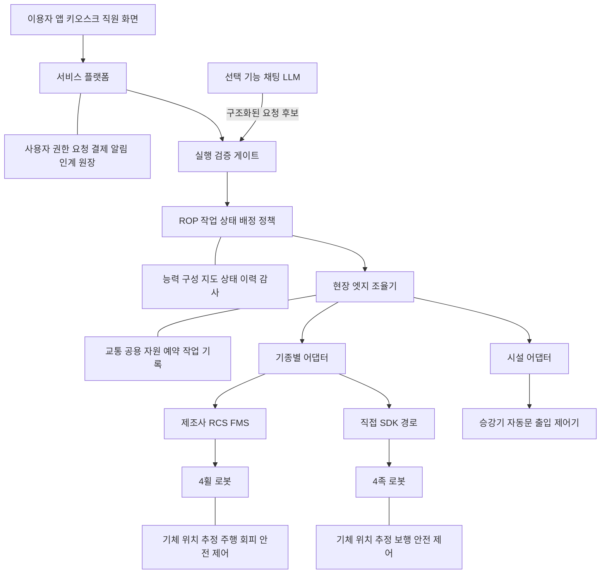
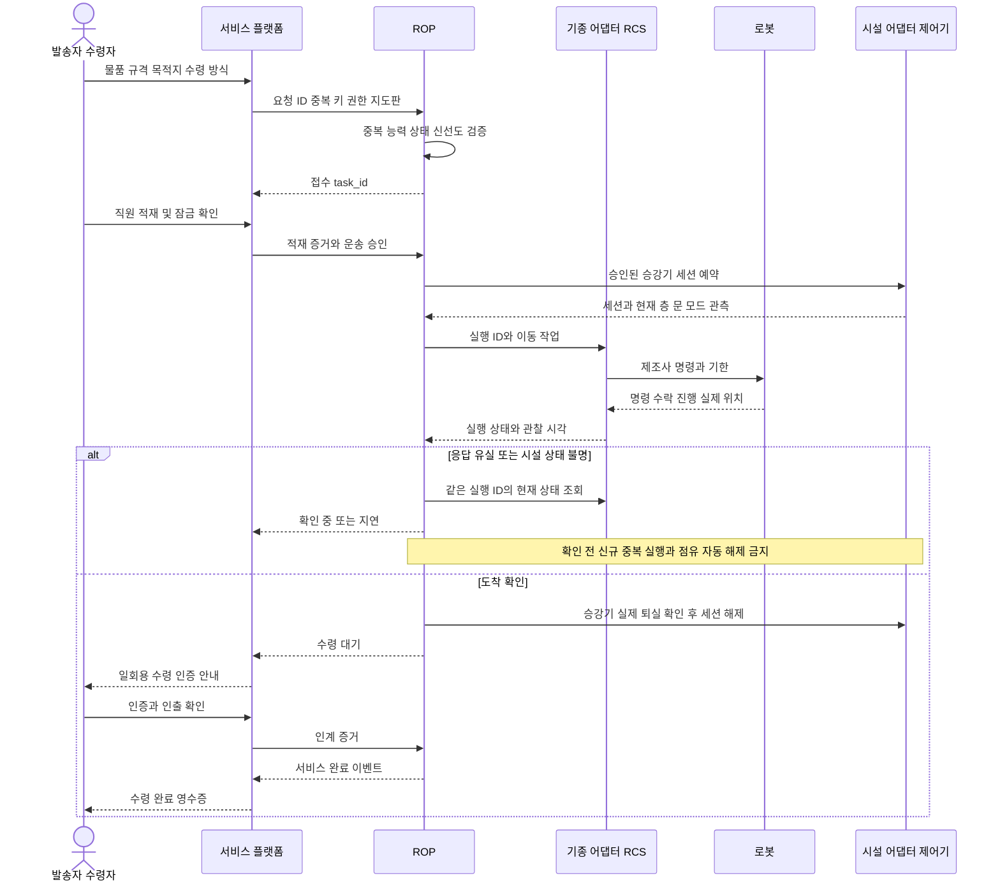

# ROP 시스템 책임과 연동 계약

조사일 **2026-10-13**. 국내 다층 업무빌딩이라는 조사용 가정이다. 이 파일의 구성도·시퀀스·ID·상태·JSON·정책은 모두 **[PM 제안·설계 예시]**다. 실제 Open-RMF·VDA 5050·Spot의 wire format이나 이미 구현된 제품 API가 아니다. 사실로 인용하는 기능 범위는 [자료집](01_core-materials.md)에 판·일자·절을 붙였다.

## 공식 자료가 해결하는 범위

|수단|열어 확인한 기능|별도 구현·합의가 필요한 것|적용 결정|
|---|---|---|---|
|Open-RMF fleet adapter|Full Control은 경로 지정·중단/교체·현재 위치 제공을 전제. Traffic Light는 pause/resume 중심 [S07](01_core-materials.md#s07)|제조사 API 연결, 좌표 정합, 실제 취소/정지 확인, 운영·보안·사용자 서비스|제조사가 제공하는 제어 수준을 먼저 확인한 뒤 adapter 범위를 선택|
|Open-RMF door/lift adapter|지도상의 설비 이름·층과 제어 가능한 설비의 연결 [S08](01_core-materials.md#s08)|현장 설비 API·전기/통신 공사·소유자 승인·화재/수동 모드·점유 관측|승강기 모델·제어반·라이선스와 업체별 지원 표 확보|
|VDA 5050 3.0.0|fleet control–mobile robot의 order/state/action/map 등 통신 의미 [S09](01_core-materials.md#s09)|시설/고객 서비스 API, 교통 알고리즘·안전 구현·보안·책임/인수 절차|두 제조사 모두 해당 판·행동을 지원할 때의 옵션. 제품 지원은 미확인|
|Spot SDK 5.2.0|GraphNav RPC·feedback, 상태·이미지·로그, 시간 동기·lease·명령 기한 [S04](01_core-materials.md#s04)|상위 요청 ID 매핑, 업무 완료, 물품 인계, 출입 권한, 빌딩 시스템 연결|직접 adapter 또는 지원되는 제조사 관제 API 중 한 제어 경로 선택|
|Robotnik 소프트웨어|ROS 2 기반 구조, RLC·Command Manager의 외부 연계 설명 [S01](01_core-materials.md#s01)|최신 실기 API 상세, 취소/실패 의미·권한·지원 SLA는 계약 확인|공개 시뮬레이터를 실기 SDK의 완전한 사양으로 사용하지 않음|
|ROS 2 QoS·MQTT|상태 신선도/생존 관련 정책과 메시지 전달 등급 [S10](01_core-materials.md#s10)|업무 중복 방지·증거 보관·재연결 후 실물 대조|역할이 다른 도구이며 완제품 ROP의 대체재가 아님|

VDA의 취소는 즉시 물리 정지와 같지 않다. §6.1.3은 기종의 이동 방식에 따른 정지 처리와 이후 상태를 설명한다. 동일 `orderId/orderUpdateId` 처리도 §6.1.4에 별도로 정의돼 있다. 이 규칙을 상위 API의 재시도와 함께 확인하되, 아래 예시 API가 VDA 메시지라고 부르지 않는다. [S09, 3.0.0 §6.1.3~4](01_core-materials.md#s09)

## 시스템 구성도

**[PM 제안]** ROP는 이 과제에서 여러 기종·시설·업무의 운영 조율을 맡는 논리적 계층이다. 특정 표준이 보장하는 제품명을 뜻하지 않는다.



도식의 RCS/FMS·직접 SDK 경로는 기종별 선택 예다. 같은 로봇에 독립된 두 명령 발행자를 동시에 두지 않는다. 제조사 관제와 직접 API를 함께 쓰려면 소유권 전환·우선권·회수 절차를 명시한다. Spot SDK의 lease 개념은 이 검토에 참고하지만 다른 로봇이 같은 기능을 제공한다고 가정하지 않는다. [S04](01_core-materials.md#s04)

## 책임 경계

|기능|결정·기록의 주체 제안|다른 계층에서 맡는 부분|PM 산출물|
|---|---|---|---|
|사용자·결제·알림·서비스 약관|서비스 플랫폼|ROP는 요청·완료 근거·예외를 전달|사용자 여정, 권한표, 과금 기준, 취소/환불 정책|
|능력·구성·가용성|ROP 등록부 + 제조사 제공 상태 + 현장 승인|로봇이 보고한 상태와 현장 검증 범위를 분리|기종/FW/센서/적재/구역별 승인표|
|작업 분해·배정|ROP|제조사 RCS는 해당 fleet 내부 배정/명령 변환 가능|한 작업의 소유자·하위 작업 ID 매핑|
|경로·교통·공용 자원|ROP/현장 조율기는 fleet 간 자원 충돌·시간 예약|제조사 planner가 허용 경로 안에서 주행, 로봇이 즉시 회피·정지|누가 길을 바꿀 수 있는지와 경로·점유 데이터 계약|
|명령·실행 추적·취소·복구|ROP가 업무 상태; adapter/RCS가 제조사 명령·feedback 대응|로봇의 안전 판단을 ROP가 우회하지 않음|접수/실행/물리 종료/업무 종료를 구분한 상태표|
|위치 추정·바퀴/보행 제어·주변 회피|로봇 및 제조사 제어 SW|ROP는 부정확/상실 상태를 받아 배정·구역 진입 제한|진단 정보·한계·복구 요청과 승인 절차|
|승강기·문·출입 설비|설비 제어기가 물리 운전·인터록. 시설 관리자에게 최종 현장 권한|ROP는 승인된 요청·세션·예약·상태를 관리|사용 권한, 수동/화재 우선, 변경 검토·점검 책임|
|점검 데이터·물품 인계|서비스 도메인/운영자가 증거와 품질 확인|로봇 ‘도착’은 한 단계의 결과|검사 품질·수령 증거·분쟁·재측정 절차|

**판단 배치 제안:** 클라우드에는 고객·과금·전사 분석·장기 기록, 엣지에는 현장 작업 원장·시설 세션·조율·오프라인 허용 정책, 로봇에는 위치 추정·즉각 반응·보행/주행·안전 기능을 둔다. 실제 제품이 이 구성을 지원하는지는 별도 검증한다. 클라우드 단절과 로봇 무선 단절을 같은 상태로 처리하지 않는다.

## 식별자와 상태를 혼합하지 않기

|대상|예시 식별·버전|반드시 함께 보관할 정보|
|---|---|---|
|업무 요청|tenant_id, site_id, request_id, idempotency_key|요청 본문 해시, requester 권한, 생성·마감·접수 시각|
|실행|task_id, attempt_id, vendor_command_id|현재 제어 소유자, command_seq, 재시도/취소 이유|
|로봇·능력|robot_id, vendor_serial, config_version|FW·SDK·센서·적재·현장 승인·제한의 유효기간|
|지도|map_id, map_version, floor_id, coordinate_frame|단위·축·기준점·좌표변환 버전·현장 승인자|
|시설|facility_id, vendor_device_id, resource_session_id|요청자·허용 목적·lease/fencing 값·예약·물리 점유·상태 관찰 시각|
|점검/물품|asset_id 또는 parcel_id, evidence_id|교정·측정 품질 또는 보관 책임·인계 상태|
|이벤트|event_id, task_seq, schema_version|발생시각·수신시각·출처·trace_id·이전 상태/버전|

**서비스 작업 상태 예시:** `REQUESTED → ACCEPTED → QUEUED → ASSIGNED → EXECUTING → AWAITING_VERIFICATION → SUCCEEDED`.

예외 분기: `BLOCKED`, `RECOVERY_REQUIRED`, `FAILED`, `CANCEL_REQUESTED → CANCELLED`. 실제 실행 결과를 아직 확인 못한 경우 `RECONCILIATION_REQUIRED`로 표시한다. **통신 단절은 그 자체로 FAILED·CANCELLED·물리 정지가 아니다.**

**관측 차원은 따로 둔다:** 연결 `CONNECTED/STALE/DISCONNECTED`, 위치 `LOCALIZED/UNCERTAIN/LOST`, 모드 `AUTONOMOUS/TELEOP/MAINTENANCE`, 화물 `EMPTY/LOADED/RECIPIENT_PENDING/HANDED_OVER`, 시설 `AVAILABLE/RESERVED/OCCUPIED/UNKNOWN/OUT_OF_SERVICE`. 위치가 오래된 로봇을 ‘현 위치에서 정지’로 그리지 않는다.

**상태 신선도 제안:** `observed_at`, `received_at`, 시간 동기 품질을 모두 보관한다. UI는 마지막 확정 위치와 경과시간을 표시한다. 배터리 값이 오래되면 계획상 잔량과 실측 잔량을 구별하고 신규 배정을 막거나 확인 절차를 거친다. TTL·경고 주기는 로봇·설비·서비스별 시험으로 정한다. ROS의 lifespan/deadline은 이를 구현하는 수단 일부이며 업무 정책 자체는 아니다. [S10](01_core-materials.md#s10)

## 배송 연동 시퀀스

**[PM 제안]** 정상 배송과 응답 유실의 처리 경로다. 물리 인계 증거는 적재함 센서·스캔·수령 확인을 실제 구성에 맞춰 정의한다.



승강기에서 하차한 뒤의 세션 해제는 실제 퇴실이 확인되는 즉시 수행한다. 예약 승인만으로 진입하지 않는다. 현재 층·문·모드·진입 공간·로봇 위치 등 구성에 맞는 물리 조건을 확인한다.

## 대표 API와 이벤트 계약 예시

**[PM 제안]** `/v1`은 이 예제의 임의 판이다. 제조사 SDK 또는 VDA API 이름이 아니다. 이 계약은 구현·부하·보안 시험을 거치지 않은 설계 템플릿이다.

```http
POST /v1/service-tasks
Authorization: Bearer <short-lived-scoped-token>
Idempotency-Key: delivery-req-001
Content-Type: application/json
```

```json
{
  "schema_version": "1.0",
  "request_id": "req-001",
  "tenant_id": "tenant-A",
  "site_id": "building-A",
  "service_type": "delivery",
  "origin": {"location_id": "mailroom", "floor_id": "L1"},
  "destination": {"location_id": "reception-3", "floor_id": "L3"},
  "parcel": {"parcel_id": "parcel-001", "mass_kg": 2.0},
  "requirements": ["locked_compartment", "recipient_confirmation"],
  "map": {"map_id": "building-A", "version": "2026-10-13.1"},
  "deadline_at": "2026-10-13T15:00:00+09:00",
  "handover_policy_id": "staff-load-recipient-unload-v1"
}
```

|계약 항목|예시 동작|인수시험 질문|
|---|---|---|
|권한·입력|서버가 token의 tenant/site/역할과 본문을 대조. 질량·규격·기한·목적지 확인|본문 tenant만 바꾸면 다른 고객 작업을 만들 수 있는가?|
|접수|`202 Accepted`, task_id·status_url 반환. 기체 출발을 의미하지 않음|DB 기록은 성공했으나 응답이 유실됐을 때 같은 키 재요청 결과는?|
|중복|같은 범위의 key+같은 본문은 기존 task 반환. 다른 본문이면 `409 Conflict`|브라우저 재전송·어댑터 재시작·다른 IP에서도 한 업무인가?|
|기한|접수 RPC timeout과 작업 마감시간·제조사 명령 유효시간을 분리|HTTP timeout 후 로봇이 실행 중일 수 있음을 처리하는가?|
|취소|`POST /v1/service-tasks/{task_id}/cancel`; 요청은 CANCEL_REQUESTED, 물리/업무 정리 후 CANCELLED|인계 직후 취소와 완료가 경합할 때 최종 원장 하나를 유지하는가?|
|재시도|조회로 실제 상태 재조정 후 재시도. 불가역 행동은 상태 확인 없이 재전송 금지|적재함 개방·상하차·시설 진입이 중복되지 않는가?|
|부분 완료|물품이 운송 중이면 취소 후 반송/직원 회수 하위 작업 생성|원래 작업 취소와 화물 처리 종결을 구별하는가?|
|보존|키·실행 ID의 보존기간은 최대 작업·재시도·감사 기간을 포함해 합의|키 만료 후 지연 재전송이 새 배송을 만들지 않는가?|

```json
{
  "schema_version": "1.0",
  "event_id": "evt-023",
  "task_id": "task-001",
  "request_id": "req-001",
  "attempt_id": "attempt-1",
  "task_seq": 23,
  "type": "service.handover_verified",
  "occurred_at": "2026-10-13T14:36:00+09:00",
  "received_at": "2026-10-13T14:36:01+09:00",
  "state": "SUCCEEDED",
  "completion_mode": "AUTONOMOUS_TRANSPORT_STAFF_LOADED",
  "evidence": {"handover_receipt_id": "receipt-001"},
  "actor": {"kind": "recipient_token", "id": "receipt-subject-001"},
  "robot_id": "wheeled-01",
  "config_version": "cfg-17",
  "trace_id": "trace-001"
}
```

이벤트는 **최소 한 번 전달될 수 있다고 가정**한다. 소비자는 event_id로 중복 제거하고 task_seq로 순서를 검증한다. 누락·역전이 보이면 현재 상태 API와 이벤트 이력으로 복구한다. 전송 시각보다 발생·관측 시각을 업무 판단에 사용한다. `robot.arrived`, `inspection.data_validated`, `service.handover_verified`는 다른 사건이다. 원문 영상·이름·전화번호는 이벤트 본문에 기본 포함하지 않는다.

## 시설의 예약과 물리 상태 불일치

**[PM 제안]** `예약 없음 → 예약 → 진입 승인 → 점유 → 퇴실 확인 → 해제`를 구분한다. 각 단계는 `facility_id`, `session_id`, 요청자·작업 ID, 관찰시각, 제어 소유권과 함께 기록한다.

- 예약 기한 만료는 물리 공간이 비었다는 증거가 아니다. 로봇이 승강기 안에서 단절되면 점유를 UNKNOWN으로 두고 현장 확인/설비 관측으로 복구한다.
- 지연된 이전 세션 명령이 새로운 세션을 닫지 못하도록 epoch/fencing 또는 동등한 소유권 검증을 설계한다. 설비가 지원하지 않으면 adapter의 직렬화만으로 충분한지 실패 시험으로 확인한다.
- 문 열림 ACK, 현재 문 열림 센서, 로봇의 통과 완료를 분리한다. 출입 허가는 요청마다 유효 구역·시간·주체를 검증한다.
- 화재·정비·수동 운전은 로봇의 예약보다 우선하는 현장 규칙을 합의한다. ROP는 시설 인터록을 우회하거나 방화문을 고정 개방하지 않는다.
- 재연결 시 현재 층·문·모드·로봇 위치·작업/화물 상태를 대조한 뒤 소유권을 재획득한다. 이전 큐 전체를 무조건 재생하지 않는다.

## 통신 계약과 보안

|데이터|요구·설계 제안|장애 시 동작|
|---|---|---|
|업무 명령|인증, request/task/command ID, 기한, 수락·진행·종결 구분, 중복 억제|응답 유실은 상태 조회·재조정. 실패로 즉시 재배정하지 않음|
|위치·배터리·시설 상태|관찰시각·신선도·품질, 상태별 최대 허용 나이 합의|stale 표시, 신규 진입·배정 제한. 안전 제어는 로컬 정책|
|점검 원본·영상|센서 종류·timestamp·품질·접근권, 대역폭·보존 정책|영상 지연은 명령 성공/정지 판단과 분리. 전송 지연 중에도 데이터 유효기간 확인|
|감사 로그|수정 추적, actor·변경 전후·trace·시간 동기, 현장 버퍼|클라우드 복구 후 중복 없이 합치고 결손을 표시|

**지연 예산은 서비스별로 합의한다.** 배송은 총 마감과 인계 대기, 안내는 일행 이탈을 감지하고 안전하게 대기하기까지의 시간, 순찰은 측정의 유효기간과 경보 대응시간이 중요하다. 즉각적인 정지·보행 균형은 인터넷 왕복시간을 전제로 설계하지 않는다. 어떤 서비스에도 통용되는 ‘100ms면 안전’ 같은 값을 근거 없이 제시하지 않는다.

인증·권한·감사 초기안: 기체/adapter별 identity와 인증서, 역할·site·action 범위 제한, 망 분리/접근 허용 목록, 비밀정보 회전, 원격 조작의 별도 승인·녹화/기록 정책, 설정 변경의 승인·버전·롤백. 지도는 동일한 map_id라도 version·층 좌표·출입 정책이 다르면 배정 전에 정합성을 확인한다. 자세한 암호·망 보안은 보안 담당자의 설계·검증 범위다.

## 채팅과 LLM의 위치

**[PM 제안] 선택 기능이다.** 세 서비스의 실행은 폼·키오스크·일정·업무 시스템 이벤트만으로도 기획할 수 있다. LLM은 자연어 요청을 구조화하고 빠진 정보를 질문하거나 계획 후보를 설명하는 역할에 둔다.

실행 게이트는 로그인 주체·출입/물품 권한·로봇 능력·배터리 신선도·시설 상태·지도/설정 판·마감·중복을 결정적 규칙으로 검증한다. 문서나 채팅에 적힌 ‘관리자 승인’ 문자열을 실제 권한으로 간주하지 않는다. 새 경로·새 동작·권한 확대·물리 인계 변경은 명시된 승인 절차를 거친다. LLM 출력은 바퀴 속도·보행·비상정지·출입 해제 명령에 직접 연결하지 않는다. 고객과 합의한 저위험 반복 요청은 규칙 검증 후 자동 실행할 수 있으며 모든 요청에 사람 클릭을 강요할 필요는 없다.
