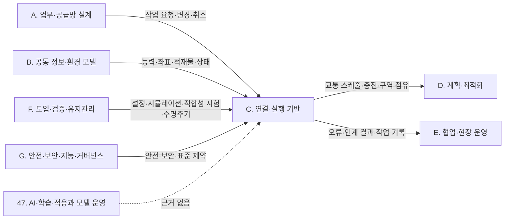

(너의 규칙은 시스템 프롬프트의 agents/shared-rules.md 와 agents/storyteller.md 이다. 아래는 이번 실행의 컨텍스트와 입력이다.)

## 실행 컨텍스트

- run_id: 2026-10-11-03
- date: 2026-10-11
- run_type: update (갱신)
- 대상: 22. 설비·건물 시스템 연동 (F. 연동)
- 예산:
    - max_search_queries: 30
    - max_sources_per_run: 15
    - new_topic_pages: 1
    - page_updates: 2
    - max_retries: 2
- 환경 알림: web_fetch_available: true · fetch_mode: full
- 세부영역 반영 제안: 2건 — 트랙 실행이 이 영역 페이지에 반영하자고 제안한 내용(입력 data/area_reflection_proposals.json). 이번 실행의 조사·검증을 거쳐 해당 절에 반영을 검토한다(사양서 6.3 절차 9 '반영은 다음 해당 영역 실행에서')
- 언어: ko
- retry_count: 1
- max_retries: 2

## 입력

### runs/2026-10-11-03/target.json

```json
{
  "run_id": "2026-10-11-03",
  "date": "2026-10-11",
  "weekday": "Sun",
  "run_number": 169,
  "run_type": "update",
  "forced": true,
  "target": {
    "area_no": 22,
    "area_name": "22. 설비·건물 시스템 연동",
    "category": "F. 연동",
    "category_letter": "F"
  },
  "topic": null,
  "track": null,
  "corrections": [],
  "budget": {
    "max_search_queries": 30,
    "max_sources_per_run": 15,
    "new_topic_pages": 1,
    "page_updates": 2,
    "max_retries": 2
  },
  "priority_reason": null,
  "priority_questions": [],
  "excluded_areas": [],
  "lifted_areas": [],
  "deferred": {
    "monthly_recheck": false,
    "weekly_review": false
  },
  "selection_rationale": "CLI 지정 run_type=update, area=22"
}
```

### runs/2026-10-11-03/research.json

```json
{
  "run_id": "2026-10-11-03",
  "date": "2026-10-11",
  "run_type": "update",
  "target": {
    "area_no": 22,
    "area_name": "22. 설비·건물 시스템 연동",
    "category": "F. 연동"
  },
  "gaps": [
    "섹션 3. 왜 중요한가 — 국토부 '로봇 친화형 건축물' 핵심기술 개발 보도자료(ref-322)는 제목만 확인돼 발행일·사업기간·세부 과제가 비어 있고, KS B 7317 은 '2021년 11월 제정'만 있어 이후 개정 이력이 없음",
    "섹션 4·6. 핵심 개념·대표 접근법(주제 페이지 2026-09-25-area10-s4) — 승강기 세션을 언제 '수락'으로 볼지, 세션 종료·잔류 처리, 작업대 결과의 완료 판정 조건 근거가 약함. 제조사 어댑터(KONE·Dormakaba)와 PLC 연결의 실제 조건이 없음",
    "섹션 5. 적용 사례 — 물류창고 가상 시나리오뿐이며 실제 설비 연결(PLC·드라이 접점)과 화재 복구, 상업 시설 사례가 없음",
    "섹션 7. 관련 표준·프레임워크·오픈소스(주제 페이지 2026-09-25-area10-s7) — KOLA 단체표준이 '표준 번호·제정일·내용 미확인', SEMI E84 현행판·후속 개발 제안, BACnet 출입통제 문서의 지위가 비어 있음",
    "섹션 8. 대표 연구와 자료(주제 페이지 2026-09-25-area10-s8) — '모두 원문을 열지 못해 결과 수치는 쓰지 않는다'로 남아 있어 각 연구의 실험 조건(실물·수치 실험)과 승강기 결과가 비어 있음",
    "섹션 9·11 — 출입통제 연동에서 권한 확인 주체(oq-043), 단체표준–Open-RMF 대응(oq-041), 인계 신호 표준(oq-042), 물류센터 승강기 병목(oq-010)이 열려 있음"
  ],
  "research_questions": [
    "문·승강기·설비의 준비와 로봇의 도착을 어떻게 맞출 것인가? [분류원문]",
    "oq-010 국내 다층 물류센터에서 화물용 승강기나 층간 반송 설비가 로봇 처리량의 병목이 된다는 정량 자료가 있는가, 병원·호텔 사례의 승강기 혼잡 결과를 물류센터에 옮길 수 있는가? (섹션 3·8 겨냥)",
    "oq-041 대한승강기협회 '엘리베이터와 로봇의 상호 연동을 위한 가이드라인' 단체표준은 어떤 메시지·상태를 정하며, Open-RMF 승강기 요청·상태 메시지와 어떻게 대응하는가? (oq-283 표준 번호 포함, 섹션 7 겨냥)",
    "oq-042 컨베이어·작업대와 이동로봇 사이 적재물 인계 신호(준비·허가·이송·완료)를 제조사 중립으로 정한 공개 표준이나 규격이 있는가? (oq-062 포함, 섹션 6·7 겨냥)",
    "oq-043 로봇 관제가 출입통제·건물 자동화 시스템(BACnet 등)을 통해 보안문을 여닫는 공개 설계나 국내 사례가 있고, 권한 확인은 누가 하는가? (섹션 7·9 겨냥)",
    "KS B 7317 과 로봇 친화형 건축물 관련 국내 제도·연구개발은 현재 어느 판·단계인가? (oq-098·oq-173·oq-311·oq-179 관련, 섹션 3·7 겨냥)"
  ],
  "findings": [
    {
      "id": "f1",
      "claim": "Park·Park 의 2026년 Architectural Research 논문은 초록 기준으로 로봇 친화형 건축물 인증(REEC)과 무장애(BF) 인증을 비교 분석해 사람 중심·로봇 적응형 건축 설계 기준을 도출했다.",
      "tag": "사실",
      "source_ids": [
        "ref-1483"
      ],
      "cross_checked": false,
      "confidence": "medium",
      "evidence_excerpt": "초록: \"comparative analysis … REEC … and Barrier-Free (BF) Certification … design standards were derived\". 서지 Architectural Research 28(1), 논문번호 14(Crossref). 본문 미열람이라 연구 방법(현장 실험 여부)은 단정하지 않음",
      "as_of": "2026-07-21",
      "site_type": null,
      "flow_item": null
    },
    {
      "id": "f2",
      "claim": "국토교통부의 로봇 친화형 건축물 설계·시공 및 운영·관리 핵심기술 개발 연구개발은 2025년 5월 착수보고회를 열고 2028년까지 완료할 예정이라고 2차 보도됐다.",
      "tag": "추정",
      "source_ids": [
        "ref-322",
        "ref-1484"
      ],
      "cross_checked": false,
      "confidence": "low",
      "evidence_excerpt": "스마트투데이 2025-05-28 기사: 착수보고회 29일, \"이번 R&D는 2028년까지 완료될 예정\". 국토부 보도자료 원문(ref-322)은 열지 못해 사업기간 2025~2028 과 보도·배포일은 2차 보도 기준",
      "as_of": "2025-05-28",
      "site_type": null,
      "flow_item": null,
      "source_unopened": false
    },
    {
      "id": "f3",
      "claim": "같은 연구개발은 세부 중점과제 가운데 하나로 기술 실증을 통한 기술표준·인증제도 개선방안 마련을 두었다고 2차 보도됐다.",
      "tag": "추정",
      "source_ids": [
        "ref-322",
        "ref-1484"
      ],
      "cross_checked": false,
      "confidence": "low",
      "evidence_excerpt": "기사: 세부 중점과제 \"△기술 실증을 통한 기술표준 및 인증제도 개선방안 마련\" 포함 세 가지. 보도자료 원문 미열람(ref-322), 이후 완료·인증 시행 여부 미확인",
      "as_of": "2025-05-28",
      "site_type": null,
      "flow_item": null,
      "source_unopened": false
    },
    {
      "id": "f4",
      "claim": "e-나라표준인증의 KS B 7317 이력은 2021-11-30 제정(고시 2021-0561), 2022-12-09 개정(고시 2022-0571), 2025-05-09 개정(고시 2025-0073)을 기록한다.",
      "tag": "사실",
      "source_ids": [
        "ref-314"
      ],
      "cross_checked": false,
      "confidence": "medium",
      "evidence_excerpt": "표준 이력사항 표: 2021-11-30 제정 '수요조사 반영에 의한 제정', 2022-12-09·2025-05-09 개정 '사회적 요청에 의한 개정'. 기존 '2021년 11월 제정' 서술과 맞고 개정 2회가 새 내용. 표준 본문·신구대비표 미열람",
      "as_of": "2025-05-09",
      "site_type": null,
      "flow_item": null
    },
    {
      "id": "f5",
      "claim": "같은 KS B 7317 기본정보는 적용 대상을 엘리베이터 탑승 기능이 있는 서비스 로봇과 병원의 환자 전용 엘리베이터를 제외한 모든 엘리베이터로 적고, 표준개발협력기관을 한국AI·로봇산업협회로 적는다.",
      "tag": "사실",
      "source_ids": [
        "ref-314"
      ],
      "cross_checked": false,
      "confidence": "medium",
      "evidence_excerpt": "적용범위: \"적용 대상 엘리베이터: 병원의 환자 전용 엘리베이터를 제외한 모든 엘리베이터\", 담당 국가기술표준원 기계융합산업표준과. 목록 정보만 사용, 인증 의무로 확장하지 않음",
      "as_of": "2025-05-09",
      "site_type": null,
      "flow_item": null
    },
    {
      "id": "f6",
      "claim": "대한승강기협회(KOLA)는 2026-03-27 게시한 보도자료에서 「엘리베이터와 로봇의 상호 연동을 위한 가이드라인」 단체표준을 제정했다고 발표했다.",
      "tag": "사실",
      "source_ids": [
        "ref-1485"
      ],
      "cross_checked": false,
      "confidence": "medium",
      "evidence_excerpt": "KOLA 보도자료(작성일 2026.03.27): \"「엘리베이터와 로봇의 상호 연동을 위한 가이드라인」단체표준을 제정했다\". 게시일을 제정일로 치환하지 않음. 기존 위키 제정 보도(ref-316·ref-317)를 협회 1차 자료로 보강",
      "as_of": "2026-03-27",
      "site_type": null,
      "flow_item": null
    },
    {
      "id": "f7",
      "claim": "e-나라표준인증 단체표준 목록은 이 가이드라인을 표준번호 B-KOLA-0001-7700, 상태 제정, 등록일자 2026-03-24 로 올려 두어, KOLA 게시일(2026-03-27)과 목록 등록일이 다르다.",
      "tag": "사실",
      "source_ids": [
        "ref-1486"
      ],
      "cross_checked": false,
      "confidence": "medium",
      "evidence_excerpt": "목록 행: \"B-KOLA-0001-7700 … 엘리베이터와 로봇의 상호 연동을 위한 가이드라인 … (사)대한승강기협회 … 제정 … 등록일자 2026-03-24\". 정확한 제정일·본문 미확인 (발행일 미확인, 확인일 기준)",
      "as_of": "2026-10-11",
      "site_type": null,
      "flow_item": null
    },
    {
      "id": "f8",
      "claim": "KOLA 발표는 이 가이드라인이 엘리베이터와 로봇 상호 연동을 위한 일반사항, 시험 설비 및 시험 절차를 제시하며 e-나라표준인증에서 무료로 내려받을 수 있다고 설명한다.",
      "tag": "사실",
      "source_ids": [
        "ref-1485"
      ],
      "cross_checked": false,
      "confidence": "medium",
      "evidence_excerpt": "보도자료: \"일반사항, 시험 설비 및 시험 절차에 대한 가이드라인을 제시\", \"e-나라표준인증 … 무료로 다운로드가 가능\". 표준 본문의 메시지·상태 정의와 Open-RMF 대응은 미확인",
      "as_of": "2026-03-27",
      "site_type": null,
      "flow_item": null
    },
    {
      "id": "f9",
      "claim": "Open-RMF 개발자(mxgrey)는 2024년 토론 답변에서, 세션을 안전하게 수행하려면 승강기가 별도 AGV 모드여야 하는 경우 모드 전환을 마칠 때까지 승강기 상태에 session_id 를 내보내지 말아야 한다고 권고했다.",
      "tag": "사실",
      "source_ids": [
        "ref-1487"
      ],
      "cross_checked": false,
      "confidence": "medium",
      "evidence_excerpt": "Discourse 아카이브(2024-08-21, GitHub 토론 #513): \"it should not broadcast the session_id value until it has finished switching into that mode\". 설계 의도 설명이며 현장 안전 동작 재현 아님",
      "as_of": "2024-08-21",
      "site_type": null,
      "flow_item": "제약"
    },
    {
      "id": "f10",
      "claim": "같은 답변은 별도 AGV 모드가 없는 승강기도 있을 수 있다고 설명한다.",
      "tag": "사실",
      "source_ids": [
        "ref-1487"
      ],
      "cross_checked": false,
      "confidence": "medium",
      "evidence_excerpt": "\"Some lifts might not have a special AGV mode\" — 이 경우 승강기 상태가 다른 모드 값을 보낼 이유가 없다는 설명. 모드 상수 열거는 기존 위키(2026-09-25-area10-s4)에 있음",
      "as_of": "2024-08-21",
      "site_type": null,
      "flow_item": "제약"
    },
    {
      "id": "f11",
      "claim": "rmf_ros2 의 lift_supervisor 구현은 승강기별 활성 세션을 두고, 같은 session_id 의 새 요청은 갱신으로 다시 발행하며 세션 종료 요청이면 종료를 발행하고 활성 세션을 비운다.",
      "tag": "사실",
      "source_ids": [
        "ref-1488"
      ],
      "cross_checked": false,
      "confidence": "medium",
      "evidence_excerpt": "Node.cpp _adapter_lift_request_update: \"curr_request->session_id == msg->session_id\" 분기에서 REQUEST_END_SESSION 이 아니면 갱신 발행, 맞으면 종료 발행 후 nullptr. 커밋 4cea3fe 고정 코드",
      "as_of": "2026-10-11",
      "site_type": null,
      "flow_item": null
    },
    {
      "id": "f12",
      "claim": "같은 구현은 감독자에게 활성 요청이 없는데 승강기 상태에 세션이 남아 있으면 승강기가 풀리도록 세션 종료 요청을 계속 발행하며, 승강기 배정을 더 지능적으로 하라는 TODO 만 남겨 두고 배정 규칙은 두지 않는다.",
      "tag": "사실",
      "source_ids": [
        "ref-1488"
      ],
      "cross_checked": false,
      "confidence": "medium",
      "evidence_excerpt": "_lift_state_update: \"we keep publishing session end requests to ensure that the lift gets released\"; 주석 \"TODO(MXG): Make this more intelligent by scheduling the lift\". 다중 플릿 배차 최적성은 입증하지 않음",
      "as_of": "2026-10-11",
      "site_type": null,
      "flow_item": "예외·성과"
    },
    {
      "id": "f13",
      "claim": "rmf_fleet_adapter 변경기록의 2.13.0(2026-06-15)에는 승강기가 이미 해당 층에 있으면 legacy 완료 상태를 내보내는 변경(#510)이 실려 있다.",
      "tag": "사실",
      "source_ids": [
        "ref-1398"
      ],
      "cross_checked": false,
      "confidence": "medium",
      "evidence_excerpt": "CHANGELOG 2.13.0 (2026-06-15): \"emit completion legacy state if lift is already on the level (#510)\". 같은 변경기록에 2.14.0(2026-09-26)이 있어 2.13.0 을 최신판으로 부르지 않음",
      "as_of": "2026-06-15",
      "site_type": null,
      "flow_item": null
    },
    {
      "id": "f14",
      "claim": "rmf_ros2 의 DispenseItem 단계는 요청 id 가 일치하는 DispenserResult 가 SUCCESS 이면 완료, FAILED 이면 실패로 바꾸고, ACKNOWLEDGED 는 접수 표시만 한다.",
      "tag": "사실",
      "source_ids": [
        "ref-1489"
      ],
      "cross_checked": false,
      "confidence": "medium",
      "evidence_excerpt": "DispenseItem.cpp _get_status: request_guid 일치 시 ACKNOWLEDGED → _request_acknowledged, SUCCESS → STATE_COMPLETED, FAILED → STATE_FAILED. 커밋 4cea3fe 고정 코드",
      "as_of": "2026-10-11",
      "site_type": null,
      "flow_item": "완료·인계"
    },
    {
      "id": "f15",
      "claim": "같은 구현은 디스펜서 상태의 요청 큐에 요청 id 가 들어 있으면 접수된 것으로 보고, 접수 뒤 큐에서 요청 id 가 사라지면 결과 메시지 없이도 완료로 간주한다.",
      "tag": "사실",
      "source_ids": [
        "ref-1489"
      ],
      "cross_checked": false,
      "confidence": "medium",
      "evidence_excerpt": "주석 \"The request has been received, so if it's no longer in the queue, then we'll assume it's finished.\" 접수 표시는 큐에 들어간 것만으로도 설정됨",
      "as_of": "2026-10-11",
      "site_type": null,
      "flow_item": "완료·인계"
    },
    {
      "id": "f16",
      "claim": "큐 소거만으로 완료 처리하면 현장 작업대 큐에서 요청이 취소·오류로 빠진 경우에도 인계 완료로 잘못 판단할 수 있을 것으로 보인다.",
      "tag": "추정",
      "source_ids": [
        "ref-1489"
      ],
      "cross_checked": false,
      "confidence": "low",
      "evidence_excerpt": "구현(큐 소거 → STATE_COMPLETED)에서 도출한 설계 위험 해석. 큐 소거가 실제 적재물 센서 확인과 같다는 보장은 코드에 없음",
      "as_of": "2026-10-11",
      "site_type": null,
      "flow_item": "완료·인계"
    },
    {
      "id": "f17",
      "claim": "CHART 계열 공개 KONE 승강기 어댑터 README 는 Open-RMF 승강기 메시지와 KONE API v2.0 사이에서 WebSocket 으로 승강기 명령을 보내고 승강기 상태를 받는 구조를 설명한다.",
      "tag": "사실",
      "source_ids": [
        "ref-1490"
      ],
      "cross_checked": false,
      "confidence": "medium",
      "evidence_excerpt": "README: \"send various lift commands to KONE API v2.0 via websocket\", \"get lift state from KONE API v2.0 via websocket\". 2023년 고정판(KABAM-Robotics 보존 저장소, 원 저장소 안내는 sharp-rmf/kone-ros-api). 현행 KONE 계약 아님",
      "as_of": "2026-10-11",
      "site_type": null,
      "flow_item": null
    },
    {
      "id": "f18",
      "claim": "같은 README 는 실제 승강기를 제어하려면 access_id 와 access_secret 을 KONE 담당자에게서 받아야 한다고 안내한다.",
      "tag": "사실",
      "source_ids": [
        "ref-1490"
      ],
      "cross_checked": false,
      "confidence": "medium",
      "evidence_excerpt": "\"To control a live elevator, you will need to get these id & secret from KONE Personnel.\" The Galen 실기 시험 문구는 프로젝트 자체 보고이며 기존 위키(ref-884)에 같은 사례가 있음",
      "as_of": "2026-10-11",
      "site_type": null,
      "flow_item": null
    },
    {
      "id": "f19",
      "claim": "연계 대상: Open-RMF 의 Dormakaba 문 어댑터 README 는 시험한 EL301·ED250 문 구동기에 Dormakaba IoT connector 를 장착해야 한다고 안내한다.",
      "tag": "사실",
      "source_ids": [
        "ref-1491"
      ],
      "cross_checked": false,
      "confidence": "medium",
      "evidence_excerpt": "README: \"tested with the Dormakaba EL301 and ED250 models. It requires the Dormakaba IoT connector to be fitter[sic] to the above door operators.\" 임의 자동문 지원을 입증하지 않음",
      "as_of": "2026-10-11",
      "site_type": null,
      "flow_item": "수행 자원"
    },
    {
      "id": "f20",
      "claim": "같은 README 는 문 클라우드 API 접근 자격증명을 Dormakaba 가 제공한다고 안내한다.",
      "tag": "사실",
      "source_ids": [
        "ref-1491"
      ],
      "cross_checked": false,
      "confidence": "medium",
      "evidence_excerpt": "\"Credentials to access the door's cloud API will be provided by Dormakaba.\" 클라우드 자격증명 제공과 건물 출입권한 승인 정책은 별개 확인 항목",
      "as_of": "2026-10-11",
      "site_type": null,
      "flow_item": null
    },
    {
      "id": "f21",
      "claim": "연계 대상: HopeTechnik 의 도서관 현장 설계 문서에서는 현장에 새로 설치한 승강기 제어함(lift controller box)의 PLC(Beckhoff CX9020)가 서버의 ADS 명령을 받아 드라이 접점으로 승강기 신호를 조작하며, 승강기 업체가 기존 승강기를 AGV 모드로 개조했다.",
      "tag": "추정",
      "source_ids": [
        "ref-1492"
      ],
      "cross_checked": false,
      "confidence": "medium",
      "evidence_excerpt": "벤더 주장: \"A PLC is housed in a lift controller box at level 6 cargo lift lobby\", \"via ADS … manipulating corresponding signals via dry contact. Beckhoff CX9020\"; \"the lift vendor upgraded the installed lift … AGV mode\". 승강기 자체 PLC 아님 (발행일 미확인, 확인일 기준)",
      "as_of": "2026-10-11",
      "site_type": "기타",
      "flow_item": "수행 자원",
      "vendor_claim": true
    },
    {
      "id": "f22",
      "claim": "연계 대상: 같은 문서의 복구표는 화재 경보가 울리면 승강기가 수동 모드로 돌아가고 PLC 가 오류 상태에 머물러, 재시작을 위한 수동 개입이 필요하다고 적는다.",
      "tag": "추정",
      "source_ids": [
        "ref-1492"
      ],
      "cross_checked": false,
      "confidence": "medium",
      "evidence_excerpt": "벤더 주장: Table 1 #2 Fire Alarm: \"Manual intervention is needed. PLC will stay in error state until it is restarted.\" 한 도서관 현장의 설계이므로 다른 건물의 화재 복구 조건으로 일반화하지 않음 (발행일 미확인, 확인일 기준)",
      "as_of": "2026-10-11",
      "site_type": "기타",
      "flow_item": "예외·성과",
      "vendor_claim": true
    },
    {
      "id": "f23",
      "claim": "같은 문서는 승강기 상태 전송 주기를 개요에서는 1 Hz 로, 서버 절에서는 2초마다로 서로 다르게 적고, 승강기 요청은 1초마다 보낸다고 적는다.",
      "tag": "추정",
      "source_ids": [
        "ref-1492"
      ],
      "cross_checked": false,
      "confidence": "medium",
      "evidence_excerpt": "벤더 주장: 개요: LiftState \"at a frequency of 1 Hz\"; Server 절: \"published to the AWS topic every 2 seconds\", LiftRequest \"every 1 second\". 차이를 설명하는 구절 없음 — 전송 주기 결론 보류 (발행일 미확인, 확인일 기준)",
      "as_of": "2026-10-11",
      "site_type": "기타",
      "flow_item": null,
      "vendor_claim": true
    },
    {
      "id": "f24",
      "claim": "OMRON LD 시리즈 통합 안내서(I680-E-02)의 인계 예시는 위치·준비 상태 확인, 적재물 교환, 정지·최종 위치 확인, 출발 준비 확인을 단계로 나눈다고 외부 조사 메모가 전한다.",
      "tag": "추정",
      "source_ids": [
        "ref-1493"
      ],
      "cross_checked": false,
      "confidence": "low",
      "evidence_excerpt": "원문 PDF 가 접근 거부(Access Denied)로 열리지 않아 메모 서술만 근거. Lift 절은 적재 장치 리프트이며 건물 승강기 사례가 아님 (발행일 미확인, 확인일 기준)",
      "as_of": "2026-10-11",
      "site_type": null,
      "flow_item": "완료·인계",
      "source_unopened": true
    },
    {
      "id": "f25",
      "claim": "같은 안내서는 그 인계 절차가 예시이며 응용 요구에 따라 달라질 수 있다고 적는다고 외부 조사 메모가 전한다.",
      "tag": "추정",
      "source_ids": [
        "ref-1493"
      ],
      "cross_checked": false,
      "confidence": "low",
      "evidence_excerpt": "원문 미열람(접근 거부). 제조사 예시 절차이며 제조사 중립 규격이 아님 (발행일 미확인, 확인일 기준)",
      "as_of": "2026-10-11",
      "site_type": null,
      "flow_item": null,
      "source_unopened": true
    },
    {
      "id": "f26",
      "claim": "SEMI 공식 판매 목록은 E84-0823 을 현행판(Current)으로 표시하고, E84 의 목적을 자동 반송 시스템(AMHS)과 생산 설비 로드포트 사이 캐리어 인계용 병렬 I/O 신호 개선으로 설명한다.",
      "tag": "사실",
      "source_ids": [
        "ref-202"
      ],
      "cross_checked": false,
      "confidence": "medium",
      "evidence_excerpt": "목록: \"Revision: SEMI E84-0823 - Current\"(이전 E84-1109 등 Superseded), 초록: AMHS 와 생산 설비 사이 \"carrier handoffs (load/unload)\" 신호 정의. 표준 본문 미열람 (발행일 미확인, 확인일 기준)",
      "as_of": "2026-10-11",
      "site_type": null,
      "flow_item": null
    },
    {
      "id": "f27",
      "claim": "SEMI Doc 7442 는 E84 를 출발점으로 별도의 인계 인터페이스 규격과 TCP/IP 하위 규격을 만들자는 신규 예비 표준 개발 제안서(SNARF)라고 외부 조사 메모가 전한다.",
      "tag": "추정",
      "source_ids": [
        "ref-1494"
      ],
      "cross_checked": false,
      "confidence": "low",
      "evidence_excerpt": "SEMI 다운로드 페이지가 봇 차단으로 열리지 않아 작성일(2025-12-17)·승인일·내용은 메모 서술만 근거. 개발 제안 승인과 표준 발행은 구분 (발행일 미확인, 확인일 기준)",
      "as_of": "2026-10-11",
      "site_type": null,
      "flow_item": null,
      "source_unopened": true
    },
    {
      "id": "f28",
      "claim": "고려대 구로병원 약품 배송 로봇 논문은 ROC 로 찾은 승강기 가동률(EOR) 임계값 59.01% 를 현장 특정값으로 해석해야 하며 다른 병원에 적용할 때 재보정이 필요하다고 명시한다.",
      "tag": "사실",
      "source_ids": [
        "ref-943"
      ],
      "cross_checked": false,
      "confidence": "medium",
      "evidence_excerpt": "Discussion: \"should be interpreted as site-specific and is expected to require recalibration when applied to other hospital environments\"; 승강기 카 크기·운반 카트·이용자 구성 차이를 이유로 듦",
      "as_of": "2026-03-31",
      "site_type": "병원",
      "flow_item": "제약"
    },
    {
      "id": "f29",
      "claim": "2026-10-11 재확인에서도 같은 논문에는 전체 성공률 87.03% 의 분모를 설명하는 구절이 없고, 분석 대상 122건에서 실패 14건을 뺀 108건의 비율은 약 88.52% 로 보고값과 다르다.",
      "tag": "사실",
      "source_ids": [
        "ref-943"
      ],
      "cross_checked": false,
      "confidence": "medium",
      "evidence_excerpt": "초록 \"We analyzed 122 non-urgent missions\", §3.1 \"The overall success rate across all trials was 87.03%\". 'all trials' 의 범위 정의 없음. oq-215 근거 보강용이며 수치 자체는 기존 위키에 있음",
      "as_of": "2026-03-31",
      "site_type": "병원",
      "flow_item": "예외·성과"
    },
    {
      "id": "f30",
      "claim": "사람과 승강기를 함께 쓰는 실제 건물에서 로봇의 층간 이동이 지연된 사례가 서로 다른 두 연구에서 보고됐다: 병원 논문은 승강기 가동률이 높을수록 배송 시간이 길어졌다고, KAIST 지도 구축 논문은 외부 이용자 때문에 승강기가 다른 층으로 가 지연이 생겼다고 적는다.",
      "tag": "사실",
      "source_ids": [
        "ref-943",
        "ref-163"
      ],
      "cross_checked": true,
      "confidence": "high",
      "evidence_excerpt": "ref-943 초록 \"An increased EOR also prolonged the delivery time\"; ref-163 결과 \"6층에서 7층으로 이동하는 구간의 경우 외부 이용자에 의해 엘리베이터가 다른 층으로 이동하는 지연이 발생\". 기관이 다른 독립 출처(질적 관찰)",
      "as_of": "2026-03",
      "site_type": null,
      "flow_item": "제약"
    },
    {
      "id": "f31",
      "claim": "Han 외 다층 호텔 배송 경로계획 논문은 실제 호텔 평면·층고로 거리 행렬(68×68)만 만들고 배송 수요는 무작위 표본으로 생성했으며, 승강기 기본 대기 시간을 30초로 두었다.",
      "tag": "사실",
      "source_ids": [
        "ref-103"
      ],
      "cross_checked": false,
      "confidence": "medium",
      "evidence_excerpt": "실험 설정: 거리는 \"derived from the actual hotel floor plan and floor height\", 수요는 \"uses random sampling to generate\" 10·20·30·60건, \"sets the base waiting time for elevators at 30 s\". 실제 호텔 운용 성능이 아님",
      "as_of": "2025-03-13",
      "site_type": null,
      "flow_item": null
    },
    {
      "id": "f32",
      "claim": "Kim 외 그래프 기반 다층 경로계획 논문은 15층 건물을 나타내는 그래프에서 소포 1·3·5·7개 시나리오로 알고리즘을 평가했다.",
      "tag": "사실",
      "source_ids": [
        "ref-321"
      ],
      "cross_checked": false,
      "confidence": "medium",
      "evidence_excerpt": "§5: \"graph-based environment representing a 15-story building … n = 1, 3, 5, 7\". 시뮬레이션 평가이며 실제 건물 운용 아님",
      "as_of": "2025-02-28",
      "site_type": null,
      "flow_item": null
    },
    {
      "id": "f33",
      "claim": "노주형 외 다층 지도 구축 연구는 KAIST N1 건물 5~9층에서 각 층의 절반 영역을 대상으로 평가를 수행했다.",
      "tag": "사실",
      "source_ids": [
        "ref-163"
      ],
      "cross_checked": false,
      "confidence": "medium",
      "evidence_excerpt": "실험: \"5층부터 9층까지 각 층의 절반 영역을 대상으로 평가를 수행\", 영문 초록 \"validated in the KAIST N1 building across five floors (5F–9F)\". 로봇 한 대의 실물 지도 구축",
      "as_of": "2026-03",
      "site_type": null,
      "flow_item": null
    },
    {
      "id": "f34",
      "claim": "같은 연구의 승강기 상호작용 시험에서는 20회 중 19회 성공이 보고됐다.",
      "tag": "사실",
      "source_ids": [
        "ref-163"
      ],
      "cross_checked": false,
      "confidence": "medium",
      "evidence_excerpt": "Table 5 \"Elevator Interaction Task 19 20 95%\". 성공률 95% 자체는 기존 위키에 있으며 시행 횟수(19/20)가 새 내용",
      "as_of": "2026-03",
      "site_type": null,
      "flow_item": null
    },
    {
      "id": "f35",
      "claim": "BACnet 출입통제 백서 BAC-09-08(2008-09-27)은 SSPC 135 LSS 작업반의 진행 중 작업이자 BACnet 표준 변경 제안의 기초 문서라고 스스로 밝힌다.",
      "tag": "사실",
      "source_ids": [
        "ref-1495"
      ],
      "cross_checked": false,
      "confidence": "medium",
      "evidence_excerpt": "표지·초록: \"the basis for proposed changes to the BACnet standard. The contents are subject to change.\" 현행 ANSI/ASHRAE 135 규범 본문이 아니며 2022년 호스팅 경로는 발행일이 아님",
      "as_of": "2008-09-27",
      "site_type": null,
      "flow_item": null
    },
    {
      "id": "f36",
      "claim": "같은 백서는 인증과 권한 검사를 구분하고, 특정 시간에 특정 문을 통과할 권리를 기본 권한 검사의 예로 든다.",
      "tag": "사실",
      "source_ids": [
        "ref-1495"
      ],
      "cross_checked": false,
      "confidence": "medium",
      "evidence_excerpt": "\"A basic example of authorization validation checks would be the right to pass through a specific door at a specific time.\" 모든 검사를 통과해야 출입이 허가된다는 설명",
      "as_of": "2008-09-27",
      "site_type": null,
      "flow_item": null
    },
    {
      "id": "f37",
      "claim": "NAVER LABS 는 2026-07-23 블로그에서 ARC 가 Tokyo Midtown Yaesu 의 기존 화물 승강기·자동문과 출입 경로를 중앙에서 연결한다고 설명하고, 연말까지 전 층 로봇 배송으로 넓힐 계획이라고 밝혔다.",
      "tag": "추정",
      "source_ids": [
        "ref-1496"
      ],
      "cross_checked": false,
      "confidence": "low",
      "evidence_excerpt": "벤더 주장: \"From freight elevators and automatic doors to entry and exit routes, ARC serves as a means for central integration\"; 전 층 확대는 \"plans to expand … by the end of the year\" 계획. 독립 운영 평가 없음",
      "as_of": "2026-07-23",
      "site_type": "상업 시설",
      "flow_item": null,
      "vendor_claim": true
    },
    {
      "id": "f38",
      "claim": "구축자 의견: ROP 의 설비 연동 수용 기준은 건축물 인증 항목·국가 연구개발 계획과 별도 목록으로 관리하고, 발주 때 인증의 적용 판·심사 범위와 현장 설비 연결 계약을 서로 다른 증빙으로 확인하는 것이 좋다.",
      "tag": "의견",
      "source_ids": [
        "ref-1483",
        "ref-322",
        "ref-1484"
      ],
      "cross_checked": false,
      "confidence": "low",
      "evidence_excerpt": "설계 논문(ref-1483)·연구개발 계획 보도(ref-1484)는 인증 운영기관의 현행 심사 규칙이 아님. 외부 조사 메모 K01·K02 의 시사점을 정리",
      "as_of": "2026-10-11",
      "site_type": null,
      "flow_item": null
    },
    {
      "id": "f39",
      "claim": "구축자 의견: 승강기 탑승 안전 표준을 검토할 때는 판(제정·개정 일자)·적용 범위·대상 승강기 유형을 함께 기록하는 것이 좋다.",
      "tag": "의견",
      "source_ids": [
        "ref-314"
      ],
      "cross_checked": false,
      "confidence": "low",
      "evidence_excerpt": "KS B 7317 이 두 차례 개정됐고 병원 환자 전용 엘리베이터를 적용 대상에서 뺀다는 목록 정보에 근거",
      "as_of": "2026-10-11",
      "site_type": null,
      "flow_item": null
    },
    {
      "id": "f40",
      "claim": "구축자 의견: KOLA 가이드라인과 Open-RMF 승강기 메시지의 대응표는 표준 원문의 메시지·시험 시나리오를 확보한 뒤에 작성하는 것이 맞다.",
      "tag": "의견",
      "source_ids": [
        "ref-1485",
        "ref-1486"
      ],
      "cross_checked": false,
      "confidence": "low",
      "evidence_excerpt": "발표·목록은 대상 범위(일반사항·시험 설비·시험 절차)와 번호만 확인. 본문 미열람",
      "as_of": "2026-10-11",
      "site_type": null,
      "flow_item": null
    },
    {
      "id": "f41",
      "claim": "구축자 의견: 장치별 세션 수락 조건(AGV 모드 전환 완료 뒤 session_id 보고 여부)을 어댑터 계약에 적고, 수락 전 탑승을 막는지 확인하는 시험을 두는 것이 좋다.",
      "tag": "의견",
      "source_ids": [
        "ref-1487"
      ],
      "cross_checked": false,
      "confidence": "low",
      "evidence_excerpt": "mxgrey 권고와 AGV 모드가 없는 승강기 존재 설명에 근거",
      "as_of": "2026-10-11",
      "site_type": null,
      "flow_item": null
    },
    {
      "id": "f42",
      "claim": "구축자 의견: 세션 유실·중복 종료·설비 상태의 세션 잔류 상황을 현장 인수 시험 항목에 넣는 것이 좋다.",
      "tag": "의견",
      "source_ids": [
        "ref-1488"
      ],
      "cross_checked": false,
      "confidence": "low",
      "evidence_excerpt": "lift_supervisor 의 세션 종료 반복 발행 분기에 근거. 다중 플릿 배정 규칙은 구현에 없음",
      "as_of": "2026-10-11",
      "site_type": null,
      "flow_item": null
    },
    {
      "id": "f43",
      "claim": "구축자 의견: 실물 인계 성공을 뜻하는 센서·PLC 조건을 작업대 결과 메시지와 따로 정하고, 큐 소거가 취소·오류를 뜻하는 경우를 구별하는 것이 맞다.",
      "tag": "의견",
      "source_ids": [
        "ref-1489"
      ],
      "cross_checked": false,
      "confidence": "low",
      "evidence_excerpt": "DispenseItem 의 큐 소거 완료 간주 분기에 근거",
      "as_of": "2026-10-11",
      "site_type": null,
      "flow_item": null
    },
    {
      "id": "f44",
      "claim": "구축자 의견: 제조사 승강기 어댑터를 검토할 때는 공개 어댑터의 판과 별도로 현행 API 판·권한 범위·건물 등록·세션 유지 조건을 확인하는 것이 좋다.",
      "tag": "의견",
      "source_ids": [
        "ref-1490"
      ],
      "cross_checked": false,
      "confidence": "low",
      "evidence_excerpt": "KONE 어댑터는 2023년 고정 공개 구현이며 자격증명을 제조사 담당자에게 받는 구조",
      "as_of": "2026-10-11",
      "site_type": null,
      "flow_item": null
    },
    {
      "id": "f45",
      "claim": "구축자 의견: 자동문 연동에서는 문 열기 API 자격증명과 별도로 로봇의 공간별 출입 권한과 비상 우선권을 누가 정하는지 확인해야 한다.",
      "tag": "의견",
      "source_ids": [
        "ref-1491",
        "ref-1495"
      ],
      "cross_checked": false,
      "confidence": "low",
      "evidence_excerpt": "Dormakaba 는 클라우드 자격증명만 제공한다고 안내하고, BACnet 백서는 인증과 권한 검사를 구분",
      "as_of": "2026-10-11",
      "site_type": null,
      "flow_item": null
    },
    {
      "id": "f46",
      "claim": "구축자 의견: ROP 장애 복구와 건물 설비의 비상 복귀를 따로 시험하고, 화재 뒤 설비 재시작 같은 수동 복귀의 책임자를 정해 두는 것이 좋다.",
      "tag": "의견",
      "source_ids": [
        "ref-1492"
      ],
      "cross_checked": false,
      "confidence": "low",
      "evidence_excerpt": "HopeTechnik 복구표의 화재 경보 뒤 PLC 오류 유지·수동 재시작 요구에 근거",
      "as_of": "2026-10-11",
      "site_type": null,
      "flow_item": null
    },
    {
      "id": "f47",
      "claim": "구축자 의견: ROP 는 준비·허가·이송·완료의 의미를 현장 PLC·작업대와 합의하고, 물리 인계 완료를 상위 작업 완료에 연결하는 것이 좋다.",
      "tag": "의견",
      "source_ids": [
        "ref-202",
        "ref-1493"
      ],
      "cross_checked": false,
      "confidence": "low",
      "evidence_excerpt": "E84(반도체 범위)와 제조사 예시 절차는 서로의 적합성을 검증한 근거가 아님",
      "as_of": "2026-10-11",
      "site_type": null,
      "flow_item": null
    },
    {
      "id": "f48",
      "claim": "구축자 의견: 병원·호텔·그래프·지도 연구의 승강기 결과를 국내 다층 물류센터 처리량으로 옮기는 것은 보류하고, 승강기 가동률·통신 상태·카 내부 점유를 나눠 수집해 현장별 임계값을 새로 검증하는 것이 맞다.",
      "tag": "의견",
      "source_ids": [
        "ref-943",
        "ref-103",
        "ref-321",
        "ref-163"
      ],
      "cross_checked": false,
      "confidence": "low",
      "evidence_excerpt": "병원 논문의 재보정 명시, 호텔·그래프 연구의 수치 실험 성격, 로봇 한 대 실물 지도 구축이라는 조건에 근거(oq-010)",
      "as_of": "2026-10-11",
      "site_type": null,
      "flow_item": null
    },
    {
      "id": "f49",
      "claim": "구축자 의견: 설비 API 연동과 로봇팔 버튼 조작을 서로 다른 승강기 연결 방식으로 기록하고, 공유 승강기 지연 시험을 따로 두는 것이 좋다.",
      "tag": "의견",
      "source_ids": [
        "ref-163",
        "ref-943"
      ],
      "cross_checked": false,
      "confidence": "low",
      "evidence_excerpt": "병원 사례는 제어반 통신 모듈, KAIST 사례는 버튼 조작이며 두 사례 모두 공유 승강기 지연을 보고",
      "as_of": "2026-10-11",
      "site_type": null,
      "flow_item": null
    },
    {
      "id": "f50",
      "claim": "구축자 의견: 기존 건물 도입 사례는 연동 설비 목록과 실제 운영 중인 로봇 종류·층 범위를 고객 측 자료로 따로 확인하기 전에는 운영 실증으로 세지 않는 것이 맞다.",
      "tag": "의견",
      "source_ids": [
        "ref-1496"
      ],
      "cross_checked": false,
      "confidence": "low",
      "evidence_excerpt": "Yaesu 발표의 전 층 확대는 계획이고 이기종 지원은 설계 설명",
      "as_of": "2026-10-11",
      "site_type": null,
      "flow_item": null
    }
  ],
  "sources": [
    {
      "id": "ref-322",
      "org": "국토교통부",
      "title": "올해 '로봇 친화형 건축물 설계·시공 및 운영·관리 핵심기술 개발'부터 착수 (보도자료)",
      "published": null,
      "url": "https://www.molit.go.kr/USR/NEWS/m_71/dtl.jsp?lcmspage=1&id=95090964",
      "type": "정부·연구기관",
      "reliability": "medium",
      "accessed": "2026-10-11",
      "summary": "원문 미열람. 외부 조사 메모가 인용한 같은 국토부 보도자료('AI 품은 건축물, 이제는 스마트+빌딩 시대', CODIL 보존본 포함)로, 이번에도 MOLIT·CODIL 원문을 열지 못해 보도·배포일과 쪽수는 확인하지 못했다.",
      "fetched": false,
      "fetched_via": null,
      "fetch_url": null,
      "source_unopened": true
    },
    {
      "id": "ref-1484",
      "org": "스마트투데이(이재수)",
      "title": "\"사람과 로봇이 공존하는 스마트 빌딩 앞당긴다\"...국토부 산학협력단과 기술개발 착수",
      "published": "2025-05-28",
      "url": "https://www.smarttoday.co.kr/ko-kr/articles/81933",
      "type": "기사",
      "reliability": "low",
      "accessed": "2026-10-11",
      "summary": "국토부 스마트+빌딩 연구개발 착수 보도. 2028년까지 완료 예정과 기술 실증을 통한 기술표준·인증제도 개선방안 등 세부 과제를 전한다.",
      "fetched": true,
      "fetched_via": "webfetch",
      "fetch_url": null,
      "source_unopened": false
    },
    {
      "id": "ref-1483",
      "org": "Park, Y.; Park, S. (Architectural Research)",
      "title": "Development of Human-Centered, Robot-Adaptive Building Design Standards: Focusing on Korea’s Building Certification Systems",
      "published": "2026-07-21",
      "url": "https://link.springer.com/article/10.1007/s44515-026-00016-y",
      "type": "논문",
      "reliability": "medium",
      "accessed": "2026-10-11",
      "summary": "로봇 친화형 건축물 인증과 무장애 인증을 비교해 로봇 적응형 건축 설계 기준을 도출한 논문(28(1), 논문번호 14). 초록과 Crossref 서지만 확인했고 본문은 열지 못했다.",
      "fetched": true,
      "fetched_via": "webfetch",
      "fetch_url": "https://api.crossref.org/works/10.1007/s44515-026-00016-y",
      "source_unopened": false
    },
    {
      "id": "ref-314",
      "org": "국가기술표준원(e-나라표준인증·KSSN)",
      "title": "KS B 7317 이동 로봇의 엘리베이터 탑승을 위한 안전 요구사항 및 평가 방법",
      "published": "2025-05-09",
      "url": "https://www.kssn.net/search/stddetail.do?itemNo=K001010135682",
      "type": "표준",
      "reliability": "medium",
      "accessed": "2026-10-11",
      "summary": "KS B 7317 표준 정보. 이번에 e-나라표준인증 상세 페이지에서 제정(2021-11-30)·개정(2022-12-09, 2025-05-09) 이력과 적용 범위·표준개발협력기관을 확인했다. 표준 본문은 미열람.",
      "fetched": true,
      "fetched_via": "webfetch",
      "fetch_url": "https://www.standard.go.kr/KSCI/standardIntro/getStandardSearchView.do?ksNo=KSB7317&menuId=919&reformNo=&tmprKsNo=KSB7317&topMenuId=502&upperMenuId=503",
      "source_unopened": false
    },
    {
      "id": "ref-1485",
      "org": "대한승강기협회(KOLA)",
      "title": "대한승강기협회, 엘리베이터-로봇 연동 단체표준 제정(26.3.27)",
      "published": "2026-03-27",
      "url": "https://kola.or.kr/pages/61/68/bbs/5705",
      "type": "정부·연구기관",
      "reliability": "medium",
      "accessed": "2026-10-11",
      "summary": "KOLA 의 「엘리베이터와 로봇의 상호 연동을 위한 가이드라인」 단체표준 제정 보도자료. 대상(일반사항·시험 설비·시험 절차), 협의체 구성, e-나라표준인증 무료 다운로드를 안내한다.",
      "fetched": true,
      "fetched_via": "webfetch",
      "fetch_url": null,
      "source_unopened": false
    },
    {
      "id": "ref-1486",
      "org": "국가기술표준원(e-나라표준인증)",
      "title": "단체표준 목록 — B-KOLA-0001-7700 엘리베이터와 로봇의 상호 연동을 위한 가이드라인",
      "published": null,
      "url": "https://www.standard.go.kr/KSCI/grpstd/getGrpStdCrtfcReqst.do?menuId=60372&topMenuId=502&upperMenuId=503",
      "type": "정부·연구기관",
      "reliability": "high",
      "accessed": "2026-10-11",
      "summary": "e-나라표준인증 단체표준 목록 검색 결과. KOLA 가이드라인의 표준번호 B-KOLA-0001-7700, 상태 제정, 등록일자 2026-03-24 를 보여 준다. 표준 본문은 미열람.",
      "fetched": true,
      "fetched_via": "webfetch",
      "fetch_url": null,
      "source_unopened": false
    },
    {
      "id": "ref-1487",
      "org": "cwrx777; mxgrey (Open Robotics Discourse 아카이브)",
      "title": "Lift session issues - Robot enter lift while lift is still in human mode (#513)",
      "published": "2024-08-21",
      "url": "https://discourse.openrobotics.org/t/lift-session-issues-robot-enter-lift-while-lift-is-still-in-human-mode-513/44679",
      "type": "오픈소스 문서",
      "reliability": "medium",
      "accessed": "2026-10-11",
      "summary": "Open-RMF GitHub 토론 #513 의 Discourse 아카이브. 승강기가 AGV 모드로 바뀌기 전 로봇이 탑승한 문제와, 모드 전환 뒤에 session_id 를 보고하라는 개발자 답변을 담는다.",
      "fetched": true,
      "fetched_via": "webfetch",
      "fetch_url": null,
      "source_unopened": false
    },
    {
      "id": "ref-1488",
      "org": "Open-RMF (open-rmf/rmf_ros2 저장소)",
      "title": "rmf_fleet_adapter/src/lift_supervisor/Node.cpp (commit 4cea3fe)",
      "published": null,
      "url": "https://github.com/open-rmf/rmf_ros2/blob/4cea3fe97d4fcafdebd5590247c42b28664e2b55/rmf_fleet_adapter/src/lift_supervisor/Node.cpp",
      "type": "오픈소스 문서",
      "reliability": "high",
      "accessed": "2026-10-11",
      "summary": "Open-RMF 승강기 감독자 구현. 같은 세션 요청의 갱신·종료 처리와, 활성 요청 없이 남은 세션에 종료 요청을 반복 발행하는 분기를 담는다.",
      "fetched": true,
      "fetched_via": "github_raw",
      "fetch_url": "https://raw.githubusercontent.com/open-rmf/rmf_ros2/4cea3fe97d4fcafdebd5590247c42b28664e2b55/rmf_fleet_adapter/src/lift_supervisor/Node.cpp",
      "source_unopened": false
    },
    {
      "id": "ref-1398",
      "org": "Open-RMF (open-rmf/rmf_ros2 저장소)",
      "title": "Changelog for package rmf_fleet_adapter",
      "published": "2026-09-26",
      "url": "https://github.com/open-rmf/rmf_ros2/blob/2.14.0/rmf_fleet_adapter/CHANGELOG.rst",
      "type": "오픈소스 문서",
      "reliability": "high",
      "accessed": "2026-10-11",
      "summary": "rmf_fleet_adapter 변경기록. 이번에 2.13.0(2026-06-15)의 승강기가 이미 해당 층에 있을 때 완료 상태를 내보내는 변경(#510)을 확인했다.",
      "fetched": true,
      "fetched_via": "github_raw",
      "fetch_url": "https://raw.githubusercontent.com/open-rmf/rmf_ros2/4cea3fe97d4fcafdebd5590247c42b28664e2b55/rmf_fleet_adapter/CHANGELOG.rst",
      "source_unopened": false
    },
    {
      "id": "ref-1489",
      "org": "Open-RMF (open-rmf/rmf_ros2 저장소)",
      "title": "rmf_fleet_adapter/src/rmf_fleet_adapter/phases/DispenseItem.cpp (commit 4cea3fe)",
      "published": null,
      "url": "https://github.com/open-rmf/rmf_ros2/blob/4cea3fe97d4fcafdebd5590247c42b28664e2b55/rmf_fleet_adapter/src/rmf_fleet_adapter/phases/DispenseItem.cpp",
      "type": "오픈소스 문서",
      "reliability": "high",
      "accessed": "2026-10-11",
      "summary": "Open-RMF 배송 작업의 디스펜서 단계 구현. 결과 메시지(ACKNOWLEDGED·SUCCESS·FAILED)와 상태 큐 소거로 완료를 판정하는 조건을 담는다.",
      "fetched": true,
      "fetched_via": "github_raw",
      "fetch_url": "https://raw.githubusercontent.com/open-rmf/rmf_ros2/4cea3fe97d4fcafdebd5590247c42b28664e2b55/rmf_fleet_adapter/src/rmf_fleet_adapter/phases/DispenseItem.cpp",
      "source_unopened": false
    },
    {
      "id": "ref-1490",
      "org": "CHART; KABAM-Robotics 보존 저장소",
      "title": "KONE RMF Lift Adapter / kone-ros-api — README (commit 9bc3a87)",
      "published": null,
      "url": "https://github.com/KABAM-Robotics/lift_kone_adapter/tree/9bc3a87a01eea66c606e0a256e1cd8a8c60bc596",
      "type": "오픈소스 문서",
      "reliability": "medium",
      "accessed": "2026-10-11",
      "summary": "Open-RMF 승강기 메시지와 KONE API v2.0 을 WebSocket 으로 잇는 공개 어댑터 README(원 저장소 안내는 sharp-rmf/kone-ros-api). 실제 승강기 제어 자격증명을 KONE 담당자에게 받도록 안내한다.",
      "fetched": true,
      "fetched_via": "github_raw",
      "fetch_url": "https://raw.githubusercontent.com/KABAM-Robotics/lift_kone_adapter/9bc3a87a01eea66c606e0a256e1cd8a8c60bc596/README.md",
      "source_unopened": false
    },
    {
      "id": "ref-1491",
      "org": "Open-RMF (open-rmf/door_adapter_dormakaba 저장소)",
      "title": "door_adapter_dormakaba — README (commit 2cf76a6)",
      "published": null,
      "url": "https://github.com/open-rmf/door_adapter_dormakaba/tree/2cf76a6b83ceee31540aeb7e0d7feb2a10042668",
      "type": "오픈소스 문서",
      "reliability": "high",
      "accessed": "2026-10-11",
      "summary": "Dormakaba 스마트 문용 Open-RMF 문 어댑터 README. EL301·ED250 시험, IoT connector 장착 요구, 문 클라우드 API 자격증명 제공 주체를 적는다.",
      "fetched": true,
      "fetched_via": "github_raw",
      "fetch_url": "https://raw.githubusercontent.com/open-rmf/door_adapter_dormakaba/2cf76a6b83ceee31540aeb7e0d7feb2a10042668/README.md",
      "source_unopened": false
    },
    {
      "id": "ref-1492",
      "org": "HopeTechnik (RMF Systems Engineering Handbook)",
      "title": "Lift and Doors Integration",
      "published": null,
      "url": "https://trl-rmf.github.io/website/content/lift-door-integration.html",
      "type": "벤더 문서",
      "reliability": "medium",
      "accessed": "2026-10-11",
      "summary": "한 도서관 현장의 승강기·문 연동 설계와 복구 설명. 승강기 제어함 PLC(Beckhoff CX9020)·드라이 접점 연결, AGV 모드 개조, 화재 경보 시 복구 절차와 메시지 주기를 적는다.",
      "fetched": true,
      "fetched_via": "webfetch",
      "fetch_url": null,
      "source_unopened": false
    },
    {
      "id": "ref-1493",
      "org": "OMRON",
      "title": "LD-Series Integration Guide (I680-E-02)",
      "published": null,
      "url": "https://www.omron.com.tw/data_pdf/mnu/i680-e-02_ld.pdf?id=3664",
      "type": "벤더 문서",
      "reliability": "medium",
      "accessed": "2026-10-11",
      "summary": "원문 미열람. OMRON LD 시리즈 이동로봇 통합 안내서로, 외부 조사 메모는 적재물 인계 예시 절차를 담는다고 전한다. 이번 검증에서 접근 거부로 열지 못했다.",
      "fetched": false,
      "fetched_via": null,
      "fetch_url": null,
      "source_unopened": true
    },
    {
      "id": "ref-202",
      "org": "SEMI",
      "title": "E08400 - SEMI E84 - Specification for Enhanced Carrier Handoff Parallel I/O Interface",
      "published": null,
      "url": "https://store-us.semi.org/products/e08400-semi-e84-specification-for-enhanced-carrier-handoff-parallel-i-o-interface",
      "type": "표준",
      "reliability": "medium",
      "accessed": "2026-10-11",
      "summary": "SEMI E84 판매 목록. 이번에 E84-0823 이 현행판(Current)으로 표시되고 AMHS–생산 설비 캐리어 인계 범위를 설명하는 초록을 확인했다. 표준 본문은 미열람.",
      "fetched": true,
      "fetched_via": "webfetch",
      "fetch_url": null,
      "source_unopened": false
    },
    {
      "id": "ref-1494",
      "org": "SEMI Physical Interfaces & Carriers TC (Japan)",
      "title": "SNARF for Doc 7442: Specification for Enhanced Handoff Interface",
      "published": null,
      "url": "https://downloads.semi.org/web/wstdsbal.nsf/18a679096dfd445188256d35007d447d/0db3fe2c9bb0eb2488258d9400027699!OpenDocument",
      "type": "표준",
      "reliability": "medium",
      "accessed": "2026-10-11",
      "summary": "원문 미열람. E84 를 바탕으로 한 새 인계 인터페이스 표준 개발 제안서로 외부 조사 메모가 전한다. 이번 검증에서 봇 차단으로 열지 못해 작성·승인일은 미확인이다.",
      "fetched": false,
      "fetched_via": null,
      "fetch_url": null,
      "source_unopened": true
    },
    {
      "id": "ref-943",
      "org": "Lee, Y. 외 (고려대학교 구로병원, 도구공간; Digital Health)",
      "title": "Feasibility of autonomous medication delivery robots considering elevator utilization in high-traffic hospital environments",
      "published": "2026-03-31",
      "url": "https://pmc.ncbi.nlm.nih.gov/articles/PMC13039597/",
      "type": "논문",
      "reliability": "high",
      "accessed": "2026-10-11",
      "summary": "혼잡한 병원에서 승강기 이용을 고려한 자율 약품 배송 로봇 실증. 이번에 EOR 임계값의 재보정 필요 명시, 배송 지연 관찰, 전체 성공률 분모 설명 부재를 다시 확인했다.",
      "fetched": true,
      "fetched_via": "webfetch",
      "fetch_url": "https://pmc.ncbi.nlm.nih.gov/articles/PMC13039597/",
      "source_unopened": false
    },
    {
      "id": "ref-103",
      "org": "Han, L.; Ding, J.; Liu, S.; Meng, M. (Sensors 25(6):1783)",
      "title": "The Path Planning Problem of Robotic Delivery in Multi-Floor Hotel Environments",
      "published": "2025-03-13",
      "url": "https://pmc.ncbi.nlm.nih.gov/articles/PMC11946681/",
      "type": "논문",
      "reliability": "high",
      "accessed": "2026-10-11",
      "summary": "다층 호텔 로봇 배송 경로계획 수치 실험. 실제 호텔 평면으로 거리 행렬을 만들고 수요는 무작위 생성했으며 승강기 기본 대기 30초·운행 40~100초를 둔다.",
      "fetched": true,
      "fetched_via": "webfetch",
      "fetch_url": null,
      "source_unopened": false
    },
    {
      "id": "ref-321",
      "org": "Kim, S.; Jang, H.; Ha, J.; Lee, D.; Ha, Y.; Song, Y. E. (Electronics 14(5):982)",
      "title": "Efficient Graph-Based Multi-Story Path Planning with Optimized Elevator Selection for Indoor Delivery Robots",
      "published": "2025-02-28",
      "url": "https://doi.org/10.3390/electronics14050982",
      "type": "논문",
      "reliability": "high",
      "accessed": "2026-10-11",
      "summary": "실내 배송 로봇의 승강기 선택을 최적화한 그래프 기반 다층 경로계획. 15층 건물 그래프에서 소포 1·3·5·7개 시나리오로 평가했다.",
      "fetched": true,
      "fetched_via": "webfetch",
      "fetch_url": "https://mdpi-res.com/d_attachment/electronics/electronics-14-00982/article_deploy/electronics-14-00982.pdf",
      "source_unopened": false
    },
    {
      "id": "ref-163",
      "org": "노주형, 강규리, 김연찬, 심현철(로봇학회 논문지 21(1):48–57)",
      "title": "탐사 및 엘리베이터 연계를 이용한 완전 자율 다층 실내 지도 구축 시스템",
      "published": "2026-03",
      "url": "https://www.kci.go.kr/kciportal/landing/article.kci?arti_id=ART003305667",
      "type": "논문",
      "reliability": "high",
      "accessed": "2026-10-11",
      "summary": "탐사와 승강기 연계로 다층 실내 지도를 자율 구축한 KAIST 연구. KAIST N1 5~9층 각 층 절반 영역 평가, 승강기 상호작용 19/20 성공, 외부 이용자로 인한 승강기 지연을 보고한다.",
      "fetched": true,
      "fetched_via": "webfetch",
      "fetch_url": "https://jkros.org/xml/48719/48719.pdf",
      "source_unopened": false
    },
    {
      "id": "ref-1495",
      "org": "SSPC 135 LSS-WG; Isler, B. 외 (BACnet International)",
      "title": "Physical Access Control with BACnet (BAC-09-08 White Paper)",
      "published": "2008-09-27",
      "url": "https://bacnet.org/wp-content/uploads/sites/4/2022/08/BAC-09-08.pdf",
      "type": "표준",
      "reliability": "medium",
      "accessed": "2026-10-11",
      "summary": "BACnet 으로 출입통제를 구현하기 위한 확장을 설명한 124쪽 백서. 표준 변경 제안의 기초 작업 문서이며 인증과 권한 검사를 구분한다.",
      "fetched": true,
      "fetched_via": "webfetch",
      "fetch_url": null,
      "source_unopened": false
    },
    {
      "id": "ref-1496",
      "org": "NAVER LABS",
      "title": "NAVER’s ARC Goes to Japan",
      "published": "2026-07-23",
      "url": "https://naverlabs.com/en/blogDetail?seq=10034507",
      "type": "벤더 문서",
      "reliability": "low",
      "accessed": "2026-10-11",
      "summary": "NAVER 다중 로봇 플랫폼 ARC 의 Tokyo Midtown Yaesu 도입 소개. 기존 화물 승강기·자동문 연동과 연말 전 층 확대 계획을 공급자 관점에서 설명한다.",
      "fetched": true,
      "fetched_via": "webfetch",
      "fetch_url": null,
      "source_unopened": false
    }
  ],
  "page_proposals": [
    {
      "action": "update",
      "path": "docs/categories/integration/facility-and-building-system-integration.md",
      "sections": [
        "3",
        "4",
        "5",
        "6",
        "7",
        "8",
        "9",
        "10",
        "11"
      ],
      "rationale": "갱신(차등): 섹션 3 — 국토부 연구개발의 2028년 완료 예정·기술표준·인증제도 개선 과제(f2·f3, 보도자료 원문 미열람이라 [추정]·'2차 보도 기준', 보도 날짜는 2025-05-28 기사 기준이며 ref-322 발행일은 미확인 유지). KS B 7317 문장은 기존 '2021년 11월 제정'을 유지하고 개정 이력(2022-12-09·2025-05-09)과 적용 범위(병원 환자 전용 엘리베이터 제외)를 덧붙임(f4·f5); ref-314 발행일을 현행 개정일 2025-05-09 로 갱신 제안 / 섹션 4(분리 2026-09-25-area10-s4) — '승강기 세션과 모드' 항목에 AGV 모드 전환 완료 뒤 session_id 보고 권고와 AGV 모드 없는 승강기(f9·f10); LiftState session_id 정의·모드 상수는 기존 내용 확인(같은 페이지 승강기 세션 항목, 2026-10-10-charging-threshold-charger-lift-evidence, 2026-09-25-area16-s4)이라 새로 넣지 않음 / 섹션 5 — 현장 유형 '기타(도서관)' 실제 설비 연결 사례: 새로 단 승강기 제어함 PLC(Beckhoff CX9020)·ADS·드라이 접점·승강기 업체 AGV 모드 개조(f21), 화재 경보 뒤 PLC 오류 유지·수동 재시작(f22), 메시지 주기 기재 불일치는 결론 없이(f23). '상업 시설' 사례로 NAVER ARC Yaesu(f37, 벤더 주장·계획 구분, f50) / 섹션 6 — 어댑터 요청·상태 감독: lift_supervisor 의 같은 세션 갱신·종료 처리와 잔류 세션 종료 반복 발행, 배정 규칙 미구현 TODO(f11·f12), 변경기록 2.13.0 #510(f13, 2.14.0 존재 병기); lift_supervisor 존재 자체는 기존 내용 확인(categories/integration/index.md 110행). 요청–결과 인계: DispenseItem 의 SUCCESS 완료·큐 소거 완료 간주(f14·f15)와 위험 해석(f16, [추정]); DispenserResult·IngestorResult 의 ACKNOWLEDGED·SUCCESS·FAILED 값 정의는 기존 내용 확인(planning-and-optimization/task-and-workflow-modeling.md 86행)이라 넣지 않음. 제조사 어댑터: KONE API v2.0 WebSocket·자격증명(f17·f18; The Galen 실기 시험은 기존 내용 확인 — ref-884, robot-ontology/ontology-based-system-and-robot-integration.md 102·113행), Dormakaba IoT connector·자격증명(f19·f20). 물리 인계 예시: OMRON(f24·f25, 원문 미열람 [추정]) / 섹션 7(분리 2026-09-25-area10-s7) — KOLA 행 '표준 번호·제정일·내용은 미확인'을 정정: 협회 보도자료(f6·f8, 게시일 2026-03-27)와 e-나라표준인증 목록 B-KOLA-0001-7700·등록일자 2026-03-24(f7)를 날짜가 다르다는 점과 함께, 메시지·RMF 대응은 미확인 유지; 제정 사실 자체는 기존 내용 확인(같은 페이지 ref-316, 2026-09-25-area10-s8 ref-317). KS B 7317 행에 개정 이력·적용 범위(f4·f5). SEMI E84 행 추가 또는 2026-09-25-area17-s7 41행 연결: E84-0823 현행판(f26), Doc7442 개발 제안(f27, 원문 미열람 [추정]). BACnet 출입통제 백서는 표준 변경 제안 작업 문서로(f35·f36) / 섹션 8(분리 2026-09-25-area10-s8) — '원문을 열지 못해 결과 수치는 쓰지 않는다' 문장 갱신: 병원 논문의 EOR 임계값 재보정 명시(f28, 새 내용), 공유 승강기 지연 독립 교차 확인(f30), Han 외는 실제 평면으로 거리 행렬만·수요는 무작위 표본·기본 대기 30초(f31), Kim 외 15층·소포 1·3·5·7(f32), 노주형 외 N1 5~9층 각 층 절반 영역·19/20(f33·f34). Park·Park 설계 기준 논문은 '초록 기준'으로(f1). 기존 내용 확인으로 넣지 않는 것: 병원 논문의 122건·실패 14건 분류(통신 2·막힘 8)·87.03%·59.01%·95.52%(objects-people-and-live-state/people-and-pedestrian-model.md 101~108행, 2026-09-29-area63-s4·s6·s8, design-and-simulation/virtual-commissioning-and-real-situation-replay.md, 2026-09-25-area03-s8), Han 외 승강기 운행 40~100초(planning-and-optimization/shared-resource-charging-and-energy-optimization.md 96~108행, 2026-09-25-area28-s3), 노주형 외 5개 층·27분·95%·버튼 조작(chat-based-configuration-and-operation/chat-map-authoring.md 113행, 2026-09-25-area06-s8, 2026-09-25-area21-s8) / 섹션 9 — 설비 제어 경계: 화재 복구·PLC 재시작은 연계 대상(설비), ROP 는 복구 책임자 지정과 시험(f22·f46); 출입통제는 문 열기 요청과 통행 권한 승인 분리(f36·f45) / 섹션 10(분리 2026-09-25-area10-s10) — 63. 병원·의료(f28·f30), 64. 상업 시설(f37·f1), 51. 인증·권한·격리(f35·f36·f45), 30. 로봇 간 협업·물리적 인계(f14~f16·f24~f27), 32. 예외 복구·재계획·업무 연속성(f22), 50. 안전 표준·인증·사고 조사(f4·f5) / 섹션 11(분리 2026-09-25-area10-s11) — 부분 근거만, 모두 열림 유지: oq-010(f28·f30~f34·f48), oq-041(f6~f10·f40), oq-283(f7 표준 번호 공개, 책임 분담은 미확인), oq-042(f24~f27·f47), oq-062(f26·f27), oq-043(f19·f20·f35·f36·f45), oq-098·oq-173·oq-311(f4·f5, 조항·기준값은 미확인), oq-067·oq-094(f11·f12, 배정 규칙 미구현), oq-215(f29, 분모 설명 없음 재확인 — 새 질문 아님), oq-258·oq-328(f28). 새 질문 6건. 넣지 않는 것: 외부 메모 F01(스마트도시협회 REEC 운영 사무국 — 기존 내용 확인: glossary/robot-friendly-building-certification.md, 2026-09-29-area64-s4 41행·s7 42행; 이번 원문은 접근 제한으로 미열람), F02(평가 분야 4개 명칭 — 확인 불가이고 기존 용어집의 4개 부문 명칭(건축·시설 설계, 네트워크·시스템, 건축 운영 관리, 로봇 지원·기타 서비스)과 충돌, 원문 재확보 필요). 다음 실행 후보: 64. 상업 시설(REEC 현행 심사 기준), 30. 로봇 간 협업·물리적 인계(OMRON·Doc7442 원문 재확보), 51. 인증·권한·격리(BACnet 출입통제)."
    }
  ],
  "glossary_candidates": [],
  "open_questions_new": [
    "KS B 7317 의 2022-12-09 개정과 2025-05-09 개정은 각각 어떤 조항(요구사항·평가 방법)을 바꿨으며, 그 변경이 승강기 연동 계층이 확인해야 할 항목에 영향을 주는가? (관련 기존 질문: oq-098, oq-173, oq-311) | 관련 영역: 22. 설비·건물 시스템 연동, 50. 안전 표준·인증·사고 조사 | 근거: f4 | 종류: 일반",
    "로봇 친화형 건축물 인증의 현행 심사 기준은 어느 판이며, 승강기·자동문·출입통제 연동 항목을 어떤 시험이나 서류로 심사하는가? (관련 기존 질문: oq-179) | 관련 영역: 22. 설비·건물 시스템 연동, 64. 상업 시설 | 근거: f1 | 종류: 일반",
    "KONE 의 현행 공식 승강기 API 계약(지원 승강기, 건물 등록, 권한 범위, 세션 유지 조건)은 2023년 고정판 공개 RMF 어댑터가 전제한 KONE API v2.0 연결 조건과 어떻게 다른가? | 관련 영역: 22. 설비·건물 시스템 연동, 20. 로봇·제조사 관제 연동 | 근거: f17 | 종류: 일반",
    "SEMI Doc 7442(E84 를 출발점으로 한 새 인계 인터페이스와 TCP/IP 하위 규격) 개발 제안은 승인 뒤 표준으로 발행됐는가, 반도체 밖 이동로봇–설비 인계에도 쓸 수 있는 범위인가? (관련 기존 질문: oq-042, oq-062) | 관련 영역: 22. 설비·건물 시스템 연동, 30. 로봇 간 협업·물리적 인계 | 근거: f27 | 종류: 일반",
    "HopeTechnik 승강기·문 연동 문서가 승강기 상태 전송 주기를 1 Hz 와 2초마다로 다르게 적은 것은 어느 쪽이 실제 구현·설정이며, 이런 주기 차이가 설비 상태를 믿을 수 있는 경과 시간 판단에 어떤 영향을 주는가? (관련 기존 질문: oq-034) | 관련 영역: 22. 설비·건물 시스템 연동, 18. 실시간 세계 상태·데이터 일관성 | 근거: f23 | 종류: 일반",
    "NAVER ARC 의 Tokyo Midtown Yaesu 도입에서 기존 화물 승강기·자동문 연동이 실제로 운영 중인 층·로봇 종류·제조사 범위는 어디까지이며, 공급자 밖의 독립 운영 평가가 있는가? | 관련 영역: 22. 설비·건물 시스템 연동, 64. 상업 시설 | 근거: f37 | 종류: 일반"
  ],
  "open_questions_resolved": [],
  "self_check": {
    "source_count": 22,
    "cross_checked_count": 1,
    "unverified": [
      "리서치 단계 산출물 출처: 외부 AI 조사 메모(runs/2026-10-11-03/external_research.md)를 변환했다. 2026-10-11 Claude 서브에이전트가 메모의 [사실] 주장을 원문과 대조 검증했고, 검증에서 나온 수정(태그 강등·표현 정정·메타데이터 정정·중복 제거)을 반영했다.",
      "f2·f3: 국토부 보도자료 원문(MOLIT·CODIL)을 열지 못해 사업기간 2025~2028, 보도 2025-05-28·배포 2025-05-27, '3쪽'은 미확인 — 2차 보도(ref-1484) 기준 [추정]",
      "f1: Park·Park 논문은 초록·Crossref 서지만 확인(본문 미열람). 메모의 '현장실험이 아닌 기존 인증기준 비교' 중 '현장실험이 아닌'은 단정하지 않음. 메모 서지 '28,14' 는 28(1), 논문번호 14 로 정정",
      "메모 F01(스마트도시협회 REEC 운영 사무국)·F02(평가 분야 4개): 스마트도시협회 페이지가 접근 제한으로 열리지 않음. F02 명칭은 기존 용어집 4개 부문 명칭과 달라 충돌 — 원문 재확보 필요, 출처·finding 에서 뺌",
      "f7: e-나라표준인증 목록의 등록일자(2026-03-24)와 KOLA 게시일(2026-03-27)이 다르며 정확한 제정일은 미확인. 가이드라인 본문의 메시지·상태 정의, Open-RMF 대응 미확인",
      "f4·f5: KS B 7317 표준 본문·신구대비표 미열람 — 개정 조항 미확인",
      "f24·f25: OMRON I680-E-02 PDF 접근 거부(Access Denied)로 원문 미열람 — 메모 서술만 근거라 [추정], 메모의 2023-05 판 날짜도 미검증",
      "f27: SEMI Doc 7442 SNARF 페이지 봇 차단으로 원문 미열람 — 작성일 2025-12-17·승인일 2025-12-18 미검증, [추정]",
      "커밋 일자 4건(rmf_internal_msgs 2a7f01b 2026-09-22, rmf_ros2 4cea3fe 2026-10-08, KONE 어댑터 9bc3a87 2023-07-13, door_adapter_dormakaba 2cf76a6 2025-06-16)은 확인하지 못해 해당 출처 published 를 null 로 둠",
      "f17·f18: KONE 어댑터 README 는 KABAM-Robotics 보존 저장소 판이며 원 저장소(sharp-rmf/kone-ros-api)와 현행 KONE 공식 API 계약은 대조하지 않음. The Galen 실기 시험은 프로젝트 자체 보고",
      "f23: HopeTechnik 문서의 1 Hz/2초 차이를 설명하는 구현·설정 근거 없음. 문서 발행일 미확인",
      "f29: 87.03% 의 분모는 원문으로 설명되지 않음(oq-215 열림 유지)",
      "f37: NAVER Yaesu 운영 범위는 공급자 블로그뿐이며 독립 평가 없음(벤더 주장)",
      "메모 U06(현대엘리베이터 현행 API 원문)·U07(TTA 10.1486 본문)은 이번 메모에 근거 finding 이 없어 열린 질문으로 올리지 않음",
      "벤더 문서만 근거인 f21~f23 은 원문 대조로 문서 내용은 확인했으나, 저장소 규칙(6.2 항목 13)에 따라 독립 출처 교차 확인 전까지 vendor_claim: true·[추정]으로 둔다."
    ],
    "scope_violations": [
      "f19·f21·f22: 문 구동기 하드웨어(IoT connector), 승강기 제어함 PLC·드라이 접점, 화재 경보 시 설비 복귀는 분류 원문 19장의 '승강기·컨베이어·PLC·설비 안전 제어' 연계 대상이므로 claim 을 '연계 대상: '으로 시작하고, ROP 몫은 요청·상태 확인과 복구 책임 정의(f46)로 한정",
      "f4·f5·f39: KS B 7317 은 로봇 자체의 탑승 안전 요구사항으로 이 영역에는 제약 조건·판 정보로만 씀(48·50번 안전 영역 쪽 내용)",
      "f35·f36·f45: BACnet 출입통제의 권한 검사는 51. 인증·권한·격리 쪽 내용이 많아 이 영역에는 문 열기 요청과 통행 승인 분리 근거로만 씀",
      "f26·f27·f47: SEMI E84·Doc7442 는 반도체 업종 규격으로 이 영역에는 인계 신호 구조의 참고로만 쓰고 물류센터 적용을 주장하지 않음",
      "f28~f30: 병원 승강기 연구의 수치는 63. 병원·의료에서 이미 다루므로 이 영역에는 새 내용(재보정 명시·지연 교차 확인·분모 재확인)만 씀"
    ],
    "budget_used": {
      "queries": 0,
      "sources": 14
    },
    "limits": "외부 조사 변환이라 검색·열람 횟수 집계 없음(budget_used.queries 0 은 집계 없음을 뜻함). 신규 출처 14건/15(ref-1483~ref-1496, 예약 구간 ref-1483~ref-1512 안), 재사용 8건(ref-322·ref-314·ref-1398·ref-202·ref-943·ref-103·ref-321·ref-163). 출처 매핑(검증 결과 기준): 메모 n2→ref-1483, n3→ref-322(같은 국토부 보도자료, 기존 제목·URL 유지)+2차 보도 ref-1484, n4→ref-314(e-나라표준인증 상세로 열람, 발행일을 현행 개정일 2025-05-09 로 갱신), n5→ref-1485, KOLA 표준 번호→e-나라표준인증 단체표준 목록 ref-1486, n7→CHANGELOG ref-1398·lift_supervisor ref-1488·DispenseItem ref-1489, n8→ref-1487, n9→ref-1490, n10→ref-1491, n11→ref-1492, n12→ref-1493(미열람), n13→ref-202, n14→ref-1494(미열람), n15→ref-943, n16→ref-103, n17→ref-321, n18→ref-163, n19→ref-1495, n20→ref-1496. n1(스마트도시협회)은 근거 finding 이 기존 내용 중복(F01)·충돌(F02)이라 출처에서 뺐고, n6(rmf_internal_msgs: ref-286·ref-499·ref-049)은 근거 finding 이 기존 내용 중복(LiftState session_id 정의, 결과 상태값 정의)이라 넣지 않음. 기존 ref 갱신 제안: ref-103 저자(Han, L. 외)·발행일 2025-03-13, ref-321 저자(Kim, S. 외)·발행일 2025-02-28, ref-163 발행일 2026-03·권호 21(1), ref-314 발행일 2025-05-09·이력, ref-202 현행판 E84-0823. fetched: true 는 검증 서브에이전트가 2026-10-11 원문을 내려받아 대조한 출처이고, fetched: false 는 ref-322·ref-1493·ref-1494. ref-1483 은 초록·서지만 확인. 교차 확인 1건(f30: 고려대 구로병원·도구공간 논문과 KAIST 논문, 서로 다른 기관의 질적 관찰). 메모 X01 외 나머지는 단일 출처라 신뢰도 medium 이하. 벤더 주장은 f37(vendor_claim, [추정]). 현장 유형: 병원(f28·f29), 기타(도서관, f21~f23), 상업 시설(f37). 물류창고 실측 자료는 이번에도 없음(oq-010 열림). 열린 질문 해결 제안 없음 — 모두 부분 근거: oq-010 근거 f28·f30~f34·f48, oq-041 근거 f6~f10·f40, oq-283 근거 f7, oq-042 근거 f24~f27·f47, oq-062 근거 f26·f27, oq-043 근거 f19·f20·f35·f36·f45, oq-098·oq-173·oq-311 근거 f4·f5, oq-067·oq-094 근거 f11·f12, oq-215 근거 f29, oq-258·oq-328 근거 f28. 메모의 '새1~새3'은 고유 id 가 없는 질문이 아니라 docs/open-questions.md 의 oq-041·oq-042·oq-043 과 같은 질문임을 질문 문장으로 확인했다. 메모 U01=oq-010, U02=oq-041·oq-283, U09=oq-042, U10=oq-043, U13=oq-215 이므로 새로 만들지 않았다. 메모의 '.research-work' 로컬 보존본 경로·행 번호는 저장소에 없어 쓰지 않고 실제 위키 위치를 적었다. 정정 요청 없음. 용어 후보 없음."
  }
}
```

### runs/2026-10-11-03/verification.json

```json
{
  "run_id": "2026-10-11-03",
  "stage": "first",
  "verdict": "조건부 승인",
  "claim_checks": [
    {
      "finding_id": "f1",
      "source_exists": true,
      "supports_claim": true,
      "cross_checked": false,
      "tag_decision": "유지",
      "note": "확인: Crossref 서지(Park, Youngsup·Park, Sungho, Architectural Research 28(1), 논문번호 14, 온라인 2026-07-21)와 Springer 초록 일치. 초록은 REEC 를 'Robotics-Enabled Environment Certification'으로 표기하고 BF 인증과 비교해 설계 기준을 도출했다고 적는다. 본문 미열람이라 연구 방법은 단정하지 않는다."
    },
    {
      "finding_id": "f2",
      "source_exists": true,
      "supports_claim": true,
      "cross_checked": false,
      "tag_decision": "유지",
      "note": "추정 유지. ref-1484(스마트투데이 2025-05-28, 이재수) 열람: '29일 … 착수보고회를 열고 … 28일 밝혔다', '2028년까지 완료될 예정'. 보도 시점에 착수보고회는 예정이었으므로 '열었다'고 쓰지 않는다(수정 지시). 기사의 사업명 문장은 오기가 있어 사업명을 확정하는 근거가 아님. ref-322 원문 미열람."
    },
    {
      "finding_id": "f3",
      "source_exists": true,
      "supports_claim": true,
      "cross_checked": false,
      "tag_decision": "유지",
      "note": "추정 유지. 기사가 세 세부 중점과제 가운데 하나로 '기술 실증을 통한 기술표준 및 인증제도 개선방안 마련'을 든다. ref-322 원문 미열람, 이후 진행 미확인."
    },
    {
      "finding_id": "f4",
      "source_exists": true,
      "supports_claim": true,
      "cross_checked": false,
      "tag_decision": "유지",
      "note": "확인: e-나라표준인증 KS B 7317 상세(standard.go.kr)에서 2021-11-30 제정(2021-0561), 2022-12-09 개정(2022-0571), 2025-05-09 개정(2025-0073) 이력 일치. 개정 조항 미확인. 트랙 반영 제안(2026-09-25-65)의 '2021-11-11 제정'은 이 고시일과 다르다."
    },
    {
      "finding_id": "f5",
      "source_exists": true,
      "supports_claim": true,
      "cross_checked": false,
      "tag_decision": "유지",
      "note": "확인: 적용 대상 엘리베이터는 '병원의 환자 전용 엘리베이터를 제외한 모든 엘리베이터', 표준개발협력기관은 한국AI·로봇산업협회, 담당은 국가기술표준원 기계융합산업표준과로 일치."
    },
    {
      "finding_id": "f6",
      "source_exists": true,
      "supports_claim": true,
      "cross_checked": false,
      "tag_decision": "유지",
      "note": "KOLA 게시물(kola.or.kr)은 검증 단계에서 두 번 모두 TLS 인증서 오류로 열리지 않음. 같은 날(2026-03-27) 이뉴스투데이 기사가 같은 제정 문구를 실어 대조했다. 그 기사는 보도자료를 옮긴 것이어서 독립 출처로 세지 않는다."
    },
    {
      "finding_id": "f7",
      "source_exists": true,
      "supports_claim": false,
      "cross_checked": false,
      "tag_decision": "강등",
      "note": "사실 → 추정. ref-1486 URL 은 단체표준 목록 첫 쪽(4,019건 중 10건)만 보여 주며, B-KOLA-0001-7700 행은 검증에서 재현되지 않았다. 표준 번호를 정확 일치로 검색해도 결과가 없다. 표준 번호·등록일자 2026-03-24 는 리서치 단계의 열람에만 기댄다. 목록 검색 조건이 URL 에 없어 fetched 표시의 근거가 약하다."
    },
    {
      "finding_id": "f8",
      "source_exists": true,
      "supports_claim": true,
      "cross_checked": false,
      "tag_decision": "유지",
      "note": "KOLA 원문 열람 실패(TLS). 이뉴스투데이 2026-03-27 기사에서 '일반사항, 시험 설비 및 시험 절차', 'e-나라표준인증에 등록게재 … 무료로 다운로드' 문구를 확인했다(보도자료 기반이라 독립 출처 아님). 메시지·상태 정의는 미확인."
    },
    {
      "finding_id": "f9",
      "source_exists": true,
      "supports_claim": true,
      "cross_checked": false,
      "tag_decision": "유지",
      "note": "확인: Discourse 아카이브의 제목(#513)과 날짜 2024-08-21 일치. mxgrey 답변 'should not broadcast the session_id value until it has finished switching into that mode' 확인. 설계 의도 설명이다."
    },
    {
      "finding_id": "f10",
      "source_exists": true,
      "supports_claim": true,
      "cross_checked": false,
      "tag_decision": "유지",
      "note": "확인: 'Some lifts might not have a special AGV mode'."
    },
    {
      "finding_id": "f11",
      "source_exists": true,
      "supports_claim": true,
      "cross_checked": false,
      "tag_decision": "유지",
      "note": "확인: 커밋 4cea3fe 의 Node.cpp. _adapter_lift_request_update 에 session_id 비교가 있고, REQUEST_END_SESSION 이 아니면 갱신, 맞으면 종료 발행 뒤 curr_request = nullptr 로 비운다."
    },
    {
      "finding_id": "f12",
      "source_exists": true,
      "supports_claim": true,
      "cross_checked": false,
      "tag_decision": "유지",
      "note": "확인: _lift_state_update 주석 'we keep publishing session end requests to ensure that the lift gets released'. TODO(MXG) 주석은 _adapter_lift_request_update 안에 있다(주장은 위치를 특정하지 않으므로 문제없음)."
    },
    {
      "finding_id": "f13",
      "source_exists": true,
      "supports_claim": true,
      "cross_checked": false,
      "tag_decision": "유지",
      "note": "확인: CHANGELOG 2.13.0(2026-06-15)의 'emit completion legacy state if lift is already on the level (#510)'. 최신 2.14.0(2026-09-26) 존재도 확인했다."
    },
    {
      "finding_id": "f14",
      "source_exists": true,
      "supports_claim": true,
      "cross_checked": false,
      "tag_decision": "유지",
      "note": "확인: DispenseItem.cpp _get_status. request_guid 일치 시 ACKNOWLEDGED → _request_acknowledged=true, SUCCESS → STATE_COMPLETED, FAILED → STATE_FAILED."
    },
    {
      "finding_id": "f15",
      "source_exists": true,
      "supports_claim": true,
      "cross_checked": false,
      "tag_decision": "유지",
      "note": "확인: request_guid_queue 에 들어 있으면 접수로 표시하고, 접수 뒤 큐에서 사라지면 완료로 처리한다. 주석 'if it's no longer in the queue, then we'll assume it's finished'."
    },
    {
      "finding_id": "f16",
      "source_exists": true,
      "supports_claim": true,
      "cross_checked": false,
      "tag_decision": "유지",
      "note": "추정(구현에서 도출한 위험 해석) 유지. 코드에 큐 소거 원인을 구분하는 분기가 없다는 점까지만 근거가 된다."
    },
    {
      "finding_id": "f17",
      "source_exists": true,
      "supports_claim": true,
      "cross_checked": false,
      "tag_decision": "유지",
      "note": "확인: README 의 KONE API v2.0 WebSocket 명령 전송과 상태 수신, CHART 개발, sharp-rmf/kone-ros-api 원 저장소. 공개 어댑터 기준이며 현행 KONE 계약이 아니다."
    },
    {
      "finding_id": "f18",
      "source_exists": true,
      "supports_claim": true,
      "cross_checked": false,
      "tag_decision": "유지",
      "note": "확인: 'To control a live elevator, you will need to get these id & secret from KONE Personnel.' The Galen 시험 문구는 기존 위키(ref-884)에 있다."
    },
    {
      "finding_id": "f19",
      "source_exists": true,
      "supports_claim": true,
      "cross_checked": false,
      "tag_decision": "유지",
      "note": "확인: EL301·ED250 시험과 IoT connector 장착 요구('fitter' 오기 원문). '연계 대상' 표시가 적절하다."
    },
    {
      "finding_id": "f20",
      "source_exists": true,
      "supports_claim": true,
      "cross_checked": false,
      "tag_decision": "유지",
      "note": "확인: 'Credentials to access the door's cloud API will be provided by Dormakaba.'"
    },
    {
      "finding_id": "f21",
      "source_exists": true,
      "supports_claim": true,
      "cross_checked": false,
      "tag_decision": "유지",
      "note": "추정·벤더 주장 유지. 도서관 현장, PLC 를 넣은 승강기 제어함, Beckhoff CX9020, ADS, 드라이 접점, AGV 모드 개조 모두 확인했다. 제어함 위치는 개요('level 6 cargo lift lobby')와 본문('service lift 4 lobby')이 달라 위치를 특정하지 않는다. 발행일·작성 주체 명시 없음(HopeTechnik 은 제목 표기)."
    },
    {
      "finding_id": "f22",
      "source_exists": true,
      "supports_claim": true,
      "cross_checked": false,
      "tag_decision": "유지",
      "note": "확인: Table 1 #2 Fire Alarm 행의 조치는 승강기 수동 모드 전환·PLC 오류 상태·경고음이고, 복구는 'Manual intervention is needed. PLC will stay in error state until it is restarted.' 벤더 주장 유지."
    },
    {
      "finding_id": "f23",
      "source_exists": true,
      "supports_claim": true,
      "cross_checked": false,
      "tag_decision": "유지",
      "note": "확인: 개요의 LiftState 1 Hz 와 서버 절의 '2초마다'(0.5 Hz)가 충돌한다. LiftRequest 는 1초마다. 결론 보류가 맞다."
    },
    {
      "finding_id": "f24",
      "source_exists": false,
      "supports_claim": false,
      "cross_checked": false,
      "tag_decision": "삭제",
      "note": "ref-1493(OMRON I680-E-02) URL 은 검증에서도 403. 문서 번호·제목으로 검색해도 이 안내서가 나오지 않아 존재를 확인하지 못했다. 근거는 외부 AI 조사 메모의 전언뿐이므로 출처 없는 내용으로 본다. oq-042 는 열림을 유지한다."
    },
    {
      "finding_id": "f25",
      "source_exists": false,
      "supports_claim": false,
      "cross_checked": false,
      "tag_decision": "삭제",
      "note": "f24 와 같은 이유(ref-1493 존재 미확인, 메모 전언뿐)."
    },
    {
      "finding_id": "f26",
      "source_exists": true,
      "supports_claim": true,
      "cross_checked": false,
      "tag_decision": "유지",
      "note": "확인: SEMI 판매 목록에서 E84-0823 이 Current, E84-1109 등이 Superseded로 표시된다. 초록 'more reliable and efficient carrier handoffs (load/unload) at production equipment load ports' 확인. 표준 본문 미열람."
    },
    {
      "finding_id": "f27",
      "source_exists": true,
      "supports_claim": true,
      "cross_checked": false,
      "tag_decision": "유지",
      "note": "추정 유지(원문 미열람). 검색 결과 요약에서 SEMI downloads 페이지(같은 문서 id)를 확인했다. 확인한 내용: Doc 7442 SNARF, E84 물리 I/O 대신 TCP/IP 인계를 제안하고 하위 규격 Doc 7443 을 둠, 반도체 조립·시험 범위, 작성일 2025-12-17. 같은 요약에 2026-07-29 SEMI 투표 요약에서 7442·7443 이 Passed로 나온다는 내용이 있으나 브리프 밖 정보라 넣지 않는다. 표준 발행은 미확인. '외부 조사 메모가 전한다' 표현은 지운다(수정 지시)."
    },
    {
      "finding_id": "f28",
      "source_exists": true,
      "supports_claim": true,
      "cross_checked": false,
      "tag_decision": "유지",
      "note": "확인: PMC13039597 §4.5 'should be interpreted as site-specific and is expected to require recalibration…'. 이유로 카 크기·운반 카트·탑승자 구성을 든다. Digital Health 12, 2026-03-31."
    },
    {
      "finding_id": "f29",
      "source_exists": true,
      "supports_claim": true,
      "cross_checked": false,
      "tag_decision": "유지",
      "note": "확인: 대상 122건, 실패 14건(§3.2), §3.4 의 완료 108건. 'all trials' 정의가 없고 108/122≈88.52% 로 87.03% 와 맞지 않는다. 보고값을 고치지 않고 불일치만 적는다."
    },
    {
      "finding_id": "f30",
      "source_exists": true,
      "supports_claim": true,
      "cross_checked": true,
      "tag_decision": "유지",
      "note": "확인: ref-943 초록 'An increased EOR also prolonged the delivery time'과 ref-163 §3.3(jkros 전문)의 외부 이용자로 인한 6층→7층 구간 지연(Table 4 의 3:00)을 확인했다. 발행 기관이 다른 독립 출처다(질적 관찰). 단 ref-163 발행일은 2026-02-28 이다."
    },
    {
      "finding_id": "f31",
      "source_exists": true,
      "supports_claim": true,
      "cross_checked": false,
      "tag_decision": "유지",
      "note": "확인: Han·Ding·Liu·Meng, Sensors 25(6):1783, 2025-03-13. 실제 평면·층고로 만든 68×68 거리 행렬, 시나리오별 방 무작위 선택(10·20·30·60), 승강기 기본 대기 30 s. 수치 실험이다."
    },
    {
      "finding_id": "f32",
      "source_exists": true,
      "supports_claim": true,
      "cross_checked": false,
      "tag_decision": "유지",
      "note": "초록(PDF 메타)에서 '15-story simulation with varying parcel counts', n=1~7 을 확인했다. MDPI 본문(403)과 §5 는 판독하지 못해 1·3·5·7 이라는 이산값은 검증에서 재현하지 못했다. 저자 6명·2025-02-28 확인."
    },
    {
      "finding_id": "f33",
      "source_exists": true,
      "supports_claim": true,
      "cross_checked": false,
      "tag_decision": "유지",
      "note": "확인: jkros 전문 §3.3 '각 층의 절반 영역', KCI 초록 KAIST N1 5F–9F. 발행일은 jkros 기준 2026-02-28(브리프의 2026-03 아님)."
    },
    {
      "finding_id": "f34",
      "source_exists": true,
      "supports_claim": true,
      "cross_checked": false,
      "tag_decision": "유지",
      "note": "확인: Table 5 Elevator Interaction 19/20(95%)."
    },
    {
      "finding_id": "f35",
      "source_exists": true,
      "supports_claim": true,
      "cross_checked": false,
      "tag_decision": "유지",
      "note": "PDF 본문은 판독 실패(압축 스트림). 검색 결과 요약에서 BAC-09-08 의 2008-09-27 날짜와 'ongoing work of the SSPC135 LSS-Working Group and the basis for proposed changes to the BACnet standard … subject to change'를 확인했다. 이후 Access Door 등은 ASHRAE 135 부록(addenda)으로 채택됐다는 기사도 있어 현행 규범 본문이 아님을 밝히는 것이 맞다."
    },
    {
      "finding_id": "f36",
      "source_exists": true,
      "supports_claim": false,
      "cross_checked": false,
      "tag_decision": "강등",
      "note": "사실 → 추정. PDF 본문 판독 실패(두 URL 모두)로 '특정 시간에 특정 문을 통과할 권리' 문장과 인증·권한 검사 구분을 검증에서 재현하지 못했고, 검색 요약에도 이 내용이 없다."
    },
    {
      "finding_id": "f37",
      "source_exists": true,
      "supports_claim": true,
      "cross_checked": false,
      "tag_decision": "유지",
      "note": "추정·벤더 주장 유지. NAVER LABS 2026-07-23 블로그에서 화물 승강기·자동문·출입 경로의 중앙 통합과 연말 전 층 확대 계획을 확인했다. 블로그는 건물을 'a commercial building'으로 적으므로 현장 유형 '상업 시설'이 맞다. 이름이 나온 로봇은 Rookie 뿐이다."
    },
    {
      "finding_id": "f38",
      "source_exists": true,
      "supports_claim": true,
      "cross_checked": false,
      "tag_decision": "유지",
      "note": "구축자 의견 표시 확인. 근거 출처 실재(ref-322 는 원문 미열람)."
    },
    {
      "finding_id": "f39",
      "source_exists": true,
      "supports_claim": true,
      "cross_checked": false,
      "tag_decision": "유지",
      "note": "구축자 의견. f4·f5 근거 확인."
    },
    {
      "finding_id": "f40",
      "source_exists": true,
      "supports_claim": true,
      "cross_checked": false,
      "tag_decision": "유지",
      "note": "구축자 의견. 근거 가운데 ref-1486 목록 행은 검증에서 재현하지 못했으나(f7) 의견의 취지(본문 확보 후 대응표 작성)에는 영향 없음."
    },
    {
      "finding_id": "f41",
      "source_exists": true,
      "supports_claim": true,
      "cross_checked": false,
      "tag_decision": "유지",
      "note": "구축자 의견. f9·f10 근거 확인."
    },
    {
      "finding_id": "f42",
      "source_exists": true,
      "supports_claim": true,
      "cross_checked": false,
      "tag_decision": "유지",
      "note": "구축자 의견. f11·f12 근거 확인."
    },
    {
      "finding_id": "f43",
      "source_exists": true,
      "supports_claim": true,
      "cross_checked": false,
      "tag_decision": "유지",
      "note": "구축자 의견. f14·f15 근거 확인."
    },
    {
      "finding_id": "f44",
      "source_exists": true,
      "supports_claim": true,
      "cross_checked": false,
      "tag_decision": "유지",
      "note": "구축자 의견. f17·f18 근거 확인."
    },
    {
      "finding_id": "f45",
      "source_exists": true,
      "supports_claim": true,
      "cross_checked": false,
      "tag_decision": "유지",
      "note": "구축자 의견. ref-1491 확인, ref-1495 의 인증·권한 구분은 검증에서 재현하지 못했으므로(f36 강등) 그 부분은 추정 근거로만 언급한다."
    },
    {
      "finding_id": "f46",
      "source_exists": true,
      "supports_claim": true,
      "cross_checked": false,
      "tag_decision": "유지",
      "note": "구축자 의견. f22 근거 확인."
    },
    {
      "finding_id": "f47",
      "source_exists": false,
      "supports_claim": true,
      "cross_checked": false,
      "tag_decision": "유지",
      "note": "구축자 의견 유지. 근거 가운데 ref-1493 은 존재 미확인이라 빼고 ref-202(E84 인계 신호)만 근거로 둔다(수정 지시)."
    },
    {
      "finding_id": "f48",
      "source_exists": true,
      "supports_claim": true,
      "cross_checked": false,
      "tag_decision": "유지",
      "note": "구축자 의견. 병원 논문의 재보정 명시, 호텔·그래프 연구의 수치 실험 성격, 로봇 한 대의 실물 지도 구축이라는 근거를 모두 확인했다."
    },
    {
      "finding_id": "f49",
      "source_exists": true,
      "supports_claim": true,
      "cross_checked": false,
      "tag_decision": "유지",
      "note": "구축자 의견. KCI 초록으로 KAIST 사례의 버튼 조작(4자유도 매니퓰레이터)을 확인했다. 병원 사례의 제어반 통신 모듈은 기존 위키 서술에 기댄다."
    },
    {
      "finding_id": "f50",
      "source_exists": true,
      "supports_claim": true,
      "cross_checked": false,
      "tag_decision": "유지",
      "note": "구축자 의견. f37 근거 확인(전 층 확대는 계획)."
    }
  ],
  "category_fit": {
    "ok": true,
    "reassign_to": null
  },
  "scope_boundary": {
    "ok": true,
    "issues": []
  },
  "duplication": {
    "ok": true,
    "overlaps": [
      "ref-943(PMC13039597)과 기존 각주 ref-060(doi 10.1177/20552076261437181)은 같은 논문(Lee, Y. 외, Digital Health 2026)이다. 이 페이지의 기존 문장은 ref-060 을 유지하고 새 문장은 ref-943 을 써도 되지만, 두 id 통합은 참고문헌 정리 대상이다",
      "f6·f8 의 KOLA 단체표준 제정은 기존 각주 ref-316(건설기술신문)·ref-317 과 겹친다. 협회 1차 자료(ref-1485)로 보강하는 것이며 새 사실은 대상 범위·무료 공개뿐이다",
      "트랙 반영 제안 2026-09-25-65 요약의 'KS B 7317 2021-11-11 제정'은 f4 의 e-나라표준인증 고시일 2021-11-30 과 다르다"
    ]
  },
  "terminology": {
    "ok": true,
    "conflicts": []
  },
  "quotation_check": {
    "ok": true,
    "issues": []
  },
  "corrections_applied": [],
  "corrections_rejected": [],
  "required_fixes": [
    "f24·f25: 삭제한다. ref-1493(OMRON I680-E-02)은 검증에서 403 이었고 검색으로도 존재를 확인하지 못했으며, 근거가 외부 조사 메모의 전언뿐이다. 6절 '물리 인계 예시' 문단, 10절 30. 로봇 간 협업·물리적 인계 연결 근거, 11절 oq-042 부분 근거, 각주, reference_updates 에서 ref-1493 을 모두 뺀다.",
    "f47: 근거 출처에서 ref-1493 을 빼고 ref-202 만 각주로 단다. [의견]과 '구축자 의견' 표시는 유지한다 — ref-1493 은 존재 미확인 출처다.",
    "f7: [사실]을 [추정]으로 강등한다. 'e-나라표준인증 단체표준 목록에 표준번호 B-KOLA-0001-7700·등록일자 2026-03-24 로 올라 있다'는 내용은 리서치 단계 열람에만 기대고 검증에서 재현하지 못했음을 문장에 밝힌다. 7절 KOLA 행과 oq-283 부분 근거의 표준 번호도 같은 수준으로 쓴다. 이유: ref-1486 URL 은 목록 첫 쪽만 보이고 해당 행이 없으며, 정확 일치 검색에서도 나오지 않는다.",
    "f36: [사실]을 [추정]으로 강등한다. BAC-09-08 의 인증·권한 검사 구분과 '특정 시간에 특정 문 통과 권리' 예시는 PDF 판독 실패로 검증에서 재현하지 못했다. f45 의견은 Dormakaba 자격증명(f20)을 주 근거로 쓰고 BACnet 쪽은 추정 근거로만 언급한다.",
    "f35: BAC-09-08 은 2008-09-27 작업 문서이고 현행 ANSI/ASHRAE 135 규범 본문이 아님을 7절 문장에 그대로 밝힌다(브리프 표현 유지). 이후 부록(addenda) 채택 여부처럼 브리프에 없는 내용은 덧붙이지 않는다.",
    "f2: '2025년 5월 착수보고회를 열고'를 '2025-05-29 착수보고회를 열 예정이라고 2025-05-28 보도됐다'로 고친다 — 출처 기사는 보도 시점에 착수보고회를 예정으로 적었다. 사업명은 기존 ref-322 보도자료 제목을 쓰고, 기사 문장을 사업명의 근거로 삼지 않는다.",
    "f2·f3·f27: 각주 정의의 접근일 뒤에 ' (원문 미열람)'을 붙이고 reference_updates 의 ref-322·ref-1494 에 source_unopened: true 를 넣는다 — 두 출처는 원문을 열지 못했다.",
    "f27: '외부 조사 메모가 전한다'는 표현을 지운다. 'SEMI 물리 인터페이스·캐리어 기술위원회(일본)의 Doc 7442 신규 예비 표준 개발 제안서(SNARF, 작성 2025-12-17)는 E84 를 출발점으로 인계 인터페이스 규격과 TCP/IP 하위 규격을 제안한다'로, 반도체 조립·시험 범위와 표준 발행 미확인을 함께 [추정]으로 쓴다 — 검증에서 검색 결과 요약으로 내용은 맞음을 확인했으나 원문은 미열람이다.",
    "ref-163: 발행일을 2026-03 이 아니라 2026-02-28(로봇학회 논문지 21(1):48–57)로 쓰고, f30·f33·f34 문장의 기준일도 2026-02-28 로 맞춘다 — jkros 게재 정보 기준.",
    "f32: '소포 1·3·5·7개'는 검증에서 본문으로 재현하지 못했다. 초록이 확인한 범위인 '15층 건물 그래프 시뮬레이션에서 소포 수 1~7개'로 쓰고 시뮬레이션 평가임을 밝힌다.",
    "트랙 반영 제안 2건(2026-09-25-65 문 설비 연동·IFC HasDrive·로봇 조작과 설비 연동의 선택 조건, 2026-09-25-76 승강기 층 이름과 지도 층의 대응표)은 브리프에 근거 finding 이 없다. 6절에 반영하지 말고, changelog_entry 와 additional_research_requests 에 '이번 실행 미처리 — 근거 finding 없음, 다음 22. 설비·건물 시스템 연동 실행으로 이월'을 적는다. 특히 2026-09-25-65 요약의 'KS B 7317 2021-11-11 제정'은 f4 의 고시일 2021-11-30 과 다르므로 페이지에 쓰지 않는다.",
    "직접 인용: 출처당 한 번, 짧은 구절만 쓴다. ref-1492(f21~f23), ref-1487(f9·f10), ref-1488(f11·f12), ref-1489(f14·f15), ref-943(f28~f30)처럼 한 출처에서 여러 발췌가 있으면 하나만 인용하고 나머지는 재서술한다.",
    "f1: '로봇 친화형 건축물 인증'은 용어집 robot-friendly-building-certification 으로 연결한다. 초록의 영문 표기(Robotics-Enabled Environment Certification, REEC)는 병기만 하고 새 용어로 등록하지 않는다."
  ],
  "confidence": "medium",
  "verification_note": "판정: 조건부 승인. 확인 45건, 미확인 5건, 교차 확인 1건(f30: 고려대 구로병원·도구공간 논문과 KAIST 논문, 공유 승강기 지연의 질적 관찰). 강등: f7 사실 → 추정(단체표준 목록 행 재현 불가), f36 사실 → 추정(BACnet 백서 본문 판독 실패). 삭제: f24·f25(ref-1493 OMRON 안내서 존재 미확인 — 403, 검색 불일치). 원문 미열람 출처: ref-322, ref-1494(검색 결과 요약으로 내용 대조), ref-1493(제외). 검증 단계 열람 실패: ref-1485(KOLA, TLS 오류, 같은 날 보도로 대조), ref-1486(목록 행 재현 불가), ref-1495(PDF 판독 실패, 검색 요약으로 f35만 대조), ref-321(본문 403, 초록으로 대조). 주의: 대부분의 주장은 단일 출처이며 Open-RMF 코드·README 와 한 도서관 현장의 벤더 문서(f21~f23)에 기댄다. Open-RMF 구현 분석은 설계 의도와 코드 동작이지 현장 안전 동작의 재현이 아니다. KS B 7317 개정 조항, KOLA 가이드라인의 메시지 정의와 Open-RMF 대응, 물류창고 승강기 병목(oq-010)은 여전히 미확인이다. ref-060 과 ref-943 은 같은 논문이므로 참고문헌 정리가 필요하다. 트랙 반영 제안 2건(2026-09-25-65, 2026-09-25-76)은 이번 브리프가 다루지 않아 다음 22. 설비·건물 시스템 연동 실행으로 이월한다. 브리프의 검색 횟수는 외부 조사 변환이라 집계되지 않았다(검증 검색 8회). 정정 요청 없음. 열린 질문 해결 인정 없음.",
  "retry_reason": null
}
```

### docs/categories/integration/facility-and-building-system-integration.md

````markdown
---
title: "22. 설비·건물 시스템 연동"
type: area
category: "F. 연동"
area_no: 22
related_areas: [15, 20, 21, 27, 28, 29, 30, 32, 35, 48, 51]
tags: [승강기 연동, Open-RMF, VDA 5050, 해제 구역, 작업대 인계, KS B 7317]
status: published
confidence: medium
created: 2026-09-24
updated: 2026-09-25
sources: [ref-023, ref-031, ref-047, ref-049, ref-060, ref-103, ref-163, ref-283, ref-284, ref-286, ref-312, ref-313, ref-314, ref-315, ref-316, ref-317, ref-318, ref-319, ref-320, ref-321, ref-322]
last_run: 2026-09-25
version: 2
---

[홈](../../index.md) › [F. 연동](index.md) › 22. 설비·건물 시스템 연동

# 22. 설비·건물 시스템 연동

!!! info "소속 대분류"
    [F. 연동](index.md) — 핵심 질문:
    제조사 관제·로봇·문·승강기·업무 시스템과 어떻게 확실하게 연결할 것인가? [분류원문]

<!-- auto:area-tracks:start -->
!!! note "관련 연구 트랙"
    이 세부영역을 가로지르는 중점 연구 트랙과 확장 아이디어다. 트랙은 분류를 바꾸지 않으며, 트랙에서 확인된 사실은 이 페이지에 반영하도록 제안된다. 전체 매핑은 [확장 아이디어 연결 구조](../../ideas/index.md)에 있다.

    - [매뉴얼 기반 로봇 기능 온톨로지](../../tracks/manual-capability-ontology/index.md) — 함께 필요한 영역(○) · 확장 아이디어: [아이디어 1. 로봇 기능 온톨로지](../../ideas/robot-capability-ontology.md)
    - [건축 도면 자동 인식](../../tracks/floorplan-recognition/index.md) — 함께 필요한 영역(○) · 확장 아이디어: [아이디어 3. 건축 도면 자동 인식](../../ideas/floorplan-recognition.md)
<!-- auto:area-tracks:end -->

<!-- auto:page-status:start -->
> 페이지 상태: published · 신뢰도: medium · 페이지 버전: 2 · 마지막 갱신: 2026-09-25 · 마지막 실행: 2026-09-25
<!-- auto:page-status:end -->

## 1. 한 줄 정의

문·승강기·출입통제·컨베이어·PLC·고정 센서와 작업을 연계한다 [분류원문]

이 영역이 다루는 일(2026-09-28 리스트업 기준):

- **설비·건물 연동**: 문·승강기·출입통제·컨베이어·자동창고·PLC·빌딩 관리 시스템과 작업을 연계한다
- **승강기·문 예약과 연동**: 승강기와 문을 예약하고 로봇의 진입과 설비 상태를 맞물려 확인한다
- **로봇–설비 작업 동기화**: 컨베이어·작업대 준비와 로봇 도착처럼 설비와 로봇의 시점을 맞춘다
- **IoT·고정 센서 연동**: 고정 카메라·출입 센서·환경 센서처럼 로봇 밖의 센서 데이터를 연결한다

이전 분류(2026-09-24)에서 이 페이지는 옛 10번 영역 ‘설비·건물 시스템 연동’(옛 대분류 C. 연결·실행 기반)이었다. 아래는 그때의 원문 정의·질문·주석이며, 보관한 옛 원문과 글자 단위로 같다.

> 옛 정의: 컨베이어, 자동창고, 작업대, PLC, 문, 승강기, 출입통제 시스템과 작업을 연계 [옛 분류원문]

> 옛 질문: 컨베이어 준비와 로봇 도착을 어떻게 맞출까? [옛 분류원문]

## 2. 핵심 질문

문·승강기·설비의 준비와 로봇의 도착을 어떻게 맞출 것인가? [분류원문]

## 3. 왜 중요한가

로봇–관제 인터페이스 표준인 VDA 5050 3.0.0 은 문·게이트·승강기 같은 주변 시스템과의 통신을 관제(fleet control) 시스템의 최소 기능 목록에 넣는다. [사실][^ref-031] 그러나 같은 명세는 관제–이동로봇 통신과 무관한 인터페이스, 곧 주변 설비·인프라 구성요소·외부 IT 시스템과의 인터페이스를 범위에서 제외한다. [사실][^ref-031] 위 두 사실에 비추어, 로봇 쪽 표준만으로는 설비 쪽 연결 방식이 정해지지 않으므로 이종 제조사 로봇을 연결하는 플랫폼은 설비 연동을 따로 설계해야 한다는 것이 이 위키 구축자의 의견이다. [의견]

설비는 여러 로봇이 나눠 쓰는 자원이기도 하다. 로봇이 층간 운반에 승강기를 쓰면 한 로봇의 세션이 승강기를 점유하는 동안 다른 로봇이 기다려야 하므로, 승강기 대기가 처리량과 운반 시간에 영향을 줄 것으로 보인다. [추정][^ref-312][^ref-286][^ref-060][^ref-103] 다만 물류센터 화물용 승강기에 대한 정량 자료는 아직 확인되지 않았다(열린 질문 oq-010).

국내에서도 제도 정비가 진행 중이다. 국가기술표준원은 2021년 11월 이동 로봇의 엘리베이터 탑승을 위한 안전 요구사항과 평가 방법을 정한 국가표준 KS B 7317 을 제정했으며, 승강기 안전기준 소관 부처인 행정안전부와 협력해 추진했다. [사실][^ref-314][^ref-315] 국토교통부는 '로봇 친화형 건축물 설계·시공 및 운영·관리 핵심기술 개발'에 착수한다고 발표했다(발행일 미확인). [추정][^ref-322]

## 4. 핵심 개념과 용어

아래 개념은 대부분 [Open-RMF](../../glossary/open-rmf.md)와 [VDA 5050](../../glossary/vda-5050.md)의 공개 문서에서 왔으며, 각각 발행 주체 한 곳의 문서에 기댄다(확인일 2026-09-25).

자세한 내용은 주제 페이지 [22. 설비·건물 시스템 연동 — 핵심 개념과 용어](../../topics/2026/2026-09-25-area10-s4.md)에 있다.

## 5. 적용 사례 (현장 유형 명시)

> **현장 유형: 물류창고.** 아래 시나리오는 이전 분류가 모든 영역에 물류 흐름 7단계를 적용하던 때(2026-09-25) 쓴 물류창고 사례다. 다른 현장 유형의 적용 사례는 이어지는 조사에서 더한다.

다음은 설명을 위한 가상의 시나리오이다. 수치는 쓰지 않는다.

**물류 흐름 단계:** 출하 (같은 층간 운반 구조가 입고·적치에도 나타난다)

**시나리오:** 위층 보관 구역의 출하 화물을 승강기로 내려 1층 출하 작업대(컨베이어 입구)에 인계

| 항목 | 내용 |
|---|---|
| 시작 조건 | 상위 업무 시스템의 출하 지시로 운반 작업이 생기고, 출하 작업대가 화물을 받을 준비가 됐는지가 인계 단계의 진행 조건이 된다. 작업대 앞 구역을 VDA 5050 해제 구역으로 두면 로봇이 진입을 요청하고 관제가 허가·대기·철회·거절로 답한다. [사실][^ref-031] |
| 작업 대상 | 출하용 박스·토트(가상) |
| 수행 자원 | 이동로봇은 운반, 승강기·자동문은 각 설비 제어기가 제어하고, Open-RMF 구조에서는 문·승강기 어댑터가 요청을 걸러 설비 노드에 전달한다. [사실][^ref-283][^ref-284] |
| 제약 | 승강기는 요청한 세션이 점유하며 AGV 모드에서는 정지 시 문이 열려 있다. [사실][^ref-312] KS B 7317 은 이동 로봇의 엘리베이터 탑승 안전 요구사항과 평가 방법을 정한다. [사실][^ref-314] |
| 완료·인계 | 로봇은 하역 위치에서 인제스터 서비스를 요청하고 확인을 받아야 다음 단계로 넘어간다. [사실][^ref-023] 이 요청–결과 방식과 구역 진입 허가를 조합하면 설비 준비 신호와 로봇 도착을 한 작업 흐름 안에서 맞출 수 있을 것으로 보인다. [추정][^ref-023][^ref-031] |
| 예외·성과 | 승강기가 화재·비상·오프라인 모드로 바뀌거나 문 상태가 오프라인·알 수 없음이면 해당 설비를 쓰는 작업을 멈추거나 다른 경로·사람 확인으로 넘기는 예외로 다뤄야 할 것으로 보인다. [추정][^ref-286][^ref-313] 승강기 세션 대기는 출하뿐 아니라 입고·적치의 층간 운반에서도 처리량과 운반 시간에 영향을 줄 것으로 보인다. [추정][^ref-312][^ref-286][^ref-060][^ref-103] |

이 시나리오에서 이 영역이 맡는 칸은 수행 자원(설비와의 요청 경로), 제약(승강기 점유와 탑승 조건), 완료·인계(작업대의 결과 확인)다. 분류 원문의 질문인 컨베이어 준비와 로봇 도착 맞추기에는 현재 추정 수준의 답만 있다. 두 시점을 함께 최적화한 공개 연구는 이번 조사에서 찾지 못했다.

복구 규칙 자체는 [32. 예외 복구·재계획·업무 연속성](../execution-collaboration-and-recovery/exception-recovery-replanning-and-business-continuity.md)에서 다룬다. 흐름 전체의 칸은 [현장 유형 매트릭스](../../site-matrix.md)에 모인다.

## 6. 대표 접근법과 기술

공개 자료에서 확인한 접근법은 어댑터를 거친 요청·상태 감독, 요청–결과 방식의 작업대 인계, 관제의 구역 진입 허가 세 가지다. [사실][^ref-283][^ref-023][^ref-031]

### 어댑터를 거친 요청·상태 감독

Open-RMF 는 문과 승강기 앞에 어댑터를 두어 요청을 걸러 설비 노드에 전달하고, 승강기 노드는 OPC 같은 프로토콜로 승강기 제어기와 통신한다. [사실][^ref-283][^ref-284] 설비 상태는 문 모드와 승강기 상태 메시지로 되돌아온다. [사실][^ref-313][^ref-286] 한계는 이 구조가 Open-RMF 한 곳의 문서에 기댄다는 점이다.


위 그림은 Open-RMF 문서 설명을 바탕으로 이 위키가 직접 그린 개념도다.

### 요청–결과 방식의 작업대 인계

배송 작업에서 로봇은 픽업 위치에서 디스펜서 서비스를 요청해 확인을 기다리고, 하역 위치에서 인제스터 서비스를 요청해 확인을 기다린다. [사실][^ref-023] 두 유형은 예시 구현이므로 실제 컨베이어·자동창고에 맞춘 어댑터는 현장마다 따로 필요하다. [추정][^ref-023]

### 관제의 구역 진입 허가

VDA 5050 3.0.0 에서 로봇은 상태 메시지의 zoneRequests 로 해제 구역 진입을 요청하고, 관제는 responses 토픽으로 허가·대기·철회·거절을 답한다. 허가가 철회·만료될 때의 행동은 releaseLossBehavior(정지·계속·대피)로 정한다. [사실][^ref-031] 동작 구역은 구역 진입·통과·이탈 때 미리 정한 action 을 수행하게 하는 장치이며, 명세는 이를 문·승강기 연동 수단으로 규정하지 않는다. [사실][^ref-031]

## 7. 관련 표준·프레임워크·오픈소스

이 영역과 관련된 공개 규격은 오픈소스 메시지 정의와 로봇 탑승 안전 표준이 중심이다. [사실][^ref-286][^ref-314] 설비–로봇 연동 자체를 정한 국제 표준은 이번 조사에서 확인하지 못했다.

자세한 내용은 주제 페이지 [22. 설비·건물 시스템 연동 — 관련 표준·프레임워크·오픈소스](../../topics/2026/2026-09-25-area10-s7.md)에 있다.

## 8. 대표 연구와 자료

승강기를 포함한 다층 이동은 경로계획·병원 배송·지도 구축 연구에서 다뤄지고 있으며, 이번에 확인한 연구는 모두 원문을 열지 못해 결과 수치는 쓰지 않는다. [사실][^ref-060][^ref-103]

자세한 내용은 주제 페이지 [22. 설비·건물 시스템 연동 — 대표 연구와 자료](../../topics/2026/2026-09-25-area10-s8.md)에 있다.

## 9. ROP가 직접 맡는 것과 외부와 연계하는 것 (책임 경계 기준)

| 경계 | ROP가 직접 맡는 것 | 외부와 연계하는 것 |
|---|---|---|
| 시설·설비 제어 | 어댑터를 통한 작업 요청·점유 예약(승강기 세션 등)·상태 확인·완료 확인 [추정][^ref-283][^ref-284] | 연계 대상: 승강기·자동문·컨베이어·PLC 의 제어와 설비 안전 제어(설비 제조사·설비 제어기) [추정][^ref-283][^ref-284][^ref-031] |
| 로봇 자체 지능·제어 | 로봇이 탑승 조건을 갖췄는지를 실행 조건으로 확인해 작업·경로 제약에 반영하는 것이 적절하다는 구축자 의견 [의견] | 연계 대상: 이동 로봇의 엘리베이터 탑승 안전 요구사항과 평가 방법(KS B 7317) [사실][^ref-314] |

승강기·자동문·컨베이어·PLC 의 제어와 설비 안전 제어는 설비 제조사·설비 제어기 쪽에 남고, ROP 는 어댑터를 통해 작업 요청·점유 예약·상태 확인·완료 확인을 맡는 것으로 보인다. [추정][^ref-283][^ref-284][^ref-031] VDA 5050 3.0.0 은 주변 시스템과의 통신을 관제 최소 기능 목록에 넣지만 주변 설비 인터페이스 자체는 범위에서 제외한다. [사실][^ref-031]

분류 원문 19장은 이 경계가 제품 전략에 따라 이동할 수 있다고 적는다([범위 경계](../../about/scope-boundary.md)). 위의 어댑터 구조와 VDA 5050 범위 규정에 비추어, 이종 제조사를 연결하는 ROP 라면 설비 쪽 제어를 직접 만들기보다 설비별 어댑터의 요청·상태 형식과 실행 확인을 담당하는 쪽이 원문의 경계와 맞는다는 것이 이 위키 구축자의 의견이다. [의견]

## 10. 다른 연구영역과의 연결 (번호와 이름을 함께 표기)

설비 연동은 로봇 연동, 공용 자원 계획, 안전 제약과 함께 움직인다.

자세한 내용은 주제 페이지 [22. 설비·건물 시스템 연동 — 다른 연구영역과의 연결](../../topics/2026/2026-09-25-area10-s10.md)에 있다.

## 11. 열린 질문

아래 질문은 [열린 질문](../../open-questions.md) 목록에 함께 오른다.

자세한 내용은 주제 페이지 [22. 설비·건물 시스템 연동 — 열린 질문](../../topics/2026/2026-09-25-area10-s11.md)에 있다.

## 12. 최근 업데이트 (자동)

<!-- auto:area-recent:start -->
- 2026-09-25 · 갱신 · [22. 설비·건물 시스템 연동](facility-and-building-system-integration.md) — 섹션 3~11 신규 작성(Open-RMF 문·승강기 어댑터와 설비 메시지, 디스펜서·인제스터, VDA 5050 3.0.0 해제·동작 구역, KS B 7317·단체표준·제조사 API, 출하 시나리오), 페이지 상태 표식 추가. 2차 수정: 7절 요약의 '국제 표준 미확인' 태그·각주 분리, 5절 KS B 7317 문장 교체, 3·9절 [의견]에 구축자 의견 명시 (실행 2026-09-25-25)
- 2026-09-25 · 생성 · [22. 설비·건물 시스템 연동 — 관련 표준·프레임워크·오픈소스](../../topics/2026/2026-09-25-area10-s7.md) — 자동 분리: 10. 설비·건물 시스템 연동 의 "7. 관련 표준·프레임워크·오픈소스" 절을 옮겼다. 2차 수정: 1절·3절 첫 문장의 '국제 표준 미확인'을 태그 없는 조사 한계 서술로 분리 (실행 2026-09-25-25)
- 2026-09-25 · 생성 · [22. 설비·건물 시스템 연동 — 핵심 개념과 용어](../../topics/2026/2026-09-25-area10-s4.md) — 자동 분리: 10. 설비·건물 시스템 연동 의 "4. 핵심 개념과 용어" 절을 옮겼다(2차 재실행에서 변경 없음) (실행 2026-09-25-25)
- 2026-09-25 · 생성 · [22. 설비·건물 시스템 연동 — 다른 연구영역과의 연결](../../topics/2026/2026-09-25-area10-s10.md) — 자동 분리: 10. 설비·건물 시스템 연동 의 "10. 다른 연구영역과의 연결" 절을 옮겼다. 2차 수정: 9번 항목 사실·의견 분리, 17번 항목을 Open-RMF 예시 작업대로 한정, 28번 항목 사실·열린 질문 분리 (실행 2026-09-25-25)
- 2026-09-25 · 생성 · [22. 설비·건물 시스템 연동 — 대표 연구와 자료](../../topics/2026/2026-09-25-area10-s8.md) — 자동 분리: 10. 설비·건물 시스템 연동 의 "8. 대표 연구와 자료" 절을 옮겼다(2차 재실행에서 변경 없음) (실행 2026-09-25-25)
<!-- auto:area-recent:end -->

## 13. 참고 자료 (각주)

[^ref-023]: Open Robotics, Workcells - Programming Multiple Robots with ROS 2, 미확인, https://osrf.github.io/ros2multirobotbook/integration_workcells.html, 접근일 2026-09-25
[^ref-031]: VDA / VDMA (VDA5050 GitHub), VDA5050/VDA5050_EN.md — Official Specification document for the VDA 5050, 미확인, https://github.com/VDA5050/VDA5050/blob/main/VDA5050_EN.md, 접근일 2026-09-25
[^ref-060]: Lee, Y. 외(Digital Health), Feasibility of autonomous medication delivery robots considering elevator utilization in high-traffic hospital environments, 2026, https://doi.org/10.1177/20552076261437181, 접근일 2026-09-25 (원문 미열람)
[^ref-103]: PMC 게재 논문(저자 미확인), The Path Planning Problem of Robotic Delivery in Multi-Floor Hotel Environments, 2025, https://pmc.ncbi.nlm.nih.gov/articles/PMC11946681/, 접근일 2026-09-25 (원문 미열람)
[^ref-283]: Open Robotics, Doors (integration_doors) - Programming Multiple Robots with ROS 2, 미확인, https://osrf.github.io/ros2multirobotbook/integration_doors.html, 접근일 2026-09-25
[^ref-284]: Open Robotics, Lifts (integration_lifts) - Programming Multiple Robots with ROS 2, 미확인, https://osrf.github.io/ros2multirobotbook/integration_lifts.html, 접근일 2026-09-25
[^ref-286]: Open Robotics (open-rmf), rmf_internal_msgs — rmf_lift_msgs/msg/LiftState.msg, 미확인, https://github.com/open-rmf/rmf_internal_msgs/blob/main/rmf_lift_msgs/msg/LiftState.msg, 접근일 2026-09-25
[^ref-312]: Open Robotics (open-rmf), rmf_internal_msgs — rmf_lift_msgs/msg/LiftRequest.msg, 미확인, https://github.com/open-rmf/rmf_internal_msgs/blob/main/rmf_lift_msgs/msg/LiftRequest.msg, 접근일 2026-09-25
[^ref-313]: Open Robotics (open-rmf), rmf_internal_msgs — rmf_door_msgs/msg/DoorMode.msg, 미확인, https://github.com/open-rmf/rmf_internal_msgs/blob/main/rmf_door_msgs/msg/DoorMode.msg, 접근일 2026-09-25
[^ref-314]: 국가표준인증통합정보시스템(KSSN), KS B 7317 이동 로봇의 엘리베이터 탑승을 위한 안전 요구사항 및 평가 방법, 2021-11, https://www.kssn.net/search/stddetail.do?itemNo=K001010135682, 접근일 2026-09-25 (원문 미열람)
[^ref-315]: 산업통상자원부 국가기술표준원(대한민국 정책브리핑), 국가표준(KS) 제정으로 로봇의 엘리베이터 탑승 돕는다, 2021-11, https://www.korea.kr/briefing/pressReleaseView.do?newsId=156480155, 접근일 2026-09-25 (원문 미열람)
[^ref-322]: 국토교통부, 올해 '로봇 친화형 건축물 설계·시공 및 운영·관리 핵심기술 개발'부터 착수 (보도자료), 미확인, https://www.molit.go.kr/USR/NEWS/m_71/dtl.jsp?lcmspage=1&id=95090964, 접근일 2026-09-25 (원문 미열람)
````

### docs/categories/integration/index.md

````markdown
---
title: "F. 연동"
type: category
status: published
created: 2026-09-24
updated: 2026-09-25
version: 2
sources: [ref-004, ref-009, ref-023, ref-031, ref-049, ref-051, ref-060, ref-079, ref-103, ref-105, ref-111, ref-125, ref-129, ref-130, ref-148, ref-153, ref-159, ref-228, ref-251, ref-253, ref-282, ref-283, ref-284, ref-285, ref-286, ref-287, ref-300, ref-310, ref-312, ref-314, ref-315, ref-316, ref-317, ref-364, ref-365, ref-367, ref-374, ref-405, ref-406, ref-407, ref-408, ref-409]
---

[홈](../../index.md) › F. 연동

# F. 연동

## 핵심 질문

제조사 관제·로봇·문·승강기·업무 시스템과 어떻게 확실하게 연결할 것인가? [분류원문]

## 개요

제조사 관제·로봇, 문·승강기 같은 설비, 업무 시스템과 실제로 연결하고 표준으로 호환성을 확보하는 일. [분류원문]

## 세부 연구영역

표의 세부 연구영역·무엇을 연구하는가·핵심 질문 열은 원문 그대로이고, 페이지·현재 상태 열은 위키에서 덧붙인 것이다. 현재 상태는 퍼블리셔가 자동으로 갱신한다.

<!-- auto:category-area-table:start -->
| 세부 연구영역 | 무엇을 연구하는가 | 핵심 질문 | 페이지 | 현재 상태 |
|---|---|---|---|---|
| **20. 로봇·제조사 관제 연동** | 제조사 API·SDK·관제 시스템과 연결하는 어댑터, 공통 명령·관측 계약, 로봇과 주고받는 통신 방식 | 로봇을 하나씩 직접 움직일지, 제조사 관제에 맡길지, 어떤 방식으로 통신할지 어떻게 정할 것인가? | [20. 로봇·제조사 관제 연동](robot-and-vendor-fleet-manager-integration.md) | published |
| **21. 상호운용 표준·적합성** | 로봇 상호운용 표준을 채택·변환하고 적합성을 시험한다 | 어떤 상호운용 표준을 따르고, 제조사가 그 표준을 지키는지 어떻게 확인할 것인가? | [21. 상호운용 표준·적합성](interoperability-standards-and-conformance.md) | published |
| **22. 설비·건물 시스템 연동** | 문·승강기·출입통제·컨베이어·PLC·고정 센서와 작업을 연계한다 | 문·승강기·설비의 준비와 로봇의 도착을 어떻게 맞출 것인가? | [22. 설비·건물 시스템 연동](facility-and-building-system-integration.md) | published |
| **23. 업무 시스템 연동** | 업무 요청을 받아 작업으로 바꾸고, 진행·완료를 되돌려 반영한다 | 업무 시스템의 요청이 바뀌거나 취소되면 진행 중인 로봇 작업을 어떻게 바꿀 것인가? | [23. 업무 시스템 연동](business-system-integration.md) | published |

[분류원문]
<!-- auto:category-area-table:end -->

## 이 대분류의 핵심 포인트

Open-RMF도 제조사별 Fleet Adapter와 건물 설비 인터페이스를 통해 로봇·문·승강기 등을 연결한다. **로봇 연결과 시설 연결을 함께 보는 것**이 필요하다. [4] [분류원문]

업무 시스템과 현장 운영·제어의 경계를 정리할 때는 ISA-95의 기업–제어 시스템 통합 관점이 참고가 된다. 실제 제품별로 업무 시스템·관제·ROP의 책임은 겹칠 수 있다. [2] [분류원문]

## 다른 대분류와의 연결

> **이전 분류 기준 내용.** 아래는 이전 분류(7개 대분류)에서 C. 연결·실행 기반 페이지에 2026-09-25 작성한 연결이다. 대분류 이름은 그때의 것이고, 링크는 새 영역 페이지로 옮겨 두었다. 새 17개 대분류 기준의 연결은 이어지는 조사에서 다시 쓴다.


C. 연결·실행 기반은 다른 대분류가 정한 업무·모델·계획을 로봇과 설비가 실제로 받는 명령과 상태로 옮기는 자리이므로, 다른 대분류와의 연결은 대부분 "무엇을 넘겨받고 무엇을 되돌려 주는가"의 문제로 나타난다. [의견] 이 절의 연결은 게시된 [20. 로봇·제조사 관제 연동](robot-and-vendor-fleet-manager-integration.md), [22. 설비·건물 시스템 연동](facility-and-building-system-integration.md), [42. 분산 시스템·통신·컴퓨팅 구조](../platform-architecture-and-infrastructure/distributed-systems-communication-and-computing.md), [29. 명령·작업 실행의 신뢰성](../execution-collaboration-and-recovery/command-and-task-execution-reliability.md) 페이지와 A. 업무·공급망 설계·B. 공통 정보·환경 모델 대분류 페이지의 검증된 주장을 다시 쓴 것이 많다. D. 계획·최적화부터 G. 안전·보안·지능·거버넌스까지의 세부영역은 대부분 아직 본문이 없어서, 상대편 쪽 서술도 C. 연결·실행 기반 쪽 근거에 기댄다.



### A. 업무·공급망 설계

[A. 업무·공급망 설계](../planning-and-business/index.md) 쪽에서 본 같은 연결은 그 페이지의 [다른 대분류와의 연결](../planning-and-business/index.md#다른-대분류와의-연결) 절에 같은 태그와 각주로 실려 있다.

- **20. 로봇·제조사 관제 연동 ↔ [23. 업무 시스템 연동](business-system-integration.md)**: VDA 5050 3.0.0 은 외부 IT 시스템과의 인터페이스를 범위에서 제외한다. 그래서 상위 주문을 Open-RMF 작업 요청 같은 로봇 작업 요청으로 번역하는 계층이 두 대분류가 일을 넘겨받는 지점이 될 것으로 보인다. [추정][^ref-031][^ref-125]
- **29. 명령·작업 실행의 신뢰성 ↔ 23. 업무 시스템 연동·[24. 작업·워크플로 모델링](../planning-and-optimization/task-and-workflow-modeling.md)**: 상위 쪽은 B2MML 거래 동사(CHANGE·CANCEL 등)와 OPC UA for ISA-95 Job Control 메서드(Update·Pause·Resume·Abort·Cancel 등)로 변경·취소를 표현한다. 로봇 쪽 Open-RMF 작업 상태는 queued·underway·completed·canceled·killed·failed 같은 상태 값과 취소·강제 종료 요청 기록을 담는다. [사실][^ref-129][^ref-130][^ref-111] 세 자료는 서로 다른 계층의 사례이며 같은 내용을 교차 확인한 것은 아니다.
- **29. 명령·작업 실행의 신뢰성 ↔ 23. 업무 시스템 연동**: Open-RMF 작업 요청·파견 요청 스키마에는 요청자가 정하는 요청 식별자 필드가 없다. 따라서 상위 요청 id 와 작업 id 의 대응을 ROP 쪽에서 보존해 중복을 걸러야 할 것으로 보인다. [추정][^ref-365][^ref-125][^ref-367] 그 대응을 얼마 동안 보존할지는 [열린 질문](../../open-questions.md) oq-046 으로 남아 있다.
- **22. 설비·건물 시스템 연동 ↔ [35. 처리능력·규모·배치 설계](../design-and-simulation/capacity-sizing-and-layout-design.md)**: 병원 약품 배송 로봇 사례에서 승강기 가동률이 높을수록 배송 실패가 많고 시간이 길었으며, 다층 호텔 배송 연구는 승강기를 경로 계획의 대기·운행 시간으로 모델링했다. [사실][^ref-060][^ref-103] 두 사례는 병원·호텔이며 물류센터 적용은 미확인이다(oq-010). 승강기 제어 자체는 분류 원문 19장 '시설·설비 제어' 경계의 연계 대상이며, 35. 처리능력·규모·배치 설계은 이를 제약 입력으로만 받는다. [의견]
- **22. 설비·건물 시스템 연동·42. 분산 시스템·통신·컴퓨팅 구조 ↔ 35. 처리능력·규모·배치 설계**: 국내에서 업무용 건축물 대상 로봇 친화형 건축물 인증을 아파트 단지로 확장한 인증 모델은 건축·시설 설계, 네트워크·시스템, 건축 운영 관리, 로봇 지원 4개 분야의 28개 항목(총점 176점)으로 구성된다(2023년 발행). [사실][^ref-409] 이 모델의 대상은 공동주택(아파트 단지)이며 물류센터가 아니다. 건물 설비와 통신 기반을 로봇 운영 조건으로 평가하는 이런 틀이 거점·설비 계획과 설비·통신 연동을 잇는 근거가 될 수 있다. [추정][^ref-409]
- **42. 분산 시스템·통신·컴퓨팅 구조 ↔ 23. 업무 시스템 연동**: 외부망이 끊긴 동안 현장 관제는 이미 받은 주문을 이어 갈 수 있으나 클라우드 WMS 의 새 주문 수신과 재고 확정은 멈추고, CAP 제약에 따라 재연결 뒤 현장 완료 기록과 WMS 기록을 맞추는 절차가 필요할 것으로 보인다. [추정][^ref-031][^ref-300][^ref-310] 물류센터 운영 기준은 미확인이다(oq-038).

### B. 공통 정보·환경 모델

[B. 공통 정보·환경 모델](../robot-ontology/index.md) 페이지의 [다른 대분류와의 연결](../robot-ontology/index.md#다른-대분류와의-연결) 절에 같은 연결이 같은 각주로 있다.

- **20. 로봇·제조사 관제 연동 ↔ [5. 로봇 능력·작업 표현](../robot-ontology/robot-capability-and-task-representation.md)**: VDA 5050 팩트시트는 적재 명세(loadSets)와 지원 동작(mobileRobotActions)을, Open-RMF [플릿 어댑터](../../glossary/fleet-adapter.md) 템플릿 설정은 수행 가능한 작업 유형(task_capabilities)과 동작 이름(actions)을 선언한다. [사실][^ref-228][^ref-105]
- **20. 로봇·제조사 관제 연동 ↔ [15. 지도·공간·위치 모델](../space-and-map-model/map-space-and-location-model.md)**: 플릿 어댑터는 로봇 좌표계가 RMF 와 다르면 같은 위치를 가리키는 좌표 쌍으로 회전·축척·이동 변환을 추정하고, 템플릿 설정은 층별 reference_coordinates 로 이 좌표 쌍을 둔다. [사실][^ref-153][^ref-105] 이 작업이 용어집의 [지도 정합](../../glossary/map-alignment.md)이다.
- **22. 설비·건물 시스템 연동 ↔ 15. 지도·공간·위치 모델**: Open-RMF 승강기 상태는 층을 층 이름 문자열(available_floors, current_floor, destination_floor)로 나타내므로, 지도의 층 이름과 승강기 층 이름을 맞추는 대응이 필요할 것으로 보인다. [추정][^ref-286][^ref-079] 대응 규칙을 정한 표준은 미확인이다(oq-045).
- **20. 로봇·제조사 관제 연동 ↔ [17. 작업 대상·자산 식별과 인계 추적](../objects-people-and-live-state/work-object-and-asset-identification-and-handover-tracking.md)**: VDA 5050 상태 스키마의 적재물 목록(loads)은 적재 상태를 판단할 수 없는 로봇이 생략할 수 있고, 적재물 식별 번호(loadId)는 바코드·RFID 같은 식별 값이며 아직 식별하지 않았으면 비워 둔다. [사실][^ref-051]
- **22. 설비·건물 시스템 연동 ↔ [18. 실시간 세계 상태·데이터 일관성](../objects-people-and-live-state/real-time-world-state-and-data-consistency.md)**: Open-RMF 문·승강기 상태 메시지는 시각 필드(door_time, lift_time)를 담고, [승강기 어댑터](../../glossary/lift-adapter.md)는 적절하다고 판단한 요청만 승강기에 전달한다. [사실][^ref-285][^ref-286][^ref-284] 상태를 몇 초까지 믿을지 정한 규칙은 미확인이다(oq-034).
- **42. 분산 시스템·통신·컴퓨팅 구조 ↔ 18. 실시간 세계 상태·데이터 일관성**: ROS 2 QoS 의 기한·생존성 정책, Sparkplug 의 노드 종료 뒤 지표 STALE 표시, VDA 5050 의 MQTT 유언을 통한 연결 끊김 통지처럼 통신 계층에 상태의 오래됨을 알리는 장치가 있다. [사실][^ref-282][^ref-287][^ref-031] 이 연결은 현재 상태를 표현하는 쪽이며, 가정한 미래를 실험하는 34. 시뮬레이션·예측용 디지털 트윈과는 아래 F. 도입·검증·유지관리 항목에서 따로 다룬다.

### D. 계획·최적화

- **20. 로봇·제조사 관제 연동 ↔ [27. 다중 로봇 경로·교통 관리 — MAPF](../planning-and-optimization/multi-robot-path-and-traffic-management-mapf.md)**: [D. 계획·최적화](../planning-and-optimization/index.md)의 교통 관리와 관련해, Open-RMF 플릿 어댑터는 로봇의 예상 이동 경로를 시설 전체의 중앙 교통 스케줄에 보고해 플릿 사이 충돌을 찾아 협상하게 하며, 제조사 관제가 허용하는 제어 수준에 따라 전체 제어·신호등·읽기 전용 가운데 하나로 붙는다. [사실][^ref-004][^ref-251] 제어 수준별 교통 성능 차이는 미확인이다(oq-032).
- **20. 로봇·제조사 관제 연동 ↔ [25. 작업 배정 — MRTA](../planning-and-optimization/task-allocation-mrta.md)**: 플릿 어댑터 템플릿 설정은 배터리가 recharge_threshold 아래로 내려간 로봇에게 작업을 맡기지 않게 하고, 충전 목표·로봇별 충전기·작업 종료 후 동작(park·charge·nothing)을 둔다. [사실][^ref-105]
- **22. 설비·건물 시스템 연동 ↔ [28. 공용 자원·충전·에너지 최적화](../planning-and-optimization/shared-resource-charging-and-energy-optimization.md)**: Open-RMF 승강기 요청은 세션 단위로 승강기를 점유하고 AGV 모드에서는 정지 시 문이 열려 있으며, VDA 5050 3.0.0 은 [해제 구역](../../glossary/release-zone.md) 진입 요청에 관제가 허가·대기·철회·거절로 답하게 한다. [사실][^ref-312][^ref-031] 이런 점유·허가 정보가 승강기와 구역을 공용 자원으로 예약·배분하는 입력이 될 것으로 보인다. [추정][^ref-312][^ref-031]
- **29. 명령·작업 실행의 신뢰성 ↔ [26. 작업 순서·스케줄링](../planning-and-optimization/task-sequencing-and-scheduling.md)**: VDA 5050 에서 이미 로봇에 넘긴 기반(base) 경로는 바꿀 수 없으므로, 우선순위 변경에 따른 재정렬은 아직 해제하지 않은 호라이즌 구간과 새 주문에만 적용할 수 있을 것으로 보인다. [추정][^ref-031]

### E. 협업·현장 운영

- **22. 설비·건물 시스템 연동 ↔ [30. 로봇 간 협업·물리적 인계](../execution-collaboration-and-recovery/robot-to-robot-collaboration-and-physical-handover.md)**: [E. 협업·현장 운영](../execution-collaboration-and-recovery/index.md)의 물리적 인계와 관련해, Open-RMF 배송 작업에서 로봇은 하역 지점 워크셀([디스펜서·인제스터](../../glossary/dispenser-ingestor.md))에 IngestorRequest 를 보내고 IngestorResult 를 받을 때까지 반복하며, IngestorResult 는 시각·요청 id·워크셀 id·상태(ACKNOWLEDGED·SUCCESS·FAILED)를 담는다. [사실][^ref-023][^ref-049] 인수 결과를 화물 식별·인계 기록과 잇는 방법은 열린 질문으로 남아 있다(oq-001, oq-042).
- **20. 로봇·제조사 관제 연동 ↔ [32. 예외 복구·재계획·업무 연속성](../execution-collaboration-and-recovery/exception-recovery-replanning-and-business-continuity.md)**: VDA 5050 의 주문 거절 오류(NO_ROUTE_TO_TARGET 등)·연결 단절(CONNECTION_BROKEN)과 Open-RMF 로봇 상태 error 를 공통 예외로 옮긴 뒤 재배정이나 사람 확인으로 넘기는 것이 두 대분류의 인계 지점이 될 것으로 보인다. [추정][^ref-031][^ref-148] 공통 상태·오류 어휘 매핑은 미확인이다(oq-033).
- **29. 명령·작업 실행의 신뢰성 ↔ 32. 예외 복구·재계획·업무 연속성**: Open-RMF 저장소 이슈 #224 는 플릿 어댑터가 재시작되면 배정된 작업이 사라진다고 지적하고, 작업 로그·백업을 SQLite 에 저장해 복구하는 기능이 별도 풀 리퀘스트로 제안되었다고 적는다. [사실][^ref-374] 현재 배포판 반영 여부는 미확인이다(oq-048).
- **42. 분산 시스템·통신·컴퓨팅 구조 ↔ 32. 예외 복구·재계획·업무 연속성**: VDA 5050 3.0.0 에서 로봇은 브로커와 연결이 끊겨도 받은 주문 정보를 유지하고, 명세 표현으로 "fulfills the order up to the last released node", 곧 마지막으로 해제된 노드까지 주문을 수행한다. [사실][^ref-031]
- **29. 명령·작업 실행의 신뢰성 ↔ [38. 모니터링·이상 탐지·원인 분석](../field-operations-and-monitoring/monitoring-anomaly-detection-and-root-cause-analysis.md)**: Open-RMF 작업 상태 기록(취소·강제 종료·중단 요청, 시작·종료 시각)이 이상 탐지와 원인 분석의 입력이 될 것으로 보인다. [추정][^ref-111]

### F. 도입·검증·유지관리

- **20. 로봇·제조사 관제 연동 ↔ [55. 현장 조사·설치·시운전](../verification-deployment-and-lifecycle/site-survey-installation-and-commissioning.md)**: [F. 도입·검증·유지관리](../verification-deployment-and-lifecycle/index.md)의 온보딩과 관련해, 새 플릿을 붙일 때 플릿 어댑터 설정에 층별 기준 좌표 쌍·충전기·지원 작업·동작을 채우는 일이 로봇 등록·지도 설정의 반복 작업이 될 것으로 보인다. [추정][^ref-105][^ref-153] 온보딩 소요를 측정한 자료는 확인하지 못했다.
- **22. 설비·건물 시스템 연동 ↔ [34. 시뮬레이션·예측용 디지털 트윈](../design-and-simulation/simulation-and-predictive-digital-twin.md)**: Open-RMF 문서는 traffic-editor 로 주석한 지도에서 문·승강기·워크셀(TeleportDispenser·TeleportIngestor)을 포함한 시뮬레이션 세계를 생성하고, 여러 플릿의 승강기 요청을 조율하는 lift_supervisor 까지 재현하는 흐름을 제시한다. [사실][^ref-406] 이는 가정한 운영 상황을 가상으로 실험하는 쪽이며, 현재 상태를 표현하는 18. 실시간 세계 상태·데이터 일관성의 문·승강기 상태 메시지와는 구분한다.
- **22. 설비·건물 시스템 연동 ↔ [54. 시험·형식 검증·벤치마크](../verification-deployment-and-lifecycle/testing-formal-verification-and-benchmarking.md)**: 같은 문서는 이렇게 만든 시뮬레이션으로 배치 전에 설비 연동을 시험해 시간과 자원을 아낄 수 있다고 설명한다. [사실][^ref-406]
- **20. 로봇·제조사 관제 연동·29. 명령·작업 실행의 신뢰성 ↔ 54. 시험·형식 검증·벤치마크**: 공개 오픈소스 가운데 VDA 5050 3.0.0 로봇 플릿 시뮬레이터(vda5050-sim)는 주문 수명주기·사전 정의 동작·교통 제어 의미를 명세와 대조하는 적합성 시험 묶음과 고장 주입을 둔다고, MQTT 기록 진단 도구(vda5050-lab)는 반복된 주문·갱신 id, 기반·호라이즌 연결, 재연결 뒤 연결 상태, 취소·동작 수명주기 불일치를 진단한다고 각각 README 에 적는다. [사실][^ref-407][^ref-408] 두 도구는 개인 프로젝트의 자기 기술이며 VDA·VDMA 공식 적합성 시험이 아니다.
- **29. 명령·작업 실행의 신뢰성 ↔ [57. 자산·소프트웨어 수명주기 관리](../verification-deployment-and-lifecycle/asset-and-software-lifecycle-management.md)**: ROS 2 [관리형 노드](../../glossary/managed-node.md)는 Unconfigured·Inactive·Active·Finalized 상태와 configure·activate·deactivate·cleanup·shutdown 같은 전이를 두어, 감독 도구가 모든 구성요소가 올바르게 준비됐는지 확인한 뒤 실행을 허용하게 한다. [사실][^ref-364]

### G. 안전·보안·지능·거버넌스

- **22. 설비·건물 시스템 연동 ↔ [48. 안전·위험 관리](../safety/safety-and-risk-management.md)**: [G. 안전·보안·지능·거버넌스](../governance-law-and-society/index.md)의 안전 관리와 관련해, 국가기술표준원은 2021년 11월 이동 로봇의 엘리베이터 탑승 안전 요구사항과 평가 방법을 정한 KS B 7317 을 제정했고, Open-RMF 승강기 상태의 운영 모드에는 사람·AGV·화재·오프라인·비상이 있다. [사실][^ref-314][^ref-315][^ref-286] ROP 는 운영 모드 확인과 작업·경로 제약 반영만 맡고, 승강기 탑승 안전과 설비 안전 제어 자체는 분류 원문 19장 '시설·설비 제어' 경계의 연계 대상이다. [의견]
- **42. 분산 시스템·통신·컴퓨팅 구조·20. 로봇·제조사 관제 연동 ↔ [51. 인증·권한·격리](../security-and-privacy/authentication-authorization-and-isolation.md)**: ROS 2 는 [DDS 보안 규격](../../glossary/dds-security.md)의 인증(PKI)·접근통제(거버넌스·권한 파일)·암호화 플러그인을 쓴다. Open-RMF 문서는 같은 신원과 접근통제 규칙을 공유하는 프로세스 묶음인 SROS 2 인클레이브로 RMF 구성요소의 권한을 나누고, 웹 대시보드에는 TLS·OIDC 인증을 더한다고 설명한다. [사실][^ref-009][^ref-405]
- **22. 설비·건물 시스템 연동 ↔ 51. 인증·권한·격리**: 로봇 관제가 문·승강기 어댑터에 요청을 보내는 구조에서는 어느 관제 구성요소가 어떤 설비 명령을 낼 수 있는지를 인클레이브·권한 파일 같은 접근통제 단위로 정해야 할 것으로 보인다. [추정][^ref-405][^ref-283][^ref-284] 출입통제 시스템 연동 사례는 미확인이다(oq-043).
- **20. 로봇·제조사 관제 연동 ↔ [21. 상호운용 표준·적합성](interoperability-standards-and-conformance.md)**: 제조사 중립 연동의 기준으로 VDA 5050(관제–이동로봇 통신), MassRobotics AMR 상호운용 표준(상태 보고), 그리고 개발 중인 국제표준 ISO 21423(산업용 이동로봇의 통신·상호운용성, 검색 결과상 FDIS 단계, 발행 여부 미확인)이 있다. [사실][^ref-031][^ref-253][^ref-159]
- **20. 로봇·제조사 관제 연동 ↔ 21. 상호운용 표준·적합성**: 이번에 확인한 VDA 5050 적합성 시험 도구가 제3자 오픈소스뿐이라, 어느 시험 결과를 연동 승인 기준으로 삼고 누가 연동 오류를 판정할지가 거버넌스 과제로 넘어갈 것으로 보인다. [추정][^ref-407][^ref-408][^ref-031] VDA 공식 적합성 인증 절차가 없다는 것은 확정된 사실이 아니다.
- **22. 설비·건물 시스템 연동 ↔ 21. 상호운용 표준·적합성**: 국내에서는 대한승강기협회가 엘리베이터와 로봇의 연동을 위한 단체표준을 제정했다고 전해진다(기사 보도 기준, 단체표준 원문·발행일 미확인). [추정][^ref-316][^ref-317] 표준이 정하는 메시지 내용은 oq-041 로 남아 있다.

### 아직 다루지 않은 연결

- **[47. AI·학습·적응과 모델 운영](../ai-and-learning/ai-learning-adaptation-and-model-operations.md)**: 이번 조사에서 C. 연결·실행 기반의 네 세부영역과 47. AI·학습·적응과 모델 운영을 잇는 검증된 근거를 찾지 못했다. 위의 29. 명령·작업 실행의 신뢰성 ↔ 38. 모니터링·이상 탐지·원인 분석 연결도 AI 기반 장애 분석이 아니라 작업 기록을 입력으로 쓰는 일반 연결로만 적었다.
- **[31. 사람–로봇 협업](../execution-collaboration-and-recovery/human-robot-collaboration.md)**, **[39. 운영 성과 측정·개선](../field-operations-and-monitoring/operational-performance-measurement-and-improvement.md)**: 이번 실행에서는 C. 연결·실행 기반과 잇는 근거를 조사하지 않았다.
- 새로 올린 열린 질문: VDA 5050 공식 적합성 시험·인증 절차의 유무와 제3자 시험 결과의 승인 기준 활용, 그리고 로봇 관제·플릿 어댑터·승강기·문 어댑터에 SROS 2 인클레이브와 권한 파일을 나누는 공개 구성 사례. 두 질문은 [열린 질문](../../open-questions.md) 목록에 등록된다.

## 이 대분류의 자료

<!-- auto:category-sources:start -->
이 대분류의 페이지가 인용했거나 이 대분류 영역과 연결된 출처는 모두 117건이다(논문 14건 · 기사·보고서 11건 · 업체 발표 7건 · 표준·오픈소스·기관 자료 85건). 유형은 참고문헌의 출처 유형을 따르며, 업체 발표는 '벤더 문서' 유형이다. 묶음마다 발행일이 최근인 것부터 10건까지 보이고, 전체 목록은 [참고문헌](../../references/index.md)에 있다.

**논문**

- [ref-1426](../../references/ref-1426.md) — Wagner, N. A., Toenning, L., Lünsch, D., Jost, J., Wietfeld, C., Detzner, P., Teleoperating Mobile Robots via VDA 5050 – A First Middleware Evaluation within Open Industrial Networks (발행 2026-04)
- [ref-260](../../references/ref-260.md) — ScienceDirect 게재 논문(저자 미확인), Heterogeneous multi-agent fleet control system for material handling in a Software-Defined Factory (발행 2026)
- [ref-163](../../references/ref-163.md) — 노주형, 강규리, 김연찬, 심현철(로봇학회 논문지), 탐사 및 엘리베이터 연계를 이용한 완전 자율 다층 실내 지도 구축 시스템 (발행 2026)
- [ref-060](../../references/ref-060.md) — Lee, Y. 외(Digital Health), Feasibility of autonomous medication delivery robots considering elevator utilization in high-traffic hospital environments (발행 2026)
- [ref-321](../../references/ref-321.md) — Electronics(MDPI) 게재 논문(저자 미확인), Efficient Graph-Based Multi-Story Path Planning with Optimized Elevator Selection for Indoor Delivery Robots (발행 2025)
- [ref-136](../../references/ref-136.md) — Applied Sciences(MDPI) 게재 논문 저자(미확인), Integrated Fleet Management of Mobile Robots for Enhancing Industrial Efficiency: A Case Study on Interoperability in Multi-Brand Environments Within the Automotive Sector (발행 2025)
- [ref-133](../../references/ref-133.md) — Lorenz, Otto, & Gendreau (Networks, Wiley), Picking Operations in Warehouses With Dynamically Arriving Orders: How Good is Reoptimization? (발행 2025)
- [ref-132](../../references/ref-132.md) — Yu, S., & Srinivas, S., Collaborative Human–Robot Teaming for Dynamic Order Picking: Interventionist strategies for improving warehouse intralogistics operations (발행 2025)
- [ref-1419](../../references/ref-1419.md) — Franke, S., Lünsch, D., Jost, J., & Roidl, M., Identification of requirements and opportunities for new types of standardized interfaces for AGV systems based on the VDA 5050 concept (발행 2023-10-11)
- [ref-409](../../references/ref-409.md) — 한국 학술지 게재 논문(지적과 국토정보 53(1), 83-105, 저자 미확인), 아파트 단지의 로봇 친화형 환경 인증 모델 개발 (지적과 국토정보 53(1), 83-105) (발행 2023)
- 그 밖에 4건

**기사·보고서**

- [ref-264](../../references/ref-264.md) — 머니투데이, "로봇 통합 관제 기술, 인정받았다"..노바테크, 70억원 투자 유치 (발행 2026-07-14)
- [ref-263](../../references/ref-263.md) — 디지털투데이, 카카오모빌리티, 로봇 플랫폼 사업 본격화..."이기종 로봇 통합 운영" (발행 2026-05)
- [ref-137](../../references/ref-137.md) — 머니투데이, 물류센터 관리시스템에 로봇 연동…"물류 자동화 새 표준 만든다" (발행 2025-01)
- [ref-002](../../references/ref-002.md) — ISA, Update to ISA-95 Standard Addresses Integration of Enterprise and Manufacturing Control Systems (발행 2025)
- [ref-320](../../references/ref-320.md) — 파이낸셜뉴스, 현대엘리베이터 '오픈 API' 참여 다각화..."엘리베이터와 로봇 연동" (발행 2023-02)
- [ref-319](../../references/ref-319.md) — 한국경제, 현대엘리베이터, 엘리베이터-로봇 연계 가능한 '오픈 API' 공개 (발행 2022-03)
- [ref-317](../../references/ref-317.md) — 전기신문, 승강기협회 '로봇-승강기 연동 표준개발'로 승강기 4차산업 견인 (발행 미확인)
- [ref-316](../../references/ref-316.md) — 건설기술신문, 승강기협, 엘리베이터-로봇 연동 단체표준 제정 (발행 미확인)
- [ref-261](../../references/ref-261.md) — 헬로티(HelloT), 미르, 다기종 모바일 로봇 연동 SW 어댑터 ‘MiR VDA 5050’ 론칭 (발행 미확인)
- [ref-257](../../references/ref-257.md) — Interact Analysis, AMR Multi-Fleet Orchestration Software Explained (발행 미확인)
- 그 밖에 1건

**업체 발표**

- [ref-608](../../references/ref-608.md) — OTTO by Rockwell Automation, OTTO Adds VDA 5050 Certifications to Support Mixed-Fleet Deployments (발행 2026-04)
- [ref-1417](../../references/ref-1417.md) — 카카오모빌리티, 카카오모빌리티, 국내 로봇 기업 협력해 ’플랫폼 기반 로봇 생태계 확장’ 지속 (발행 2026-03-16)
- [ref-1429](../../references/ref-1429.md) — idealworks, VDA 5050 3.0.0 release (March 2026) (발행 2026-03)
- [ref-318](../../references/ref-318.md) — KONE, KONE Service Robot API (발행 미확인)
- [ref-262](../../references/ref-262.md) — 클로봇(Clobot), 통합 로봇 관제 플랫폼 크롬스[CROMS] (발행 미확인)
- [ref-1416](../../references/ref-1416.md) — InOrbit.AI, 10 Companies around the World Collaborate to Showcase Robot Orchestration at Automate 2026 (발행 미확인)
- [ref-1029](../../references/ref-1029.md) — InOrbit, Contents — InOrbit Developer Portal (발행 미확인)

**표준·오픈소스·기관 자료**

- [ref-1413](../../references/ref-1413.md) — Open Robotics (open-rmf), rmf_ros2 — rmf_fleet_adapter/include/rmf_fleet_adapter/agv/EasyTrafficLight.hpp (2.14.0) (발행 2026-09-26)
- [ref-1398](../../references/ref-1398.md) — Open-RMF (open-rmf/rmf_ros2 저장소), Changelog for package rmf_fleet_adapter (발행 2026-09-26)
- [ref-854](../../references/ref-854.md) — Open Source Robotics Alliance (OSRA) Interop SIG, Open Robotics Discourse, Interop SIG, 02 July 2026: Natural-Language Control of Open-RMF Fleets via the Model Context Protocol (MCP) (발행 2026-06-25)
- [ref-1415](../../references/ref-1415.md) — Open Robotics Discourse (OSRA Interop SIG), Interop SIG, 7 May 2026: Open-RMF Upcoming Zone Feature (발행 2026-05-04)
- [ref-1427](../../references/ref-1427.md) — TU Dortmund, Communication Networks Institute (ComNets), Interoperable Teleoperation of Mobile Robots in Intralogistics: Joint Paper Demonstrates End-to-End Network Co-Design for Smart Industries (발행 2026-04-24)
- [ref-032](../../references/ref-032.md) — VDA(Verband der Automobilindustrie), Version 3.0 of VDA 5050 released (발행 2026-04)
- [ref-1412](../../references/ref-1412.md) — VDA(Verband der Automobilindustrie), VDA 5050 (발행 2026-03-17)
- [ref-710](../../references/ref-710.md) — 한국지능형로봇표준포럼(KOROS), KOROS 1148-8:2025 서비스 로봇을 위한 모듈 - 제2-8부 : 소프트웨어 모듈용 정보모델 상호운용성 시험 절차 (발행 2025-06-04)
- [ref-560](../../references/ref-560.md) — ISO, ISO 10218-2:2025 - Robotics — Safety requirements — Part 2: Industrial robot applications and robot cells (발행 2025-02)
- [ref-135](../../references/ref-135.md) — ASCM, SCOR Digital Standard — Introduction and Front Matter (SCOR Version 14.0, 2025) (발행 2025)
- 그 밖에 75건
<!-- auto:category-sources:end -->

## 최근 업데이트

<!-- auto:category-recent:start -->
- 2026-10-11 · 갱신 · [21. 상호운용 표준·적합성](interoperability-standards-and-conformance.md) — 차등 갱신: 5절 수행 자원 칸 경로 계산을 선 유도 로봇으로 정정·자유 주행 로봇 경로 공유 병기, 제조 공장 전시 시연 사례(Mesh-Up 2025, 실제 공장 배치 아님) 추가; 6절 OPC 시험 도구 사전 점검과 인정 시험소 인증 구분·승인 근거 수준 표·VDA 5050 동작 시험표; 7절 VDA 5050 3.0.0 날짜(출처 충돌)·태그 스키마 끝 쉼표·OPC UA Robotics Facet·MassRobotics 스키마·KS 두 건·IDS 1.0(트랙 반영 제안 2026-10-09-26 일부 반영); 8절 vda5050-lab 자기 기술 반영·vda5050-sim 분리·Wagner 외 추가; 10절 14·42번 연결; 11절 부분 근거와 새 질문 2건; 6·7·11절 첫 단락에 2026-09-25 분리 페이지(area28-s6·s7·s11) 링크 유지; 프런트매터 sources 에 기존 ref-636·ref-637·ref-708·ref-710 유지; 13절 각주 갱신(ref-408·ref-705 원문 열람 반영, 신규 각주) (실행 2026-10-11-01)
- 2026-10-11 · 생성 · [21. 상호운용 표준·적합성 — 관련 표준·프레임워크·오픈소스](../../topics/2026/2026-10-11-area21-s7.md) — 자동 분리: 21. 상호운용 표준·적합성 의 "7. 관련 표준·프레임워크·오픈소스" 절(2,916자)을 옮겼다 (실행 2026-10-11-01)
- 2026-10-11 · 생성 · [21. 상호운용 표준·적합성 — 대표 접근법과 기술](../../topics/2026/2026-10-11-area21-s6.md) — 자동 분리: 21. 상호운용 표준·적합성 의 "6. 대표 접근법과 기술" 절(2,060자)을 옮겼다 (실행 2026-10-11-01)
- 2026-10-11 · 생성 · [21. 상호운용 표준·적합성 — 대표 연구와 자료](../../topics/2026/2026-10-11-area21-s8.md) — 자동 분리: 21. 상호운용 표준·적합성 의 "8. 대표 연구와 자료" 절(1,461자)을 옮겼다 (실행 2026-10-11-01)
- 2026-10-11 · 생성 · [21. 상호운용 표준·적합성 — 열린 질문](../../topics/2026/2026-10-11-area21-s11.md) — 자동 분리: 21. 상호운용 표준·적합성 의 "11. 열린 질문" 절(1,079자)을 옮겼다 (실행 2026-10-11-01)
<!-- auto:category-recent:end -->

## 참고 자료

원문의 [4]는 참고문헌 [ref-004](../../references/ref-004.md)에 해당한다.[^ref-004] 원문의 [2]는 참고문헌 [ref-002](../../references/ref-002.md)에 해당한다.[^ref-002]

[^ref-002]: ISA, Update to ISA-95 Standard Addresses Integration of Enterprise and Manufacturing Control Systems, 2025, https://www.isa.org/news-press-releases/2025/april/update-to-isa-95-standard-addresses-integration-of, 접근일 2026-09-28

[^ref-004]: Open Robotics, RMF Core Overview — Programming Multiple Robots with ROS 2, 미확인, https://osrf.github.io/ros2multirobotbook/rmf-core.html, 접근일 2026-09-24
[^ref-009]: ROS 2 Design, ROS 2 DDS-Security Integration, 미확인, https://design.ros2.org/articles/ros2_dds_security.html, 접근일 2026-09-25
[^ref-023]: Open Robotics, Workcells - Programming Multiple Robots with ROS 2, 미확인, https://osrf.github.io/ros2multirobotbook/integration_workcells.html, 접근일 2026-09-25
[^ref-031]: VDA / VDMA (VDA5050 GitHub), VDA5050/VDA5050_EN.md — Official Specification document for the VDA 5050, 미확인, https://github.com/VDA5050/VDA5050/blob/main/VDA5050_EN.md, 접근일 2026-09-25
[^ref-049]: Open Robotics (open-rmf), rmf_internal_msgs — rmf_ingestor_msgs/msg/IngestorResult.msg, 미확인, https://github.com/open-rmf/rmf_internal_msgs/blob/main/rmf_ingestor_msgs/msg/IngestorResult.msg, 접근일 2026-09-25 (원문 미열람)
[^ref-051]: VDA / VDMA (VDA5050 GitHub), VDA5050/VDA5050 — json_schemas/state.schema, 미확인, https://github.com/VDA5050/VDA5050/blob/main/json_schemas/state.schema, 접근일 2026-09-25 (원문 미열람)
[^ref-060]: Lee, Y. 외(Digital Health), Feasibility of autonomous medication delivery robots considering elevator utilization in high-traffic hospital environments, 2026, https://doi.org/10.1177/20552076261437181, 접근일 2026-09-25 (원문 미열람)
[^ref-079]: Open Robotics, Traffic Editor - Programming Multiple Robots with ROS 2, 미확인, https://osrf.github.io/ros2multirobotbook/traffic-editor.html, 접근일 2026-09-25 (원문 미열람)
[^ref-103]: PMC 게재 논문(저자 미확인), The Path Planning Problem of Robotic Delivery in Multi-Floor Hotel Environments, 미확인, https://pmc.ncbi.nlm.nih.gov/articles/PMC11946681/, 접근일 2026-09-25 (원문 미열람)
[^ref-105]: Open Robotics (open-rmf), fleet_adapter_template — fleet_adapter_template/config.yaml, 미확인, https://github.com/open-rmf/fleet_adapter_template/blob/main/fleet_adapter_template/config.yaml, 접근일 2026-09-25 (원문 미열람)
[^ref-111]: Open Robotics (open-rmf), rmf_api_msgs — rmf_api_msgs/schemas/task_state.json, 미확인, https://github.com/open-rmf/rmf_api_msgs/blob/main/rmf_api_msgs/schemas/task_state.json, 접근일 2026-09-25 (원문 미열람)
[^ref-125]: Open Robotics (open-rmf), rmf_api_msgs — rmf_api_msgs/schemas/task_request.json, 미확인, https://github.com/open-rmf/rmf_api_msgs/blob/main/rmf_api_msgs/schemas/task_request.json, 접근일 2026-09-25 (원문 미열람)
[^ref-129]: MESA International, B2MML-BatchML/Schema/B2MML-TransactionProfile.xsd, 2023, https://github.com/MESAInternational/B2MML-BatchML/blob/master/Schema/B2MML-TransactionProfile.xsd, 접근일 2026-09-25 (원문 미열람)
[^ref-130]: OPC Foundation, UA-Nodeset ISA95-JOBCONTROL — opc.ua.isa95-jobcontrol.nodeset2 (NodeSet2.xml·documentation.csv), 2024-01-31, https://github.com/OPCFoundation/UA-Nodeset/tree/latest/ISA95-JOBCONTROL, 접근일 2026-09-25 (원문 미열람)
[^ref-148]: Open Robotics (open-rmf), rmf_api_msgs — rmf_api_msgs/schemas/robot_state.json, 미확인, https://github.com/open-rmf/rmf_api_msgs/blob/main/rmf_api_msgs/schemas/robot_state.json, 접근일 2026-09-25 (원문 미열람)
[^ref-153]: Open Robotics, Fleet Adapter Tutorial - Programming Multiple Robots with ROS 2, 미확인, https://osrf.github.io/ros2multirobotbook/integration_fleets_adapter_tutorial.html, 접근일 2026-09-25 (원문 미열람)
[^ref-159]: ISO, ISO 21423 - Robotics — Industrial mobile robots — Communications and interoperability, 미확인, https://www.iso.org/standard/86749.html, 접근일 2026-09-25 (원문 미열람)
[^ref-228]: VDA / VDMA (VDA5050 GitHub), VDA5050/VDA5050 — json_schemas/factsheet.schema, 미확인, https://github.com/VDA5050/VDA5050/blob/main/json_schemas/factsheet.schema, 접근일 2026-09-25 (원문 미열람)
[^ref-251]: Open Robotics, Mobile Robot Fleets (integration_fleets) - Programming Multiple Robots with ROS 2, 미확인, https://osrf.github.io/ros2multirobotbook/integration_fleets.html, 접근일 2026-09-25 (원문 미열람)
[^ref-253]: MassRobotics, MassRobotics-AMR/AMR_Interop_Standard — README, 미확인, https://github.com/MassRobotics-AMR/AMR_Interop_Standard, 접근일 2026-09-25 (원문 미열람)
[^ref-282]: Open Robotics (ROS 2 Documentation), Quality of Service settings — ROS 2 Documentation: Jazzy, 미확인, https://docs.ros.org/en/jazzy/Concepts/Intermediate/About-Quality-of-Service-Settings.html, 접근일 2026-09-25 (원문 미열람)
[^ref-283]: Open Robotics, Doors (integration_doors) - Programming Multiple Robots with ROS 2, 미확인, https://osrf.github.io/ros2multirobotbook/integration_doors.html, 접근일 2026-09-25 (원문 미열람)
[^ref-284]: Open Robotics, Lifts (integration_lifts) - Programming Multiple Robots with ROS 2, 미확인, https://osrf.github.io/ros2multirobotbook/integration_lifts.html, 접근일 2026-09-25 (원문 미열람)
[^ref-285]: Open Robotics (open-rmf), rmf_internal_msgs — rmf_door_msgs/msg/DoorState.msg, 미확인, https://github.com/open-rmf/rmf_internal_msgs/blob/main/rmf_door_msgs/msg/DoorState.msg, 접근일 2026-09-25 (원문 미열람)
[^ref-286]: Open Robotics (open-rmf), rmf_internal_msgs — rmf_lift_msgs/msg/LiftState.msg, 미확인, https://github.com/open-rmf/rmf_internal_msgs/blob/main/rmf_lift_msgs/msg/LiftState.msg, 접근일 2026-09-25 (원문 미열람)
[^ref-287]: Eclipse Foundation (eclipse-sparkplug GitHub), Sparkplug Specification — Chapter 5 Operational Behavior (Sparkplug_5_Operational_Behavior.adoc), 미확인, https://github.com/eclipse-sparkplug/sparkplug/blob/master/specification/src/main/asciidoc/chapters/Sparkplug_5_Operational_Behavior.adoc, 접근일 2026-09-25 (원문 미열람)
[^ref-300]: KubeEdge (CNCF, kubeedge GitHub), KubeEdge — README, 미확인, https://github.com/kubeedge/kubeedge, 접근일 2026-09-25 (원문 미열람)
[^ref-310]: Gilbert, S., & Lynch, N., Brewer's conjecture and the feasibility of consistent, available, partition-tolerant web services, 2002-06, https://dl.acm.org/doi/10.1145/564585.564601, 접근일 2026-09-25 (원문 미열람)
[^ref-312]: Open Robotics (open-rmf), rmf_internal_msgs — rmf_lift_msgs/msg/LiftRequest.msg, 미확인, https://github.com/open-rmf/rmf_internal_msgs/blob/main/rmf_lift_msgs/msg/LiftRequest.msg, 접근일 2026-09-25 (원문 미열람)
[^ref-314]: 국가표준인증통합정보시스템(KSSN), KS B 7317 이동 로봇의 엘리베이터 탑승을 위한 안전 요구사항 및 평가 방법, 2021-11, https://www.kssn.net/search/stddetail.do?itemNo=K001010135682, 접근일 2026-09-25 (원문 미열람)
[^ref-315]: 산업통상자원부 국가기술표준원(대한민국 정책브리핑), 국가표준(KS) 제정으로 로봇의 엘리베이터 탑승 돕는다, 2021-11, https://www.korea.kr/briefing/pressReleaseView.do?newsId=156480155, 접근일 2026-09-25 (원문 미열람)
[^ref-316]: 건설기술신문, 승강기협, 엘리베이터-로봇 연동 단체표준 제정, 미확인, https://www.ctman.kr/35296, 접근일 2026-09-25 (원문 미열람)
[^ref-317]: 전기신문, 승강기협회 '로봇-승강기 연동 표준개발'로 승강기 4차산업 견인, 미확인, https://www.electimes.com/news/articleView.html?idxno=320147, 접근일 2026-09-25 (원문 미열람)
[^ref-364]: ROS 2 Design, Managed nodes (ROS 2 Design: node_lifecycle), 미확인, https://design.ros2.org/articles/node_lifecycle.html, 접근일 2026-09-25
[^ref-365]: Open Robotics (open-rmf), rmf_api_msgs — rmf_api_msgs/schemas/dispatch_task_request.json, 미확인, https://github.com/open-rmf/rmf_api_msgs/blob/main/rmf_api_msgs/schemas/dispatch_task_request.json, 접근일 2026-09-25 (원문 미열람)
[^ref-367]: IETF HTTPAPI Working Group (Jena, J., & Dalal, S.), The Idempotency-Key HTTP Header Field (draft-ietf-httpapi-idempotency-key-header), 미확인, https://github.com/ietf-wg-httpapi/idempotency/blob/main/draft-ietf-httpapi-idempotency-key-header.md, 접근일 2026-09-25 (원문 미열람)
[^ref-374]: Open Robotics (open-rmf/rmf_ros2 GitHub), Task recovery when fleet adapter get restarted · Issue #224 · open-rmf/rmf_ros2, 미확인, https://github.com/open-rmf/rmf_ros2/issues/224, 접근일 2026-09-25 (원문 미열람)
[^ref-405]: Open Robotics, Security - Programming Multiple Robots with ROS 2, 미확인, https://osrf.github.io/ros2multirobotbook/security.html, 접근일 2026-09-25
[^ref-406]: Open Robotics, Simulation - Programming Multiple Robots with ROS 2, 미확인, https://osrf.github.io/ros2multirobotbook/simulation.html, 접근일 2026-09-25
[^ref-407]: gpue (GitHub), vda5050-sim — README (Standards-compliant VDA5050 (v3.0.0) robot fleet simulator — MQTT or NATS), 미확인, https://github.com/gpue/vda5050-sim, 접근일 2026-09-25
[^ref-408]: ekusiadadus (GitHub), vda5050-lab — README (Diagnose VDA 5050 order, reconnect, and cancel failures from MQTT traces), 미확인, https://github.com/ekusiadadus/vda5050-lab, 접근일 2026-09-25
[^ref-409]: 한국 학술지 게재 논문(지적과 국토정보 53(1), 83-105, 저자 미확인), 아파트 단지의 로봇 친화형 환경 인증 모델 개발 (지적과 국토정보 53(1), 83-105), 2023, https://www.kci.go.kr/kciportal/landing/article.kci?arti_id=ART002978381, 접근일 2026-09-25 (원문 미열람)
````

### data/area_reflection_proposals.json (대상 영역 22. 설비·건물 시스템 연동 에 대한 트랙 반영 제안 2건, status 제안 — 반영은 이 실행에서: 사양서 6.3 절차 9·공통 규칙 11)

```json
{
  "items": [
    {
      "run_id": "2026-09-25-65",
      "date": "2026-09-25",
      "track": "floorplan-recognition",
      "stage": 3,
      "area_no": 22,
      "section": "6. 대표 접근법과 기술",
      "summary": "문·승강기 통과를 설비 연동(Open-RMF 문 어댑터 DoorRequest·DoorState, IFC 자동 구동 문 HasDrive)으로 충족하는 방식(f6·f8), 로봇 조작과 설비 연동의 선택 조건(추정, f22). KS B 7317 은 표준명·2021-11-11 제정 사실만 [사실]로 쓰고 단차·틈새 수치는 '미확인'으로 두며, 승강기 탑승 안전 제어 자체는 '연계 대상'으로 짧게 적는다(f17).",
      "status": "제안"
    },
    {
      "run_id": "2026-09-25-76",
      "date": "2026-09-25",
      "track": "floorplan-recognition",
      "stage": 4,
      "area_no": 22,
      "section": "6. 대표 접근법과 기술",
      "summary": "Open-RMF 승강기 상태의 층이 주석 없는 문자열(ref-286)이고 승강기 메시지는 운행 층을 층 이름 목록으로 두므로(ref-667), 지도 층 이름과의 층 대응표가 필요할 것으로 보인다(추정, oq-045).",
      "status": "제안"
    }
  ]
}
```

### templates/area.md

```markdown
---
title: "{{area_no}}. {{area_name}}"        # 원문 명칭 그대로. 예: "17. 작업 대상·자산 식별과 인계 추적"
type: area
category: "{{category}}"                    # 소속 대분류 원문 명칭. 예: "E. 사물·사람·실시간 상태"
area_no: {{area_no}}                        # 1~67 정수
related_areas: [{{related_areas}}]          # 10절에서 연결한 세부영역 번호. 예: [18, 29, 30]. 없으면 []
tags: [{{tags}}]                            # 핵심 용어 3~6개. 예: [EPCIS, 인계 확인, 자산 추적]. 시드면 []
status: {{status}}                          # seed | draft | verified | published | needs_update | deprecated
confidence: {{confidence}}                  # high | medium | low. 내용 검증 에이전트가 부여. 시드면 이 줄을 뺀다
created: {{created}}                        # YYYY-MM-DD. 페이지를 처음 만든 날
updated: {{updated}}                        # YYYY-MM-DD. 마지막으로 내용을 바꾼 날
sources: [{{sources}}]                      # 이 페이지 각주에 쓴 참고문헌 id. 예: [ref-003, ref-021]. 없으면 []
last_run: {{last_run}}                      # 이 페이지를 마지막으로 다룬 실행 날짜 YYYY-MM-DD. 시드면 이 줄을 뺀다
version: {{version}}                        # 정수. 시드 1, 갱신마다 +1
---
<!--
[템플릿] 세부 연구영역 페이지 (type: area)
경로: docs/categories/<대분류 slug>/<영역 slug>.md  (아래 경로 규약 표. 2026-09-28 개정부터 폴더·파일 이름에 대분류 문자·영역 번호를 붙이지 않는다)
쓰임: 구축 시 시드 생성 → 영역 심화 실행(1주기)에서 3~11절 작성 → 갱신·월간 재검증 실행에서 부분 갱신.
시드 규칙(4.4): 1절·2절의 원문 정의·질문, 소속 대분류, 원문 주석(2절의 "> 원문 주석:" 인용 블록. 예: 17. 작업 대상·자산 식별과 인계 추적의 EPCIS 언급, 14. 도면·BIM에서 지도 만들기·15. 지도·공간·위치 모델·16. 장소 의미·지도 관리의 지도 관리 주석, 18. 실시간 세계 상태·데이터 일관성과 34. 시뮬레이션·예측용 디지털 트윈의 구분, L. AI·학습 기술의 교차 적용 주석, C. 채팅 기반 구성·운영의 엔진 짝 주석), 1절 아래 "이 영역이 다루는 일(2026-09-28 리스트업 기준)" 목록(data/area_items.json)과 옛 영역에서 이어받은 경우의 계보 안내(data/area_lineage.json)만 넣고, 3~11절은 제목만 두고 "아직 작성되지 않음"으로 표시한다. status 는 seed.
분량: 3~11절의 본문 글자 수(공백 포함, 표 구분 기호·각주 정의·프런트매터 제외)를 4,000자 이내로 한다. 넘치면 주제 페이지(docs/topics/)로 분리하고 이 페이지에서는 링크한다.
갱신 규칙: 갱신 실행에서는 기존 본문 중 유지할 부분과 바꿀 부분을 정하고, 브리프에 없는 새 사실을 더하지 않는다. 조건부 승인의 수정 목록은 모두 반영한다. 변경 요약은 pages.json 의 diff_summary 와 changelog_entry 로 내고(12절 최근 업데이트는 퍼블리셔가 채운다) version 을 올린다.
절 제목: 아래 13개 H2 문자열은 사양서 5.4 문구 그대로(괄호 설명 포함)이며 pipeline/checks/protect_source.py 의 AREA_SECTIONS 와 글자 단위로 같다. 괄호까지 포함해 그대로 쓴다. 다르면 "섹션 제목·순서 불일치"로 반려된다.

[공통 규칙] 모든 템플릿에 같은 규칙이 적용된다.
1. 자리 표시: {{...}} 는 모두 실제 값으로 바꾼다. 자리 표시({{ }})가 남은 페이지는 퍼블리셔가 반려한다. 값이 없는 선택 필드는 줄 자체를 지운다.
2. 섹션 제목과 순서는 고정이다. 제목 문구를 바꾸거나, 섹션을 빼거나, 순서를 바꾸지 않는다. 채울 근거가 없는 섹션은 제목 아래에 "아직 작성되지 않음" 한 줄만 둔다. 섹션 안의 소제목(###)은 자유롭게 둘 수 있다.
3. 자동 갱신 영역: auto:<key>:start 와 auto:<key>:end 마커 사이는 퍼블리셔 스크립트가 다시 쓴다. 마커를 지우거나 옮기지 않으며, 마커 사이의 내용은 손대지 않는다(새 페이지에서는 템플릿의 안내 문구를 그대로 둔다). 마커 밖의 본문은 스크립트가 건드리지 않는다.
4. 안내 주석 처리: 이 블록을 포함한 HTML 주석과 프런트매터의 # 주석은 완성 페이지에서 지운다. auto 마커 주석만 남긴다.
5. 문체: 한국어 평서체("~이다/~한다"), 짧은 단락, 전문용어는 첫 등장 시 영문 병기, 약어는 첫 등장 시 풀어 쓴다. 마케팅 표현 금지, 근거 없는 단정 금지. 독자는 로봇·플랫폼·기획 실무자이며 전문가가 아니어도 이해할 수 있어야 한다.
6. 항목 호칭: 대분류·세부영역은 항상 번호와 이름을 함께 쓴다. 예: "17. 작업 대상·자산 식별과 인계 추적", "B. 로봇 온톨로지". "B-7", "2-1", "7번"처럼 코드·번호만으로 부르지 않는다. 표·도식·링크 텍스트 안에서도 같다.
7. 사실 표기: 주장 문장의 끝에 [사실] / [추정] / [의견] 중 하나와 각주를 함께 붙인다. 예: "GS1 EPCIS는 제품·자산의 상태·위치·이동·인계 이벤트를 공유하는 표준이다. [사실][^ref-003]". 트랙 가설은 [가설], 사용자가 experiments/ 에 넣은 실험 결과는 [사용자 실험]으로 표기하고, 둘 다 [사실]로 올리려면 내용 검증 에이전트의 판정이 필요하다. 벤더의 기능·성능 주장은 독립 출처로 확인되기 전까지 [추정]에 "벤더 주장"을 병기한다. 출처 없는 수치·사례는 쓰지 않는다. 핵심 수치는 2개 이상 출처로 교차 확인한다. 확인하지 못한 것은 지어내지 않고 "미확인"으로 남기거나 열린 질문으로 보낸다. 모든 사실에는 기준일(발행일 또는 확인일)을 남긴다. 서로 다른 출처가 충돌하면 한쪽을 고르지 않고 둘 다 제시하고 열린 질문에 올린다. "빠짐없이", "완전", "모든 기능" 같은 표현은 측정 결과(커버리지 지표)가 있을 때만 쓴다.
8. 분류 원문: _source/ROP_연구분야_분류.md 에서 가져온 문장은 한 글자도 바꾸지 않고(굵게·기울임 같은 마크다운 표기와 원문의 [1]~[10] 번호 표기 포함) 문장(또는 표) 끝에 [분류원문] 을 붙인다. 2026-09-28 개정 전 원문(보관본 _source/archive/ROP_SCM_연구분야_분류_2026-09-24.md)의 문장은 옛 영역의 정의·질문·주석을 이력으로 남길 때만 같은 방식으로 옮기고 [옛 분류원문] 을 붙인다. 두 태그 줄 모두 퍼블리셔가 해당 원문과 글자 단위로 대조한다. 원문의 대분류·세부영역 명칭·번호·정의·질문은 변경·축약·병합하지 않는다(B. 로봇 온톨로지, C. 채팅 기반 구성·운영과 그 세부영역 이름도 줄이지 않는다). 세부영역을 새로 만들거나 분류를 확장하지 않는다. 필요해 보이면 열린 질문에 "분류 확장 제안"으로만 기록한다.
9. 각주: 본문에서는 [^ref-003] 형식으로 쓴다. 각주 정의는 페이지 마지막 "참고 자료" 또는 "출처" 섹션에 "[^ref-003]: 기관, 제목, 발행일, URL, 접근일 YYYY-MM-DD" 형식으로 둔다(시드 docs/references/ref-003.md·docs/about/what-is-rop.md 와 같은 형식. 예: "[^ref-003]: GS1, EPCIS and CBV Linked Data Model, 미확인, https://ref.gs1.org/epcis/, 접근일 2026-09-24"). 발행일을 모르면 발행일 자리에 "미확인"을 쓰고, 접근일은 날짜 앞에 "접근일 "을 붙인다. 원문을 열지 못한 출처는 접근일 뒤에 " (원문 미열람)"을 붙인다. 참고문헌 id 는 ref-001 ~ ref-010 이 분류 원문 22장(참고 자료)의 1~10번에 대응한다(ref-001 ASCM SCOR Digital Standard(이전 판 분류가 업무 프로세스 범위를 잡을 때 참고한 자료), ref-002 ISA-95, ref-003 GS1 EPCIS, ref-004 Open-RMF, ref-005 Li et al. Lifelong MAPF, ref-006 Ma et al. MAPD, ref-007 NIST 협업 로봇 성능, ref-008 NIST ARIAC, ref-009 ROS 2 DDS-Security, ref-010 ROS 2 위협 모델). 새 출처는 ref-011 부터 리서치 브리프가 준 id 를 그대로 쓴다. 같은 주장에는 기존 각주를 재사용한다. 출처 원문 직접 인용은 출처당 1회, 짧은 구절만 허용하고 나머지는 요약·재서술한다. 표·그림은 복제하지 않고 필요하면 Mermaid로 직접 그린다.
10. 링크: 이 페이지의 위치 기준 상대 경로 마크다운 링크를 쓰고 .md 확장자를 포함한다. 링크 텍스트는 원문 명칭 그대로 쓴다.
11. 도식: mermaid 코드 펜스를 쓴다. 노드 id 는 영문으로, 표시 이름은 한국어 이름으로 쓴다. 도식 안에서도 번호만 쓰지 말고 이름을 쓴다.
12. 범위 경계: 분류 원문 19장을 기준으로 한다. 외부 연계 영역(수요예측·구매·재무·전사 자원 계획 / 센서 인식·SLAM·로컬 회피·파지·모터·관절 제어 / 승강기·컨베이어·PLC·설비 안전 제어 / 배차·운송계획·운임·국제물류 / 의료·식품·위험물·실외 차량·드론 등의 전문 요구사항)은 "연계 대상"으로 짧게 다루고 ROP 직접 범위처럼 서술하지 않는다.
13. 교차 규칙: L. AI·학습 기술의 AI는 매뉴얼 해석은 4. 이기종 로봇 등록과 55. 현장 조사·설치·시운전, 도면 해석은 14. 도면·BIM에서 지도 만들기, 학습 기반 배정은 25. 작업 배정 — MRTA, 장애 분석은 38. 모니터링·이상 탐지·원인 분석에 적용되는 연구 방법이다. AI 관련 내용은 L. AI·학습 기술의 해당 영역 페이지(예: 45. 문서·도면·장면 이해, 47. AI·학습·적응과 모델 운영)와 적용 대상 영역 페이지 양쪽에 연결한다. 18. 실시간 세계 상태·데이터 일관성(현재 상태를 표현)과 34. 시뮬레이션·예측용 디지털 트윈(가정한 미래를 실험)의 구분을 지킨다. C. 채팅 기반 구성·운영의 채팅 기능은 대화가 부르는 엔진과 짝을 이룬다(맵 작성은 14·15번, 시나리오 구성과 실제 상황 재현은 33·36번, 로봇 구성은 5번, 업무 지시는 25·26번 영역). 채팅 영역을 다루면 짝이 되는 엔진 영역을 함께 연결한다.
14. 날짜는 YYYY-MM-DD(Asia/Seoul). 실행 id 는 YYYY-MM-DD-NN(예 2026-09-25-01). 열린 질문 id 는 oq-001 부터, 트랙 백로그 질문 id 는 q<단계>-<두 자리>(예 q1-01), 참고문헌 id 는 ref-NNN.
15. 현장 유형: 이 위키는 ROP를 구현하고 운영하는 데 관여하는 일 전체의 기술 지형도이며, 물류창고는 현장 유형(물류창고·제조 공장·병원·상업 시설·가정·실외·기타) 가운데 하나다. 적용 사례·예시는 현장 유형 하나를 명시하고 여섯 항목(시작 조건, 작업 대상, 수행 자원, 제약, 완료·인계, 예외·성과, 원문 21장)을 채운다. 물류 흐름(입고~반품)을 모든 영역의 기본 틀로 쓰지 않는다.

[경로 규약] 대분류 폴더와 세부영역 파일. 같은 대분류 안의 세부영역은 파일명만으로, 다른 대분류의 세부영역은 ../<대분류 slug>/<파일>로 링크한다. 홈은 ../../index.md, 열린 질문은 ../../open-questions.md, 현장 유형 매트릭스는 ../../site-matrix.md, 용어집은 ../../glossary/<slug>.md, 참고문헌은 ../../references/ref-NNN.md, 표준 목록은 ../../standards/index.md, 주제 페이지는 ../../topics/YYYY/YYYY-MM-DD-slug.md, 트랙 개요는 ../../tracks/<트랙 slug>/index.md(예: manual-capability-ontology, chat-based-configuration-and-operation, floorplan-recognition) 이다.
| 대분류 | 핵심 질문 | 폴더 (docs/categories/ 아래, index.md 가 대분류 페이지) |
|-|-|-|
| A. 기획·사업 | 어떤 일을 로봇에게 맡기고, 무엇을 들여, 어떤 효과를 볼 것인가? | planning-and-business/ |
| B. 로봇 온톨로지 | 서로 다른 제조사의 로봇을 어떻게 등록하고, 할 수 있는 일을 같은 말로 표현해, 시스템과 쉽게 연결할 것인가? | robot-ontology/ |
| C. 채팅 기반 구성·운영 | 맵 작성, 시나리오 구성, 로봇 구성, 실제 상황 재현, 업무 지시를 비전문 사용자가 대화만으로 할 수 있게 하려면? | chat-based-configuration-and-operation/ |
| D. 공간·지도 모델 | 로봇마다 다른 지도와 건물 도면을 어떻게 하나의 공간으로 만들고 유지할 것인가? | space-and-map-model/ |
| E. 사물·사람·실시간 상태 | 작업 대상·사람·설비·로봇이 지금 어디에 어떤 상태로 있는지 어떻게 믿을 수 있게 알 것인가? | objects-people-and-live-state/ |
| F. 연동 | 제조사 관제·로봇·문·승강기·업무 시스템과 어떻게 확실하게 연결할 것인가? | integration/ |
| G. 계획·최적화 | 누가, 언제, 어디로, 어떤 자원을 써서 일할 것인가? | planning-and-optimization/ |
| H. 실행·협업·예외 복구 | 계획한 일을 여러 로봇과 사람이 함께 끝까지 해내고, 어긋나면 어떻게 이어 갈 것인가? | execution-collaboration-and-recovery/ |
| I. 설계·시뮬레이션 | 현장을 바꾸거나 로봇을 늘리기 전에 가상으로 설계하고 결과를 미리 볼 수 있는가? | design-and-simulation/ |
| J. 현장 운영·관제 | 운영자가 지금 무슨 일이 일어나는지 보고, 이상을 알아차리고, 성과를 확인할 수 있는가? | field-operations-and-monitoring/ |
| K. 플랫폼 아키텍처·인프라 | 플랫폼을 어디에 어떻게 두어야 끊김·확장·다현장 조건에서도 계속 동작하는가? | platform-architecture-and-infrastructure/ |
| L. AI·학습 기술 | 학습·언어 모델 같은 AI 기술을 어디에 쓰고, 그 결과를 어떤 기준으로 믿을 것인가? | ai-and-learning/ |
| M. 안전 | 여러 로봇·사람·설비가 함께 움직일 때 생기는 위험을 어떻게 찾고 막을 것인가? | safety/ |
| N. 보안·개인정보 | 누가 어떤 로봇에 무엇을 시킬 수 있는지 통제하고, 데이터와 사람의 정보를 어떻게 지킬 것인가? | security-and-privacy/ |
| O. 검증·도입·수명주기 | 만든 것을 어떻게 검증하고, 현장에 설치해 넘기고, 오래 바꿔 가며 운영할 것인가? | verification-deployment-and-lifecycle/ |
| P. 거버넌스·법규·사회 | 여러 사업자와 법, 사회적 요구 속에서 책임과 규칙을 어떻게 정할 것인가? | governance-law-and-society/ |
| Q. 현장 유형별 적용 | 현장마다 다른 요구를 플랫폼이 어떻게 받아들이고, 실제로 어디에 어떻게 쓰이고 있는가? | site-type-applications/ |

| 번호 | 세부영역(원문 명칭) | 대분류 | 파일 (docs/categories/ 아래) |
|-|-|-|-|
| 1 | 1. 기술·시장·업체 동향 | A. 기획·사업 | planning-and-business/technology-market-and-vendor-trends.md |
| 2 | 2. 사용 사례·요구·책임 범위 | A. 기획·사업 | planning-and-business/use-cases-requirements-and-scope.md |
| 3 | 3. 경제성·조달·사업 모델 | A. 기획·사업 | planning-and-business/economics-procurement-and-business-models.md |
| 4 | 4. 이기종 로봇 등록 | B. 로봇 온톨로지 | robot-ontology/heterogeneous-robot-registration.md |
| 5 | 5. 로봇 능력·작업 표현 | B. 로봇 온톨로지 | robot-ontology/robot-capability-and-task-representation.md |
| 6 | 6. 온톨로지 기반 시스템·로봇 연동 | B. 로봇 온톨로지 | robot-ontology/ontology-based-system-and-robot-integration.md |
| 7 | 7. 온톨로지 검증·변경 관리 | B. 로봇 온톨로지 | robot-ontology/ontology-verification-and-change-management.md |
| 8 | 8. 채팅으로 맵 작성 | C. 채팅 기반 구성·운영 | chat-based-configuration-and-operation/chat-map-authoring.md |
| 9 | 9. 채팅으로 시나리오 구성 | C. 채팅 기반 구성·운영 | chat-based-configuration-and-operation/chat-scenario-composition.md |
| 10 | 10. 채팅으로 로봇 구성 | C. 채팅 기반 구성·운영 | chat-based-configuration-and-operation/chat-robot-configuration.md |
| 11 | 11. 채팅으로 실제 상황 시뮬레이션 재현 | C. 채팅 기반 구성·운영 | chat-based-configuration-and-operation/chat-real-situation-simulation-replay.md |
| 12 | 12. 채팅으로 업무 지시·오케스트레이션 | C. 채팅 기반 구성·운영 | chat-based-configuration-and-operation/chat-task-instruction-and-orchestration.md |
| 13 | 13. 대화형 기능의 신뢰·기반 | C. 채팅 기반 구성·운영 | chat-based-configuration-and-operation/conversational-trust-and-foundations.md |
| 14 | 14. 도면·BIM에서 지도 만들기 | D. 공간·지도 모델 | space-and-map-model/maps-from-floor-plans-and-bim.md |
| 15 | 15. 지도·공간·위치 모델 | D. 공간·지도 모델 | space-and-map-model/map-space-and-location-model.md |
| 16 | 16. 장소 의미·지도 관리 | D. 공간·지도 모델 | space-and-map-model/place-semantics-and-map-management.md |
| 17 | 17. 작업 대상·자산 식별과 인계 추적 | E. 사물·사람·실시간 상태 | objects-people-and-live-state/work-object-and-asset-identification-and-handover-tracking.md |
| 18 | 18. 실시간 세계 상태·데이터 일관성 | E. 사물·사람·실시간 상태 | objects-people-and-live-state/real-time-world-state-and-data-consistency.md |
| 19 | 19. 사람·보행자 모델 | E. 사물·사람·실시간 상태 | objects-people-and-live-state/people-and-pedestrian-model.md |
| 20 | 20. 로봇·제조사 관제 연동 | F. 연동 | integration/robot-and-vendor-fleet-manager-integration.md |
| 21 | 21. 상호운용 표준·적합성 | F. 연동 | integration/interoperability-standards-and-conformance.md |
| 22 | 22. 설비·건물 시스템 연동 | F. 연동 | integration/facility-and-building-system-integration.md |
| 23 | 23. 업무 시스템 연동 | F. 연동 | integration/business-system-integration.md |
| 24 | 24. 작업·워크플로 모델링 | G. 계획·최적화 | planning-and-optimization/task-and-workflow-modeling.md |
| 25 | 25. 작업 배정 — MRTA | G. 계획·최적화 | planning-and-optimization/task-allocation-mrta.md |
| 26 | 26. 작업 순서·스케줄링 | G. 계획·최적화 | planning-and-optimization/task-sequencing-and-scheduling.md |
| 27 | 27. 다중 로봇 경로·교통 관리 — MAPF | G. 계획·최적화 | planning-and-optimization/multi-robot-path-and-traffic-management-mapf.md |
| 28 | 28. 공용 자원·충전·에너지 최적화 | G. 계획·최적화 | planning-and-optimization/shared-resource-charging-and-energy-optimization.md |
| 29 | 29. 명령·작업 실행의 신뢰성 | H. 실행·협업·예외 복구 | execution-collaboration-and-recovery/command-and-task-execution-reliability.md |
| 30 | 30. 로봇 간 협업·물리적 인계 | H. 실행·협업·예외 복구 | execution-collaboration-and-recovery/robot-to-robot-collaboration-and-physical-handover.md |
| 31 | 31. 사람–로봇 협업 | H. 실행·협업·예외 복구 | execution-collaboration-and-recovery/human-robot-collaboration.md |
| 32 | 32. 예외 복구·재계획·업무 연속성 | H. 실행·협업·예외 복구 | execution-collaboration-and-recovery/exception-recovery-replanning-and-business-continuity.md |
| 33 | 33. 시나리오 모델·편집 | I. 설계·시뮬레이션 | design-and-simulation/scenario-model-and-editing.md |
| 34 | 34. 시뮬레이션·예측용 디지털 트윈 | I. 설계·시뮬레이션 | design-and-simulation/simulation-and-predictive-digital-twin.md |
| 35 | 35. 처리능력·규모·배치 설계 | I. 설계·시뮬레이션 | design-and-simulation/capacity-sizing-and-layout-design.md |
| 36 | 36. 가상 시운전·실제 상황 재현 | I. 설계·시뮬레이션 | design-and-simulation/virtual-commissioning-and-real-situation-replay.md |
| 37 | 37. 관제 화면·실행 기록 | J. 현장 운영·관제 | field-operations-and-monitoring/control-screen-and-execution-records.md |
| 38 | 38. 모니터링·이상 탐지·원인 분석 | J. 현장 운영·관제 | field-operations-and-monitoring/monitoring-anomaly-detection-and-root-cause-analysis.md |
| 39 | 39. 운영 성과 측정·개선 | J. 현장 운영·관제 | field-operations-and-monitoring/operational-performance-measurement-and-improvement.md |
| 40 | 40. 운영 절차·요청 창구 | J. 현장 운영·관제 | field-operations-and-monitoring/operating-procedures-and-request-channels.md |
| 41 | 41. 플랫폼 아키텍처·외부 API | K. 플랫폼 아키텍처·인프라 | platform-architecture-and-infrastructure/platform-architecture-and-external-api.md |
| 42 | 42. 분산 시스템·통신·컴퓨팅 구조 | K. 플랫폼 아키텍처·인프라 | platform-architecture-and-infrastructure/distributed-systems-communication-and-computing.md |
| 43 | 43. 데이터·관측성·배포 | K. 플랫폼 아키텍처·인프라 | platform-architecture-and-infrastructure/data-observability-and-deployment.md |
| 44 | 44. 로봇 기반 모델·언어 모델 계획 | L. AI·학습 기술 | ai-and-learning/robot-foundation-models-and-llm-planning.md |
| 45 | 45. 문서·도면·장면 이해 | L. AI·학습 기술 | ai-and-learning/document-drawing-and-scene-understanding.md |
| 46 | 46. 예측·학습 기반 최적화 | L. AI·학습 기술 | ai-and-learning/prediction-and-learning-based-optimization.md |
| 47 | 47. AI·학습·적응과 모델 운영 | L. AI·학습 기술 | ai-and-learning/ai-learning-adaptation-and-model-operations.md |
| 48 | 48. 안전·위험 관리 | M. 안전 | safety/safety-and-risk-management.md |
| 49 | 49. 사람 근접 안전 | M. 안전 | safety/human-proximity-safety.md |
| 50 | 50. 안전 표준·인증·사고 조사 | M. 안전 | safety/safety-standards-certification-and-incident-investigation.md |
| 51 | 51. 인증·권한·격리 | N. 보안·개인정보 | security-and-privacy/authentication-authorization-and-isolation.md |
| 52 | 52. 통신 보호·위협 관리·감사 | N. 보안·개인정보 | security-and-privacy/communication-protection-threat-management-and-audit.md |
| 53 | 53. 개인정보·영상 데이터 | N. 보안·개인정보 | security-and-privacy/privacy-and-video-data.md |
| 54 | 54. 시험·형식 검증·벤치마크 | O. 검증·도입·수명주기 | verification-deployment-and-lifecycle/testing-formal-verification-and-benchmarking.md |
| 55 | 55. 현장 조사·설치·시운전 | O. 검증·도입·수명주기 | verification-deployment-and-lifecycle/site-survey-installation-and-commissioning.md |
| 56 | 56. 운영 이관·확대·교육 | O. 검증·도입·수명주기 | verification-deployment-and-lifecycle/operations-handover-scale-out-and-training.md |
| 57 | 57. 자산·소프트웨어 수명주기 관리 | O. 검증·도입·수명주기 | verification-deployment-and-lifecycle/asset-and-software-lifecycle-management.md |
| 58 | 58. 다사업자 책임·계약·데이터 | P. 거버넌스·법규·사회 | governance-law-and-society/multi-party-responsibility-contracts-and-data.md |
| 59 | 59. 법·규제·보험·라이선스 | P. 거버넌스·법규·사회 | governance-law-and-society/law-regulation-insurance-and-licensing.md |
| 60 | 60. 노동·수용성·접근성 | P. 거버넌스·법규·사회 | governance-law-and-society/labor-acceptance-and-accessibility.md |
| 61 | 61. 물류창고 | Q. 현장 유형별 적용 | site-type-applications/warehouse.md |
| 62 | 62. 제조 공장 | Q. 현장 유형별 적용 | site-type-applications/manufacturing-plant.md |
| 63 | 63. 병원·의료 | Q. 현장 유형별 적용 | site-type-applications/hospital-and-healthcare.md |
| 64 | 64. 상업 시설 | Q. 현장 유형별 적용 | site-type-applications/commercial-facilities.md |
| 65 | 65. 가정·공동주택 | Q. 현장 유형별 적용 | site-type-applications/home-and-apartment.md |
| 66 | 66. 실외 | Q. 현장 유형별 적용 | site-type-applications/outdoor.md |
| 67 | 67. 기타 현장 | Q. 현장 유형별 적용 | site-type-applications/other-sites.md |
-->
[홈](../../index.md) › [{{category}}](index.md) › {{area_no}}. {{area_name}}

# {{area_no}}. {{area_name}}

!!! info "소속 대분류"
    [{{category}}](index.md) — 핵심 질문:
    {{category_core_question}} [분류원문]
<!-- 4.8: 세부영역 페이지 상단에 소속 대분류와 핵심 질문을 노출한다. 시드 67페이지(예: docs/categories/robot-ontology/robot-capability-and-task-representation.md)·agents/storyteller.md 4.2·agents/verifier.md 11절 항목 3·부록 C 와 같은 세 줄 admonition 블록이다.
1줄: !!! info "소속 대분류"
2줄: 공백 4칸 + 대분류 링크 + " — 핵심 질문:" (콜론에서 줄이 끝난다. 콜론 뒤에 공백을 두지 않는다)
3줄: 공백 4칸 + 분류 원문 1장 표의 핵심 질문 문장 그대로(위 경로 규약의 대분류 표 참고) + " [분류원문]"
예(B. 로봇 온톨로지):
!!! info "소속 대분류"
    [B. 로봇 온톨로지](index.md) — 핵심 질문:
    서로 다른 제조사의 로봇을 어떻게 등록하고, 할 수 있는 일을 같은 말로 표현해, 시스템과 쉽게 연결할 것인가? [분류원문]
3줄은 태그를 뗀 문자열이 분류 원문 표 셀 하나와 글자 단위로 같아야 퍼블리셔 원문 보호 검사(protect_source.py 의 check_area·check_tagged_lines)를 통과한다. 링크와 핵심 질문을 한 줄에 합치면 태그 줄이 원문 셀과 달라져 반려된다. 갱신 실행에서는 입력으로 받은 시드의 이 세 줄을 들여쓰기·줄바꿈 위치까지 한 글자도 바꾸지 않고 그대로 둔다. 2차 검증(verifier.md 항목 3·부록 C)은 이 블록을 입력 시드와 줄바꿈까지 글자 단위로 대조하며, 한 줄로 합치거나 "**소속 대분류:** …" 단락으로 바꾸면 [분류원문] 훼손으로 불통과된다. -->

<!-- auto:area-tracks:start -->
<!-- auto:area-tracks:end -->
<!-- "관련 연구 트랙" 안내. 퍼블리셔가 config/tracks/*.yaml 의 primary_area·related_areas·idea_areas 에서 만든다(연결된 트랙이 없으면 빈 영역). 시드 67페이지 모두 admonition 블록 바로 아래에 이 마커가 있다. 마커를 지우거나 옮기지 않는다. -->

<!-- auto:page-status:start -->
<!-- auto:page-status:end -->
<!-- 페이지 상태 줄은 손으로 쓰지 않는다. 상태의 단일 원천은 프런트매터(status·confidence·version·updated·last_run)이며, 퍼블리셔가 이 마커 안에 "> 페이지 상태: … · 신뢰도: … · 페이지 버전: … · 마지막 갱신: … · 마지막 실행: …" 한 줄을 만든다. 마커 밖에 "페이지 상태:" 나 "> 상태: draft …" 같은 줄을 쓰면 check_frontmatter 가 반려한다. 시드 세부영역에는 이 마커가 없으며, 영역 심화 실행에서 area-tracks 마커 아래(1절 제목 위)에 빈 마커 두 줄을 넣는다. 새 시드를 이 템플릿으로 만들 때는 이 마커를 지운다. -->

## 1. 한 줄 정의

{{definition}} [분류원문]

{{area_items_block}}
<!--
첫 내용 줄: 분류 원문 표의 "무엇을 연구하는가" 칸 문장을 한 글자도 바꾸지 않고 옮기고 끝에 " [분류원문]" 을 붙인다. 예: "물품·자산·도구 같은 작업 대상의 식별·위치·인계 책임을 추적하고, 사람에게 넘길 때 수령인을 확인한다 [분류원문]".
이 절의 첫 내용 줄은 정의 문장 + " [분류원문]" 과 글자 단위로 같아야 한다. 태그 뒤에 각주나 다른 글자를 붙이지 않는다. 원문 주석(현재 원문)은 이 절이 아니라 2절의 인용 블록에 둔다.
{{area_items_block}}: 시드가 넣은 위키 문구를 그대로 둔다(pipeline/scaffold.py area_items_block). (1) "이 영역이 다루는 일(2026-09-28 리스트업 기준):" 과 그 아래 "- **일 이름**: 정의" 목록(data/area_items.json), (2) 옛 영역에서 일부를 이어받은 영역이면 계보 안내 문장(data/area_lineage.json), (3) 옛 영역 본문을 이어받은 영역이면 옛 영역 안내 문장과 옛 정의·질문·주석 인용 블록("> 옛 정의: … [옛 분류원문]", "> 옛 질문: … [옛 분류원문]", "> 옛 원문 주석: … [옛 분류원문]"). 옛 인용 블록은 보관한 옛 원문(_source/archive/ROP_SCM_연구분야_분류_2026-09-24.md)과 글자 단위로 같아야 하며(protect_source.py check_tagged_lines), 이력 기록이므로 에이전트가 고치거나 새 문장을 [옛 분류원문] 으로 태그하지 않는다. 해당 내용이 없는 영역은 이 자리 표시 줄을 지운다.
이 절의 원문 문장과 옛 원문 인용은 에이전트가 수정하지 않는다. 퍼블리셔(pipeline/checks/protect_source.py check_area)가 _source/ 원문과 글자 단위로 대조한다.
-->

## 2. 핵심 질문

{{core_question}} [분류원문]

> 원문 주석: {{source_note_paragraph}} [분류원문]

{{source_note_footnote_sentence}}
<!--
첫 내용 줄은 분류 원문 세부영역 표의 "핵심 질문" 칸 문장 + " [분류원문]" 과 글자 단위로 같아야 한다. 예: "로봇이 도착했을 때 실제로 무엇이 누구에게 넘겨졌는지 어떻게 확인할 것인가? [분류원문]". 수정 금지. (대분류 페이지의 핵심 질문과 다른 문장이다. 소속 대분류의 핵심 질문은 H1 아래 admonition 에 둔다.)
원문 주석: 분류 원문에서 이 세부영역을 "N번"으로 명시해 언급하는 표 아래 문단이 있는 영역은 문단마다 이 절 안에 "> 원문 주석: <문단 그대로> [분류원문]" 인용 블록 하나를 둔다. 해당 영역(2026-09-28 원문 기준): 4. 이기종 로봇 등록, 5. 로봇 능력·작업 표현, 14. 도면·BIM에서 지도 만들기, 15. 지도·공간·위치 모델, 16. 장소 의미·지도 관리, 17. 작업 대상·자산 식별과 인계 추적, 18. 실시간 세계 상태·데이터 일관성, 25. 작업 배정 — MRTA, 26. 작업 순서·스케줄링, 30. 로봇 간 협업·물리적 인계, 33. 시나리오 모델·편집, 34. 시뮬레이션·예측용 디지털 트윈, 36. 가상 시운전·실제 상황 재현, 38. 모니터링·이상 탐지·원인 분석, 55. 현장 조사·설치·시운전. 예: 17. 작업 대상·자산 식별과 인계 추적의 EPCIS 언급, 14~16번의 지도 관리 주석, 18. 실시간 세계 상태·데이터 일관성과 34. 시뮬레이션·예측용 디지털 트윈의 구분, L. AI·학습 기술의 교차 적용 주석("매뉴얼 해석은 4·55번, 도면 해석은 14번, 학습 기반 배정은 25번, 장애 분석은 38번"), C. 채팅 기반 구성·운영의 엔진 짝 주석("맵 작성은 14·15번, 시나리오 구성과 실제 상황 재현은 33·36번, 로봇 구성은 5번, 업무 지시는 25·26번").
굵게 표기와 원문의 [n] 번호를 그대로 두고, 인용 블록은 " [분류원문]" 으로 끝나야 하며 그 뒤에 각주를 붙이지 않는다. 한 문단이 여러 영역을 언급하면 각 영역 페이지에 같은 인용 블록을 둔다. 문단이 여럿인 영역(예: 14. 도면·BIM에서 지도 만들기는 셋, 15. 지도·공간·위치 모델과 25. 작업 배정 — MRTA는 둘)은 인용 블록도 원문 순서대로 그 수만큼 둔다. 원문 주석이 없는 영역은 인용 블록 줄과 각주 문장 줄을 지운다. 정확한 목록은 pipeline/lib/source.py 의 area_notes(번호)가 정한다.
각주: 원문의 [n] 에 대응하는 참고문헌 각주는 인용 블록 밖의 별도 문장에 둔다. 예: "원문의 [3]은 참고문헌 [ref-003](../../references/ref-003.md)에 해당한다.[^ref-003]". 각주 정의는 13절에 둔다. [n] 이 없는 주석이면 각주 문장 줄을 지운다.
퍼블리셔(pipeline/checks/protect_source.py check_area)가 이 절의 첫 줄과 "> 원문 주석:" 인용 블록 목록을 _source/ 원문과 글자 단위로 대조한다. 인용 블록이 1절에 있거나, "원문 주석: "으로 시작하지 않거나, 태그 뒤에 각주가 붙으면 "원문 주석 인용 불일치"로 반려된다.
-->

## 3. 왜 중요한가

{{why_it_matters}}
<!--
2~4개의 짧은 단락. 이 영역이 없으면 ROP를 구현·운영할 때 무엇이 막히는지, 로봇 개별 성능과 업무 전체 성과가 어떻게 갈리는지를 쓴다. 2절의 핵심 질문에서 출발한다. 특정 현장 유형(예: 물류창고)에만 해당하는 이야기로 좁히지 말고, 현장 유형에 따라 달라지는 점이 있으면 어느 현장 유형인지 밝힌다.
주장마다 태그와 각주를 붙인다. 근거가 브리프에 없으면 [의견]으로 쓰거나 쓰지 않는다. 사례·수치는 출처가 있을 때만 쓴다.
-->

## 4. 핵심 개념과 용어

{{key_concepts}}
<!--
형식: "- **용어(영문)** — 한 줄 설명. [태그][^ref]" 목록. 3~8개.
약어는 첫 등장 시 풀어 쓴다. 예: "VDA 5050(독일자동차산업협회 무인운반차 인터페이스)", "WMS(Warehouse Management System, 창고 관리 시스템)". 용어집에 있는 용어는 ../../glossary/<slug>.md 로 링크한다. 새 용어는 pages.json 의 glossary_updates 로도 낸다.
-->

## 5. 적용 사례 (현장 유형 명시)

**현장 유형:** {{site_types}}
<!-- 이 사례가 놓이는 현장 유형을 분류 원문 21장의 일곱 가지(물류창고 / 제조 공장 / 병원 / 상업 시설 / 가정 / 실외 / 기타) 가운데 하나로 명시한다. 예: "병원". 물류창고는 일곱 현장 유형 가운데 하나일 뿐이므로 기본값으로 쓰지 않고, 브리프 근거가 있는 현장 유형을 고른다. 물류창고 사례라면 입고 → 적치 → 보충 → 피킹 → 포장 → 출하 → 반품 중 어느 단계인지를 사례 제목이나 서술에 덧붙일 수 있다. -->

**사례:** {{case_title}}
<!-- 한 현장의 구체적 작업 하나를 제목으로 쓴다. 예: "병원에서 검체를 검사실로 운반", "제조 공장에서 공정 사이 부품 운반". -->

| 항목 | 내용 |
|---|---|
| 시작 조건 | {{trigger}} |
| 작업 대상 | {{object}} |
| 수행 자원 | {{resources}} |
| 제약 | {{constraints}} |
| 완료·인계 | {{completion_handover}} |
| 예외·성과 | {{exception_performance}} |

{{case_narrative}}
<!--
여섯 항목은 분류 원문 21장의 정의를 따른다. 시작 조건: 어떤 요청·이벤트가 작업을 발생시키는가? / 작업 대상: 어떤 물건·공간·정보·사람을 다루는가? / 수행 자원: 로봇·사람·설비 중 누가 어떤 부분을 맡는가? / 제약: 시간·공간·적재량·설비·권한·안전 제약은 무엇인가? / 완료·인계: 무엇이 확인돼야 일이 끝났다고 인정하는가? / 예외·성과: 실패하면 누가 복구하며, 처리량·시간·비용에 어떤 영향을 주는가?
표 아래에 1~3단락으로 사례를 서술한다. 이 영역이 여섯 항목 중 어디에 관여하는지가 드러나야 한다. 실제 도입 사례는 출처 각주와 함께 쓰고, 설명용 가상 사례이면 첫 문장에 밝힌다(예: "다음은 설명을 위한 가상의 사례이다."). 지어낸 현장 수치는 쓰지 않는다.
사례가 여럿이면 "**현장 유형:** … / **사례:** … / 여섯 항목 표 / 서술" 묶음을 사례마다 반복한다(서로 다른 현장 유형의 사례를 우선한다). 2026-09-28 개정 전에 쓴 물류창고 시나리오는 "현장 유형: 물류창고" 사례로 유지한다.
다룬 칸(현장 유형 × 항목)은 pages.json 의 site_matrix_updates 로 함께 낸다(항목마다 site_type·item·link·title. 대분류는 퍼블리셔가 link 에서 정한다). 현장 유형 매트릭스 페이지: ../../site-matrix.md
-->

## 6. 대표 접근법과 기술

{{approaches}}
<!--
소제목(###)별로 접근법을 2~5개 정리한다. 각 접근법: 무엇을 해결하는가, 어떻게 동작하는가, 한계는 무엇인가. 주장마다 태그·각주.
벤더 제품의 기능·성능은 [추정]에 "벤더 주장"을 병기한다. 표·그림은 복제하지 않고 필요하면 mermaid 로 직접 그린다.
-->

## 7. 관련 표준·프레임워크·오픈소스

{{standards}}
<!--
표 형식: | 이름 | 유형(표준 / 오픈소스 / 평가 프로그램 / 프레임워크) | 이 영역과의 관계 | 출처 |. 각 행의 출처 칸에 각주.
표준·규격은 발행 기관의 공식 자료를 근거로 하고, 원문을 못 열었으면 "원문 미열람"을 표기한다. 대체·개정된 표준은 현재 버전을 확인해 기준일을 쓴다. 표준 목록 페이지(../../standards/index.md)와 용어집 링크를 함께 둔다.
-->

## 8. 대표 연구와 자료

{{key_research}}
<!--
목록 형식: "- 저자 또는 기관, 제목(연도) — 한두 문장 요약과 이 영역에서의 의미. [태그][^ref]". 3~8건. 학술 논문·표준·정부·연구기관 보고서를 우선하고 기사·벤더 문서는 보조로 둔다.
-->

## 9. ROP가 직접 맡는 것과 외부와 연계하는 것 (책임 경계 기준)

| 경계 | ROP가 직접 맡는 것 | 외부와 연계하는 것 |
|---|---|---|
| {{boundary_row}} | {{owned}} | {{external}} |

{{boundary_note}}
<!--
분류 원문 19장(ROP가 직접 소유할 범위와 외부 연계 경계)의 다섯 경계(상위 업무 시스템 / 로봇 자체 지능·제어 / 시설·설비 제어 / 현장 간 운송 / 업종별 조건) 중 이 영역에 해당하는 행만 골라 채운다(최소 1행). 이 표는 위키의 열 이름과 영역에 맞게 고쳐 쓴 셀을 섞은 합성 표이므로 행 끝에 [분류원문] 을 붙이지 않는다(원문의 줄도 셀도 아닌 문장에 태그가 붙으면 태그 줄 원문 대조에 실패한다). 원문 19장 표를 열 이름·셀까지 그대로 옮길 때만 표 아래 빈 줄 다음에 [분류원문] 한 줄을 두고, 영역에 맞게 고쳐 쓴 행·문장에는 태그를 붙이지 않고 주장에 [사실]/[추정]/[의견]과 각주를 붙인다. 원문 셀 문구를 인용할 때는 문장 안에 따옴표로 인용하고 범위 경계 페이지(../../about/scope-boundary.md)로 링크한다.
표 아래 1~2단락: 경계가 제품 전략에 따라 이동할 수 있다는 점과, 이 영역에서 이종 제조사를 연결하는 ROP가 어디까지를 인터페이스와 실행 보장으로 맡는지를 쓴다. 외부 연계 영역을 ROP 직접 범위처럼 서술하지 않는다. 범위 경계 페이지: ../../about/scope-boundary.md
-->

## 10. 다른 연구영역과의 연결 (번호와 이름을 함께 표기)

{{connections}}
<!--
목록 형식: "- [18. 실시간 세계 상태·데이터 일관성](real-time-world-state-and-data-consistency.md) — 연결 이유 한 문장"(같은 대분류 E. 사물·사람·실시간 상태 안의 예). 다른 대분류의 영역은 ../<대분류 slug>/<파일>.md 로 링크한다(경로 규약 표 참고).
반드시 번호와 이름을 함께 쓴다. 여기에 적은 번호를 프런트매터 related_areas 에 넣는다.
교차 규칙: AI를 다루면 L. AI·학습 기술의 해당 영역(예: 45. 문서·도면·장면 이해, 47. AI·학습·적응과 모델 운영)을 연결한다. 18. 실시간 세계 상태·데이터 일관성(현재 상태를 표현)과 34. 시뮬레이션·예측용 디지털 트윈(가정한 미래를 실험)의 구분을 지킨다. C. 채팅 기반 구성·운영의 영역이면 짝이 되는 엔진 영역(맵 작성은 14·15번, 시나리오 구성과 실제 상황 재현은 33·36번, 로봇 구성은 5번, 업무 지시는 25·26번)을 연결한다. 현장 유형별 요구·도입 사례는 Q. 현장 유형별 적용의 해당 영역(61. 물류창고 ~ 67. 기타 현장)을 연결한다. 트랙과 관련된 영역이면 트랙 개요(../../tracks/<트랙 slug>/index.md. 예: manual-capability-ontology, chat-based-configuration-and-operation, floorplan-recognition)도 연결한다.
-->

## 11. 열린 질문

{{open_questions}}
<!--
목록 형식: "- **oq-012** (상태: 열림 | 조사 중 | 해결 | 보류 · 제기 2026-09-25 · 실행 2026-09-25-01) 질문 문장". 해결된 질문은 답이 실린 페이지 링크를 덧붙인다.
새 질문·해결된 질문은 pages.json 의 open_question_updates 로도 낸다. 전체 목록: ../../open-questions.md
트랙 전용 질문(q1-01 형식)은 여기에 두지 않고 트랙 백로그(../../tracks/<트랙 slug>/question-backlog.md)로 링크만 둔다.
출처가 충돌한 주장, 확인하지 못한 수치, "분류 확장 제안"은 여기에 질문으로 올린다.
-->

## 12. 최근 업데이트 (자동)

<!-- auto:area-recent:start -->
퍼블리셔가 자동으로 채운다.
<!-- auto:area-recent:end -->
<!-- 퍼블리셔가 이 영역을 다룬 실행과 주제 페이지를 최신순으로 넣는다(날짜 | 실행 id | 변경 요약 | 페이지 링크). 스토리텔러는 마커 사이를 건드리지 않는다. -->

## 13. 참고 자료 (각주)

{{footnotes}}
<!--
각주 정의만 둔다. 형식: "[^ref-003]: GS1, EPCIS and CBV Linked Data Model, 미확인, https://ref.gs1.org/epcis/, 접근일 2026-09-24"(공통 규칙 9). 본문에서 쓴 각주는 모두 여기에 정의하고, 정의만 있고 본문에 없는 각주는 지운다. 프런트매터 sources 와 일치시킨다.
시드 페이지는 2절 원문 주석의 [n] 에 대응하는 각주 정의만 둔다(없으면 "아직 작성되지 않음"). 각주 정의는 이 절에만 두고 [분류원문] 이 붙은 줄에는 붙이지 않는다.
-->
```

### templates/topic.md

```markdown
---
title: "{{title}}"                          # 주제 제목. 질문형 또는 명사구. 예: "로봇 도착과 작업 대상 인계 확인은 어떻게 다른가"
type: topic
category: "{{category}}"                    # 주 연구영역이 속한 대분류 원문 명칭. 예: "E. 사물·사람·실시간 상태"
primary_area_no: {{primary_area_no}}        # 주 연구영역 번호(1~67). 반드시 하나
track: {{track_slug}}                       # 트랙 실행에서 나온 주제 페이지만. 예: manual-capability-ontology, chat-based-configuration-and-operation, floorplan-recognition. 아니면 이 줄을 뺀다
related_areas: [{{related_areas}}]          # 관련 영역 번호 0개 이상. 예: [18, 29]. 없으면 []
tags: [{{tags}}]                            # 핵심 용어 3~6개
status: {{status}}                          # draft | verified | published | needs_update | deprecated
confidence: {{confidence}}                  # high | medium | low. 내용 검증 에이전트가 부여
created: {{created}}                        # YYYY-MM-DD
updated: {{updated}}                        # YYYY-MM-DD
sources: [{{sources}}]                      # 이 페이지 각주에 쓴 참고문헌 id
last_run: {{last_run}}                      # 이 페이지를 마지막으로 다룬 실행 날짜
version: {{version}}                        # 정수. 신규 1, 갱신마다 +1
---
<!--
[템플릿] 주제 페이지 (type: topic)
경로: docs/topics/YYYY/YYYY-MM-DD-slug.md  (YYYY-MM-DD 는 생성한 실행 날짜, slug 는 영문 소문자·하이픈)
쓰임: 파이프라인 2주기부터의 주제 조사 실행, 세부영역 페이지가 4,000자를 넘어 분리한 글, 트랙 실행에서 하나의 질문을 깊게 다룬 글. 하루 신규 주제 페이지 상한은 daily_budget.new_topic_pages 를 따른다.
필수: 주 연구영역 하나(primary_area_no)와 0개 이상의 관련 영역. 트랙 실행에서 나온 페이지는 프런트매터에 track 을 넣고, 해당 트랙 단계 페이지의 3절(조사 결과)에서 이 페이지를 링크한다.
분량: 1~7절 텍스트 합계(공백 포함, 표 구분 기호·각주 정의·프런트매터 제외) 1,500~2,500자.
서사 골격: 왜 중요한가 → 현장에서 무슨 일이 벌어지는가(현장 유형을 밝힌 적용 사례) → 무엇이 알려져 있는가(검증된 사실) → ROP는 무엇을 맡고 무엇을 연계하는가 → 다른 영역과 어떻게 이어지는가 → 아직 모르는 것.
브리프의 발견 사항(finding)만 쓴다. 새 사실을 더하지 않는다. 필요한 사실이 브리프에 없으면 본문에 넣지 않고 pages.json 의 additional_research_requests 에 기록한다.

[공통 규칙] 모든 템플릿에 같은 규칙이 적용된다.
1. 자리 표시: {{...}} 는 모두 실제 값으로 바꾼다. 자리 표시({{ }})가 남은 페이지는 퍼블리셔가 반려한다. 값이 없는 선택 필드는 줄 자체를 지운다.
2. 섹션 제목과 순서는 고정이다. 제목 문구를 바꾸거나, 섹션을 빼거나, 순서를 바꾸지 않는다. 채울 근거가 없는 섹션은 제목 아래에 "아직 작성되지 않음" 한 줄만 둔다. 섹션 안의 소제목(###)은 자유롭게 둘 수 있다.
3. 자동 갱신 영역: auto:<key>:start 와 auto:<key>:end 마커 사이는 퍼블리셔 스크립트가 다시 쓴다. 마커를 지우거나 옮기지 않으며, 마커 사이의 내용은 손대지 않는다(새 페이지에서는 템플릿의 안내 문구를 그대로 둔다). 마커 밖의 본문은 스크립트가 건드리지 않는다.
4. 안내 주석 처리: 이 블록을 포함한 HTML 주석과 프런트매터의 # 주석은 완성 페이지에서 지운다. auto 마커 주석만 남긴다.
5. 문체: 한국어 평서체("~이다/~한다"), 짧은 단락, 전문용어는 첫 등장 시 영문 병기, 약어는 첫 등장 시 풀어 쓴다. 마케팅 표현 금지, 근거 없는 단정 금지. 독자는 로봇·플랫폼·기획 실무자이며 전문가가 아니어도 이해할 수 있어야 한다.
6. 항목 호칭: 대분류·세부영역은 항상 번호와 이름을 함께 쓴다. 예: "17. 작업 대상·자산 식별과 인계 추적", "B. 로봇 온톨로지". "B-7", "2-1", "7번"처럼 코드·번호만으로 부르지 않는다. 표·도식·링크 텍스트 안에서도 같다.
7. 사실 표기: 주장 문장의 끝에 [사실] / [추정] / [의견] 중 하나와 각주를 함께 붙인다. 예: "GS1 EPCIS는 제품·자산의 상태·위치·이동·인계 이벤트를 공유하는 표준이다. [사실][^ref-003]". 트랙 가설은 [가설], 사용자가 experiments/ 에 넣은 실험 결과는 [사용자 실험]으로 표기하고, 둘 다 [사실]로 올리려면 내용 검증 에이전트의 판정이 필요하다. 벤더의 기능·성능 주장은 독립 출처로 확인되기 전까지 [추정]에 "벤더 주장"을 병기한다. 출처 없는 수치·사례는 쓰지 않는다. 핵심 수치는 2개 이상 출처로 교차 확인한다. 확인하지 못한 것은 지어내지 않고 "미확인"으로 남기거나 열린 질문으로 보낸다. 모든 사실에는 기준일(발행일 또는 확인일)을 남긴다. 서로 다른 출처가 충돌하면 한쪽을 고르지 않고 둘 다 제시하고 열린 질문에 올린다. "빠짐없이", "완전", "모든 기능" 같은 표현은 측정 결과(커버리지 지표)가 있을 때만 쓴다.
8. 분류 원문: _source/ROP_연구분야_분류.md 에서 가져온 문장은 한 글자도 바꾸지 않고(굵게·기울임 같은 마크다운 표기와 원문의 [1]~[10] 번호 표기 포함) 문장(또는 표) 끝에 [분류원문] 을 붙인다. 2026-09-28 개정 전 원문(보관본 _source/archive/ROP_SCM_연구분야_분류_2026-09-24.md)의 문장은 옛 영역의 정의·질문·주석을 이력으로 남길 때만 같은 방식으로 옮기고 [옛 분류원문] 을 붙인다. 두 태그 줄 모두 퍼블리셔가 해당 원문과 글자 단위로 대조한다. 원문의 대분류·세부영역 명칭·번호·정의·질문은 변경·축약·병합하지 않는다(B. 로봇 온톨로지, C. 채팅 기반 구성·운영과 그 세부영역 이름도 줄이지 않는다). 세부영역을 새로 만들거나 분류를 확장하지 않는다. 필요해 보이면 열린 질문에 "분류 확장 제안"으로만 기록한다.
9. 각주: 본문에서는 [^ref-003] 형식으로 쓴다. 각주 정의는 페이지 마지막 "참고 자료" 또는 "출처" 섹션에 "[^ref-003]: 기관, 제목, 발행일, URL, 접근일 YYYY-MM-DD" 형식으로 둔다(시드 docs/references/ref-003.md·docs/about/what-is-rop.md 와 같은 형식. 예: "[^ref-003]: GS1, EPCIS and CBV Linked Data Model, 미확인, https://ref.gs1.org/epcis/, 접근일 2026-09-24"). 발행일을 모르면 발행일 자리에 "미확인"을 쓰고, 접근일은 날짜 앞에 "접근일 "을 붙인다. 원문을 열지 못한 출처는 접근일 뒤에 " (원문 미열람)"을 붙인다. 참고문헌 id 는 ref-001 ~ ref-010 이 분류 원문 22장(참고 자료)의 1~10번에 대응한다(ref-001 ASCM SCOR Digital Standard(이전 판 분류가 업무 프로세스 범위를 잡을 때 참고한 자료), ref-002 ISA-95, ref-003 GS1 EPCIS, ref-004 Open-RMF, ref-005 Li et al. Lifelong MAPF, ref-006 Ma et al. MAPD, ref-007 NIST 협업 로봇 성능, ref-008 NIST ARIAC, ref-009 ROS 2 DDS-Security, ref-010 ROS 2 위협 모델). 새 출처는 ref-011 부터 리서치 브리프가 준 id 를 그대로 쓴다. 같은 주장에는 기존 각주를 재사용한다. 출처 원문 직접 인용은 출처당 1회, 짧은 구절만 허용하고 나머지는 요약·재서술한다. 표·그림은 복제하지 않고 필요하면 Mermaid로 직접 그린다.
10. 링크: 이 페이지의 위치 기준 상대 경로 마크다운 링크를 쓰고 .md 확장자를 포함한다. 링크 텍스트는 원문 명칭 그대로 쓴다.
11. 도식: mermaid 코드 펜스를 쓴다. 노드 id 는 영문으로, 표시 이름은 한국어 이름으로 쓴다. 도식 안에서도 번호만 쓰지 말고 이름을 쓴다.
12. 범위 경계: 분류 원문 19장을 기준으로 한다. 외부 연계 영역(수요예측·구매·재무·전사 자원 계획 / 센서 인식·SLAM·로컬 회피·파지·모터·관절 제어 / 승강기·컨베이어·PLC·설비 안전 제어 / 배차·운송계획·운임·국제물류 / 의료·식품·위험물·실외 차량·드론 등의 전문 요구사항)은 "연계 대상"으로 짧게 다루고 ROP 직접 범위처럼 서술하지 않는다.
13. 교차 규칙: L. AI·학습 기술의 AI는 매뉴얼 해석은 4. 이기종 로봇 등록과 55. 현장 조사·설치·시운전, 도면 해석은 14. 도면·BIM에서 지도 만들기, 학습 기반 배정은 25. 작업 배정 — MRTA, 장애 분석은 38. 모니터링·이상 탐지·원인 분석에 적용되는 연구 방법이다. AI 관련 내용은 L. AI·학습 기술의 해당 영역 페이지(예: 45. 문서·도면·장면 이해, 47. AI·학습·적응과 모델 운영)와 적용 대상 영역 페이지 양쪽에 연결한다. 18. 실시간 세계 상태·데이터 일관성(현재 상태를 표현)과 34. 시뮬레이션·예측용 디지털 트윈(가정한 미래를 실험)의 구분을 지킨다. C. 채팅 기반 구성·운영의 채팅 기능은 대화가 부르는 엔진과 짝을 이룬다(맵 작성은 14·15번, 시나리오 구성과 실제 상황 재현은 33·36번, 로봇 구성은 5번, 업무 지시는 25·26번 영역). 채팅 영역을 다루면 짝이 되는 엔진 영역을 함께 연결한다.
14. 날짜는 YYYY-MM-DD(Asia/Seoul). 실행 id 는 YYYY-MM-DD-NN(예 2026-09-25-01). 열린 질문 id 는 oq-001 부터, 트랙 백로그 질문 id 는 q<단계>-<두 자리>(예 q1-01), 참고문헌 id 는 ref-NNN.
15. 현장 유형: 이 위키는 ROP를 구현하고 운영하는 데 관여하는 일 전체의 기술 지형도이며, 물류창고는 현장 유형(물류창고·제조 공장·병원·상업 시설·가정·실외·기타) 가운데 하나다. 적용 사례·예시는 현장 유형 하나를 명시하고 여섯 항목(시작 조건, 작업 대상, 수행 자원, 제약, 완료·인계, 예외·성과, 원문 21장)을 채운다. 물류 흐름(입고~반품)을 모든 영역의 기본 틀로 쓰지 않는다.

[경로 규약] 이 페이지에서 홈은 ../../index.md, 주제 목록은 ../index.md, 세부영역 페이지는 ../../categories/<대분류 slug>/<파일>, 대분류 페이지는 ../../categories/<대분류 slug>/index.md, 용어집은 ../../glossary/<slug>.md, 참고문헌은 ../../references/ref-NNN.md, 열린 질문은 ../../open-questions.md, 현장 유형 매트릭스는 ../../site-matrix.md, 트랙은 ../../tracks/<트랙 slug>/<파일>.md 이다.
| 대분류 | 핵심 질문 | 폴더 (docs/categories/ 아래, index.md 가 대분류 페이지) |
|-|-|-|
| A. 기획·사업 | 어떤 일을 로봇에게 맡기고, 무엇을 들여, 어떤 효과를 볼 것인가? | planning-and-business/ |
| B. 로봇 온톨로지 | 서로 다른 제조사의 로봇을 어떻게 등록하고, 할 수 있는 일을 같은 말로 표현해, 시스템과 쉽게 연결할 것인가? | robot-ontology/ |
| C. 채팅 기반 구성·운영 | 맵 작성, 시나리오 구성, 로봇 구성, 실제 상황 재현, 업무 지시를 비전문 사용자가 대화만으로 할 수 있게 하려면? | chat-based-configuration-and-operation/ |
| D. 공간·지도 모델 | 로봇마다 다른 지도와 건물 도면을 어떻게 하나의 공간으로 만들고 유지할 것인가? | space-and-map-model/ |
| E. 사물·사람·실시간 상태 | 작업 대상·사람·설비·로봇이 지금 어디에 어떤 상태로 있는지 어떻게 믿을 수 있게 알 것인가? | objects-people-and-live-state/ |
| F. 연동 | 제조사 관제·로봇·문·승강기·업무 시스템과 어떻게 확실하게 연결할 것인가? | integration/ |
| G. 계획·최적화 | 누가, 언제, 어디로, 어떤 자원을 써서 일할 것인가? | planning-and-optimization/ |
| H. 실행·협업·예외 복구 | 계획한 일을 여러 로봇과 사람이 함께 끝까지 해내고, 어긋나면 어떻게 이어 갈 것인가? | execution-collaboration-and-recovery/ |
| I. 설계·시뮬레이션 | 현장을 바꾸거나 로봇을 늘리기 전에 가상으로 설계하고 결과를 미리 볼 수 있는가? | design-and-simulation/ |
| J. 현장 운영·관제 | 운영자가 지금 무슨 일이 일어나는지 보고, 이상을 알아차리고, 성과를 확인할 수 있는가? | field-operations-and-monitoring/ |
| K. 플랫폼 아키텍처·인프라 | 플랫폼을 어디에 어떻게 두어야 끊김·확장·다현장 조건에서도 계속 동작하는가? | platform-architecture-and-infrastructure/ |
| L. AI·학습 기술 | 학습·언어 모델 같은 AI 기술을 어디에 쓰고, 그 결과를 어떤 기준으로 믿을 것인가? | ai-and-learning/ |
| M. 안전 | 여러 로봇·사람·설비가 함께 움직일 때 생기는 위험을 어떻게 찾고 막을 것인가? | safety/ |
| N. 보안·개인정보 | 누가 어떤 로봇에 무엇을 시킬 수 있는지 통제하고, 데이터와 사람의 정보를 어떻게 지킬 것인가? | security-and-privacy/ |
| O. 검증·도입·수명주기 | 만든 것을 어떻게 검증하고, 현장에 설치해 넘기고, 오래 바꿔 가며 운영할 것인가? | verification-deployment-and-lifecycle/ |
| P. 거버넌스·법규·사회 | 여러 사업자와 법, 사회적 요구 속에서 책임과 규칙을 어떻게 정할 것인가? | governance-law-and-society/ |
| Q. 현장 유형별 적용 | 현장마다 다른 요구를 플랫폼이 어떻게 받아들이고, 실제로 어디에 어떻게 쓰이고 있는가? | site-type-applications/ |

| 번호 | 세부영역(원문 명칭) | 대분류 | 파일 (docs/categories/ 아래) |
|-|-|-|-|
| 1 | 1. 기술·시장·업체 동향 | A. 기획·사업 | planning-and-business/technology-market-and-vendor-trends.md |
| 2 | 2. 사용 사례·요구·책임 범위 | A. 기획·사업 | planning-and-business/use-cases-requirements-and-scope.md |
| 3 | 3. 경제성·조달·사업 모델 | A. 기획·사업 | planning-and-business/economics-procurement-and-business-models.md |
| 4 | 4. 이기종 로봇 등록 | B. 로봇 온톨로지 | robot-ontology/heterogeneous-robot-registration.md |
| 5 | 5. 로봇 능력·작업 표현 | B. 로봇 온톨로지 | robot-ontology/robot-capability-and-task-representation.md |
| 6 | 6. 온톨로지 기반 시스템·로봇 연동 | B. 로봇 온톨로지 | robot-ontology/ontology-based-system-and-robot-integration.md |
| 7 | 7. 온톨로지 검증·변경 관리 | B. 로봇 온톨로지 | robot-ontology/ontology-verification-and-change-management.md |
| 8 | 8. 채팅으로 맵 작성 | C. 채팅 기반 구성·운영 | chat-based-configuration-and-operation/chat-map-authoring.md |
| 9 | 9. 채팅으로 시나리오 구성 | C. 채팅 기반 구성·운영 | chat-based-configuration-and-operation/chat-scenario-composition.md |
| 10 | 10. 채팅으로 로봇 구성 | C. 채팅 기반 구성·운영 | chat-based-configuration-and-operation/chat-robot-configuration.md |
| 11 | 11. 채팅으로 실제 상황 시뮬레이션 재현 | C. 채팅 기반 구성·운영 | chat-based-configuration-and-operation/chat-real-situation-simulation-replay.md |
| 12 | 12. 채팅으로 업무 지시·오케스트레이션 | C. 채팅 기반 구성·운영 | chat-based-configuration-and-operation/chat-task-instruction-and-orchestration.md |
| 13 | 13. 대화형 기능의 신뢰·기반 | C. 채팅 기반 구성·운영 | chat-based-configuration-and-operation/conversational-trust-and-foundations.md |
| 14 | 14. 도면·BIM에서 지도 만들기 | D. 공간·지도 모델 | space-and-map-model/maps-from-floor-plans-and-bim.md |
| 15 | 15. 지도·공간·위치 모델 | D. 공간·지도 모델 | space-and-map-model/map-space-and-location-model.md |
| 16 | 16. 장소 의미·지도 관리 | D. 공간·지도 모델 | space-and-map-model/place-semantics-and-map-management.md |
| 17 | 17. 작업 대상·자산 식별과 인계 추적 | E. 사물·사람·실시간 상태 | objects-people-and-live-state/work-object-and-asset-identification-and-handover-tracking.md |
| 18 | 18. 실시간 세계 상태·데이터 일관성 | E. 사물·사람·실시간 상태 | objects-people-and-live-state/real-time-world-state-and-data-consistency.md |
| 19 | 19. 사람·보행자 모델 | E. 사물·사람·실시간 상태 | objects-people-and-live-state/people-and-pedestrian-model.md |
| 20 | 20. 로봇·제조사 관제 연동 | F. 연동 | integration/robot-and-vendor-fleet-manager-integration.md |
| 21 | 21. 상호운용 표준·적합성 | F. 연동 | integration/interoperability-standards-and-conformance.md |
| 22 | 22. 설비·건물 시스템 연동 | F. 연동 | integration/facility-and-building-system-integration.md |
| 23 | 23. 업무 시스템 연동 | F. 연동 | integration/business-system-integration.md |
| 24 | 24. 작업·워크플로 모델링 | G. 계획·최적화 | planning-and-optimization/task-and-workflow-modeling.md |
| 25 | 25. 작업 배정 — MRTA | G. 계획·최적화 | planning-and-optimization/task-allocation-mrta.md |
| 26 | 26. 작업 순서·스케줄링 | G. 계획·최적화 | planning-and-optimization/task-sequencing-and-scheduling.md |
| 27 | 27. 다중 로봇 경로·교통 관리 — MAPF | G. 계획·최적화 | planning-and-optimization/multi-robot-path-and-traffic-management-mapf.md |
| 28 | 28. 공용 자원·충전·에너지 최적화 | G. 계획·최적화 | planning-and-optimization/shared-resource-charging-and-energy-optimization.md |
| 29 | 29. 명령·작업 실행의 신뢰성 | H. 실행·협업·예외 복구 | execution-collaboration-and-recovery/command-and-task-execution-reliability.md |
| 30 | 30. 로봇 간 협업·물리적 인계 | H. 실행·협업·예외 복구 | execution-collaboration-and-recovery/robot-to-robot-collaboration-and-physical-handover.md |
| 31 | 31. 사람–로봇 협업 | H. 실행·협업·예외 복구 | execution-collaboration-and-recovery/human-robot-collaboration.md |
| 32 | 32. 예외 복구·재계획·업무 연속성 | H. 실행·협업·예외 복구 | execution-collaboration-and-recovery/exception-recovery-replanning-and-business-continuity.md |
| 33 | 33. 시나리오 모델·편집 | I. 설계·시뮬레이션 | design-and-simulation/scenario-model-and-editing.md |
| 34 | 34. 시뮬레이션·예측용 디지털 트윈 | I. 설계·시뮬레이션 | design-and-simulation/simulation-and-predictive-digital-twin.md |
| 35 | 35. 처리능력·규모·배치 설계 | I. 설계·시뮬레이션 | design-and-simulation/capacity-sizing-and-layout-design.md |
| 36 | 36. 가상 시운전·실제 상황 재현 | I. 설계·시뮬레이션 | design-and-simulation/virtual-commissioning-and-real-situation-replay.md |
| 37 | 37. 관제 화면·실행 기록 | J. 현장 운영·관제 | field-operations-and-monitoring/control-screen-and-execution-records.md |
| 38 | 38. 모니터링·이상 탐지·원인 분석 | J. 현장 운영·관제 | field-operations-and-monitoring/monitoring-anomaly-detection-and-root-cause-analysis.md |
| 39 | 39. 운영 성과 측정·개선 | J. 현장 운영·관제 | field-operations-and-monitoring/operational-performance-measurement-and-improvement.md |
| 40 | 40. 운영 절차·요청 창구 | J. 현장 운영·관제 | field-operations-and-monitoring/operating-procedures-and-request-channels.md |
| 41 | 41. 플랫폼 아키텍처·외부 API | K. 플랫폼 아키텍처·인프라 | platform-architecture-and-infrastructure/platform-architecture-and-external-api.md |
| 42 | 42. 분산 시스템·통신·컴퓨팅 구조 | K. 플랫폼 아키텍처·인프라 | platform-architecture-and-infrastructure/distributed-systems-communication-and-computing.md |
| 43 | 43. 데이터·관측성·배포 | K. 플랫폼 아키텍처·인프라 | platform-architecture-and-infrastructure/data-observability-and-deployment.md |
| 44 | 44. 로봇 기반 모델·언어 모델 계획 | L. AI·학습 기술 | ai-and-learning/robot-foundation-models-and-llm-planning.md |
| 45 | 45. 문서·도면·장면 이해 | L. AI·학습 기술 | ai-and-learning/document-drawing-and-scene-understanding.md |
| 46 | 46. 예측·학습 기반 최적화 | L. AI·학습 기술 | ai-and-learning/prediction-and-learning-based-optimization.md |
| 47 | 47. AI·학습·적응과 모델 운영 | L. AI·학습 기술 | ai-and-learning/ai-learning-adaptation-and-model-operations.md |
| 48 | 48. 안전·위험 관리 | M. 안전 | safety/safety-and-risk-management.md |
| 49 | 49. 사람 근접 안전 | M. 안전 | safety/human-proximity-safety.md |
| 50 | 50. 안전 표준·인증·사고 조사 | M. 안전 | safety/safety-standards-certification-and-incident-investigation.md |
| 51 | 51. 인증·권한·격리 | N. 보안·개인정보 | security-and-privacy/authentication-authorization-and-isolation.md |
| 52 | 52. 통신 보호·위협 관리·감사 | N. 보안·개인정보 | security-and-privacy/communication-protection-threat-management-and-audit.md |
| 53 | 53. 개인정보·영상 데이터 | N. 보안·개인정보 | security-and-privacy/privacy-and-video-data.md |
| 54 | 54. 시험·형식 검증·벤치마크 | O. 검증·도입·수명주기 | verification-deployment-and-lifecycle/testing-formal-verification-and-benchmarking.md |
| 55 | 55. 현장 조사·설치·시운전 | O. 검증·도입·수명주기 | verification-deployment-and-lifecycle/site-survey-installation-and-commissioning.md |
| 56 | 56. 운영 이관·확대·교육 | O. 검증·도입·수명주기 | verification-deployment-and-lifecycle/operations-handover-scale-out-and-training.md |
| 57 | 57. 자산·소프트웨어 수명주기 관리 | O. 검증·도입·수명주기 | verification-deployment-and-lifecycle/asset-and-software-lifecycle-management.md |
| 58 | 58. 다사업자 책임·계약·데이터 | P. 거버넌스·법규·사회 | governance-law-and-society/multi-party-responsibility-contracts-and-data.md |
| 59 | 59. 법·규제·보험·라이선스 | P. 거버넌스·법규·사회 | governance-law-and-society/law-regulation-insurance-and-licensing.md |
| 60 | 60. 노동·수용성·접근성 | P. 거버넌스·법규·사회 | governance-law-and-society/labor-acceptance-and-accessibility.md |
| 61 | 61. 물류창고 | Q. 현장 유형별 적용 | site-type-applications/warehouse.md |
| 62 | 62. 제조 공장 | Q. 현장 유형별 적용 | site-type-applications/manufacturing-plant.md |
| 63 | 63. 병원·의료 | Q. 현장 유형별 적용 | site-type-applications/hospital-and-healthcare.md |
| 64 | 64. 상업 시설 | Q. 현장 유형별 적용 | site-type-applications/commercial-facilities.md |
| 65 | 65. 가정·공동주택 | Q. 현장 유형별 적용 | site-type-applications/home-and-apartment.md |
| 66 | 66. 실외 | Q. 현장 유형별 적용 | site-type-applications/outdoor.md |
| 67 | 67. 기타 현장 | Q. 현장 유형별 적용 | site-type-applications/other-sites.md |
-->
[홈](../../index.md) › [주제](../index.md) › {{title}}

# {{title}}

**주 연구영역:** [{{primary_area_no}}. {{primary_area_name}}](../../categories/{{category_slug}}/{{area_file}}.md) · **관련 영역:** {{related_area_links_or_없음}} · **실행:** {{run_id}}
<!-- 관련 영역 링크는 "[18. 실시간 세계 상태·데이터 일관성](../../categories/objects-people-and-live-state/real-time-world-state-and-data-consistency.md)" 형식으로 쉼표 구분. 트랙 페이지면 "· **트랙:** [트랙 이름](../../tracks/<트랙 slug>/index.md) 단계 n" 을 덧붙인다(예: [매뉴얼 기반 로봇 기능 온톨로지](../../tracks/manual-capability-ontology/index.md), [채팅 기반 구성·운영](../../tracks/chat-based-configuration-and-operation/index.md)). -->

<!-- auto:page-status:start -->
<!-- auto:page-status:end -->
<!-- 페이지 상태 줄은 손으로 쓰지 않는다. 상태의 단일 원천은 프런트매터이며, 퍼블리셔가 이 마커 안에 "> 페이지 상태: … · 신뢰도: … · 페이지 버전: … · 마지막 갱신: … · 마지막 실행: …" 한 줄을 만든다. 마커 밖에 "페이지 상태:" 나 "> 상태: draft …" 같은 줄을 쓰면 check_frontmatter 가 반려한다. 새 페이지에는 빈 마커 두 줄만 둔다. -->

## 1. 세 줄 요약

- {{summary_line_1}}
- {{summary_line_2}}
- {{summary_line_3}}
<!-- 정확히 세 줄. 각 줄은 한 문장. 첫 줄은 무엇을 밝혔는가, 둘째 줄은 ROP 운영에 무엇을 뜻하는가, 셋째 줄은 무엇이 아직 확인되지 않았는가. 요약에도 핵심 주장에는 태그를 붙인다. -->

## 2. 배경

{{background}}
<!--
어느 연구영역의 어떤 질문에서 출발했는지 쓴다. 주 연구영역의 원문 "핵심 질문"을 인용하면 그대로 옮기고 [분류원문] 을 붙인다. 출발점이 열린 질문(oq-NNN)이나 트랙 백로그 질문(q1-01), 정정 요청, priority.yaml 의 우선 주제이면 그 id 와 링크를 적는다. 1~2단락.
-->

## 3. 본문

### {{subheading_1}}

{{body_1}}

### {{subheading_2}}

{{body_2}}
<!--
소제목은 자유(2~5개). 주장마다 태그·각주. 검증된 발견 사항만 쓰고 순서는 서사 골격을 따른다. 출처가 충돌하면 둘 다 제시하고 7절 열린 질문에 올린다.
표·그림 복제 금지. 도식이 필요하면 mermaid 로 그리고 도식 안에서도 이름을 쓴다. 벤더 주장은 [추정]에 "벤더 주장" 병기. 조건부 승인의 수정 목록을 모두 반영하고 pages.json 의 fixes_applied 에 표시한다.
-->

## 4. 현장 시나리오

**현장 유형:** {{site_types}}

**사례:** {{case_title}}

| 항목 | 내용 |
|---|---|
| 시작 조건 | {{trigger}} |
| 작업 대상 | {{object}} |
| 수행 자원 | {{resources}} |
| 제약 | {{constraints}} |
| 완료·인계 | {{completion_handover}} |
| 예외·성과 | {{exception_performance}} |

{{case_narrative}}
<!--
절 제목 "4. 현장 시나리오"는 파이프라인(pipeline/lib/validate.py)이 쓰는 고정 문자열이므로 바꾸지 않는다. 내용은 분류 원문 21장의 방법대로 쓴다: 현장 유형(물류창고 / 제조 공장 / 병원 / 상업 시설 / 가정 / 실외 / 기타) 하나를 명시하고, 여섯 항목(시작 조건: 어떤 요청·이벤트가 작업을 발생시키는가 / 작업 대상: 어떤 물건·공간·정보·사람을 다루는가 / 수행 자원 / 제약 / 완료·인계 / 예외·성과)을 채운다. 물류창고는 일곱 현장 유형 가운데 하나이므로 기본값으로 쓰지 않는다. 이 주제와 직접 관련 없는 항목은 "해당 없음"으로 둔다. 실제 사례는 출처 각주와 함께, 설명용 가상 사례이면 첫 문장에 밝히고 지어낸 수치는 쓰지 않는다. 다룬 칸(현장 유형 × 항목)은 pages.json 의 site_matrix_updates 로 낸다.
-->

## 5. ROP 관점의 시사점

**직접 범위:**
{{direct_scope_implications}}

**연계 범위:**
{{external_scope_implications}}
<!-- 분류 원문 19장(ROP가 직접 소유할 범위와 외부 연계 경계)의 경계를 기준으로 ROP가 직접 맡는 것과 외부와 연계하는 것을 나누어 쓴다. 각 항목은 목록으로, 주장마다 태그·각주. 외부 연계 영역을 ROP 직접 범위처럼 쓰지 않는다. -->

## 6. 연결되는 연구영역

{{connected_areas}}
<!-- 목록 형식: "- [25. 작업 배정 — MRTA](../../categories/planning-and-optimization/task-allocation-mrta.md) — 연결 이유 한 문장". 주 연구영역을 첫 줄에, 관련 영역을 그 아래에. 번호와 이름을 함께 쓴다. 여기 적은 번호는 프런트매터 primary_area_no·related_areas 와 일치시킨다. AI를 다루면 27. AI·학습·적응과 모델 운영을 함께 연결한다. -->

## 7. 열린 질문

{{open_questions}}
<!-- 목록 형식: "- **oq-012** (상태: 열림 · 제기 2026-09-25 · 실행 2026-09-25-01) 질문 문장". 이 글에서 새로 생긴 질문과 답한(해결한) 질문을 나누어 적고, 해결한 질문에는 답이 있는 절을 표시한다. 트랙 질문(q1-01)은 트랙 백로그 링크만 둔다. pages.json 의 open_question_updates 로도 낸다. 없으면 "없음"과 이유. -->

## 8. 출처

{{footnotes}}
<!-- 각주 정의만 둔다. 형식: "[^ref-003]: 기관, 제목, 발행일, URL, 접근일 YYYY-MM-DD". 본문의 각주와 프런트매터 sources 를 일치시킨다. 새 출처는 pages.json 의 reference_updates 로도 낸다. -->

## 9. 검증 노트

- 판정: 1차 {{first_verdict}} / 2차 {{second_verdict}}
- 확인·미확인: 확인 {{confirmed_count}}건 · 미확인 {{unconfirmed_count}}건 · 교차 확인 {{cross_checked_count}}건
- 강등된 주장: {{downgraded_claims_or_없음}}
- 검증자 주의: {{verification_note}}
- 신뢰도: {{confidence}}
<!-- 내용 검증 에이전트의 verification.json 에서 옮긴다. 판정 값: 1차 = 승인 | 조건부 승인 | 반려, 2차 = 통과 | 수정 후 재검증 | 불통과. 강등된 주장은 finding id 와 "사실 → 추정" 같은 변경을 적는다. "검증자 주의"는 verification_note 문구를 그대로 쓴다. 스토리텔러는 여기에 자기 의견을 넣지 않는다. -->

## 10. 이력

| 날짜 | 실행 id | 변경 | 버전 |
|---|---|---|---|
| {{date}} | {{run_id}} | {{change_summary}} | {{version}} |
<!-- 신규 작성은 "신규 작성". 갱신마다 한 행을 위에 추가하고 프런트매터 version 을 올린다. 정정 요청을 반영했으면 corr-NNN id 를 적는다. -->
```

### docs/references/index.md (요약: 이번 대상 페이지가 인용한 21건 / 전체 1430건. 목록에 없는 출처는 새 id 로 적는다 — 같은 URL 이 이미 있으면 퍼블리셔가 기존 id 로 합친다)

```markdown
| id | 기관 | 제목 | 발행일 | URL | 접근일 | 원문 열람 |
|---|---|---|---|---|---|---|
| ref-023 | Open Robotics | Workcells - Programming Multiple Robots with ROS 2 | 미확인 | https://osrf.github.io/ros2multirobotbook/integration_workcells.html | 2026-09-25 | 예 |
| ref-031 | VDA / VDMA (VDA5050 GitHub) | VDA5050/VDA5050_EN.md — Official Specification document for the VDA 5050 | 미확인 | https://github.com/VDA5050/VDA5050/blob/main/VDA5050_EN.md | 2026-09-25 | 예 |
| ref-047 | Open Robotics (open-rmf) | rmf_internal_msgs — rmf_dispenser_msgs/msg/DispenserRequest.msg | 미확인 | https://github.com/open-rmf/rmf_internal_msgs/blob/main/rmf_dispenser_msgs/msg/DispenserRequest.msg | 2026-09-25 | 예 |
| ref-049 | Open Robotics (open-rmf) | rmf_internal_msgs — rmf_ingestor_msgs/msg/IngestorResult.msg | 미확인 | https://github.com/open-rmf/rmf_internal_msgs/blob/main/rmf_ingestor_msgs/msg/IngestorResult.msg | 2026-09-25 | 예 |
| ref-060 | Lee, Y. 외(Digital Health) | Feasibility of autonomous medication delivery robots considering elevator utilization in high-traffic hospital environments | 2026 | https://doi.org/10.1177/20552076261437181 | 2026-09-25 | 아니오 |
| ref-103 | PMC 게재 논문(저자 미확인) | The Path Planning Problem of Robotic Delivery in Multi-Floor Hotel Environments | 미확인 | https://pmc.ncbi.nlm.nih.gov/articles/PMC11946681/ | 2026-09-25 | 아니오 |
| ref-163 | 노주형, 강규리, 김연찬, 심현철(로봇학회 논문지) | 탐사 및 엘리베이터 연계를 이용한 완전 자율 다층 실내 지도 구축 시스템 | 2026 | https://www.kci.go.kr/kciportal/landing/article.kci?arti_id=ART003305667 | 2026-09-25 | 아니오 |
| ref-283 | Open Robotics | Doors (integration_doors) - Programming Multiple Robots with ROS 2 | 미확인 | https://osrf.github.io/ros2multirobotbook/integration_doors.html | 2026-09-25 | 예 |
| ref-284 | Open Robotics | Lifts (integration_lifts) - Programming Multiple Robots with ROS 2 | 미확인 | https://osrf.github.io/ros2multirobotbook/integration_lifts.html | 2026-09-25 | 예 |
| ref-286 | Open Robotics (open-rmf) | rmf_internal_msgs — rmf_lift_msgs/msg/LiftState.msg | 미확인 | https://github.com/open-rmf/rmf_internal_msgs/blob/main/rmf_lift_msgs/msg/LiftState.msg | 2026-09-25 | 예 |
| ref-312 | Open Robotics (open-rmf) | rmf_internal_msgs — rmf_lift_msgs/msg/LiftRequest.msg | 미확인 | https://github.com/open-rmf/rmf_internal_msgs/blob/main/rmf_lift_msgs/msg/LiftRequest.msg | 2026-09-25 | 예 |
| ref-313 | Open Robotics (open-rmf) | rmf_internal_msgs — rmf_door_msgs/msg/DoorMode.msg | 미확인 | https://github.com/open-rmf/rmf_internal_msgs/blob/main/rmf_door_msgs/msg/DoorMode.msg | 2026-09-25 | 예 |
| ref-314 | 국가표준인증통합정보시스템(KSSN) | KS B 7317 이동 로봇의 엘리베이터 탑승을 위한 안전 요구사항 및 평가 방법 | 2021-11 | https://www.kssn.net/search/stddetail.do?itemNo=K001010135682 | 2026-09-25 | 아니오 |
| ref-315 | 산업통상자원부 국가기술표준원(대한민국 정책브리핑) | 국가표준(KS) 제정으로 로봇의 엘리베이터 탑승 돕는다 | 2021-11 | https://www.korea.kr/briefing/pressReleaseView.do?newsId=156480155 | 2026-09-25 | 아니오 |
| ref-316 | 건설기술신문 | 승강기협, 엘리베이터-로봇 연동 단체표준 제정 | 미확인 | https://www.ctman.kr/35296 | 2026-09-25 | 아니오 |
| ref-317 | 전기신문 | 승강기협회 '로봇-승강기 연동 표준개발'로 승강기 4차산업 견인 | 미확인 | https://www.electimes.com/news/articleView.html?idxno=320147 | 2026-09-25 | 아니오 |
| ref-318 | KONE | KONE Service Robot API | 미확인 | https://dev.kone.com/api-portal/service-robot-api/ | 2026-09-25 | 아니오 |
| ref-319 | 한국경제 | 현대엘리베이터, 엘리베이터-로봇 연계 가능한 '오픈 API' 공개 | 2022-03 | https://www.hankyung.com/economy/article/202203314153Y | 2026-09-25 | 아니오 |
| ref-320 | 파이낸셜뉴스 | 현대엘리베이터 '오픈 API' 참여 다각화..."엘리베이터와 로봇 연동" | 2023-02 | https://www.fnnews.com/news/202302140913318867 | 2026-09-25 | 아니오 |
| ref-321 | Electronics(MDPI) 게재 논문(저자 미확인) | Efficient Graph-Based Multi-Story Path Planning with Optimized Elevator Selection for Indoor Delivery Robots | 2025 | https://doi.org/10.3390/electronics14050982 | 2026-09-25 | 아니오 |
| ref-322 | 국토교통부 | 올해 '로봇 친화형 건축물 설계·시공 및 운영·관리 핵심기술 개발'부터 착수 (보도자료) | 미확인 | https://www.molit.go.kr/USR/NEWS/m_71/dtl.jsp?lcmspage=1&id=95090964 | 2026-09-25 | 아니오 |
```

### docs/glossary/index.md (요약: 용어 399개, slug: 한국어 (영어). 정의는 docs/glossary/<slug>.md)

```markdown
- 3d-scene-graph: 3차원 장면 그래프 (3D Scene Graph)
- 4d-scene-graph: 4차원 장면 그래프 (4D Scene Graph)
- a-b-update: A/B 업데이트 (A/B Update (Dual Partition Update with Rollback))
- aas-registry-and-discovery: 자산관리셸 레지스트리·디스커버리 (AAS Registry / Discovery)
- ablation-study: 절제 실험 (Ablation Study)
- abstract-and-concrete-scenario: 추상 시나리오·구체 시나리오 (Abstract Scenario / Concrete Scenario)
- action-dependency-graph: 행동 의존 그래프 (Action Dependency Graph (ADG))
- action-status: 동작 상태 (Action Status (VDA 5050 actionStatus))
- actively-exploited-vulnerability: 적극 악용 취약점 (Actively Exploited Vulnerability (EU Cyber Resilience Act))
- affordance: 어포던스 (Affordance)
- age-of-information: 정보 나이 (Age of Information (AoI))
- agentic-ai: 에이전틱 AI (Agentic AI)
- aggregation-event: 집계 이벤트 (AggregationEvent)
- agv-technical-data-submodel: AGV 기술 데이터 서브모델 (Technical Data for AGV in Intralogistics (IDTA 02047))
- alarm-management: 경보 관리 (Alarm Management (ANSI/ISA 18.2))
- alert-tier: 경보 등급 (Alert Tier (Open-RMF Alert))
- almere-model: 알메러 모델 (Almere Model)
- alternative-name: 대체 이름 (Alternative Name (IMDF alt_name))
- amr-assisted-order-picking: AMR 협업 피킹 (AMR-assisted Order Picking)
- api-deprecation-policy: API 폐기 정책 (API Deprecation Policy)
- approval-fatigue: 승인 피로 (Approval Fatigue (Consent Fatigue))
- ariac: 산업 자동화용 민첩 로봇 경진대회 (Agile Robotics for Industrial Automation Competition (ARIAC))
- artificial-intelligence-management-system: AI 관리 시스템 (Artificial Intelligence Management System (AIMS))
- as-planned-vs-as-built-deviation: 설계–준공 편차 (As-planned vs As-built Deviation)
- asam-openscenario: 오픈시나리오 (ASAM OpenSCENARIO)
- assembly-line-feeding-problem: 조립라인 공급 문제 (Assembly Line Feeding Problem (ALFP))
- asset-administration-shell: 자산관리셸 (Asset Administration Shell (AAS))
- association-event: 연결 이벤트 (AssociationEvent)
- asyncapi-specification: AsyncAPI 명세 (AsyncAPI Specification)
- attribute-based-access-control: 속성 기반 접근 통제 (Attribute-Based Access Control (ABAC))
- audit-trail: 감사 추적 (Audit Trail)
- automatic-recording-of-events: 자동 사건 기록 (Automatic Recording of Events (Logs, EU AI Act Article 12))
- automatic-simulation-model-generation: 자동 시뮬레이션 모델 생성 (Automatic Simulation Model Generation (ASMG))
- automation-bias: 자동화 편향 (Automation Bias)
- average-displacement-error: 평균 변위 오차 (Average Displacement Error (ADE))
- b2mml: B2MML (Business To Manufacturing Markup Language (B2MML))
- bag-file: 백 파일 (Bag File (rosbag2))
- battery-swapping: 배터리 교환 (Battery Swapping)
- behavior-domain-definition-language: 행동 영역 정의 언어 (Behavior Domain Definition Language (BDDL))
- behavior-tree: 행동 트리 (Behavior Tree)
- block-reference: 블록 참조 (Block Reference (INSERT))
- bpmn: 비즈니스 프로세스 모델 및 표기법 (Business Process Model and Notation (BPMN))
- brainless-robot: 브레인리스 로봇 (Brainless Robot)
- building-element-proxy: 건물 요소 프록시 (Building Element Proxy (IfcBuildingElementProxy))
- building-information-modeling: 건물 정보 모델링 (Building Information Modeling (BIM))
- building-topology-ontology: 건물 위상 온톨로지 (Building Topology Ontology (BOT))
- buildingsmart-data-dictionary: buildingSMART 데이터 사전 (buildingSMART Data Dictionary (bSDD))
- business-continuity-management-system: 업무 연속성 관리 시스템 (Business Continuity Management System (BCMS))
- business-location: 업무 위치 (Business Location (EPCIS bizLocation))
- cap-theorem: CAP 정리 (CAP Theorem)
- capabilities-skills-services: 능력·스킬·서비스 모델 (Capabilities, Skills and Services (CSS) Model)
- capability-based-task-allocation: 능력 기반 작업 배정 (Capability-based Task Allocation)
- capability-description-submodel: 능력 기술 서브모델 (Capability Description Submodel (IDTA 02020))
- capability-matchmaking: 능력 매칭 (Capability Matchmaking)
- cbv: 핵심 업무 어휘 (Core Business Vocabulary (CBV))
- cell-based-production: 셀 생산 방식 (Cell-based Production)
- clarification-question: 명확화 질문 (Clarification Question (Follow-up Clarification))
- cloud-robotics: 클라우드 로보틱스 (Cloud Robotics)
- coalition-formation: 연합 형성 (Coalition Formation)
- collaborative-application: 협동 적용 (Collaborative Application)
- collaborative-perception: 협동 인지 (Collaborative Perception)
- common-coordinate-system: 공통 좌표계 (Common Coordinate System (CCS, ISO 21423))
- common-data-environment: 공통 데이터 환경 (Common Data Environment (CDE))
- compensating-transaction: 보상 트랜잭션 (Compensating Transaction)
- competency-question: 역량 질문 (Competency Question (CQ))
- condition-based-maintenance: 상태 기반 정비 (Condition-Based Maintenance (CBM))
- configuration-copilot: 구성 코파일럿 (Configuration Copilot)
- conflict-based-search: 충돌 기반 탐색 (Conflict-Based Search (CBS))
- conformal-prediction: 등각 예측 (Conformal Prediction)
- conformance-test: 적합성 시험 (Conformance Test)
- confused-deputy: 혼란된 대리인 (Confused Deputy)
- connection-state: 연결 상태 (Connection State (VDA 5050 connectionState))
- consensus-based-bundle-algorithm: 합의 기반 번들 알고리즘 (Consensus-Based Bundle Algorithm (CBBA))
- constrained-decoding: 제약 디코딩 (Constrained Decoding)
- contrastive-explanation: 대조적 설명 (Contrastive Explanation)
- control-barrier-function: 제어 장벽 함수 (Control Barrier Function (CBF))
- cooperative-object-transport: 협동 운반 (Cooperative Object Transport)
- cora: 로봇·자동화 핵심 온톨로지 (Core Ontology for Robotics and Automation (CORA))
- core-manufacturing-simulation-data: 핵심 제조 시뮬레이션 데이터 (Core Manufacturing Simulation Data (CMSD))
- costmap: 비용 지도 (Costmap)
- crdt: 무충돌 복제 데이터 타입 (Conflict-free Replicated Data Type (CRDT))
- cross-embodiment-learning: 교차 형태 학습 (Cross-embodiment Learning)
- cross-schedule-dependency: 스케줄 간 의존 (Cross-schedule Dependency (XD))
- curb-cut: 연석 경사로 (Curb Cut (Curb Ramp))
- cyber-resilience-act: 사이버복원력법 (Cyber Resilience Act (CRA))
- data-holder: 데이터 보유자 (Data Holder (EU Data Act))
- data-provenance: 데이터 출처 추적 (Data Provenance (W3C PROV))
- dds-security: DDS 보안 규격 (DDS Security (DDS-Security))
- deadlock: 교착 (Deadlock)
- decision-focused-learning: 결정 중심 학습 (Decision-Focused Learning)
- digital-nameplate: 디지털 명판 (Digital Nameplate (IDTA 02006))
- digital-shadow: 디지털 섀도 (Digital Shadow)
- digital-thread: 디지털 스레드 (Digital Thread)
- digital-twin-composition: 디지털 트윈 결합 (Digital Twin Composition)
- digital-twin: 디지털 트윈 (Digital Twin)
- discrete-event-simulation: 이산 사건 시뮬레이션 (Discrete Event Simulation (DES))
- dispenser-ingestor: 디스펜서·인제스터 (Dispenser / Ingestor)
- distributed-tracing: 분산 추적 (Distributed Tracing)
- document-layout-analysis: 문서 레이아웃 분석 (Document Layout Analysis)
- domain-shift: 도메인 이동 (Domain Shift)
- door-to-door-robot-delivery: 도어 투 도어 로봇 배송 (Door-to-Door Robot Delivery)
- drawing-exchange-format: 도면 교환 형식 (Drawing Exchange Format (DXF))
- dual-system-architecture: 이중 시스템 구조 (Dual-system Architecture (System 1 / System 2))
- eclass: ECLASS (ECLASS)
- edit-cost: 편집 비용 (Edit Cost)
- elevator-operating-rate: 승강기 가동률 (Elevator Operating Rate (EOR))
- empanelment-programme: 등재 프로그램 (Empanelment Programme)
- enclave: 인클레이브 (Enclave (SROS 2))
- epcis-error-declaration: 오류 선언 (Error Declaration (EPCIS errorDeclaration))
- epcis: 전자 제품 코드 정보 서비스 (Electronic Product Code Information Services (EPCIS))
- ethical-black-box: 윤리적 블랙박스 (Ethical Black Box (EBB))
- event-driven-rescheduling: 사건 기반 재스케줄링 (Event-driven Rescheduling)
- event-trace: 사건 트레이스 (Event Trace)
- excessive-agency: 과도한 에이전시 (Excessive Agency)
- expected-value-of-perfect-information: 완전 정보의 기대 가치 (Expected Value of Perfect Information (EVPI))
- explainable-mapf: 설명 가능한 다중 에이전트 경로 찾기 (Explainable Multi-Agent Path Finding (Explainable MAPF))
- explicit-implicit-confirmation: 명시적 확인·암시적 확인 (Explicit / Implicit Confirmation)
- face-obfuscation: 얼굴 가림 (Face Obfuscation)
- failure-explanation: 실패 설명 (Failure Explanation)
- falsification: 반증 기반 시험 (Falsification)
- fan-out: 팬아웃 (Fan-out (human-robot team))
- fault-detection-and-diagnosis-fdd: 고장 탐지·진단 (Fault Detection and Diagnosis (FDD))
- fault-injection: 장애 주입 (Fault Injection)
- filter-mask: 필터 마스크 (Filter Mask (Nav2 costmap filter))
- finops: 핀옵스 (FinOps)
- fleet-adapter: 플릿 어댑터 (Fleet Adapter)
- fleet-control-level: 플릿 제어 수준 (Fleet Control Level (Open-RMF: Full Control / Traffic Light / Read Only))
- fleet-management-system: 플릿 관리 시스템 (Fleet Management System (FMS))
- fleet-sizing: 차량 소요대수 산정 (Fleet Sizing)
- floor-plan-recognition: 평면도 인식 (Floor Plan Recognition)
- fog-computing: 포그 컴퓨팅 (Fog Computing)
- frozen-horizon: 동결 구간 (Frozen Horizon (Frozen Zone))
- generalized-voronoi-graph: 일반화 보로노이 그래프 (Generalized Voronoi Graph (GVG))
- giai: 글로벌 개별 자산 식별자 (Global Individual Asset Identifier (GIAI))
- gln-extension-component: GLN 확장 성분 (GLN Extension Component)
- goal-condition: 목표 조건 (Goal Condition)
- goods-to-person: 상품-대-사람 (Goods-to-Person (GTP))
- grade-certainty-of-evidence: 근거 확실성 등급 (GRADE (Grading of Recommendations, Assessment, Development and Evaluation))
- grai: 글로벌 반환형 자산 식별자 (Global Returnable Asset Identifier (GRAI))
- graph-edit-distance: 그래프 편집 거리 (Graph Edit Distance (GED))
- guidance-graph: 안내 그래프 (Guidance Graph)
- hallucination: 환각 (Hallucination)
- hardware-in-the-loop: 하드웨어 인 더 루프 (Hardware-in-the-Loop (HiL))
- hddl: 계층 도메인 정의 언어 (Hierarchical Domain Definition Language (HDDL))
- hierarchical-task-network: 계층적 작업 네트워크 (Hierarchical Task Network (HTN))
- high-impact-ai: 고영향 인공지능 (High-impact AI (Korea AI Basic Act))
- hmi-philosophy: HMI 철학 (HMI Philosophy (ISA-TR101.01))
- human-in-the-loop: 사람 참여 루프 (Human-in-the-Loop (HITL))
- human-motion-trajectory-prediction: 사람 움직임 궤적 예측 (Human Motion Trajectory Prediction)
- hungarian-method: 헝가리안 방법 (Hungarian Method)
- i-pass-handoff-program: I-PASS 인계 프로그램 (I-PASS Handoff Program)
- idempotency-key: 멱등성 키 (Idempotency Key)
- identity-report: 신원 보고 (Identity Report (MassRobotics identityReport))
- iec-common-data-dictionary: IEC 공통 데이터 사전 (IEC Common Data Dictionary (IEC CDD))
- ifc: 산업 기초 클래스 (Industry Foundation Classes (IFC))
- imitation-learning: 모방 학습 (Imitation Learning)
- indirect-prompt-injection: 간접 프롬프트 주입 (Indirect Prompt Injection)
- indoor-mapping-data-format: 실내 지도 데이터 형식 (Indoor Mapping Data Format (IMDF))
- indoor-space-subspacing: 공간 세분화 (Subspacing (Indoor Space Subdivision))
- indoorgml: IndoorGML (IndoorGML)
- industrial-data: 산업데이터 (Industrial Data)
- information-delivery-specification: 정보 전달 명세 (Information Delivery Specification (IDS))
- information-for-use: 사용 정보 (Information for Use (Instructions for Use))
- infrastructure-mounted-sensing: 인프라 장착 센서 (Infrastructure-mounted Sensing)
- integrity-risk: 무결성 위험 (Integrity Risk)
- intent-recognition: 의도 인식 (Intent Recognition (Intent Detection))
- irdi: 국제 등록 데이터 식별자 (International Registration Data Identifier (IRDI))
- irreducible-infeasible-subset: 기약 불능 제약 집합 (Irreducible Infeasible Subset (IIS))
- isa-95: 기업–제어 시스템 통합 표준 (ISA-95 Enterprise-Control System Integration)
- it-ot-convergence: IT/OT 융합 (IT/OT Convergence)
- jailbreak: 탈옥 (Jailbreak)
- job-shop-scheduling-problem: 작업장 스케줄링 문제 (Job Shop Scheduling Problem (JSSP))
- joint-goal-accuracy: 결합 목표 정확도 (Joint Goal Accuracy (JGA))
- json-schema: JSON 스키마 (JSON Schema)
- keystroke-level-model: 키 입력 수준 모델 (Keystroke-Level Model (KLM))
- kiosk-accessibility: 무인정보단말기 접근성 (Kiosk Accessibility (Unmanned Information Terminal Accessibility))
- lane-closure: 차선 폐쇄 (Lane Closure)
- language-guided-floor-plan-generation: 언어 유도 평면도 생성 (Language-guided Floor Plan Generation)
- latent-failure: 잠재 실패 (Latent Failure)
- layout-interchange-format: 레이아웃 교환 형식 (Layout Interchange Format (LIF))
- lease-expiry: 허가 만료 시각 (Lease Expiry (VDA 5050 leaseExpiry))
- level-alignment-fiducial: 층 정렬 기준점 (Fiducial (Level Alignment Fiducial))
- life-cycle-costing: 수명주기 비용 분석 (Life Cycle Costing (LCC, IEC 60300-3-3))
- lifelong-mapf: 지속형 다중 에이전트 경로 찾기 (Lifelong Multi-Agent Path Finding (Lifelong MAPF))
- lift-adapter: 승강기 어댑터 (Lift Adapter)
- linear-temporal-logic-on-finite-traces: 유한 트레이스 선형 시간 논리 (Linear Temporal Logic on Finite Traces (LTLf))
- linear-temporal-logic: 선형 시간 논리 (Linear Temporal Logic (LTL))
- littles-law: 리틀의 법칙 (Little's Law)
- llm-agent: LLM 에이전트 (LLM Agent)
- llm-modulo-framework: LLM-모듈로 프레임워크 (LLM-Modulo Framework)
- localization-score: 위치추정 품질 점수 (Localization Score (VDA 5050 localizationScore))
- location-check-digit: 위치 체크 디지트 (Location Check Digit)
- lockout-tagout: 잠금·표지 (Lockout/Tagout (LOTO))
- log-playback: 로그 재생 (Log Playback)
- makespan: 메이크스팬 (Makespan)
- managed-node: 관리형 노드 (Managed Node (ROS 2 Lifecycle Node))
- management-of-change: 변경 관리 (Management of Change (MOC))
- map-alignment: 지도 정합 (Map Alignment)
- map-distribution: 지도 배포 (Map Distribution (VDA 5050 downloadMap / enableMap / deleteMap))
- map-version: 지도 버전 (Map Version (VDA 5050 mapId / mapVersion))
- mapf: 다중 에이전트 경로 찾기 (Multi-Agent Path Finding (MAPF))
- maps-of-dynamics: 움직임 지도 (Maps of Dynamics (MoD))
- market-based-task-allocation: 시장 기반 작업 배정 (Market-based Task Allocation)
- matter: 매터 (Matter (Connectivity Standards Alliance smart home standard))
- mcap: MCAP (MCAP)
- milp: 혼합 정수 계획 (Mixed Integer Linear Programming (MILP))
- minimum-cost-flow: 최소 비용 흐름 (Minimum-Cost Flow)
- mission-specification-pattern: 미션 명세 패턴 (Mission Specification Pattern)
- mobile-manipulator: 모바일 매니퓰레이터 (Mobile Manipulator)
- mobile-video-information-processing-device: 이동형 영상정보처리기기 (Mobile Video Information Processing Device)
- model-checking: 모델 검사 (Model Checking)
- model-context-protocol: 모델 컨텍스트 프로토콜 (Model Context Protocol (MCP))
- model-contractual-terms: 모델 계약 조항 (Model Contractual Terms (MCTs))
- model-registry: 모델 레지스트리 (Model Registry)
- model-substitution-and-routing-dilution: 모델 대체·라우팅 희석 (Model Substitution / Routing Dilution)
- models-and-simulations-credibility-assessment: 모델·시뮬레이션 신뢰도 평가 (Models and Simulations Credibility Assessment (NASA-STD-7009))
- mqtt-last-will: MQTT 유언 메시지 (MQTT Last Will (Will Message))
- mqtt-quality-of-service-level: MQTT 서비스 품질 수준 (MQTT Quality of Service (QoS) Level)
- mqtt: 메시지 큐잉 원격 측정 전송 (Message Queuing Telemetry Transport (MQTT))
- mrta: 다중 로봇 작업 배정 (Multi-Robot Task Allocation (MRTA))
- multi-agent-pickup-and-delivery: 다중 에이전트 픽업·배송 (Multi-Agent Pickup and Delivery (MAPD))
- multi-fleet-orchestration: 다중 플릿 오케스트레이션 (Multi-Fleet Orchestration)
- multi-trip-vehicle-routing-problem: 다중 운행 차량 경로 문제 (Multi-Trip Vehicle Routing Problem (MTVRP))
- nearest-vehicle-first-rule: 최근접 차량 우선 규칙 (Nearest Vehicle First (NVF) Rule)
- neuro-symbolic-ai: 신경-기호 AI (Neuro-symbolic AI)
- number-of-clicks: 클릭 수 지표 (Number of Clicks (NoC))
- oauth2-client-credentials-grant: 클라이언트 자격 증명 흐름 (OAuth 2.0 Client Credentials Grant (Machine-to-Machine))
- observability: 관측성 (Observability)
- occupancy-grid-map: 점유 격자 지도 (Occupancy Grid Map (OGM))
- ocel: 객체 중심 이벤트 로그 (Object-Centric Event Log (OCEL))
- online-simulation: 온라인 시뮬레이션 (Online Simulation)
- ontology-evolution: 온톨로지 진화 (Ontology Evolution)
- ontology-pitfall: 온톨로지 피트폴 (Ontology Pitfall)
- ontology-population: 온톨로지 채우기 (Ontology Population)
- open-rmf: 오픈 RMF (Open-RMF (Open Robotics Middleware Framework))
- openapi-specification: OpenAPI 명세 (OpenAPI Specification (OAS))
- opentelemetry-genai-semantic-conventions: 생성형 AI 의미 규약 (OpenTelemetry GenAI Semantic Conventions)
- opentelemetry: 오픈텔레메트리 (OpenTelemetry (OTel))
- operating-mode: 운용 모드 (Operating Mode (VDA 5050 operatingMode))
- operating-zone: 운용 구역 (Operating Zone (ISO 3691-4))
- operational-state: 운용 상태 (Operational State (MassRobotics statusReport operationalState))
- optimality-gap: 최적성 간격 (Optimality Gap)
- order-batching: 주문 배치 (Order Batching)
- original-instructions: 원본 설명서 (Original Instructions)
- outdoor-mobile-robot-operational-safety-certification: 실외이동로봇 운행안전인증 (Outdoor Mobile Robot Operational Safety Certification)
- over-the-air-update: 무선 업데이트 (Over-the-Air Update (OTA))
- overall-equipment-effectiveness: 종합설비효율 (Overall Equipment Effectiveness (OEE))
- panoptic-quality: 파놉틱 품질 (Panoptic Quality (PQ))
- panoptic-symbol-spotting: 파놉틱 심볼 스포팅 (Panoptic Symbol Spotting)
- pass-k: pass^k 지표 (pass^k)
- pay-per-pick: 피킹량 기반 과금 (Pay-per-pick)
- payback-period: 투자 회수 기간 (Payback Period)
- pddl: 계획 도메인 정의 언어 (Planning Domain Definition Language (PDDL))
- perfect-order-fulfillment: 완전 주문 이행률 (Perfect Order Fulfillment)
- performable-action: 수행 가능 동작 (Performable Action (Open-RMF perform_action))
- persistence-filter: 지속성 필터 (Persistence Filter)
- personal-delivery-device: 개인 배송 장치 (Personal Delivery Device (PDD))
- phased-rollout: 단계적 배포 (Phased Rollout (Staged Rollout))
- plug-and-produce: 플러그 앤 프로듀스 (Plug and Produce)
- post-encroachment-time: 침범 후 시간 (Post-Encroachment Time (PET))
- post-occupancy-evaluation: 사용 후 평가 (Post-Occupancy Evaluation (POE))
- power-and-force-limiting: 동력·힘 제한 (Power and Force Limiting (PFL))
- pre-execution-plan-verification: 사전 실행 계획 검증 (Pre-execution Plan Verification)
- pre-hold-post-condition: 전제·유지·사후 조건 (Pre-, Hold-, Post-condition)
- precedence-constraint: 선후 제약 (Precedence Constraint)
- precision-time-protocol: 정밀 시간 프로토콜 (Precision Time Protocol (PTP))
- predictive-maintenance: 예지 정비 (Predictive Maintenance)
- presumption-of-conformity: 적합성 추정 (Presumption of Conformity)
- priority-inheritance-with-backtracking: 우선순위 상속·되돌림 (Priority Inheritance with Backtracking (PIBT))
- private-5g-network: 5G 특화망(이음5G) (Private 5G Network (e-Um 5G))
- process-mining: 프로세스 마이닝 (Process Mining)
- product-liability: 제조물책임 (Product Liability)
- prompt-injection: 프롬프트 주입 (Prompt Injection)
- protective-separation-distance: 보호 분리 거리 (Protective Separation Distance)
- pseudonymisation: 가명처리 (Pseudonymisation)
- public-area-mobile-robot: 공공 영역 이동로봇 (Public-area Mobile Robot (PMR))
- put-wall: 풋월 (Put Wall)
- raster-to-vector-conversion: 래스터–벡터 변환 (Raster-to-Vector Conversion)
- raw-video-regulatory-sandbox-exemption: 영상정보 원본 활용 규제샌드박스 실증특례 (Regulatory Sandbox Special Demonstration Exemption for Raw Video Use)
- read-point: 판독 지점 (Read Point (EPCIS readPoint))
- reality-gap: 현실 격차 (Reality Gap (Sim-to-Real Gap))
- regression-testing: 회귀 시험 (Regression Testing)
- release-zone: 해제 구역 (Release Zone)
- remote-attestation: 원격 증명 (Remote Attestation)
- remote-controlled-small-vehicle: 원격 조작형 소형차 (Remote-controlled Small Vehicle (遠隔操作型小型車))
- required-and-provided-capability: 요구 능력·제공 능력 (Required Capability / Provided (Offered) Capability)
- resource-constrained-project-scheduling-problem: 자원 제약 프로젝트 스케줄링 문제 (Resource-Constrained Project Scheduling Problem (RCPSP))
- risk-assessment: 위험성평가 (Risk Assessment (ISO 12100))
- roadmap: 경로망 (Roadmap)
- robot-as-a-service: 서비스형 로봇 (Robot-as-a-Service (RaaS))
- robot-density: 로봇 밀도 (Robot Density)
- robot-foundation-model: 로봇 기반 모델 (Robot Foundation Model)
- robot-friendly-building-certification: 로봇 친화형 건축물 인증 (Robot-Friendly Building Certification)
- robot-standard-process-model: 로봇활용 표준공정모델 (Robot Standard Process Model (Korea))
- robot-task-fitness-matrix: 로봇–작업 적합도 행렬 (Robot–Task Fitness Matrix)
- robotic-middleware-for-healthcare: 의료 로봇 미들웨어 RoMi-H (Robotic Middleware for Healthcare (RoMi-H))
- robotic-mobile-fulfillment-system: 로봇 이동형 풀필먼트 시스템 (Robotic Mobile Fulfillment System (RMFS))
- role-ambiguity: 역할 모호성 (Role Ambiguity)
- role-based-access-control: 역할 기반 접근 통제 (Role-Based Access Control (RBAC))
- root-cause-analysis-rca: 근본 원인 분석 (Root Cause Analysis (RCA))
- runtime-tracing: 런타임 추적 (Runtime Tracing (ros2_tracing))
- runtime-verification: 런타임 검증 (Runtime Verification)
- safe-interval-path-planning: 안전 구간 경로 계획 (Safe Interval Path Planning (SIPP))
- safety-guardrail: 안전 가드레일 (Safety Guardrail (LLM-enabled robots))
- safety-state-report: 안전 상태 보고 (Safety State (VDA 5050 safetyState))
- saga: 사가 (Saga)
- satisfiability-modulo-theories: 이론 모듈로 만족 가능성 (Satisfiability Modulo Theories (SMT))
- scan-vs-bim: 스캔 대 BIM 비교 (Scan-vs-BIM)
- scenario-reconstruction: 시나리오 재구성 (Scenario Reconstruction)
- schedule-stability: 일정 안정성 (Schedule Stability)
- scor: 공급망 운영 참조 모델 (Supply Chain Operations Reference (SCOR))
- security-level-iec-62443: 보안 수준 (Security Level (SL, IEC 62443))
- self-driving-laboratory: 자율 실험실 (Self-driving Laboratory (Autonomous Laboratory))
- semantic-id: 의미 식별자 (Semantic ID (semanticId))
- semantic-map: 의미 지도 (Semantic Map)
- semantic-versioning: 의미적 버전 관리 (Semantic Versioning (SemVer))
- semi-open-queueing-network: 반개방형 대기행렬 네트워크 (Semi-Open Queueing Network (SOQN))
- semi-static-object: 반정적 객체 (Semi-static Object)
- service-level-agreement: 서비스 수준 협약 (Service Level Agreement (SLA))
- service-triad: 서비스 삼자 관계 (Service Triad (service robot, customer, frontline employee))
- shacl: 형상 제약 언어 (Shapes Constraint Language (SHACL))
- shift-handover: 교대 인수인계 (Shift Handover)
- shifting-bottleneck-detection-active-period-method: 이동 병목 탐지 (Shifting Bottleneck Detection (Active Period Method))
- shuttle-based-storage-and-retrieval-system: 셔틀 기반 저장·회수 시스템 (Shuttle-Based Storage and Retrieval System (SBS/RS))
- signal-temporal-logic: 신호 시간 논리 (Signal Temporal Logic (STL))
- sila-2: SiLA 2 (Standardization in Lab Automation 2 (SiLA 2))
- sim-vs-real-correlation-coefficient: 시뮬레이션–현실 상관 계수 (Sim-vs-Real Correlation Coefficient (SRCC))
- similarity-transformation: 유사 변환 (Similarity Transformation)
- simulation-description-format: 시뮬레이션 기술 형식 (Simulation Description Format (SDFormat))
- situation-awareness-based-agent-transparency: 상황 인식 기반 에이전트 투명성 (Situation Awareness-based Agent Transparency (SAT))
- situation-awareness: 상황 인식 (Situation Awareness (SA))
- situation-state-tracking: 상황 상태 추적 (Situation State Tracking)
- skill-interface: 스킬 인터페이스 (Skill Interface)
- skill: 스킬 (Skill)
- skos: 단순 지식 조직 체계 (Simple Knowledge Organization System (SKOS))
- slot-filling: 슬롯 채우기 (Slot Filling)
- slotcar: 슬롯카 모델 (Slotcar (Open-RMF simulated robot plugin))
- smart-hospital-leading-model: 스마트병원 선도모델 (Smart Hospital Leading Model)
- smart-logistics-center-certification: 스마트물류센터 인증 (Smart Logistics Center Certification)
- social-force-model: 사회적 힘 모델 (Social Force Model)
- social-robot-navigation: 사회적 내비게이션 (Social Robot Navigation (Human-aware Navigation))
- soft-landings: 소프트 랜딩 (Soft Landings (BSRIA BG 54))
- software-bill-of-materials: 소프트웨어 자재명세서 (Software Bill of Materials (SBOM))
- software-in-the-loop: 소프트웨어 인 더 루프 (Software-in-the-Loop (SiL))
- software-nameplate: 소프트웨어 명판 (Software Nameplate (IDTA 02007))
- source-grounding: 출처 근거 연결 (Source Grounding)
- space-boundary: 공간 경계 (Space Boundary (IfcRelSpaceBoundary))
- space-graph: 공간 그래프 (Space Graph)
- speed-and-separation-monitoring: 속도·분리 감시 (Speed and Separation Monitoring (SSM))
- sscc: 물류 단위 일련 코드 (Serial Shipping Container Code (SSCC))
- stakeholder-requirements-specification: 이해관계자 요구사항 명세 (Stakeholder Requirements Specification (StRS))
- state-of-charge: 충전 상태 (State of Charge (SOC))
- state-of-health: 배터리 건강 상태 (State of Health (SOH))
- state-script: 상태 스크립트 (State Script (Mender))
- stpa: 시스템 이론적 프로세스 분석 (System-Theoretic Process Analysis (STPA))
- strict-schema: 엄격 스키마 (Strict Schema (deprecated elements removed))
- stride-threat-classification: STRIDE 위협 분류 (STRIDE (Spoofing, Tampering, Repudiation, Information Disclosure, Denial of Service, Elevation of Privilege))
- structured-output: 구조화 출력 (Structured Output)
- substantial-modification: 실질적 변경 (Substantial Modification)
- success-weighted-by-path-length: 경로 길이 가중 성공률 (Success weighted by Path Length (SPL))
- supervisory-control: 감독 제어 (Supervisory Control)
- surrogate-model: 대리 모델 (Surrogate Model)
- synchronization-loss: 동기화 손실 (Synchronization Loss)
- table-structure-recognition: 표 구조 인식 (Table Structure Recognition)
- tamper-evident-log: 변조 탐지 로그 (Tamper-evident Log)
- task-decomposition: 작업 분해 (Task Decomposition)
- task-dependency-graph: 작업 의존 그래프 (Task Dependency Graph (Dependency DAG))
- technology-readiness-level: 기술 성숙도 (Technology Readiness Level (TRL))
- teleoperation: 원격 조작 (Teleoperation)
- time-window: 시간창 (Time Window)
- topological-map: 위상 지도 (Topological Map)
- total-cost-of-ownership: 총소유비용 (Total Cost of Ownership (TCO))
- trace-context: 추적 문맥 (Trace Context (W3C traceparent / tracestate))
- transparency-level-ieee-7001: 자율 시스템 투명성 수준 (Transparency Level (IEEE 7001-2021))
- traversability: 통과 가능성 (Traversability)
- uncertainty-alignment: 불확실도 정렬 (Uncertainty Alignment)
- underspecification: 과소명세 (Underspecification)
- urdf: 통합 로봇 기술 형식 (Unified Robot Description Format (URDF))
- use-case-template: 사용 사례 템플릿 (Use Case Template (IEC 62559-2))
- user-defined-property-set: 사용자 정의 속성 세트 (User-defined Property Set)
- user-simulator: 사용자 시뮬레이터 (User Simulator)
- utaut: 통합 기술 수용 이론 (Unified Theory of Acceptance and Use of Technology (UTAUT))
- vda-5050-cancel-order: 주문 취소 즉시 동작 (cancelOrder (VDA 5050 instant action))
- vda-5050-factsheet: VDA 5050 팩트시트 (VDA 5050 factsheet)
- vda-5050-hibernation: 절전 모드 (Hibernation (VDA 5050 startHibernation / HIBERNATING))
- vda-5050: VDA 5050 (VDA 5050)
- verification-and-validation-of-simulation-models: 시뮬레이션 모델 검증·타당성 확인 (Verification and Validation (V&V) of Simulation Models)
- version-iri: 버전 IRI (Version IRI (owl:versionIRI))
- virtual-commissioning: 가상 시운전 (Virtual Commissioning)
- vision-language-action-model: 비전 언어 행동 모델 (Vision-Language-Action Model (VLA))
- voice-picking: 음성 피킹 (Voice-Directed Picking (Voice Picking))
- waveless-order-release: 웨이브리스 출고 지시 (Waveless Order Release)
- webhook: 웹훅 (Webhook)
- wes-wcs-wms-mes-tms: 창고 실행·창고 제어·창고 관리·제조 실행·운송 관리 시스템 (Warehouse Execution System / Warehouse Control System / Warehouse Management System / Manufacturing Execution System / Transportation Management System)
- wireless-safety-rated-emergency-stop: 무선 안전 비상정지 (Wireless Safety-rated Emergency Stop)
- workflow-diagram: 워크플로 다이어그램 (Workflow Diagram (Open-RMF 상호운용 관심 그룹 제안))
- workflow-net: 워크플로 넷 (Workflow Net (WF-net))
- zone-set: 구역 집합 (Zone Set (VDA 5050 zoneSet))
- zones-and-conduits: 보안 구역과 도관 (Zones and Conduits (IEC 62443))
```

### docs/open-questions.md (요약: 대상 영역 [22] 에 걸린 25건 / 전체 371건)

```markdown
- oq-010 [열림] 국내 다층 물류센터에서 화물용 승강기나 층간 반송 설비가 로봇 처리량의 병목이 된다는 정량 자료가 있는가, 병원·호텔 사례의 승강기 혼잡 결과를 물류센터에 옮길 수 있는가? (영역 22, 35)
- oq-034 [열림] 문·승강기·충전기 같은 설비 상태 정보를 몇 초까지 믿고 통과·배정을 확정할지 정한 표준이나 국내 현장 기준이 있는가, 없으면 대상별 허용 경과 시간을 어떤 근거로 정할 것인가? (영역 18, 22)
- oq-041 [열림] 대한승강기협회 '엘리베이터와 로봇의 상호 연동을 위한 가이드라인' 단체표준은 어떤 메시지·상태(호출·탑승·하차·세션 해제 등)를 정하며, Open-RMF 승강기 요청·상태 메시지와 어떻게 대응하는가? (영역 21, 22)
- oq-042 [열림] 컨베이어·작업대와 이동로봇 사이 적재물 인계 신호(준비·허가·이송·완료)를 제조사 중립으로 정한 공개 표준이나 규격이 있는가? (영역 22, 30)
- oq-043 [열림] 로봇 관제가 출입통제·건물 자동화 시스템(BACnet 등)을 통해 보안문을 여닫는 공개 설계나 국내 사례가 있고, 권한 확인은 누가 하는가? (영역 22, 51)
- oq-045 [열림] 로봇 지도의 층(level) 이름과 승강기 상태의 층 이름(Open-RMF available_floors 등)을 서로 대응시키는 규칙을 정한 표준이나 공개 구현이 있는가? (영역 15, 22)
- oq-056 [열림] 로봇 관제·플릿 어댑터·승강기·문 어댑터에 SROS 2 인클레이브와 권한 파일을 어떤 단위로 나눠 설비 명령 권한을 제한하는지 공개한 구성이나 사례가 있는가? (영역 22, 51)
- oq-062 [열림] 반도체 업종의 SEMI E84 같은 단계별 인계 신호를 물류센터의 이동로봇–컨베이어·작업대 인계에 적용하거나 옮긴 사례가 있는가? (영역 22, 30)
- oq-067 [열림] 여러 제조사 플릿이 한 승강기를 함께 쓸 때 세션 순서·최대 점유 시간·목적층 묶음을 정하는 배분 규칙을 공개한 표준이나 구현이 있는가? (영역 22, 28)
- oq-094 [열림] Open-RMF 시뮬레이션의 lift_supervisor 처럼 여러 플릿의 승강기·문 요청 조율을 시뮬레이션에서 검증한 결과를 실제 설비 연동 시운전의 합격 기준으로 쓸 수 있는가, 쓴다면 시뮬레이션과 현장의 차이를 어떻게 확인하는가? (영역 22, 34, 54, 55)
- oq-098 [열림] KS B 7317 이 정한 이동 로봇의 승강기 탑승 단차·틈새 기준값은 무엇이며, 국내 물류센터의 화물용 승강기와 이종 제조사 로봇에 그대로 적용되는가? (영역 15, 22)
- oq-173 [열림] 국가기술표준원이 2021년 제정을 발표한 로봇의 승강기 탑승 안전 요구사항 KS 와 실내 배송 로봇 KS 의 표준 번호·조항은 무엇이며, 그 요구(속도 제어·보호 정지·높낮이차·틈새)가 승강기 연동 계층에 어떤 정보를 요구하는가? (영역 63, 22, 59)
- oq-176 [열림] 호텔·쇼핑몰에서 제조사가 다른 배송·청소·안내 로봇을 하나의 오케스트레이션 계층(Open-RMF 등)으로 묶어 승강기를 함께 쓰게 한 국내외 공개 사례가 있는가? (영역 64, 20, 22)
- oq-179 [열림] 로봇 친화형 건축물 인증이 오피스를 넘어 호텔·쇼핑몰 같은 상업 시설로 확대됐는가? (영역 64, 22)
- oq-182 [열림] 이동로봇 특별법안이 간소화·표준화하겠다는 공동현관·엘리베이터 통신 연동 절차는 어떤 기존 표준(KS 로봇 승강기 탑승 요구사항, 홈네트워크 월패드 규격)을 참조하며, 한 단지에서 제조사가 다른 배송로봇이 같은 인터페이스를 쓰게 하는가? (영역 65, 22, 21)
- oq-191 [열림] 싱가포르 SS 713(로봇·승강기·자동문 데이터 교환)과 TR 130(로봇·중앙 관제 상호운용)은 무엇을 규정하며, ISO 제안은 어디까지 진행됐고 국내 로봇 승강기 탑승 KS 와는 어떻게 다른가? (영역 67, 22, 21)
- oq-199 [열림] 국내 공공건축 BIM 적용 확대로 만들어지는 IFC 모델을 준공 뒤 유지관리 단계에서 로봇 운영 지도로 넘겨받는 절차나 요구 수준(공간·문·승강기 정보)이 정해져 있는가? (영역 14, 22)
- oq-258 [열림] 한 병원의 실제 기록으로 찾은 승강기 가동률 임계값 같은 운영 기준이 다른 병원 구조·승강기 제어 정책을 재현한 시뮬레이션에서도 유지되는지 검증한 연구가 있는가? (영역 36, 63, 22)
- oq-283 [열림] 로봇-승강기 연동 표준 과제의 결과물(표준 번호, 연동 장애 시 승강기 제조사·로봇 제조사·관제 사업자의 책임 분담)이 공개되었는가? (영역 58, 22)
- oq-311 [열림] ISO/DIS 13482:2024 부속서 H 의 승강기 협동 로봇 요구가 국내 KS B 7317 과 어떻게 대응하는가? (영역 50, 22)
- oq-322 [열림] 로봇이 직접 관측한 승강기·문 상태와 설비 제어기가 보고한 상태가 다를 때 어느 쪽을 기준으로 통과·탑승을 확정하는지 정한 표준이나 현장 사례가 있는가? (영역 18, 22)
- oq-325 [열림] 병원·호텔·쇼핑몰·공동주택에서 로봇의 승강기 연동이 승강기 제조사 API, 승강기 관리 솔루션, 로봇팔 버튼 조작, 제어반 전용 통신 모듈로 갈리는데, 이 방식들을 한 현장에서 같은 승강기 인터페이스로 묶어 제조사가 다른 로봇이 함께 쓰게 한 사례나 방식별 비교 자료가 있는가(관련 기존 질문 oq-176 은 오케스트레이션 계층, oq-182 는 공동주택 연동 절차, oq-191 은 싱가포르 표준을 묻고, 이 질문은 승강기 연동 방식 간 비교를 묻는다)? (영역 22, 63, 64, 65)
- oq-328 [열림] 병원 승강기 가동률·탑승 인원 같은 혼잡 임계값(예: 고려대 구로병원의 약 60%)을 다른 병원·건물로 옮겨 로봇 배정 시점에 쓸 때 재보정하는 방법이나 다기관 연구가 있는가? (영역 19, 26, 22)
- oq-331 [열림] OpenSCENARIO 2 DSL 로 다중 로봇 플릿의 작업 배정과 승강기·문 같은 설비 사건을 기술할 수 있는가, 기술하려면 어떤 확장 라이브러리가 필요한가? (영역 33, 22)
- oq-364 [열림] 승강기 운행 시간 민감도와 실제 승강기 대기열·최대 점유 시간의 관계를 같은 실험에서 측정한 자료가 있는가? (영역 28, 22)
```

### docs/standards/index.md (요약: 344개 — 이름 · 종류 · 발행 기관)

```markdown
- SCOR (SCOR Digital Standard) · 표준 · ASCM(Association for Supply Chain Management)
- ISA-95 (ANSI/ISA-95) · 표준 · ISA(International Society of Automation)
- GS1 EPCIS · 표준 · GS1
- Open-RMF · 오픈소스 · Open Robotics
- ROS 2 DDS-Security (ROS 2 DDS-Security Integration) · 프레임워크 · ROS 2 Design
- ROS 2 위협 모델 (ROS 2 Robotic Systems Threat Model) · 프레임워크 · ROS 2 Design
- NIST 협업 로봇 성능 (Performance of Collaborative Robot Systems) · 평가 프로그램 · NIST(National Institute of Standards and Technology)
- ARIAC · 평가 프로그램 · NIST
- GS1 EPCIS 2.0 (ISO/IEC 19987:2024) · ISO/IEC · GS1 · 표준
- GS1 CBV (Core Business Vocabulary) · GS1 · 표준
- SSCC (Serial Shipping Container Code) · GS1 · 표준
- GS1 Logistic Label Guideline · GS1 · 표준
- GRAI (Global Returnable Asset Identifier) · GS1 · 표준
- GIAI (Global Individual Asset Identifier) · GS1 · 표준
- EPC Tag Data Standard (1.11판) · GS1 · 표준
- VDA 5050 (2.0.0) · VDA(Verband der Automobilindustrie) · 표준
- OpenEPCIS · OpenEPCIS · 오픈소스
- IEEE 1872-2015 Standard Ontologies for Robotics and Automation (CORA) · IEEE · 표준
- IEEE 1872.2-2021 Standard for Autonomous Robotics (AuR) Ontology · IEEE · 표준
- W3C/OGC Semantic Sensor Network Ontology (SSN/SOSA) · W3C / OGC · 표준
- VDA 5050 (3.0.0) · VDA(Verband der Automobilindustrie) · 표준
- MassRobotics AMR Interoperability Standard (1.0) · MassRobotics · 표준
- OPC UA for Robotics Part 1: Vertical Integration (OPC 40010-1) · OPC Foundation / VDMA · 표준
- Information Model for Capabilities, Skills & Services (CSS) · Plattform Industrie 4.0 · 프레임워크
- Oliot EPCIS (GS1 EPCIS/CBV 2.0 오픈소스 구현) · Auto-ID Labs Korea(세종대학교) · 오픈소스
- RAWSim-O · Merschformann, M. (RAWSim-O GitHub) · 오픈소스
- 스마트물류센터 인증제 · 한국교통연구원(인증스마트물류센터) · 평가 프로그램
- BPMN 2.0 (ISO/IEC 19510:2013) · OMG(Object Management Group) · ISO/IEC · 표준
- IEC 62264-3:2016 (ISA-95 Part 3) 제조 운영 관리 활동 모델 · IEC / ISO · 표준
- B2MML (Business To Manufacturing Markup Language, 판 0701) · MESA International · 표준
- OCEL 2.0 (Object-Centric Event Log) · arXiv:2403.01975 저자(미확인) · 표준
- ISO 22400-2:2014 제조 운영 관리 KPI 정의 · ISO · 표준
- WERC DC Measures · WERC(Warehousing Education and Research Council) · 평가 프로그램
- PM4Py · Process Intelligence Solutions · 오픈소스
- OPC UA for ISA-95 Part 4: Job Control (OPC 10031-4, 노드셋 2.0.0) · OPC Foundation / ISA · 표준
- osmAG-from-cad (CAD-to-osmAG 파이프라인) · Zhang, J. (jiajiezhang7 GitHub) · 오픈소스
- Ogm2Pgbm · Vega-Torres, M. A. (MigVega GitHub) · 오픈소스
- ifc2indoorgml · Diakité, A. A. 외 · 오픈소스
- IDTA 02020 Capability Description 1.0 · IDTA(Industrial Digital Twin Association) · 표준
- IDTA 02047 Technical Data for Automated Guided Vehicles 1.0 · IDTA(Industrial Digital Twin Association) · 표준
- CaSkMan · CaSkade-Automation (GitHub) · 오픈소스
- SOMA (Socio-physical Model of Activities) · EASE CRC · 오픈소스
- IEEE 1872.2 AuR 온톨로지 OWL 구현(IndustrialStandard-ODP-IEEE1872-2) · Helmut Schmidt University, Institute of Automation Technology · 오픈소스
- ISO 22166-201:2024 서비스 로봇 모듈 공통 정보 모델 · ISO · 표준
- KS B 7321-2 서비스 로봇 모듈용 정보 모델 — 제2부: 소프트웨어 모듈용 정보 모델 · 국가표준인증통합정보시스템(KSSN) · 표준
- VDMA LIF (Layout Interchange Format) · VDMA · 표준
- IFC 4.3 (Industry Foundation Classes, 개발 저장소 ifc4.3-main) · buildingSMART · 표준
- Nav2 Docking Framework (nav2_docking) · ROS Navigation (Open Navigation) · 오픈소스
- IDTA 02020 Capability Description (AAS 서브모델 1.0) · IDTA(Industrial Digital Twin Association) · 표준
- IDTA 02047 Technical Data for Automated Guided Vehicles (1.0) · IDTA(Industrial Digital Twin Association) · 표준
- AAS Part 3a: Data Specification – IEC 61360 (IDTA-01003-a 3.0.2) · IDTA(Industrial Digital Twin Association) · 표준
- ISO 22166-202:2025 서비스 로봇 소프트웨어 모듈 정보 모델 · ISO · 표준
- KS B 7321-2 로봇 — 서비스 로봇 모듈용 정보 모델 — 제2부: 소프트웨어 모듈용 정보 모델 · 국가표준인증통합정보시스템(KSSN) · 표준
- SkiROS2 · RVMI lab, Aalborg University · 오픈소스
- LIF (Layout Interchange Format) 1.0.0 · VDMA · 표준
- ISO 21423 Industrial mobile robots — Communications and interoperability · ISO · 표준
- IFC 4.3 (IfcSpace) · buildingSMART International · 표준
- OGC IndoorGML 2.0 · OGC · 표준
- ISO 19164:2024 Indoor feature model · ISO · 표준
- GS1 GLN (Global Location Number) · GS1 · 표준
- REP 105 Coordinate Frames for Mobile Platforms · ROS (ros-infrastructure/rep) · 프레임워크
- ROSA (ROS Agent) · NASA Jet Propulsion Laboratory · 오픈소스
- RAI · Robotec.ai · 오픈소스
- free_fleet (Open-RMF 플릿 어댑터) · Open Robotics (open-rmf) · 오픈소스
- ros_amr_interop (VDA5050 커넥터·MassRobotics 송신 노드) · InOrbit · 오픈소스
- Open-RMF fleet_adapter_template · Open Robotics (open-rmf) · 오픈소스
- SLAM Toolbox · Macenski, S. (SteveMacenski GitHub) · 오픈소스
- ROS 2 QoS 정책 (Deadline·Lifespan·Liveliness, Jazzy 문서) · Open Robotics (ROS 2 Documentation) · 오픈소스
- Eclipse Sparkplug (Chapter 5 Operational Behavior) · Eclipse Foundation · 표준
- OPC UA Part 4: Services (7.11 DataValue) · OPC Foundation · 표준
- ISO 23247 제조 디지털 트윈 프레임워크 · ISO (NIST 해설 경유) · 표준
- ROS 2 설계 문서 — ROS on DDS · QoS 정책 · ROS 2 Design · 프레임워크
- rmw_zenoh (Zenoh 기반 ROS 2 미들웨어) · ROS 2 (ros2/rmw_zenoh) · 오픈소스
- KubeEdge · KubeEdge (CNCF) · 오픈소스
- Open-RMF rmf-web (대시보드·API 서버) · Open Robotics (open-rmf) · 오픈소스
- MQTT Version 5.0 · OASIS · 표준
- NIST SP 500-325 Fog Computing Conceptual Model · NIST · 프레임워크
- KS B 7317 이동 로봇의 엘리베이터 탑승을 위한 안전 요구사항 및 평가 방법 · 산업통상자원부 국가기술표준원 · 표준
- Open-RMF 승강기·문 메시지(rmf_internal_msgs의 rmf_lift_msgs·rmf_door_msgs) · Open Robotics (open-rmf) · 오픈소스
- KnowRob (하이브리드 지식 베이스) · KnowRob (knowrob GitHub) · 오픈소스
- IEEE1872-owl (CORA 공개 OWL 번역, 제3자) · srfiorini (IEEE1872-owl GitHub) · 오픈소스
- CityGML 3.0 Part 1: Conceptual Model (OGC 20-010) · OGC · 표준
- IMDF (Indoor Mapping Data Format) 1.0.0 · OGC / Apple · 표준
- BOT (Building Topology Ontology) 0.3.2 · W3C Linked Building Data Community Group · 프레임워크
- ifcOWL · buildingSMART · 표준
- Brick Schema · Brick Consortium · 오픈소스
- ISO 16739-1:2024 (IFC 4.3) · ISO · 표준
- Rasa 폼(Forms, Rasa 3.x) · Rasa Technologies · 오픈소스
- ROS 2 액션 설계(Actions) · ROS 2 Design · 프레임워크
- ROS 2 관리형 노드 수명주기(Managed nodes) · ROS 2 Design · 프레임워크
- Open-RMF rmf_task · Open Robotics (open-rmf) · 오픈소스
- IETF Idempotency-Key HTTP 헤더 초안(draft-ietf-httpapi-idempotency-key-header) · IETF HTTPAPI Working Group · 표준
- OPC UA Part 10: Programs (v1.04) · OPC Foundation · 표준
- ISA-TR88.00.02 Machine and Unit States (PackML) · ISA · 표준
- BehaviorTree.CPP · BehaviorTree (GitHub) · 오픈소스
- OR-Tools CP-SAT (스케줄링 레시피) · Google · 오픈소스
- Open-RMF rmf_task (TaskPlanner·BinaryPriorityScheme) · Open Robotics (open-rmf) · 오픈소스
- rmf_task (Open-RMF 작업 계획기 TaskPlanner) · Open Robotics (open-rmf) · 오픈소스
- ISO 13567-1:2017 CAD 레이어 구성·명명 — Part 1: 개요와 원칙 · ISO · 표준
- 미국 국가 CAD 표준(NCS) AIA CAD 레이어 이름 형식(V5, V6 판 있음) · National Institute of Building Sciences · 표준
- KS F 1542 CAD 도면 작성을 위한 레이어 원칙과 기준 · 국가표준인증통합정보시스템(KSSN) · 표준
- 건설CALS/EC 전자도면 작성표준(V1.1, KCCS-0001-2006) · 한국건설기술연구원(건설CALS 체계) · 표준
- ezdxf (DXF 읽기·쓰기 라이브러리) · Moitzi, M. (mozman/ezdxf GitHub) · 오픈소스
- ECLASS (제품·서비스 분류·속성 사전, Release 15.0·16.0) · ECLASS e.V. · 표준
- IEC 공통 데이터 사전(IEC CDD) · IEC · 표준
- rmf_traffic (Open-RMF 교통 스케줄링·협상 패키지) · Open Robotics (open-rmf) · 오픈소스
- Open-RMF Traffic Editor · Open Robotics · 오픈소스
- MAPF-LRR2023 (League of Robot Runners 2023 팀 해법 WPPL) · DiligentPanda (Team Pikachu, GitHub) · 오픈소스
- SEMI E84 Enhanced Carrier Handoff Parallel I/O Interface · SEMI · 표준
- ASTM F3499-21 A-UGV 도킹 성능 시험 방법 · ASTM International · 표준
- ANSI/A3 R15.08-2-2023 Industrial Mobile Robots — Safety Requirements — Part 2 · ANSI / A3 · 표준
- KS B ISO 10218-2 산업용 로봇의 안전 — 제2부: 로봇 시스템 및 통합 · 국가표준인증통합정보시스템(KSSN) · 표준
- Open-RMF 디스펜서·인제스터 메시지(rmf_internal_msgs의 rmf_dispenser_msgs) · Open Robotics (open-rmf) · 오픈소스
- Open-RMF rmf_traffic (교통 그래프·뮤텍스 그룹) · Open Robotics (open-rmf) · 오픈소스
- Open-RMF rmf_reservation (실험적 예약 라이브러리) · Open Robotics (open-rmf) · 오픈소스
- ISO 3691-4:2023 무인 산업용 트럭과 그 시스템의 안전 요구·검증 · ISO · 표준
- ISO 10218-1·10218-2:2025 산업용 로봇 안전(협동 적용 통합) · ISO (A3 해설 경유) · 표준
- ANSI/A3 R15.08-2 산업용 이동로봇 시스템·적용 안전 표준 · A3(Association for Advancing Automation) · 표준
- 고정식·이동식 산업용 로봇의 협동작업 안전 가이드 · 고용노동부·한국산업안전보건공단 · 프레임워크
- 이동식 협동로봇 안전기준 KS(표준 번호 미확인) · 중소벤처기업부 발표(대구 이동식 협동로봇 규제자유특구) · 표준
- Open-RMF rmf_demos · Open Robotics (open-rmf) · 오픈소스
- IEC 61360-7:2024 교차 도메인 개념 데이터 사전(General items) · IEC · 표준
- IDTA 02003 Generic Frame for Technical Data for Industrial Equipment in Manufacturing (1.2) · IDTA(Industrial Digital Twin Association) · 표준
- Nav2 map_server (ROS 2 지도 서버, 점유 격자 지도 YAML 형식) · ROS Navigation (ros-navigation/navigation2) · 오픈소스
- ROS 2 diagnostics · ROS (ros/diagnostics GitHub) · 오픈소스
- ros2_tracing · ROS 2 (ros2/ros2_tracing GitHub) · 오픈소스
- OpenTelemetry Specification · OpenTelemetry (CNCF) · 오픈소스
- Open-RMF 작업 상태 스키마(rmf_api_msgs task_state) · Open Robotics (open-rmf) · 오픈소스
- Open-RMF 경보 메시지(rmf_task_msgs Alert) · Open Robotics (open-rmf) · 오픈소스
- IFCtoLBD (IFC → 링크드 빌딩 데이터 변환기, 판 2.54.0) · Oraskari, J. (jyrkioraskari GitHub) · 오픈소스
- SHACL (Shapes Constraint Language) · W3C · 표준
- IDS (Information Delivery Specification) · buildingSMART · 표준
- RMF Site Editor (rmf_site) · Open Robotics (open-rmf) · 오픈소스
- ISO 22301:2019 업무 연속성 관리 시스템 요구사항(개정 1:2024 별도) · ISO · 표준
- 기업재난관리표준·재해경감 우수기업 인증제 · 행정안전부 · 평가 프로그램
- 중소규모 사업장 기능연속성계획(BCP) 수립 가이드(2022) · 고용노동부 · 프레임워크
- 보상 트랜잭션 패턴(Compensating Transaction pattern) · Microsoft (Azure Architecture Center) · 프레임워크
- Open-RMF rmf_ros2 플릿 어댑터(RobotUpdateHandle) · Open Robotics (open-rmf) · 오픈소스
- IEEE 1872.1-2024 Standard for Robot Task Representation · IEEE Standards Association · 표준
- Serverless Workflow (Open Workflow Specification) DSL · CNCF Serverless Workflow · 오픈소스
- HDDL (Hierarchical Domain Definition Language) · Höller 외(IPC 2020 계층 계획 부문) · 프레임워크
- FaMe (BPMN 기반 다중 로봇 시스템 개발 틀) · Pettinari, S. (UNICAM PROS) · 오픈소스
- ISO 20607:2019 기계 안전 — 설명서 일반 작성 원칙 · ISO · 표준
- IEC/IEEE 82079-1:2019 제품 사용 정보 작성 — Part 1: 원칙과 일반 요구사항 · IEC / IEEE / ISO · 표준
- OmniDocBench (PDF 문서 파싱 벤치마크) · OpenDataLab · 오픈소스
- ISO 23247-6:2026 제조 디지털 트윈 프레임워크 — 제6부: 디지털 트윈 결합 · ISO · 표준
- KS X ISO 23247 제조를 위한 디지털 트윈 프레임워크(제1부 개요 및 일반 원리 등) · 국가표준인증종합정보센터(KSSN) · 표준
- Open-RMF rmf_simulation (시뮬레이션 플러그인) · Open Robotics (open-rmf) · 오픈소스
- OFacT (Open Factory Twin) · OpenFactoryTwin (Fraunhofer ISST, HSBI, FH Dortmund) · 오픈소스
- League of Robot Runners · League of Robot Runners (Amazon Robotics 후원) · 평가 프로그램
- ASTM F45 위원회(무인 자동 유도 산업 차량) · ASTM International (NIST 참여) · 표준
- KS B ISO 18646-1 서비스 로봇 성능 기준 및 시험방법 — 제1부: 바퀴형 로봇의 이동능력 · 국가표준인증종합정보센터(KSSN) · 표준
- 한국로봇산업진흥원 로봇 시험평가 · 한국로봇산업진흥원(KIRIA) · 평가 프로그램
- ros2_fault_injection · reeceholland (GitHub) · 오픈소스
- ROSMonitoring · University of Liverpool Autonomy and Verification · 오픈소스
- LSMART (Lifelong Scalable Multi-Agent Realistic Testbed) · Yan, J. 외(arXiv 2602.15721) · 오픈소스
- IDTA 02007 Nameplate for Software in Manufacturing (Software Nameplate 1.0) · IDTA(Industrial Digital Twin Association) · 표준
- ISO 17359:2018 기계 상태 감시·진단 일반 지침 · ISO · 표준
- ISO 55000:2024 자산 관리 — 용어·개요·원칙 · ISO (ISO/TC 251) · 표준
- IEC TR 62443-2-3:2015 IACS 환경의 패치 관리 · IEC · 표준
- REP 2000 ROS 2 Releases and Target Platforms · Open Robotics (ROS REP) · 프레임워크
- rmf_simulation (Open-RMF 시뮬레이션 플러그인) · Open Robotics (open-rmf) · 오픈소스
- 협동로봇 설치 작업장 안전인증 · 한국로봇사용자협회 · 평가 프로그램
- ISO 12100:2010 기계 안전 — 설계 일반 원칙 — 위험성평가와 위험 감소 · ISO (CEN EN ISO 12100:2010) · 표준
- KS B ISO/TS 15066 로봇 및 로봇 장치 — 협동로봇 · 국가기술표준원(KSSN) · 표준
- Nav2 Route Server (nav2_route) · ROS Navigation (ros-navigation/navigation2) · 오픈소스
- NIST SP 800-82 Rev. 3 Guide to Operational Technology (OT) Security · NIST · 프레임워크
- Eclipse Mosquitto (MQTT 브로커, mosquitto.conf ACL·인증서 인증) · Eclipse Foundation · 오픈소스
- SROS 2 접근 제어 정책(ROS 2 Access Control Policies) · ROS 2 Design · 프레임워크
- ROS 2 보안 인클레이브(ROS 2 Security Enclaves) · ROS 2 Design · 프레임워크
- KISA 로봇 보안취약점 점검 체크리스트 해설서 · 한국인터넷진흥원(KISA) · 프레임워크
- NIST AI RMF 1.0 (NIST AI 100-1) · NIST · 프레임워크
- ISO/IEC 42001:2023 AI 관리 시스템 · ISO/IEC · 표준
- ISO/IEC 23894:2023 AI 위험관리 지침 · ISO/IEC · 표준
- MLflow 모델 레지스트리 · MLflow (Linux Foundation 오픈소스 프로젝트) · 오픈소스
- LoTa-Bench · lbaa2022 (LoTa-Bench 공식 저장소) · 오픈소스
- AmbiK 데이터셋 · cog-model (AmbiK 저자) · 오픈소스
- SISO CMSD (Core Manufacturing Simulation Data, SISO-STD-008-2010·SISO-STD-008-01-2012) · SISO(Simulation Interoperability Standards Organization) · 표준
- SLAPStack (블록 적재 창고 저장 위치 배정 시뮬레이션) · Rinciog, A. 외 (malerinc/slapstack GitHub) · 오픈소스
- Semantic Versioning 2.0.0 · Semantic Versioning (semver.org) · 프레임워크
- IETF RFC 9745 The Deprecation HTTP Response Header Field · IETF · 표준
- IEC 62443-3-3:2013 시스템 보안 요구사항과 보안 수준 · IEC · 표준
- ISO/IEC 20000-1:2018 서비스 관리 시스템 요구사항 · ISO/IEC · 표준
- KOROS 1148-8:2025 서비스 로봇을 위한 모듈 — 제2-8부: 소프트웨어 모듈용 정보모델 상호운용성 시험 절차 · 한국지능형로봇표준포럼(KOROS) · 표준
- OPC Foundation 인증 프로그램(적합성 시험 도구 CTT·독립 시험소 인증) · OPC Foundation · 평가 프로그램
- Nav2 costmap_2d (비용 지도·비용 지도 필터: 금지 구역·속도 제한) · ROS Navigation (ros-navigation/navigation2) · 오픈소스
- SLAM2REF (라이다 데이터의 기준 지도 다중 세션 정렬 도구) · Vega-Torres, M. A. (MigVega GitHub) · 오픈소스
- Open-RMF rmf_task_ros2 디스패처·입찰 경매자(평가기) · Open Robotics (open-rmf) · 오픈소스
- Rasa 폴백·사람 인계(Fallback and Human Handoff, Rasa 3.x) · Rasa Technologies · 오픈소스
- nudged (2D 유사 변환 추정 라이브러리) · Palonen, A. (axelpale/nudged GitHub) · 오픈소스
- Rasa CALM 대화 복구 패턴(rasa-calm-demo patterns.yml) · Rasa Technologies · 오픈소스
- IfcDiff (IfcOpenShell IFC 모델 비교 도구, v0.8.0 문서) · IfcOpenShell · 오픈소스
- BS EN ISO 19650 Guidance Part C: 공통 데이터 환경(Edition 1) · UK BIM Framework · 프레임워크
- OWASP Top 10 for LLM Applications 2025 (LLM06 Excessive Agency) · OWASP · 프레임워크
- Model Context Protocol 명세 2025-06-18 (Server Features: Tools) · Model Context Protocol (modelcontextprotocol GitHub) · 표준
- LangChain Human-in-the-loop 미들웨어 · LangChain · 오픈소스
- ISO 18646-2:2024 서비스 로봇 성능 기준과 시험 방법 — Part 2: 주행 · ISO · 표준
- ASTM F3244 Standard Test Method for Navigation: Defined Area · ASTM International · 표준
- SSIG (평면도 구조 유사도 지표) · van Engelenburg, C. 외 (caspervanengelenburg GitHub) · 오픈소스
- SLABIM (SLAM–BIM 결합 데이터셋) · HKUST Aerial Robotics Group · 오픈소스
- vda5050-sim (VDA 5050 가상 로봇 플릿 시뮬레이터) · gpue (vda5050-sim GitHub, 개인 저장소) · 오픈소스
- vda-5050-lib.js (가상 AGV 어댑터 포함 VDA 5050 라이브러리) · coatyio · 오픈소스
- τ-bench (도구–에이전트–사용자 상호작용 벤치마크) · sierra-research · 평가 프로그램
- SafeAgentBench (LLM 체화 에이전트 안전 계획 벤치마크) · SafeAgentBench 저자(shengyin1224 공식 저장소) · 평가 프로그램
- JSON Schema Validation (json-schema-spec, main 브랜치 차기판 초안) · JSON Schema (json-schema-org) · 표준
- VAL (PDDL 계획 검증 도구) · KCL-Planning · 오픈소스
- JSONSchemaBench · guidance-ai · 오픈소스
- Model Context Protocol 명세 2025-06-18 (Basic: Authorization) · Model Context Protocol (modelcontextprotocol GitHub) · 표준
- NIST SP 800-162 속성 기반 접근 통제(ABAC) 정의와 고려 사항 · NIST · 프레임워크
- RobotFleet (LLM·MILP 작업 배정기를 둔 중앙 다중 로봇 계획 틀) · therohangupta (RobotFleet 공식 저장소) · 오픈소스
- rosbag2 · ROS 2 (ros2/rosbag2 GitHub) · 오픈소스
- Simod (로그 기반 업무 프로세스 시뮬레이션 모델 자동 발견 도구) · Camargo, M., Dumas, M., & González-Rojas, O. · 오픈소스
- Open-RMF 작업 요청 스키마(rmf_api_msgs task_request) · Open Robotics (open-rmf) · 오픈소스
- Open-RMF 작업 구성(compose 범주)과 단계 API(ros2multirobotbook task_new) · Open Robotics · 오픈소스
- VerifyLLM (LLM 기반 사전 실행 작업 계획 검증 모듈, 코드 공개) · Grigorev, D. S., Kovalev, A. K., & Panov, A. I. (IROS 2025) · 오픈소스
- EU AI Act 제12조 기록 보관 (Regulation (EU) 2024/1689, Article 12 Record-keeping) · European Union (유럽위원회 AI Act Service Desk 게재) · 프레임워크
- 생성형 인공지능(AI) 개발·활용을 위한 개인정보 처리 안내서(2025.8.) · 개인정보보호위원회 · 프레임워크
- 2024 신뢰할 수 있는 인공지능 개발 안내서 — 일반분야 · 과학기술정보통신부·한국정보통신기술협회(TTA) · 프레임워크
- Embodied Agent Interface (체화 의사결정 언어 모델 벤치마크) · Li, M. 외 (NeurIPS 2024 Datasets and Benchmarks) · 평가 프로그램
- langbar (다중 모달 GUI–MCP 아키텍처 참조 구현) · van Dam, H. G. W. · 오픈소스
- IDTA 02006 Digital Nameplate for Industrial Equipment (3.0) · IDTA(Industrial Digital Twin Association) · 표준
- IDTA-01002 Asset Administration Shell Specification — API (3.2.0) · IDTA(Industrial Digital Twin Association) · 표준
- RoMi-H Empanelment Programme (싱가포르 공공 의료기관 시스템 통합사 등재) · Changi General Hospital CHART(Centre for Healthcare Assistive & Robotics Technology) · 평가 프로그램
- CSS 온톨로지 (CaSkade-Automation/CSS, Plattform Industrie 4.0 능력·스킬·서비스 모델의 OWL 구현) · CaSkade-Automation (Helmut Schmidt University, Institute of Automation Technology) · 오픈소스
- OWL 2 Web Ontology Language Structural Specification (Second Edition) · W3C · 표준
- IDTA 서브모델 템플릿 공식 저장소(admin-shell-io/submodel-templates) 판·폐기 규칙 · IDTA(Industrial Digital Twin Association) · 표준
- KGCL (Knowledge Graph Change Language) · Hegde, H. 외 (Database, Oxford) · 프레임워크
- ISO 13482 (서비스 로봇 안전 요구사항) · ISO · 표준
- RoMi-H (Robotic Middleware for Healthcare) · Changi General Hospital CHART(Centre for Healthcare Assistive & Robotics Technology) · 오픈소스
- 서비스로봇 실증사업 · 한국로봇산업진흥원 · 평가 프로그램
- 스마트병원 선도모델(9개 모듈) · 한국보건산업진흥원 스마트병원 확산지원센터 · 프레임워크
- 로봇 친화형 건축물 인증 · 스마트도시협회 · 평가 프로그램
- Matter 1.2 (로봇청소기 장치 유형 포함) · Connectivity Standards Alliance (CSA) · 표준
- 실외이동로봇 운행안전인증 (지능형로봇법 제40조의2) · 한국로봇산업진흥원 · 평가 프로그램
- ISO/TR 4448-1:2024 Public-area mobile robots (PMR) — Part 1: Overview of paradigm · ISO (ISO/TC 204) · 표준
- ISO 4448 시리즈 (Public-area mobile robots, Part 6·9·16 개발 중) · ISO/TC 204 · 표준
- Nav2 GPS 항법 구성 (navsat_transform·두 EKF 융합·rolling 전역 비용 지도) · Open Navigation (Nav2) · 오픈소스
- SiLA 2 (Standardization in Lab Automation 2) · SiLA Consortium · 표준
- ISO 18497-3:2024 부분 자동·반자율·자율 농업기계 안전 — 제3부: 자율 운용 구역 · ISO · 표준
- SS 713 Data Exchange Between Robots, Lifts and Automated Doorways · 싱가포르(발행 기관명 미확인, The Robot Report 보도 기준) · 표준
- TR 130 Interoperability Between Robots and Central Command Systems · 싱가포르(발행 기관명 미확인, The Robot Report 보도 기준) · 표준
- IEEE 1873-2015 Robot Map Data Representation for Navigation · IEEE Standards Association (IEEE RAS) · 표준
- osmAG (OSM 형식 계층형 위상·거리 의미 지도) · Feng, D. 외 (arXiv) · 프레임워크
- Open-RMF 차선 요청 메시지(rmf_fleet_msgs LaneRequest) · Open Robotics (open-rmf) · 오픈소스
- OpenAPI Specification 3.1.0 · OpenAPI Initiative · 표준
- AsyncAPI Specification 3.1.0 · AsyncAPI Initiative · 표준
- FogROS2 (클라우드·포그 로보틱스 플랫폼) · Ichnowski, J., Chen, K., Dharmarajan, K. 외 · 오픈소스
- MCAP (rosbag2 기본 기록 형식, ROS 2 Iron 부터) · Foxglove (ROS 2 채택: Open Robotics) · 오픈소스
- OpenTelemetry 생성형 AI 의미 규약 — 토큰 지표 · OpenTelemetry (CNCF) · 오픈소스
- ros-opentelemetry · szobov (GitHub, 개인 저장소) · 오픈소스
- Mender (OTA 업데이트 관리자) · Northern.tech (mendersoftware) · 오픈소스
- FinOps 프레임워크 (FinOps Phases) · FinOps Foundation · 프레임워크
- FOCUS 1.2 (FinOps 청구 데이터 명세) · FinOps Foundation · 표준
- Open X-Embodiment 데이터셋·RT-X 모델 · Open X-Embodiment Collaboration · 오픈소스
- OpenVLA · Kim, M. J., Pertsch, K., Karamcheti, S. 외 · 오픈소스
- GR00T N1 · NVIDIA · 오픈소스
- POGEMA (협동 다중 에이전트 경로 찾기 벤치마크 플랫폼) · Skrynnik, A. 외 (ICLR 2025) · 평가 프로그램
- ISO 13381-1:2025 기계 상태 감시·진단 — 예지 — Part 1: 일반 지침과 요구사항 · ISO (ISO/TC 108) · 표준
- Docling (AI 기반 문서 변환 오픈소스 도구) · IBM Research · 오픈소스
- LangExtract (원문 위치 근거를 붙이는 LLM 정보 추출 라이브러리) · Google (google/langextract) · 오픈소스
- AECV-Bench (건축·엔지니어링 도면 이해 벤치마크) · Kondratenko, A. 외 (arXiv 2601.04819) · 평가 프로그램
- FloorPlanCAD (파놉틱 심볼 스포팅용 CAD 평면도 데이터셋) · Fan, Z. 외 (arXiv 2105.07147) · 평가 프로그램
- Nav2 Collision Monitor (nav2_collision_monitor) · Open Navigation (ros-navigation/navigation2) · 오픈소스
- ASAM OpenSCENARIO XML (1.4.0) · ASAM e.V. · 표준
- SDFormat (Simulation Description Format) · Open Source Robotics Foundation · 오픈소스
- BEHAVIOR-1K (BDDL 활동 명세·OmniGibson) · Stanford 등 (Li, C. 외) · 평가 프로그램
- Moving AI MAPF 벤치마크 · Moving AI Lab (Sturtevant 외) · 평가 프로그램
- Arena-Bench · Kästner, L. 외 (RA-L 2022) · 평가 프로그램
- ISA-101 시리즈 (ISA-101.01-2015, ISA-TR101.01-2022 HMI 철학, ISA-TR101.02-2019 HMI 사용성과 성능) · ISA(International Society of Automation) · 표준
- Open-RMF rmf_visualization · Open Robotics (open-rmf) · 오픈소스
- Open-RMF 작업 로그 스키마(rmf_api_msgs task_log·log_entry) · Open Robotics (open-rmf) · 오픈소스
- IEC 62559 사용 사례 방법론 (Part 1~4) · IEC · 표준
- ISO/IEC/IEEE 29148:2018 요구공학 · ISO / IEC / IEEE · 표준
- 로봇활용 표준공정모델 · 산업통상자원부 · 프레임워크
- OWASP Top 10 for LLM Applications 2025 (LLM01 Prompt Injection) · OWASP GenAI Security Project · 프레임워크
- EU 기계류 규정 (EU) 2023/1230 (변조 보호·개입 증거 기록, 업계 해설 기준) · European Union (IES 해설 경유) · 프레임워크
- KISA 로봇 분야 보안모델 고도화판·사이버보안 요구사항 해설서 · 과학기술정보통신부·한국인터넷진흥원(KISA) · 프레임워크
- 윤리적 블랙박스(EBB) 공개 표준 초안 (An Ethical Black Box for Social Robots: a draft Open Standard) · Winfield, A. F. T., van Maris, A., Salvini, P., & Jirotka, M. (arXiv) · 프레임워크
- VDI/VDE 3693 Blatt 1 가상 시운전 — 모델 유형·용어·정의 (2025-05 개정판) · VDI/VDE (VDI/VDE-Gesellschaft Mess- und Automatisierungstechnik) · 표준
- NASA-STD-7009B Standard for Models and Simulations · NASA · 표준
- 개인정보 보호법 제25조의2(이동형 영상정보처리기기의 운영 제한) · 개인정보보호위원회 · 프레임워크
- 이동형 영상정보처리기기를 위한 개인영상정보 보호·활용 안내서(2024.9.) · 개인정보보호위원회 · 프레임워크
- 가명정보 처리 가이드라인(2024-02 개정, 비정형 데이터 포함) · 개인정보보호위원회 · 프레임워크
- 영상정보 원본 활용 규제샌드박스 실증특례 · 개인정보보호위원회 · 프레임워크
- EDPB Guidelines 3/2019 on processing of personal data through video devices · European Data Protection Board (EDPB) · 프레임워크
- EgoBlur · Meta Reality Labs · 오픈소스
- ANSI/A3 R15.08-3-2026 산업용 이동로봇 안전 요구사항 제3부: IMR 응용의 사용 · ANSI / A3(Association for Advancing Automation) · 표준
- HSE Human Factors Briefing Note No. 8 — Safety-Critical Communications · UK Health and Safety Executive (HSE) · 프레임워크
- IEC 60300-3-3:2017 신뢰성 관리 — 적용 지침 — 수명주기 비용 · IEC(International Electrotechnical Commission) · 표준
- REP 155 Conventions, Topics, Interfaces for Perception in Human-Robot Interaction (ROS4HRI) · ROS (ros-infrastructure/rep) · 프레임워크
- HuNavSim (ROS 2 사람 보행 시뮬레이터) · Pérez-Higueras, N., Otero, R., Caballero, F., & Merino, L. · 오픈소스
- Open-RMF CrowdSim (Menge 기반 군중 시뮬레이션) · Open Robotics · 오픈소스
- 사회적 내비게이션 평가 원칙·지침 (Principles and Guidelines for Evaluating Social Robot Navigation Algorithms) · Francis, A. 외 · 프레임워크
- BSRIA BG 54/2018 Soft Landings Framework (소프트 랜딩 프레임워크) · BSRIA · 프레임워크
- 산업안전보건법 시행규칙 별표 5 로봇작업 특별교육 · 법제처(법령해석 법제처-23-0872 경유) · 프레임워크
- EU 데이터법 (Regulation (EU) 2023/2854, Data Act) · European Union (European Commission 해설) · 프레임워크
- EU 데이터법 모델 계약 조항·클라우드 표준 계약 조항 권고 초안 · European Commission · 프레임워크
- 산업데이터 계약 가이드라인 · 산업통상부 · 프레임워크
- Kubernetes Deprecation Policy (API 폐기 정책) · The Kubernetes Authors · 오픈소스
- ISO/IEC 19086-1:2016 클라우드 SLA 프레임워크 — Part 1: 개요와 개념 · ISO/IEC (JTC 1) · 표준
- IEC 62443-2-4:2023 IACS 서비스 제공자 보안 프로그램 요구사항 · IEC · 표준
- EU AI법 제25조(AI 가치사슬 책임)·제26조(고위험 AI 배포자 의무) · European Union (Future of Life Institute 비공식 게재본 경유) · 프레임워크
- 21 CFR Part 11 §11.10 폐쇄형 시스템 통제(감사 추적) · U.S. Food and Drug Administration · 프레임워크
- ISO/IEC Guide 71:2014 표준의 접근성 반영 지침(2판) · ISO/IEC · 표준
- 장애인차별금지법에 따른 무인정보단말기 접근성 의무(2026-01-28 전면 시행) · 보건복지부 · 프레임워크
- 근로자참여 및 협력증진에 관한 법률 제20조(협의 사항) · 대한민국 국회 · 프레임워크
- 독일 사업장조직법(BetrVG) 제87조 공동결정권 · Bundesministerium der Justiz · 프레임워크
- 지능형로봇법·도로교통법 개정(실외이동로봇 보도 통행·운용자 의무·보험 의무, 2023-11-17 시행) · 산업통상자원부·경찰청 · 프레임워크
- 버지니아주법 §46.2-908.1:1 개인 배송 장치(Personal Delivery Devices) · Commonwealth of Virginia · 프레임워크
- EU 개정 제조물책임지침 (Directive (EU) 2024/2853) · European Union (Gibson Dunn 해설 경유) · 프레임워크
- 한국 제조물책임법 · 대한민국 (김·장 법률사무소 해설 경유) · 프레임워크
- 인공지능 기본법 (2026-01-22 시행) · 과학기술정보통신부 · 프레임워크
- EU 사이버복원력법(CRA) 보고 의무 · European Commission · 프레임워크
- 산업안전보건법 안전검사 (산업용 로봇·컨베이어) · 고용노동부 · 프레임워크
- ROS 2 개발자 가이드 (패키지 라이선스·저작권 규칙) · Open Robotics (ROS 2 Documentation) · 오픈소스
- REP 2004 Package Quality Categories · ROS (ros-infrastructure/rep) · 프레임워크
- SPDX (ISO/IEC 5962:2021) · SPDX Project (Linux Foundation) · 표준
- Gazebo(클래식) 모델 구조·요구사항 (모델 데이터베이스 라이선스 표기) · Open Robotics (Gazebo Classic) · 오픈소스
- ANSI/ISA 18.2-2016 공정 산업 경보 시스템 관리 (Management of Alarm Systems for the Process Industries) · ISA(International Society of Automation) · 표준
- IDTA 02005 Provision of Simulation Models (1.0) · IDTA(Industrial Digital Twin Association) · 표준
- autoware_rosbag2_anonymizer · Autoware Foundation · 오픈소스
- Gazebo Fuel Tools (gz-fuel-tools) · Open Robotics · 오픈소스
- ISO/AWI 26159-2 로봇 응용을 위한 기반시설 — 승강기·자동문 연동 요구사항 (초안) · ISO (ISO/TC 299 Robotics) · 표준
- ISO/CD TS 8100-11 승강기와 다른 시스템의 상호운용 (위원회 초안) · ISO (ISO/TC 178 Lifts, escalators and moving walks) · 표준
- 싱가포르 Technical Reference 93 (TR 93) 로봇–건물 설비 데이터 교환 · 싱가포르 (CGH 보도자료 기준, 발행 기관명 미확인) · 표준
- Open-RMF 장애물 메시지(rmf_internal_msgs의 rmf_obstacle_msgs) · Open Robotics (open-rmf) · 오픈소스
- Open-RMF rmf_obstacle (사람 검출·lane_blocker) · Open Robotics (open-rmf) · 오픈소스
- Scenario Execution for Robotics (OpenSCENARIO 2 기반 로봇 시나리오 실행 라이브러리) · Pasch, F. 외 (Intel Labs 외) · 오픈소스
- RoboVAST (출처 기록 기반 시뮬레이션 시험 틀) · Ortega, A., Wiest, S., Pasch, F., & Hochgeschwender, N. · 프레임워크
- ISO 11064 관제 센터 인간공학 설계(Ergonomic design of control centres) 계열 · ISO · 표준
- IEEE 7001-2021 자율 시스템 투명성 표준 · IEEE Standards Association · 표준
- W3C Trace Context (traceparent·tracestate, 권고안 2021-11-23) · W3C · 표준
- EU AI Act 제19조 자동 생성 로그 (Article 19) · European Union (유럽위원회 AI Act Service Desk 게재) · 프레임워크
- EU 기계류 지침 2006/42/EC 부속서 I 1.7.4.1 (설명서 언어·원본·번역 표기) · European Parliament and Council (legislation.gov.uk 게재본) · 프레임워크
- MMLongBench-Doc (긴 문서 이해 벤치마크) · Ma, Y. 외 (NeurIPS 2024 Datasets and Benchmarks) · 평가 프로그램
- NVIDIA Isaac Mission Dispatch · NVIDIA (nvidia-isaac) · 오픈소스
- NVIDIA Isaac Mission Control · NVIDIA (nvidia-isaac) · 오픈소스
- PlanSys2 (ROS 2 Planning System) · PlanSys2 프로젝트 · 오픈소스
- crossflow · Open Robotics (open-rmf) · 오픈소스
- Open BIM Object standard (OBOS) V1.0 · Construction Information Limited (Masterspec, 뉴질랜드) · 표준
- W3C SKOS (Simple Knowledge Organization System) Reference · W3C · 표준
- BPMN 2.0.2 (OMG formal/13-12-09) · OMG(Object Management Group) · 표준
- Open-RMF 입찰 제안 메시지(rmf_internal_msgs의 rmf_task_msgs BidProposal) · Open Robotics (open-rmf) · 오픈소스
- KS B ISO 22166-202 로봇 — 서비스 로봇의 모듈화 — 제202부: 소프트웨어 모듈용 정보 모델 · 국가표준인증통합정보시스템(KSSN) · 표준
```

### runs/2026-10-11-03/docs_tree.txt

```text
about/agents.md
about/how-to-contribute.md
about/idea-mapping.md
about/reading-guide.md
about/research-method.md
about/scope-boundary.md
about/simulator.md
about/what-is-rop.md
categories/ai-and-learning/ai-learning-adaptation-and-model-operations.md
categories/ai-and-learning/document-drawing-and-scene-understanding.md
categories/ai-and-learning/index.md
categories/ai-and-learning/prediction-and-learning-based-optimization.md
categories/ai-and-learning/robot-foundation-models-and-llm-planning.md
categories/chat-based-configuration-and-operation/chat-map-authoring.md
categories/chat-based-configuration-and-operation/chat-real-situation-simulation-replay.md
categories/chat-based-configuration-and-operation/chat-robot-configuration.md
categories/chat-based-configuration-and-operation/chat-scenario-composition.md
categories/chat-based-configuration-and-operation/chat-task-instruction-and-orchestration.md
categories/chat-based-configuration-and-operation/conversational-trust-and-foundations.md
categories/chat-based-configuration-and-operation/index.md
categories/design-and-simulation/capacity-sizing-and-layout-design.md
categories/design-and-simulation/index.md
categories/design-and-simulation/scenario-model-and-editing.md
categories/design-and-simulation/simulation-and-predictive-digital-twin.md
categories/design-and-simulation/virtual-commissioning-and-real-situation-replay.md
categories/execution-collaboration-and-recovery/command-and-task-execution-reliability.md
categories/execution-collaboration-and-recovery/exception-recovery-replanning-and-business-continuity.md
categories/execution-collaboration-and-recovery/human-robot-collaboration.md
categories/execution-collaboration-and-recovery/index.md
categories/execution-collaboration-and-recovery/robot-to-robot-collaboration-and-physical-handover.md
categories/field-operations-and-monitoring/control-screen-and-execution-records.md
categories/field-operations-and-monitoring/index.md
categories/field-operations-and-monitoring/monitoring-anomaly-detection-and-root-cause-analysis.md
categories/field-operations-and-monitoring/operating-procedures-and-request-channels.md
categories/field-operations-and-monitoring/operational-performance-measurement-and-improvement.md
categories/governance-law-and-society/index.md
categories/governance-law-and-society/labor-acceptance-and-accessibility.md
categories/governance-law-and-society/law-regulation-insurance-and-licensing.md
categories/governance-law-and-society/multi-party-responsibility-contracts-and-data.md
categories/integration/business-system-integration.md
categories/integration/facility-and-building-system-integration.md
categories/integration/index.md
categories/integration/interoperability-standards-and-conformance.md
categories/integration/robot-and-vendor-fleet-manager-integration.md
categories/objects-people-and-live-state/index.md
categories/objects-people-and-live-state/people-and-pedestrian-model.md
categories/objects-people-and-live-state/real-time-world-state-and-data-consistency.md
categories/objects-people-and-live-state/work-object-and-asset-identification-and-handover-tracking.md
categories/planning-and-business/economics-procurement-and-business-models.md
categories/planning-and-business/index.md
categories/planning-and-business/technology-market-and-vendor-trends.md
categories/planning-and-business/use-cases-requirements-and-scope.md
categories/planning-and-optimization/index.md
categories/planning-and-optimization/multi-robot-path-and-traffic-management-mapf.md
categories/planning-and-optimization/shared-resource-charging-and-energy-optimization.md
categories/planning-and-optimization/task-allocation-mrta.md
categories/planning-and-optimization/task-and-workflow-modeling.md
categories/planning-and-optimization/task-sequencing-and-scheduling.md
categories/platform-architecture-and-infrastructure/data-observability-and-deployment.md
categories/platform-architecture-and-infrastructure/distributed-systems-communication-and-computing.md
categories/platform-architecture-and-infrastructure/index.md
categories/platform-architecture-and-infrastructure/platform-architecture-and-external-api.md
categories/robot-ontology/heterogeneous-robot-registration.md
categories/robot-ontology/index.md
categories/robot-ontology/ontology-based-system-and-robot-integration.md
categories/robot-ontology/ontology-verification-and-change-management.md
categories/robot-ontology/robot-capability-and-task-representation.md
categories/safety/human-proximity-safety.md
categories/safety/index.md
categories/safety/safety-and-risk-management.md
categories/safety/safety-standards-certification-and-incident-investigation.md
categories/security-and-privacy/authentication-authorization-and-isolation.md
categories/security-and-privacy/communication-protection-threat-management-and-audit.md
categories/security-and-privacy/index.md
categories/security-and-privacy/privacy-and-video-data.md
categories/site-type-applications/commercial-facilities.md
categories/site-type-applications/home-and-apartment.md
categories/site-type-applications/hospital-and-healthcare.md
categories/site-type-applications/index.md
categories/site-type-applications/manufacturing-plant.md
categories/site-type-applications/other-sites.md
categories/site-type-applications/outdoor.md
categories/site-type-applications/warehouse.md
categories/space-and-map-model/index.md
categories/space-and-map-model/map-space-and-location-model.md
categories/space-and-map-model/maps-from-floor-plans-and-bim.md
categories/space-and-map-model/place-semantics-and-map-management.md
categories/verification-deployment-and-lifecycle/asset-and-software-lifecycle-management.md
categories/verification-deployment-and-lifecycle/index.md
categories/verification-deployment-and-lifecycle/operations-handover-scale-out-and-training.md
categories/verification-deployment-and-lifecycle/site-survey-installation-and-commissioning.md
categories/verification-deployment-and-lifecycle/testing-formal-verification-and-benchmarking.md
changelog.md
corrections.md
glossary/3d-scene-graph.md
glossary/4d-scene-graph.md
glossary/a-b-update.md
glossary/aas-registry-and-discovery.md
glossary/ablation-study.md
glossary/abstract-and-concrete-scenario.md
glossary/action-dependency-graph.md
glossary/action-status.md
glossary/actively-exploited-vulnerability.md
glossary/affordance.md
glossary/age-of-information.md
glossary/agentic-ai.md
glossary/aggregation-event.md
glossary/agv-technical-data-submodel.md
glossary/alarm-management.md
glossary/alert-tier.md
glossary/almere-model.md
glossary/alternative-name.md
glossary/amr-assisted-order-picking.md
glossary/api-deprecation-policy.md
glossary/approval-fatigue.md
glossary/ariac.md
glossary/artificial-intelligence-management-system.md
glossary/as-planned-vs-as-built-deviation.md
glossary/asam-openscenario.md
glossary/assembly-line-feeding-problem.md
glossary/asset-administration-shell.md
glossary/association-event.md
glossary/asyncapi-specification.md
glossary/attribute-based-access-control.md
glossary/audit-trail.md
glossary/automatic-recording-of-events.md
glossary/automatic-simulation-model-generation.md
glossary/automation-bias.md
glossary/average-displacement-error.md
glossary/b2mml.md
glossary/bag-file.md
glossary/battery-swapping.md
glossary/behavior-domain-definition-language.md
glossary/behavior-tree.md
glossary/block-reference.md
glossary/bpmn.md
glossary/brainless-robot.md
glossary/building-element-proxy.md
glossary/building-information-modeling.md
glossary/building-topology-ontology.md
glossary/buildingsmart-data-dictionary.md
glossary/business-continuity-management-system.md
glossary/business-location.md
glossary/cap-theorem.md
glossary/capabilities-skills-services.md
glossary/capability-based-task-allocation.md
glossary/capability-description-submodel.md
glossary/capability-matchmaking.md
glossary/cbv.md
glossary/cell-based-production.md
glossary/clarification-question.md
glossary/cloud-robotics.md
glossary/coalition-formation.md
glossary/collaborative-application.md
glossary/collaborative-perception.md
glossary/common-coordinate-system.md
glossary/common-data-environment.md
glossary/compensating-transaction.md
glossary/competency-question.md
glossary/condition-based-maintenance.md
glossary/configuration-copilot.md
glossary/conflict-based-search.md
glossary/conformal-prediction.md
glossary/conformance-test.md
glossary/confused-deputy.md
glossary/connection-state.md
glossary/consensus-based-bundle-algorithm.md
glossary/constrained-decoding.md
glossary/contrastive-explanation.md
glossary/control-barrier-function.md
glossary/cooperative-object-transport.md
glossary/cora.md
glossary/core-manufacturing-simulation-data.md
glossary/costmap.md
glossary/crdt.md
glossary/cross-embodiment-learning.md
glossary/cross-schedule-dependency.md
glossary/curb-cut.md
glossary/cyber-resilience-act.md
glossary/data-holder.md
glossary/data-provenance.md
glossary/dds-security.md
glossary/deadlock.md
glossary/decision-focused-learning.md
glossary/digital-nameplate.md
glossary/digital-shadow.md
glossary/digital-thread.md
glossary/digital-twin-composition.md
glossary/digital-twin.md
glossary/discrete-event-simulation.md
glossary/dispenser-ingestor.md
glossary/distributed-tracing.md
glossary/document-layout-analysis.md
glossary/domain-shift.md
glossary/door-to-door-robot-delivery.md
glossary/drawing-exchange-format.md
glossary/dual-system-architecture.md
glossary/eclass.md
glossary/edit-cost.md
glossary/elevator-operating-rate.md
glossary/empanelment-programme.md
glossary/enclave.md
glossary/epcis-error-declaration.md
glossary/epcis.md
glossary/ethical-black-box.md
glossary/event-driven-rescheduling.md
glossary/event-trace.md
glossary/excessive-agency.md
glossary/expected-value-of-perfect-information.md
glossary/explainable-mapf.md
glossary/explicit-implicit-confirmation.md
glossary/face-obfuscation.md
glossary/failure-explanation.md
glossary/falsification.md
glossary/fan-out.md
glossary/fault-detection-and-diagnosis-fdd.md
glossary/fault-injection.md
glossary/filter-mask.md
glossary/finops.md
glossary/fleet-adapter.md
glossary/fleet-control-level.md
glossary/fleet-management-system.md
glossary/fleet-sizing.md
glossary/floor-plan-recognition.md
glossary/fog-computing.md
glossary/frozen-horizon.md
glossary/generalized-voronoi-graph.md
glossary/giai.md
glossary/gln-extension-component.md
glossary/goal-condition.md
glossary/goods-to-person.md
glossary/grade-certainty-of-evidence.md
glossary/grai.md
glossary/graph-edit-distance.md
glossary/guidance-graph.md
glossary/hallucination.md
glossary/hardware-in-the-loop.md
glossary/hddl.md
glossary/hierarchical-task-network.md
glossary/high-impact-ai.md
glossary/hmi-philosophy.md
glossary/human-in-the-loop.md
glossary/human-motion-trajectory-prediction.md
glossary/hungarian-method.md
glossary/i-pass-handoff-program.md
glossary/idempotency-key.md
glossary/identity-report.md
glossary/iec-common-data-dictionary.md
glossary/ifc.md
glossary/imitation-learning.md
glossary/index.md
glossary/indirect-prompt-injection.md
glossary/indoor-mapping-data-format.md
glossary/indoor-space-subspacing.md
glossary/indoorgml.md
glossary/industrial-data.md
glossary/information-delivery-specification.md
glossary/information-for-use.md
glossary/infrastructure-mounted-sensing.md
glossary/integrity-risk.md
glossary/intent-recognition.md
glossary/irdi.md
glossary/irreducible-infeasible-subset.md
glossary/isa-95.md
glossary/it-ot-convergence.md
glossary/jailbreak.md
glossary/job-shop-scheduling-problem.md
glossary/joint-goal-accuracy.md
glossary/json-schema.md
glossary/keystroke-level-model.md
glossary/kiosk-accessibility.md
glossary/lane-closure.md
glossary/language-guided-floor-plan-generation.md
glossary/latent-failure.md
glossary/layout-interchange-format.md
glossary/lease-expiry.md
glossary/level-alignment-fiducial.md
glossary/life-cycle-costing.md
glossary/lifelong-mapf.md
glossary/lift-adapter.md
glossary/linear-temporal-logic-on-finite-traces.md
glossary/linear-temporal-logic.md
glossary/littles-law.md
glossary/llm-agent.md
glossary/llm-modulo-framework.md
glossary/localization-score.md
glossary/location-check-digit.md
glossary/lockout-tagout.md
glossary/log-playback.md
glossary/makespan.md
glossary/managed-node.md
glossary/management-of-change.md
glossary/map-alignment.md
glossary/map-distribution.md
glossary/map-version.md
glossary/mapf.md
glossary/maps-of-dynamics.md
glossary/market-based-task-allocation.md
glossary/matter.md
glossary/mcap.md
glossary/milp.md
glossary/minimum-cost-flow.md
glossary/mission-specification-pattern.md
glossary/mobile-manipulator.md
glossary/mobile-video-information-processing-device.md
glossary/model-checking.md
glossary/model-context-protocol.md
glossary/model-contractual-terms.md
glossary/model-registry.md
glossary/model-substitution-and-routing-dilution.md
glossary/models-and-simulations-credibility-assessment.md
glossary/mqtt-last-will.md
glossary/mqtt-quality-of-service-level.md
glossary/mqtt.md
glossary/mrta.md
glossary/multi-agent-pickup-and-delivery.md
glossary/multi-fleet-orchestration.md
glossary/multi-trip-vehicle-routing-problem.md
glossary/nearest-vehicle-first-rule.md
glossary/neuro-symbolic-ai.md
glossary/number-of-clicks.md
glossary/oauth2-client-credentials-grant.md
glossary/observability.md
glossary/occupancy-grid-map.md
glossary/ocel.md
glossary/online-simulation.md
glossary/ontology-evolution.md
glossary/ontology-pitfall.md
glossary/ontology-population.md
glossary/open-rmf.md
glossary/openapi-specification.md
glossary/opentelemetry-genai-semantic-conventions.md
glossary/opentelemetry.md
glossary/operating-mode.md
glossary/operating-zone.md
glossary/operational-state.md
glossary/optimality-gap.md
glossary/order-batching.md
glossary/original-instructions.md
glossary/outdoor-mobile-robot-operational-safety-certification.md
glossary/over-the-air-update.md
glossary/overall-equipment-effectiveness.md
glossary/panoptic-quality.md
glossary/panoptic-symbol-spotting.md
glossary/pass-k.md
glossary/pay-per-pick.md
glossary/payback-period.md
glossary/pddl.md
glossary/perfect-order-fulfillment.md
glossary/performable-action.md
glossary/persistence-filter.md
glossary/personal-delivery-device.md
glossary/phased-rollout.md
glossary/plug-and-produce.md
glossary/post-encroachment-time.md
glossary/post-occupancy-evaluation.md
glossary/power-and-force-limiting.md
glossary/pre-execution-plan-verification.md
glossary/pre-hold-post-condition.md
glossary/precedence-constraint.md
glossary/precision-time-protocol.md
glossary/predictive-maintenance.md
glossary/presumption-of-conformity.md
glossary/priority-inheritance-with-backtracking.md
glossary/private-5g-network.md
glossary/process-mining.md
glossary/product-liability.md
glossary/prompt-injection.md
glossary/protective-separation-distance.md
glossary/pseudonymisation.md
glossary/public-area-mobile-robot.md
glossary/put-wall.md
glossary/raster-to-vector-conversion.md
glossary/raw-video-regulatory-sandbox-exemption.md
glossary/read-point.md
glossary/reality-gap.md
glossary/regression-testing.md
glossary/release-zone.md
glossary/remote-attestation.md
glossary/remote-controlled-small-vehicle.md
glossary/required-and-provided-capability.md
glossary/resource-constrained-project-scheduling-problem.md
glossary/risk-assessment.md
glossary/roadmap.md
glossary/robot-as-a-service.md
glossary/robot-density.md
glossary/robot-foundation-model.md
glossary/robot-friendly-building-certification.md
glossary/robot-standard-process-model.md
glossary/robot-task-fitness-matrix.md
glossary/robotic-middleware-for-healthcare.md
glossary/robotic-mobile-fulfillment-system.md
glossary/role-ambiguity.md
glossary/role-based-access-control.md
glossary/root-cause-analysis-rca.md
glossary/runtime-tracing.md
glossary/runtime-verification.md
glossary/safe-interval-path-planning.md
glossary/safety-guardrail.md
glossary/safety-state-report.md
glossary/saga.md
glossary/satisfiability-modulo-theories.md
glossary/scan-vs-bim.md
glossary/scenario-reconstruction.md
glossary/schedule-stability.md
glossary/scor.md
glossary/security-level-iec-62443.md
glossary/self-driving-laboratory.md
glossary/semantic-id.md
glossary/semantic-map.md
glossary/semantic-versioning.md
glossary/semi-open-queueing-network.md
glossary/semi-static-object.md
glossary/service-level-agreement.md
glossary/service-triad.md
glossary/shacl.md
glossary/shift-handover.md
glossary/shifting-bottleneck-detection-active-period-method.md
glossary/shuttle-based-storage-and-retrieval-system.md
glossary/signal-temporal-logic.md
glossary/sila-2.md
glossary/sim-vs-real-correlation-coefficient.md
glossary/similarity-transformation.md
glossary/simulation-description-format.md
glossary/situation-awareness-based-agent-transparency.md
glossary/situation-awareness.md
glossary/situation-state-tracking.md
glossary/skill-interface.md
glossary/skill.md
glossary/skos.md
glossary/slot-filling.md
glossary/slotcar.md
glossary/smart-hospital-leading-model.md
glossary/smart-logistics-center-certification.md
glossary/social-force-model.md
glossary/social-robot-navigation.md
glossary/soft-landings.md
glossary/software-bill-of-materials.md
glossary/software-in-the-loop.md
glossary/software-nameplate.md
glossary/source-grounding.md
glossary/space-boundary.md
glossary/space-graph.md
glossary/speed-and-separation-monitoring.md
glossary/sscc.md
glossary/stakeholder-requirements-specification.md
glossary/state-of-charge.md
glossary/state-of-health.md
glossary/state-script.md
glossary/stpa.md
glossary/strict-schema.md
glossary/stride-threat-classification.md
glossary/structured-output.md
glossary/substantial-modification.md
glossary/success-weighted-by-path-length.md
glossary/supervisory-control.md
glossary/surrogate-model.md
glossary/synchronization-loss.md
glossary/table-structure-recognition.md
glossary/tamper-evident-log.md
glossary/task-decomposition.md
glossary/task-dependency-graph.md
glossary/technology-readiness-level.md
glossary/teleoperation.md
glossary/time-window.md
glossary/topological-map.md
glossary/total-cost-of-ownership.md
glossary/trace-context.md
glossary/transparency-level-ieee-7001.md
glossary/traversability.md
glossary/uncertainty-alignment.md
glossary/underspecification.md
glossary/urdf.md
glossary/use-case-template.md
glossary/user-defined-property-set.md
glossary/user-simulator.md
glossary/utaut.md
glossary/vda-5050-cancel-order.md
glossary/vda-5050-factsheet.md
glossary/vda-5050-hibernation.md
glossary/vda-5050.md
glossary/verification-and-validation-of-simulation-models.md
glossary/version-iri.md
glossary/virtual-commissioning.md
glossary/vision-language-action-model.md
glossary/voice-picking.md
glossary/waveless-order-release.md
glossary/webhook.md
glossary/wes-wcs-wms-mes-tms.md
glossary/wireless-safety-rated-emergency-stop.md
glossary/workflow-diagram.md
glossary/workflow-net.md
glossary/zone-set.md
glossary/zones-and-conduits.md
ideas/chat-based-configuration-and-operation.md
ideas/floorplan-recognition.md
ideas/index.md
ideas/robot-capability-ontology.md
index.md
logs/daily/2026-09-25.md
logs/daily/2026-09-26.md
logs/daily/2026-09-29.md
logs/daily/2026-09-30.md
logs/daily/2026-10-09.md
logs/daily/2026-10-10.md
logs/daily/2026-10-11.md
logs/index.md
logs/weekly/2026-W39.md
metrics.md
open-questions.md
references/index.md
references/ref-001.md
references/ref-002.md
references/ref-003.md
references/ref-004.md
references/ref-005.md
references/ref-006.md
references/ref-007.md
references/ref-008.md
references/ref-009.md
references/ref-010.md
references/ref-011.md
references/ref-012.md
references/ref-013.md
references/ref-014.md
references/ref-015.md
references/ref-016.md
references/ref-017.md
references/ref-018.md
references/ref-019.md
references/ref-020.md
references/ref-021.md
references/ref-022.md
references/ref-023.md
references/ref-024.md
references/ref-025.md
references/ref-026.md
references/ref-027.md
references/ref-028.md
references/ref-029.md
references/ref-030.md
references/ref-031.md
references/ref-032.md
references/ref-033.md
references/ref-034.md
references/ref-035.md
references/ref-036.md
references/ref-037.md
references/ref-038.md
references/ref-039.md
references/ref-040.md
references/ref-041.md
references/ref-042.md
references/ref-043.md
references/ref-044.md
references/ref-045.md
references/ref-046.md
references/ref-047.md
references/ref-048.md
references/ref-049.md
references/ref-050.md
references/ref-051.md
references/ref-052.md
references/ref-053.md
references/ref-054.md
references/ref-055.md
references/ref-056.md
references/ref-057.md
references/ref-058.md
references/ref-059.md
references/ref-060.md
references/ref-061.md
references/ref-062.md
references/ref-063.md
references/ref-064.md
references/ref-065.md
references/ref-066.md
references/ref-067.md
references/ref-068.md
references/ref-069.md
references/ref-070.md
references/ref-071.md
references/ref-072.md
references/ref-073.md
references/ref-074.md
references/ref-075.md
references/ref-076.md
references/ref-077.md
references/ref-078.md
references/ref-079.md
references/ref-080.md
references/ref-081.md
references/ref-082.md
references/ref-083.md
references/ref-084.md
references/ref-085.md
references/ref-086.md
references/ref-087.md
references/ref-088.md
references/ref-089.md
references/ref-090.md
references/ref-091.md
references/ref-092.md
references/ref-093.md
references/ref-094.md
references/ref-095.md
references/ref-096.md
references/ref-097.md
references/ref-098.md
references/ref-099.md
references/ref-100.md
references/ref-1000.md
references/ref-1001.md
references/ref-1002.md
references/ref-1003.md
references/ref-1004.md
references/ref-1005.md
references/ref-1006.md
references/ref-1007.md
references/ref-1008.md
references/ref-1009.md
references/ref-101.md
references/ref-1010.md
references/ref-1011.md
references/ref-1012.md
references/ref-1013.md
references/ref-1014.md
references/ref-1015.md
references/ref-1016.md
references/ref-1017.md
references/ref-1018.md
references/ref-1019.md
references/ref-102.md
references/ref-1020.md
references/ref-1021.md
references/ref-1022.md
references/ref-1023.md
references/ref-1024.md
references/ref-1025.md
references/ref-1026.md
references/ref-1027.md
references/ref-1028.md
references/ref-1029.md
references/ref-103.md
references/ref-1030.md
references/ref-1031.md
references/ref-1032.md
references/ref-1033.md
references/ref-1034.md
references/ref-1035.md
references/ref-1036.md
references/ref-1037.md
references/ref-1038.md
references/ref-1039.md
references/ref-104.md
references/ref-1040.md
references/ref-1041.md
references/ref-1042.md
references/ref-1043.md
references/ref-1044.md
references/ref-1045.md
references/ref-1046.md
references/ref-1047.md
references/ref-1048.md
references/ref-1049.md
references/ref-105.md
references/ref-1050.md
references/ref-1051.md
references/ref-1052.md
references/ref-1053.md
references/ref-1054.md
references/ref-1055.md
references/ref-1056.md
references/ref-1057.md
references/ref-1058.md
references/ref-1059.md
references/ref-106.md
references/ref-1060.md
references/ref-1061.md
references/ref-1062.md
references/ref-1063.md
references/ref-1064.md
references/ref-1065.md
references/ref-1066.md
references/ref-1067.md
references/ref-1068.md
references/ref-1069.md
references/ref-107.md
references/ref-1070.md
references/ref-1071.md
references/ref-1072.md
references/ref-1073.md
references/ref-1074.md
references/ref-1075.md
references/ref-1076.md
references/ref-1077.md
references/ref-1078.md
references/ref-1079.md
references/ref-108.md
references/ref-1080.md
references/ref-1081.md
references/ref-1082.md
references/ref-1083.md
references/ref-1084.md
references/ref-1085.md
references/ref-1086.md
references/ref-1087.md
references/ref-1088.md
references/ref-1089.md
references/ref-109.md
references/ref-1090.md
references/ref-1091.md
references/ref-1092.md
references/ref-1093.md
references/ref-1094.md
references/ref-1095.md
references/ref-1096.md
references/ref-1097.md
references/ref-1098.md
references/ref-1099.md
references/ref-110.md
references/ref-1100.md
references/ref-1101.md
references/ref-1102.md
references/ref-1103.md
references/ref-1104.md
references/ref-1105.md
references/ref-1106.md
references/ref-1107.md
references/ref-1108.md
references/ref-1109.md
references/ref-111.md
references/ref-1110.md
references/ref-1111.md
references/ref-1112.md
references/ref-1113.md
references/ref-1114.md
references/ref-1115.md
references/ref-1116.md
references/ref-1117.md
references/ref-1118.md
references/ref-1119.md
references/ref-112.md
references/ref-1120.md
references/ref-1121.md
references/ref-1122.md
references/ref-1123.md
references/ref-1124.md
references/ref-1125.md
references/ref-1126.md
references/ref-1127.md
references/ref-1128.md
references/ref-1129.md
references/ref-113.md
references/ref-1130.md
references/ref-1131.md
references/ref-1132.md
references/ref-1133.md
references/ref-1134.md
references/ref-1135.md
references/ref-1136.md
references/ref-1137.md
references/ref-1138.md
references/ref-1139.md
references/ref-114.md
references/ref-1140.md
references/ref-1141.md
references/ref-1142.md
references/ref-1143.md
references/ref-1144.md
references/ref-1145.md
references/ref-1146.md
references/ref-1147.md
references/ref-1148.md
references/ref-1149.md
references/ref-115.md
references/ref-1150.md
references/ref-1151.md
references/ref-1152.md
references/ref-1153.md
references/ref-1154.md
references/ref-1155.md
references/ref-1156.md
references/ref-1157.md
references/ref-1158.md
references/ref-1159.md
references/ref-116.md
references/ref-1160.md
references/ref-1161.md
references/ref-1162.md
references/ref-1163.md
references/ref-1164.md
references/ref-1165.md
references/ref-1166.md
references/ref-1167.md
references/ref-1168.md
references/ref-1169.md
references/ref-117.md
references/ref-1170.md
references/ref-1171.md
references/ref-1172.md
references/ref-1173.md
references/ref-1174.md
references/ref-1175.md
references/ref-1176.md
references/ref-1177.md
references/ref-1178.md
references/ref-1179.md
references/ref-118.md
references/ref-1180.md
references/ref-1181.md
references/ref-1182.md
references/ref-1183.md
references/ref-1184.md
references/ref-1185.md
references/ref-1186.md
references/ref-1187.md
references/ref-1188.md
references/ref-1189.md
references/ref-119.md
references/ref-1190.md
references/ref-1191.md
references/ref-1192.md
references/ref-1193.md
references/ref-1194.md
references/ref-1195.md
references/ref-1196.md
references/ref-1197.md
references/ref-1198.md
references/ref-1199.md
references/ref-120.md
references/ref-1200.md
references/ref-1201.md
references/ref-1202.md
references/ref-1203.md
references/ref-1204.md
references/ref-1205.md
references/ref-1206.md
references/ref-1207.md
references/ref-1208.md
references/ref-1209.md
references/ref-121.md
references/ref-1210.md
references/ref-1211.md
references/ref-1212.md
references/ref-1213.md
references/ref-1214.md
references/ref-1215.md
references/ref-1216.md
references/ref-1217.md
references/ref-1218.md
references/ref-1219.md
references/ref-122.md
references/ref-1220.md
references/ref-1221.md
references/ref-1222.md
references/ref-1223.md
references/ref-1224.md
references/ref-1225.md
references/ref-1226.md
references/ref-1227.md
references/ref-1228.md
references/ref-1229.md
references/ref-123.md
references/ref-1230.md
references/ref-1231.md
references/ref-1232.md
references/ref-1233.md
references/ref-1234.md
references/ref-1235.md
references/ref-1236.md
references/ref-1237.md
references/ref-1238.md
references/ref-1239.md
references/ref-124.md
references/ref-1240.md
references/ref-1241.md
references/ref-1242.md
references/ref-1243.md
references/ref-1244.md
references/ref-1245.md
references/ref-1246.md
references/ref-1247.md
references/ref-1248.md
references/ref-1249.md
references/ref-125.md
references/ref-1250.md
references/ref-1251.md
references/ref-1252.md
references/ref-1253.md
references/ref-1254.md
references/ref-1255.md
references/ref-1256.md
references/ref-1257.md
references/ref-1258.md
references/ref-1259.md
references/ref-126.md
references/ref-1260.md
references/ref-1261.md
references/ref-1262.md
references/ref-1263.md
references/ref-1264.md
references/ref-1265.md
references/ref-1266.md
references/ref-1267.md
references/ref-1268.md
references/ref-1269.md
references/ref-127.md
references/ref-1270.md
references/ref-1271.md
references/ref-1272.md
references/ref-1273.md
references/ref-1274.md
references/ref-1275.md
references/ref-1276.md
references/ref-1277.md
references/ref-1278.md
references/ref-1279.md
references/ref-128.md
references/ref-1280.md
references/ref-1281.md
references/ref-1282.md
references/ref-1283.md
references/ref-1284.md
references/ref-1285.md
references/ref-1286.md
references/ref-1287.md
references/ref-1288.md
references/ref-1289.md
references/ref-129.md
references/ref-1290.md
references/ref-1291.md
references/ref-1292.md
references/ref-1293.md
references/ref-1294.md
references/ref-1295.md
references/ref-1296.md
references/ref-1297.md
references/ref-1298.md
references/ref-1299.md
references/ref-130.md
references/ref-1300.md
references/ref-1301.md
references/ref-1302.md
references/ref-1303.md
references/ref-1304.md
references/ref-1305.md
references/ref-1306.md
references/ref-1307.md
references/ref-1308.md
references/ref-1309.md
references/ref-131.md
references/ref-1310.md
references/ref-1311.md
references/ref-1312.md
references/ref-1313.md
references/ref-1314.md
references/ref-1315.md
references/ref-1316.md
references/ref-1317.md
references/ref-1318.md
references/ref-1319.md
references/ref-132.md
references/ref-1320.md
references/ref-1321.md
references/ref-1322.md
references/ref-1323.md
references/ref-1324.md
references/ref-1325.md
references/ref-1326.md
references/ref-1327.md
references/ref-1328.md
references/ref-1329.md
references/ref-133.md
references/ref-1330.md
references/ref-1331.md
references/ref-1332.md
references/ref-1333.md
references/ref-1334.md
references/ref-1335.md
references/ref-1336.md
references/ref-1337.md
references/ref-1338.md
references/ref-1339.md
references/ref-134.md
references/ref-1340.md
references/ref-1341.md
references/ref-1342.md
references/ref-1343.md
references/ref-1344.md
references/ref-1345.md
references/ref-1346.md
references/ref-1347.md
references/ref-1348.md
references/ref-1349.md
references/ref-135.md
references/ref-1350.md
references/ref-1351.md
references/ref-1352.md
references/ref-1353.md
references/ref-1354.md
references/ref-1355.md
references/ref-1356.md
references/ref-1357.md
references/ref-1358.md
references/ref-1359.md
references/ref-136.md
references/ref-1360.md
references/ref-1361.md
references/ref-1362.md
references/ref-1363.md
references/ref-1364.md
references/ref-1365.md
references/ref-1366.md
references/ref-1367.md
references/ref-1368.md
references/ref-1369.md
references/ref-137.md
references/ref-1370.md
references/ref-1371.md
references/ref-1372.md
references/ref-1373.md
references/ref-1374.md
references/ref-1375.md
references/ref-1376.md
references/ref-1377.md
references/ref-1378.md
references/ref-1379.md
references/ref-138.md
references/ref-1380.md
references/ref-1381.md
references/ref-1382.md
references/ref-1383.md
references/ref-1384.md
references/ref-1385.md
references/ref-1386.md
references/ref-1387.md
references/ref-1388.md
references/ref-1389.md
references/ref-139.md
references/ref-1390.md
references/ref-1391.md
references/ref-1392.md
references/ref-1393.md
references/ref-1394.md
references/ref-1395.md
references/ref-1396.md
references/ref-1397.md
references/ref-1398.md
references/ref-1399.md
references/ref-140.md
references/ref-1400.md
references/ref-1401.md
references/ref-1402.md
references/ref-1403.md
references/ref-1404.md
references/ref-1405.md
references/ref-1406.md
references/ref-1407.md
references/ref-1408.md
references/ref-1409.md
references/ref-141.md
references/ref-1410.md
references/ref-1411.md
references/ref-1412.md
references/ref-1413.md
references/ref-1414.md
references/ref-1415.md
references/ref-1416.md
references/ref-1417.md
references/ref-1418.md
references/ref-1419.md
references/ref-142.md
references/ref-1420.md
references/ref-1421.md
references/ref-1422.md
references/ref-1423.md
references/ref-1424.md
references/ref-1425.md
references/ref-1426.md
references/ref-1427.md
references/ref-1428.md
references/ref-1429.md
references/ref-143.md
references/ref-1430.md
references/ref-144.md
references/ref-145.md
references/ref-146.md
references/ref-147.md
references/ref-148.md
references/ref-149.md
references/ref-150.md
references/ref-151.md
references/ref-152.md
references/ref-153.md
references/ref-154.md
references/ref-155.md
references/ref-156.md
references/ref-157.md
references/ref-158.md
references/ref-159.md
references/ref-160.md
references/ref-161.md
references/ref-162.md
references/ref-163.md
references/ref-164.md
references/ref-165.md
references/ref-166.md
references/ref-167.md
references/ref-168.md
references/ref-169.md
references/ref-170.md
references/ref-171.md
references/ref-172.md
references/ref-173.md
references/ref-174.md
references/ref-175.md
references/ref-176.md
references/ref-177.md
references/ref-178.md
references/ref-179.md
references/ref-180.md
references/ref-181.md
references/ref-182.md
references/ref-183.md
references/ref-184.md
references/ref-185.md
references/ref-186.md
references/ref-187.md
references/ref-188.md
references/ref-189.md
references/ref-190.md
references/ref-191.md
references/ref-192.md
references/ref-193.md
references/ref-194.md
references/ref-195.md
references/ref-196.md
references/ref-197.md
references/ref-198.md
references/ref-199.md
references/ref-200.md
references/ref-201.md
references/ref-202.md
references/ref-203.md
references/ref-204.md
references/ref-205.md
references/ref-206.md
references/ref-207.md
references/ref-208.md
references/ref-209.md
references/ref-210.md
references/ref-211.md
references/ref-212.md
references/ref-213.md
references/ref-214.md
references/ref-215.md
references/ref-216.md
references/ref-217.md
references/ref-218.md
references/ref-219.md
references/ref-220.md
references/ref-221.md
references/ref-222.md
references/ref-223.md
references/ref-224.md
references/ref-225.md
references/ref-226.md
references/ref-227.md
references/ref-228.md
references/ref-229.md
references/ref-230.md
references/ref-231.md
references/ref-232.md
references/ref-233.md
references/ref-234.md
references/ref-235.md
references/ref-236.md
references/ref-237.md
references/ref-238.md
references/ref-239.md
references/ref-240.md
references/ref-241.md
references/ref-242.md
references/ref-243.md
references/ref-244.md
references/ref-245.md
references/ref-246.md
references/ref-247.md
references/ref-248.md
references/ref-249.md
references/ref-250.md
references/ref-251.md
references/ref-252.md
references/ref-253.md
references/ref-254.md
references/ref-255.md
references/ref-256.md
references/ref-257.md
references/ref-258.md
references/ref-259.md
references/ref-260.md
references/ref-261.md
references/ref-262.md
references/ref-263.md
references/ref-264.md
references/ref-265.md
references/ref-266.md
references/ref-267.md
references/ref-268.md
references/ref-269.md
references/ref-270.md
references/ref-271.md
references/ref-272.md
references/ref-273.md
references/ref-274.md
references/ref-275.md
references/ref-276.md
references/ref-277.md
references/ref-278.md
references/ref-279.md
references/ref-280.md
references/ref-281.md
references/ref-282.md
references/ref-283.md
references/ref-284.md
references/ref-285.md
references/ref-286.md
references/ref-287.md
references/ref-288.md
references/ref-289.md
references/ref-290.md
references/ref-291.md
references/ref-292.md
references/ref-293.md
references/ref-294.md
references/ref-295.md
references/ref-296.md
references/ref-297.md
references/ref-298.md
references/ref-299.md
references/ref-300.md
references/ref-301.md
references/ref-302.md
references/ref-303.md
references/ref-304.md
references/ref-305.md
references/ref-306.md
references/ref-307.md
references/ref-308.md
references/ref-309.md
references/ref-310.md
references/ref-311.md
references/ref-312.md
references/ref-313.md
references/ref-314.md
references/ref-315.md
references/ref-316.md
references/ref-317.md
references/ref-318.md
references/ref-319.md
references/ref-320.md
references/ref-321.md
references/ref-322.md
references/ref-323.md
references/ref-324.md
references/ref-325.md
references/ref-326.md
references/ref-327.md
references/ref-328.md
references/ref-329.md
references/ref-330.md
references/ref-331.md
references/ref-332.md
references/ref-333.md
references/ref-334.md
references/ref-335.md
references/ref-336.md
references/ref-337.md
references/ref-338.md
references/ref-339.md
references/ref-340.md
references/ref-341.md
references/ref-342.md
references/ref-343.md
references/ref-344.md
references/ref-345.md
references/ref-346.md
references/ref-347.md
references/ref-348.md
references/ref-349.md
references/ref-350.md
references/ref-351.md
references/ref-352.md
references/ref-353.md
references/ref-354.md
references/ref-355.md
references/ref-356.md
references/ref-357.md
references/ref-358.md
references/ref-359.md
references/ref-360.md
references/ref-361.md
references/ref-362.md
references/ref-363.md
references/ref-364.md
references/ref-365.md
references/ref-366.md
references/ref-367.md
references/ref-368.md
references/ref-369.md
references/ref-370.md
references/ref-371.md
references/ref-372.md
references/ref-373.md
references/ref-374.md
references/ref-375.md
references/ref-376.md
references/ref-377.md
references/ref-378.md
references/ref-379.md
references/ref-380.md
references/ref-381.md
references/ref-382.md
references/ref-383.md
references/ref-384.md
references/ref-385.md
references/ref-386.md
references/ref-387.md
references/ref-388.md
references/ref-389.md
references/ref-390.md
references/ref-391.md
references/ref-392.md
references/ref-393.md
references/ref-394.md
references/ref-395.md
references/ref-396.md
references/ref-397.md
references/ref-398.md
references/ref-399.md
references/ref-400.md
references/ref-401.md
references/ref-402.md
references/ref-403.md
references/ref-404.md
references/ref-405.md
references/ref-406.md
references/ref-407.md
references/ref-408.md
references/ref-409.md
references/ref-410.md
references/ref-411.md
references/ref-412.md
references/ref-413.md
references/ref-414.md
references/ref-415.md
references/ref-416.md
references/ref-417.md
references/ref-418.md
references/ref-419.md
references/ref-420.md
references/ref-421.md
references/ref-422.md
references/ref-423.md
references/ref-424.md
references/ref-425.md
references/ref-426.md
references/ref-427.md
references/ref-428.md
references/ref-429.md
references/ref-430.md
references/ref-431.md
references/ref-432.md
references/ref-433.md
references/ref-434.md
references/ref-435.md
references/ref-436.md
references/ref-437.md
references/ref-438.md
references/ref-439.md
references/ref-440.md
references/ref-441.md
references/ref-442.md
references/ref-443.md
references/ref-444.md
references/ref-445.md
references/ref-446.md
references/ref-447.md
references/ref-448.md
references/ref-449.md
references/ref-450.md
references/ref-451.md
references/ref-452.md
references/ref-453.md
references/ref-454.md
references/ref-455.md
references/ref-456.md
references/ref-457.md
references/ref-458.md
references/ref-459.md
references/ref-460.md
references/ref-461.md
references/ref-462.md
references/ref-463.md
references/ref-464.md
references/ref-465.md
references/ref-466.md
references/ref-467.md
references/ref-468.md
references/ref-469.md
references/ref-470.md
references/ref-471.md
references/ref-472.md
references/ref-473.md
references/ref-474.md
references/ref-475.md
references/ref-476.md
references/ref-477.md
references/ref-478.md
references/ref-479.md
references/ref-480.md
references/ref-481.md
references/ref-482.md
references/ref-483.md
references/ref-484.md
references/ref-485.md
references/ref-486.md
references/ref-487.md
references/ref-488.md
references/ref-489.md
references/ref-490.md
references/ref-491.md
references/ref-492.md
references/ref-493.md
references/ref-494.md
references/ref-495.md
references/ref-496.md
references/ref-497.md
references/ref-498.md
references/ref-499.md
references/ref-500.md
references/ref-501.md
references/ref-502.md
references/ref-503.md
references/ref-504.md
references/ref-505.md
references/ref-506.md
references/ref-507.md
references/ref-508.md
references/ref-509.md
references/ref-510.md
references/ref-511.md
references/ref-512.md
references/ref-513.md
references/ref-514.md
references/ref-515.md
references/ref-516.md
references/ref-517.md
references/ref-518.md
references/ref-519.md
references/ref-520.md
references/ref-521.md
references/ref-522.md
references/ref-523.md
references/ref-524.md
references/ref-525.md
references/ref-526.md
references/ref-527.md
references/ref-528.md
references/ref-529.md
references/ref-530.md
references/ref-531.md
references/ref-532.md
references/ref-533.md
references/ref-534.md
references/ref-535.md
references/ref-536.md
references/ref-537.md
references/ref-538.md
references/ref-539.md
references/ref-540.md
references/ref-541.md
references/ref-542.md
references/ref-543.md
references/ref-544.md
references/ref-545.md
references/ref-546.md
references/ref-547.md
references/ref-548.md
references/ref-549.md
references/ref-550.md
references/ref-551.md
references/ref-552.md
references/ref-553.md
references/ref-554.md
references/ref-555.md
references/ref-556.md
references/ref-557.md
references/ref-558.md
references/ref-559.md
references/ref-560.md
references/ref-561.md
references/ref-562.md
references/ref-563.md
references/ref-564.md
references/ref-565.md
references/ref-566.md
references/ref-567.md
references/ref-568.md
references/ref-569.md
references/ref-570.md
references/ref-571.md
references/ref-572.md
references/ref-573.md
references/ref-574.md
references/ref-575.md
references/ref-576.md
references/ref-577.md
references/ref-578.md
references/ref-579.md
references/ref-580.md
references/ref-581.md
references/ref-582.md
references/ref-583.md
references/ref-584.md
references/ref-585.md
references/ref-586.md
references/ref-587.md
references/ref-588.md
references/ref-589.md
references/ref-590.md
references/ref-591.md
references/ref-592.md
references/ref-593.md
references/ref-594.md
references/ref-595.md
references/ref-596.md
references/ref-597.md
references/ref-598.md
references/ref-599.md
references/ref-600.md
references/ref-601.md
references/ref-602.md
references/ref-603.md
references/ref-604.md
references/ref-605.md
references/ref-606.md
references/ref-607.md
references/ref-608.md
references/ref-609.md
references/ref-610.md
references/ref-611.md
references/ref-612.md
references/ref-613.md
references/ref-614.md
references/ref-615.md
references/ref-616.md
references/ref-617.md
references/ref-618.md
references/ref-619.md
references/ref-620.md
references/ref-621.md
references/ref-622.md
references/ref-623.md
references/ref-624.md
references/ref-625.md
references/ref-626.md
references/ref-627.md
references/ref-628.md
references/ref-629.md
references/ref-630.md
references/ref-631.md
references/ref-632.md
references/ref-633.md
references/ref-634.md
references/ref-635.md
references/ref-636.md
references/ref-637.md
references/ref-638.md
references/ref-639.md
references/ref-640.md
references/ref-641.md
references/ref-642.md
references/ref-643.md
references/ref-644.md
references/ref-645.md
references/ref-646.md
references/ref-647.md
references/ref-648.md
references/ref-649.md
references/ref-650.md
references/ref-651.md
references/ref-652.md
references/ref-653.md
references/ref-654.md
references/ref-655.md
references/ref-656.md
references/ref-657.md
references/ref-658.md
references/ref-659.md
references/ref-660.md
references/ref-661.md
references/ref-662.md
references/ref-663.md
references/ref-664.md
references/ref-665.md
references/ref-666.md
references/ref-667.md
references/ref-668.md
references/ref-669.md
references/ref-670.md
references/ref-671.md
references/ref-672.md
references/ref-673.md
references/ref-674.md
references/ref-675.md
references/ref-676.md
references/ref-677.md
references/ref-678.md
references/ref-679.md
references/ref-680.md
references/ref-681.md
references/ref-682.md
references/ref-683.md
references/ref-684.md
references/ref-685.md
references/ref-686.md
references/ref-687.md
references/ref-688.md
references/ref-689.md
references/ref-690.md
references/ref-691.md
references/ref-692.md
references/ref-693.md
references/ref-694.md
references/ref-695.md
references/ref-696.md
references/ref-697.md
references/ref-698.md
references/ref-699.md
references/ref-700.md
references/ref-701.md
references/ref-702.md
references/ref-703.md
references/ref-704.md
references/ref-705.md
references/ref-706.md
references/ref-707.md
references/ref-708.md
references/ref-709.md
references/ref-710.md
references/ref-711.md
references/ref-712.md
references/ref-713.md
references/ref-714.md
references/ref-715.md
references/ref-716.md
references/ref-717.md
references/ref-718.md
references/ref-719.md
references/ref-720.md
references/ref-721.md
references/ref-722.md
references/ref-723.md
references/ref-724.md
references/ref-725.md
references/ref-726.md
references/ref-727.md
references/ref-728.md
references/ref-729.md
references/ref-730.md
references/ref-731.md
references/ref-732.md
references/ref-733.md
references/ref-734.md
references/ref-735.md
references/ref-736.md
references/ref-737.md
references/ref-738.md
references/ref-739.md
references/ref-740.md
references/ref-741.md
references/ref-742.md
references/ref-743.md
references/ref-744.md
references/ref-745.md
references/ref-746.md
references/ref-747.md
references/ref-748.md
references/ref-749.md
references/ref-750.md
references/ref-751.md
references/ref-752.md
references/ref-753.md
references/ref-754.md
references/ref-755.md
references/ref-756.md
references/ref-757.md
references/ref-758.md
references/ref-759.md
references/ref-760.md
references/ref-761.md
references/ref-762.md
references/ref-763.md
references/ref-764.md
references/ref-765.md
references/ref-766.md
references/ref-767.md
references/ref-768.md
references/ref-769.md
references/ref-770.md
references/ref-771.md
references/ref-772.md
references/ref-773.md
references/ref-774.md
references/ref-775.md
references/ref-776.md
references/ref-777.md
references/ref-778.md
references/ref-779.md
references/ref-780.md
references/ref-781.md
references/ref-782.md
references/ref-783.md
references/ref-784.md
references/ref-785.md
references/ref-786.md
references/ref-787.md
references/ref-788.md
references/ref-789.md
references/ref-790.md
references/ref-791.md
references/ref-792.md
references/ref-793.md
references/ref-794.md
references/ref-795.md
references/ref-796.md
references/ref-797.md
references/ref-798.md
references/ref-799.md
references/ref-800.md
references/ref-801.md
references/ref-802.md
references/ref-803.md
references/ref-804.md
references/ref-805.md
references/ref-806.md
references/ref-807.md
references/ref-808.md
references/ref-809.md
references/ref-810.md
references/ref-811.md
references/ref-812.md
references/ref-813.md
references/ref-814.md
references/ref-815.md
references/ref-816.md
references/ref-817.md
references/ref-818.md
references/ref-819.md
references/ref-820.md
references/ref-821.md
references/ref-822.md
references/ref-823.md
references/ref-824.md
references/ref-825.md
references/ref-826.md
references/ref-827.md
references/ref-828.md
references/ref-829.md
references/ref-830.md
references/ref-831.md
references/ref-832.md
references/ref-833.md
references/ref-834.md
references/ref-835.md
references/ref-836.md
references/ref-837.md
references/ref-838.md
references/ref-839.md
references/ref-840.md
references/ref-841.md
references/ref-842.md
references/ref-843.md
references/ref-844.md
references/ref-845.md
references/ref-846.md
references/ref-847.md
references/ref-848.md
references/ref-849.md
references/ref-850.md
references/ref-851.md
references/ref-852.md
references/ref-853.md
references/ref-854.md
references/ref-855.md
references/ref-856.md
references/ref-857.md
references/ref-858.md
references/ref-859.md
references/ref-860.md
references/ref-861.md
references/ref-862.md
references/ref-863.md
references/ref-864.md
references/ref-865.md
references/ref-866.md
references/ref-867.md
references/ref-868.md
references/ref-869.md
references/ref-870.md
references/ref-871.md
references/ref-872.md
references/ref-873.md
references/ref-874.md
references/ref-875.md
references/ref-876.md
references/ref-877.md
references/ref-878.md
references/ref-879.md
references/ref-880.md
references/ref-881.md
references/ref-882.md
references/ref-883.md
references/ref-884.md
references/ref-885.md
references/ref-886.md
references/ref-887.md
references/ref-888.md
references/ref-889.md
references/ref-890.md
references/ref-891.md
references/ref-892.md
references/ref-893.md
references/ref-894.md
references/ref-895.md
references/ref-896.md
references/ref-897.md
references/ref-898.md
references/ref-899.md
references/ref-900.md
references/ref-901.md
references/ref-902.md
references/ref-903.md
references/ref-904.md
references/ref-905.md
references/ref-906.md
references/ref-907.md
references/ref-908.md
references/ref-909.md
references/ref-910.md
references/ref-911.md
references/ref-912.md
references/ref-913.md
references/ref-914.md
references/ref-915.md
references/ref-916.md
references/ref-917.md
references/ref-918.md
references/ref-919.md
references/ref-920.md
references/ref-921.md
references/ref-922.md
references/ref-923.md
references/ref-924.md
references/ref-925.md
references/ref-926.md
references/ref-927.md
references/ref-928.md
references/ref-929.md
references/ref-930.md
references/ref-931.md
references/ref-932.md
references/ref-933.md
references/ref-934.md
references/ref-935.md
references/ref-936.md
references/ref-937.md
references/ref-938.md
references/ref-939.md
references/ref-940.md
references/ref-941.md
references/ref-942.md
references/ref-943.md
references/ref-944.md
references/ref-945.md
references/ref-946.md
references/ref-947.md
references/ref-948.md
references/ref-949.md
references/ref-950.md
references/ref-951.md
references/ref-952.md
references/ref-953.md
references/ref-954.md
references/ref-955.md
references/ref-956.md
references/ref-957.md
references/ref-958.md
references/ref-959.md
references/ref-960.md
references/ref-961.md
references/ref-962.md
references/ref-963.md
references/ref-964.md
references/ref-965.md
references/ref-966.md
references/ref-967.md
references/ref-968.md
references/ref-969.md
references/ref-970.md
references/ref-971.md
references/ref-972.md
references/ref-973.md
references/ref-974.md
references/ref-975.md
references/ref-976.md
references/ref-977.md
references/ref-978.md
references/ref-979.md
references/ref-980.md
references/ref-981.md
references/ref-982.md
references/ref-983.md
references/ref-984.md
references/ref-985.md
references/ref-986.md
references/ref-987.md
references/ref-988.md
references/ref-989.md
references/ref-990.md
references/ref-991.md
references/ref-992.md
references/ref-993.md
references/ref-994.md
references/ref-995.md
references/ref-996.md
references/ref-997.md
references/ref-998.md
references/ref-999.md
site-matrix.md
standards/index.md
topics/2026/2026-09-25-area01-s11.md
topics/2026/2026-09-25-area01-s3.md
topics/2026/2026-09-25-area01-s4.md
topics/2026/2026-09-25-area01-s6.md
topics/2026/2026-09-25-area01-s7.md
topics/2026/2026-09-25-area01-s8.md
topics/2026/2026-09-25-area02-s10.md
topics/2026/2026-09-25-area02-s11.md
topics/2026/2026-09-25-area02-s4.md
topics/2026/2026-09-25-area02-s6.md
topics/2026/2026-09-25-area02-s7.md
topics/2026/2026-09-25-area02-s8.md
topics/2026/2026-09-25-area03-s11.md
topics/2026/2026-09-25-area03-s6.md
topics/2026/2026-09-25-area03-s7.md
topics/2026/2026-09-25-area03-s8.md
topics/2026/2026-09-25-area04-s11.md
topics/2026/2026-09-25-area04-s4.md
topics/2026/2026-09-25-area04-s6.md
topics/2026/2026-09-25-area04-s7.md
topics/2026/2026-09-25-area04-s8.md
topics/2026/2026-09-25-area05-s4.md
topics/2026/2026-09-25-area05-s6.md
topics/2026/2026-09-25-area05-s7.md
topics/2026/2026-09-25-area05-s8.md
topics/2026/2026-09-25-area06-s10.md
topics/2026/2026-09-25-area06-s3.md
topics/2026/2026-09-25-area06-s4.md
topics/2026/2026-09-25-area06-s6.md
topics/2026/2026-09-25-area06-s7.md
topics/2026/2026-09-25-area06-s8.md
topics/2026/2026-09-25-area07-s6.md
topics/2026/2026-09-25-area07-s7.md
topics/2026/2026-09-25-area08-s10.md
topics/2026/2026-09-25-area08-s11.md
topics/2026/2026-09-25-area08-s3.md
topics/2026/2026-09-25-area08-s4.md
topics/2026/2026-09-25-area08-s6.md
topics/2026/2026-09-25-area08-s7.md
topics/2026/2026-09-25-area08-s8.md
topics/2026/2026-09-25-area09-s10.md
topics/2026/2026-09-25-area09-s11.md
topics/2026/2026-09-25-area09-s4.md
topics/2026/2026-09-25-area09-s6.md
topics/2026/2026-09-25-area09-s7.md
topics/2026/2026-09-25-area09-s8.md
topics/2026/2026-09-25-area10-s10.md
topics/2026/2026-09-25-area10-s11.md
topics/2026/2026-09-25-area10-s4.md
topics/2026/2026-09-25-area10-s7.md
topics/2026/2026-09-25-area10-s8.md
topics/2026/2026-09-25-area11-s10.md
topics/2026/2026-09-25-area11-s4.md
topics/2026/2026-09-25-area11-s6.md
topics/2026/2026-09-25-area11-s7.md
topics/2026/2026-09-25-area11-s8.md
topics/2026/2026-09-25-area12-s11.md
topics/2026/2026-09-25-area12-s4.md
topics/2026/2026-09-25-area12-s6.md
topics/2026/2026-09-25-area12-s7.md
topics/2026/2026-09-25-area12-s8.md
topics/2026/2026-09-25-area13-s11.md
topics/2026/2026-09-25-area13-s4.md
topics/2026/2026-09-25-area13-s6.md
topics/2026/2026-09-25-area13-s7.md
topics/2026/2026-09-25-area13-s8.md
topics/2026/2026-09-25-area14-s11.md
topics/2026/2026-09-25-area14-s4.md
topics/2026/2026-09-25-area14-s6.md
topics/2026/2026-09-25-area14-s8.md
topics/2026/2026-09-25-area15-s3.md
topics/2026/2026-09-25-area15-s4.md
topics/2026/2026-09-25-area15-s6.md
topics/2026/2026-09-25-area15-s7.md
topics/2026/2026-09-25-area15-s8.md
topics/2026/2026-09-25-area16-s11.md
topics/2026/2026-09-25-area16-s4.md
topics/2026/2026-09-25-area16-s6.md
topics/2026/2026-09-25-area16-s7.md
topics/2026/2026-09-25-area16-s8.md
topics/2026/2026-09-25-area17-s10.md
topics/2026/2026-09-25-area17-s11.md
topics/2026/2026-09-25-area17-s4.md
topics/2026/2026-09-25-area17-s6.md
topics/2026/2026-09-25-area17-s7.md
topics/2026/2026-09-25-area17-s8.md
topics/2026/2026-09-25-area18-s4.md
topics/2026/2026-09-25-area18-s6.md
topics/2026/2026-09-25-area18-s7.md
topics/2026/2026-09-25-area18-s8.md
topics/2026/2026-09-25-area19-s11.md
topics/2026/2026-09-25-area19-s4.md
topics/2026/2026-09-25-area19-s6.md
topics/2026/2026-09-25-area19-s7.md
topics/2026/2026-09-25-area19-s8.md
topics/2026/2026-09-25-area20-s10.md
topics/2026/2026-09-25-area20-s11.md
topics/2026/2026-09-25-area20-s4.md
topics/2026/2026-09-25-area20-s6.md
topics/2026/2026-09-25-area20-s7.md
topics/2026/2026-09-25-area21-s4.md
topics/2026/2026-09-25-area21-s6.md
topics/2026/2026-09-25-area21-s7.md
topics/2026/2026-09-25-area21-s8.md
topics/2026/2026-09-25-area22-s10.md
topics/2026/2026-09-25-area22-s4.md
topics/2026/2026-09-25-area22-s6.md
topics/2026/2026-09-25-area22-s7.md
topics/2026/2026-09-25-area22-s8.md
topics/2026/2026-09-25-area23-s10.md
topics/2026/2026-09-25-area23-s11.md
topics/2026/2026-09-25-area23-s4.md
topics/2026/2026-09-25-area23-s6.md
topics/2026/2026-09-25-area23-s7.md
topics/2026/2026-09-25-area24-s10.md
topics/2026/2026-09-25-area24-s3.md
topics/2026/2026-09-25-area24-s4.md
topics/2026/2026-09-25-area24-s6.md
topics/2026/2026-09-25-area24-s7.md
topics/2026/2026-09-25-area25-s11.md
topics/2026/2026-09-25-area25-s3.md
topics/2026/2026-09-25-area25-s6.md
topics/2026/2026-09-25-area25-s7.md
topics/2026/2026-09-25-area25-s8.md
topics/2026/2026-09-25-area26-s10.md
topics/2026/2026-09-25-area26-s11.md
topics/2026/2026-09-25-area26-s3.md
topics/2026/2026-09-25-area26-s4.md
topics/2026/2026-09-25-area26-s6.md
topics/2026/2026-09-25-area26-s7.md
topics/2026/2026-09-25-area26-s8.md
topics/2026/2026-09-25-area27-s10.md
topics/2026/2026-09-25-area27-s4.md
topics/2026/2026-09-25-area27-s6.md
topics/2026/2026-09-25-area27-s7.md
topics/2026/2026-09-25-area27-s8.md
topics/2026/2026-09-25-area28-s11.md
topics/2026/2026-09-25-area28-s3.md
topics/2026/2026-09-25-area28-s4.md
topics/2026/2026-09-25-area28-s6.md
topics/2026/2026-09-25-area28-s7.md
topics/2026/2026-09-25-epcis-event-design-for-robot-handover.md
topics/2026/2026-09-25-robot-load-reporting-handover-confirmation.md
topics/2026/2026-09-26-area04-s10.md
topics/2026/2026-09-26-area25-s7.md
topics/2026/2026-09-29-area01-s10.md
topics/2026/2026-09-29-area01-s11.md
topics/2026/2026-09-29-area01-s3.md
topics/2026/2026-09-29-area01-s4.md
topics/2026/2026-09-29-area01-s6.md
topics/2026/2026-09-29-area01-s7.md
topics/2026/2026-09-29-area01-s8.md
topics/2026/2026-09-29-area04-s10.md
topics/2026/2026-09-29-area04-s11.md
topics/2026/2026-09-29-area04-s3.md
topics/2026/2026-09-29-area04-s4.md
topics/2026/2026-09-29-area04-s6.md
topics/2026/2026-09-29-area04-s7.md
topics/2026/2026-09-29-area04-s8.md
topics/2026/2026-09-29-area06-s10.md
topics/2026/2026-09-29-area06-s11.md
topics/2026/2026-09-29-area06-s3.md
topics/2026/2026-09-29-area06-s4.md
topics/2026/2026-09-29-area06-s6.md
topics/2026/2026-09-29-area06-s7.md
topics/2026/2026-09-29-area06-s8.md
topics/2026/2026-09-29-area07-s10.md
topics/2026/2026-09-29-area07-s11.md
topics/2026/2026-09-29-area07-s3.md
topics/2026/2026-09-29-area07-s4.md
topics/2026/2026-09-29-area07-s6.md
topics/2026/2026-09-29-area07-s7.md
topics/2026/2026-09-29-area07-s8.md
topics/2026/2026-09-29-area08-s10.md
topics/2026/2026-09-29-area08-s11.md
topics/2026/2026-09-29-area08-s3.md
topics/2026/2026-09-29-area08-s4.md
topics/2026/2026-09-29-area08-s6.md
topics/2026/2026-09-29-area08-s7.md
topics/2026/2026-09-29-area08-s8.md
topics/2026/2026-09-29-area09-s10.md
topics/2026/2026-09-29-area09-s11.md
topics/2026/2026-09-29-area09-s3.md
topics/2026/2026-09-29-area09-s4.md
topics/2026/2026-09-29-area09-s6.md
topics/2026/2026-09-29-area09-s7.md
topics/2026/2026-09-29-area09-s8.md
topics/2026/2026-09-29-area10-s10.md
topics/2026/2026-09-29-area10-s11.md
topics/2026/2026-09-29-area10-s3.md
topics/2026/2026-09-29-area10-s4.md
topics/2026/2026-09-29-area10-s6.md
topics/2026/2026-09-29-area10-s7.md
topics/2026/2026-09-29-area10-s8.md
topics/2026/2026-09-29-area11-s10.md
topics/2026/2026-09-29-area11-s11.md
topics/2026/2026-09-29-area11-s3.md
topics/2026/2026-09-29-area11-s4.md
topics/2026/2026-09-29-area11-s6.md
topics/2026/2026-09-29-area11-s7.md
topics/2026/2026-09-29-area11-s8.md
topics/2026/2026-09-29-area12-s10.md
topics/2026/2026-09-29-area12-s11.md
topics/2026/2026-09-29-area12-s3.md
topics/2026/2026-09-29-area12-s4.md
topics/2026/2026-09-29-area12-s6.md
topics/2026/2026-09-29-area12-s7.md
topics/2026/2026-09-29-area12-s8.md
topics/2026/2026-09-29-area13-s10.md
topics/2026/2026-09-29-area13-s11.md
topics/2026/2026-09-29-area13-s3.md
topics/2026/2026-09-29-area13-s4.md
topics/2026/2026-09-29-area13-s6.md
topics/2026/2026-09-29-area13-s7.md
topics/2026/2026-09-29-area13-s8.md
topics/2026/2026-09-29-area61-s10.md
topics/2026/2026-09-29-area61-s11.md
topics/2026/2026-09-29-area61-s3.md
topics/2026/2026-09-29-area61-s4.md
topics/2026/2026-09-29-area61-s6.md
topics/2026/2026-09-29-area61-s7.md
topics/2026/2026-09-29-area61-s8.md
topics/2026/2026-09-29-area62-s10.md
topics/2026/2026-09-29-area62-s11.md
topics/2026/2026-09-29-area62-s3.md
topics/2026/2026-09-29-area62-s4.md
topics/2026/2026-09-29-area62-s6.md
topics/2026/2026-09-29-area62-s7.md
topics/2026/2026-09-29-area62-s8.md
topics/2026/2026-09-29-area63-s10.md
topics/2026/2026-09-29-area63-s11.md
topics/2026/2026-09-29-area63-s3.md
topics/2026/2026-09-29-area63-s4.md
topics/2026/2026-09-29-area63-s6.md
topics/2026/2026-09-29-area63-s7.md
topics/2026/2026-09-29-area63-s8.md
topics/2026/2026-09-29-area64-s10.md
topics/2026/2026-09-29-area64-s11.md
topics/2026/2026-09-29-area64-s3.md
topics/2026/2026-09-29-area64-s4.md
topics/2026/2026-09-29-area64-s6.md
topics/2026/2026-09-29-area64-s7.md
topics/2026/2026-09-29-area64-s8.md
topics/2026/2026-09-29-area65-s10.md
topics/2026/2026-09-29-area65-s11.md
topics/2026/2026-09-29-area65-s3.md
topics/2026/2026-09-29-area65-s4.md
topics/2026/2026-09-29-area65-s6.md
topics/2026/2026-09-29-area65-s7.md
topics/2026/2026-09-29-area65-s8.md
topics/2026/2026-09-30-area02-s10.md
topics/2026/2026-09-30-area02-s11.md
topics/2026/2026-09-30-area02-s3.md
topics/2026/2026-09-30-area02-s4.md
topics/2026/2026-09-30-area02-s6.md
topics/2026/2026-09-30-area02-s7.md
topics/2026/2026-09-30-area02-s8.md
topics/2026/2026-09-30-area03-s10.md
topics/2026/2026-09-30-area03-s11.md
topics/2026/2026-09-30-area03-s3.md
topics/2026/2026-09-30-area03-s4.md
topics/2026/2026-09-30-area03-s6.md
topics/2026/2026-09-30-area03-s7.md
topics/2026/2026-09-30-area03-s8.md
topics/2026/2026-09-30-area14-s10.md
topics/2026/2026-09-30-area14-s11.md
topics/2026/2026-09-30-area14-s3.md
topics/2026/2026-09-30-area14-s4.md
topics/2026/2026-09-30-area14-s6.md
topics/2026/2026-09-30-area14-s8.md
topics/2026/2026-09-30-area16-s10.md
topics/2026/2026-09-30-area16-s11.md
topics/2026/2026-09-30-area16-s4.md
topics/2026/2026-09-30-area16-s6.md
topics/2026/2026-09-30-area16-s7.md
topics/2026/2026-09-30-area16-s8.md
topics/2026/2026-09-30-area19-s10.md
topics/2026/2026-09-30-area19-s11.md
topics/2026/2026-09-30-area19-s3.md
topics/2026/2026-09-30-area19-s4.md
topics/2026/2026-09-30-area19-s6.md
topics/2026/2026-09-30-area19-s7.md
topics/2026/2026-09-30-area19-s8.md
topics/2026/2026-09-30-area33-s10.md
topics/2026/2026-09-30-area33-s11.md
topics/2026/2026-09-30-area33-s3.md
topics/2026/2026-09-30-area33-s4.md
topics/2026/2026-09-30-area33-s6.md
topics/2026/2026-09-30-area33-s7.md
topics/2026/2026-09-30-area33-s8.md
topics/2026/2026-09-30-area36-s10.md
topics/2026/2026-09-30-area36-s11.md
topics/2026/2026-09-30-area36-s3.md
topics/2026/2026-09-30-area36-s4.md
topics/2026/2026-09-30-area36-s6.md
topics/2026/2026-09-30-area36-s7.md
topics/2026/2026-09-30-area36-s8.md
topics/2026/2026-09-30-area37-s10.md
topics/2026/2026-09-30-area37-s4.md
topics/2026/2026-09-30-area37-s6.md
topics/2026/2026-09-30-area37-s8.md
topics/2026/2026-09-30-area40-s10.md
topics/2026/2026-09-30-area40-s11.md
topics/2026/2026-09-30-area40-s3.md
topics/2026/2026-09-30-area40-s4.md
topics/2026/2026-09-30-area40-s6.md
topics/2026/2026-09-30-area40-s7.md
topics/2026/2026-09-30-area40-s8.md
topics/2026/2026-09-30-area41-s10.md
topics/2026/2026-09-30-area41-s11.md
topics/2026/2026-09-30-area41-s3.md
topics/2026/2026-09-30-area41-s4.md
topics/2026/2026-09-30-area41-s6.md
topics/2026/2026-09-30-area41-s7.md
topics/2026/2026-09-30-area41-s8.md
topics/2026/2026-09-30-area43-s10.md
topics/2026/2026-09-30-area43-s11.md
topics/2026/2026-09-30-area43-s3.md
topics/2026/2026-09-30-area43-s4.md
topics/2026/2026-09-30-area43-s6.md
topics/2026/2026-09-30-area43-s7.md
topics/2026/2026-09-30-area44-s10.md
topics/2026/2026-09-30-area44-s11.md
topics/2026/2026-09-30-area44-s3.md
topics/2026/2026-09-30-area44-s4.md
topics/2026/2026-09-30-area44-s6.md
topics/2026/2026-09-30-area44-s7.md
topics/2026/2026-09-30-area44-s8.md
topics/2026/2026-09-30-area45-s10.md
topics/2026/2026-09-30-area45-s11.md
topics/2026/2026-09-30-area45-s3.md
topics/2026/2026-09-30-area45-s4.md
topics/2026/2026-09-30-area45-s6.md
topics/2026/2026-09-30-area45-s7.md
topics/2026/2026-09-30-area45-s8.md
topics/2026/2026-09-30-area46-s10.md
topics/2026/2026-09-30-area46-s11.md
topics/2026/2026-09-30-area46-s3.md
topics/2026/2026-09-30-area46-s4.md
topics/2026/2026-09-30-area46-s6.md
topics/2026/2026-09-30-area46-s7.md
topics/2026/2026-09-30-area46-s8.md
topics/2026/2026-09-30-area49-s10.md
topics/2026/2026-09-30-area49-s11.md
topics/2026/2026-09-30-area49-s3.md
topics/2026/2026-09-30-area49-s4.md
topics/2026/2026-09-30-area49-s6.md
topics/2026/2026-09-30-area49-s7.md
topics/2026/2026-09-30-area49-s8.md
topics/2026/2026-09-30-area50-s10.md
topics/2026/2026-09-30-area50-s11.md
topics/2026/2026-09-30-area50-s3.md
topics/2026/2026-09-30-area50-s4.md
topics/2026/2026-09-30-area50-s6.md
topics/2026/2026-09-30-area50-s7.md
topics/2026/2026-09-30-area50-s8.md
topics/2026/2026-09-30-area52-s10.md
topics/2026/2026-09-30-area52-s11.md
topics/2026/2026-09-30-area52-s3.md
topics/2026/2026-09-30-area52-s4.md
topics/2026/2026-09-30-area52-s6.md
topics/2026/2026-09-30-area52-s8.md
topics/2026/2026-09-30-area53-s10.md
topics/2026/2026-09-30-area53-s11.md
topics/2026/2026-09-30-area53-s3.md
topics/2026/2026-09-30-area53-s4.md
topics/2026/2026-09-30-area53-s6.md
topics/2026/2026-09-30-area53-s7.md
topics/2026/2026-09-30-area53-s8.md
topics/2026/2026-09-30-area56-s10.md
topics/2026/2026-09-30-area56-s11.md
topics/2026/2026-09-30-area56-s3.md
topics/2026/2026-09-30-area56-s4.md
topics/2026/2026-09-30-area56-s6.md
topics/2026/2026-09-30-area56-s7.md
topics/2026/2026-09-30-area56-s8.md
topics/2026/2026-09-30-area58-s10.md
topics/2026/2026-09-30-area58-s11.md
topics/2026/2026-09-30-area58-s3.md
topics/2026/2026-09-30-area58-s4.md
topics/2026/2026-09-30-area58-s6.md
topics/2026/2026-09-30-area58-s7.md
topics/2026/2026-09-30-area59-s10.md
topics/2026/2026-09-30-area59-s11.md
topics/2026/2026-09-30-area59-s3.md
topics/2026/2026-09-30-area59-s4.md
topics/2026/2026-09-30-area59-s6.md
topics/2026/2026-09-30-area59-s7.md
topics/2026/2026-09-30-area59-s8.md
topics/2026/2026-09-30-area60-s10.md
topics/2026/2026-09-30-area60-s11.md
topics/2026/2026-09-30-area60-s3.md
topics/2026/2026-09-30-area60-s4.md
topics/2026/2026-09-30-area60-s6.md
topics/2026/2026-09-30-area60-s7.md
topics/2026/2026-09-30-area60-s8.md
topics/2026/2026-09-30-area66-s10.md
topics/2026/2026-09-30-area66-s11.md
topics/2026/2026-09-30-area66-s3.md
topics/2026/2026-09-30-area66-s4.md
topics/2026/2026-09-30-area66-s6.md
topics/2026/2026-09-30-area66-s7.md
topics/2026/2026-09-30-area66-s8.md
topics/2026/2026-09-30-area67-s10.md
topics/2026/2026-09-30-area67-s11.md
topics/2026/2026-09-30-area67-s3.md
topics/2026/2026-09-30-area67-s4.md
topics/2026/2026-09-30-area67-s6.md
topics/2026/2026-09-30-area67-s7.md
topics/2026/2026-09-30-area67-s8.md
topics/2026/2026-10-09-area18-s10.md
topics/2026/2026-10-09-area18-s11.md
topics/2026/2026-10-09-area18-s6.md
topics/2026/2026-10-09-area18-s7.md
topics/2026/2026-10-09-area18-s8.md
topics/2026/2026-10-09-area19-s10.md
topics/2026/2026-10-09-area19-s11.md
topics/2026/2026-10-09-area19-s6.md
topics/2026/2026-10-09-area19-s7.md
topics/2026/2026-10-09-area19-s8.md
topics/2026/2026-10-09-area33-s10.md
topics/2026/2026-10-09-area33-s11.md
topics/2026/2026-10-09-area33-s3.md
topics/2026/2026-10-09-area33-s6.md
topics/2026/2026-10-09-area33-s7.md
topics/2026/2026-10-09-area33-s8.md
topics/2026/2026-10-09-area37-s11.md
topics/2026/2026-10-09-area37-s3.md
topics/2026/2026-10-09-area37-s7.md
topics/2026/2026-10-09-area38-s10.md
topics/2026/2026-10-09-area38-s11.md
topics/2026/2026-10-09-area38-s3.md
topics/2026/2026-10-09-area38-s7.md
topics/2026/2026-10-09-area41-s11.md
topics/2026/2026-10-09-area41-s6.md
topics/2026/2026-10-09-area41-s7.md
topics/2026/2026-10-09-area42-s10.md
topics/2026/2026-10-09-area42-s11.md
topics/2026/2026-10-09-area42-s3.md
topics/2026/2026-10-09-area42-s7.md
topics/2026/2026-10-09-area43-s10.md
topics/2026/2026-10-09-area43-s11.md
topics/2026/2026-10-09-area43-s6.md
topics/2026/2026-10-09-area43-s7.md
topics/2026/2026-10-09-area43-s8.md
topics/2026/2026-10-10-area20-s10.md
topics/2026/2026-10-10-area20-s11.md
topics/2026/2026-10-10-area20-s3.md
topics/2026/2026-10-10-area20-s6.md
topics/2026/2026-10-10-area20-s7.md
topics/2026/2026-10-10-area20-s8.md
topics/2026/2026-10-10-area24-s11.md
topics/2026/2026-10-10-area24-s3.md
topics/2026/2026-10-10-area24-s6.md
topics/2026/2026-10-10-area24-s7.md
topics/2026/2026-10-10-area24-s8.md
topics/2026/2026-10-10-area25-s10.md
topics/2026/2026-10-10-area25-s11.md
topics/2026/2026-10-10-area25-s3.md
topics/2026/2026-10-10-area25-s6.md
topics/2026/2026-10-10-area25-s7.md
topics/2026/2026-10-10-area25-s8.md
topics/2026/2026-10-10-area26-s10.md
topics/2026/2026-10-10-area26-s11.md
topics/2026/2026-10-10-area26-s3.md
topics/2026/2026-10-10-area26-s7.md
topics/2026/2026-10-10-area26-s8.md
topics/2026/2026-10-10-area27-s10.md
topics/2026/2026-10-10-area27-s11.md
topics/2026/2026-10-10-area27-s6.md
topics/2026/2026-10-10-area27-s7.md
topics/2026/2026-10-10-area27-s8.md
topics/2026/2026-10-10-area28-s10.md
topics/2026/2026-10-10-area28-s11.md
topics/2026/2026-10-10-area28-s3.md
topics/2026/2026-10-10-area28-s6.md
topics/2026/2026-10-10-area28-s7.md
topics/2026/2026-10-10-area28-s8.md
topics/2026/2026-10-10-binary-priority-cost-deadline-and-replanning.md
topics/2026/2026-10-10-charging-threshold-charger-lift-evidence.md
topics/2026/2026-10-11-area21-s10.md
topics/2026/2026-10-11-area21-s11.md
topics/2026/2026-10-11-area21-s6.md
topics/2026/2026-10-11-area21-s7.md
topics/2026/2026-10-11-area21-s8.md
topics/index.md
tracks/chat-based-configuration-and-operation/experiments.md
tracks/chat-based-configuration-and-operation/index.md
tracks/chat-based-configuration-and-operation/log.md
tracks/chat-based-configuration-and-operation/question-backlog.md
tracks/chat-based-configuration-and-operation/stage-1-prior-work-and-products.md
tracks/chat-based-configuration-and-operation/stage-10-integrated-verification.md
tracks/chat-based-configuration-and-operation/stage-2-data-and-standards.md
tracks/chat-based-configuration-and-operation/stage-3-implementation-hypothesis.md
tracks/chat-based-configuration-and-operation/stage-4-misinterpretation-safeguards.md
tracks/chat-based-configuration-and-operation/stage-5-verification-and-hypotheses.md
tracks/chat-based-configuration-and-operation/stage-6-chat-map-authoring.md
tracks/chat-based-configuration-and-operation/stage-7-chat-scenario-composition.md
tracks/chat-based-configuration-and-operation/stage-8-chat-robot-configuration.md
tracks/chat-based-configuration-and-operation/stage-9-chat-real-situation-replay.md
tracks/chat-based-configuration-and-operation/task-model-draft.md
tracks/floorplan-recognition/experiments.md
tracks/floorplan-recognition/index.md
tracks/floorplan-recognition/log.md
tracks/floorplan-recognition/question-backlog.md
tracks/floorplan-recognition/space-graph-schema-draft.md
tracks/floorplan-recognition/stage-1-prior-work-and-products.md
tracks/floorplan-recognition/stage-2-data-and-standards.md
tracks/floorplan-recognition/stage-3-implementation-hypothesis.md
tracks/floorplan-recognition/stage-4-map-conversion-and-site-alignment.md
tracks/floorplan-recognition/stage-5-verification-and-hypotheses.md
tracks/manual-capability-ontology/document-type-matrix.md
tracks/manual-capability-ontology/evaluation-and-verification.md
tracks/manual-capability-ontology/experiments.md
tracks/manual-capability-ontology/index.md
tracks/manual-capability-ontology/log.md
tracks/manual-capability-ontology/model-standard-comparison.md
tracks/manual-capability-ontology/ontology-draft.md
tracks/manual-capability-ontology/question-backlog.md
tracks/manual-capability-ontology/stage-1-existing-models-and-standards.md
tracks/manual-capability-ontology/stage-2-document-types.md
tracks/manual-capability-ontology/stage-3-extraction-methods.md
tracks/manual-capability-ontology/stage-4-execution-grounding.md
tracks/manual-capability-ontology/stage-5-completeness-verification.md
tracks/manual-capability-ontology/stage-6-lifecycle-governance.md
tracks/manual-capability-ontology/stage-7-rop-scenarios-and-hypotheses.md
```

### inbox/corrections.md

````markdown
# 정정 요청함 (inbox/corrections.md)

이 파일은 위키 내용에 대한 정정 요청을 모으는 곳이다. 형식, 처리 흐름, 거부되는 경우는 docs/corrections.md(정정 요청 안내)에 있다.

- 한 요청은 `## corr-NNN` 제목으로 시작하는 블록 하나다. id 는 corr-001 부터 순서대로 늘리며, 아래 "요청 목록"에 새 블록을 덧붙인다.
- 필드는 서식의 여섯 줄(페이지, 문제 문장, 근거, 요청일, 요청자, 상태)을 그대로 쓰고 값만 채운다. 각 필드는 한 줄로 쓴다. 페이지·문제 문장·근거·요청일은 빌드 사양서 7.4 의 필드이고, 요청자·상태는 구축자가 더한 것이다. [가정]
- 상태는 요청자가 `open` 으로 쓴다. `applied`(반영됨)·`rejected`(반영하지 않음)는 퍼블리셔가 바꾸고, 그때 "처리 실행"과 "처리 메모" 줄을 덧붙인다.
- 리서치 에이전트는 다음 실행에서 이 파일 전체를 읽는다. 대상 페이지에 걸린 `open` 요청은 반드시 조사 질문에 들어가고, 내용 검증 에이전트가 1차 검증 항목 11(정정 요청 반영 여부)로 확인하며, 처리 결과는 docs/changelog.md(변경 이력)에 남는다.
- 분류 원문의 명칭·번호·정의·질문은 정정 대상이 아니다. 새 주제나 우선 영역은 config/priority.yaml 에 적는다.

## 서식

아래 블록을 복사해 "요청 목록" 끝에 붙이고, 제목의 `corr-NNN` 을 실제 id 로 바꾼 뒤 값을 채운다. 코드 펜스 안의 서식은 요청으로 읽히지 않는다(정정 요청을 읽는 스크립트는 코드 펜스 안의 `## corr-` 줄을 제외해야 한다). [가정]

```markdown
## corr-NNN

- 페이지: docs/<경로>/<파일>.md
- 문제 문장: "페이지에 있는 문장을 태그까지 그대로 옮긴다"
- 근거: 출처 URL 또는 설명
- 요청일: YYYY-MM-DD
- 요청자: 이름 또는 역할
- 상태: open
```

## 요청 목록

(아직 요청이 없다.)
````

### runs/2026-10-11-03/pages.json

```json
{
  "run_id": "2026-10-11-03",
  "outline": [
    {
      "path": "docs/categories/integration/facility-and-building-system-integration.md",
      "section": "3. 왜 중요한가",
      "budget_chars": 1400,
      "summary": "VDA 5050 3.0.0 은 주변 설비 인터페이스를 범위에서 빼므로 설비 연동은 따로 설계해야 하고, 실제 건물에서 공유 승강기 지연이 두 연구에서 보고됐다. [사실][^ref-031][^ref-943][^ref-163] KS B 7317 은 2021-11-30 제정 뒤 두 차례 개정됐다. [사실][^ref-314]",
      "planned_findings": [
        "f30",
        "f4",
        "f5",
        "f2",
        "f3",
        "f38"
      ]
    },
    {
      "path": "docs/categories/integration/facility-and-building-system-integration.md",
      "section": "4. 핵심 개념과 용어",
      "budget_chars": 350,
      "summary": "Open-RMF 개발자는 AGV 모드 전환을 마칠 때까지 승강기 상태에 session_id 를 내보내지 말라고 권고했다. [사실][^ref-1487]",
      "planned_findings": [
        "f9",
        "f10"
      ]
    },
    {
      "path": "docs/categories/integration/facility-and-building-system-integration.md",
      "section": "5. 적용 사례 (현장 유형 명시)",
      "budget_chars": 2300,
      "summary": "기타(도서관) 현장의 승강기 제어함 PLC·드라이 접점 연결과 화재 뒤 수동 복구, 병원 승강기 가동률 임계값의 재보정 필요, 상업 시설의 승강기·자동문 중앙 연결 발표를 사례로 더한다. [추정] 벤더 주장[^ref-1492]",
      "planned_findings": [
        "f21",
        "f22",
        "f23",
        "f28",
        "f29",
        "f30",
        "f37",
        "f48",
        "f50"
      ]
    },
    {
      "path": "docs/categories/integration/facility-and-building-system-integration.md",
      "section": "6. 대표 접근법과 기술",
      "budget_chars": 2300,
      "summary": "Open-RMF 승강기 감독자는 같은 세션 요청을 갱신·종료로 처리하고 잔류 세션에 종료 요청을 반복하며, 디스펜서 단계는 SUCCESS 또는 대기열 소거로 완료를 판정한다. [사실][^ref-1488][^ref-1489]",
      "planned_findings": [
        "f11",
        "f12",
        "f13",
        "f14",
        "f15",
        "f16",
        "f17",
        "f18",
        "f19",
        "f20",
        "f21",
        "f41",
        "f42",
        "f43",
        "f44",
        "f49"
      ]
    },
    {
      "path": "docs/categories/integration/facility-and-building-system-integration.md",
      "section": "7. 관련 표준·프레임워크·오픈소스",
      "budget_chars": 1900,
      "summary": "KS B 7317 개정 이력, KOLA 단체표준의 대상 범위, SEMI E84 현행판과 Doc 7442 개발 제안, BACnet 출입통제 백서의 지위를 표로 정리한다. [사실][^ref-314][^ref-1485][^ref-202][^ref-1495]",
      "planned_findings": [
        "f4",
        "f5",
        "f6",
        "f7",
        "f8",
        "f26",
        "f27",
        "f35",
        "f36",
        "f39",
        "f40"
      ]
    },
    {
      "path": "docs/categories/integration/facility-and-building-system-integration.md",
      "section": "8. 대표 연구와 자료",
      "budget_chars": 1500,
      "summary": "승강기를 포함한 다층 이동 연구는 실물 실증·수치 실험·시뮬레이션으로 조건이 다르다. [사실][^ref-943][^ref-103][^ref-321][^ref-163]",
      "planned_findings": [
        "f1",
        "f28",
        "f30",
        "f31",
        "f32",
        "f33",
        "f34",
        "f48"
      ]
    },
    {
      "path": "docs/categories/integration/facility-and-building-system-integration.md",
      "section": "9. ROP가 직접 맡는 것과 외부와 연계하는 것 (책임 경계 기준)",
      "budget_chars": 1200,
      "summary": "화재 뒤 설비 재시작은 연계 대상이고 ROP 는 복구 책임자 지정과 시험을 맡으며, 출입통제에서는 문 열기 요청과 통행 권한 승인을 나눈다. [의견][^ref-1492][^ref-1491]",
      "planned_findings": [
        "f22",
        "f46",
        "f20",
        "f36",
        "f45",
        "f47"
      ]
    },
    {
      "path": "docs/categories/integration/facility-and-building-system-integration.md",
      "section": "10. 다른 연구영역과의 연결 (번호와 이름을 함께 표기)",
      "budget_chars": 1100,
      "summary": "63. 병원·의료, 64. 상업 시설, 67. 기타 현장, 51. 인증·권한·격리, 30. 로봇 간 협업·물리적 인계, 32. 예외 복구·재계획·업무 연속성, 50. 안전 표준·인증·사고 조사, 20. 로봇·제조사 관제 연동 연결을 더한다. [사실][^ref-943][^ref-314]",
      "planned_findings": [
        "f1",
        "f4",
        "f14",
        "f17",
        "f20",
        "f22",
        "f26",
        "f28",
        "f37"
      ]
    },
    {
      "path": "docs/categories/integration/facility-and-building-system-integration.md",
      "section": "11. 열린 질문",
      "budget_chars": 1700,
      "summary": "oq-010·oq-041·oq-042·oq-043 등은 부분 근거만 보강돼 열림을 유지하고, KS B 7317 개정 조항·REEC 심사 기준·KONE 현행 API·SEMI Doc 7442 발행·상태 주기 불일치·Yaesu 운영 범위 질문 6건을 새로 올린다.",
      "planned_findings": [
        "f4",
        "f1",
        "f17",
        "f27",
        "f23",
        "f37"
      ]
    }
  ],
  "pages": [
    {
      "path": "docs/categories/integration/facility-and-building-system-integration.md",
      "action": "update",
      "status": "draft",
      "diff_summary": "차등 갱신: 3절 공유 승강기 지연 교차 확인·KS B 7317 개정 이력·국토부 연구개발 2차 보도; 4절 AGV 모드와 세션 수락; 5절 기타(도서관)·병원·상업 시설 사례 추가; 6절 승강기 감독·작업대 완료 판정·제조사 어댑터; 7절 표준 보강 표; 8절 연구 실험 조건 갱신; 9절 비상 복귀·출입통제 경계; 10절 연결 8건; 11절 부분 근거·새 질문 6건; 13절 각주 갱신",
      "patches": [
        {
          "section": "3. 왜 중요한가",
          "action": "replace",
          "frontmatter": {
            "related_areas": [
              15,
              20,
              21,
              27,
              28,
              29,
              30,
              32,
              35,
              48,
              50,
              51,
              63,
              64,
              67
            ],
            "tags": [
              "승강기 연동",
              "Open-RMF",
              "VDA 5050",
              "작업대 인계",
              "KS B 7317",
              "단체표준"
            ],
            "sources": [
              "ref-023",
              "ref-031",
              "ref-047",
              "ref-049",
              "ref-060",
              "ref-103",
              "ref-163",
              "ref-202",
              "ref-283",
              "ref-284",
              "ref-286",
              "ref-312",
              "ref-313",
              "ref-314",
              "ref-315",
              "ref-316",
              "ref-317",
              "ref-318",
              "ref-319",
              "ref-320",
              "ref-321",
              "ref-322",
              "ref-943",
              "ref-1398",
              "ref-1483",
              "ref-1484",
              "ref-1485",
              "ref-1486",
              "ref-1487",
              "ref-1488",
              "ref-1489",
              "ref-1490",
              "ref-1491",
              "ref-1492",
              "ref-1494",
              "ref-1495",
              "ref-1496"
            ],
            "last_run": "2026-10-11"
          },
          "content": "로봇–관제 인터페이스 표준인 VDA 5050 3.0.0 은 문·게이트·승강기 같은 주변 시스템과의 통신을 관제(fleet control) 시스템의 최소 기능 목록에 넣는다. [사실][^ref-031] 그러나 같은 명세는 관제–이동로봇 통신과 무관한 인터페이스, 곧 주변 설비·인프라 구성요소·외부 IT 시스템과의 인터페이스를 범위에서 제외한다. [사실][^ref-031] 위 두 사실에 비추어, 로봇 쪽 표준만으로는 설비 쪽 연결 방식이 정해지지 않으므로 이종 제조사 로봇을 연결하는 플랫폼은 설비 연동을 따로 설계해야 한다는 것이 이 위키 구축자의 의견이다. [의견]\n\n설비는 여러 로봇이 나눠 쓰는 자원이기도 하다. 로봇이 층간 운반에 승강기를 쓰면 한 로봇의 세션이 승강기를 점유하는 동안 다른 로봇이 기다려야 하므로, 승강기 대기가 처리량과 운반 시간에 영향을 줄 것으로 보인다. [추정][^ref-312][^ref-286][^ref-060][^ref-103] 실제로 사람과 승강기를 함께 쓰는 건물에서 로봇의 층간 이동이 늦어진 사례가 기관이 다른 두 연구에서 보고됐다(2026-03-31·2026-02-28 발표). 병원 연구는 승강기 가동률이 높을수록 배송 시간이 길어졌다고, 대학 건물 지도 구축 연구는 외부 이용자 때문에 승강기가 다른 층으로 가 지연이 생겼다고 적는다. [사실][^ref-943][^ref-163] 다만 물류센터 화물용 승강기에 대한 정량 자료는 아직 확인되지 않았다(열린 질문 oq-010).\n\n국내에서도 제도 정비가 진행 중이다. 국가기술표준원은 2021년 11월 이동 로봇의 엘리베이터 탑승을 위한 안전 요구사항과 평가 방법을 정한 국가표준 KS B 7317 을 제정했으며, 승강기 안전기준 소관 부처인 행정안전부와 협력해 추진했다. [사실][^ref-314][^ref-315] e-나라표준인증 이력에 따르면 이 표준은 2021-11-30 제정 뒤 2022-12-09 과 2025-05-09 두 차례 개정됐고, 병원의 환자 전용 엘리베이터를 제외한 모든 엘리베이터를 적용 대상으로 둔다. [사실][^ref-314] 개정된 조항은 미확인이다.\n\n국토교통부는 '로봇 친화형 건축물 설계·시공 및 운영·관리 핵심기술 개발'에 착수한다고 발표했다(발행일 미확인). [추정][^ref-322] 2차 보도에 따르면 이 연구개발은 2025-05-29 착수보고회를 열 예정이라고 2025-05-28 보도됐고, 2028년까지 완료될 예정이며, 세부 중점과제에 기술 실증을 통한 기술표준·인증제도 개선방안 마련이 들어 있다. [추정][^ref-1484][^ref-322] 국토부 보도자료 원문은 열지 못해 사업기간과 과제 내용은 2차 보도 기준이며, 이후 진행은 미확인이다.\n\n건축물 인증과 국가 연구개발 계획은 인증 운영기관의 현행 심사 규칙이 아니므로, ROP 의 설비 연동 수용 기준은 이들과 별도 목록으로 관리하고 발주 때 인증의 적용 판·심사 범위와 현장 설비 연결 계약을 서로 다른 증빙으로 확인하는 것이 좋다는 것이 이 위키 구축자의 의견이다. [의견][^ref-1483][^ref-1484]"
        },
        {
          "section": "4. 핵심 개념과 용어",
          "action": "append",
          "content": "\n### 2026-10-11 보강\n\n- **AGV 모드 전환과 세션 수락** — Open-RMF 개발자는 2024-08-21 토론 답변에서, 세션을 안전하게 수행하려면 승강기가 별도 AGV 모드여야 하는 경우 모드 전환을 마칠 때까지 승강기 상태에 세션 식별자(session_id)를 내보내지 말아야 한다고 권고했다. [사실][^ref-1487] 같은 답변은 별도 AGV 모드가 없는 승강기도 있을 수 있다고 설명한다. [사실][^ref-1487] 이 권고는 설계 의도의 설명이며 현장 안전 동작을 재현한 결과가 아니다."
        },
        {
          "section": "5. 적용 사례 (현장 유형 명시)",
          "action": "append",
          "content": "\n**현장 유형:** 기타\n\n**사례:** 도서관에서 기존 승강기를 로봇의 층간 이동에 연동 (도서관 현장 설계 문서)\n\n| 항목 | 내용 |\n|---|---|\n| 시작 조건 | 미확인 |\n| 작업 대상 | 미확인 |\n| 수행 자원 | 연계 대상: 현장에 새로 설치한 승강기 제어함 안의 PLC(Beckhoff CX9020)가 서버의 ADS 명령을 받아 드라이 접점으로 승강기 신호를 조작하고, 승강기 업체가 기존 승강기를 AGV 모드로 개조했다. [추정] 벤더 주장[^ref-1492] |\n| 제약 | 미확인 |\n| 완료·인계 | 미확인 |\n| 예외·성과 | 연계 대상: 화재 경보가 울리면 승강기가 수동 모드로 돌아가고 PLC 는 재시작할 때까지 오류 상태에 머물러, 다시 시작하려면 사람의 개입이 필요하다. [추정] 벤더 주장[^ref-1492] |\n\n이 사례는 한 도서관 현장의 벤더 설계 문서(발행일 미확인, 확인일 2026-10-11)에 기대며, 승강기 자체 제어반이 아니라 새로 단 제어함을 거쳐 신호를 조작하는 방식이다. 같은 문서는 승강기 상태 전송 주기를 개요에서는 1 Hz 로, 서버 절에서는 2초마다로 서로 다르게 적고 승강기 요청은 1초마다 보낸다고 적는다. [추정] 벤더 주장[^ref-1492] 차이를 설명하는 근거가 없어 실제 주기는 결론을 내리지 않는다.\n\n이 사례에서 이 영역이 맡는 칸은 수행 자원(설비 쪽 연결 경로)과 예외·성과(비상 뒤 설비 복귀)다. 한 현장의 설계이므로 다른 건물의 화재 복구 조건으로 일반화하지 않는다.\n\n**현장 유형:** 병원\n\n**사례:** 혼잡한 병원에서 승강기를 함께 쓰며 약품 배송 (고려대 구로병원 연구)\n\n| 항목 | 내용 |\n|---|---|\n| 시작 조건 | 미확인 |\n| 작업 대상 | 약품 [사실][^ref-943] |\n| 수행 자원 | 미확인 |\n| 제약 | 승강기 가동률이 높을수록 배송 시간이 길어졌다. [사실][^ref-943] 논문은 ROC 분석으로 찾은 [승강기 가동률](../../glossary/elevator-operating-rate.md)(EOR) 임계값 59.01% 를 현장 특정값으로 해석해야 하며 다른 병원에 적용하려면 재보정이 필요하다고 명시한다(2026-03-31 발표). [사실][^ref-943] |\n| 완료·인계 | 미확인 |\n| 예외·성과 | 2026-10-11 재확인에서도 논문에는 전체 성공률 87.03% 의 분모를 설명하는 구절이 없고, 분석 대상 122건에서 실패 14건을 뺀 108건의 비율(약 88.52%)과 보고값이 다르다. [사실][^ref-943] |\n\n병원 쪽 요구와 다른 칸은 [63. 병원·의료](../site-type-applications/hospital-and-healthcare.md)에서 다룬다. 이 사례에서 이 영역이 보는 것은 공유 승강기라는 설비 자원이 로봇 배송에 거는 제약이다. 병원·호텔·그래프·지도 연구의 승강기 결과를 국내 다층 물류센터 처리량으로 옮기는 것은 보류하고, 승강기 가동률·통신 상태·카 내부 점유를 나눠 수집해 현장별 임계값을 새로 검증해야 한다는 것이 이 위키 구축자의 의견이다(oq-010). [의견][^ref-943]\n\n**현장 유형:** 상업 시설\n\n**사례:** 상업 건물(Tokyo Midtown Yaesu)의 기존 화물 승강기·자동문을 로봇 배송에 연결 (NAVER LABS 발표)\n\n| 항목 | 내용 |\n|---|---|\n| 시작 조건 | 미확인 |\n| 작업 대상 | 미확인 |\n| 수행 자원 | NAVER LABS 는 2026-07-23 블로그에서 다중 로봇 플랫폼 ARC 가 이 건물의 기존 화물 승강기·자동문과 출입 경로를 중앙에서 연결한다고 설명했다. [추정] 벤더 주장[^ref-1496] |\n| 제약 | 미확인 |\n| 완료·인계 | 미확인 |\n| 예외·성과 | 미확인 |\n\n같은 블로그는 연말까지 전 층 로봇 배송으로 넓힐 계획이라고 밝혔으며, 이는 계획이지 운영 결과가 아니다. [추정] 벤더 주장[^ref-1496] 공급자 밖의 독립 운영 평가는 확인하지 못했다. 기존 건물 도입 사례는 연동 설비 목록과 실제 운영 중인 로봇 종류·층 범위를 고객 측 자료로 따로 확인하기 전에는 운영 실증으로 세지 않는 것이 맞다는 것이 이 위키 구축자의 의견이다. [의견][^ref-1496]"
        },
        {
          "section": "6. 대표 접근법과 기술",
          "action": "append",
          "content": "\n2026-10-11 재확인에서는 위 두 접근법(어댑터를 거친 요청·상태 감독, 요청–결과 방식의 작업대 인계)의 구현 세부와 제조사 어댑터·설비 쪽 연결 방식을 보강했다.\n\n### 승강기 세션 감독과 수락 조건\n\nOpen-RMF 의 승강기 감독자(lift_supervisor) 구현(rmf_ros2 커밋 4cea3fe, 확인일 2026-10-11)은 승강기마다 활성 세션을 두고, 같은 세션 식별자의 새 요청은 갱신으로 다시 내보내며 세션 종료 요청이 오면 종료를 내보낸 뒤 활성 세션을 비운다. [사실][^ref-1488] 감독자에게 활성 요청이 없는데 승강기 상태에 세션이 남아 있으면 승강기가 풀리도록 세션 종료 요청을 계속 내보내며, 여러 요청 사이의 승강기 배정 규칙은 두지 않고 개선 과제(TODO) 주석만 남겨 두었다. [사실][^ref-1488] 플릿 어댑터 변경기록의 2.13.0(2026-06-15)에는 승강기가 이미 해당 층에 있으면 legacy 완료 상태를 내보내는 변경(#510)이 실려 있고, 같은 변경기록에는 그 뒤 판인 2.14.0(2026-09-26)도 있다. [사실][^ref-1398]\n\n이 분석은 코드 동작과 설계 의도이며 현장 안전 동작의 재현이 아니다. 장치별 세션 수락 조건(AGV 모드 전환을 마친 뒤 session_id 를 보고하는지)을 어댑터 계약에 적고 수락 전 탑승을 막는지 확인하는 시험을 두며, 세션 유실·중복 종료·설비 상태의 세션 잔류 상황을 현장 인수 시험 항목에 넣는 것이 좋다는 것이 이 위키 구축자의 의견이다. [의견][^ref-1487][^ref-1488]\n\n### 작업대 결과와 완료 판정\n\nOpen-RMF 배송 작업의 디스펜서 단계(DispenseItem) 구현은 요청 식별자가 일치하는 결과 메시지가 SUCCESS 이면 완료, FAILED 이면 실패로 바꾸고, ACKNOWLEDGED 는 접수 표시만 한다. [사실][^ref-1489] 같은 구현은 디스펜서 상태의 요청 대기열에 요청 식별자가 들어 있으면 접수로 보고, 접수 뒤 대기열에서 그 식별자가 사라지면 결과 메시지 없이도 완료로 간주한다. [사실][^ref-1489] 대기열 소거만으로 완료 처리하면 현장 작업대 대기열에서 요청이 취소·오류로 빠진 경우에도 인계 완료로 잘못 판단할 수 있을 것으로 보인다. [추정][^ref-1489] 그래서 실물 인계 성공을 뜻하는 센서·PLC 조건을 작업대 결과 메시지와 따로 정하고, 대기열 소거가 취소·오류를 뜻하는 경우를 구별해야 한다는 것이 이 위키 구축자의 의견이다. [의견][^ref-1489]\n\n### 제조사 어댑터와 설비 자격증명\n\nCHART 계열의 공개 KONE 승강기 어댑터 README(2023년 고정판을 KABAM-Robotics 저장소가 보존, 확인일 2026-10-11)는 Open-RMF 승강기 메시지와 KONE API v2.0 사이에서 WebSocket 으로 승강기 명령을 보내고 승강기 상태를 받는 구조를 설명한다. [사실][^ref-1490] 같은 README 는 실제 승강기를 제어하려면 접근 id 와 비밀값(access_id·access_secret)을 KONE 담당자에게서 받아야 한다고 안내한다. [사실][^ref-1490] 이 어댑터는 공개 구현이며 현행 KONE 계약을 보여 주지 않는다.\n\n연계 대상: Open-RMF 의 Dormakaba 문 어댑터 README 는 시험한 EL301·ED250 문 구동기에 Dormakaba IoT connector 를 장착해야 하고, 문 클라우드 API 접근 자격증명은 Dormakaba 가 제공한다고 안내한다. [사실][^ref-1491] 제조사 어댑터를 검토할 때는 공개 어댑터의 판과 별도로 현행 API 판·권한 범위·건물 등록·세션 유지 조건을 확인하는 것이 좋다는 것이 이 위키 구축자의 의견이다. [의견][^ref-1490]\n\n### 설비 쪽 연결 방식의 구분\n\n제조사 API 대신 기존 승강기에 제어함과 PLC 를 새로 달아 드라이 접점으로 신호를 조작하는 방식도 한 도서관 현장 문서에 나온다(5절 기타 현장 사례). [추정] 벤더 주장[^ref-1492] 설비 API 연동과 로봇팔 버튼 조작을 서로 다른 승강기 연결 방식으로 기록하고, 공유 승강기 지연 시험을 따로 두는 것이 좋다는 것이 이 위키 구축자의 의견이다. [의견][^ref-163][^ref-943]"
        },
        {
          "section": "7. 관련 표준·프레임워크·오픈소스",
          "action": "append",
          "content": "\n### 2026-10-11 보강\n\n이번 재확인에서 국내 표준·단체표준의 판 정보와 인계 신호·출입통제 관련 문서의 지위를 보강했다. [사실][^ref-314][^ref-1485][^ref-202][^ref-1495]\n\n| 이름 | 유형 | 이 영역과의 관계 |\n|---|---|---|\n| KS B 7317 이동 로봇의 엘리베이터 탑승을 위한 안전 요구사항 및 평가 방법 | 표준 | e-나라표준인증 이력상 2021-11-30 제정(고시 2021-0561), 2022-12-09 개정(고시 2022-0571), 2025-05-09 개정(고시 2025-0073)이다. 적용 대상은 엘리베이터 탑승 기능이 있는 서비스 로봇과 병원의 환자 전용 엘리베이터를 제외한 모든 엘리베이터이고, 표준개발협력기관은 한국AI·로봇산업협회다. [사실][^ref-314] 개정 조항은 미확인이며, 로봇 탑승 안전 요구이므로 이 영역에서는 제약 조건과 판 정보로만 다룬다. |\n| 엘리베이터와 로봇의 상호 연동을 위한 가이드라인 (대한승강기협회 단체표준) | 표준 | 대한승강기협회는 2026-03-27 게시한 보도자료에서 이 단체표준을 제정했다고 발표했고, 일반사항·시험 설비·시험 절차를 제시하며 e-나라표준인증에서 무료로 내려받을 수 있다고 설명했다. [사실][^ref-1485] 리서치 단계 열람에서는 e-나라표준인증 단체표준 목록에 표준번호 B-KOLA-0001-7700, 상태 제정, 등록일자 2026-03-24 로 올라 있었으나, 검증 단계에서는 이 목록 행을 재현하지 못했다. [추정][^ref-1486] 등록일자와 협회 게시일이 다르고, 정확한 제정일·메시지·상태 정의·Open-RMF 대응은 미확인이다. |\n| SEMI E84 Enhanced Carrier Handoff Parallel I/O Interface | 표준 | SEMI 공식 판매 목록은 E84-0823 을 현행판으로 표시하고, 목적을 자동 반송 시스템(AMHS)과 생산 설비 로드포트 사이 캐리어 인계용 병렬 I/O 신호 개선으로 설명한다(확인일 2026-10-11). [사실][^ref-202] 반도체 업종 규격이므로 이 영역에서는 인계 신호 구조의 참고로만 쓴다. |\n| SEMI Doc 7442 Specification for Enhanced Handoff Interface (개발 제안) | 표준 | SEMI 물리 인터페이스·캐리어 기술위원회(일본)의 Doc 7442 신규 예비 표준 개발 제안서(SNARF, 작성 2025-12-17)는 E84 를 출발점으로 인계 인터페이스 규격과 TCP/IP 하위 규격을 제안하며, 대상은 반도체 조립·시험 범위다. 표준으로 발행됐는지는 미확인이다. [추정][^ref-1494] |\n| Physical Access Control with BACnet (BAC-09-08 백서) | 프레임워크 | 2008-09-27 백서로, SSPC 135 LSS 작업반의 진행 중 작업이자 BACnet 표준 변경 제안의 기초 문서라고 스스로 밝히며 현행 ANSI/ASHRAE 135 규범 본문이 아니다. [사실][^ref-1495] 같은 백서가 인증과 권한 검사를 구분하고 특정 시간에 특정 문을 통과할 권리를 기본 권한 검사의 예로 든다는 내용은 검증에서 본문으로 재현하지 못했다. [추정][^ref-1495] |\n\n승강기 탑승 안전 표준을 검토할 때는 판(제정·개정 일자)·적용 범위·대상 승강기 유형을 함께 기록하는 것이 좋다는 것이 이 위키 구축자의 의견이다. [의견][^ref-314] 대한승강기협회 가이드라인과 Open-RMF 승강기 메시지의 대응표는 표준 원문의 메시지·시험 시나리오를 확보한 뒤에 작성하는 것이 맞다는 것도 구축자의 의견이다. [의견][^ref-1485]"
        },
        {
          "section": "8. 대표 연구와 자료",
          "action": "replace",
          "content": "승강기를 포함한 다층 이동은 경로계획·병원 배송·지도 구축 연구에서 다뤄지며, 연구마다 실물 실증·수치 실험·시뮬레이션으로 조건이 다르다. [사실][^ref-943][^ref-103][^ref-321][^ref-163] 2026-09-25 에는 원문을 열지 못해 결과 수치를 쓰지 않았고, 2026-10-11 재확인에서 아래 실험 조건과 일부 결과를 확인했다.\n\n자세한 내용은 주제 페이지 [22. 설비·건물 시스템 연동 — 대표 연구와 자료](../../topics/2026/2026-09-25-area10-s8.md)에 있다.\n\n- Lee, Y. 외(고려대학교 구로병원·도구공간), Digital Health(2026-03-31) — 혼잡한 병원에서 승강기 이용을 고려한 약품 배송 로봇 실증이다. 승강기 가동률 임계값 59.01% 는 현장 특정값이며 다른 병원에 적용할 때 재보정이 필요하다고 명시한다. [사실][^ref-943]\n- Han, L. 외, Sensors 25(6):1783(2025-03-13) — 실제 호텔 평면·층고로 68×68 거리 행렬만 만들고 배송 수요는 무작위 표본으로 생성했으며 승강기 기본 대기 시간을 30초로 두었다. 실제 호텔 운용 성능이 아니라 수치 실험이다. [사실][^ref-103]\n- Kim, S. 외, Electronics 14(5):982(2025-02-28) — 15층 건물 그래프 시뮬레이션에서 소포 수 1~7개로 승강기 선택을 최적화한 다층 경로계획을 평가했다. 실제 건물 운용이 아닌 시뮬레이션 평가다. [사실][^ref-321]\n- 노주형 외, 로봇학회 논문지 21(1):48–57(2026-02-28) — KAIST N1 건물 5~9층에서 각 층의 절반 영역을 대상으로 다층 지도 구축을 평가했고, 승강기 상호작용 시험에서는 20회 중 19회 성공을 보고했다. [사실][^ref-163]\n- 두 실물 연구의 공통 관찰 — 사람과 승강기를 함께 쓰는 건물에서 병원 논문은 승강기 가동률이 높을수록 배송 시간이 길어졌다고, KAIST 논문은 외부 이용자 때문에 승강기가 다른 층으로 가 지연이 생겼다고 보고했다. 기관이 다른 두 출처의 질적 관찰이다. [사실][^ref-943][^ref-163]\n- Park, Y.·Park, S., Architectural Research 28(1), 논문번호 14(2026-07-21) — 초록 기준으로 [로봇 친화형 건축물 인증](../../glossary/robot-friendly-building-certification.md)(초록 표기 Robotics-Enabled Environment Certification, REEC)과 무장애(BF) 인증을 비교 분석해 사람 중심·로봇 적응형 건축 설계 기준을 도출했다. 본문은 열지 못해 연구 방법은 단정하지 않는다. [사실][^ref-1483]\n\n이 연구들의 승강기 결과를 국내 다층 물류센터 처리량으로 옮기는 것은 보류하고, 현장별 임계값을 새로 검증해야 한다는 것이 이 위키 구축자의 의견이다(oq-010). [의견][^ref-943][^ref-103][^ref-321][^ref-163]"
        },
        {
          "section": "9. ROP가 직접 맡는 것과 외부와 연계하는 것 (책임 경계 기준)",
          "action": "append",
          "content": "\n건물 설비의 비상 복귀도 같은 경계로 나뉜다. 5절 기타 현장 사례처럼 화재 경보 뒤 승강기의 수동 모드 복귀와 PLC 재시작에는 사람의 개입이 필요할 수 있으며, 이는 연계 대상인 설비 쪽 조치다. [추정] 벤더 주장[^ref-1492] 그래서 ROP 장애 복구와 건물 설비의 비상 복귀를 따로 시험하고, 화재 뒤 설비 재시작 같은 수동 복귀의 책임자를 정해 두는 것이 좋다는 것이 이 위키 구축자의 의견이다. [의견][^ref-1492]\n\n출입통제에서는 문 열기 요청과 통행 권한 승인을 나눠 본다. Dormakaba 문 어댑터 README 는 문 클라우드 API 접근 자격증명을 Dormakaba 가 제공한다고 안내한다. [사실][^ref-1491] BACnet 출입통제 백서가 인증과 권한 검사를 구분한다는 내용은 검증에서 재현하지 못한 추정 근거다. [추정][^ref-1495] 이에 비추어 자동문 연동에서는 문 열기 API 자격증명과 별도로 로봇의 공간별 출입 권한과 비상 우선권을 누가 정하는지 확인해야 한다는 것이 이 위키 구축자의 의견이다. [의견][^ref-1491]\n\n물리 인계에서는 ROP 가 준비·허가·이송·완료의 의미를 현장 PLC·작업대와 합의하고, 물리 인계 완료를 상위 작업 완료에 연결하는 것이 좋다는 것이 이 위키 구축자의 의견이다. SEMI E84 같은 업종 규격은 인계 신호 구조의 참고일 뿐 다른 현장에 대한 적합성을 검증한 근거가 아니다. [의견][^ref-202]"
        },
        {
          "section": "10. 다른 연구영역과의 연결 (번호와 이름을 함께 표기)",
          "action": "append",
          "content": "\n### 2026-10-11 보강\n\n- [63. 병원·의료](../site-type-applications/hospital-and-healthcare.md) — 병원 약품 배송 논문은 승강기 가동률 임계값을 현장 특정값으로 보고 다른 병원에서는 재보정이 필요하다고 명시한다. [사실][^ref-943]\n- [64. 상업 시설](../site-type-applications/commercial-facilities.md) — 상업 건물의 기존 화물 승강기·자동문을 다중 로봇 플랫폼에 중앙 연결했다는 공급자 발표가 있다. [추정] 벤더 주장[^ref-1496] 로봇 친화형 건축물 인증과 무장애 인증을 비교한 설계 기준 연구도 건물 쪽 요구의 배경이 된다. [사실][^ref-1483]\n- [67. 기타 현장](../site-type-applications/other-sites.md) — 도서관 현장의 승강기 제어함 PLC·드라이 접점 연결과 화재 뒤 수동 복구 사례(5절)다. [추정] 벤더 주장[^ref-1492]\n- [51. 인증·권한·격리](../security-and-privacy/authentication-authorization-and-isolation.md) — 자동문 어댑터의 클라우드 자격증명은 문 제조사가 제공하며, 로봇의 공간별 통행 권한 승인은 그와 별개로 정해야 한다. [사실][^ref-1491]\n- [30. 로봇 간 협업·물리적 인계](../execution-collaboration-and-recovery/robot-to-robot-collaboration-and-physical-handover.md) — Open-RMF 디스펜서 단계의 완료 판정(SUCCESS 또는 대기열 소거)과 반도체 업종의 인계 신호 규격(SEMI E84)이 물리 인계 설계의 참고가 된다. [사실][^ref-1489][^ref-202]\n- [32. 예외 복구·재계획·업무 연속성](../execution-collaboration-and-recovery/exception-recovery-replanning-and-business-continuity.md) — 화재 경보 뒤 설비 재시작에 사람의 개입이 필요하다는 현장 문서가 있어, 설비 비상 복귀를 ROP 복구 절차와 따로 다뤄야 한다. [추정] 벤더 주장[^ref-1492]\n- [50. 안전 표준·인증·사고 조사](../safety/safety-standards-certification-and-incident-investigation.md) — KS B 7317 은 2021-11-30 제정 뒤 2022-12-09·2025-05-09 에 개정됐고 병원 환자 전용 엘리베이터를 적용 대상에서 뺀다. [사실][^ref-314]\n- [20. 로봇·제조사 관제 연동](robot-and-vendor-fleet-manager-integration.md) — 승강기 제조사 API(KONE API v2.0)를 Open-RMF 승강기 메시지에 잇는 공개 어댑터가 있다. [사실][^ref-1490]"
        },
        {
          "section": "11. 열린 질문",
          "action": "append",
          "content": "\n### 2026-10-11 재확인에서 얻은 부분 근거\n\n아래 질문은 이번 재확인에서 근거가 일부 보강됐으나 모두 열림 상태를 유지한다.\n\n- **oq-010** (상태: 열림) 병원 논문의 재보정 명시, 공유 승강기 지연의 교차 확인, 호텔·그래프 연구의 수치 실험 성격, 지도 구축 연구의 로봇 한 대 실물 실험이라는 조건을 확인했으나 물류센터 실측 자료는 여전히 없다(8절).\n- **oq-041**·**oq-283** (상태: 열림) 대한승강기협회 가이드라인의 대상 범위(일반사항·시험 설비·시험 절차)와 무료 공개를 확인했고, 표준 번호는 리서치 단계 열람에만 기댄다(7절). 메시지·상태 정의, Open-RMF 대응, 연동 장애 시 책임 분담은 미확인이다.\n- **oq-042**·**oq-062** (상태: 열림) SEMI E84 현행판과 Doc 7442 개발 제안을 확인했으나 반도체 범위이며, 이동로봇–컨베이어·작업대 인계용 제조사 중립 규격은 확인하지 못했다.\n- **oq-043** (상태: 열림) 문 클라우드 자격증명의 제공 주체와 BACnet 출입통제 백서의 지위를 확인했으나, 로봇 관제가 보안문을 여닫는 사례와 권한 확인 주체는 미확인이다.\n- **oq-098**·**oq-173**·**oq-311** (상태: 열림) KS B 7317 의 개정 이력과 적용 범위를 확인했으나 조항과 기준값은 미확인이다.\n- **oq-067**·**oq-094** (상태: 열림) Open-RMF 승강기 감독자에 여러 요청 사이의 배정 규칙이 구현돼 있지 않음을 확인했다(6절).\n- **oq-215** (상태: 열림) 병원 논문의 전체 성공률 87.03% 분모 설명이 없음을 다시 확인했다(5절 병원 사례).\n- **oq-258**·**oq-328** (상태: 열림) 병원 논문이 승강기 가동률 임계값의 재보정 필요를 명시함을 확인했다.\n\n### 새로 올린 질문\n\n- (상태: 열림 · 제기 2026-10-11 · 실행 2026-10-11-03) KS B 7317 의 2022-12-09 개정과 2025-05-09 개정은 각각 어떤 조항(요구사항·평가 방법)을 바꿨으며, 그 변경이 승강기 연동 계층이 확인해야 할 항목에 영향을 주는가?\n- (상태: 열림 · 제기 2026-10-11 · 실행 2026-10-11-03) 로봇 친화형 건축물 인증의 현행 심사 기준은 어느 판이며, 승강기·자동문·출입통제 연동 항목을 어떤 시험이나 서류로 심사하는가?\n- (상태: 열림 · 제기 2026-10-11 · 실행 2026-10-11-03) KONE 의 현행 공식 승강기 API 계약(지원 승강기, 건물 등록, 권한 범위, 세션 유지 조건)은 2023년 고정판 공개 RMF 어댑터가 전제한 KONE API v2.0 연결 조건과 어떻게 다른가?\n- (상태: 열림 · 제기 2026-10-11 · 실행 2026-10-11-03) SEMI Doc 7442 개발 제안은 승인 뒤 표준으로 발행됐는가, 반도체 밖 이동로봇–설비 인계에도 쓸 수 있는 범위인가?\n- (상태: 열림 · 제기 2026-10-11 · 실행 2026-10-11-03) 도서관 현장 승강기·문 연동 문서가 승강기 상태 전송 주기를 1 Hz 와 2초마다로 다르게 적은 것은 어느 쪽이 실제 구현·설정이며, 이런 주기 차이가 설비 상태를 믿을 수 있는 경과 시간 판단에 어떤 영향을 주는가?\n- (상태: 열림 · 제기 2026-10-11 · 실행 2026-10-11-03) NAVER ARC 의 Tokyo Midtown Yaesu 도입에서 기존 화물 승강기·자동문 연동이 실제로 운영 중인 층·로봇 종류·제조사 범위는 어디까지이며, 공급자 밖의 독립 운영 평가가 있는가?"
        },
        {
          "section": "13. 참고 자료 (각주)",
          "action": "replace",
          "content": "[^ref-023]: Open Robotics, Workcells - Programming Multiple Robots with ROS 2, 미확인, https://osrf.github.io/ros2multirobotbook/integration_workcells.html, 접근일 2026-09-25\n[^ref-031]: VDA / VDMA (VDA5050 GitHub), VDA5050/VDA5050_EN.md — Official Specification document for the VDA 5050, 미확인, https://github.com/VDA5050/VDA5050/blob/main/VDA5050_EN.md, 접근일 2026-09-25\n[^ref-060]: Lee, Y. 외(Digital Health), Feasibility of autonomous medication delivery robots considering elevator utilization in high-traffic hospital environments, 2026, https://doi.org/10.1177/20552076261437181, 접근일 2026-09-25 (원문 미열람)\n[^ref-103]: Han, L.; Ding, J.; Liu, S.; Meng, M. (Sensors 25(6):1783), The Path Planning Problem of Robotic Delivery in Multi-Floor Hotel Environments, 2025-03-13, https://pmc.ncbi.nlm.nih.gov/articles/PMC11946681/, 접근일 2026-10-11\n[^ref-163]: 노주형, 강규리, 김연찬, 심현철(로봇학회 논문지 21(1):48–57), 탐사 및 엘리베이터 연계를 이용한 완전 자율 다층 실내 지도 구축 시스템, 2026-02-28, https://www.kci.go.kr/kciportal/landing/article.kci?arti_id=ART003305667, 접근일 2026-10-11\n[^ref-202]: SEMI, E08400 - SEMI E84 - Specification for Enhanced Carrier Handoff Parallel I/O Interface, 미확인, https://store-us.semi.org/products/e08400-semi-e84-specification-for-enhanced-carrier-handoff-parallel-i-o-interface, 접근일 2026-10-11\n[^ref-283]: Open Robotics, Doors (integration_doors) - Programming Multiple Robots with ROS 2, 미확인, https://osrf.github.io/ros2multirobotbook/integration_doors.html, 접근일 2026-09-25\n[^ref-284]: Open Robotics, Lifts (integration_lifts) - Programming Multiple Robots with ROS 2, 미확인, https://osrf.github.io/ros2multirobotbook/integration_lifts.html, 접근일 2026-09-25\n[^ref-286]: Open Robotics (open-rmf), rmf_internal_msgs — rmf_lift_msgs/msg/LiftState.msg, 미확인, https://github.com/open-rmf/rmf_internal_msgs/blob/main/rmf_lift_msgs/msg/LiftState.msg, 접근일 2026-09-25\n[^ref-312]: Open Robotics (open-rmf), rmf_internal_msgs — rmf_lift_msgs/msg/LiftRequest.msg, 미확인, https://github.com/open-rmf/rmf_internal_msgs/blob/main/rmf_lift_msgs/msg/LiftRequest.msg, 접근일 2026-09-25\n[^ref-313]: Open Robotics (open-rmf), rmf_internal_msgs — rmf_door_msgs/msg/DoorMode.msg, 미확인, https://github.com/open-rmf/rmf_internal_msgs/blob/main/rmf_door_msgs/msg/DoorMode.msg, 접근일 2026-09-25\n[^ref-314]: 국가기술표준원(e-나라표준인증·KSSN), KS B 7317 이동 로봇의 엘리베이터 탑승을 위한 안전 요구사항 및 평가 방법, 2025-05-09, https://www.kssn.net/search/stddetail.do?itemNo=K001010135682, 접근일 2026-10-11\n[^ref-315]: 산업통상자원부 국가기술표준원(대한민국 정책브리핑), 국가표준(KS) 제정으로 로봇의 엘리베이터 탑승 돕는다, 2021-11, https://www.korea.kr/briefing/pressReleaseView.do?newsId=156480155, 접근일 2026-09-25 (원문 미열람)\n[^ref-321]: Kim, S.; Jang, H.; Ha, J.; Lee, D.; Ha, Y.; Song, Y. E. (Electronics 14(5):982), Efficient Graph-Based Multi-Story Path Planning with Optimized Elevator Selection for Indoor Delivery Robots, 2025-02-28, https://doi.org/10.3390/electronics14050982, 접근일 2026-10-11\n[^ref-322]: 국토교통부, 올해 '로봇 친화형 건축물 설계·시공 및 운영·관리 핵심기술 개발'부터 착수 (보도자료), 미확인, https://www.molit.go.kr/USR/NEWS/m_71/dtl.jsp?lcmspage=1&id=95090964, 접근일 2026-10-11 (원문 미열람)\n[^ref-943]: Lee, Y. 외 (고려대학교 구로병원, 도구공간; Digital Health), Feasibility of autonomous medication delivery robots considering elevator utilization in high-traffic hospital environments, 2026-03-31, https://pmc.ncbi.nlm.nih.gov/articles/PMC13039597/, 접근일 2026-10-11\n[^ref-1398]: Open-RMF (open-rmf/rmf_ros2 저장소), Changelog for package rmf_fleet_adapter, 2026-09-26, https://github.com/open-rmf/rmf_ros2/blob/2.14.0/rmf_fleet_adapter/CHANGELOG.rst, 접근일 2026-10-11\n[^ref-1483]: Park, Y.; Park, S. (Architectural Research), Development of Human-Centered, Robot-Adaptive Building Design Standards: Focusing on Korea’s Building Certification Systems, 2026-07-21, https://link.springer.com/article/10.1007/s44515-026-00016-y, 접근일 2026-10-11\n[^ref-1484]: 스마트투데이(이재수), \"사람과 로봇이 공존하는 스마트 빌딩 앞당긴다\"...국토부 산학협력단과 기술개발 착수, 2025-05-28, https://www.smarttoday.co.kr/ko-kr/articles/81933, 접근일 2026-10-11\n[^ref-1485]: 대한승강기협회(KOLA), 대한승강기협회, 엘리베이터-로봇 연동 단체표준 제정(26.3.27), 2026-03-27, https://kola.or.kr/pages/61/68/bbs/5705, 접근일 2026-10-11\n[^ref-1486]: 국가기술표준원(e-나라표준인증), 단체표준 목록 — B-KOLA-0001-7700 엘리베이터와 로봇의 상호 연동을 위한 가이드라인, 미확인, https://www.standard.go.kr/KSCI/grpstd/getGrpStdCrtfcReqst.do?menuId=60372&topMenuId=502&upperMenuId=503, 접근일 2026-10-11\n[^ref-1487]: cwrx777; mxgrey (Open Robotics Discourse 아카이브), Lift session issues - Robot enter lift while lift is still in human mode (#513), 2024-08-21, https://discourse.openrobotics.org/t/lift-session-issues-robot-enter-lift-while-lift-is-still-in-human-mode-513/44679, 접근일 2026-10-11\n[^ref-1488]: Open-RMF (open-rmf/rmf_ros2 저장소), rmf_fleet_adapter/src/lift_supervisor/Node.cpp (commit 4cea3fe), 미확인, https://github.com/open-rmf/rmf_ros2/blob/4cea3fe97d4fcafdebd5590247c42b28664e2b55/rmf_fleet_adapter/src/lift_supervisor/Node.cpp, 접근일 2026-10-11\n[^ref-1489]: Open-RMF (open-rmf/rmf_ros2 저장소), rmf_fleet_adapter/src/rmf_fleet_adapter/phases/DispenseItem.cpp (commit 4cea3fe), 미확인, https://github.com/open-rmf/rmf_ros2/blob/4cea3fe97d4fcafdebd5590247c42b28664e2b55/rmf_fleet_adapter/src/rmf_fleet_adapter/phases/DispenseItem.cpp, 접근일 2026-10-11\n[^ref-1490]: CHART; KABAM-Robotics 보존 저장소, KONE RMF Lift Adapter / kone-ros-api — README (commit 9bc3a87), 미확인, https://github.com/KABAM-Robotics/lift_kone_adapter/tree/9bc3a87a01eea66c606e0a256e1cd8a8c60bc596, 접근일 2026-10-11\n[^ref-1491]: Open-RMF (open-rmf/door_adapter_dormakaba 저장소), door_adapter_dormakaba — README (commit 2cf76a6), 미확인, https://github.com/open-rmf/door_adapter_dormakaba/tree/2cf76a6b83ceee31540aeb7e0d7feb2a10042668, 접근일 2026-10-11\n[^ref-1492]: HopeTechnik (RMF Systems Engineering Handbook), Lift and Doors Integration, 미확인, https://trl-rmf.github.io/website/content/lift-door-integration.html, 접근일 2026-10-11\n[^ref-1494]: SEMI Physical Interfaces & Carriers TC (Japan), SNARF for Doc 7442: Specification for Enhanced Handoff Interface, 미확인, https://downloads.semi.org/web/wstdsbal.nsf/18a679096dfd445188256d35007d447d/0db3fe2c9bb0eb2488258d9400027699!OpenDocument, 접근일 2026-10-11 (원문 미열람)\n[^ref-1495]: SSPC 135 LSS-WG; Isler, B. 외 (BACnet International), Physical Access Control with BACnet (BAC-09-08 White Paper), 2008-09-27, https://bacnet.org/wp-content/uploads/sites/4/2022/08/BAC-09-08.pdf, 접근일 2026-10-11\n[^ref-1496]: NAVER LABS, NAVER’s ARC Goes to Japan, 2026-07-23, https://naverlabs.com/en/blogDetail?seq=10034507, 접근일 2026-10-11"
        }
      ]
    },
    {
      "path": "docs/topics/2026/2026-10-11-area22-s6.md",
      "action": "create",
      "status": "draft",
      "diff_summary": "자동 분리: 22. 설비·건물 시스템 연동 의 \"6. 대표 접근법과 기술\" 절(2,450자)을 옮겼다"
    },
    {
      "path": "docs/topics/2026/2026-10-11-area22-s11.md",
      "action": "create",
      "status": "draft",
      "diff_summary": "자동 분리: 22. 설비·건물 시스템 연동 의 \"11. 열린 질문\" 절(1,835자)을 옮겼다"
    },
    {
      "path": "docs/topics/2026/2026-10-11-area22-s7.md",
      "action": "create",
      "status": "draft",
      "diff_summary": "자동 분리: 22. 설비·건물 시스템 연동 의 \"7. 관련 표준·프레임워크·오픈소스\" 절(1,772자)을 옮겼다"
    },
    {
      "path": "docs/topics/2026/2026-10-11-area22-s3.md",
      "action": "create",
      "status": "draft",
      "diff_summary": "자동 분리: 22. 설비·건물 시스템 연동 의 \"3. 왜 중요한가\" 절(1,310자)을 옮겼다"
    },
    {
      "path": "docs/topics/2026/2026-10-11-area22-s8.md",
      "action": "create",
      "status": "draft",
      "diff_summary": "자동 분리: 22. 설비·건물 시스템 연동 의 \"8. 대표 연구와 자료\" 절(1,246자)을 옮겼다"
    },
    {
      "path": "docs/topics/2026/2026-10-11-area22-s10.md",
      "action": "create",
      "status": "draft",
      "diff_summary": "자동 분리: 22. 설비·건물 시스템 연동 의 \"10. 다른 연구영역과의 연결 (번호와 이름을 함께 표기)\" 절(881자)을 옮겼다"
    }
  ],
  "changelog_entry": "2026-10-11 | 22. 설비·건물 시스템 연동 | 차등 갱신: KS B 7317 개정 이력·대한승강기협회 단체표준·Open-RMF 승강기 감독과 작업대 완료 판정·KONE·Dormakaba 어댑터·SEMI E84·BACnet 출입통제 백서 보강, 기타(도서관)·병원·상업 시설 적용 사례 추가, 대표 연구의 실험 조건 갱신, 새 열린 질문 6건; 트랙 반영 제안 2건(2026-09-25-65, 2026-09-25-76)은 이번 실행 미처리 — 근거 finding 없음, 다음 22. 설비·건물 시스템 연동 실행으로 이월 | run 2026-10-11-03",
  "index_updates": {
    "home_recent": "2026-10-11 — 22. 설비·건물 시스템 연동: KS B 7317 개정 이력, 승강기 단체표준, Open-RMF 승강기 세션 감독·작업대 완료 판정, 도서관·병원·상업 시설 승강기 연동 사례 보강",
    "category_recent": "2026-10-11 — 22. 설비·건물 시스템 연동: 승강기 세션 수락·잔류 세션 처리, 작업대 결과 완료 판정, 제조사 승강기·문 어댑터 자격증명, KS B 7317·대한승강기협회 단체표준·SEMI E84 판 정보, 기타(도서관)·병원·상업 시설 사례 추가",
    "area_recent": "2026-10-11 — 22. 설비·건물 시스템 연동: 3~11절 차등 갱신(승강기 감독·작업대 완료 판정·제조사 어댑터·표준 판 정보·연구 실험 조건·비상 복귀와 출입통제 경계·새 질문 6건), 5절에 기타(도서관)·병원·상업 시설 사례 추가"
  },
  "glossary_updates": [],
  "reference_updates": [
    {
      "id": "ref-322",
      "org": "국토교통부",
      "title": "올해 '로봇 친화형 건축물 설계·시공 및 운영·관리 핵심기술 개발'부터 착수 (보도자료)",
      "published": null,
      "url": "https://www.molit.go.kr/USR/NEWS/m_71/dtl.jsp?lcmspage=1&id=95090964",
      "type": "정부·연구기관",
      "reliability": "medium",
      "accessed": "2026-10-11",
      "summary": "원문 미열람. 국토부 로봇 친화형 건축물 핵심기술 개발 착수 보도자료로, 이번에도 원문을 열지 못해 보도·배포일과 사업기간은 2차 보도(ref-1484) 기준이다.",
      "source_unopened": true,
      "cited_by": [
        "docs/categories/integration/facility-and-building-system-integration.md"
      ]
    },
    {
      "id": "ref-1484",
      "org": "스마트투데이(이재수)",
      "title": "\"사람과 로봇이 공존하는 스마트 빌딩 앞당긴다\"...국토부 산학협력단과 기술개발 착수",
      "published": "2025-05-28",
      "url": "https://www.smarttoday.co.kr/ko-kr/articles/81933",
      "type": "기사",
      "reliability": "low",
      "accessed": "2026-10-11",
      "summary": "국토부 스마트+빌딩 연구개발 착수 보도. 2025-05-29 착수보고회 예정, 2028년까지 완료 예정, 기술 실증을 통한 기술표준·인증제도 개선방안 등 세부 과제를 전한다.",
      "source_unopened": false,
      "cited_by": [
        "docs/categories/integration/facility-and-building-system-integration.md"
      ]
    },
    {
      "id": "ref-1483",
      "org": "Park, Y.; Park, S. (Architectural Research)",
      "title": "Development of Human-Centered, Robot-Adaptive Building Design Standards: Focusing on Korea’s Building Certification Systems",
      "published": "2026-07-21",
      "url": "https://link.springer.com/article/10.1007/s44515-026-00016-y",
      "type": "논문",
      "reliability": "medium",
      "accessed": "2026-10-11",
      "summary": "로봇 친화형 건축물 인증과 무장애 인증을 비교해 로봇 적응형 건축 설계 기준을 도출한 논문(28(1), 논문번호 14). 초록과 Crossref 서지만 확인했고 본문은 열지 못했다.",
      "source_unopened": false,
      "cited_by": [
        "docs/categories/integration/facility-and-building-system-integration.md"
      ]
    },
    {
      "id": "ref-314",
      "org": "국가기술표준원(e-나라표준인증·KSSN)",
      "title": "KS B 7317 이동 로봇의 엘리베이터 탑승을 위한 안전 요구사항 및 평가 방법",
      "published": "2025-05-09",
      "url": "https://www.kssn.net/search/stddetail.do?itemNo=K001010135682",
      "type": "표준",
      "reliability": "medium",
      "accessed": "2026-10-11",
      "summary": "KS B 7317 표준 정보. e-나라표준인증 상세에서 제정(2021-11-30)·개정(2022-12-09, 2025-05-09) 이력과 적용 범위·표준개발협력기관을 확인했다. 표준 본문은 미열람.",
      "source_unopened": false,
      "cited_by": [
        "docs/categories/integration/facility-and-building-system-integration.md"
      ]
    },
    {
      "id": "ref-1485",
      "org": "대한승강기협회(KOLA)",
      "title": "대한승강기협회, 엘리베이터-로봇 연동 단체표준 제정(26.3.27)",
      "published": "2026-03-27",
      "url": "https://kola.or.kr/pages/61/68/bbs/5705",
      "type": "정부·연구기관",
      "reliability": "medium",
      "accessed": "2026-10-11",
      "summary": "KOLA 의 「엘리베이터와 로봇의 상호 연동을 위한 가이드라인」 단체표준 제정 보도자료. 대상(일반사항·시험 설비·시험 절차)과 e-나라표준인증 무료 다운로드를 안내한다.",
      "source_unopened": false,
      "cited_by": [
        "docs/categories/integration/facility-and-building-system-integration.md"
      ]
    },
    {
      "id": "ref-1486",
      "org": "국가기술표준원(e-나라표준인증)",
      "title": "단체표준 목록 — B-KOLA-0001-7700 엘리베이터와 로봇의 상호 연동을 위한 가이드라인",
      "published": null,
      "url": "https://www.standard.go.kr/KSCI/grpstd/getGrpStdCrtfcReqst.do?menuId=60372&topMenuId=502&upperMenuId=503",
      "type": "정부·연구기관",
      "reliability": "high",
      "accessed": "2026-10-11",
      "summary": "e-나라표준인증 단체표준 목록 검색 결과. 리서치 단계 열람에서 KOLA 가이드라인의 표준번호 B-KOLA-0001-7700, 상태 제정, 등록일자 2026-03-24 를 보였으나 검증 단계에서는 해당 목록 행을 재현하지 못했다. 표준 본문은 미열람.",
      "source_unopened": false,
      "cited_by": [
        "docs/categories/integration/facility-and-building-system-integration.md"
      ]
    },
    {
      "id": "ref-1487",
      "org": "cwrx777; mxgrey (Open Robotics Discourse 아카이브)",
      "title": "Lift session issues - Robot enter lift while lift is still in human mode (#513)",
      "published": "2024-08-21",
      "url": "https://discourse.openrobotics.org/t/lift-session-issues-robot-enter-lift-while-lift-is-still-in-human-mode-513/44679",
      "type": "오픈소스 문서",
      "reliability": "medium",
      "accessed": "2026-10-11",
      "summary": "Open-RMF GitHub 토론 #513 의 Discourse 아카이브. 승강기가 AGV 모드로 바뀌기 전 로봇이 탑승한 문제와, 모드 전환 뒤에 session_id 를 보고하라는 개발자 답변을 담는다.",
      "source_unopened": false,
      "cited_by": [
        "docs/categories/integration/facility-and-building-system-integration.md"
      ]
    },
    {
      "id": "ref-1488",
      "org": "Open-RMF (open-rmf/rmf_ros2 저장소)",
      "title": "rmf_fleet_adapter/src/lift_supervisor/Node.cpp (commit 4cea3fe)",
      "published": null,
      "url": "https://github.com/open-rmf/rmf_ros2/blob/4cea3fe97d4fcafdebd5590247c42b28664e2b55/rmf_fleet_adapter/src/lift_supervisor/Node.cpp",
      "type": "오픈소스 문서",
      "reliability": "high",
      "accessed": "2026-10-11",
      "summary": "Open-RMF 승강기 감독자 구현. 같은 세션 요청의 갱신·종료 처리와, 활성 요청 없이 남은 세션에 종료 요청을 반복 발행하는 분기를 담는다.",
      "source_unopened": false,
      "cited_by": [
        "docs/categories/integration/facility-and-building-system-integration.md"
      ]
    },
    {
      "id": "ref-1398",
      "org": "Open-RMF (open-rmf/rmf_ros2 저장소)",
      "title": "Changelog for package rmf_fleet_adapter",
      "published": "2026-09-26",
      "url": "https://github.com/open-rmf/rmf_ros2/blob/2.14.0/rmf_fleet_adapter/CHANGELOG.rst",
      "type": "오픈소스 문서",
      "reliability": "high",
      "accessed": "2026-10-11",
      "summary": "rmf_fleet_adapter 변경기록. 2.13.0(2026-06-15)의 승강기가 이미 해당 층에 있을 때 legacy 완료 상태를 내보내는 변경(#510)과 2.14.0(2026-09-26) 존재를 확인했다.",
      "source_unopened": false,
      "cited_by": [
        "docs/categories/integration/facility-and-building-system-integration.md"
      ]
    },
    {
      "id": "ref-1489",
      "org": "Open-RMF (open-rmf/rmf_ros2 저장소)",
      "title": "rmf_fleet_adapter/src/rmf_fleet_adapter/phases/DispenseItem.cpp (commit 4cea3fe)",
      "published": null,
      "url": "https://github.com/open-rmf/rmf_ros2/blob/4cea3fe97d4fcafdebd5590247c42b28664e2b55/rmf_fleet_adapter/src/rmf_fleet_adapter/phases/DispenseItem.cpp",
      "type": "오픈소스 문서",
      "reliability": "high",
      "accessed": "2026-10-11",
      "summary": "Open-RMF 배송 작업의 디스펜서 단계 구현. 결과 메시지(ACKNOWLEDGED·SUCCESS·FAILED)와 상태 대기열 소거로 완료를 판정하는 조건을 담는다.",
      "source_unopened": false,
      "cited_by": [
        "docs/categories/integration/facility-and-building-system-integration.md"
      ]
    },
    {
      "id": "ref-1490",
      "org": "CHART; KABAM-Robotics 보존 저장소",
      "title": "KONE RMF Lift Adapter / kone-ros-api — README (commit 9bc3a87)",
      "published": null,
      "url": "https://github.com/KABAM-Robotics/lift_kone_adapter/tree/9bc3a87a01eea66c606e0a256e1cd8a8c60bc596",
      "type": "오픈소스 문서",
      "reliability": "medium",
      "accessed": "2026-10-11",
      "summary": "Open-RMF 승강기 메시지와 KONE API v2.0 을 WebSocket 으로 잇는 공개 어댑터 README(원 저장소 안내는 sharp-rmf/kone-ros-api). 실제 승강기 제어 자격증명을 KONE 담당자에게 받도록 안내한다.",
      "source_unopened": false,
      "cited_by": [
        "docs/categories/integration/facility-and-building-system-integration.md"
      ]
    },
    {
      "id": "ref-1491",
      "org": "Open-RMF (open-rmf/door_adapter_dormakaba 저장소)",
      "title": "door_adapter_dormakaba — README (commit 2cf76a6)",
      "published": null,
      "url": "https://github.com/open-rmf/door_adapter_dormakaba/tree/2cf76a6b83ceee31540aeb7e0d7feb2a10042668",
      "type": "오픈소스 문서",
      "reliability": "high",
      "accessed": "2026-10-11",
      "summary": "Dormakaba 스마트 문용 Open-RMF 문 어댑터 README. EL301·ED250 시험, IoT connector 장착 요구, 문 클라우드 API 자격증명 제공 주체를 적는다.",
      "source_unopened": false,
      "cited_by": [
        "docs/categories/integration/facility-and-building-system-integration.md"
      ]
    },
    {
      "id": "ref-1492",
      "org": "HopeTechnik (RMF Systems Engineering Handbook)",
      "title": "Lift and Doors Integration",
      "published": null,
      "url": "https://trl-rmf.github.io/website/content/lift-door-integration.html",
      "type": "벤더 문서",
      "reliability": "medium",
      "accessed": "2026-10-11",
      "summary": "한 도서관 현장의 승강기·문 연동 설계와 복구 설명. 승강기 제어함 PLC(Beckhoff CX9020)·드라이 접점 연결, AGV 모드 개조, 화재 경보 시 복구 절차와 메시지 주기를 적는다.",
      "source_unopened": false,
      "cited_by": [
        "docs/categories/integration/facility-and-building-system-integration.md"
      ]
    },
    {
      "id": "ref-202",
      "org": "SEMI",
      "title": "E08400 - SEMI E84 - Specification for Enhanced Carrier Handoff Parallel I/O Interface",
      "published": null,
      "url": "https://store-us.semi.org/products/e08400-semi-e84-specification-for-enhanced-carrier-handoff-parallel-i-o-interface",
      "type": "표준",
      "reliability": "medium",
      "accessed": "2026-10-11",
      "summary": "SEMI E84 판매 목록. E84-0823 이 현행판(Current)으로 표시되고 AMHS–생산 설비 캐리어 인계 범위를 설명하는 초록을 확인했다. 표준 본문은 미열람.",
      "source_unopened": false,
      "cited_by": [
        "docs/categories/integration/facility-and-building-system-integration.md"
      ]
    },
    {
      "id": "ref-1494",
      "org": "SEMI Physical Interfaces & Carriers TC (Japan)",
      "title": "SNARF for Doc 7442: Specification for Enhanced Handoff Interface",
      "published": null,
      "url": "https://downloads.semi.org/web/wstdsbal.nsf/18a679096dfd445188256d35007d447d/0db3fe2c9bb0eb2488258d9400027699!OpenDocument",
      "type": "표준",
      "reliability": "medium",
      "accessed": "2026-10-11",
      "summary": "원문 미열람. E84 를 출발점으로 인계 인터페이스 규격과 TCP/IP 하위 규격을 제안하는 신규 예비 표준 개발 제안서(작성 2025-12-17, 반도체 조립·시험 범위)로, 검증에서 검색 결과 요약으로 내용을 대조했다. 표준 발행은 미확인.",
      "source_unopened": true,
      "cited_by": [
        "docs/categories/integration/facility-and-building-system-integration.md"
      ]
    },
    {
      "id": "ref-943",
      "org": "Lee, Y. 외 (고려대학교 구로병원, 도구공간; Digital Health)",
      "title": "Feasibility of autonomous medication delivery robots considering elevator utilization in high-traffic hospital environments",
      "published": "2026-03-31",
      "url": "https://pmc.ncbi.nlm.nih.gov/articles/PMC13039597/",
      "type": "논문",
      "reliability": "high",
      "accessed": "2026-10-11",
      "summary": "혼잡한 병원에서 승강기 이용을 고려한 자율 약품 배송 로봇 실증. EOR 임계값의 재보정 필요 명시, 배송 지연 관찰, 전체 성공률 분모 설명 부재를 확인했다. ref-060 과 같은 논문이다.",
      "source_unopened": false,
      "cited_by": [
        "docs/categories/integration/facility-and-building-system-integration.md"
      ]
    },
    {
      "id": "ref-103",
      "org": "Han, L.; Ding, J.; Liu, S.; Meng, M. (Sensors 25(6):1783)",
      "title": "The Path Planning Problem of Robotic Delivery in Multi-Floor Hotel Environments",
      "published": "2025-03-13",
      "url": "https://pmc.ncbi.nlm.nih.gov/articles/PMC11946681/",
      "type": "논문",
      "reliability": "high",
      "accessed": "2026-10-11",
      "summary": "다층 호텔 로봇 배송 경로계획 수치 실험. 실제 호텔 평면으로 거리 행렬을 만들고 수요는 무작위 생성했으며 승강기 기본 대기 30초를 둔다.",
      "source_unopened": false,
      "cited_by": [
        "docs/categories/integration/facility-and-building-system-integration.md"
      ]
    },
    {
      "id": "ref-321",
      "org": "Kim, S.; Jang, H.; Ha, J.; Lee, D.; Ha, Y.; Song, Y. E. (Electronics 14(5):982)",
      "title": "Efficient Graph-Based Multi-Story Path Planning with Optimized Elevator Selection for Indoor Delivery Robots",
      "published": "2025-02-28",
      "url": "https://doi.org/10.3390/electronics14050982",
      "type": "논문",
      "reliability": "high",
      "accessed": "2026-10-11",
      "summary": "실내 배송 로봇의 승강기 선택을 최적화한 그래프 기반 다층 경로계획. 15층 건물 그래프 시뮬레이션에서 소포 수 1~7개로 평가했다(초록 기준).",
      "source_unopened": false,
      "cited_by": [
        "docs/categories/integration/facility-and-building-system-integration.md"
      ]
    },
    {
      "id": "ref-163",
      "org": "노주형, 강규리, 김연찬, 심현철(로봇학회 논문지 21(1):48–57)",
      "title": "탐사 및 엘리베이터 연계를 이용한 완전 자율 다층 실내 지도 구축 시스템",
      "published": "2026-02-28",
      "url": "https://www.kci.go.kr/kciportal/landing/article.kci?arti_id=ART003305667",
      "type": "논문",
      "reliability": "high",
      "accessed": "2026-10-11",
      "summary": "탐사와 승강기 연계로 다층 실내 지도를 자율 구축한 KAIST 연구. KAIST N1 5~9층 각 층 절반 영역 평가, 승강기 상호작용 19/20 성공, 외부 이용자로 인한 승강기 지연을 보고한다.",
      "source_unopened": false,
      "cited_by": [
        "docs/categories/integration/facility-and-building-system-integration.md"
      ]
    },
    {
      "id": "ref-1495",
      "org": "SSPC 135 LSS-WG; Isler, B. 외 (BACnet International)",
      "title": "Physical Access Control with BACnet (BAC-09-08 White Paper)",
      "published": "2008-09-27",
      "url": "https://bacnet.org/wp-content/uploads/sites/4/2022/08/BAC-09-08.pdf",
      "type": "표준",
      "reliability": "medium",
      "accessed": "2026-10-11",
      "summary": "BACnet 으로 출입통제를 구현하기 위한 확장을 설명한 백서. 표준 변경 제안의 기초 작업 문서이며 현행 ANSI/ASHRAE 135 규범 본문이 아니다. 인증·권한 검사 구분 내용은 검증에서 재현하지 못했다.",
      "source_unopened": false,
      "cited_by": [
        "docs/categories/integration/facility-and-building-system-integration.md"
      ]
    },
    {
      "id": "ref-1496",
      "org": "NAVER LABS",
      "title": "NAVER’s ARC Goes to Japan",
      "published": "2026-07-23",
      "url": "https://naverlabs.com/en/blogDetail?seq=10034507",
      "type": "벤더 문서",
      "reliability": "low",
      "accessed": "2026-10-11",
      "summary": "NAVER 다중 로봇 플랫폼 ARC 의 Tokyo Midtown Yaesu 도입 소개. 기존 화물 승강기·자동문 연동과 연말 전 층 확대 계획을 공급자 관점에서 설명한다.",
      "source_unopened": false,
      "cited_by": [
        "docs/categories/integration/facility-and-building-system-integration.md"
      ]
    }
  ],
  "open_question_updates": [
    {
      "action": "new",
      "question": "KS B 7317 의 2022-12-09 개정과 2025-05-09 개정은 각각 어떤 조항(요구사항·평가 방법)을 바꿨으며, 그 변경이 승강기 연동 계층이 확인해야 할 항목에 영향을 주는가? (관련 기존 질문: oq-098, oq-173, oq-311)",
      "areas": [
        22,
        50
      ],
      "status": "열림",
      "link": null
    },
    {
      "action": "new",
      "question": "로봇 친화형 건축물 인증의 현행 심사 기준은 어느 판이며, 승강기·자동문·출입통제 연동 항목을 어떤 시험이나 서류로 심사하는가? (관련 기존 질문: oq-179)",
      "areas": [
        22,
        64
      ],
      "status": "열림",
      "link": null
    },
    {
      "action": "new",
      "question": "KONE 의 현행 공식 승강기 API 계약(지원 승강기, 건물 등록, 권한 범위, 세션 유지 조건)은 2023년 고정판 공개 RMF 어댑터가 전제한 KONE API v2.0 연결 조건과 어떻게 다른가?",
      "areas": [
        22,
        20
      ],
      "status": "열림",
      "link": null
    },
    {
      "action": "new",
      "question": "SEMI Doc 7442(E84 를 출발점으로 한 새 인계 인터페이스와 TCP/IP 하위 규격) 개발 제안은 승인 뒤 표준으로 발행됐는가, 반도체 밖 이동로봇–설비 인계에도 쓸 수 있는 범위인가? (관련 기존 질문: oq-042, oq-062)",
      "areas": [
        22,
        30
      ],
      "status": "열림",
      "link": null
    },
    {
      "action": "new",
      "question": "HopeTechnik 승강기·문 연동 문서가 승강기 상태 전송 주기를 1 Hz 와 2초마다로 다르게 적은 것은 어느 쪽이 실제 구현·설정이며, 이런 주기 차이가 설비 상태를 믿을 수 있는 경과 시간 판단에 어떤 영향을 주는가? (관련 기존 질문: oq-034)",
      "areas": [
        22,
        18
      ],
      "status": "열림",
      "link": null
    },
    {
      "action": "new",
      "question": "NAVER ARC 의 Tokyo Midtown Yaesu 도입에서 기존 화물 승강기·자동문 연동이 실제로 운영 중인 층·로봇 종류·제조사 범위는 어디까지이며, 공급자 밖의 독립 운영 평가가 있는가?",
      "areas": [
        22,
        64
      ],
      "status": "열림",
      "link": null
    }
  ],
  "site_matrix_updates": [
    {
      "site_type": "기타",
      "item": "수행 자원",
      "link": "docs/categories/integration/facility-and-building-system-integration.md#5-적용-사례-현장-유형-명시",
      "title": "22. 설비·건물 시스템 연동"
    },
    {
      "site_type": "기타",
      "item": "예외·성과",
      "link": "docs/categories/integration/facility-and-building-system-integration.md#5-적용-사례-현장-유형-명시",
      "title": "22. 설비·건물 시스템 연동"
    },
    {
      "site_type": "병원",
      "item": "작업 대상",
      "link": "docs/categories/integration/facility-and-building-system-integration.md#5-적용-사례-현장-유형-명시",
      "title": "22. 설비·건물 시스템 연동"
    },
    {
      "site_type": "병원",
      "item": "제약",
      "link": "docs/categories/integration/facility-and-building-system-integration.md#5-적용-사례-현장-유형-명시",
      "title": "22. 설비·건물 시스템 연동"
    },
    {
      "site_type": "병원",
      "item": "예외·성과",
      "link": "docs/categories/integration/facility-and-building-system-integration.md#5-적용-사례-현장-유형-명시",
      "title": "22. 설비·건물 시스템 연동"
    },
    {
      "site_type": "상업 시설",
      "item": "수행 자원",
      "link": "docs/categories/integration/facility-and-building-system-integration.md#5-적용-사례-현장-유형-명시",
      "title": "22. 설비·건물 시스템 연동"
    }
  ],
  "standards_updates": [
    {
      "name": "엘리베이터와 로봇의 상호 연동을 위한 가이드라인 (대한승강기협회 단체표준)",
      "kind": "표준",
      "org": "대한승강기협회(KOLA)",
      "url": "https://kola.or.kr/pages/61/68/bbs/5705",
      "related_areas": [
        22,
        21
      ],
      "summary": "엘리베이터와 로봇 상호 연동의 일반사항·시험 설비·시험 절차를 제시하는 단체표준으로, 협회가 2026-03-27 제정을 발표했다. 표준 번호(B-KOLA-0001-7700)는 검증에서 재현하지 못했고 메시지 정의는 미확인이다.",
      "ref_id": "ref-1485"
    },
    {
      "name": "KONE RMF Lift Adapter (kone-ros-api)",
      "kind": "오픈소스",
      "org": "CHART (KABAM-Robotics 보존 저장소)",
      "url": "https://github.com/KABAM-Robotics/lift_kone_adapter/tree/9bc3a87a01eea66c606e0a256e1cd8a8c60bc596",
      "related_areas": [
        22,
        20
      ],
      "summary": "Open-RMF 승강기 메시지와 KONE API v2.0 을 WebSocket 으로 잇는 공개 어댑터(2023년 고정판). 실제 승강기 제어 자격증명은 KONE 담당자에게 받는다.",
      "ref_id": "ref-1490"
    },
    {
      "name": "door_adapter_dormakaba (Open-RMF Dormakaba 문 어댑터)",
      "kind": "오픈소스",
      "org": "Open Robotics (open-rmf)",
      "url": "https://github.com/open-rmf/door_adapter_dormakaba/tree/2cf76a6b83ceee31540aeb7e0d7feb2a10042668",
      "related_areas": [
        22,
        51
      ],
      "summary": "Dormakaba EL301·ED250 문 구동기용 Open-RMF 문 어댑터. IoT connector 장착이 필요하고 문 클라우드 API 자격증명은 Dormakaba 가 제공한다.",
      "ref_id": "ref-1491"
    }
  ],
  "additional_research_requests": [
    "이번 실행 미처리 — 근거 finding 없음, 다음 22. 설비·건물 시스템 연동 실행으로 이월: 트랙 반영 제안 2026-09-25-65(문 설비 연동·IFC HasDrive·로봇 조작과 설비 연동의 선택 조건)와 2026-09-25-76(승강기 층 이름과 지도 층의 대응표). 2026-09-25-65 요약의 'KS B 7317 2021-11-11 제정'은 e-나라표준인증 고시일 2021-11-30 과 달라 페이지에 쓰지 않았다.",
    "6절 물리 인계 예시: OMRON LD 시리즈 통합 안내서(I680-E-02)는 존재를 확인하지 못해 뺐다. 제조사 이동로봇–작업대 인계 절차의 1차 자료를 재확보해야 한다(30. 로봇 간 협업·물리적 인계, oq-042).",
    "7절·11절: KS B 7317 의 2022-12-09·2025-05-09 개정 조항(신구대비표)과 기준값 확인이 필요하다(oq-098·oq-173·oq-311).",
    "7절: 대한승강기협회 가이드라인 원문(메시지·상태·시험 시나리오)과 e-나라표준인증 단체표준 목록의 표준 번호·제정일을 재현 가능한 방식으로 확인해야 한다(oq-041·oq-283).",
    "3절: 국토교통부 로봇 친화형 건축물 핵심기술 개발 보도자료 원문(발행일·사업기간·세부 과제) 확인이 필요하다.",
    "5절: 새로 넣은 기타(도서관)·병원·상업 시설 사례의 시작 조건·작업 대상·완료·인계 칸을 채울 근거가 브리프에 없었다.",
    "참고문헌 정리: ref-060 과 ref-943 은 같은 논문(Lee, Y. 외, Digital Health 2026)이므로 id 통합이 필요하다.",
    "로봇 친화형 건축물 인증의 현행 심사 기준과 평가 부문 명칭(외부 메모 F02 와 기존 용어집 4개 부문 명칭 충돌) 원문 재확보가 필요하다(64. 상업 시설)."
  ],
  "fixes_applied": [
    "f24·f25 삭제 — 6절 물리 인계 예시, 10절 30. 로봇 간 협업·물리적 인계 연결 근거, 11절 oq-042 부분 근거, 13절 각주, reference_updates 어디에도 ref-1493 을 쓰지 않았다.",
    "f47 — 9절 물리 인계 의견 문장의 각주를 ref-202 하나로 달고 [의견]과 '이 위키 구축자의 의견' 표시를 유지했다.",
    "f7 강등 — 7절 대한승강기협회 행에서 표준번호 B-KOLA-0001-7700·등록일자 2026-03-24 를 [추정]으로 쓰고 리서치 단계 열람에만 기대며 검증에서 목록 행을 재현하지 못했다고 밝혔고, 11절 oq-041·oq-283 부분 근거에도 같은 수준으로 적었다.",
    "f36 강등 — 7절 BACnet 행과 9절 출입통제 문단에서 인증·권한 검사 구분을 [추정]으로 쓰고 재현 불가를 밝혔으며, f45 의견은 Dormakaba 자격증명(f20, ref-1491)을 주 근거로 각주를 달고 BACnet 은 추정 근거로만 언급했다.",
    "f35 — 7절 BACnet 행에 2008-09-27 작업 문서이고 현행 ANSI/ASHRAE 135 규범 본문이 아님을 밝혔고 부록 채택 여부 같은 브리프 밖 내용은 넣지 않았다.",
    "f2 — 3절에서 '2025-05-29 착수보고회를 열 예정이라고 2025-05-28 보도됐고'로 고쳤고 사업명은 ref-322 보도자료 제목을 쓰는 기존 문장을 유지했다.",
    "f2·f3·f27 — 13절 ref-322·ref-1494 각주 접근일 뒤에 ' (원문 미열람)'을 붙이고 reference_updates 의 두 출처에 source_unopened: true 를 넣었다.",
    "f27 — '외부 조사 메모가 전한다'를 쓰지 않고 7절 SEMI Doc 7442 행을 지시 문구대로(SEMI 물리 인터페이스·캐리어 기술위원회(일본), SNARF, 작성 2025-12-17, 반도체 조립·시험 범위, 표준 발행 미확인) [추정]으로 썼다.",
    "ref-163 — 각주·reference_updates 발행일을 2026-02-28(로봇학회 논문지 21(1):48–57)로 쓰고 3절 f30 문장 기준일과 8절 f33·f34 항목 기준일을 2026-02-28 로 맞췄다.",
    "f32 — 8절에서 '15층 건물 그래프 시뮬레이션에서 소포 수 1~7개'로 쓰고 시뮬레이션 평가임을 밝혔으며 reference_updates 의 ref-321 요약도 같게 고쳤다.",
    "트랙 반영 제안 2건(2026-09-25-65, 2026-09-25-76) — 6절에 반영하지 않고 changelog_entry 와 additional_research_requests 에 '이번 실행 미처리 — 근거 finding 없음, 다음 22. 설비·건물 시스템 연동 실행으로 이월'을 적었으며 'KS B 7317 2021-11-11 제정'은 페이지에 쓰지 않았다.",
    "직접 인용 — 모든 출처(ref-1492, ref-1487, ref-1488, ref-1489, ref-943 포함)를 직접 인용 없이 재서술했다.",
    "f1 — 8절에서 '로봇 친화형 건축물 인증'을 용어집 robot-friendly-building-certification 으로 연결하고 Robotics-Enabled Environment Certification(REEC)은 병기만 했으며 glossary_updates 에 새 용어를 넣지 않았다.",
    "분량 초과 자동 분리: 22. 설비·건물 시스템 연동 본문 14,192자 > 기준 4,000자 → 6개 절을 주제 페이지로 옮김, 남은 본문 5,569자"
  ]
}
```

### runs/2026-10-11-03/pages/categories/integration/facility-and-building-system-integration.md

```markdown
---
title: "22. 설비·건물 시스템 연동"
type: area
category: "F. 연동"
area_no: 22
related_areas: [15, 20, 21, 27, 28, 29, 30, 32, 35, 48, 50, 51, 63, 64, 67]
tags: [승강기 연동, Open-RMF, VDA 5050, 작업대 인계, KS B 7317, 단체표준]
status: draft
confidence: medium
created: 2026-09-24
updated: 2026-10-11
sources: [ref-023, ref-031, ref-047, ref-049, ref-060, ref-103, ref-163, ref-202, ref-283, ref-284, ref-286, ref-312, ref-313, ref-314, ref-315, ref-316, ref-317, ref-318, ref-319, ref-320, ref-321, ref-322, ref-943, ref-1398, ref-1483, ref-1484, ref-1485, ref-1486, ref-1487, ref-1488, ref-1489, ref-1490, ref-1491, ref-1492, ref-1494, ref-1495, ref-1496]
last_run: 2026-10-11
version: 3
---

[홈](../../index.md) › [F. 연동](index.md) › 22. 설비·건물 시스템 연동

# 22. 설비·건물 시스템 연동

!!! info "소속 대분류"
    [F. 연동](index.md) — 핵심 질문:
    제조사 관제·로봇·문·승강기·업무 시스템과 어떻게 확실하게 연결할 것인가? [분류원문]

<!-- auto:area-tracks:start -->
!!! note "관련 연구 트랙"
    이 세부영역을 가로지르는 중점 연구 트랙과 확장 아이디어다. 트랙은 분류를 바꾸지 않으며, 트랙에서 확인된 사실은 이 페이지에 반영하도록 제안된다. 전체 매핑은 [확장 아이디어 연결 구조](../../ideas/index.md)에 있다.

    - [매뉴얼 기반 로봇 기능 온톨로지](../../tracks/manual-capability-ontology/index.md) — 함께 필요한 영역(○) · 확장 아이디어: [아이디어 1. 로봇 기능 온톨로지](../../ideas/robot-capability-ontology.md)
    - [건축 도면 자동 인식](../../tracks/floorplan-recognition/index.md) — 함께 필요한 영역(○) · 확장 아이디어: [아이디어 3. 건축 도면 자동 인식](../../ideas/floorplan-recognition.md)
<!-- auto:area-tracks:end -->

<!-- auto:page-status:start -->
> 페이지 상태: published · 신뢰도: medium · 페이지 버전: 2 · 마지막 갱신: 2026-09-25 · 마지막 실행: 2026-09-25
<!-- auto:page-status:end -->

## 1. 한 줄 정의

문·승강기·출입통제·컨베이어·PLC·고정 센서와 작업을 연계한다 [분류원문]

이 영역이 다루는 일(2026-09-28 리스트업 기준):

- **설비·건물 연동**: 문·승강기·출입통제·컨베이어·자동창고·PLC·빌딩 관리 시스템과 작업을 연계한다
- **승강기·문 예약과 연동**: 승강기와 문을 예약하고 로봇의 진입과 설비 상태를 맞물려 확인한다
- **로봇–설비 작업 동기화**: 컨베이어·작업대 준비와 로봇 도착처럼 설비와 로봇의 시점을 맞춘다
- **IoT·고정 센서 연동**: 고정 카메라·출입 센서·환경 센서처럼 로봇 밖의 센서 데이터를 연결한다

이전 분류(2026-09-24)에서 이 페이지는 옛 10번 영역 ‘설비·건물 시스템 연동’(옛 대분류 C. 연결·실행 기반)이었다. 아래는 그때의 원문 정의·질문·주석이며, 보관한 옛 원문과 글자 단위로 같다.

> 옛 정의: 컨베이어, 자동창고, 작업대, PLC, 문, 승강기, 출입통제 시스템과 작업을 연계 [옛 분류원문]

> 옛 질문: 컨베이어 준비와 로봇 도착을 어떻게 맞출까? [옛 분류원문]

## 2. 핵심 질문

문·승강기·설비의 준비와 로봇의 도착을 어떻게 맞출 것인가? [분류원문]

## 3. 왜 중요한가

로봇–관제 인터페이스 표준인 VDA 5050 3.0.0 은 문·게이트·승강기 같은 주변 시스템과의 통신을 관제(fleet control) 시스템의 최소 기능 목록에 넣는다. [사실][^ref-031] 그러나 같은 명세는 관제–이동로봇 통신과 무관한 인터페이스, 곧 주변 설비·인프라 구성요소·외부 IT 시스템과의 인터페이스를 범위에서 제외한다. [사실][^ref-031]

자세한 내용은 주제 페이지 [22. 설비·건물 시스템 연동 — 왜 중요한가](../../topics/2026/2026-10-11-area22-s3.md)에 있다.

## 4. 핵심 개념과 용어

아래 개념은 대부분 [Open-RMF](../../glossary/open-rmf.md)와 [VDA 5050](../../glossary/vda-5050.md)의 공개 문서에서 왔으며, 각각 발행 주체 한 곳의 문서에 기댄다(확인일 2026-09-25).

자세한 내용은 주제 페이지 [22. 설비·건물 시스템 연동 — 핵심 개념과 용어](../../topics/2026/2026-09-25-area10-s4.md)에 있다.

### 2026-10-11 보강

- **AGV 모드 전환과 세션 수락** — Open-RMF 개발자는 2024-08-21 토론 답변에서, 세션을 안전하게 수행하려면 승강기가 별도 AGV 모드여야 하는 경우 모드 전환을 마칠 때까지 승강기 상태에 세션 식별자(session_id)를 내보내지 말아야 한다고 권고했다. [사실][^ref-1487] 같은 답변은 별도 AGV 모드가 없는 승강기도 있을 수 있다고 설명한다. [사실][^ref-1487] 이 권고는 설계 의도의 설명이며 현장 안전 동작을 재현한 결과가 아니다.

## 5. 적용 사례 (현장 유형 명시)

> **현장 유형: 물류창고.** 아래 시나리오는 이전 분류가 모든 영역에 물류 흐름 7단계를 적용하던 때(2026-09-25) 쓴 물류창고 사례다. 다른 현장 유형의 적용 사례는 이어지는 조사에서 더한다.

다음은 설명을 위한 가상의 시나리오이다. 수치는 쓰지 않는다.

**물류 흐름 단계:** 출하 (같은 층간 운반 구조가 입고·적치에도 나타난다)

**시나리오:** 위층 보관 구역의 출하 화물을 승강기로 내려 1층 출하 작업대(컨베이어 입구)에 인계

| 항목 | 내용 |
|---|---|
| 시작 조건 | 상위 업무 시스템의 출하 지시로 운반 작업이 생기고, 출하 작업대가 화물을 받을 준비가 됐는지가 인계 단계의 진행 조건이 된다. 작업대 앞 구역을 VDA 5050 해제 구역으로 두면 로봇이 진입을 요청하고 관제가 허가·대기·철회·거절로 답한다. [사실][^ref-031] |
| 작업 대상 | 출하용 박스·토트(가상) |
| 수행 자원 | 이동로봇은 운반, 승강기·자동문은 각 설비 제어기가 제어하고, Open-RMF 구조에서는 문·승강기 어댑터가 요청을 걸러 설비 노드에 전달한다. [사실][^ref-283][^ref-284] |
| 제약 | 승강기는 요청한 세션이 점유하며 AGV 모드에서는 정지 시 문이 열려 있다. [사실][^ref-312] KS B 7317 은 이동 로봇의 엘리베이터 탑승 안전 요구사항과 평가 방법을 정한다. [사실][^ref-314] |
| 완료·인계 | 로봇은 하역 위치에서 인제스터 서비스를 요청하고 확인을 받아야 다음 단계로 넘어간다. [사실][^ref-023] 이 요청–결과 방식과 구역 진입 허가를 조합하면 설비 준비 신호와 로봇 도착을 한 작업 흐름 안에서 맞출 수 있을 것으로 보인다. [추정][^ref-023][^ref-031] |
| 예외·성과 | 승강기가 화재·비상·오프라인 모드로 바뀌거나 문 상태가 오프라인·알 수 없음이면 해당 설비를 쓰는 작업을 멈추거나 다른 경로·사람 확인으로 넘기는 예외로 다뤄야 할 것으로 보인다. [추정][^ref-286][^ref-313] 승강기 세션 대기는 출하뿐 아니라 입고·적치의 층간 운반에서도 처리량과 운반 시간에 영향을 줄 것으로 보인다. [추정][^ref-312][^ref-286][^ref-060][^ref-103] |

이 시나리오에서 이 영역이 맡는 칸은 수행 자원(설비와의 요청 경로), 제약(승강기 점유와 탑승 조건), 완료·인계(작업대의 결과 확인)다. 분류 원문의 질문인 컨베이어 준비와 로봇 도착 맞추기에는 현재 추정 수준의 답만 있다. 두 시점을 함께 최적화한 공개 연구는 이번 조사에서 찾지 못했다.

복구 규칙 자체는 [32. 예외 복구·재계획·업무 연속성](../execution-collaboration-and-recovery/exception-recovery-replanning-and-business-continuity.md)에서 다룬다. 흐름 전체의 칸은 [현장 유형 매트릭스](../../site-matrix.md)에 모인다.

**현장 유형:** 기타

**사례:** 도서관에서 기존 승강기를 로봇의 층간 이동에 연동 (도서관 현장 설계 문서)

| 항목 | 내용 |
|---|---|
| 시작 조건 | 미확인 |
| 작업 대상 | 미확인 |
| 수행 자원 | 연계 대상: 현장에 새로 설치한 승강기 제어함 안의 PLC(Beckhoff CX9020)가 서버의 ADS 명령을 받아 드라이 접점으로 승강기 신호를 조작하고, 승강기 업체가 기존 승강기를 AGV 모드로 개조했다. [추정] 벤더 주장[^ref-1492] |
| 제약 | 미확인 |
| 완료·인계 | 미확인 |
| 예외·성과 | 연계 대상: 화재 경보가 울리면 승강기가 수동 모드로 돌아가고 PLC 는 재시작할 때까지 오류 상태에 머물러, 다시 시작하려면 사람의 개입이 필요하다. [추정] 벤더 주장[^ref-1492] |

이 사례는 한 도서관 현장의 벤더 설계 문서(발행일 미확인, 확인일 2026-10-11)에 기대며, 승강기 자체 제어반이 아니라 새로 단 제어함을 거쳐 신호를 조작하는 방식이다. 같은 문서는 승강기 상태 전송 주기를 개요에서는 1 Hz 로, 서버 절에서는 2초마다로 서로 다르게 적고 승강기 요청은 1초마다 보낸다고 적는다. [추정] 벤더 주장[^ref-1492] 차이를 설명하는 근거가 없어 실제 주기는 결론을 내리지 않는다.

이 사례에서 이 영역이 맡는 칸은 수행 자원(설비 쪽 연결 경로)과 예외·성과(비상 뒤 설비 복귀)다. 한 현장의 설계이므로 다른 건물의 화재 복구 조건으로 일반화하지 않는다.

**현장 유형:** 병원

**사례:** 혼잡한 병원에서 승강기를 함께 쓰며 약품 배송 (고려대 구로병원 연구)

| 항목 | 내용 |
|---|---|
| 시작 조건 | 미확인 |
| 작업 대상 | 약품 [사실][^ref-943] |
| 수행 자원 | 미확인 |
| 제약 | 승강기 가동률이 높을수록 배송 시간이 길어졌다. [사실][^ref-943] 논문은 ROC 분석으로 찾은 [승강기 가동률](../../glossary/elevator-operating-rate.md)(EOR) 임계값 59.01% 를 현장 특정값으로 해석해야 하며 다른 병원에 적용하려면 재보정이 필요하다고 명시한다(2026-03-31 발표). [사실][^ref-943] |
| 완료·인계 | 미확인 |
| 예외·성과 | 2026-10-11 재확인에서도 논문에는 전체 성공률 87.03% 의 분모를 설명하는 구절이 없고, 분석 대상 122건에서 실패 14건을 뺀 108건의 비율(약 88.52%)과 보고값이 다르다. [사실][^ref-943] |

병원 쪽 요구와 다른 칸은 [63. 병원·의료](../site-type-applications/hospital-and-healthcare.md)에서 다룬다. 이 사례에서 이 영역이 보는 것은 공유 승강기라는 설비 자원이 로봇 배송에 거는 제약이다. 병원·호텔·그래프·지도 연구의 승강기 결과를 국내 다층 물류센터 처리량으로 옮기는 것은 보류하고, 승강기 가동률·통신 상태·카 내부 점유를 나눠 수집해 현장별 임계값을 새로 검증해야 한다는 것이 이 위키 구축자의 의견이다(oq-010). [의견][^ref-943]

**현장 유형:** 상업 시설

**사례:** 상업 건물(Tokyo Midtown Yaesu)의 기존 화물 승강기·자동문을 로봇 배송에 연결 (NAVER LABS 발표)

| 항목 | 내용 |
|---|---|
| 시작 조건 | 미확인 |
| 작업 대상 | 미확인 |
| 수행 자원 | NAVER LABS 는 2026-07-23 블로그에서 다중 로봇 플랫폼 ARC 가 이 건물의 기존 화물 승강기·자동문과 출입 경로를 중앙에서 연결한다고 설명했다. [추정] 벤더 주장[^ref-1496] |
| 제약 | 미확인 |
| 완료·인계 | 미확인 |
| 예외·성과 | 미확인 |

같은 블로그는 연말까지 전 층 로봇 배송으로 넓힐 계획이라고 밝혔으며, 이는 계획이지 운영 결과가 아니다. [추정] 벤더 주장[^ref-1496] 공급자 밖의 독립 운영 평가는 확인하지 못했다. 기존 건물 도입 사례는 연동 설비 목록과 실제 운영 중인 로봇 종류·층 범위를 고객 측 자료로 따로 확인하기 전에는 운영 실증으로 세지 않는 것이 맞다는 것이 이 위키 구축자의 의견이다. [의견][^ref-1496]

## 6. 대표 접근법과 기술

공개 자료에서 확인한 접근법은 어댑터를 거친 요청·상태 감독, 요청–결과 방식의 작업대 인계, 관제의 구역 진입 허가 세 가지다. [사실][^ref-283][^ref-023][^ref-031]

자세한 내용은 주제 페이지 [22. 설비·건물 시스템 연동 — 대표 접근법과 기술](../../topics/2026/2026-10-11-area22-s6.md)에 있다.

## 7. 관련 표준·프레임워크·오픈소스

이 영역과 관련된 공개 규격은 오픈소스 메시지 정의와 로봇 탑승 안전 표준이 중심이다. [사실][^ref-286][^ref-314] 설비–로봇 연동 자체를 정한 국제 표준은 이번 조사에서 확인하지 못했다.

자세한 내용은 주제 페이지 [22. 설비·건물 시스템 연동 — 관련 표준·프레임워크·오픈소스](../../topics/2026/2026-10-11-area22-s7.md)에 있다.

## 8. 대표 연구와 자료

승강기를 포함한 다층 이동은 경로계획·병원 배송·지도 구축 연구에서 다뤄지며, 연구마다 실물 실증·수치 실험·시뮬레이션으로 조건이 다르다. [사실][^ref-943][^ref-103][^ref-321][^ref-163] 2026-09-25 에는 원문을 열지 못해 결과 수치를 쓰지 않았고, 2026-10-11 재확인에서 아래 실험 조건과 일부 결과를 확인했다.

자세한 내용은 주제 페이지 [22. 설비·건물 시스템 연동 — 대표 연구와 자료](../../topics/2026/2026-10-11-area22-s8.md)에 있다.

## 9. ROP가 직접 맡는 것과 외부와 연계하는 것 (책임 경계 기준)

| 경계 | ROP가 직접 맡는 것 | 외부와 연계하는 것 |
|---|---|---|
| 시설·설비 제어 | 어댑터를 통한 작업 요청·점유 예약(승강기 세션 등)·상태 확인·완료 확인 [추정][^ref-283][^ref-284] | 연계 대상: 승강기·자동문·컨베이어·PLC 의 제어와 설비 안전 제어(설비 제조사·설비 제어기) [추정][^ref-283][^ref-284][^ref-031] |
| 로봇 자체 지능·제어 | 로봇이 탑승 조건을 갖췄는지를 실행 조건으로 확인해 작업·경로 제약에 반영하는 것이 적절하다는 구축자 의견 [의견] | 연계 대상: 이동 로봇의 엘리베이터 탑승 안전 요구사항과 평가 방법(KS B 7317) [사실][^ref-314] |

승강기·자동문·컨베이어·PLC 의 제어와 설비 안전 제어는 설비 제조사·설비 제어기 쪽에 남고, ROP 는 어댑터를 통해 작업 요청·점유 예약·상태 확인·완료 확인을 맡는 것으로 보인다. [추정][^ref-283][^ref-284][^ref-031] VDA 5050 3.0.0 은 주변 시스템과의 통신을 관제 최소 기능 목록에 넣지만 주변 설비 인터페이스 자체는 범위에서 제외한다. [사실][^ref-031]

분류 원문 19장은 이 경계가 제품 전략에 따라 이동할 수 있다고 적는다([범위 경계](../../about/scope-boundary.md)). 위의 어댑터 구조와 VDA 5050 범위 규정에 비추어, 이종 제조사를 연결하는 ROP 라면 설비 쪽 제어를 직접 만들기보다 설비별 어댑터의 요청·상태 형식과 실행 확인을 담당하는 쪽이 원문의 경계와 맞는다는 것이 이 위키 구축자의 의견이다. [의견]

건물 설비의 비상 복귀도 같은 경계로 나뉜다. 5절 기타 현장 사례처럼 화재 경보 뒤 승강기의 수동 모드 복귀와 PLC 재시작에는 사람의 개입이 필요할 수 있으며, 이는 연계 대상인 설비 쪽 조치다. [추정] 벤더 주장[^ref-1492] 그래서 ROP 장애 복구와 건물 설비의 비상 복귀를 따로 시험하고, 화재 뒤 설비 재시작 같은 수동 복귀의 책임자를 정해 두는 것이 좋다는 것이 이 위키 구축자의 의견이다. [의견][^ref-1492]

출입통제에서는 문 열기 요청과 통행 권한 승인을 나눠 본다. Dormakaba 문 어댑터 README 는 문 클라우드 API 접근 자격증명을 Dormakaba 가 제공한다고 안내한다. [사실][^ref-1491] BACnet 출입통제 백서가 인증과 권한 검사를 구분한다는 내용은 검증에서 재현하지 못한 추정 근거다. [추정][^ref-1495] 이에 비추어 자동문 연동에서는 문 열기 API 자격증명과 별도로 로봇의 공간별 출입 권한과 비상 우선권을 누가 정하는지 확인해야 한다는 것이 이 위키 구축자의 의견이다. [의견][^ref-1491]

물리 인계에서는 ROP 가 준비·허가·이송·완료의 의미를 현장 PLC·작업대와 합의하고, 물리 인계 완료를 상위 작업 완료에 연결하는 것이 좋다는 것이 이 위키 구축자의 의견이다. SEMI E84 같은 업종 규격은 인계 신호 구조의 참고일 뿐 다른 현장에 대한 적합성을 검증한 근거가 아니다. [의견][^ref-202]

## 10. 다른 연구영역과의 연결 (번호와 이름을 함께 표기)

설비 연동은 로봇 연동, 공용 자원 계획, 안전 제약과 함께 움직인다.

자세한 내용은 주제 페이지 [22. 설비·건물 시스템 연동 — 다른 연구영역과의 연결](../../topics/2026/2026-10-11-area22-s10.md)에 있다.

## 11. 열린 질문

아래 질문은 [열린 질문](../../open-questions.md) 목록에 함께 오른다.

자세한 내용은 주제 페이지 [22. 설비·건물 시스템 연동 — 열린 질문](../../topics/2026/2026-10-11-area22-s11.md)에 있다.

## 12. 최근 업데이트 (자동)

<!-- auto:area-recent:start -->
- 2026-09-25 · 갱신 · [22. 설비·건물 시스템 연동](facility-and-building-system-integration.md) — 섹션 3~11 신규 작성(Open-RMF 문·승강기 어댑터와 설비 메시지, 디스펜서·인제스터, VDA 5050 3.0.0 해제·동작 구역, KS B 7317·단체표준·제조사 API, 출하 시나리오), 페이지 상태 표식 추가. 2차 수정: 7절 요약의 '국제 표준 미확인' 태그·각주 분리, 5절 KS B 7317 문장 교체, 3·9절 [의견]에 구축자 의견 명시 (실행 2026-09-25-25)
- 2026-09-25 · 생성 · [22. 설비·건물 시스템 연동 — 관련 표준·프레임워크·오픈소스](../../topics/2026/2026-09-25-area10-s7.md) — 자동 분리: 10. 설비·건물 시스템 연동 의 "7. 관련 표준·프레임워크·오픈소스" 절을 옮겼다. 2차 수정: 1절·3절 첫 문장의 '국제 표준 미확인'을 태그 없는 조사 한계 서술로 분리 (실행 2026-09-25-25)
- 2026-09-25 · 생성 · [22. 설비·건물 시스템 연동 — 핵심 개념과 용어](../../topics/2026/2026-09-25-area10-s4.md) — 자동 분리: 10. 설비·건물 시스템 연동 의 "4. 핵심 개념과 용어" 절을 옮겼다(2차 재실행에서 변경 없음) (실행 2026-09-25-25)
- 2026-09-25 · 생성 · [22. 설비·건물 시스템 연동 — 다른 연구영역과의 연결](../../topics/2026/2026-09-25-area10-s10.md) — 자동 분리: 10. 설비·건물 시스템 연동 의 "10. 다른 연구영역과의 연결" 절을 옮겼다. 2차 수정: 9번 항목 사실·의견 분리, 17번 항목을 Open-RMF 예시 작업대로 한정, 28번 항목 사실·열린 질문 분리 (실행 2026-09-25-25)
- 2026-09-25 · 생성 · [22. 설비·건물 시스템 연동 — 대표 연구와 자료](../../topics/2026/2026-09-25-area10-s8.md) — 자동 분리: 10. 설비·건물 시스템 연동 의 "8. 대표 연구와 자료" 절을 옮겼다(2차 재실행에서 변경 없음) (실행 2026-09-25-25)
<!-- auto:area-recent:end -->

## 13. 참고 자료 (각주)

[^ref-023]: Open Robotics, Workcells - Programming Multiple Robots with ROS 2, 미확인, https://osrf.github.io/ros2multirobotbook/integration_workcells.html, 접근일 2026-09-25
[^ref-031]: VDA / VDMA (VDA5050 GitHub), VDA5050/VDA5050_EN.md — Official Specification document for the VDA 5050, 미확인, https://github.com/VDA5050/VDA5050/blob/main/VDA5050_EN.md, 접근일 2026-09-25
[^ref-060]: Lee, Y. 외(Digital Health), Feasibility of autonomous medication delivery robots considering elevator utilization in high-traffic hospital environments, 2026, https://doi.org/10.1177/20552076261437181, 접근일 2026-09-25 (원문 미열람)
[^ref-103]: Han, L.; Ding, J.; Liu, S.; Meng, M. (Sensors 25(6):1783), The Path Planning Problem of Robotic Delivery in Multi-Floor Hotel Environments, 2025-03-13, https://pmc.ncbi.nlm.nih.gov/articles/PMC11946681/, 접근일 2026-10-11
[^ref-163]: 노주형, 강규리, 김연찬, 심현철(로봇학회 논문지 21(1):48–57), 탐사 및 엘리베이터 연계를 이용한 완전 자율 다층 실내 지도 구축 시스템, 2026-02-28, https://www.kci.go.kr/kciportal/landing/article.kci?arti_id=ART003305667, 접근일 2026-10-11
[^ref-202]: SEMI, E08400 - SEMI E84 - Specification for Enhanced Carrier Handoff Parallel I/O Interface, 미확인, https://store-us.semi.org/products/e08400-semi-e84-specification-for-enhanced-carrier-handoff-parallel-i-o-interface, 접근일 2026-10-11
[^ref-283]: Open Robotics, Doors (integration_doors) - Programming Multiple Robots with ROS 2, 미확인, https://osrf.github.io/ros2multirobotbook/integration_doors.html, 접근일 2026-09-25
[^ref-284]: Open Robotics, Lifts (integration_lifts) - Programming Multiple Robots with ROS 2, 미확인, https://osrf.github.io/ros2multirobotbook/integration_lifts.html, 접근일 2026-09-25
[^ref-286]: Open Robotics (open-rmf), rmf_internal_msgs — rmf_lift_msgs/msg/LiftState.msg, 미확인, https://github.com/open-rmf/rmf_internal_msgs/blob/main/rmf_lift_msgs/msg/LiftState.msg, 접근일 2026-09-25
[^ref-312]: Open Robotics (open-rmf), rmf_internal_msgs — rmf_lift_msgs/msg/LiftRequest.msg, 미확인, https://github.com/open-rmf/rmf_internal_msgs/blob/main/rmf_lift_msgs/msg/LiftRequest.msg, 접근일 2026-09-25
[^ref-313]: Open Robotics (open-rmf), rmf_internal_msgs — rmf_door_msgs/msg/DoorMode.msg, 미확인, https://github.com/open-rmf/rmf_internal_msgs/blob/main/rmf_door_msgs/msg/DoorMode.msg, 접근일 2026-09-25
[^ref-314]: 국가기술표준원(e-나라표준인증·KSSN), KS B 7317 이동 로봇의 엘리베이터 탑승을 위한 안전 요구사항 및 평가 방법, 2025-05-09, https://www.kssn.net/search/stddetail.do?itemNo=K001010135682, 접근일 2026-10-11
[^ref-321]: Kim, S.; Jang, H.; Ha, J.; Lee, D.; Ha, Y.; Song, Y. E. (Electronics 14(5):982), Efficient Graph-Based Multi-Story Path Planning with Optimized Elevator Selection for Indoor Delivery Robots, 2025-02-28, https://doi.org/10.3390/electronics14050982, 접근일 2026-10-11
[^ref-943]: Lee, Y. 외 (고려대학교 구로병원, 도구공간; Digital Health), Feasibility of autonomous medication delivery robots considering elevator utilization in high-traffic hospital environments, 2026-03-31, https://pmc.ncbi.nlm.nih.gov/articles/PMC13039597/, 접근일 2026-10-11
[^ref-1487]: cwrx777; mxgrey (Open Robotics Discourse 아카이브), Lift session issues - Robot enter lift while lift is still in human mode (#513), 2024-08-21, https://discourse.openrobotics.org/t/lift-session-issues-robot-enter-lift-while-lift-is-still-in-human-mode-513/44679, 접근일 2026-10-11
[^ref-1491]: Open-RMF (open-rmf/door_adapter_dormakaba 저장소), door_adapter_dormakaba — README (commit 2cf76a6), 미확인, https://github.com/open-rmf/door_adapter_dormakaba/tree/2cf76a6b83ceee31540aeb7e0d7feb2a10042668, 접근일 2026-10-11
[^ref-1492]: HopeTechnik (RMF Systems Engineering Handbook), Lift and Doors Integration, 미확인, https://trl-rmf.github.io/website/content/lift-door-integration.html, 접근일 2026-10-11
[^ref-1495]: SSPC 135 LSS-WG; Isler, B. 외 (BACnet International), Physical Access Control with BACnet (BAC-09-08 White Paper), 2008-09-27, https://bacnet.org/wp-content/uploads/sites/4/2022/08/BAC-09-08.pdf, 접근일 2026-10-11
[^ref-1496]: NAVER LABS, NAVER’s ARC Goes to Japan, 2026-07-23, https://naverlabs.com/en/blogDetail?seq=10034507, 접근일 2026-10-11
```

### runs/2026-10-11-03/pages/topics/2026/2026-10-11-area22-s6.md

````markdown
---
title: "22. 설비·건물 시스템 연동 — 대표 접근법과 기술"
type: topic
category: "F. 연동"
primary_area_no: 22
related_areas: [15, 20, 21, 27, 28, 29, 30, 32, 35, 48, 50, 51, 63, 64, 67]
tags: [분리 페이지]
status: draft
confidence: medium
created: 2026-10-11
updated: 2026-10-11
sources: [ref-023, ref-031, ref-1398, ref-1487, ref-1488, ref-1489, ref-1490, ref-1491, ref-1492, ref-163, ref-283, ref-284, ref-286, ref-313, ref-943]
last_run: 2026-10-11
version: 1
split_from: docs/categories/integration/facility-and-building-system-integration.md#6
---

[홈](../../index.md) › [주제](../index.md) › 22. 설비·건물 시스템 연동 — 대표 접근법과 기술

# 22. 설비·건물 시스템 연동 — 대표 접근법과 기술

<!-- auto:page-status:start -->
<!-- auto:page-status:end -->

## 1. 세 줄 요약

- 공개 자료에서 확인한 접근법은 어댑터를 거친 요청·상태 감독, 요청–결과 방식의 작업대 인계, 관제의 구역 진입 허가 세 가지다. [사실][^ref-283][^ref-023][^ref-031]
- 이 페이지는 [22. 설비·건물 시스템 연동](../../categories/integration/facility-and-building-system-integration.md) 페이지의 "대표 접근법과 기술" 절이 분량 기준을 넘어 옮겨 온 것이다. 원 페이지의 검증을 거친 내용이며 새 주장은 없다.

## 2. 배경

[22. 설비·건물 시스템 연동](../../categories/integration/facility-and-building-system-integration.md) 페이지를 쓰는 과정에서 "대표 접근법과 기술" 절의 분량이 세부영역 페이지 기준(4,000자)을 넘어, 내용을 줄이지 않고 이 주제 페이지로 분리했다.

## 3. 본문

공개 자료에서 확인한 접근법은 어댑터를 거친 요청·상태 감독, 요청–결과 방식의 작업대 인계, 관제의 구역 진입 허가 세 가지다. [사실][^ref-283][^ref-023][^ref-031]

### 어댑터를 거친 요청·상태 감독

Open-RMF 는 문과 승강기 앞에 어댑터를 두어 요청을 걸러 설비 노드에 전달하고, 승강기 노드는 OPC 같은 프로토콜로 승강기 제어기와 통신한다. [사실][^ref-283][^ref-284] 설비 상태는 문 모드와 승강기 상태 메시지로 되돌아온다. [사실][^ref-313][^ref-286] 한계는 이 구조가 Open-RMF 한 곳의 문서에 기댄다는 점이다.


위 그림은 Open-RMF 문서 설명을 바탕으로 이 위키가 직접 그린 개념도다.

### 요청–결과 방식의 작업대 인계

배송 작업에서 로봇은 픽업 위치에서 디스펜서 서비스를 요청해 확인을 기다리고, 하역 위치에서 인제스터 서비스를 요청해 확인을 기다린다. [사실][^ref-023] 두 유형은 예시 구현이므로 실제 컨베이어·자동창고에 맞춘 어댑터는 현장마다 따로 필요하다. [추정][^ref-023]

### 관제의 구역 진입 허가

VDA 5050 3.0.0 에서 로봇은 상태 메시지의 zoneRequests 로 해제 구역 진입을 요청하고, 관제는 responses 토픽으로 허가·대기·철회·거절을 답한다. 허가가 철회·만료될 때의 행동은 releaseLossBehavior(정지·계속·대피)로 정한다. [사실][^ref-031] 동작 구역은 구역 진입·통과·이탈 때 미리 정한 action 을 수행하게 하는 장치이며, 명세는 이를 문·승강기 연동 수단으로 규정하지 않는다. [사실][^ref-031]

2026-10-11 재확인에서는 위 두 접근법(어댑터를 거친 요청·상태 감독, 요청–결과 방식의 작업대 인계)의 구현 세부와 제조사 어댑터·설비 쪽 연결 방식을 보강했다.

### 승강기 세션 감독과 수락 조건

Open-RMF 의 승강기 감독자(lift_supervisor) 구현(rmf_ros2 커밋 4cea3fe, 확인일 2026-10-11)은 승강기마다 활성 세션을 두고, 같은 세션 식별자의 새 요청은 갱신으로 다시 내보내며 세션 종료 요청이 오면 종료를 내보낸 뒤 활성 세션을 비운다. [사실][^ref-1488] 감독자에게 활성 요청이 없는데 승강기 상태에 세션이 남아 있으면 승강기가 풀리도록 세션 종료 요청을 계속 내보내며, 여러 요청 사이의 승강기 배정 규칙은 두지 않고 개선 과제(TODO) 주석만 남겨 두었다. [사실][^ref-1488] 플릿 어댑터 변경기록의 2.13.0(2026-06-15)에는 승강기가 이미 해당 층에 있으면 legacy 완료 상태를 내보내는 변경(#510)이 실려 있고, 같은 변경기록에는 그 뒤 판인 2.14.0(2026-09-26)도 있다. [사실][^ref-1398]

이 분석은 코드 동작과 설계 의도이며 현장 안전 동작의 재현이 아니다. 장치별 세션 수락 조건(AGV 모드 전환을 마친 뒤 session_id 를 보고하는지)을 어댑터 계약에 적고 수락 전 탑승을 막는지 확인하는 시험을 두며, 세션 유실·중복 종료·설비 상태의 세션 잔류 상황을 현장 인수 시험 항목에 넣는 것이 좋다는 것이 이 위키 구축자의 의견이다. [의견][^ref-1487][^ref-1488]

### 작업대 결과와 완료 판정

Open-RMF 배송 작업의 디스펜서 단계(DispenseItem) 구현은 요청 식별자가 일치하는 결과 메시지가 SUCCESS 이면 완료, FAILED 이면 실패로 바꾸고, ACKNOWLEDGED 는 접수 표시만 한다. [사실][^ref-1489] 같은 구현은 디스펜서 상태의 요청 대기열에 요청 식별자가 들어 있으면 접수로 보고, 접수 뒤 대기열에서 그 식별자가 사라지면 결과 메시지 없이도 완료로 간주한다. [사실][^ref-1489] 대기열 소거만으로 완료 처리하면 현장 작업대 대기열에서 요청이 취소·오류로 빠진 경우에도 인계 완료로 잘못 판단할 수 있을 것으로 보인다. [추정][^ref-1489] 그래서 실물 인계 성공을 뜻하는 센서·PLC 조건을 작업대 결과 메시지와 따로 정하고, 대기열 소거가 취소·오류를 뜻하는 경우를 구별해야 한다는 것이 이 위키 구축자의 의견이다. [의견][^ref-1489]

### 제조사 어댑터와 설비 자격증명

CHART 계열의 공개 KONE 승강기 어댑터 README(2023년 고정판을 KABAM-Robotics 저장소가 보존, 확인일 2026-10-11)는 Open-RMF 승강기 메시지와 KONE API v2.0 사이에서 WebSocket 으로 승강기 명령을 보내고 승강기 상태를 받는 구조를 설명한다. [사실][^ref-1490] 같은 README 는 실제 승강기를 제어하려면 접근 id 와 비밀값(access_id·access_secret)을 KONE 담당자에게서 받아야 한다고 안내한다. [사실][^ref-1490] 이 어댑터는 공개 구현이며 현행 KONE 계약을 보여 주지 않는다.

연계 대상: Open-RMF 의 Dormakaba 문 어댑터 README 는 시험한 EL301·ED250 문 구동기에 Dormakaba IoT connector 를 장착해야 하고, 문 클라우드 API 접근 자격증명은 Dormakaba 가 제공한다고 안내한다. [사실][^ref-1491] 제조사 어댑터를 검토할 때는 공개 어댑터의 판과 별도로 현행 API 판·권한 범위·건물 등록·세션 유지 조건을 확인하는 것이 좋다는 것이 이 위키 구축자의 의견이다. [의견][^ref-1490]

### 설비 쪽 연결 방식의 구분

제조사 API 대신 기존 승강기에 제어함과 PLC 를 새로 달아 드라이 접점으로 신호를 조작하는 방식도 한 도서관 현장 문서에 나온다(5절 기타 현장 사례). [추정] 벤더 주장[^ref-1492] 설비 API 연동과 로봇팔 버튼 조작을 서로 다른 승강기 연결 방식으로 기록하고, 공유 승강기 지연 시험을 따로 두는 것이 좋다는 것이 이 위키 구축자의 의견이다. [의견][^ref-163][^ref-943]

## 4. 현장 시나리오

현장 시나리오는 원 페이지의 [5. 적용 사례 (현장 유형 명시)](../../categories/integration/facility-and-building-system-integration.md) 절에 있다.

## 5. ROP 관점의 시사점

ROP가 직접 맡는 것과 외부와 연계하는 것은 원 페이지의 [9. ROP가 직접 맡는 것과 외부와 연계하는 것 (책임 경계 기준)](../../categories/integration/facility-and-building-system-integration.md) 절에 있다.

## 6. 연결되는 연구영역

- 주 연구영역: [22. 설비·건물 시스템 연동](../../categories/integration/facility-and-building-system-integration.md)
- 관련 영역: [15. 지도·공간·위치 모델](../../categories/space-and-map-model/map-space-and-location-model.md), [20. 로봇·제조사 관제 연동](../../categories/integration/robot-and-vendor-fleet-manager-integration.md), [21. 상호운용 표준·적합성](../../categories/integration/interoperability-standards-and-conformance.md), [27. 다중 로봇 경로·교통 관리 — MAPF](../../categories/planning-and-optimization/multi-robot-path-and-traffic-management-mapf.md), [28. 공용 자원·충전·에너지 최적화](../../categories/planning-and-optimization/shared-resource-charging-and-energy-optimization.md), [29. 명령·작업 실행의 신뢰성](../../categories/execution-collaboration-and-recovery/command-and-task-execution-reliability.md), [30. 로봇 간 협업·물리적 인계](../../categories/execution-collaboration-and-recovery/robot-to-robot-collaboration-and-physical-handover.md), [32. 예외 복구·재계획·업무 연속성](../../categories/execution-collaboration-and-recovery/exception-recovery-replanning-and-business-continuity.md), [35. 처리능력·규모·배치 설계](../../categories/design-and-simulation/capacity-sizing-and-layout-design.md), [48. 안전·위험 관리](../../categories/safety/safety-and-risk-management.md), [50. 안전 표준·인증·사고 조사](../../categories/safety/safety-standards-certification-and-incident-investigation.md), [51. 인증·권한·격리](../../categories/security-and-privacy/authentication-authorization-and-isolation.md), [63. 병원·의료](../../categories/site-type-applications/hospital-and-healthcare.md), [64. 상업 시설](../../categories/site-type-applications/commercial-facilities.md), [67. 기타 현장](../../categories/site-type-applications/other-sites.md)

## 7. 열린 질문

열린 질문은 원 페이지의 [11. 열린 질문](../../categories/integration/facility-and-building-system-integration.md) 절과 [열린 질문](../../open-questions.md) 페이지에 모은다.

## 8. 출처

[^ref-023]: Open Robotics, Workcells - Programming Multiple Robots with ROS 2, 미확인, https://osrf.github.io/ros2multirobotbook/integration_workcells.html, 접근일 2026-09-25
[^ref-031]: VDA / VDMA (VDA5050 GitHub), VDA5050/VDA5050_EN.md — Official Specification document for the VDA 5050, 미확인, https://github.com/VDA5050/VDA5050/blob/main/VDA5050_EN.md, 접근일 2026-09-25
[^ref-1398]: Open-RMF (open-rmf/rmf_ros2 저장소), Changelog for package rmf_fleet_adapter, 2026-09-26, https://github.com/open-rmf/rmf_ros2/blob/2.14.0/rmf_fleet_adapter/CHANGELOG.rst, 접근일 2026-10-11
[^ref-1487]: cwrx777; mxgrey (Open Robotics Discourse 아카이브), Lift session issues - Robot enter lift while lift is still in human mode (#513), 2024-08-21, https://discourse.openrobotics.org/t/lift-session-issues-robot-enter-lift-while-lift-is-still-in-human-mode-513/44679, 접근일 2026-10-11
[^ref-1488]: Open-RMF (open-rmf/rmf_ros2 저장소), rmf_fleet_adapter/src/lift_supervisor/Node.cpp (commit 4cea3fe), 미확인, https://github.com/open-rmf/rmf_ros2/blob/4cea3fe97d4fcafdebd5590247c42b28664e2b55/rmf_fleet_adapter/src/lift_supervisor/Node.cpp, 접근일 2026-10-11
[^ref-1489]: Open-RMF (open-rmf/rmf_ros2 저장소), rmf_fleet_adapter/src/rmf_fleet_adapter/phases/DispenseItem.cpp (commit 4cea3fe), 미확인, https://github.com/open-rmf/rmf_ros2/blob/4cea3fe97d4fcafdebd5590247c42b28664e2b55/rmf_fleet_adapter/src/rmf_fleet_adapter/phases/DispenseItem.cpp, 접근일 2026-10-11
[^ref-1490]: CHART; KABAM-Robotics 보존 저장소, KONE RMF Lift Adapter / kone-ros-api — README (commit 9bc3a87), 미확인, https://github.com/KABAM-Robotics/lift_kone_adapter/tree/9bc3a87a01eea66c606e0a256e1cd8a8c60bc596, 접근일 2026-10-11
[^ref-1491]: Open-RMF (open-rmf/door_adapter_dormakaba 저장소), door_adapter_dormakaba — README (commit 2cf76a6), 미확인, https://github.com/open-rmf/door_adapter_dormakaba/tree/2cf76a6b83ceee31540aeb7e0d7feb2a10042668, 접근일 2026-10-11
[^ref-1492]: HopeTechnik (RMF Systems Engineering Handbook), Lift and Doors Integration, 미확인, https://trl-rmf.github.io/website/content/lift-door-integration.html, 접근일 2026-10-11
[^ref-163]: 노주형, 강규리, 김연찬, 심현철(로봇학회 논문지 21(1):48–57), 탐사 및 엘리베이터 연계를 이용한 완전 자율 다층 실내 지도 구축 시스템, 2026-02-28, https://www.kci.go.kr/kciportal/landing/article.kci?arti_id=ART003305667, 접근일 2026-10-11
[^ref-283]: Open Robotics, Doors (integration_doors) - Programming Multiple Robots with ROS 2, 미확인, https://osrf.github.io/ros2multirobotbook/integration_doors.html, 접근일 2026-09-25
[^ref-284]: Open Robotics, Lifts (integration_lifts) - Programming Multiple Robots with ROS 2, 미확인, https://osrf.github.io/ros2multirobotbook/integration_lifts.html, 접근일 2026-09-25
[^ref-286]: Open Robotics (open-rmf), rmf_internal_msgs — rmf_lift_msgs/msg/LiftState.msg, 미확인, https://github.com/open-rmf/rmf_internal_msgs/blob/main/rmf_lift_msgs/msg/LiftState.msg, 접근일 2026-09-25
[^ref-313]: Open Robotics (open-rmf), rmf_internal_msgs — rmf_door_msgs/msg/DoorMode.msg, 미확인, https://github.com/open-rmf/rmf_internal_msgs/blob/main/rmf_door_msgs/msg/DoorMode.msg, 접근일 2026-09-25
[^ref-943]: Lee, Y. 외 (고려대학교 구로병원, 도구공간; Digital Health), Feasibility of autonomous medication delivery robots considering elevator utilization in high-traffic hospital environments, 2026-03-31, https://pmc.ncbi.nlm.nih.gov/articles/PMC13039597/, 접근일 2026-10-11

## 9. 검증 노트

원 페이지와 함께 실행 2026-10-11-03 의 1차·2차 검증을 거쳤다. 분리는 코드가 했고 내용은 바꾸지 않았다.

## 10. 이력

| 날짜 | 실행 id | 변경 |
|---|---|---|
| 2026-10-11 | 2026-10-11-03 | 22. 설비·건물 시스템 연동 의 "대표 접근법과 기술" 절에서 분리 |
````

### runs/2026-10-11-03/pages/topics/2026/2026-10-11-area22-s11.md

```markdown
---
title: "22. 설비·건물 시스템 연동 — 열린 질문"
type: topic
category: "F. 연동"
primary_area_no: 22
related_areas: [15, 20, 21, 27, 28, 29, 30, 32, 35, 48, 50, 51, 63, 64, 67]
tags: [분리 페이지]
status: draft
confidence: medium
created: 2026-10-11
updated: 2026-10-11
sources: []
last_run: 2026-10-11
version: 1
split_from: docs/categories/integration/facility-and-building-system-integration.md#11
---

[홈](../../index.md) › [주제](../index.md) › 22. 설비·건물 시스템 연동 — 열린 질문

# 22. 설비·건물 시스템 연동 — 열린 질문

<!-- auto:page-status:start -->
<!-- auto:page-status:end -->

## 1. 세 줄 요약

- 아래 질문은 [열린 질문](../../open-questions.md) 목록에 함께 오른다.
- 이 페이지는 [22. 설비·건물 시스템 연동](../../categories/integration/facility-and-building-system-integration.md) 페이지의 "열린 질문" 절이 분량 기준을 넘어 옮겨 온 것이다. 원 페이지의 검증을 거친 내용이며 새 주장은 없다.

## 2. 배경

[22. 설비·건물 시스템 연동](../../categories/integration/facility-and-building-system-integration.md) 페이지를 쓰는 과정에서 "열린 질문" 절의 분량이 세부영역 페이지 기준(4,000자)을 넘어, 내용을 줄이지 않고 이 주제 페이지로 분리했다.

## 3. 본문

아래 질문은 [열린 질문](../../open-questions.md) 목록에 함께 오른다.


### 2026-10-11 재확인에서 얻은 부분 근거

아래 질문은 이번 재확인에서 근거가 일부 보강됐으나 모두 열림 상태를 유지한다.

- **oq-010** (상태: 열림) 병원 논문의 재보정 명시, 공유 승강기 지연의 교차 확인, 호텔·그래프 연구의 수치 실험 성격, 지도 구축 연구의 로봇 한 대 실물 실험이라는 조건을 확인했으나 물류센터 실측 자료는 여전히 없다(8절).
- **oq-041**·**oq-283** (상태: 열림) 대한승강기협회 가이드라인의 대상 범위(일반사항·시험 설비·시험 절차)와 무료 공개를 확인했고, 표준 번호는 리서치 단계 열람에만 기댄다(7절). 메시지·상태 정의, Open-RMF 대응, 연동 장애 시 책임 분담은 미확인이다.
- **oq-042**·**oq-062** (상태: 열림) SEMI E84 현행판과 Doc 7442 개발 제안을 확인했으나 반도체 범위이며, 이동로봇–컨베이어·작업대 인계용 제조사 중립 규격은 확인하지 못했다.
- **oq-043** (상태: 열림) 문 클라우드 자격증명의 제공 주체와 BACnet 출입통제 백서의 지위를 확인했으나, 로봇 관제가 보안문을 여닫는 사례와 권한 확인 주체는 미확인이다.
- **oq-098**·**oq-173**·**oq-311** (상태: 열림) KS B 7317 의 개정 이력과 적용 범위를 확인했으나 조항과 기준값은 미확인이다.
- **oq-067**·**oq-094** (상태: 열림) Open-RMF 승강기 감독자에 여러 요청 사이의 배정 규칙이 구현돼 있지 않음을 확인했다(6절).
- **oq-215** (상태: 열림) 병원 논문의 전체 성공률 87.03% 분모 설명이 없음을 다시 확인했다(5절 병원 사례).
- **oq-258**·**oq-328** (상태: 열림) 병원 논문이 승강기 가동률 임계값의 재보정 필요를 명시함을 확인했다.

### 새로 올린 질문

- (상태: 열림 · 제기 2026-10-11 · 실행 2026-10-11-03) KS B 7317 의 2022-12-09 개정과 2025-05-09 개정은 각각 어떤 조항(요구사항·평가 방법)을 바꿨으며, 그 변경이 승강기 연동 계층이 확인해야 할 항목에 영향을 주는가?
- (상태: 열림 · 제기 2026-10-11 · 실행 2026-10-11-03) 로봇 친화형 건축물 인증의 현행 심사 기준은 어느 판이며, 승강기·자동문·출입통제 연동 항목을 어떤 시험이나 서류로 심사하는가?
- (상태: 열림 · 제기 2026-10-11 · 실행 2026-10-11-03) KONE 의 현행 공식 승강기 API 계약(지원 승강기, 건물 등록, 권한 범위, 세션 유지 조건)은 2023년 고정판 공개 RMF 어댑터가 전제한 KONE API v2.0 연결 조건과 어떻게 다른가?
- (상태: 열림 · 제기 2026-10-11 · 실행 2026-10-11-03) SEMI Doc 7442 개발 제안은 승인 뒤 표준으로 발행됐는가, 반도체 밖 이동로봇–설비 인계에도 쓸 수 있는 범위인가?
- (상태: 열림 · 제기 2026-10-11 · 실행 2026-10-11-03) 도서관 현장 승강기·문 연동 문서가 승강기 상태 전송 주기를 1 Hz 와 2초마다로 다르게 적은 것은 어느 쪽이 실제 구현·설정이며, 이런 주기 차이가 설비 상태를 믿을 수 있는 경과 시간 판단에 어떤 영향을 주는가?
- (상태: 열림 · 제기 2026-10-11 · 실행 2026-10-11-03) NAVER ARC 의 Tokyo Midtown Yaesu 도입에서 기존 화물 승강기·자동문 연동이 실제로 운영 중인 층·로봇 종류·제조사 범위는 어디까지이며, 공급자 밖의 독립 운영 평가가 있는가?

## 4. 현장 시나리오

현장 시나리오는 원 페이지의 [5. 적용 사례 (현장 유형 명시)](../../categories/integration/facility-and-building-system-integration.md) 절에 있다.

## 5. ROP 관점의 시사점

ROP가 직접 맡는 것과 외부와 연계하는 것은 원 페이지의 [9. ROP가 직접 맡는 것과 외부와 연계하는 것 (책임 경계 기준)](../../categories/integration/facility-and-building-system-integration.md) 절에 있다.

## 6. 연결되는 연구영역

- 주 연구영역: [22. 설비·건물 시스템 연동](../../categories/integration/facility-and-building-system-integration.md)
- 관련 영역: [15. 지도·공간·위치 모델](../../categories/space-and-map-model/map-space-and-location-model.md), [20. 로봇·제조사 관제 연동](../../categories/integration/robot-and-vendor-fleet-manager-integration.md), [21. 상호운용 표준·적합성](../../categories/integration/interoperability-standards-and-conformance.md), [27. 다중 로봇 경로·교통 관리 — MAPF](../../categories/planning-and-optimization/multi-robot-path-and-traffic-management-mapf.md), [28. 공용 자원·충전·에너지 최적화](../../categories/planning-and-optimization/shared-resource-charging-and-energy-optimization.md), [29. 명령·작업 실행의 신뢰성](../../categories/execution-collaboration-and-recovery/command-and-task-execution-reliability.md), [30. 로봇 간 협업·물리적 인계](../../categories/execution-collaboration-and-recovery/robot-to-robot-collaboration-and-physical-handover.md), [32. 예외 복구·재계획·업무 연속성](../../categories/execution-collaboration-and-recovery/exception-recovery-replanning-and-business-continuity.md), [35. 처리능력·규모·배치 설계](../../categories/design-and-simulation/capacity-sizing-and-layout-design.md), [48. 안전·위험 관리](../../categories/safety/safety-and-risk-management.md), [50. 안전 표준·인증·사고 조사](../../categories/safety/safety-standards-certification-and-incident-investigation.md), [51. 인증·권한·격리](../../categories/security-and-privacy/authentication-authorization-and-isolation.md), [63. 병원·의료](../../categories/site-type-applications/hospital-and-healthcare.md), [64. 상업 시설](../../categories/site-type-applications/commercial-facilities.md), [67. 기타 현장](../../categories/site-type-applications/other-sites.md)

## 7. 열린 질문

열린 질문은 원 페이지의 [11. 열린 질문](../../categories/integration/facility-and-building-system-integration.md) 절과 [열린 질문](../../open-questions.md) 페이지에 모은다.

## 8. 출처

이 절에는 각주가 없다.

## 9. 검증 노트

원 페이지와 함께 실행 2026-10-11-03 의 1차·2차 검증을 거쳤다. 분리는 코드가 했고 내용은 바꾸지 않았다.

## 10. 이력

| 날짜 | 실행 id | 변경 |
|---|---|---|
| 2026-10-11 | 2026-10-11-03 | 22. 설비·건물 시스템 연동 의 "열린 질문" 절에서 분리 |
```

### runs/2026-10-11-03/pages/topics/2026/2026-10-11-area22-s7.md

```markdown
---
title: "22. 설비·건물 시스템 연동 — 관련 표준·프레임워크·오픈소스"
type: topic
category: "F. 연동"
primary_area_no: 22
related_areas: [15, 20, 21, 27, 28, 29, 30, 32, 35, 48, 50, 51, 63, 64, 67]
tags: [분리 페이지]
status: draft
confidence: medium
created: 2026-10-11
updated: 2026-10-11
sources: [ref-1485, ref-1486, ref-1494, ref-1495, ref-202, ref-286, ref-314]
last_run: 2026-10-11
version: 1
split_from: docs/categories/integration/facility-and-building-system-integration.md#7
---

[홈](../../index.md) › [주제](../index.md) › 22. 설비·건물 시스템 연동 — 관련 표준·프레임워크·오픈소스

# 22. 설비·건물 시스템 연동 — 관련 표준·프레임워크·오픈소스

<!-- auto:page-status:start -->
<!-- auto:page-status:end -->

## 1. 세 줄 요약

- 이 영역과 관련된 공개 규격은 오픈소스 메시지 정의와 로봇 탑승 안전 표준이 중심이다. [사실][^ref-286][^ref-314] 설비–로봇 연동 자체를 정한 국제 표준은 이번 조사에서 확인하지 못했다.
- 이 페이지는 [22. 설비·건물 시스템 연동](../../categories/integration/facility-and-building-system-integration.md) 페이지의 "관련 표준·프레임워크·오픈소스" 절이 분량 기준을 넘어 옮겨 온 것이다. 원 페이지의 검증을 거친 내용이며 새 주장은 없다.

## 2. 배경

[22. 설비·건물 시스템 연동](../../categories/integration/facility-and-building-system-integration.md) 페이지를 쓰는 과정에서 "관련 표준·프레임워크·오픈소스" 절의 분량이 세부영역 페이지 기준(4,000자)을 넘어, 내용을 줄이지 않고 이 주제 페이지로 분리했다.

## 3. 본문

이 영역과 관련된 공개 규격은 오픈소스 메시지 정의와 로봇 탑승 안전 표준이 중심이다. [사실][^ref-286][^ref-314] 설비–로봇 연동 자체를 정한 국제 표준은 이번 조사에서 확인하지 못했다.


### 2026-10-11 보강

이번 재확인에서 국내 표준·단체표준의 판 정보와 인계 신호·출입통제 관련 문서의 지위를 보강했다. [사실][^ref-314][^ref-1485][^ref-202][^ref-1495]

| 이름 | 유형 | 이 영역과의 관계 |
|---|---|---|
| KS B 7317 이동 로봇의 엘리베이터 탑승을 위한 안전 요구사항 및 평가 방법 | 표준 | e-나라표준인증 이력상 2021-11-30 제정(고시 2021-0561), 2022-12-09 개정(고시 2022-0571), 2025-05-09 개정(고시 2025-0073)이다. 적용 대상은 엘리베이터 탑승 기능이 있는 서비스 로봇과 병원의 환자 전용 엘리베이터를 제외한 모든 엘리베이터이고, 표준개발협력기관은 한국AI·로봇산업협회다. [사실][^ref-314] 개정 조항은 미확인이며, 로봇 탑승 안전 요구이므로 이 영역에서는 제약 조건과 판 정보로만 다룬다. |
| 엘리베이터와 로봇의 상호 연동을 위한 가이드라인 (대한승강기협회 단체표준) | 표준 | 대한승강기협회는 2026-03-27 게시한 보도자료에서 이 단체표준을 제정했다고 발표했고, 일반사항·시험 설비·시험 절차를 제시하며 e-나라표준인증에서 무료로 내려받을 수 있다고 설명했다. [사실][^ref-1485] 리서치 단계 열람에서는 e-나라표준인증 단체표준 목록에 표준번호 B-KOLA-0001-7700, 상태 제정, 등록일자 2026-03-24 로 올라 있었으나, 검증 단계에서는 이 목록 행을 재현하지 못했다. [추정][^ref-1486] 등록일자와 협회 게시일이 다르고, 정확한 제정일·메시지·상태 정의·Open-RMF 대응은 미확인이다. |
| SEMI E84 Enhanced Carrier Handoff Parallel I/O Interface | 표준 | SEMI 공식 판매 목록은 E84-0823 을 현행판으로 표시하고, 목적을 자동 반송 시스템(AMHS)과 생산 설비 로드포트 사이 캐리어 인계용 병렬 I/O 신호 개선으로 설명한다(확인일 2026-10-11). [사실][^ref-202] 반도체 업종 규격이므로 이 영역에서는 인계 신호 구조의 참고로만 쓴다. |
| SEMI Doc 7442 Specification for Enhanced Handoff Interface (개발 제안) | 표준 | SEMI 물리 인터페이스·캐리어 기술위원회(일본)의 Doc 7442 신규 예비 표준 개발 제안서(SNARF, 작성 2025-12-17)는 E84 를 출발점으로 인계 인터페이스 규격과 TCP/IP 하위 규격을 제안하며, 대상은 반도체 조립·시험 범위다. 표준으로 발행됐는지는 미확인이다. [추정][^ref-1494] |
| Physical Access Control with BACnet (BAC-09-08 백서) | 프레임워크 | 2008-09-27 백서로, SSPC 135 LSS 작업반의 진행 중 작업이자 BACnet 표준 변경 제안의 기초 문서라고 스스로 밝히며 현행 ANSI/ASHRAE 135 규범 본문이 아니다. [사실][^ref-1495] 같은 백서가 인증과 권한 검사를 구분하고 특정 시간에 특정 문을 통과할 권리를 기본 권한 검사의 예로 든다는 내용은 검증에서 본문으로 재현하지 못했다. [추정][^ref-1495] |

승강기 탑승 안전 표준을 검토할 때는 판(제정·개정 일자)·적용 범위·대상 승강기 유형을 함께 기록하는 것이 좋다는 것이 이 위키 구축자의 의견이다. [의견][^ref-314] 대한승강기협회 가이드라인과 Open-RMF 승강기 메시지의 대응표는 표준 원문의 메시지·시험 시나리오를 확보한 뒤에 작성하는 것이 맞다는 것도 구축자의 의견이다. [의견][^ref-1485]

## 4. 현장 시나리오

현장 시나리오는 원 페이지의 [5. 적용 사례 (현장 유형 명시)](../../categories/integration/facility-and-building-system-integration.md) 절에 있다.

## 5. ROP 관점의 시사점

ROP가 직접 맡는 것과 외부와 연계하는 것은 원 페이지의 [9. ROP가 직접 맡는 것과 외부와 연계하는 것 (책임 경계 기준)](../../categories/integration/facility-and-building-system-integration.md) 절에 있다.

## 6. 연결되는 연구영역

- 주 연구영역: [22. 설비·건물 시스템 연동](../../categories/integration/facility-and-building-system-integration.md)
- 관련 영역: [15. 지도·공간·위치 모델](../../categories/space-and-map-model/map-space-and-location-model.md), [20. 로봇·제조사 관제 연동](../../categories/integration/robot-and-vendor-fleet-manager-integration.md), [21. 상호운용 표준·적합성](../../categories/integration/interoperability-standards-and-conformance.md), [27. 다중 로봇 경로·교통 관리 — MAPF](../../categories/planning-and-optimization/multi-robot-path-and-traffic-management-mapf.md), [28. 공용 자원·충전·에너지 최적화](../../categories/planning-and-optimization/shared-resource-charging-and-energy-optimization.md), [29. 명령·작업 실행의 신뢰성](../../categories/execution-collaboration-and-recovery/command-and-task-execution-reliability.md), [30. 로봇 간 협업·물리적 인계](../../categories/execution-collaboration-and-recovery/robot-to-robot-collaboration-and-physical-handover.md), [32. 예외 복구·재계획·업무 연속성](../../categories/execution-collaboration-and-recovery/exception-recovery-replanning-and-business-continuity.md), [35. 처리능력·규모·배치 설계](../../categories/design-and-simulation/capacity-sizing-and-layout-design.md), [48. 안전·위험 관리](../../categories/safety/safety-and-risk-management.md), [50. 안전 표준·인증·사고 조사](../../categories/safety/safety-standards-certification-and-incident-investigation.md), [51. 인증·권한·격리](../../categories/security-and-privacy/authentication-authorization-and-isolation.md), [63. 병원·의료](../../categories/site-type-applications/hospital-and-healthcare.md), [64. 상업 시설](../../categories/site-type-applications/commercial-facilities.md), [67. 기타 현장](../../categories/site-type-applications/other-sites.md)

## 7. 열린 질문

열린 질문은 원 페이지의 [11. 열린 질문](../../categories/integration/facility-and-building-system-integration.md) 절과 [열린 질문](../../open-questions.md) 페이지에 모은다.

## 8. 출처

[^ref-1485]: 대한승강기협회(KOLA), 대한승강기협회, 엘리베이터-로봇 연동 단체표준 제정(26.3.27), 2026-03-27, https://kola.or.kr/pages/61/68/bbs/5705, 접근일 2026-10-11
[^ref-1486]: 국가기술표준원(e-나라표준인증), 단체표준 목록 — B-KOLA-0001-7700 엘리베이터와 로봇의 상호 연동을 위한 가이드라인, 미확인, https://www.standard.go.kr/KSCI/grpstd/getGrpStdCrtfcReqst.do?menuId=60372&topMenuId=502&upperMenuId=503, 접근일 2026-10-11
[^ref-1494]: SEMI Physical Interfaces & Carriers TC (Japan), SNARF for Doc 7442: Specification for Enhanced Handoff Interface, 미확인, https://downloads.semi.org/web/wstdsbal.nsf/18a679096dfd445188256d35007d447d/0db3fe2c9bb0eb2488258d9400027699!OpenDocument, 접근일 2026-10-11 (원문 미열람)
[^ref-1495]: SSPC 135 LSS-WG; Isler, B. 외 (BACnet International), Physical Access Control with BACnet (BAC-09-08 White Paper), 2008-09-27, https://bacnet.org/wp-content/uploads/sites/4/2022/08/BAC-09-08.pdf, 접근일 2026-10-11
[^ref-202]: SEMI, E08400 - SEMI E84 - Specification for Enhanced Carrier Handoff Parallel I/O Interface, 미확인, https://store-us.semi.org/products/e08400-semi-e84-specification-for-enhanced-carrier-handoff-parallel-i-o-interface, 접근일 2026-10-11
[^ref-286]: Open Robotics (open-rmf), rmf_internal_msgs — rmf_lift_msgs/msg/LiftState.msg, 미확인, https://github.com/open-rmf/rmf_internal_msgs/blob/main/rmf_lift_msgs/msg/LiftState.msg, 접근일 2026-09-25
[^ref-314]: 국가기술표준원(e-나라표준인증·KSSN), KS B 7317 이동 로봇의 엘리베이터 탑승을 위한 안전 요구사항 및 평가 방법, 2025-05-09, https://www.kssn.net/search/stddetail.do?itemNo=K001010135682, 접근일 2026-10-11

## 9. 검증 노트

원 페이지와 함께 실행 2026-10-11-03 의 1차·2차 검증을 거쳤다. 분리는 코드가 했고 내용은 바꾸지 않았다.

## 10. 이력

| 날짜 | 실행 id | 변경 |
|---|---|---|
| 2026-10-11 | 2026-10-11-03 | 22. 설비·건물 시스템 연동 의 "관련 표준·프레임워크·오픈소스" 절에서 분리 |
```

### runs/2026-10-11-03/pages/topics/2026/2026-10-11-area22-s3.md

```markdown
---
title: "22. 설비·건물 시스템 연동 — 왜 중요한가"
type: topic
category: "F. 연동"
primary_area_no: 22
related_areas: [15, 20, 21, 27, 28, 29, 30, 32, 35, 48, 50, 51, 63, 64, 67]
tags: [분리 페이지]
status: draft
confidence: medium
created: 2026-10-11
updated: 2026-10-11
sources: [ref-031, ref-060, ref-103, ref-1483, ref-1484, ref-163, ref-286, ref-312, ref-314, ref-315, ref-322, ref-943]
last_run: 2026-10-11
version: 1
split_from: docs/categories/integration/facility-and-building-system-integration.md#3
---

[홈](../../index.md) › [주제](../index.md) › 22. 설비·건물 시스템 연동 — 왜 중요한가

# 22. 설비·건물 시스템 연동 — 왜 중요한가

<!-- auto:page-status:start -->
<!-- auto:page-status:end -->

## 1. 세 줄 요약

- 로봇–관제 인터페이스 표준인 VDA 5050 3.0.0 은 문·게이트·승강기 같은 주변 시스템과의 통신을 관제(fleet control) 시스템의 최소 기능 목록에 넣는다. [사실][^ref-031] 그러나 같은 명세는 관제–이동로봇 통신과 무관한 인터페이스, 곧 주변 설비·인프라 구성요소·외부 IT 시스템과의 인터페이스를 범위에서 제외한다. [사실][^ref-031]
- 이 페이지는 [22. 설비·건물 시스템 연동](../../categories/integration/facility-and-building-system-integration.md) 페이지의 "왜 중요한가" 절이 분량 기준을 넘어 옮겨 온 것이다. 원 페이지의 검증을 거친 내용이며 새 주장은 없다.

## 2. 배경

[22. 설비·건물 시스템 연동](../../categories/integration/facility-and-building-system-integration.md) 페이지를 쓰는 과정에서 "왜 중요한가" 절의 분량이 세부영역 페이지 기준(4,000자)을 넘어, 내용을 줄이지 않고 이 주제 페이지로 분리했다.

## 3. 본문

로봇–관제 인터페이스 표준인 VDA 5050 3.0.0 은 문·게이트·승강기 같은 주변 시스템과의 통신을 관제(fleet control) 시스템의 최소 기능 목록에 넣는다. [사실][^ref-031] 그러나 같은 명세는 관제–이동로봇 통신과 무관한 인터페이스, 곧 주변 설비·인프라 구성요소·외부 IT 시스템과의 인터페이스를 범위에서 제외한다. [사실][^ref-031] 위 두 사실에 비추어, 로봇 쪽 표준만으로는 설비 쪽 연결 방식이 정해지지 않으므로 이종 제조사 로봇을 연결하는 플랫폼은 설비 연동을 따로 설계해야 한다는 것이 이 위키 구축자의 의견이다. [의견]

설비는 여러 로봇이 나눠 쓰는 자원이기도 하다. 로봇이 층간 운반에 승강기를 쓰면 한 로봇의 세션이 승강기를 점유하는 동안 다른 로봇이 기다려야 하므로, 승강기 대기가 처리량과 운반 시간에 영향을 줄 것으로 보인다. [추정][^ref-312][^ref-286][^ref-060][^ref-103] 실제로 사람과 승강기를 함께 쓰는 건물에서 로봇의 층간 이동이 늦어진 사례가 기관이 다른 두 연구에서 보고됐다(2026-03-31·2026-02-28 발표). 병원 연구는 승강기 가동률이 높을수록 배송 시간이 길어졌다고, 대학 건물 지도 구축 연구는 외부 이용자 때문에 승강기가 다른 층으로 가 지연이 생겼다고 적는다. [사실][^ref-943][^ref-163] 다만 물류센터 화물용 승강기에 대한 정량 자료는 아직 확인되지 않았다(열린 질문 oq-010).

국내에서도 제도 정비가 진행 중이다. 국가기술표준원은 2021년 11월 이동 로봇의 엘리베이터 탑승을 위한 안전 요구사항과 평가 방법을 정한 국가표준 KS B 7317 을 제정했으며, 승강기 안전기준 소관 부처인 행정안전부와 협력해 추진했다. [사실][^ref-314][^ref-315] e-나라표준인증 이력에 따르면 이 표준은 2021-11-30 제정 뒤 2022-12-09 과 2025-05-09 두 차례 개정됐고, 병원의 환자 전용 엘리베이터를 제외한 모든 엘리베이터를 적용 대상으로 둔다. [사실][^ref-314] 개정된 조항은 미확인이다.

국토교통부는 '로봇 친화형 건축물 설계·시공 및 운영·관리 핵심기술 개발'에 착수한다고 발표했다(발행일 미확인). [추정][^ref-322] 2차 보도에 따르면 이 연구개발은 2025-05-29 착수보고회를 열 예정이라고 2025-05-28 보도됐고, 2028년까지 완료될 예정이며, 세부 중점과제에 기술 실증을 통한 기술표준·인증제도 개선방안 마련이 들어 있다. [추정][^ref-1484][^ref-322] 국토부 보도자료 원문은 열지 못해 사업기간과 과제 내용은 2차 보도 기준이며, 이후 진행은 미확인이다.

건축물 인증과 국가 연구개발 계획은 인증 운영기관의 현행 심사 규칙이 아니므로, ROP 의 설비 연동 수용 기준은 이들과 별도 목록으로 관리하고 발주 때 인증의 적용 판·심사 범위와 현장 설비 연결 계약을 서로 다른 증빙으로 확인하는 것이 좋다는 것이 이 위키 구축자의 의견이다. [의견][^ref-1483][^ref-1484]

## 4. 현장 시나리오

현장 시나리오는 원 페이지의 [5. 적용 사례 (현장 유형 명시)](../../categories/integration/facility-and-building-system-integration.md) 절에 있다.

## 5. ROP 관점의 시사점

ROP가 직접 맡는 것과 외부와 연계하는 것은 원 페이지의 [9. ROP가 직접 맡는 것과 외부와 연계하는 것 (책임 경계 기준)](../../categories/integration/facility-and-building-system-integration.md) 절에 있다.

## 6. 연결되는 연구영역

- 주 연구영역: [22. 설비·건물 시스템 연동](../../categories/integration/facility-and-building-system-integration.md)
- 관련 영역: [15. 지도·공간·위치 모델](../../categories/space-and-map-model/map-space-and-location-model.md), [20. 로봇·제조사 관제 연동](../../categories/integration/robot-and-vendor-fleet-manager-integration.md), [21. 상호운용 표준·적합성](../../categories/integration/interoperability-standards-and-conformance.md), [27. 다중 로봇 경로·교통 관리 — MAPF](../../categories/planning-and-optimization/multi-robot-path-and-traffic-management-mapf.md), [28. 공용 자원·충전·에너지 최적화](../../categories/planning-and-optimization/shared-resource-charging-and-energy-optimization.md), [29. 명령·작업 실행의 신뢰성](../../categories/execution-collaboration-and-recovery/command-and-task-execution-reliability.md), [30. 로봇 간 협업·물리적 인계](../../categories/execution-collaboration-and-recovery/robot-to-robot-collaboration-and-physical-handover.md), [32. 예외 복구·재계획·업무 연속성](../../categories/execution-collaboration-and-recovery/exception-recovery-replanning-and-business-continuity.md), [35. 처리능력·규모·배치 설계](../../categories/design-and-simulation/capacity-sizing-and-layout-design.md), [48. 안전·위험 관리](../../categories/safety/safety-and-risk-management.md), [50. 안전 표준·인증·사고 조사](../../categories/safety/safety-standards-certification-and-incident-investigation.md), [51. 인증·권한·격리](../../categories/security-and-privacy/authentication-authorization-and-isolation.md), [63. 병원·의료](../../categories/site-type-applications/hospital-and-healthcare.md), [64. 상업 시설](../../categories/site-type-applications/commercial-facilities.md), [67. 기타 현장](../../categories/site-type-applications/other-sites.md)

## 7. 열린 질문

열린 질문은 원 페이지의 [11. 열린 질문](../../categories/integration/facility-and-building-system-integration.md) 절과 [열린 질문](../../open-questions.md) 페이지에 모은다.

## 8. 출처

[^ref-031]: VDA / VDMA (VDA5050 GitHub), VDA5050/VDA5050_EN.md — Official Specification document for the VDA 5050, 미확인, https://github.com/VDA5050/VDA5050/blob/main/VDA5050_EN.md, 접근일 2026-09-25
[^ref-060]: Lee, Y. 외(Digital Health), Feasibility of autonomous medication delivery robots considering elevator utilization in high-traffic hospital environments, 2026, https://doi.org/10.1177/20552076261437181, 접근일 2026-09-25 (원문 미열람)
[^ref-103]: Han, L.; Ding, J.; Liu, S.; Meng, M. (Sensors 25(6):1783), The Path Planning Problem of Robotic Delivery in Multi-Floor Hotel Environments, 2025-03-13, https://pmc.ncbi.nlm.nih.gov/articles/PMC11946681/, 접근일 2026-10-11
[^ref-1483]: Park, Y.; Park, S. (Architectural Research), Development of Human-Centered, Robot-Adaptive Building Design Standards: Focusing on Korea’s Building Certification Systems, 2026-07-21, https://link.springer.com/article/10.1007/s44515-026-00016-y, 접근일 2026-10-11
[^ref-1484]: 스마트투데이(이재수), "사람과 로봇이 공존하는 스마트 빌딩 앞당긴다"...국토부 산학협력단과 기술개발 착수, 2025-05-28, https://www.smarttoday.co.kr/ko-kr/articles/81933, 접근일 2026-10-11
[^ref-163]: 노주형, 강규리, 김연찬, 심현철(로봇학회 논문지 21(1):48–57), 탐사 및 엘리베이터 연계를 이용한 완전 자율 다층 실내 지도 구축 시스템, 2026-02-28, https://www.kci.go.kr/kciportal/landing/article.kci?arti_id=ART003305667, 접근일 2026-10-11
[^ref-286]: Open Robotics (open-rmf), rmf_internal_msgs — rmf_lift_msgs/msg/LiftState.msg, 미확인, https://github.com/open-rmf/rmf_internal_msgs/blob/main/rmf_lift_msgs/msg/LiftState.msg, 접근일 2026-09-25
[^ref-312]: Open Robotics (open-rmf), rmf_internal_msgs — rmf_lift_msgs/msg/LiftRequest.msg, 미확인, https://github.com/open-rmf/rmf_internal_msgs/blob/main/rmf_lift_msgs/msg/LiftRequest.msg, 접근일 2026-09-25
[^ref-314]: 국가기술표준원(e-나라표준인증·KSSN), KS B 7317 이동 로봇의 엘리베이터 탑승을 위한 안전 요구사항 및 평가 방법, 2025-05-09, https://www.kssn.net/search/stddetail.do?itemNo=K001010135682, 접근일 2026-10-11
[^ref-315]: 산업통상자원부 국가기술표준원(대한민국 정책브리핑), 국가표준(KS) 제정으로 로봇의 엘리베이터 탑승 돕는다, 2021-11, https://www.korea.kr/briefing/pressReleaseView.do?newsId=156480155, 접근일 2026-09-25 (원문 미열람)
[^ref-322]: 국토교통부, 올해 '로봇 친화형 건축물 설계·시공 및 운영·관리 핵심기술 개발'부터 착수 (보도자료), 미확인, https://www.molit.go.kr/USR/NEWS/m_71/dtl.jsp?lcmspage=1&id=95090964, 접근일 2026-10-11 (원문 미열람)
[^ref-943]: Lee, Y. 외 (고려대학교 구로병원, 도구공간; Digital Health), Feasibility of autonomous medication delivery robots considering elevator utilization in high-traffic hospital environments, 2026-03-31, https://pmc.ncbi.nlm.nih.gov/articles/PMC13039597/, 접근일 2026-10-11

## 9. 검증 노트

원 페이지와 함께 실행 2026-10-11-03 의 1차·2차 검증을 거쳤다. 분리는 코드가 했고 내용은 바꾸지 않았다.

## 10. 이력

| 날짜 | 실행 id | 변경 |
|---|---|---|
| 2026-10-11 | 2026-10-11-03 | 22. 설비·건물 시스템 연동 의 "왜 중요한가" 절에서 분리 |
```

### runs/2026-10-11-03/pages/topics/2026/2026-10-11-area22-s8.md

```markdown
---
title: "22. 설비·건물 시스템 연동 — 대표 연구와 자료"
type: topic
category: "F. 연동"
primary_area_no: 22
related_areas: [15, 20, 21, 27, 28, 29, 30, 32, 35, 48, 50, 51, 63, 64, 67]
tags: [분리 페이지]
status: draft
confidence: medium
created: 2026-10-11
updated: 2026-10-11
sources: [ref-103, ref-1483, ref-163, ref-321, ref-943]
last_run: 2026-10-11
version: 1
split_from: docs/categories/integration/facility-and-building-system-integration.md#8
---

[홈](../../index.md) › [주제](../index.md) › 22. 설비·건물 시스템 연동 — 대표 연구와 자료

# 22. 설비·건물 시스템 연동 — 대표 연구와 자료

<!-- auto:page-status:start -->
<!-- auto:page-status:end -->

## 1. 세 줄 요약

- 승강기를 포함한 다층 이동은 경로계획·병원 배송·지도 구축 연구에서 다뤄지며, 연구마다 실물 실증·수치 실험·시뮬레이션으로 조건이 다르다. [사실][^ref-943][^ref-103][^ref-321][^ref-163] 2026-09-25 에는 원문을 열지 못해 결과 수치를 쓰지 않았고, 2026-10-11 재확인에서 아래 실험 조건과 일부 결과를 확인했다.
- 이 페이지는 [22. 설비·건물 시스템 연동](../../categories/integration/facility-and-building-system-integration.md) 페이지의 "대표 연구와 자료" 절이 분량 기준을 넘어 옮겨 온 것이다. 원 페이지의 검증을 거친 내용이며 새 주장은 없다.

## 2. 배경

[22. 설비·건물 시스템 연동](../../categories/integration/facility-and-building-system-integration.md) 페이지를 쓰는 과정에서 "대표 연구와 자료" 절의 분량이 세부영역 페이지 기준(4,000자)을 넘어, 내용을 줄이지 않고 이 주제 페이지로 분리했다.

## 3. 본문

승강기를 포함한 다층 이동은 경로계획·병원 배송·지도 구축 연구에서 다뤄지며, 연구마다 실물 실증·수치 실험·시뮬레이션으로 조건이 다르다. [사실][^ref-943][^ref-103][^ref-321][^ref-163] 2026-09-25 에는 원문을 열지 못해 결과 수치를 쓰지 않았고, 2026-10-11 재확인에서 아래 실험 조건과 일부 결과를 확인했다.


- Lee, Y. 외(고려대학교 구로병원·도구공간), Digital Health(2026-03-31) — 혼잡한 병원에서 승강기 이용을 고려한 약품 배송 로봇 실증이다. 승강기 가동률 임계값 59.01% 는 현장 특정값이며 다른 병원에 적용할 때 재보정이 필요하다고 명시한다. [사실][^ref-943]
- Han, L. 외, Sensors 25(6):1783(2025-03-13) — 실제 호텔 평면·층고로 68×68 거리 행렬만 만들고 배송 수요는 무작위 표본으로 생성했으며 승강기 기본 대기 시간을 30초로 두었다. 실제 호텔 운용 성능이 아니라 수치 실험이다. [사실][^ref-103]
- Kim, S. 외, Electronics 14(5):982(2025-02-28) — 15층 건물 그래프 시뮬레이션에서 소포 수 1~7개로 승강기 선택을 최적화한 다층 경로계획을 평가했다. 실제 건물 운용이 아닌 시뮬레이션 평가다. [사실][^ref-321]
- 노주형 외, 로봇학회 논문지 21(1):48–57(2026-02-28) — KAIST N1 건물 5~9층에서 각 층의 절반 영역을 대상으로 다층 지도 구축을 평가했고, 승강기 상호작용 시험에서는 20회 중 19회 성공을 보고했다. [사실][^ref-163]
- 두 실물 연구의 공통 관찰 — 사람과 승강기를 함께 쓰는 건물에서 병원 논문은 승강기 가동률이 높을수록 배송 시간이 길어졌다고, KAIST 논문은 외부 이용자 때문에 승강기가 다른 층으로 가 지연이 생겼다고 보고했다. 기관이 다른 두 출처의 질적 관찰이다. [사실][^ref-943][^ref-163]
- Park, Y.·Park, S., Architectural Research 28(1), 논문번호 14(2026-07-21) — 초록 기준으로 [로봇 친화형 건축물 인증](../../glossary/robot-friendly-building-certification.md)(초록 표기 Robotics-Enabled Environment Certification, REEC)과 무장애(BF) 인증을 비교 분석해 사람 중심·로봇 적응형 건축 설계 기준을 도출했다. 본문은 열지 못해 연구 방법은 단정하지 않는다. [사실][^ref-1483]

이 연구들의 승강기 결과를 국내 다층 물류센터 처리량으로 옮기는 것은 보류하고, 현장별 임계값을 새로 검증해야 한다는 것이 이 위키 구축자의 의견이다(oq-010). [의견][^ref-943][^ref-103][^ref-321][^ref-163]

## 4. 현장 시나리오

현장 시나리오는 원 페이지의 [5. 적용 사례 (현장 유형 명시)](../../categories/integration/facility-and-building-system-integration.md) 절에 있다.

## 5. ROP 관점의 시사점

ROP가 직접 맡는 것과 외부와 연계하는 것은 원 페이지의 [9. ROP가 직접 맡는 것과 외부와 연계하는 것 (책임 경계 기준)](../../categories/integration/facility-and-building-system-integration.md) 절에 있다.

## 6. 연결되는 연구영역

- 주 연구영역: [22. 설비·건물 시스템 연동](../../categories/integration/facility-and-building-system-integration.md)
- 관련 영역: [15. 지도·공간·위치 모델](../../categories/space-and-map-model/map-space-and-location-model.md), [20. 로봇·제조사 관제 연동](../../categories/integration/robot-and-vendor-fleet-manager-integration.md), [21. 상호운용 표준·적합성](../../categories/integration/interoperability-standards-and-conformance.md), [27. 다중 로봇 경로·교통 관리 — MAPF](../../categories/planning-and-optimization/multi-robot-path-and-traffic-management-mapf.md), [28. 공용 자원·충전·에너지 최적화](../../categories/planning-and-optimization/shared-resource-charging-and-energy-optimization.md), [29. 명령·작업 실행의 신뢰성](../../categories/execution-collaboration-and-recovery/command-and-task-execution-reliability.md), [30. 로봇 간 협업·물리적 인계](../../categories/execution-collaboration-and-recovery/robot-to-robot-collaboration-and-physical-handover.md), [32. 예외 복구·재계획·업무 연속성](../../categories/execution-collaboration-and-recovery/exception-recovery-replanning-and-business-continuity.md), [35. 처리능력·규모·배치 설계](../../categories/design-and-simulation/capacity-sizing-and-layout-design.md), [48. 안전·위험 관리](../../categories/safety/safety-and-risk-management.md), [50. 안전 표준·인증·사고 조사](../../categories/safety/safety-standards-certification-and-incident-investigation.md), [51. 인증·권한·격리](../../categories/security-and-privacy/authentication-authorization-and-isolation.md), [63. 병원·의료](../../categories/site-type-applications/hospital-and-healthcare.md), [64. 상업 시설](../../categories/site-type-applications/commercial-facilities.md), [67. 기타 현장](../../categories/site-type-applications/other-sites.md)

## 7. 열린 질문

열린 질문은 원 페이지의 [11. 열린 질문](../../categories/integration/facility-and-building-system-integration.md) 절과 [열린 질문](../../open-questions.md) 페이지에 모은다.

## 8. 출처

[^ref-103]: Han, L.; Ding, J.; Liu, S.; Meng, M. (Sensors 25(6):1783), The Path Planning Problem of Robotic Delivery in Multi-Floor Hotel Environments, 2025-03-13, https://pmc.ncbi.nlm.nih.gov/articles/PMC11946681/, 접근일 2026-10-11
[^ref-1483]: Park, Y.; Park, S. (Architectural Research), Development of Human-Centered, Robot-Adaptive Building Design Standards: Focusing on Korea’s Building Certification Systems, 2026-07-21, https://link.springer.com/article/10.1007/s44515-026-00016-y, 접근일 2026-10-11
[^ref-163]: 노주형, 강규리, 김연찬, 심현철(로봇학회 논문지 21(1):48–57), 탐사 및 엘리베이터 연계를 이용한 완전 자율 다층 실내 지도 구축 시스템, 2026-02-28, https://www.kci.go.kr/kciportal/landing/article.kci?arti_id=ART003305667, 접근일 2026-10-11
[^ref-321]: Kim, S.; Jang, H.; Ha, J.; Lee, D.; Ha, Y.; Song, Y. E. (Electronics 14(5):982), Efficient Graph-Based Multi-Story Path Planning with Optimized Elevator Selection for Indoor Delivery Robots, 2025-02-28, https://doi.org/10.3390/electronics14050982, 접근일 2026-10-11
[^ref-943]: Lee, Y. 외 (고려대학교 구로병원, 도구공간; Digital Health), Feasibility of autonomous medication delivery robots considering elevator utilization in high-traffic hospital environments, 2026-03-31, https://pmc.ncbi.nlm.nih.gov/articles/PMC13039597/, 접근일 2026-10-11

## 9. 검증 노트

원 페이지와 함께 실행 2026-10-11-03 의 1차·2차 검증을 거쳤다. 분리는 코드가 했고 내용은 바꾸지 않았다.

## 10. 이력

| 날짜 | 실행 id | 변경 |
|---|---|---|
| 2026-10-11 | 2026-10-11-03 | 22. 설비·건물 시스템 연동 의 "대표 연구와 자료" 절에서 분리 |
```

### runs/2026-10-11-03/pages/topics/2026/2026-10-11-area22-s10.md

```markdown
---
title: "22. 설비·건물 시스템 연동 — 다른 연구영역과의 연결"
type: topic
category: "F. 연동"
primary_area_no: 22
related_areas: [15, 20, 21, 27, 28, 29, 30, 32, 35, 48, 50, 51, 63, 64, 67]
tags: [분리 페이지]
status: draft
confidence: medium
created: 2026-10-11
updated: 2026-10-11
sources: [ref-1483, ref-1489, ref-1490, ref-1491, ref-1492, ref-1496, ref-202, ref-314, ref-943]
last_run: 2026-10-11
version: 1
split_from: docs/categories/integration/facility-and-building-system-integration.md#10
---

[홈](../../index.md) › [주제](../index.md) › 22. 설비·건물 시스템 연동 — 다른 연구영역과의 연결

# 22. 설비·건물 시스템 연동 — 다른 연구영역과의 연결

<!-- auto:page-status:start -->
<!-- auto:page-status:end -->

## 1. 세 줄 요약

- 설비 연동은 로봇 연동, 공용 자원 계획, 안전 제약과 함께 움직인다.
- 이 페이지는 [22. 설비·건물 시스템 연동](../../categories/integration/facility-and-building-system-integration.md) 페이지의 "다른 연구영역과의 연결" 절이 분량 기준을 넘어 옮겨 온 것이다. 원 페이지의 검증을 거친 내용이며 새 주장은 없다.

## 2. 배경

[22. 설비·건물 시스템 연동](../../categories/integration/facility-and-building-system-integration.md) 페이지를 쓰는 과정에서 "다른 연구영역과의 연결 (번호와 이름을 함께 표기)" 절의 분량이 세부영역 페이지 기준(4,000자)을 넘어, 내용을 줄이지 않고 이 주제 페이지로 분리했다.

## 3. 본문

설비 연동은 로봇 연동, 공용 자원 계획, 안전 제약과 함께 움직인다.


### 2026-10-11 보강

- [63. 병원·의료](../../categories/site-type-applications/hospital-and-healthcare.md) — 병원 약품 배송 논문은 승강기 가동률 임계값을 현장 특정값으로 보고 다른 병원에서는 재보정이 필요하다고 명시한다. [사실][^ref-943]
- [64. 상업 시설](../../categories/site-type-applications/commercial-facilities.md) — 상업 건물의 기존 화물 승강기·자동문을 다중 로봇 플랫폼에 중앙 연결했다는 공급자 발표가 있다. [추정] 벤더 주장[^ref-1496] 로봇 친화형 건축물 인증과 무장애 인증을 비교한 설계 기준 연구도 건물 쪽 요구의 배경이 된다. [사실][^ref-1483]
- [67. 기타 현장](../../categories/site-type-applications/other-sites.md) — 도서관 현장의 승강기 제어함 PLC·드라이 접점 연결과 화재 뒤 수동 복구 사례(5절)다. [추정] 벤더 주장[^ref-1492]
- [51. 인증·권한·격리](../../categories/security-and-privacy/authentication-authorization-and-isolation.md) — 자동문 어댑터의 클라우드 자격증명은 문 제조사가 제공하며, 로봇의 공간별 통행 권한 승인은 그와 별개로 정해야 한다. [사실][^ref-1491]
- [30. 로봇 간 협업·물리적 인계](../../categories/execution-collaboration-and-recovery/robot-to-robot-collaboration-and-physical-handover.md) — Open-RMF 디스펜서 단계의 완료 판정(SUCCESS 또는 대기열 소거)과 반도체 업종의 인계 신호 규격(SEMI E84)이 물리 인계 설계의 참고가 된다. [사실][^ref-1489][^ref-202]
- [32. 예외 복구·재계획·업무 연속성](../../categories/execution-collaboration-and-recovery/exception-recovery-replanning-and-business-continuity.md) — 화재 경보 뒤 설비 재시작에 사람의 개입이 필요하다는 현장 문서가 있어, 설비 비상 복귀를 ROP 복구 절차와 따로 다뤄야 한다. [추정] 벤더 주장[^ref-1492]
- [50. 안전 표준·인증·사고 조사](../../categories/safety/safety-standards-certification-and-incident-investigation.md) — KS B 7317 은 2021-11-30 제정 뒤 2022-12-09·2025-05-09 에 개정됐고 병원 환자 전용 엘리베이터를 적용 대상에서 뺀다. [사실][^ref-314]
- [20. 로봇·제조사 관제 연동](../../categories/integration/robot-and-vendor-fleet-manager-integration.md) — 승강기 제조사 API(KONE API v2.0)를 Open-RMF 승강기 메시지에 잇는 공개 어댑터가 있다. [사실][^ref-1490]

## 4. 현장 시나리오

현장 시나리오는 원 페이지의 [5. 적용 사례 (현장 유형 명시)](../../categories/integration/facility-and-building-system-integration.md) 절에 있다.

## 5. ROP 관점의 시사점

ROP가 직접 맡는 것과 외부와 연계하는 것은 원 페이지의 [9. ROP가 직접 맡는 것과 외부와 연계하는 것 (책임 경계 기준)](../../categories/integration/facility-and-building-system-integration.md) 절에 있다.

## 6. 연결되는 연구영역

- 주 연구영역: [22. 설비·건물 시스템 연동](../../categories/integration/facility-and-building-system-integration.md)
- 관련 영역: [15. 지도·공간·위치 모델](../../categories/space-and-map-model/map-space-and-location-model.md), [20. 로봇·제조사 관제 연동](../../categories/integration/robot-and-vendor-fleet-manager-integration.md), [21. 상호운용 표준·적합성](../../categories/integration/interoperability-standards-and-conformance.md), [27. 다중 로봇 경로·교통 관리 — MAPF](../../categories/planning-and-optimization/multi-robot-path-and-traffic-management-mapf.md), [28. 공용 자원·충전·에너지 최적화](../../categories/planning-and-optimization/shared-resource-charging-and-energy-optimization.md), [29. 명령·작업 실행의 신뢰성](../../categories/execution-collaboration-and-recovery/command-and-task-execution-reliability.md), [30. 로봇 간 협업·물리적 인계](../../categories/execution-collaboration-and-recovery/robot-to-robot-collaboration-and-physical-handover.md), [32. 예외 복구·재계획·업무 연속성](../../categories/execution-collaboration-and-recovery/exception-recovery-replanning-and-business-continuity.md), [35. 처리능력·규모·배치 설계](../../categories/design-and-simulation/capacity-sizing-and-layout-design.md), [48. 안전·위험 관리](../../categories/safety/safety-and-risk-management.md), [50. 안전 표준·인증·사고 조사](../../categories/safety/safety-standards-certification-and-incident-investigation.md), [51. 인증·권한·격리](../../categories/security-and-privacy/authentication-authorization-and-isolation.md), [63. 병원·의료](../../categories/site-type-applications/hospital-and-healthcare.md), [64. 상업 시설](../../categories/site-type-applications/commercial-facilities.md), [67. 기타 현장](../../categories/site-type-applications/other-sites.md)

## 7. 열린 질문

열린 질문은 원 페이지의 [11. 열린 질문](../../categories/integration/facility-and-building-system-integration.md) 절과 [열린 질문](../../open-questions.md) 페이지에 모은다.

## 8. 출처

[^ref-1483]: Park, Y.; Park, S. (Architectural Research), Development of Human-Centered, Robot-Adaptive Building Design Standards: Focusing on Korea’s Building Certification Systems, 2026-07-21, https://link.springer.com/article/10.1007/s44515-026-00016-y, 접근일 2026-10-11
[^ref-1489]: Open-RMF (open-rmf/rmf_ros2 저장소), rmf_fleet_adapter/src/rmf_fleet_adapter/phases/DispenseItem.cpp (commit 4cea3fe), 미확인, https://github.com/open-rmf/rmf_ros2/blob/4cea3fe97d4fcafdebd5590247c42b28664e2b55/rmf_fleet_adapter/src/rmf_fleet_adapter/phases/DispenseItem.cpp, 접근일 2026-10-11
[^ref-1490]: CHART; KABAM-Robotics 보존 저장소, KONE RMF Lift Adapter / kone-ros-api — README (commit 9bc3a87), 미확인, https://github.com/KABAM-Robotics/lift_kone_adapter/tree/9bc3a87a01eea66c606e0a256e1cd8a8c60bc596, 접근일 2026-10-11
[^ref-1491]: Open-RMF (open-rmf/door_adapter_dormakaba 저장소), door_adapter_dormakaba — README (commit 2cf76a6), 미확인, https://github.com/open-rmf/door_adapter_dormakaba/tree/2cf76a6b83ceee31540aeb7e0d7feb2a10042668, 접근일 2026-10-11
[^ref-1492]: HopeTechnik (RMF Systems Engineering Handbook), Lift and Doors Integration, 미확인, https://trl-rmf.github.io/website/content/lift-door-integration.html, 접근일 2026-10-11
[^ref-1496]: NAVER LABS, NAVER’s ARC Goes to Japan, 2026-07-23, https://naverlabs.com/en/blogDetail?seq=10034507, 접근일 2026-10-11
[^ref-202]: SEMI, E08400 - SEMI E84 - Specification for Enhanced Carrier Handoff Parallel I/O Interface, 미확인, https://store-us.semi.org/products/e08400-semi-e84-specification-for-enhanced-carrier-handoff-parallel-i-o-interface, 접근일 2026-10-11
[^ref-314]: 국가기술표준원(e-나라표준인증·KSSN), KS B 7317 이동 로봇의 엘리베이터 탑승을 위한 안전 요구사항 및 평가 방법, 2025-05-09, https://www.kssn.net/search/stddetail.do?itemNo=K001010135682, 접근일 2026-10-11
[^ref-943]: Lee, Y. 외 (고려대학교 구로병원, 도구공간; Digital Health), Feasibility of autonomous medication delivery robots considering elevator utilization in high-traffic hospital environments, 2026-03-31, https://pmc.ncbi.nlm.nih.gov/articles/PMC13039597/, 접근일 2026-10-11

## 9. 검증 노트

원 페이지와 함께 실행 2026-10-11-03 의 1차·2차 검증을 거쳤다. 분리는 코드가 했고 내용은 바꾸지 않았다.

## 10. 이력

| 날짜 | 실행 id | 변경 |
|---|---|---|
| 2026-10-11 | 2026-10-11-03 | 22. 설비·건물 시스템 연동 의 "다른 연구영역과의 연결" 절에서 분리 |
```

### runs/2026-10-11-03/verification2.json

```json
{
  "run_id": "2026-10-11-03",
  "stage": "second",
  "verdict": "수정 후 재검증",
  "claim_checks": [
    {
      "finding_id": "f45",
      "source_exists": true,
      "supports_claim": true,
      "cross_checked": false,
      "tag_decision": "유지",
      "note": "2차 지적: 분리 페이지 2026-10-11-area22-s10 의 '51. 인증·권한·격리' 항목이 f20 사실(자격증명은 문 제조사가 제공)과 f45 구축자 의견(통행 권한 승인은 별개로 정해야 한다)을 한 문장에 묶어 [사실]로 달았다. 의견을 사실로 올린 것이다. 9절 본문은 [의견]으로 맞게 썼다."
    },
    {
      "finding_id": "f46",
      "source_exists": true,
      "supports_claim": true,
      "cross_checked": false,
      "tag_decision": "유지",
      "note": "2차 지적: 분리 페이지 2026-10-11-area22-s10 의 '32. 예외 복구·재계획·업무 연속성' 항목에서 f46 구축자 의견('설비 비상 복귀를 ROP 복구 절차와 따로 다뤄야 한다')이 f22 와 함께 [추정] 벤더 주장 아래 들어갔다. [의견]과 구축자 의견 표시가 빠졌다. 9절 본문은 맞게 썼다."
    },
    {
      "finding_id": "f47",
      "source_exists": true,
      "supports_claim": true,
      "cross_checked": false,
      "tag_decision": "유지",
      "note": "2차 지적: 근거는 1차 지시대로 ref-202 하나로 줄였다(9절 본문은 [의견]으로 맞음). 그러나 분리 페이지 2026-10-11-area22-s10 의 '30. 로봇 간 협업·물리적 인계' 항목은 f47 의견인 'E84 는 물리 인계 설계의 참고가 된다'를 [사실][^ref-1489][^ref-202]로 달았다."
    }
  ],
  "category_fit": {
    "ok": true,
    "reassign_to": null
  },
  "scope_boundary": {
    "ok": true,
    "issues": []
  },
  "duplication": {
    "ok": false,
    "overlaps": [
      "7·8·10·11절: 갱신 전 페이지는 각각 기존 주제 페이지 2026-09-25-area10-s7·s8·s10·s11 로 가는 '자세한 내용은 …' 링크를 갖고 있었다. 이번 산출물에서는 원 페이지에도 새 분리 페이지(2026-10-11-area22-s7·s8·s10·s11)에도 그 링크가 없다. 그래서 검증·게시된 기존 내용(기존 표준 표, 대표 연구 목록, 다른 영역 연결, oq-034·oq-045·oq-056 등 열린 질문 목록)에 세부영역 페이지에서 닿을 수 없다. 분리 페이지 본문의 빈 줄 두 개로 보아 원 절에서 옮길 때 이 링크 줄이 빠진 것으로 보인다",
      "기존 주제 페이지 2026-09-25-area10-s7 의 대한승강기협회 행('표준 번호·제정일·내용 미확인')은 새 페이지 2026-10-11-area22-s7 의 보강 내용으로 일부 갱신됐다. 두 페이지 사이에 연결이 없어 독자는 옛 서술만 보게 될 수 있다",
      "ref-943 과 ref-060 은 같은 논문이다. 1차에서 지적했고 additional_research_requests 에 정리 요청이 있다"
    ]
  },
  "terminology": {
    "ok": true,
    "conflicts": []
  },
  "quotation_check": {
    "ok": true
  },
  "corrections_applied": [],
  "corrections_rejected": [],
  "required_fixes": [
    "10절(분리 페이지 2026-10-11-area22-s10) '51. 인증·권한·격리' 항목: 문장을 둘로 나눈다. '자동문 어댑터의 클라우드 자격증명은 문 제조사가 제공한다. [사실][^ref-1491]'과 '로봇의 공간별 통행 권한 승인은 그와 별개로 정해야 한다는 것이 이 위키 구축자의 의견이다. [의견][^ref-1491]'로 쓴다. 이유: 뒷부분은 f45 구축자 의견이며 [사실]로 올릴 수 없다.",
    "10절 '30. 로봇 간 협업·물리적 인계' 항목: 사실과 의견을 나눈다. 'Open-RMF 디스펜서 단계는 SUCCESS 결과 또는 대기열 소거로 완료를 판정한다. [사실][^ref-1489]', 'SEMI E84 는 자동 반송 시스템과 생산 설비 로드포트 사이 캐리어 인계 신호를 다루는 반도체 업종 규격이다. [사실][^ref-202]', '이 둘은 물리 인계 설계의 참고일 뿐 다른 현장에 대한 적합성 근거가 아니라는 것이 이 위키 구축자의 의견이다. [의견][^ref-202]'로 쓴다. 이유: '참고가 된다'는 f47 의견이다.",
    "10절 '32. 예외 복구·재계획·업무 연속성' 항목: 앞부분 '화재 경보 뒤 설비 재시작에 사람의 개입이 필요하다는 현장 문서가 있다'는 [추정] 벤더 주장[^ref-1492]로 둔다. 뒷부분 '설비 비상 복귀를 ROP 복구 절차와 따로 다뤄야 한다'는 '…는 것이 이 위키 구축자의 의견이다. [의견][^ref-1492]'로 분리한다. 이유: f46 은 [의견]이다.",
    "3절(분리 페이지 2026-10-11-area22-s3) 마지막 단락 f38: '건축물 인증과 국가 연구개발 계획은 인증 운영기관의 현행 심사 규칙이 아니므로'를 '건축물 인증을 다룬 설계 논문과 국가 연구개발 계획 보도는 인증 운영기관의 현행 심사 규칙이 아니므로'로 고친다. 이유: 브리프 f38 의 근거는 두 자료(ref-1483·ref-1484)의 성격에 관한 것이다. 인증 제도 자체가 심사 규칙이 아니라는 뜻이 아니다.",
    "7·8·10·11절 patches(append): 기존 주제 페이지 링크를 본문 안에 다시 넣는다. 예: '2026-09-25 까지 정리한 내용은 [22. 설비·건물 시스템 연동 — 관련 표준·프레임워크·오픈소스(2026-09-25)](../../topics/2026/2026-09-25-area10-s7.md)에 있다.' 8절은 2026-09-25-area10-s8.md, 10절은 2026-09-25-area10-s10.md, 11절은 2026-09-25-area10-s11.md 를 가리킨다. '자세한 내용은 주제 페이지 …' 와 다른 문형으로 써서 분리 뒤에도 남게 한다. 7절 문장에는 새 대한승강기협회 행이 옛 페이지의 '표준 번호·제정일·내용 미확인'을 보강한다는 점을 덧붙인다. 이유: 이 링크가 없으면 검증된 기존 내용과 열린 질문 목록에 세부영역 페이지에서 닿을 수 없다.",
    "11절 '새로 올린 질문' 6건의 문구를 open_question_updates[].question 과 글자 단위로 같게 맞춘다. 지금은 1·2·4·5번 질문에서 '(관련 기존 질문: …)' 괄호가 페이지에만 빠졌다. 5번은 페이지가 'HopeTechnik' 대신 '도서관 현장'으로 썼다. 두 곳 중 한쪽 표기로 통일한다. 이유: 열린 질문 갱신과 페이지 절이 일치해야 한다.",
    "reference_updates 의 ref-1486 reliability 를 high 에서 medium 으로 낮춘다. 이유: 이 출처에 기댄 f7 은 검증에서 목록 행을 재현하지 못해 [추정]으로 강등됐다. fetch_url 도 검색 조건을 담지 않는다."
  ],
  "confidence": "medium",
  "verification_note": "판정: 조건부 승인 / 2차 수정 후 재검증. 확인 45건, 미확인 5건, 교차 확인 1건(f30: 고려대 구로병원·도구공간 논문과 KAIST 논문, 공유 승강기 지연의 질적 관찰). 강등: f7 사실 → 추정(단체표준 목록 행 재현 불가), f36 사실 → 추정(BACnet 백서 본문 판독 실패). 삭제: f24·f25(ref-1493 OMRON 안내서 존재 미확인 — 403, 검색 불일치). 원문 미열람 출처: ref-322, ref-1494(검색 결과 요약으로 내용 대조), ref-1493(제외). 검증 단계 열람 실패: ref-1485(KOLA, TLS 오류, 같은 날 보도로 대조), ref-1486(목록 행 재현 불가), ref-1495(PDF 판독 실패, 검색 요약으로 f35만 대조), ref-321(본문 403, 초록으로 대조). 주의: 대부분의 주장은 단일 출처이며 Open-RMF 코드·README 와 한 도서관 현장의 벤더 문서(f21~f23)에 기댄다. Open-RMF 구현 분석은 설계 의도와 코드 동작이지 현장 안전 동작의 재현이 아니다. KS B 7317 개정 조항, KOLA 가이드라인의 메시지 정의와 Open-RMF 대응, 물류창고 승강기 병목(oq-010)은 여전히 미확인이다. ref-060 과 ref-943 은 같은 논문이므로 참고문헌 정리가 필요하다. 트랙 반영 제안 2건(2026-09-25-65, 2026-09-25-76)은 이번 브리프가 다루지 않아 다음 22. 설비·건물 시스템 연동 실행으로 이월한다. 브리프의 검색 횟수는 외부 조사 변환이라 집계되지 않았다(검증 검색 8회). 정정 요청 없음. 열린 질문 해결 인정 없음. / 2차 수정 후 재검증. 1차 수정 지시 13건은 모두 이행됐다(ref-1493 제거, f7·f36 강등, 원문 미열람 표기, ref-163 발행일, f32 범위, 직접 인용 없음 확인). 드리프트 4건을 고치도록 지시했다. 분리 페이지 '다른 연구영역과의 연결'에서 구축자 의견 f45·f46·f47 이 [사실]·[추정]으로 표기된 3건과, '왜 중요한가'의 f38 근거를 잘못 옮긴 1건이다. [분류원문] 보존, 섹션 순서 준수, 범위 경계 준수(설비 제어·PLC·화재 복귀는 연계 대상으로 표시). 링크 문제: 7·8·10·11절에서 기존 주제 페이지(2026-09-25-area10-s7·s8·s10·s11)로 가는 링크가 사라져 기존 검증 내용에 닿을 수 없으므로 복원을 지시했다. 자동 분리 과정에서 '자세한 내용은 주제 페이지 …' 줄이 빠지는 것으로 보이므로 pipeline 담당의 확인이 필요하다. 그 밖에 열린 질문 문구 불일치와 ref-1486 신뢰도 조정을 지시했다. 검증 검색 0회(2차).",
  "retry_reason": null
}
```


## 수정 지시

- 판정(verdict): 수정 후 재검증
- 재작업 사유(retry_reason): —
- 수정 지시(required_fixes):
    - 10절(분리 페이지 2026-10-11-area22-s10) '51. 인증·권한·격리' 항목: 문장을 둘로 나눈다. '자동문 어댑터의 클라우드 자격증명은 문 제조사가 제공한다. [사실][^ref-1491]'과 '로봇의 공간별 통행 권한 승인은 그와 별개로 정해야 한다는 것이 이 위키 구축자의 의견이다. [의견][^ref-1491]'로 쓴다. 이유: 뒷부분은 f45 구축자 의견이며 [사실]로 올릴 수 없다.
    - 10절 '30. 로봇 간 협업·물리적 인계' 항목: 사실과 의견을 나눈다. 'Open-RMF 디스펜서 단계는 SUCCESS 결과 또는 대기열 소거로 완료를 판정한다. [사실][^ref-1489]', 'SEMI E84 는 자동 반송 시스템과 생산 설비 로드포트 사이 캐리어 인계 신호를 다루는 반도체 업종 규격이다. [사실][^ref-202]', '이 둘은 물리 인계 설계의 참고일 뿐 다른 현장에 대한 적합성 근거가 아니라는 것이 이 위키 구축자의 의견이다. [의견][^ref-202]'로 쓴다. 이유: '참고가 된다'는 f47 의견이다.
    - 10절 '32. 예외 복구·재계획·업무 연속성' 항목: 앞부분 '화재 경보 뒤 설비 재시작에 사람의 개입이 필요하다는 현장 문서가 있다'는 [추정] 벤더 주장[^ref-1492]로 둔다. 뒷부분 '설비 비상 복귀를 ROP 복구 절차와 따로 다뤄야 한다'는 '…는 것이 이 위키 구축자의 의견이다. [의견][^ref-1492]'로 분리한다. 이유: f46 은 [의견]이다.
    - 3절(분리 페이지 2026-10-11-area22-s3) 마지막 단락 f38: '건축물 인증과 국가 연구개발 계획은 인증 운영기관의 현행 심사 규칙이 아니므로'를 '건축물 인증을 다룬 설계 논문과 국가 연구개발 계획 보도는 인증 운영기관의 현행 심사 규칙이 아니므로'로 고친다. 이유: 브리프 f38 의 근거는 두 자료(ref-1483·ref-1484)의 성격에 관한 것이다. 인증 제도 자체가 심사 규칙이 아니라는 뜻이 아니다.
    - 7·8·10·11절 patches(append): 기존 주제 페이지 링크를 본문 안에 다시 넣는다. 예: '2026-09-25 까지 정리한 내용은 [22. 설비·건물 시스템 연동 — 관련 표준·프레임워크·오픈소스(2026-09-25)](../../topics/2026/2026-09-25-area10-s7.md)에 있다.' 8절은 2026-09-25-area10-s8.md, 10절은 2026-09-25-area10-s10.md, 11절은 2026-09-25-area10-s11.md 를 가리킨다. '자세한 내용은 주제 페이지 …' 와 다른 문형으로 써서 분리 뒤에도 남게 한다. 7절 문장에는 새 대한승강기협회 행이 옛 페이지의 '표준 번호·제정일·내용 미확인'을 보강한다는 점을 덧붙인다. 이유: 이 링크가 없으면 검증된 기존 내용과 열린 질문 목록에 세부영역 페이지에서 닿을 수 없다.
    - 11절 '새로 올린 질문' 6건의 문구를 open_question_updates[].question 과 글자 단위로 같게 맞춘다. 지금은 1·2·4·5번 질문에서 '(관련 기존 질문: …)' 괄호가 페이지에만 빠졌다. 5번은 페이지가 'HopeTechnik' 대신 '도서관 현장'으로 썼다. 두 곳 중 한쪽 표기로 통일한다. 이유: 열린 질문 갱신과 페이지 절이 일치해야 한다.
    - reference_updates 의 ref-1486 reliability 를 high 에서 medium 으로 낮춘다. 이유: 이 출처에 기댄 f7 은 검증에서 목록 행을 재현하지 못해 [추정]으로 강등됐다. fetch_url 도 검색 조건을 담지 않는다.
- 검증 노트: 판정: 조건부 승인 / 2차 수정 후 재검증. 확인 45건, 미확인 5건, 교차 확인 1건(f30: 고려대 구로병원·도구공간 논문과 KAIST 논문, 공유 승강기 지연의 질적 관찰). 강등: f7 사실 → 추정(단체표준 목록 행 재현 불가), f36 사실 → 추정(BACnet 백서 본문 판독 실패). 삭제: f24·f25(ref-1493 OMRON 안내서 존재 미확인 — 403, 검색 불일치). 원문 미열람 출처: ref-322, ref-1494(검색 결과 요약으로 내용 대조), ref-1493(제외). 검증 단계 열람 실패: ref-1485(KOLA, TLS 오류, 같은 날 보도로 대조), ref-1486(목록 행 재현 불가), ref-1495(PDF 판독 실패, 검색 요약으로 f35만 대조), ref-321(본문 403, 초록으로 대조). 주의: 대부분의 주장은 단일 출처이며 Open-RMF 코드·README 와 한 도서관 현장의 벤더 문서(f21~f23)에 기댄다. Open-RMF 구현 분석은 설계 의도와 코드 동작이지 현장 안전 동작의 재현이 아니다. KS B 7317 개정 조항, KOLA 가이드라인의 메시지 정의와 Open-RMF 대응, 물류창고 승강기 병목(oq-010)은 여전히 미확인이다. ref-060 과 ref-943 은 같은 논문이므로 참고문헌 정리가 필요하다. 트랙 반영 제안 2건(2026-09-25-65, 2026-09-25-76)은 이번 브리프가 다루지 않아 다음 22. 설비·건물 시스템 연동 실행으로 이월한다. 브리프의 검색 횟수는 외부 조사 변환이라 집계되지 않았다(검증 검색 8회). 정정 요청 없음. 열린 질문 해결 인정 없음. / 2차 수정 후 재검증. 1차 수정 지시 13건은 모두 이행됐다(ref-1493 제거, f7·f36 강등, 원문 미열람 표기, ref-163 발행일, f32 범위, 직접 인용 없음 확인). 드리프트 4건을 고치도록 지시했다. 분리 페이지 '다른 연구영역과의 연결'에서 구축자 의견 f45·f46·f47 이 [사실]·[추정]으로 표기된 3건과, '왜 중요한가'의 f38 근거를 잘못 옮긴 1건이다. [분류원문] 보존, 섹션 순서 준수, 범위 경계 준수(설비 제어·PLC·화재 복귀는 연계 대상으로 표시). 링크 문제: 7·8·10·11절에서 기존 주제 페이지(2026-09-25-area10-s7·s8·s10·s11)로 가는 링크가 사라져 기존 검증 내용에 닿을 수 없으므로 복원을 지시했다. 자동 분리 과정에서 '자세한 내용은 주제 페이지 …' 줄이 빠지는 것으로 보이므로 pipeline 담당의 확인이 필요하다. 그 밖에 열린 질문 문구 불일치와 ref-1486 신뢰도 조정을 지시했다. 검증 검색 0회(2차).

이전 초안(runs/<run_id>/pages.json, pages/)과 2차 판정(verification2.json)은 입력에 있다. storyteller.md 9절대로 이행하고 모든 페이지의 content 를 포함한 전체 pages.json 을 다시 반환한다.
