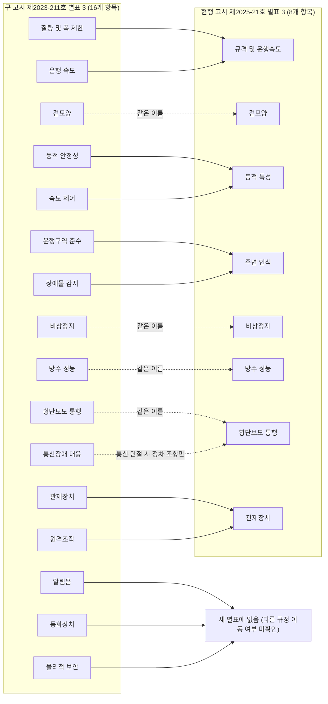

[홈](../../index.md) › [M. 안전](index.md) › 50. 안전 표준·인증·사고 조사

# 50. 안전 표준·인증·사고 조사

!!! info "소속 대분류"
    [M. 안전](index.md) — 핵심 질문:
    여러 로봇·사람·설비가 함께 움직일 때 생기는 위험을 어떻게 찾고 막을 것인가? [분류원문]

<!-- auto:area-tracks:start -->
<!-- auto:area-tracks:end -->

<!-- auto:page-status:start -->
> 페이지 상태: published · 신뢰도: medium · 페이지 버전: 2 · 마지막 갱신: 2026-09-30 · 마지막 실행: 2026-09-30
<!-- auto:page-status:end -->

## 1. 한 줄 정의

안전 표준 적합성·인증, 사고 기록과 사후 조사 [분류원문]

이 영역이 다루는 일(2026-09-28 리스트업 기준):

- **안전 표준·인증**: 산업용 로봇·이동 로봇·서비스 로봇 안전 표준(ISO 10218, ISO 3691-4, ISO 13482 등)과 인증에 맞춘다
- **사고 기록·사후 조사**: 사고와 아차 사고를 기록하고 원인을 조사해 재발을 막는다

## 2. 핵심 질문

어떤 안전 표준과 인증을 따라야 하며, 사고가 나면 원인을 어떻게 밝힐 것인가? [분류원문]

## 3. 왜 중요한가

따를 안전 표준과 인증은 로봇 유형(산업용 ISO 10218, 이동 R15.08, 서비스 ISO 13482)과 현장·국가 조건(한국 실외 보도 운행 법정 인증, 승강기 탑승 KS B 7317)에 따라 갈리고 주요 표준이 2025~2026년에 개정 중이어서, 여러 제조사 로봇을 함께 운영하는 ROP는 적용 기준을 한 번 정하고 끝낼 수 없는 것으로 보인다. [추정][^ref-1115][^ref-1117][^ref-980][^ref-945]

자세한 내용은 주제 페이지 [50. 안전 표준·인증·사고 조사 — 왜 중요한가](../../topics/2026/2026-09-30-area50-s3.md)에 있다.

## 4. 핵심 개념과 용어

표준 개정과 사고 자료를 읽으려면 다음 용어를 알아야 한다. 이번 갱신에서 '적합성 추정'은 EU 관보 원문으로, '중상 보고'는 연구 원고로 다시 확인했다. [사실][^ref-1476][^ref-1122]

자세한 내용은 주제 페이지 [50. 안전 표준·인증·사고 조사 — 핵심 개념과 용어](../../topics/2026/2026-10-11-area50-s4.md)에 있다.

## 5. 적용 사례 (현장 유형 명시)

이번 조사에서 확인한 사례는 네 가지다. 제조 공장·물류창고의 사고(보도 2건, 안전보건공단 공개 재해사례 1건), 실외 로봇의 법정 인증, 가정의 모의 사고 조사, 건설 현장의 위험성평가다. 병원·상업 시설의 안전 인증·사고 조사 사례는 이번 조사에서 찾지 못했다.

**현장 유형:** 제조 공장

**사례:** 식품 제조 공장에서 멈춘 적재 로봇을 점검하던 노동자의 끼임 사망 사고(2026-09)

| 항목 | 내용 |
|---|---|
| 시작 조건 | 2026-09-21 제품 적재용 로봇이 멈춰 노동자가 점검에 나섰다. [사실][^ref-1125] |
| 작업 대상 | 멈춘 제품 적재용 로봇과 그 로봇을 점검하던 노동자 [사실][^ref-1125] |
| 수행 자원 | 점검 노동자와 적재 로봇 [사실][^ref-1125] |
| 제약 | 고용노동부 통영지청은 전원 차단·기동스위치 잠금·표지(LOTO)가 실시되지 않았다고 지적했다. [사실][^ref-1125] |
| 완료·인계 | 해당 없음 |
| 예외·성과 | 노동자가 끼여 2026-09-25 숨졌다. 노동부 통영지청은 산업안전보건법·중대재해처벌법 위반을 조사하고 있다. [사실][^ref-1125] |

재가동 경위는 조사 쟁점이다. 경찰은 다른 노동자가 작업 중임을 확인하지 않고 재가동했는지, 기계 오작동인지를 수사 중이며, 원인은 확정되지 않았다(원인 미확정, 2026-09-29 보도 기준). [사실][^ref-1125] 이 사례에서 이 영역은 예외·성과 항목, 곧 사고 뒤 누가 무엇을 조사하는가에 관여한다.

**현장 유형:** 제조 공장

**사례:** 로봇 용접기의 용접 팁을 교체하다 로봇 팔과 지그 사이에 끼인 사망 사고(안전보건공단 공개 재해사례, 발생일 미확인)

| 항목 | 내용 |
|---|---|
| 시작 조건 | 로봇 용접기의 용접 팁을 교체하는 작업이었다. [사실][^ref-1482] |
| 작업 대상 | 로봇 용접기의 로봇 팔·지그와 셀 안에 들어간 작업자 [사실][^ref-1482] |
| 수행 자원 | 용접 팁을 교체하던 작업자와 작동 중이던 로봇 팔 [사실][^ref-1482] |
| 제약 | 공단의 재발방지대책은 다음을 제시한다. 출입할 때 감응식 방호장치가 작동하게 하고, 일시중지(muting) 기능을 쓸 때는 다른 수단으로 안전을 유지하며, 수리·점검 같은 비정형 작업은 로봇 운전을 정지한 뒤 출입문으로 들어가 한다. [사실][^ref-1482] |
| 완료·인계 | 해당 없음 |
| 예외·성과 | 작업자가 작동 중인 로봇 팔과 지그 사이에 가슴이 끼여 숨졌다(광주 광산구 사업장, 발생일 미확인). [사실][^ref-1482] |

공단은 원인을 두 가지로 든다. 일시중지(muting) 기능을 써서 감응식 방호장치가 작동하지 않았다. 또 작업자가 로봇 운전을 정지하지 않은 채, 안전 조치가 없는 재료 투입구를 통해 셀에 들어갔다. [사실][^ref-1482] 이 사례는 위아래의 보도 사례와는 별개로 다룬다. 이 사례에서 이 영역은 예외·성과 항목에 관여한다. 곧 공식 재해 조사가 원인을 방호장치 우회와 정지 절차 누락으로 정리하는 방식이다(조사 방법은 6절).

**현장 유형:** 물류창고

**사례:** 농산물유통센터에서 상자를 선별해 팔레트로 옮기는 로봇의 점검 중 압착 사망 사고(2023-11)

| 항목 | 내용 |
|---|---|
| 시작 조건 | 로봇의 센서 오류를 점검하고 프로그램을 고친 뒤 작동을 확인하는 작업이었다. [사실][^ref-1124] |
| 작업 대상 | 파프리카 상자를 선별해 팔레트로 옮기는 산업용 로봇 [사실][^ref-1124] |
| 수행 자원 | 산업용 로봇과 점검 작업자 [사실][^ref-1124] |
| 제약 | 해당 없음 |
| 완료·인계 | 해당 없음 |
| 예외·성과 | 2023-11-07 작업자가 로봇에 압착되어 숨졌다. 경찰은 로봇이 사람을 상자로 인식한 것으로 보고 안전관리 책임자의 과실 여부를 수사했다(2023-11-08 보도 기준). [사실][^ref-1124] |

두 사고 모두 정상 운전이 아니라 점검과 작동 확인 같은 비정상 작업 중에 일어났다. [사실][^ref-1124][^ref-1125]

**현장 유형:** 실외

**사례:** 연계 대상: 보도를 운행하는 실외이동로봇의 운행안전인증

| 항목 | 내용 |
|---|---|
| 시작 조건 | 연계 대상: 인증을 신청하면 심사가 시작된다. 산업통상부 고시 제2025-21호(첨부 고시문 표기 제2025-021호, 2025-11-24 발령·시행) 제9조①은 인증기관이 인증신청서를 받은 날부터 30일 안에 심사 결과를 알리도록 정한다. 한국로봇산업진흥원도 처리기간을 신청일부터 30일 이내로 안내한다(확인일 2026-10-11). [사실][^ref-1485][^ref-980] 정부 보도참고자료(2025-11-27)는 심사기간을 60일에서 30일로 줄였다고('25.11 시행) 적는다. 구 고시 제2023-211호 제9조①에는 이런 기한이 없었다. [사실][^ref-1484][^ref-1118] 서류 보완 기간이 30일에 들어가는지는 미확인이다. |
| 작업 대상 | 최대 질량 500kg·최고 속도 15km/h 이하 실외이동로봇 [사실][^ref-980] |
| 수행 자원 | 지능형로봇법 제40조의2 에 근거한 인증을 한국로봇산업진흥원이 맡는다. [사실][^ref-980] 인증기관은 로봇 제품명·모델명과 함께 관제장치 제품명·모델명을 보관한다(제10조②). 현행 별표 3 은 관제장치가 운용 중인 모든 로봇의 위치·속력, 주행가능 거리 또는 배터리 잔량, 통신 신호 감도, 상태를 실시간으로 확인하고 로봇을 원격으로 정지할 수 있어야 한다고 정한다. [사실][^ref-1485] |
| 제약 | 구 고시 제2023-211호 별표 3 의 기준 항목은 16개였다. 질량 및 폭 제한, 운행 속도, 겉모양, 동적 안정성, 비상정지, 운행구역 준수, 속도 제어, 장애물 감지, 알림음, 등화장치, 방수 성능, 물리적 보안, 횡단보도 통행, 관제장치, 통신장애 대응, 원격조작이다. [사실][^ref-1118] 현행 제2025-21호 별표 3 의 항목은 8개다. 규격 및 운행속도, 겉모양, 동적 특성, 주변 인식, 비상정지, 방수 성능, 횡단보도 통행, 관제장치이며, 진흥원이 안내하는 8개 심사항목과 이름이 같다. [사실][^ref-1485][^ref-980] 정부는 2025-11 심사 평가항목을 16개에서 8개로 합쳤다고 밝혔다. [사실][^ref-1484] |
| 완료·인계 | 해당 없음 |
| 예외·성과 | 해당 없음 |

연계 대상: 인증 절차와 기준은 산업통상자원부 고시 제2023-211호(2023-11-17 발령)로 처음 정해졌다. 이 고시는 지능형로봇법(법률 제19412호) 개정 시행에 따라 만들어졌고, 별표에서 로봇 모델 구분, 최고속도, 최대폭, 최대질량, 운행안전성 기준을 다뤘다. [사실][^ref-1118] 제2025-21호가 2025-11-24 제2023-211호(2023-11-17 발령)를 개정했고, 발령일부터 시행한다. [사실][^ref-1485] 제2023-211호의 시행일은 원 고시 첨부 부칙에 2023-11-17, 제2025-21호 첨부 본문에 실린 구 부칙에 2023-11-21 로 서로 다르게 적혀 있다. 그래서 어느 쪽으로도 확정하지 않는다(11절의 출처 충돌 질문). [추정][^ref-1118][^ref-1485]

두 별표를 조문끼리 맞춰 보면 구 별표의 항목이 다음처럼 합쳐졌다. 질량·폭 제한과 운행 속도는 '규격 및 운행속도'로, 동적 안정성(5° 경사·30mm 턱)과 속도 제어(정확도 ±10%)는 '동적 특성'으로 들어갔다. 운행구역 준수와 장애물 감지는 '주변 인식'으로, 관제장치와 원격조작(원격 정지, 영상으로 주변을 확인하는 원격 수동조작)은 '관제장치'로 합쳐졌다. [사실][^ref-1118][^ref-1485] 알림음(55~73dB(A)), 등화장치(표면 60℃ 이하), 물리적 보안(통신포트·저장장치 단자 보호)은 새 별표에 없다. 통신장애 대응(운행계획서 시나리오)은 '횡단보도 통행 중 통신이 끊기면 안전한 곳에 정차한다'는 조항으로만 남았다. [사실][^ref-1118][^ref-1485] 빠진 항목이 세부운영지침 같은 다른 규정으로 옮겨졌는지는 미확인이다. 아래 도식은 이 대조를 보여 준다. 점선은 이름이 같은 항목, 또는 일부 조항만 남은 항목이다.

이전 판은 일부 기준값을 '2023-07 행정예고안 보도 기준, 확정 고시 별표 원문 미확인'으로 두었다. 질량별 속도 제한(230kg 초과 5km/h, 100kg 초과 10km/h), 폭 800mm 이하(보도 폭 2,500mm 이상이면 1,200mm), 5° 경사, 알림음 55~73dB, 등화장치 표면 온도 60℃ 이하, 방수 IPX4 다. 이 값들은 확정 고시 제2023-211호 별표 3 에 그대로 있다. [사실][^ref-1118] 현행 제2025-21호 별표 3 에는 질량·폭·속도·5° 경사·IPX4 기준이 남았고, 알림음·등화장치 기준은 없다. 두 판 모두 어린이·노인·장애인 보호구역에서 최대 5km/h 를 지키는지 확인하는 조항을 둔다. [사실][^ref-1118][^ref-1485] ROP 는 인증 자체를 맡지 않는다. 인증이 허용한 운행 조건을 작업·경로 제약으로 받아들이는 쪽에서 이 사례에 관여한다(9절). [추정][^ref-980]

**현장 유형:** 가정

**사례:** 실제 사고가 아닌 역할극 모의 사고(노인 지원 주거 공동체 시나리오) — 넘어진 거주자 곁 보조 로봇의 알림 실패 조사

| 항목 | 내용 |
|---|---|
| 시작 조건 | 지원 주거 아파트에서 거주자가 넘어졌다(모의). [사실][^ref-1121] |
| 작업 대상 | 넘어진 거주자와 그 사실을 직원에게 알리는 정보(모의) [사실][^ref-1121] |
| 수행 자원 | 보조 로봇과 직원, 그리고 사고를 조사하는 조사자(모의) [사실][^ref-1121] |
| 제약 | 로봇이 인터넷에 연결되지 않은 상태였다(모의 조건). [사실][^ref-1121] |
| 완료·인계 | 해당 없음 |
| 예외·성과 | 보조 로봇이 오작동해 직원에게 알리지 못했다(모의). 조사는 목격자 증언, 윤리적 블랙박스 기록, 환경·로봇 전문가 분석, 기술·조직 권고로 구성되었다. [사실][^ref-1121] |

Webb 외(2021)는 이 모의 사고를 역할극 증언 면담으로 조사해 조사 방법을 시험했다. 실제 사고 자료가 아니므로 방법의 시험 사례로만 읽는다. [사실][^ref-1121]

**현장 유형:** 기타

**사례:** 건설 현장에 이동로봇을 배치하기 전의 위험성평가

| 항목 | 내용 |
|---|---|
| 시작 조건 | 건설 현장에 이동로봇을 배치하기 전 위험성평가 틀이 필요한 상황이다. [사실][^ref-563] |
| 작업 대상 | 해당 없음 |
| 수행 자원 | 해당 없음 |
| 제약 | ISO 10218, ISO/TS 15066, ANSI/RIA R15.08, ANSI/ITSDF B56.5, CSA Z434 를 검토한 결과, 이동로봇 전용이면서 다양한 배치 상황에 적용할 수 있는 표준이 없고 이동 플랫폼의 위험성평가 문헌도 제한적이었다. [사실][^ref-563] |
| 완료·인계 | 해당 없음 |
| 예외·성과 | 해당 없음 |

Belzile 외(2025)는 이 공백을 메우려고 건설 현장 이동로봇 배치용 위험성평가 틀을 제안했다(프리프린트). [사실][^ref-563]

## 6. 대표 접근법과 기술

사고 기록에 관한 공개 규약 초안은 아직 필드 형식과 보존 기간을 정하지 않았다. 사고 원인을 제어 구조와 조직 정책까지 넓혀 묻는 분석 방법은 이번 조사에서 강의 자료 수준으로만 확인했다. [추정][^ref-1483][^ref-1486]

자세한 내용은 주제 페이지 [50. 안전 표준·인증·사고 조사 — 대표 접근법과 기술](../../topics/2026/2026-10-11-area50-s6.md)에 있다.

## 7. 관련 표준·프레임워크·오픈소스

EN ISO 10218-1/-2:2025 의 참조는 위원회 시행결정 (EU) 2026/2015(2026-09-07 관보 게재)로 기계류 지침 2006/42/EC 의 조화 표준 목록에 실렸다. 실외이동로봇 운행안전인증 기준은 2025-11-24 개정 고시로 8개 항목이 되었다. [사실][^ref-1476][^ref-1485]

자세한 내용은 주제 페이지 [50. 안전 표준·인증·사고 조사 — 관련 표준·프레임워크·오픈소스](../../topics/2026/2026-10-11-area50-s7.md)에 있다.

## 8. 대표 연구와 자료

이번 판은 미국 연방 OSHA 중상 보고 분석(2015-01-01~2022-04-30)과 Ohio 산재보상 청구 분석(2001~2020)을 다룬다. 두 자료는 관할·기간·집계 단위가 다르다. [사실][^ref-1122][^ref-1481]

자세한 내용은 주제 페이지 [50. 안전 표준·인증·사고 조사 — 대표 연구와 자료](../../topics/2026/2026-10-11-area50-s8.md)에 있다.

## 9. ROP가 직접 맡는 것과 외부와 연계하는 것 (책임 경계 기준)

ROP가 직접 맡을 범위는 인증 상태·적용 표준과 판·허용 운행 조건을 등록해 배정·경로 제약에 반영하고, 사고 조사에 쓸 플릿 수준 실행 기록을 보존하는 일로 보인다. [추정][^ref-980][^ref-1116][^ref-1120][^ref-1122]

| 경계 | ROP가 직접 맡는 것 | 외부와 연계하는 것 |
|---|---|---|
| 로봇 자체 지능·제어 | 로봇·적용마다 인증 상태와 적용 표준·판을 등록 정보로 관리하고, 정지·재가동·정비 모드 전환 명령과 로봇 상태 보고를 사고 조사에 쓸 수 있게 보존한다. [추정][^ref-1116][^ref-1120] | 연계 대상: 로봇 본체의 표준 적합성과 제품 인증은 제조사와 인증기관이, 로봇 셀·이동로봇 적용의 위험성평가와 사용 정보는 통합자가 맡는다. [추정][^ref-1115][^ref-1084] |
| 업종별 조건 | 인증이 허용한 운행 조건(질량·속도·구역)을 배정·경로 제약에 반영하고 표준 판 개정을 추적한다. [추정][^ref-980][^ref-1116] | 연계 대상: 실외 운행 인증과 보험은 운영자와 한국로봇산업진흥원의 일이다. [추정][^ref-980][^ref-991] 연계 대상: 현행 고시 제2025-21호 별표 3 은 관제장치에 다음을 요구한다. 운용 중인 모든 로봇을 식별하고, 위치·속력, 주행가능 거리 또는 배터리 잔량, 로봇–관제장치 통신 신호 감도, 상태(주행·대기·비상정지·오류)를 실시간으로 확인한다. 통행할 수 없으면 관제장치에 알리고 관리자가 조치하며, 원격 정지 수단과 영상장치로 주변을 보며 조작하는 원격 수동조작을 갖춘다. [사실][^ref-1485] 연계 대상: 같은 고시 제10조②는 인증기관이 인증번호·회사명·로봇 제품명·모델명과 함께 관제장치 제품명·모델명을 보관하게 한다. 따라서 인증 정보는 로봇 모델과 관제장치 모델의 조합으로 관리된다. [사실][^ref-1485] |
| 시설·설비 제어 | 사고 조사에 필요한 실행 기록을 외부 주체와 주고받는 인터페이스를 둔다. [추정][^ref-1125] | 연계 대상: 교육·작업 절차·잠금·표지는 사용자 사업장이, 법정 사고 조사는 고용노동부·경찰이 맡는다. [추정][^ref-1084][^ref-1125] |

실외이동로봇 운행안전인증처럼 인증 자체는 운영자·진흥원의 일이고, ROP는 그 결과를 받아 작업·경로 제약으로 반영하는 쪽이다. [추정][^ref-980] 이 경계는 제품 전략에 따라 옮겨질 수 있으며 기준은 [범위 경계](../../about/scope-boundary.md)에 있다. 이종 제조사를 연결하는 ROP는 각 주체의 인증·평가 결과와 조사에 필요한 실행 기록을 주고받는 인터페이스를 맡는 것으로 보인다. [추정][^ref-1115][^ref-1084][^ref-1125]

구축자 의견: 실외이동로봇 인증 정보에는 고시 번호·시행일(제2025-21호, 2025-11-24)과 별표 판(구 16개 항목, 현행 8개 항목)을 함께 기록해야 한다. 그래야 구 별표로 받은 인증과 현행 별표 기준을 구분할 수 있다. 현행 관제장치 항목이 요구하는 실시간 상태(위치·속력·배터리·통신 감도·상태)와 원격 정지는, ROP 가 이기종 로봇 상태 모델로 받아야 할 최소 항목으로 쓸 수 있다. [의견][^ref-1485][^ref-1118] 다만 ROP 계층이 인증에서 말하는 관제장치에 해당하는지, 이 요구를 충족하는지는 판단하지 않는다. 이 문제는 열린 질문 oq-187 로 남긴다.

## 10. 다른 연구영역과의 연결 (번호와 이름을 함께 표기)

이 영역은 위험성평가·정지 절차, 인증 속성 등록, 사고 조사용 기록, 법정 인증·책임 분담을 매개로 여러 영역과 이어진다. 아래 연결은 이번 조사 결과를 세부영역 정의와 대조한 제안이다. [추정][^ref-1084][^ref-1120]

자세한 내용은 주제 페이지 [50. 안전 표준·인증·사고 조사 — 다른 연구영역과의 연결](../../topics/2026/2026-10-11-area50-s10.md)에 있다.

## 11. 열린 질문

실외이동로봇 인증 심사 항목 수의 충돌(oq-230)과 ISO 3691-4 차기판 단계의 충돌(oq-384)은 원문을 확인해 해결했다. 실외 별표 개정의 세부(oq-186)와 플랫폼 수준 사고 기록 항목(oq-252)은 부분 근거만 더하고 열어 둔다. [사실][^ref-1118][^ref-1485][^ref-789]

자세한 내용은 주제 페이지 [50. 안전 표준·인증·사고 조사 — 열린 질문](../../topics/2026/2026-10-11-area50-s11.md)에 있다.

## 12. 최근 업데이트 (자동)

<!-- auto:area-recent:start -->
- 2026-09-30 · 갱신 · [50. 안전 표준·인증·사고 조사](safety-standards-certification-and-incident-investigation.md) — seed → draft: 3~11절 첫 작성(표준·인증 개정 현황, 제조 공장·물류창고·실외·가정·기타 사례, 사고 기록·조사 방법, 책임 경계, 연결 17건, 열린 질문 7건). 2차 수정: 7절 머리 문장을 f1·f3 의 구체 사실로 교체, 프런트매터 sources 를 각주 정의와 일치 (실행 2026-09-30-15)
- 2026-09-30 · 생성 · [50. 안전 표준·인증·사고 조사 — 관련 표준·프레임워크·오픈소스](../../topics/2026/2026-09-30-area50-s7.md) — 자동 분리: 50. 안전 표준·인증·사고 조사 의 "7. 관련 표준·프레임워크·오픈소스" 절을 옮겼다. 2차 수정: 1절·3절 머리 문장을 f1·f3 의 구체 사실로 교체 (실행 2026-09-30-15)
- 2026-09-30 · 생성 · [50. 안전 표준·인증·사고 조사 — 핵심 개념과 용어](../../topics/2026/2026-09-30-area50-s4.md) — 자동 분리: 50. 안전 표준·인증·사고 조사 의 "4. 핵심 개념과 용어" 절(1,007자)을 옮겼다 (실행 2026-09-30-15)
- 2026-09-30 · 생성 · [50. 안전 표준·인증·사고 조사 — 대표 접근법과 기술](../../topics/2026/2026-09-30-area50-s6.md) — 자동 분리: 50. 안전 표준·인증·사고 조사 의 "6. 대표 접근법과 기술" 절을 옮겼다. 2차 수정: 역할별 표준 적합성 경로의 브리프 밖 한계 문장을 f16 사실 문장으로 교체 (실행 2026-09-30-15)
- 2026-09-30 · 생성 · [50. 안전 표준·인증·사고 조사 — 열린 질문](../../topics/2026/2026-09-30-area50-s11.md) — 자동 분리: 50. 안전 표준·인증·사고 조사 의 "11. 열린 질문" 절(978자)을 옮겼다 (실행 2026-09-30-15)
<!-- auto:area-recent:end -->

## 13. 참고 자료 (각주)

[^ref-1084]: The Robot Report, New AMR safety standard available with release of ANSI/A3 R15.08-2, 2023-10-26, https://www.therobotreport.com/new-amr-safety-standard-available-with-release-of-ansi-a3-r15-08-2/, 접근일 2026-09-30 (원문 미열람)
[^ref-991]: 산업통상자원부·경찰청 (대한민국 정책브리핑), ‘실외이동로봇’ 보도 통행 가능해진다…배달·... (제목 일부만 확인), 2023-11-16, https://www.korea.kr/news/policyNewsView.do?newsId=148922726, 접근일 2026-09-30 (원문 미열람)
[^ref-1115]: The Robot Report, ISO 10218 industrial robot safety standard receives major overhaul, 2025-02, https://www.therobotreport.com/iso-10218-industrial-robot-safety-standard-receives-major-overhaul/, 접근일 2026-09-30
[^ref-1116]: IBF Solutions, New standards for industrial robots EN ISO 10218-1 and -2, 2026-09-18, https://www.ibf-solutions.com/en/seminars-and-news/news/new-standards-for-industrial-robots-en-iso-10218-1-and-2, 접근일 2026-09-30
[^ref-1117]: Institute for Standardization of Serbia (ISS) — ISO 프로젝트 정보, ISO/FDIS 13482 Robotics — Safety requirements for service robots, 미확인, https://iss.rs/en/project/show/iso:proj:83498, 접근일 2026-09-30
[^ref-980]: 한국로봇산업진흥원, 실외이동로봇 운행안전인증, 미확인, https://www.kiria.org/portal/cert/portalCertEstiSafe.do, 접근일 2026-10-11
[^ref-1118]: 산업통상자원부, 실외이동로봇 운행안전인증 절차 및 기준 등에 관한 고시, 2023-11-17, https://www.motir.go.kr/kor/article/ATCL0c554f816/64488/view, 접근일 2026-10-11
[^ref-945]: 산업통상자원부 국가기술표준원 (KDI 경제정보센터 게재), 국가표준(KS) 제정으로 로봇의 엘리베이터 탑승 돕는다, 2021-11-11, https://eiec.kdi.re.kr/policy/materialView.do?num=220004, 접근일 2026-09-30
[^ref-1120]: Winfield, A. F. T., van Maris, A., Salvini, P., & Jirotka, M. (arXiv), An Ethical Black Box for Social Robots: a draft Open Standard, 2022-05-13, https://arxiv.org/abs/2205.06564, 접근일 2026-09-30
[^ref-1121]: Webb, H., Dumitru, M., van Maris, A., Winkle, K., Jirotka, M., & Winfield, A. (Frontiers in Robotics and AI), Role-Play as Responsible Robotics: The Virtual Witness Testimony Role-Play Interview for Investigating Hazardous Human-Robot Interactions, 2021-06-29, https://www.frontiersin.org/journals/robotics-and-ai/articles/10.3389/frobt.2021.644336/full, 접근일 2026-10-11
[^ref-1122]: Sanders, N. E., Sener, E., & Chen, K. B. (Applied Ergonomics 121), Robot-related injuries in the workplace: An analysis of OSHA Severe Injury Reports, 2024, https://eprints.whiterose.ac.uk/id/eprint/217393/, 접근일 2026-10-11
[^ref-1124]: 경향신문, ‘로봇이 사람을 박스로 인식’ 고성 농산물유통센터서 40대 압착 사망, 2023-11-08, https://www.khan.co.kr/article/202311081103001, 접근일 2026-09-30
[^ref-1125]: 경남도민일보, 오뚜기에스에프 끼임사고, 기본 예방조치 안 지켰다, 2026-09-29, https://www.idomin.com/news/articleView.html?idxno=2015923, 접근일 2026-09-30
[^ref-563]: Belzile, B., Wanang-Siyapdjie, T., Karimi, S., Braga, R. G., Iordanova, I., & St-Onge, D. (arXiv), From Safety Standards to Safe Operation with Mobile Robotic Systems Deployment, 2025-02-28, https://arxiv.org/abs/2502.20693, 접근일 2026-09-30
[^ref-1476]: European Commission (Official Journal of the European Union), Commission Implementing Decision (EU) 2026/2015 of 4 September 2026 amending and repealing Implementing Decision (EU) 2023/1586 as regards harmonised standards for machinery drafted in support of Directive 2006/42/EC, 2026-09-07, https://eur-lex.europa.eu/legal-content/EN/TXT/?uri=CELEX%3A32026D2015, 접근일 2026-10-11
[^ref-789]: ISO, ISO/DIS 3691-4 (제3판) - Industrial trucks — Safety requirements and verification — Part 4: Driverless industrial trucks and their systems, 미확인, https://www.iso.org/standard/88615.html, 접근일 2026-10-11
[^ref-1481]: Suresh, V., Konda, S., Haney, J. M. 외 (American Journal of Industrial Medicine 69(5):345–357, 권호·쪽은 Crossref 기준), Robot-Related Workers' Compensation Claims in Ohio, 2001–2020, 2026-03-03(온라인 선공개), https://stacks.cdc.gov/view/cdc/258698, 접근일 2026-10-11
[^ref-1482]: 안전보건공단, 산업용 로봇 팔과 지그 사이에 끼임 (재해사례), 미확인, https://oshri.kosha.or.kr/kosha/data/machine.do?articleNo=411924&attachNo=233368&mode=download, 접근일 2026-10-11
[^ref-1483]: Winfield, A. F. T., van Maris, A., Salvini, P., & Jirotka, M. (ICRES 2022 Proceedings, CLAWAR), An Ethical Black Box for Social Robots: a draft Open Standard (ICRES 2022 게재본), 2022-07, https://doi.org/10.13180/icres.2022.18-19.07.019, 접근일 2026-10-11
[^ref-1484]: 관계부처 합동 (금융위원회 누리집 게재 보도참고자료), 규제의 벽은 허물고 AI의 길은 넓힌다 — 신산업 규제합리화 1호 로드맵(AI 분야) 발표, 2025-11-27, https://www.fsc.go.kr/no010101/85753, 접근일 2026-10-11
[^ref-1485]: 산업통상부, 실외이동로봇 운행안전인증 절차 및 기준 등에 관한 고시 (고시 제2025-021호, 일부개정), 2025-11-24, https://www.motir.go.kr/kor/article/ATCL0c554f816/64952/view, 접근일 2026-10-11
[^ref-1486]: Leveson, N. (MIT OpenCourseWare, 16.863J System Safety), System Safety: CAST Analysis (강의 자료), 2016, https://ocw.mit.edu/courses/16-863j-system-safety-spring-2016/7dc4344ef259e4bde4acc1bb2d578a95_MIT16_863JS16_LecNotes3-2.pdf, 접근일 2026-10-11
