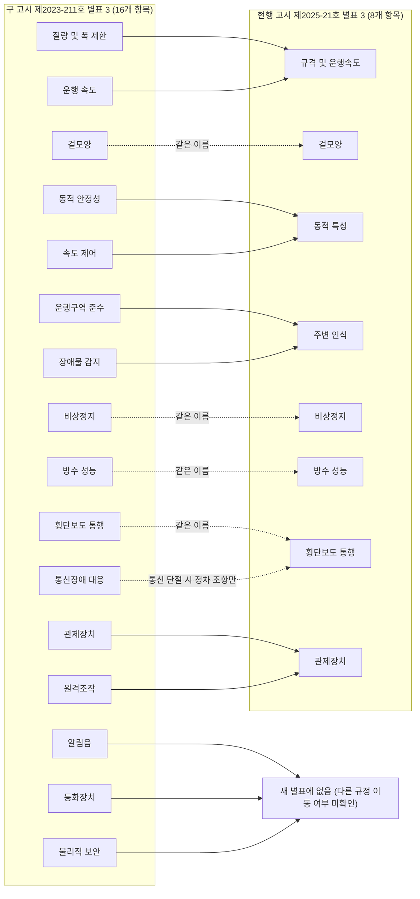

(너의 규칙은 시스템 프롬프트의 agents/shared-rules.md 와 agents/storyteller.md 이다. 아래는 이번 실행의 컨텍스트와 입력이다.)

## 실행 컨텍스트

- run_id: 2026-10-11-06
- date: 2026-10-11
- run_type: update (갱신)
- 대상: 50. 안전 표준·인증·사고 조사 (M. 안전)
- 예산:
    - max_search_queries: 30
    - max_sources_per_run: 15
    - new_topic_pages: 1
    - page_updates: 2
    - max_retries: 2
- 환경 알림: web_fetch_available: true · fetch_mode: full
- 언어: ko
- retry_count: 1
- max_retries: 2

## 입력

### runs/2026-10-11-06/target.json

```json
{
  "run_id": "2026-10-11-06",
  "date": "2026-10-11",
  "weekday": "Sun",
  "run_number": 172,
  "run_type": "update",
  "forced": true,
  "target": {
    "area_no": 50,
    "area_name": "50. 안전 표준·인증·사고 조사",
    "category": "M. 안전",
    "category_letter": "M"
  },
  "topic": null,
  "track": null,
  "corrections": [],
  "budget": {
    "max_search_queries": 30,
    "max_sources_per_run": 15,
    "new_topic_pages": 1,
    "page_updates": 2,
    "max_retries": 2
  },
  "priority_reason": null,
  "priority_questions": [],
  "excluded_areas": [],
  "lifted_areas": [],
  "deferred": {
    "monthly_recheck": false,
    "weekly_review": false
  },
  "selection_rationale": "CLI 지정 run_type=update, area=50"
}
```

### runs/2026-10-11-06/research.json

```json
{
  "run_id": "2026-10-11-06",
  "date": "2026-10-11",
  "run_type": "update",
  "target": {
    "area_no": 50,
    "area_name": "50. 안전 표준·인증·사고 조사",
    "category": "M. 안전"
  },
  "gaps": [
    "섹션 5. 적용 사례 — 실외 사례 표·본문(98·100·104·106행)이 고시 제2023-211호를 현행 근거로 두고 심사항목 8개·16가지를 '어느 쪽도 고르지 않고' 병기하며, 행정예고 기준값을 '확정 고시 별표 원문 미확인'으로 둠. 제조 공장·물류창고 사고 사례는 수사·조사 중 기사 두 건뿐이고 공식 재해사례 자료가 없음",
    "섹션 6. 대표 접근법과 기술(분리 2026-09-30-area50-s6) — '사고 기록 장치' 소절의 '기록할 데이터 형식과 보존 기간 … 미확인'(45행), 조직·제어 책임까지 보는 사고 분석 방법(CAST) 없음",
    "섹션 7. 관련 표준·프레임워크·오픈소스(분리 2026-09-30-area50-s7) — EN ISO 10218 EU 조화 게재 행(42행)이 IBF 해설 단독 근거로 [사실], 실외이동로봇 행(45행)의 '고시 제2023-211호가 정한다'가 낡음, R15.08-3·ISO 3691-4 차기판·KS 부합판·UL 3100·국내 자율안전확인·EU 기계 규정 기록 요구·rosbag2/MCAP 기록 계약 없음",
    "섹션 8. 대표 연구와 자료(분리 2026-09-30-area50-s8) — Sanders 외의 관측 기간·관할 범위 미기재, 미국 보상 청구 자료(Suresh 외 2026) 없음, Webb 외 역할극의 수행 조건·한계 미기재",
    "섹션 4. 핵심 개념과 용어(분리 2026-09-30-area50-s4) — '적합성 추정' 항목(41행)이 해설 기준이고 2027-01-20 목록 폐지 미반영, '중상 보고' 항목(45행)의 기간이 연 단위",
    "섹션 9. 책임 경계 — 실외 인증이 요구하는 관제장치 기능(실시간 상태·원격 정지)과 인증 정보의 관제장치 모델 단위 미반영",
    "섹션 11. 열린 질문(분리 2026-09-30-area50-s11) — oq-186·oq-230 이 별표 원문 미확인 상태, oq-384(ISO 3691-4 차기판 단계 충돌) 미해소",
    "정정 요청 없음(target.json corrections 비어 있음). 메모·검증에서 나온 위키 내부 정정: 고시 근거(제2025-021호), 16/8 항목 경위, EU 게재 서술 강등, ref-789 제목, 'KS B ISO 10218-2 2017 확인'"
  ],
  "research_questions": [
    "어떤 안전 표준과 인증을 따라야 하며, 사고가 나면 원인을 어떻게 밝힐 것인가? [분류원문]",
    "oq-186·oq-230 실외이동로봇 운행안전인증 심사항목이 16개에서 8개로 바뀐 개정의 시점·근거 고시와 항목 대응은 무엇인가? (섹션 5·7·11 겨냥)",
    "EN ISO 10218-1/-2:2025 의 EU 조화 게재는 어떤 법령에 대한 것이며 언제까지 효력이 있는가, ISO 3691-4 차기판·국내 KS 부합판의 현재 상태는 무엇인가(oq-384, oq-251)? (섹션 4·7 겨냥)",
    "oq-252 사고 조사에 필요한 기록 항목·형식·보존을 정한 공개 규약(EBB 초안, EU 기계 규정, rosbag2·MCAP)은 무엇을 정하고 무엇을 비워 두는가? (섹션 6·7 겨냥)",
    "로봇 사고 통계(OSHA SIR, Ohio 보상 청구, 국내 공식 재해사례)는 어떤 관할·기간·집계 단위·한계를 가지는가? (섹션 5·8 겨냥)",
    "사고 원인을 개인 과실이 아니라 제어 구조·조직 정책까지 조사하는 방법(CAST·역할극 증언)은 무엇을 요구하고 어떤 한계가 있는가? (섹션 6·8 겨냥)"
  ],
  "findings": [
    {
      "id": "f1",
      "claim": "위원회 시행결정 (EU) 2026/2015(2026-09-04 채택, 2026-09-07 관보 L 시리즈 게재)의 부속서는 시행결정 (EU) 2023/1586 부속서 I 에 EN ISO 10218-1:2025(223a)와 EN ISO 10218-2:2025(224a)의 참조를 추가한다.",
      "tag": "사실",
      "source_ids": [
        "ref-1496"
      ],
      "cross_checked": false,
      "confidence": "medium",
      "evidence_excerpt": "부속서 (2)(a): \"223a. EN ISO 10218-1:2025 Robotics – Safety requirements – Part 1: Industrial robots\" / \"224a. EN ISO 10218-2:2025 … Part 2: Industrial robot applications and robot cells\". 머리말 \"OJ L 2026/2015, 7.9.2026\", \"of 4 September 2026\", 제3조 관보 게재일 발효. 기존 위키(2026-09-30-area50-s7.md 42행, s4.md 41행, safety/index.md 177행)의 IBF 해설 기반 게재 사실·날짜를 1차 원문으로 보강",
      "as_of": "2026-10-11",
      "site_type": null,
      "flow_item": null
    },
    {
      "id": "f2",
      "claim": "이 결정이 참조를 추가한 목록(2023/1586 부속서 I)은 기계류 지침 2006/42/EC 에 대한 적합성 추정을 주는 조화 표준 목록이며, 같은 결정 제2조는 2023/1586 을 2027-01-20 부로 폐지한다. 전문 (14)는 그 이유를 지침 2006/42/EC 가 규정 (EU) 2023/1230 으로 같은 날 폐지되기 때문이라고 적는다.",
      "tag": "사실",
      "source_ids": [
        "ref-1496"
      ],
      "cross_checked": false,
      "confidence": "medium",
      "evidence_excerpt": "전문 (11): \"references of harmonised standards conferring a presumption of conformity with Directive 2006/42/EC\". 제2조: \"Implementing Decision (EU) 2023/1586 is repealed with effect from 20 January 2027.\" 전문 (14) 같은 취지. 2023/1230 에 따른 새 조화 표준 게재로 읽지 않음(이 결정은 지침 기반)",
      "as_of": "2026-10-11",
      "site_type": null,
      "flow_item": null
    },
    {
      "id": "f3",
      "claim": "기존 위키(2026-09-30-area50-s7.md 42행)의 'PL d·범주 3 일률 요구 대신 표의 기본 성능 수준 또는 위험성평가 근거 선택 허용, 운전 정지용 정상 정지 기능 신설' 서술은 컨설팅사 IBF Solutions 해설만 근거로 [사실]로 실려 있다. 관보 원문으로 확인되는 것은 참조 게재 사실·날짜·법적 기반뿐이므로 이 서술은 [추정]·벤더 해설로 낮추는 것이 맞다.",
      "tag": "추정",
      "source_ids": [
        "ref-1116",
        "ref-1496"
      ],
      "cross_checked": false,
      "confidence": "low",
      "evidence_excerpt": "벤더 주장: IBF Solutions 해설(ref-1116, 2026-09-18)만 PL d·범주 3 대체와 정상 정지 요구를 전한다. (EU) 2026/2015 본문·부속서에는 참조 목록만 있고 ISO 10218 조항 내용은 없음. ISO 10218:2025 원문 미열람이라 해설 내용 자체의 옳고 그름은 판단하지 않음. 같은 서술이 s4.md 41행·safety/index.md 177행과 이어짐",
      "as_of": "2026-10-11",
      "site_type": null,
      "flow_item": null,
      "vendor_claim": true
    },
    {
      "id": "f4",
      "claim": "ANSI/A3 R15.08-3-2026(Part 3: Use of IMR Applications)은 A3 판매 페이지 기준 2026-04-23 발행으로 표시되며, 이 사실은 위키에 이미 있다. 이 영역 7절 표에는 R15.08-2 만 있어 Part 3 행을 더할 근거로만 쓴다.",
      "tag": "추정",
      "source_ids": [
        "ref-1255"
      ],
      "cross_checked": false,
      "confidence": "low",
      "evidence_excerpt": "기존 내용 확인: ref-1255(2026-10-09 원문 열람, \"Published April 23, 2026\"), docs/categories/safety/index.md 53·137·169행. 이번 재열람은 Cloudflare 차단으로 실패해 [추정]. 사용자 의무 세부(oq-265)는 답하지 않음",
      "as_of": "2026-10-11",
      "site_type": null,
      "flow_item": null,
      "source_unopened": true
    },
    {
      "id": "f5",
      "claim": "ISO 3691-4 차기판 프로젝트는 ISO 위원회 페이지에서 'ISO/DIS 3691-4, Edition 3, Under development'이며 단계 40.60(투표 종료, 2026-09-10)으로 표시되고 ISO 3691-4:2023 을 대체할 예정이다. 발행된 개정판이 아니다.",
      "tag": "사실",
      "source_ids": [
        "ref-789"
      ],
      "cross_checked": false,
      "confidence": "medium",
      "evidence_excerpt": "committee.iso.org/standard/88615: \"ISO/DIS 3691-4 / Edition 3 / Under development / Stage: Close of voting [40.60]\", 이력 \"40.60 2026-09-10\", \"Will replace ISO 3691-4:2023\". 위키 ref-789 의 2026-09-26 'ISO/CD' 기록과의 충돌(oq-384)을 해소. ref-789 제목을 'ISO/DIS 3691-4 (제3판)'으로 갱신 제안. 개정안 본문 미열람",
      "as_of": "2026-10-11",
      "site_type": null,
      "flow_item": null
    },
    {
      "id": "f6",
      "claim": "국가표준 목록에서 KS B ISO 10218-1(산업용 로봇의 안전 요구사항 제1부: 로봇)의 대응 국제표준은 ISO 10218-1:2011(IDT, 일치)이고 최종개정확인일은 2021-11-26 이다(제정 2008-01-17).",
      "tag": "사실",
      "source_ids": [
        "ref-1497"
      ],
      "cross_checked": false,
      "confidence": "medium",
      "evidence_excerpt": "standard.go.kr 상세: 대응국제표준 \"ISO 10218-1:2011 / IDT 일치\", 제정일 2008-01-17, 최종개정확인일 2021-11-26. 최종개정확인일은 다른 표준과 연계된 확인 개정일로 보이며, ISO 10218-1:2025 부합화 KS 는 이 목록에서 확인되지 않음(부재 증명 아님)",
      "as_of": "2026-10-11",
      "site_type": null,
      "flow_item": null
    },
    {
      "id": "f7",
      "claim": "같은 목록에서 KS B ISO 10218-2(제2부: 로봇 시스템 및 통합)의 대응 국제표준은 ISO 10218-2:2011(IDT)이고 최종개정확인일은 2022-10-12(고시 제2022-0433호)다. 위키의 'KS B ISO 10218-2 2017 확인' 표현은 낡았다.",
      "tag": "사실",
      "source_ids": [
        "ref-211"
      ],
      "cross_checked": false,
      "confidence": "medium",
      "evidence_excerpt": "standard.go.kr 상세: \"ISO 10218-2:2011 / IDT 일치\", 제정일 2012-03-29, 최종개정확인일 2022-10-12, 이력 고시번호 2022-0433. 2017 확인 표현 위치: docs/topics/2026/2026-09-26-area25-s7.md 45행과 ref-814 제목(48. 안전·위험 관리 쪽 분리 페이지라 후속 정리)",
      "as_of": "2026-10-11",
      "site_type": null,
      "flow_item": null
    },
    {
      "id": "f8",
      "claim": "EU 기계 규정 (EU) 2023/1230 부속서 III 1.2.1(f)는 제어 시스템을, 개입과 관련해 생성된 데이터와 출시·사용 개시 뒤 업로드한 안전 소프트웨어 판의 추적 기록이 업로드 뒤 5년간 활성화되도록 설계·제작해야 한다고 정한다. 목적은 관할 국가기관의 이유 있는 요청에 따른 적합성 입증에 한정된다.",
      "tag": "사실",
      "source_ids": [
        "ref-555"
      ],
      "cross_checked": false,
      "confidence": "medium",
      "evidence_excerpt": "2026-07-27 통합본 부속서 III 1.2.1 (f): \"the tracing log of the data generated in relation to an intervention and of the versions of safety software uploaded … is enabled for five years after such upload, exclusively to demonstrate the conformity … further to a reasoned request from a competent national authority\". 영역 52 의 IES 해설(ref-1109, 2026-09-30-area52-s3.md 43행) 기반 문장을 1차 원문으로 보강. 일반 작업 로그 보관 의무로 확대하지 않음",
      "as_of": "2026-10-11",
      "site_type": null,
      "flow_item": null
    },
    {
      "id": "f9",
      "claim": "같은 절 둘째 목록 (b)는 행동·논리가 전부 또는 일부 자체 진화하며 여러 자율성 수준으로 작동하도록 설계된 기계의 제어 시스템에 대해, 안전 기능을 보장하는 소프트웨어 기반 안전 시스템의 안전 관련 의사결정 데이터를 기록하고 수집 뒤 1년간 보존하도록 정한다.",
      "tag": "사실",
      "source_ids": [
        "ref-555"
      ],
      "cross_checked": false,
      "confidence": "medium",
      "evidence_excerpt": "부속서 III 1.2.1 둘째 목록: \"Control systems of machinery … with fully or partially self-evolving behaviour or logic …\" (b) \"recording of data on the safety related decision-making process … retained for one year after its collection, exclusively to demonstrate the conformity\". 대상은 자체 진화 제어 시스템에 한정. 통합본은 M1 2024/2748·M2 2026/1744 반영",
      "as_of": "2026-10-11",
      "site_type": null,
      "flow_item": null
    },
    {
      "id": "f10",
      "claim": "UL 3100(Automated Mobile Platforms, AMPs) 공식 목록은 제1판의 최초 발행일을 2021-05-26, 최근 개정일과 ANSI 승인일을 2026-06-10 으로 표시한다.",
      "tag": "사실",
      "source_ids": [
        "ref-1498"
      ],
      "cross_checked": false,
      "confidence": "medium",
      "evidence_excerpt": "UL 표준 목록: \"Edition 1 (Active)\", \"Published Date: May 26, 2021 / Last Revision: June 10, 2026 / ANSI Approved: June 10, 2026\". 개정 조항 전체·시험 수치는 미열람",
      "as_of": "2026-10-11",
      "site_type": null,
      "flow_item": null
    },
    {
      "id": "f11",
      "claim": "UL 3100 의 공개 적용 범위 1.4 는 산업용 로봇 자체의 요구사항은 포함하지 않으며(UL 1740·CSA Z434 가 다룸), 그 표준에 맞는 로봇 매니퓰레이터는 통합 시스템의 탑재물로 쓸 수 있다고 적는다.",
      "tag": "사실",
      "source_ids": [
        "ref-1498"
      ],
      "cross_checked": false,
      "confidence": "medium",
      "evidence_excerpt": "Scope 1.4: \"This Standard does not include requirements for industrial robots, which are covered under … UL 1740 and … CSA Z434. A robotic manipulator that is in compliance with these standards may be used as the payload for the integrated system.\" 결합 시스템 인증 범위는 인증서로 따로 확인 필요",
      "as_of": "2026-10-11",
      "site_type": null,
      "flow_item": null
    },
    {
      "id": "f12",
      "claim": "UL Solutions 는 2026-03-11 보도자료에서 Simbe 의 매장용 자율이동로봇 Tally 가 UL 3300(SCIEE 로봇 표준) 인증을 받았으며, 로봇과 충전 도크가 화재·감전 위험과 안전한 자율 이동 시험을 거쳤다고 발표했다.",
      "tag": "추정",
      "source_ids": [
        "ref-1499"
      ],
      "cross_checked": false,
      "confidence": "low",
      "evidence_excerpt": "벤더 주장: 인증기관 자체 상업 발표 \"Tally earned certification to UL 3300 …\", \"The robot and its charging dock underwent extensive evaluation\". 인증서·시험보고서 미열람. 이종 플릿 전체의 안전 입증으로 쓰지 않음",
      "as_of": "2026-10-11",
      "site_type": null,
      "flow_item": null,
      "vendor_claim": true
    },
    {
      "id": "f13",
      "claim": "정부의 2025-11-27 보도참고자료(신산업 규제합리화 1호 로드맵, AI 분야)는 실외이동로봇 운행안전인증의 심사 평가항목을 16개에서 8개로 통폐합하고 심사기간을 60일에서 30일로 줄였다고('25.11 시행) 적는다.",
      "tag": "사실",
      "source_ids": [
        "ref-1504"
      ],
      "cross_checked": false,
      "confidence": "medium",
      "evidence_excerpt": "보도참고 본문 과제 표: \"(실외이동로봇)운행안전인증 심사 평가항목 통폐합 (16→8개) 및 심사기간 단축 (60→30일) ('25.11 시행)\". 메모가 근거로 든 kmcc.go.kr 로드맵 파일은 열지 못해 같은 날 정부 보도참고(fsc.go.kr 게재)로 출처를 바꿈. 쪽 번호는 쓰지 않음",
      "as_of": "2026-10-11",
      "site_type": null,
      "flow_item": null
    },
    {
      "id": "f14",
      "claim": "산업통상부 고시 제2025-021호(실외이동로봇 운행안전인증 절차 및 기준 등에 관한 고시 일부개정)는 2025-11-24 발령되었고 부칙에서 '발령한 날부터 시행'하므로 2025-11-24 부터 시행이다. 현행 절차·기준의 근거는 제2023-211호가 아니라 이 개정 고시다.",
      "tag": "사실",
      "source_ids": [
        "ref-1505"
      ],
      "cross_checked": false,
      "confidence": "medium",
      "evidence_excerpt": "산업통상부 고시 게시물(등록일 2025-11-24) 첨부 고시문: \"산업통상부 고시 제2025-021호 … 2025년 11월 24일\", 부칙 제1조 \"이 고시는 발령한 날부터 시행한다.\" 기존 위키 '절차·기준은 고시 제2023-211호(2023-11-17)가 정한다'(2026-09-30-area50-s7.md 45행, 본 페이지 104행)의 정정 근거",
      "as_of": "2026-10-11",
      "site_type": null,
      "flow_item": null
    },
    {
      "id": "f15",
      "claim": "고시 제2023-211호는 2023-11-17 발령(제정)되었다. 시행일은 원 고시 첨부 부칙이 '2023년 11월 17일부터 시행', 제2025-021호 첨부 본문에 실린 구 부칙(<제2023-211호, 2023.11.17.>)이 '2023년 11월 21일부터 시행'으로 서로 달라 확정하지 않는다.",
      "tag": "추정",
      "source_ids": [
        "ref-1118",
        "ref-1505"
      ],
      "cross_checked": false,
      "confidence": "low",
      "evidence_excerpt": "ref-1118 첨부 HWP 부칙: \"이 고시는 2023년 11월 17일부터 시행한다.\" / ref-1505 첨부 본문: \"부칙 <제2023-211호, 2023.11.17.> 이 고시는 2023년 11월 21일부터 시행한다.\" 같은 부처의 두 원문이 다름. 독립 검증 보고는 2023-11-21 로 적었으나 원 고시 첨부와 충돌해 [추정]으로 둠",
      "as_of": "2026-10-11",
      "site_type": null,
      "flow_item": null
    },
    {
      "id": "f16",
      "claim": "고시 제2025-021호 제9조①은 운행안전인증기관이 인증신청서를 접수한 날부터 30일 이내에 심사 결과를 통보하도록 정한다. 제2023-211호 제9조①에는 이 기한이 없고 심사 종료 뒤 통보만 정했다.",
      "tag": "사실",
      "source_ids": [
        "ref-1505",
        "ref-1118"
      ],
      "cross_checked": false,
      "confidence": "medium",
      "evidence_excerpt": "2025-021 제9조①: \"인증신청서를 접수한 날로부터 30일 이내에 신청인에게 심사 결과를 통보해야 한다.\" 2023-211 제9조①: \"심사가 종료되면 신청인에게 심사 결과를 통보해야 한다.\" 진흥원 안내 '신청일로부터 30일 이내'(ref-980, 본 페이지 98행)와 일치. 서류 보완 기간(제7조② 30일 이내)의 산입 여부는 미확인",
      "as_of": "2026-10-11",
      "site_type": null,
      "flow_item": null
    },
    {
      "id": "f17",
      "claim": "고시 제2023-211호 별표 3(운행안전인증 기준)은 질량 및 폭 제한, 운행 속도, 겉모양, 동적 안정성, 비상정지, 운행구역 준수, 속도 제어, 장애물 감지, 알림음, 등화장치, 방수 성능, 물리적 보안, 횡단보도 통행, 관제장치, 통신장애 대응, 원격조작의 16개 항목을 둔다.",
      "tag": "사실",
      "source_ids": [
        "ref-1118"
      ],
      "cross_checked": false,
      "confidence": "medium",
      "evidence_excerpt": "ref-1118 첨부 HWP [별표 3] 실외이동로봇 운행안전인증 기준(제4조 관련) 항목 1~16 원문 대조. 2023-07 행정예고 보도(ref-992)의 '16가지'와 수가 일치",
      "as_of": "2026-10-11",
      "site_type": null,
      "flow_item": null
    },
    {
      "id": "f18",
      "claim": "현행 고시 제2025-021호 별표 3 은 규격 및 운행속도, 겉모양, 동적 특성, 주변 인식, 비상정지, 방수 성능, 횡단보도 통행, 관제장치의 8개 항목을 두며, 한국로봇산업진흥원 안내의 8개 심사항목과 이름이 같다.",
      "tag": "사실",
      "source_ids": [
        "ref-1505",
        "ref-980"
      ],
      "cross_checked": false,
      "confidence": "medium",
      "evidence_excerpt": "ref-1505 첨부 【별표 3】 항목 1~8 원문 대조. 진흥원 페이지(재열람): \"규격 및 운행속도, 겉모양, 동적 특성 등 총 8개 심사항목\". 진흥원은 고시를 집행하는 인증기관이라 독립 교차 확인으로 세지 않음",
      "as_of": "2026-10-11",
      "site_type": null,
      "flow_item": null
    },
    {
      "id": "f19",
      "claim": "두 별표를 조문으로 대조하면 구 질량·폭 제한과 운행 속도는 '규격 및 운행속도'로, 동적 안정성(5° 경사·30 mm 턱)과 속도 제어(±10 %)는 '동적 특성'으로, 운행구역 준수와 장애물 감지는 '주변 인식'으로, 관제장치와 원격조작(원격 정지·영상 확인 원격 수동조작)은 '관제장치'로 합쳐졌다. 알림음(55~73 dB(A)), 등화장치(표면 60℃ 이하), 물리적 보안(통신포트·저장장치 단자 보호)은 새 별표에 없고, 통신장애 대응(운행계획서 시나리오)은 횡단보도 통행 중 통신 단절 시 정차 조항으로만 남았다. 빠진 항목이 다른 규정으로 옮겨졌는지는 확인하지 못했다.",
      "tag": "사실",
      "source_ids": [
        "ref-1118",
        "ref-1505"
      ],
      "cross_checked": false,
      "confidence": "medium",
      "evidence_excerpt": "두 HWP 의 별표 3 세부 문구가 대부분 그대로 옮겨짐(예: 구 7.가 '정확도 ± 10 % 이내' = 신 3.다). 신 7.나 \"횡단보도 통행 중 통신 단절이 발생한 경우 … 안전한 곳에 정차\", 신 8.라 \"원격에서 정지할 수 있는 수단\". 알림음·등화장치·물리적 보안 문구는 신 별표 3 에 없음. 이동 여부(세부운영지침 등)는 미확인",
      "as_of": "2026-10-11",
      "site_type": null,
      "flow_item": null
    },
    {
      "id": "f20",
      "claim": "본 페이지 5절이 '2023-07 행정예고안 보도 기준, 확정 고시 별표 원문 미확인'으로 둔 기준 예시(질량별 속도 230 kg 초과 5 km/h·100 kg 초과 10 km/h, 폭 800 mm·보도 2,500 mm 이상이면 1,200 mm, 5° 경사, 알림음 55~73 dB, 등화장치 60℃, IPX4)는 확정 고시 제2023-211호 별표 3 에 그대로 있다. 현행 제2025-021호에는 질량·폭·속도·5° 경사·IPX4 는 남고 알림음·등화장치 기준은 없다.",
      "tag": "사실",
      "source_ids": [
        "ref-1118",
        "ref-1505"
      ],
      "cross_checked": false,
      "confidence": "medium",
      "evidence_excerpt": "2023-211 별표 3 항목 1·2·4·9·10·11 수치 원문 대조, 2025-021 별표 3 항목 1·3·6 대조. 두 판 모두 어린이·노인·장애인 보호구역 최대 5 km/h 확인 조항 있음. 정정 대상: 본 페이지 106행",
      "as_of": "2026-10-11",
      "site_type": null,
      "flow_item": null
    },
    {
      "id": "f21",
      "claim": "현행 별표 3 의 관제장치 항목은 관제장치가 운용 중인 모든 로봇을 식별하고, 모든 로봇의 위치·속력, 주행가능 거리 또는 배터리 잔량, 로봇–관제장치 통신 신호 감도, 상태(주행·대기·비상정지·오류)를 실시간으로 확인할 수 있어야 하며, 통행 불가 시 관제장치 알림과 관리자 조치, 원격 정지 수단, 영상장치로 주변을 확인하는 원격 수동조작을 요구한다.",
      "tag": "사실",
      "source_ids": [
        "ref-1505"
      ],
      "cross_checked": false,
      "confidence": "medium",
      "evidence_excerpt": "2025-021 【별표 3】 8. 관제장치 가~마. 고시 본문·별표 3 에는 관제장치의 운행 기록 저장·보관 요구 문구가 없음(oq-333 부분 근거). 이 요구를 이기종 오케스트레이션 계층이 충족하는지(oq-187)는 판단하지 않음",
      "as_of": "2026-10-11",
      "site_type": "실외",
      "flow_item": "수행 자원"
    },
    {
      "id": "f22",
      "claim": "고시 제2025-021호 제10조②는 인증기관이 인증번호, 회사명, 실외이동로봇 제품명·모델명과 함께 관제장치 제품명·모델명, 소재지 등의 정보를 보관하도록 정해, 인증 정보가 로봇 모델과 관제장치 모델의 조합으로 관리됨을 보여 준다.",
      "tag": "사실",
      "source_ids": [
        "ref-1505"
      ],
      "cross_checked": false,
      "confidence": "medium",
      "evidence_excerpt": "제10조②: \"인증번호, 회사명, 실외이동로봇 제품명ㆍ모델명, 관제장치 제품명ㆍ모델명, 소재지 등에 대한 정보를 별도로 보관해야 한다.\" 인증 대상이 로봇과 관제장치 조합이라는 기존 위키 내용(ref-980, 2026-09-30-area59-s6.md 41행)과 일치",
      "as_of": "2026-10-11",
      "site_type": "실외",
      "flow_item": "수행 자원"
    },
    {
      "id": "f23",
      "claim": "안전보건공단 산업안전보건인증원의 자율안전확인 대상 안내는 산업용 로봇을 직교좌표로봇을 포함해 3축 이상의 매니퓰레이터(액추에이터·교시 펜던트·제어기·통신 인터페이스 포함)를 갖추고 전용 제어기로 프로그램·자동제어가 가능한 고정식 로봇으로 정의한다.",
      "tag": "사실",
      "source_ids": [
        "ref-1500"
      ],
      "cross_checked": false,
      "confidence": "medium",
      "evidence_excerpt": "자율안전확인 대상품 안내 산업용 로봇 행: \"3축 이상의 메니퓰레이터(엑츄에이터, 교시 펜던터, 제어기 및 통신 인터페이스를 포함)를 구비하고 전용의 제어기를 이용하여 프로그램 및 자동제어가 가능한 고정식 로봇\". AMR·AGV 전체를 같은 대상으로 보지 않음",
      "as_of": "2026-10-11",
      "site_type": null,
      "flow_item": null
    },
    {
      "id": "f24",
      "claim": "Sanders 외(2024)가 분석한 OSHA 중상 보고(SIR)의 기간은 2015-01-01 부터 2022-04-30 까지다.",
      "tag": "사실",
      "source_ids": [
        "ref-1122"
      ],
      "cross_checked": false,
      "confidence": "medium",
      "evidence_excerpt": "저자 공개 원고(White Rose) p.5 137–138행: \"January 1, 2015 through April 30, 2022\". 2024 발표를 2024년까지의 집계로 읽지 않음. 기존 위키(s4.md 45행, s8.md 42행)의 '2015~2022년' 보강",
      "as_of": "2026-10-11",
      "site_type": null,
      "flow_item": null
    },
    {
      "id": "f25",
      "claim": "같은 연구는 SIR 이 연방 OSHA 관할 사업장의 보고만 담고 자체 주 계획(State Plan)을 운영하는 22개 주의 사업장은 포함하지 않는다고 밝힌다.",
      "tag": "사실",
      "source_ids": [
        "ref-1122"
      ],
      "cross_checked": false,
      "confidence": "medium",
      "evidence_excerpt": "원고 133–136행(연방 OSHA 관할, 주 계획 22개 주 제외). 메모의 'OSHA 대시보드는 업무상 사망을 포함하지 않는다'(OSHA 페이지)는 403 으로 확인하지 못해 넣지 않음",
      "as_of": "2026-10-11",
      "site_type": null,
      "flow_item": null
    },
    {
      "id": "f26",
      "claim": "같은 연구에서 분석한 사고 서술의 단어 수 중앙값은 36 단어였다.",
      "tag": "사실",
      "source_ids": [
        "ref-1122"
      ],
      "cross_checked": false,
      "confidence": "medium",
      "evidence_excerpt": "원고 p.13 332행: \"median word count was 36\". 선별된 77건 보고의 서술 길이이며 원인 정밀도나 발생률을 뜻하지 않음. 기존 '서술이 더 구조화되고 상세해야 한다'(s3.md 41행) 결론의 근거 수치",
      "as_of": "2026-10-11",
      "site_type": null,
      "flow_item": null
    },
    {
      "id": "f27",
      "claim": "Suresh 외(American Journal of Industrial Medicine 69(5), 2026)는 Ohio 산재보상국(OHBWC) 자료에서 2001~2020년 로봇 관련 산재보상 청구 1,076건을 키워드 검색으로 찾았다.",
      "tag": "사실",
      "source_ids": [
        "ref-1501"
      ],
      "cross_checked": false,
      "confidence": "medium",
      "evidence_excerpt": "초록 Results: \"From 2001 to 2020, 1076 robot-related claims were identified\". Methods: OHBWC 데이터베이스 키워드 검색. 서지 69(5):345–357, 인쇄 2026-05, 온라인 2026-03-03(Crossref). 로봇 노출 노동자당 발생률이 아님",
      "as_of": "2026-10-11",
      "site_type": null,
      "flow_item": null
    },
    {
      "id": "f28",
      "claim": "초록 기준으로 이 청구의 85% 가 의료비만 청구(의료 처치만 또는 휴업 7일 이하)였고, 청구의 75.7% 가 공유 작업공간에서 협동 적용 로봇 팔을 다루는 작업과 관련됐다.",
      "tag": "사실",
      "source_ids": [
        "ref-1501"
      ],
      "cross_checked": false,
      "confidence": "medium",
      "evidence_excerpt": "초록: \"85% medical-only claims (medical care only and/or ≤ 7 days away from work)\", \"Most claims involved working with robotic arms for collaborative applications (75.7%) in a shared workspace\". 메모의 'n = 917(85.2%)'과 '발생률을 계산하지 못함(§4.1)'은 본문 미열람으로 확인하지 못해 쓰지 않음",
      "as_of": "2026-10-11",
      "site_type": null,
      "flow_item": null
    },
    {
      "id": "f29",
      "claim": "안전보건공단 공개 재해사례(광주 광산구 사업장)는 로봇 용접기의 용접 팁 교체 작업자가 작동 중인 로봇 팔과 지그 사이에 흉부가 끼어 숨진 사고의 원인을 두 가지로 든다: 일시중지(muting) 기능 사용으로 감응식 방호장치가 작동하지 않은 것, 로봇 운전을 정지하지 않고 안전 조치가 없는 재료 투입구로 셀에 들어간 것.",
      "tag": "사실",
      "source_ids": [
        "ref-1502"
      ],
      "cross_checked": false,
      "confidence": "medium",
      "evidence_excerpt": "재해발생원인: \"일시중지(muting) 기능 사용으로 방호장치 미작동\", \"로봇을 정지시키지 않은 상태에서 안전 조치가 구축되지 않은 재료 투입구 공간을 통해 셀 내부로 들어가 작업\". 발생일 미기재. 고성·오뚜기 사건과 다른 사건",
      "as_of": "2026-10-11",
      "site_type": "제조 공장",
      "flow_item": "예외·성과"
    },
    {
      "id": "f30",
      "claim": "같은 사례의 재발방지대책은 출입 시 감응식 방호장치가 작동하도록 하고 muting 사용 시 다른 수단으로 안전이 유지되도록 관리하며, 수리·점검 같은 비정형 작업은 로봇 운전을 정지한 뒤 출입문으로 들어가 하라고 제시한다.",
      "tag": "사실",
      "source_ids": [
        "ref-1502"
      ],
      "cross_checked": false,
      "confidence": "medium",
      "evidence_excerpt": "재발방지대책: \"일시중지(muting) 사용시 다른 수단에 의하여 안전이 유지되도록 관리\", \"수리·점검 등 비정형적 작업을 하는 경우에는 해당 로봇의 운전을 반드시 정지한 후, 출입문으로 진입\". 사례 대책 표현이며 muting 구현 인증 지침은 아님",
      "as_of": "2026-10-11",
      "site_type": "제조 공장",
      "flow_item": "제약"
    },
    {
      "id": "f31",
      "claim": "Leveson 의 MIT OCW 강의 자료(16.863J System Safety, 2016년 봄 학기) 'CAST 분석'은 SO2 탱크 넘침 사례에서 안전 핵심 장비가 오랫동안 작동하지 않은 이유, 그런 상태로 공장을 운전하는 정책과 위험성평가 여부, 점검·정비 정책을 조사 질문으로 던진다.",
      "tag": "사실",
      "source_ids": [
        "ref-1506"
      ],
      "cross_checked": false,
      "confidence": "medium",
      "evidence_excerpt": "슬라이드 6 Questions: \"What types of policy existent about operating plant with non-functioning safety equipment? Is risk assessment done when this occurs?\", \"What is maintenance policy? Why was safety-critical equipment non-operational …\". '2016'은 강의 학기이며 사고 연도가 아님. 로봇 적용 실증 아님",
      "as_of": "2026-10-11",
      "site_type": null,
      "flow_item": null
    },
    {
      "id": "f32",
      "claim": "같은 강의는 운전원 수준 분석 항목으로 맥락·시스템 요인과 정신 모형의 결함을 두고, 사후 판단 편향(hindsight bias)을 경계한다.",
      "tag": "사실",
      "source_ids": [
        "ref-1506"
      ],
      "cross_checked": false,
      "confidence": "medium",
      "evidence_excerpt": "슬라이드 10: \"Contextual and systemic factors\", \"Mental model flaws\"; 슬라이드 7 제목 \"Hindsight Bias at Operator Level\"",
      "as_of": "2026-10-11",
      "site_type": null,
      "flow_item": null
    },
    {
      "id": "f33",
      "claim": "Webb 외(2021)는 2020년 11월 같은 연구자 한 명이 Zoom 으로 가상 목격자 증언(VWT) 역할극 면담 22회를 진행했으며, 실제 사고가 아닌 삽화 시나리오를 보여 주는 방식이었다.",
      "tag": "사실",
      "source_ids": [
        "ref-1121"
      ],
      "cross_checked": false,
      "confidence": "medium",
      "evidence_excerpt": "Results 도입: \"In November 2020 we conducted a first set of 22 VWT role-play interviews … conducted over an online teleconferencing platform (Zoom)\". 실제 사고·실제 고령자 목격자 조사가 아님",
      "as_of": "2026-10-11",
      "site_type": null,
      "flow_item": null
    },
    {
      "id": "f34",
      "claim": "연구진은 정지 이미지를 써서 시나리오의 동적인 부분을 효과적으로 전달하지 못했다고 한계를 밝혔다(예: 로봇이 거주자 다리와 부딪혔을 가능성을 시사하는 움직임).",
      "tag": "사실",
      "source_ids": [
        "ref-1121"
      ],
      "cross_checked": false,
      "confidence": "medium",
      "evidence_excerpt": "Discussion: \"the use of static images meant we could not convey the more dynamic parts of the scenario effectively\". 면담에서 충돌 언급이 적은 것을 실제 충돌 부재의 증거로 쓰지 않음",
      "as_of": "2026-10-11",
      "site_type": null,
      "flow_item": null
    },
    {
      "id": "f35",
      "claim": "윤리적 블랙박스 초안(ICRES 2022 게재본 부록, RFC Draft 0.1)은 날짜 필드 ebbD 의 길이를 표에서는 10자, MD 기록 주석 2 에서는 12 ASCII 문자로 다르게 적고, 시각 필드도 표와 주석이 다르다.",
      "tag": "사실",
      "source_ids": [
        "ref-1503"
      ],
      "cross_checked": false,
      "confidence": "medium",
      "evidence_excerpt": "게재본 Table 3 \"ebbD EBB date record written 10 chars\" vs MD note 2 \"The EBB date field ebbD is 12 ASCII characters\"(시각 필드는 Table 2 12자 vs note 3 10자). 초안 내부 표기 충돌이며 규범 값을 정하지 않음. 기존 위키 '기록할 데이터 형식 … 미확인'(2026-09-30-area50-s6.md 45행) 보강",
      "as_of": "2026-10-11",
      "site_type": null,
      "flow_item": null
    },
    {
      "id": "f36",
      "claim": "같은 초안의 체크섬 표기는 표 2 의 4 문자, 표 3 의 8자리 16진수, 주석 4 의 '64비트 비암호학적 해시(추후 결정)'로 서로 맞지 않는다.",
      "tag": "사실",
      "source_ids": [
        "ref-1503"
      ],
      "cross_checked": false,
      "confidence": "medium",
      "evidence_excerpt": "Table 2 \"Checksum 4 chars ASCII\", Table 3 \"chkS checksum for complete record 8 hexadecimal chars\", note 4 \"64-bit … hash function, to be determined\". 변조 방지 보장 근거로 쓰지 않음",
      "as_of": "2026-10-11",
      "site_type": null,
      "flow_item": null
    },
    {
      "id": "f37",
      "claim": "초안은 로봇 결정 코드의 숫자값 정의를 표준 범위 밖으로 두고 로봇 제조사나 운영자에게 맡긴다.",
      "tag": "사실",
      "source_ids": [
        "ref-1503"
      ],
      "cross_checked": false,
      "confidence": "medium",
      "evidence_excerpt": "RD note 8: \"outside the scope of this standard, and left to the robot's manufacturer or operator\". 제조사 간 결정 의미를 통일한 규약이 아님",
      "as_of": "2026-10-11",
      "site_type": null,
      "flow_item": null
    },
    {
      "id": "f38",
      "claim": "초안의 로봇 데이터(RD) 기록은 저장 한도에 이르면 가장 오래된 RD 기록부터 덮어쓰는 순환 구조이며, 고정 보존 기간을 정하지 않는다.",
      "tag": "사실",
      "source_ids": [
        "ref-1503"
      ],
      "cross_checked": false,
      "confidence": "medium",
      "evidence_excerpt": "부록 A.4: \"write the next RD record overwriting RD record 1, and write subsequent RDs …\". 보존 기간 조항 없음. 사고 시 보존 잠금은 초안에 없음",
      "as_of": "2026-10-11",
      "site_type": null,
      "flow_item": null
    },
    {
      "id": "f39",
      "claim": "rosbag2 0.35.0 README 의 --repeat-transient-local 옵션은 지정 토픽의 최근 N개(기본 1개) 메시지를 보관했다가 분할로 새 파일이 시작되거나 스냅샷을 쓸 때 앞에 다시 넣는다.",
      "tag": "사실",
      "source_ids": [
        "ref-831"
      ],
      "cross_checked": false,
      "confidence": "medium",
      "evidence_excerpt": "태그 0.35.0 README: \"tells the recorder to retain the last N messages for specified topics and prepend them when a new bag file starts (on split) or when a snapshot is written\", \"If omitted, the default depth is 1\". 0.35.0 CHANGELOG 날짜 2026-09-12. 정적 TF·지도 보존은 depth 설정에 종속",
      "as_of": "2026-10-11",
      "site_type": null,
      "flow_item": null
    },
    {
      "id": "f40",
      "claim": "같은 판의 스냅샷 모드는 메시지를 바로 디스크에 쓰지 않고 --max-cache-size(바이트)와 선택적 --max-cache-duration(초)로 제한한 메모리 순환 버퍼에 두었다가 요청 시(~/snapshot 서비스) 디스크에 저장한다.",
      "tag": "사실",
      "source_ids": [
        "ref-831"
      ],
      "cross_checked": false,
      "confidence": "medium",
      "evidence_excerpt": "README Snapshot mode: \"keeps an in-memory circular buffer bounded by --max-cache-size (bytes) and optionally --max-cache-duration (seconds). The entire buffer can be dumped to disk on request\". 사고 전 기록 길이는 설정·유입량에 종속, 무제한 보존 아님",
      "as_of": "2026-10-11",
      "site_type": null,
      "flow_item": null
    },
    {
      "id": "f41",
      "claim": "rosbag2 의 유실 메시지 통계는 증분 방식이라 유실이 0인 토픽은 이벤트에 들어가지 않고, 내부 카운터는 이벤트를 발행할 때마다 0으로 재설정된다.",
      "tag": "사실",
      "source_ids": [
        "ref-831"
      ],
      "cross_checked": false,
      "confidence": "medium",
      "evidence_excerpt": "README Statistics about lost messages: \"the statistics are incremental, and message lost event doesn't include topics with zero number of lost messages … inner counters reset to zero after each event has been published\". 이벤트 미수신을 유실 0 으로 단정할 수 없음",
      "as_of": "2026-10-11",
      "site_type": null,
      "flow_item": null
    },
    {
      "id": "f42",
      "claim": "MCAP 명세는 Message 레코드의 publish_time 을 '발행 시각, 알 수 없으면 log_time 으로 설정해야 한다(must)'고 정한다. 따라서 publish_time 이 log_time 과 같으면 실제 발행 시각인지 대체값인지 포맷만으로 구분되지 않는다.",
      "tag": "사실",
      "source_ids": [
        "ref-1096"
      ],
      "cross_checked": false,
      "confidence": "medium",
      "evidence_excerpt": "고정 커밋 f7069e6 명세 Message: \"publish_time … Time at which the message was published. If not available, must be set to the log time.\" log_time·publish_time 구분 자체는 기존 위키(design-and-simulation/index.md 100행). 새 내용은 대체 규칙",
      "as_of": "2026-10-11",
      "site_type": null,
      "flow_item": null
    },
    {
      "id": "f43",
      "claim": "MCAP 명세는 Chunk 의 uncompressed_crc 와 여러 레코드의 crc 값이 0 이면 'CRC 검증을 수행하지 않아야 한다(should not)'는 뜻으로 정한다. CRC 는 오류 검출용이며 서명이나 증거 인계를 보장하지 않는다.",
      "tag": "사실",
      "source_ids": [
        "ref-1096"
      ],
      "cross_checked": false,
      "confidence": "medium",
      "evidence_excerpt": "명세 Chunk: \"uncompressed_crc … A value of zero indicates that CRC validation should not be performed.\" 다른 레코드 crc 필드에도 같은 문구. 강도는 must 가 아닌 should",
      "as_of": "2026-10-11",
      "site_type": null,
      "flow_item": null
    },
    {
      "id": "f44",
      "claim": "표준 레지스트리는 발행판(ISO 3691-4:2023)과 개발 중 프로젝트(ISO/DIS 3691-4 제3판), 국내 부합판(KS B ISO 10218-1·-2, ISO 10218:2011 IDT)과 국제 최신판(ISO 10218:2025), EU 조화 게재(지침 2006/42/EC 기반, 2027-01-20 폐지 예정 목록)를 별도 속성으로 두고, 배포 설정에는 현장 승인된 판을 고정해야 한다.",
      "tag": "의견",
      "source_ids": [
        "ref-789",
        "ref-1497",
        "ref-211",
        "ref-1496"
      ],
      "cross_checked": false,
      "confidence": "low",
      "evidence_excerpt": "f1·f2·f5~f7 에서 도출. 국제판 개정만으로 현장 인용판을 자동 치환하지 않음",
      "as_of": "2026-10-11",
      "site_type": null,
      "flow_item": null
    },
    {
      "id": "f45",
      "claim": "실외이동로봇 인증 정보는 고시 번호·시행일(제2025-021호, 2025-11-24)과 별표 판(16항목/8항목)을 함께 기록하고, 구 별표로 받은 인증과 현행 별표 기준을 구분해야 한다. 현행 관제장치 항목의 실시간 상태(위치·속력·배터리·통신 감도·상태)와 원격 정지는 ROP 가 이종 로봇 상태 모델로 받아야 할 최소 항목으로 쓸 수 있다.",
      "tag": "의견",
      "source_ids": [
        "ref-1505",
        "ref-1118"
      ],
      "cross_checked": false,
      "confidence": "low",
      "evidence_excerpt": "f14·f17~f22 에서 도출. ROP 계층이 인증상 관제장치인지(oq-187)는 판단하지 않음",
      "as_of": "2026-10-11",
      "site_type": "실외",
      "flow_item": "수행 자원"
    },
    {
      "id": "f46",
      "claim": "EU 부속서 III 1.2.1 의 5년·1년 기록 의무는 안전 소프트웨어 개입·판 이력과 자체 진화 제어의 안전 결정 데이터에 한정되므로, ROP 는 인증 증거용 이력과 일반 작업 로그를 나눠 보존 정책을 정하고 플릿 전체 데이터를 일률적으로 5년 또는 1년 보관해야 한다고 해석하지 않는 것이 맞다.",
      "tag": "의견",
      "source_ids": [
        "ref-555"
      ],
      "cross_checked": false,
      "confidence": "low",
      "evidence_excerpt": "f8·f9 에서 도출. 적용 여부는 제품·제어 시스템별 검토 필요",
      "as_of": "2026-10-11",
      "site_type": null,
      "flow_item": null
    },
    {
      "id": "f47",
      "claim": "사고 자료 레코드에는 출처별 관할(연방 OSHA 관할만 등), 관측 기간, 집계 단위(보고 건수·부상 수·보상 청구), 중증도 정의, 노출 분모 유무를 필드로 두어 OSHA SIR 과 Ohio 보상 청구 같은 서로 다른 모집단을 합산·비교하지 않게 해야 한다.",
      "tag": "의견",
      "source_ids": [
        "ref-1122",
        "ref-1501"
      ],
      "cross_checked": false,
      "confidence": "low",
      "evidence_excerpt": "f24~f28 에서 도출",
      "as_of": "2026-10-11",
      "site_type": null,
      "flow_item": null
    },
    {
      "id": "f48",
      "claim": "EBB 초안을 공통 기록 스키마로 쓰기 전에 날짜·시각·체크섬 표기 충돌을 해소하고, ROP 쪽에서 제조사 원본 결정 코드·공통 사건 유형·코드표 판·시각 기준·사고 시 보존 잠금을 따로 정의해야 한다. 기록기 쪽에서는 사고 트리거 스냅샷, 정적 토픽 재삽입 depth, 유실 이벤트 수신 여부, MCAP publish_time 대체 여부와 원본 해시·추출 이력을 증거 메타데이터로 함께 남겨야 한다.",
      "tag": "의견",
      "source_ids": [
        "ref-1503",
        "ref-1120",
        "ref-831",
        "ref-1096"
      ],
      "cross_checked": false,
      "confidence": "low",
      "evidence_excerpt": "f35~f43 에서 도출. 현장 재현 시험(기록기 장애·캐시 소진·이벤트 누락)은 이번에 하지 않음",
      "as_of": "2026-10-11",
      "site_type": null,
      "flow_item": null
    },
    {
      "id": "f49",
      "claim": "CAST 의 조사 질문을 플릿 사고에 옮기면, 사건 시간선 뒤에 제조사·통합자·현장 운영자·관제자 각각의 제어 책임, 당시 관측 가능했던 정보, 방호장치 우회(muting)와 정비·승인 정책을 따로 조사하고, '교육 부족' 같은 결론을 증거 없이 먼저 정하지 않는 절차가 필요하다.",
      "tag": "의견",
      "source_ids": [
        "ref-1506",
        "ref-1502"
      ],
      "cross_checked": false,
      "confidence": "low",
      "evidence_excerpt": "f29~f32 에서 도출. 로봇 사고에 CAST 를 적용한 실증은 이번에 확인하지 않음",
      "as_of": "2026-10-11",
      "site_type": null,
      "flow_item": null
    }
  ],
  "sources": [
    {
      "id": "ref-1496",
      "org": "European Commission (Official Journal of the European Union)",
      "title": "Commission Implementing Decision (EU) 2026/2015 of 4 September 2026 amending and repealing Implementing Decision (EU) 2023/1586 as regards harmonised standards for machinery drafted in support of Directive 2006/42/EC",
      "published": "2026-09-07",
      "url": "https://eur-lex.europa.eu/legal-content/EN/TXT/?uri=CELEX%3A32026D2015",
      "type": "정부·연구기관",
      "reliability": "high",
      "accessed": "2026-10-11",
      "summary": "EN ISO 10218-1/-2:2025 참조를 기계류 지침 2006/42/EC 조화 표준 목록(2023/1586 부속서 I)에 추가한 시행결정(OJ L 2026/2015). 제2조로 2023/1586 을 2027-01-20 부로 폐지한다. Publications Office 공식 원문으로 열람.",
      "fetched": true,
      "fetched_via": "webfetch",
      "fetch_url": null,
      "source_unopened": false
    },
    {
      "id": "ref-1497",
      "org": "국가기술표준원 (국가표준인증 통합정보시스템)",
      "title": "KS B ISO 10218-1 로봇 및 로봇장치 ─ 산업용 로봇의 안전에 관한 요구사항 ─ 제1부: 로봇",
      "published": "2021-11-26",
      "url": "https://standard.go.kr/KSCI/standardIntro/getStandardSearchView.do?ksNo=KSBISO10218-1&menuId=919&reformNo=05&tmprKsNo=KSBISO10218-1&topMenuId=502&upperMenuId=503",
      "type": "표준",
      "reliability": "medium",
      "accessed": "2026-10-11",
      "summary": "KS 상세 목록. 대응 국제표준 ISO 10218-1:2011(IDT), 제정 2008-01-17, 최종개정확인일 2021-11-26. 표준 본문은 열지 않았다.",
      "fetched": true,
      "fetched_via": "webfetch",
      "fetch_url": null,
      "source_unopened": false
    },
    {
      "id": "ref-1498",
      "org": "UL Standards & Engagement",
      "title": "UL 3100 Automated Mobile Platforms (AMPs)",
      "published": "2026-06-10",
      "url": "https://www.shopulstandards.com/ProductDetail.aspx?UniqueKey=39063",
      "type": "표준",
      "reliability": "medium",
      "accessed": "2026-10-11",
      "summary": "UL 3100 공식 목록. 제1판(2021-05-26 발행)의 최근 개정·ANSI 승인 2026-06-10, 적용 범위 1.1·1.4(산업용 로봇 제외, 매니퓰레이터 탑재 가능)를 공개한다. 개정 조항 전체는 열지 않았다.",
      "fetched": true,
      "fetched_via": "webfetch",
      "fetch_url": null,
      "source_unopened": false
    },
    {
      "id": "ref-1499",
      "org": "UL Solutions",
      "title": "UL Solutions Grants Its First Global Certification for a Public-Facing Robot to Simbe's Tally Autonomous Mobile Robot",
      "published": "2026-03-11",
      "url": "https://www.ul.com/news/ul-solutions-grants-its-first-global-certification-public-facing-robot-simbes-tally-autonomous",
      "type": "벤더 문서",
      "reliability": "medium",
      "accessed": "2026-10-11",
      "summary": "인증기관의 상업 보도자료. Simbe Tally 로봇·충전 도크의 UL 3300 인증 취득을 발표한다. 인증서·시험보고서는 공개되지 않았다.",
      "fetched": true,
      "fetched_via": "webfetch",
      "fetch_url": null,
      "source_unopened": false
    },
    {
      "id": "ref-1500",
      "org": "안전보건공단 산업안전보건인증원",
      "title": "자율안전확인 대상품 (자율안전확인신고 대상 및 적용범위)",
      "published": null,
      "url": "https://miis.kosha.or.kr/oshci/busi/viewMiisJayulMerchandiseInfo.do",
      "type": "정부·연구기관",
      "reliability": "high",
      "accessed": "2026-10-11",
      "summary": "자율안전확인 대상 기계·기구 안내. 산업용 로봇을 3축 이상 매니퓰레이터와 전용 제어기를 갖춘 고정식 로봇으로 정의한다.",
      "fetched": true,
      "fetched_via": "webfetch",
      "fetch_url": null,
      "source_unopened": false
    },
    {
      "id": "ref-1501",
      "org": "Suresh, V., Konda, S., Haney, J. M. 외 (American Journal of Industrial Medicine 69(5))",
      "title": "Robot-Related Workers' Compensation Claims in Ohio, 2001–2020",
      "published": "2026-05",
      "url": "https://stacks.cdc.gov/view/cdc/258698",
      "type": "논문",
      "reliability": "medium",
      "accessed": "2026-10-11",
      "summary": "NIOSH 연구진의 Ohio 산재보상 청구 분석(pp.345–357, 온라인 2026-03-03, DOI 10.1002/ajim.70067). 이번에는 CDC Stacks 서지·초록만 확인했고 본문 PDF 는 열지 못했다.",
      "fetched": true,
      "fetched_via": "webfetch",
      "fetch_url": null,
      "source_unopened": false
    },
    {
      "id": "ref-1502",
      "org": "안전보건공단",
      "title": "산업용 로봇 팔과 지그 사이에 끼임 (재해사례)",
      "published": null,
      "url": "https://oshri.kosha.or.kr/kosha/data/machine.do?articleNo=411924&attachNo=233368&mode=download",
      "type": "정부·연구기관",
      "reliability": "high",
      "accessed": "2026-10-11",
      "summary": "공개 재해사례 1쪽. 용접 팁 교체 중 끼임 사망의 원인(muting 사용으로 방호장치 미작동, 운전 정지 없이 셀 진입)과 재발방지대책을 적는다. 발생일은 없다.",
      "fetched": true,
      "fetched_via": "webfetch",
      "fetch_url": null,
      "source_unopened": false
    },
    {
      "id": "ref-1503",
      "org": "Winfield, A. F. T., van Maris, A., Salvini, P., & Jirotka, M. (ICRES 2022 Proceedings, CLAWAR)",
      "title": "An Ethical Black Box for Social Robots: a draft Open Standard (ICRES 2022 게재본)",
      "published": "2022-07",
      "url": "https://doi.org/10.13180/icres.2022.18-19.07.019",
      "type": "논문",
      "reliability": "medium",
      "accessed": "2026-10-11",
      "summary": "윤리적 블랙박스 공개 표준 초안의 학회 게재본(pp.99–110, 부록 RFC Draft 0.1 포함). 같은 연구의 arXiv 판은 ref-1120. 필드 표·주석과 RD 덮어쓰기 구조를 확인했다.",
      "fetched": true,
      "fetched_via": "webfetch",
      "fetch_url": "https://www.clawar.org/icres2022/wp-content/uploads/2022/07/ICRES2022-Proceedings-manuscript.pdf",
      "source_unopened": false
    },
    {
      "id": "ref-1504",
      "org": "관계부처 합동 (금융위원회 누리집 게재 보도참고자료)",
      "title": "규제의 벽은 허물고 AI의 길은 넓힌다 — 신산업 규제합리화 1호 로드맵(AI 분야) 발표",
      "published": "2025-11-27",
      "url": "https://www.fsc.go.kr/no010101/85753",
      "type": "정부·연구기관",
      "reliability": "high",
      "accessed": "2026-10-11",
      "summary": "정부의 AI 분야 규제합리화 로드맵 보도참고자료. 실외이동로봇 운행안전인증 심사 평가항목 16→8개 통폐합과 심사기간 60→30일 단축('25.11 시행)을 적는다.",
      "fetched": true,
      "fetched_via": "webfetch",
      "fetch_url": null,
      "source_unopened": false
    },
    {
      "id": "ref-1505",
      "org": "산업통상부",
      "title": "실외이동로봇 운행안전인증 절차 및 기준 등에 관한 고시 (고시 제2025-021호, 일부개정)",
      "published": "2025-11-24",
      "url": "https://www.motir.go.kr/kor/article/ATCL0c554f816/64952/view",
      "type": "정부·연구기관",
      "reliability": "high",
      "accessed": "2026-10-11",
      "summary": "2025-11-24 발령·시행된 일부개정 고시. 첨부 본문에서 제9조① 30일 통보 기한, 제10조② 관제장치 모델 정보 보관, 별표 3 의 8개 인증 기준 항목을 확인했다.",
      "fetched": true,
      "fetched_via": "webfetch",
      "fetch_url": null,
      "source_unopened": false
    },
    {
      "id": "ref-1506",
      "org": "Leveson, N. (MIT OpenCourseWare, 16.863J System Safety)",
      "title": "System Safety: CAST Analysis (강의 자료)",
      "published": "2016",
      "url": "https://ocw.mit.edu/courses/16-863j-system-safety-spring-2016/7dc4344ef259e4bde4acc1bb2d578a95_MIT16_863JS16_LecNotes3-2.pdf",
      "type": "정부·연구기관",
      "reliability": "medium",
      "accessed": "2026-10-11",
      "summary": "2016년 봄 학기 강의 슬라이드. SO2 탱크 넘침 사례로 CAST 조사 질문(정비 정책·안전 장비 비가동 운전)과 운전원 분석 항목(맥락·시스템 요인, 정신 모형 결함)을 보여 준다. 2016 은 강의 학기다.",
      "fetched": true,
      "fetched_via": "webfetch",
      "fetch_url": null,
      "source_unopened": false
    },
    {
      "id": "ref-1255",
      "org": "A3(Association for Advancing Automation)",
      "title": "ANSI/A3 R15.08-3-2026, American National Standard for Industrial Mobile Robots – Safety Requirements – Part 3: Use of IMR Applications",
      "published": "2026-04-23",
      "url": "https://www.automate.org/store/products/ansi-a3-r15-08-3-2026-american-national-standard-for-industrial-mobile-robots-safety-requirements-part-3-use-of-imr-applications-pdf-download",
      "type": "표준",
      "reliability": "medium",
      "accessed": "2026-10-11",
      "summary": "R15.08 Part 3 판매 페이지(기존 출처). 이번 재열람은 Cloudflare 차단으로 실패했고 발행일은 2026-10-09 열람 기록 기준이다.",
      "fetched": false,
      "fetched_via": null,
      "fetch_url": null,
      "source_unopened": true
    },
    {
      "id": "ref-789",
      "org": "ISO",
      "title": "ISO/DIS 3691-4 (제3판) - Industrial trucks — Safety requirements and verification — Part 4: Driverless industrial trucks and their systems",
      "published": null,
      "url": "https://www.iso.org/standard/88615.html",
      "type": "표준",
      "reliability": "medium",
      "accessed": "2026-10-11",
      "summary": "ISO 3691-4 차기판(제3판) 프로젝트 페이지. 2026-10-11 위원회 페이지 기준 ISO/DIS, 단계 40.60(2026-09-10 투표 종료), ISO 3691-4:2023 대체 예정. 기존 'ISO/CD' 제목을 갱신한다.",
      "fetched": true,
      "fetched_via": "webfetch",
      "fetch_url": "https://committee.iso.org/standard/88615.html",
      "source_unopened": false
    },
    {
      "id": "ref-211",
      "org": "국가표준인증통합정보시스템(KSSN)",
      "title": "KS B ISO 10218-2 로봇 및 로봇 장치 - 산업용 로봇의 안전에 관한 요구사항 - 제2부: 로봇 시스템 및 통합",
      "published": "2022-10-12",
      "url": "https://www.kssn.net/search/stddetail.do?itemNo=K001010083660",
      "type": "표준",
      "reliability": "medium",
      "accessed": "2026-10-11",
      "summary": "KS B ISO 10218-2 목록(기존 출처). 이번에 국가표준인증 통합정보시스템 상세에서 ISO 10218-2:2011 IDT, 최종개정확인일 2022-10-12(고시 2022-0433)를 확인했다.",
      "fetched": true,
      "fetched_via": "webfetch",
      "fetch_url": "https://www.standard.go.kr/KSCI/standardIntro/getStandardSearchView.do?ksNo=KSBISO10218-2&menuId=919&reformNo=&tmprKsNo=KSBISO10218-2&topMenuId=502&upperMenuId=503",
      "source_unopened": false
    },
    {
      "id": "ref-555",
      "org": "European Union (EUR-Lex)",
      "title": "Regulation (EU) 2023/1230 of the European Parliament and of the Council on machinery",
      "published": "2023-06",
      "url": "https://eur-lex.europa.eu/eli/reg/2023/1230/oj/eng",
      "type": "정부·연구기관",
      "reliability": "high",
      "accessed": "2026-10-11",
      "summary": "EU 기계 규정. 이번에 2026-07-27 통합본(M1 2024/2748, M2 2026/1744 반영)에서 부속서 III 1.2.1(f) 5년 추적 기록과 둘째 목록 (b) 1년 보존, 제54조 적용일을 확인했다.",
      "fetched": true,
      "fetched_via": "webfetch",
      "fetch_url": "https://eur-lex.europa.eu/legal-content/EN/TXT/HTML/?uri=CELEX:02023R1230-20260727",
      "source_unopened": false
    },
    {
      "id": "ref-1122",
      "org": "Sanders, N. E., Sener, E., & Chen, K. B. (Applied Ergonomics 121)",
      "title": "Robot-related injuries in the workplace: An analysis of OSHA Severe Injury Reports",
      "published": "2024",
      "url": "https://eprints.whiterose.ac.uk/id/eprint/217393/",
      "type": "논문",
      "reliability": "medium",
      "accessed": "2026-10-11",
      "summary": "OSHA 중상 보고 로봇 관련 사고 분석(기존 출처). 이번에 저자 공개 원고에서 분석 기간(2015-01-01~2022-04-30), 연방 관할 범위, 서술 단어 수 중앙값 36 을 확인했다.",
      "fetched": true,
      "fetched_via": "webfetch",
      "fetch_url": "https://eprints.whiterose.ac.uk/id/eprint/217393/1/Robot-Related%20Injuries.pdf",
      "source_unopened": false
    },
    {
      "id": "ref-1120",
      "org": "Winfield, A. F. T., van Maris, A., Salvini, P., & Jirotka, M. (arXiv)",
      "title": "An Ethical Black Box for Social Robots: a draft Open Standard",
      "published": "2022-05-13",
      "url": "https://arxiv.org/abs/2205.06564",
      "type": "논문",
      "reliability": "medium",
      "accessed": "2026-10-11",
      "summary": "윤리적 블랙박스 초안의 arXiv 판(기존 출처). 이번에는 다시 열지 않았고, 필드 세부는 학회 게재본(ref-1503)으로 확인했다.",
      "fetched": false,
      "fetched_via": null,
      "fetch_url": null,
      "source_unopened": true
    },
    {
      "id": "ref-1121",
      "org": "Webb, H., Dumitru, M., van Maris, A., Winkle, K., Jirotka, M., & Winfield, A. (Frontiers in Robotics and AI)",
      "title": "Role-Play as Responsible Robotics: The Virtual Witness Testimony Role-Play Interview for Investigating Hazardous Human-Robot Interactions",
      "published": "2021-06-29",
      "url": "https://www.frontiersin.org/journals/robotics-and-ai/articles/10.3389/frobt.2021.644336/full",
      "type": "논문",
      "reliability": "high",
      "accessed": "2026-10-11",
      "summary": "역할극 증언 면담 연구(기존 출처). 이번에 2020-11 Zoom 면담 22회와 정지 이미지 한계를 확인했다.",
      "fetched": true,
      "fetched_via": "webfetch",
      "fetch_url": null,
      "source_unopened": false
    },
    {
      "id": "ref-831",
      "org": "ROS 2 (ros2/rosbag2 GitHub)",
      "title": "rosbag2 — README (Recording and playback of ROS 2 communications)",
      "published": null,
      "url": "https://github.com/ros2/rosbag2",
      "type": "오픈소스 문서",
      "reliability": "high",
      "accessed": "2026-10-11",
      "summary": "rosbag2 README(기존 출처). 이번에 태그 0.35.0 판(rosbag2_transport CHANGELOG 0.35.0 = 2026-09-12)에서 repeat-transient-local, 스냅샷 모드 순환 버퍼, 유실 메시지 통계를 확인했다. 태그 커밋 날짜는 확인하지 못했다.",
      "fetched": true,
      "fetched_via": "github_raw",
      "fetch_url": "https://raw.githubusercontent.com/ros2/rosbag2/0.35.0/README.md",
      "source_unopened": false
    },
    {
      "id": "ref-1096",
      "org": "MCAP 프로젝트 (Foxglove)",
      "title": "MCAP Format Specification",
      "published": null,
      "url": "https://mcap.dev/spec",
      "type": "오픈소스 문서",
      "reliability": "high",
      "accessed": "2026-10-11",
      "summary": "MCAP 포맷 명세(기존 출처). 이번에 커밋 f7069e6 고정판에서 publish_time 대체 규칙과 CRC 0 의미를 확인했다. 고정 커밋 날짜는 확인하지 못했다.",
      "fetched": true,
      "fetched_via": "github_raw",
      "fetch_url": "https://raw.githubusercontent.com/foxglove/mcap/f7069e637d66460b138bde275cefcd9021e64a78/website/docs/spec/index.md",
      "source_unopened": false
    },
    {
      "id": "ref-1118",
      "org": "산업통상자원부",
      "title": "실외이동로봇 운행안전인증 절차 및 기준 등에 관한 고시",
      "published": "2023-11-17",
      "url": "https://www.motir.go.kr/kor/article/ATCL0c554f816/64488/view",
      "type": "정부·연구기관",
      "reliability": "high",
      "accessed": "2026-10-11",
      "summary": "고시 제2023-211호(2023-11-17 제정, 기존 출처). 이번에 첨부 HWP 에서 별표 3 의 16개 기준 항목과 제9조, 부칙('2023년 11월 17일부터 시행')을 확인했다. 현행은 제2025-021호(ref-1505)로 개정됐다.",
      "fetched": true,
      "fetched_via": "webfetch",
      "fetch_url": null,
      "source_unopened": false
    },
    {
      "id": "ref-1116",
      "org": "IBF Solutions",
      "title": "New standards for industrial robots EN ISO 10218-1 and -2",
      "published": "2026-09-18",
      "url": "https://www.ibf-solutions.com/en/seminars-and-news/news/new-standards-for-industrial-robots-en-iso-10218-1-and-2",
      "type": "업계 보고서",
      "reliability": "medium",
      "accessed": "2026-10-11",
      "summary": "EN ISO 10218:2025 조화 게재를 해설한 컨설팅사 글(기존 출처). PL d·범주 3 대체와 정상 정지 요구 서술의 단독 근거다. 이번에는 다시 열지 않았다.",
      "fetched": false,
      "fetched_via": null,
      "fetch_url": null,
      "source_unopened": true
    },
    {
      "id": "ref-980",
      "org": "한국로봇산업진흥원",
      "title": "실외이동로봇 운행안전인증",
      "published": null,
      "url": "https://www.kiria.org/portal/cert/portalCertEstiSafe.do",
      "type": "정부·연구기관",
      "reliability": "high",
      "accessed": "2026-10-11",
      "summary": "인증기관 안내 페이지(기존 출처). 이번 재열람에서 8개 심사항목과 '인증 신청일로부터 30일 이내' 처리기간을 다시 확인했다.",
      "fetched": true,
      "fetched_via": "webfetch",
      "fetch_url": null,
      "source_unopened": false
    }
  ],
  "page_proposals": [
    {
      "action": "update",
      "path": "docs/categories/safety/safety-standards-certification-and-incident-investigation.md",
      "sections": [
        "4",
        "5",
        "6",
        "7",
        "8",
        "9",
        "11"
      ],
      "rationale": "갱신(차등): 섹션 4(분리 2026-09-30-area50-s4) — '적합성 추정' 항목(41행)을 IBF 해설 대신 관보 원문으로 보강(f1)하고 지침 2006/42/EC 기반 목록이 2027-01-20 폐지됨을 덧붙임(f2). '중상 보고' 항목(45행)의 기간을 2015-01-01~2022-04-30 로(f24), 연방 관할 한정(f25) / 섹션 5 — 실외 사례: 104행 '고시 제2023-211호(2023-11-17)로 정해졌고'를 현행 제2025-021호(2025-11-24 발령·시행, f14)로 정정하고 제2023-211호 시행일은 두 원문이 달라 확정하지 않음(f15 [추정], 독립 검증 보고의 2023-11-21 과도 다름); 100행 제약 칸과 106행 W19 문장('8개와 16가지로 달라 어느 쪽도 고르지 않고')을 '구 고시 별표 3 16개(f17) → 현행 별표 3 8개(f18), 2025-11 통폐합(f13)'으로 정정하고 항목 대응·빠진 항목(알림음·등화장치·물리적 보안, 다른 규정 이동 여부 미확인)을 f19 로; 106행 '확정 고시 별표 원문 미확인' 기준값은 2023-211 별표 3 에 있음과 현행 잔존 여부(f20); 98행 30일 처리기간에 제9조① 근거(f16)·60→30일 경위(f13). 제조 공장: 공식 재해사례(용접 팁 교체 끼임, muting 우회·운전 정지 미실시, f29·f30)를 사례로 추가하되 고성·오뚜기 기사 사건과 연결하지 않음; 의견 f45·f49 / 섹션 6(분리 2026-09-30-area50-s6) — '사고 기록 장치' 소절 45행 '형식과 보존 기간 … 미확인'을 EBB 초안 게재본 내용으로 보강: 날짜·시각 필드 충돌(f35), 체크섬 충돌(f36), 결정 코드 제조사 위임(f37), RD 순환 덮어쓰기·보존 기간 없음(f38). 조직·제어 분석 방법 CAST 소절 추가(f31·f32, 2016 은 강의 학기이며 사고 연도 아님); 의견 f48·f49 / 섹션 7(분리 2026-09-30-area50-s7) — 42행 EN ISO 10218 EU 조화 게재 행: 게재 사실·날짜·법적 기반은 관보 원문(f1·f2)으로, PL d·범주 3 대체·정상 정지 서술은 IBF 단독 근거라 [사실]→[추정]·벤더 해설로 강등(f3). 45행 실외이동로봇 행 '절차·기준은 고시 제2023-211호(2023-11-17)가 정한다'→ 제2023-211호를 제2025-021호가 2025-11-24 개정·시행(f14), 심사항목 구판 16·현행 8(f17·f18). R15.08-3 행 추가(f4 [추정], 발행 사실은 기존 내용 확인 — safety/index.md 53행, 재추가 아님). ISO/DIS 3691-4 제3판 40.60(2026-09-10) 행(f5) — ref-789 제목을 'ISO/DIS 3691-4 (제3판)'으로 갱신. KS 부합판 ISO 10218-1/-2:2011 IDT(f6·f7). EU 기계 규정 부속서 III 1.2.1(f) 5년 추적 기록(f8: 영역 52 의 IES 해설 기반 문장 2026-09-30-area52-s3.md 43행을 1차 원문으로 보강)과 자체 진화 제어 1년 보존(f9). UL 3100 판·범위(f10·f11), UL 3300 Tally 인증은 벤더 주장(f12 [추정]). 자율안전확인 대상 정의(f23). rosbag2 0.35.0 repeat-transient-local·스냅샷·유실 통계(f39~f41, 기능 일반은 ref-831 기존 내용), MCAP publish_time 대체 규칙·CRC 0(f42·f43, log_time/publish_time 구분 자체는 design-and-simulation/index.md 100행 기존 내용); 의견 f44·f46 기존 내용 확인(새로 넣지 않음): EU 기계 규정 일반 적용일 2027-01-20(2026-09-25-area26-s7.md 55행, 2026-09-30-area52-s3.md 43행), 제54조 (b) 제50조(1) 2026-10-20(safety-and-risk-management.md 142행, 2026-10-11 게시), R15.08-3 발행일(safety/index.md 53행) / 섹션 8(분리 2026-09-30-area50-s8) — Sanders 외 항목(42행)에 기간(f24)·연방 관할 한정(f25)·서술 단어 수 중앙값 36(f26). Suresh 외 2026 AJIM 69(5):345–357 추가(f27·f28: 85% 는 초록 수치, n=917·발생률 미산출 서술은 미확인이라 쓰지 않음). Webb 외 항목(41행)에 2020-11 Zoom 22회(f33)와 정지 이미지 한계(f34); 의견 f47 / 섹션 9 — 업종별 조건 행: 실외 인증의 관제장치 요구(실시간 상태·원격 정지, f21)와 인증 정보의 관제장치 모델 단위(f22)를 인증 상태 등록 근거로; 의견 f45 / 섹션 11(분리 2026-09-30-area50-s11) — 해결 제안: oq-230(구판 16·현행 8 이 모두 항목 단위이며 세부 목록 확인, f17·f18·f19), oq-384(ISO/DIS 3691-4 제3판 40.60, f5). 부분 답: oq-186(시점·근거 고시 f13·f14, 경사로→동적 특성, 알림음·등화장치는 새 별표에 없음 f19; 다른 규정 이동 여부가 남아 열린 채 둠), oq-251·oq-123(KS 는 여전히 2011 IDT, f6·f7), oq-252(f8·f9·f35~f43), oq-333(관제장치 항목에 기록 보관 요구 문구 없음, f21), oq-187(관련 근거 f22). 답하지 못함: oq-170, oq-253, oq-254, oq-265. 메모의 '새 질문' 4건은 문구 대조로 기존 oq-251~oq-254 와 같아 새로 만들지 않음. 메모의 '새로 생긴 열린 질문' 중 '별표 구·신 대응표'는 f19 로 대부분 답해져 만들지 않고 남은 부분은 oq-186 에 둠; EBB·스냅샷 검증·MCAP 증거 표시 3건과 제2023-211호 시행일 출처 충돌, 2023/1230 조화 게재 시점 질문을 새로 올림 / 후속 정리(이번 갱신 범위 밖, 다른 페이지): docs/topics/2026/2026-09-26-area25-s7.md 45행 'KS B ISO 10218-2 … 2017 확인' → 2022-10-12 확인(f7)과 ref-814 제목, docs/categories/safety/index.md 177행(IBF 단독 근거 [사실]·'산업통상자원부 고시(2023-11-17)로 정해졌다')을 f1·f2·f14 로 정리, 2026-09-30-area52-s3.md 43행에 f8 1차 근거 연결. 다음 실행 후보: 66. 실외(f17~f22), 59. 법·규제·보험·라이선스(f2·f8·f9·f14), 37. 관제 화면·실행 기록(f21·f39~f43)"
    }
  ],
  "glossary_candidates": [],
  "open_questions_new": [
    "윤리적 블랙박스 초안의 날짜·시각·체크섬 표기 충돌을 해소한 후속 판이 있는가, 서로 다른 제조사의 로봇 결정 코드를 공통 사건 유형으로 옮기는 공개 매핑이 있는가? | 관련 영역: 50. 안전 표준·인증·사고 조사, 37. 관제 화면·실행 기록 | 근거: f35 | 종류: 일반",
    "rosbag2 스냅샷·repeat-transient-local·유실 통계를 쓴 사고 전후 기록을 현장 설정(스냅샷 트리거 지연, 전원 상실, 정적 토픽 depth, 유실 이벤트 누락)에서 시험해 보존 길이와 누락을 검증한 사례가 있는가? | 관련 영역: 50. 안전 표준·인증·사고 조사, 43. 데이터·관측성·배포 | 근거: f40 | 종류: 일반",
    "MCAP 의 publish_time 이 log_time 으로 대체된 경우와 원본 추출·해시·서명 이력을 사고 증거 묶음에 어떻게 표시하고 검증할 것인가? | 관련 영역: 50. 안전 표준·인증·사고 조사, 38. 모니터링·이상 탐지·원인 분석 | 근거: f42 | 종류: 일반",
    "출처 충돌: 실외이동로봇 운행안전인증 고시 제2023-211호의 시행일은 원 고시 첨부 부칙(2023-11-17)과 제2025-021호 첨부 본문에 실린 구 부칙(2023-11-21) 가운데 어느 쪽인가? | 관련 영역: 50. 안전 표준·인증·사고 조사, 66. 실외 | 근거: f15 | 종류: 출처 충돌",
    "EN ISO 10218-1/-2:2025 참조는 기계 규정 (EU) 2023/1230 의 조화 표준으로 언제 게재되며, 지침 2006/42/EC 기반 목록(시행결정 2023/1586)이 2027-01-20 폐지된 뒤 적합성 추정은 어떻게 이어지는가? | 관련 영역: 50. 안전 표준·인증·사고 조사, 59. 법·규제·보험·라이선스 | 근거: f2 | 종류: 일반"
  ],
  "open_questions_resolved": [
    "oq-230",
    "oq-384"
  ],
  "self_check": {
    "source_count": 23,
    "cross_checked_count": 0,
    "unverified": [
      "리서치 단계 산출물 출처: 외부 AI 조사 메모(runs/2026-10-11-06/external_research.md)를 변환했다. 2026-10-11 Claude 서브에이전트가 메모의 [사실] 주장을 원문과 대조 검증했고, 검증에서 나온 수정(태그 강등·표현 정정·메타데이터 정정·중복 제거)을 반영했다.",
      "f4: A3 R15.08-3 판매 페이지 재열람 실패(Cloudflare) — 발행일은 기존 ref-1255(2026-10-09 열람) 기준이라 [추정]",
      "f15: 고시 제2023-211호 시행일 — 원 고시 첨부 HWP 부칙 '2023년 11월 17일부터 시행'과 제2025-021호 첨부 본문의 구 부칙 '2023년 11월 21일부터 시행'이 충돌. 독립 검증 보고(2023-11-21)와도 달라 확정하지 않음",
      "f19: 2023-211 별표 3 의 알림음·등화장치·물리적 보안과 통신장애 대응(운행계획서 시나리오)이 세부운영지침 등 다른 규정으로 옮겨졌는지 미확인",
      "f13: 메모가 든 kmcc.go.kr 로드맵 파일(인쇄 p.50)은 열지 못해 같은 날 정부 보도참고(fsc.go.kr, ref-1504)로 출처를 바꾸고 쪽 번호를 삭제",
      "f27·f28: Suresh 외는 CDC Stacks 초록·Crossref 서지만 확인(본문 PDF 열람 실패). 메모의 'n = 917(85.2%)'·'발생률 미산출(§4.1)'은 미확인이라 쓰지 않음",
      "메모 F19(OSHA SIR 대시보드는 업무상 사망 제외)는 osha.gov 403 으로 확인하지 못해 넣지 않음(연방 관할 한정은 Sanders 원고로 f25)",
      "f10·f11: UL 3100 은 공식 목록의 판·범위만 확인, 2026 개정 조항 전체·시험 수치 미확인. f12: Tally UL 3300 인증서·시험보고서 미확인(벤더 주장)",
      "f3: ISO 10218:2025 원문 미열람이라 IBF 해설의 PL d·범주 3·정상 정지 서술이 틀렸다고 판단한 것이 아니라 근거 수준만 낮춤",
      "f39~f43: rosbag2 0.35.0 태그 대상 커밋 날짜와 MCAP 고정 커밋(f7069e6) 날짜는 확인하지 못해 published null. 현장 무유실 성능은 시험하지 않음",
      "f6·f7: KS 목록에서 ISO 10218:2025 부합 KS 를 찾지 못했으나 후속 고시 전수 부재를 증명한 것은 아님(oq-251 부분 답)",
      "oq-170(ISO 3691-4:2023 원문 플릿 정보 요구), oq-253(국내 고정형·이동형 분리 재해 통계), oq-254(ISO/FDIS 13482 플릿 요구), oq-265(R15.08-3 사용자 의무)는 이번 메모가 답하지 못함",
      "메모가 2026-10-11 기준 위키 진단에 쓴 고정 커밋과 배포 페이지의 동일성, 오뚜기·고성 사고의 공식 최종 원인, 국내 실외운행인증 최신 누계는 확인하지 못함"
    ],
    "scope_violations": [
      "f8·f9·f2: EU 기계 규정·조화 표준의 법적 효력 해석은 59. 법·규제·보험·라이선스 쪽 내용이므로 조문 확인까지만 하고 개별 제품의 적용 여부는 판단하지 않음",
      "f39~f43: rosbag2·MCAP 기록 기능은 37. 관제 화면·실행 기록, 43. 데이터·관측성·배포와 겹치며, 이 영역에는 사고 조사 증거 보존 관점으로만 씀",
      "f17~f22: 실외이동로봇 인증 기준은 66. 실외와 겹치며, 이 영역에는 인증 근거·항목 변화와 ROP 가 받는 관제장치 요구로만 씀"
    ],
    "budget_used": {
      "queries": 0,
      "sources": 11
    },
    "limits": "외부 조사 변환이라 검색·열람 횟수 집계 없음(budget_used.queries 0 은 집계 없음을 뜻함). 신규 출처 11건/15(ref-1496~ref-1506, 예약 구간 ref-1496~ref-1525 안), 재사용 12건(ref-1255·ref-789·ref-211·ref-555·ref-1122·ref-1120·ref-1121·ref-831·ref-1096·ref-1118·ref-1116·ref-980). 출처 매핑(검증 결과 기준): 메모 n1→ref-1496, n2→ref-1255(미열람), n3→ref-1497, n4→ref-211(standard.go.kr 상세로 열람; ref-814 는 '2017 확인' 제목이라 쓰지 않음), n5→ref-789(제목 ISO/DIS 3691-4 (제3판)으로 갱신), n6→ref-555(2026-07-27 통합본), n7→ref-1498, n8→ref-1499(벤더 문서), n9→ref-1500, n10→ref-1122(White Rose 원고), n11→ref-1501(초록만), n12(OSHA SIR 페이지)는 403 이라 출처에서 뺌, n13→ref-1502, n14→ref-1503(ICRES 게재본, DOI 10.13180/icres.2022.18-19.07.019; arXiv 판 ref-1120 은 미재열람), n15→ref-1121, n16→ref-831(0.35.0 태그 raw), n17→ref-1096(고정 커밋 raw), n18→ref-1504(kmcc.go.kr 대신 fsc.go.kr 보도참고 85753), n19→ref-1505(첨부 본문·별표 3 열람), n20→ref-1506. 추가 재사용: ref-1118(2023-211 첨부 HWP 별표 3·부칙), ref-1116(강등 대상 해설, 미재열람), ref-980(진흥원 8개 항목 재열람). fetched: false 는 ref-1255·ref-1120·ref-1116. 교차 확인 0건(모든 사실 finding 이 단일 출처이거나 같은 기관 계열: 고시·진흥원·로드맵은 정부 계열, EBB·Webb 은 RoboTIPS 계열) — 신뢰도 medium 이하. 중복 제거: 메모 F07(일반 적용일)·F08(제50조(1) 2026-10-20, 2026-10-11 게시된 safety-and-risk-management.md 142행)·F03(R15.08-3 발행일)은 기존 위키에 있어 rationale 에 위치만 적고 F03 만 7절 행 근거로 [추정] f4 에 남김. 메모 F19·F22 는 확인 불가로 넣지 않음. 검증 반영: F13 출처 교체·쪽 번호 삭제, F15 시행일 2025-11-24·고시 번호 제2025-021호, 별표 3 원문(구 16·신 8)으로 W19·W82 정정, F02 에 2023/1586 2027-01-20 폐지 보완, W78 강등(f3), F04 로 oq-384 해소·ref-789 제목 갱신, F17 행 번호 137–138, F23 원인 2개·장소, F25 '2016'=강의 학기, F37 should 강도, F21 은 초록 85% 만, X01 벤더 주장 [추정]. 검증 보고와 다르게 둔 것: 제2023-211호 시행일(검증 보고 2023-11-21)은 원 고시 첨부 부칙(2023-11-17)과 충돌해 f15 [추정]과 출처 충돌 질문으로 남김. 열린 질문: 해결 제안 oq-230·oq-384, 부분 답 oq-186·oq-251·oq-123·oq-252·oq-333·oq-187. 메모의 새 질문 4건은 기존 oq-251~oq-254 와 같아 새로 만들지 않음. 새 질문 5건. 메모의 '.research-work' 로컬 경로·행 번호는 쓰지 않고 원문 절·쪽·조와 위키 실제 위치를 적었다. 정정 요청 없음. 용어 후보 없음."
  }
}
```

### runs/2026-10-11-06/verification.json

```json
{
  "run_id": "2026-10-11-06",
  "stage": "first",
  "verdict": "조건부 승인",
  "claim_checks": [
    {
      "finding_id": "f1",
      "source_exists": true,
      "supports_claim": true,
      "cross_checked": false,
      "tag_decision": "유지",
      "note": "확인: EUR-Lex 원문을 열어 (EU) 2026/2015 의 채택일 2026-09-04, 관보 게재일 2026-09-07(OJ L 2026/2015), 부속서 223a·224a 의 EN ISO 10218-1/-2:2025 추가를 대조했다. 단일 1차 출처다."
    },
    {
      "finding_id": "f2",
      "source_exists": true,
      "supports_claim": true,
      "cross_checked": false,
      "tag_decision": "유지",
      "note": "확인: 같은 원문에서 제2조의 2023/1586 폐지(2027-01-20 발효)와 전문 (14)의 '지침 2006/42/EC 가 규정 2023/1230 으로 폐지됨'을 대조했다. 목록은 지침 기반이며 규정 2023/1230 의 조화 게재로 읽지 않는다는 한정을 유지해야 한다."
    },
    {
      "finding_id": "f3",
      "source_exists": true,
      "supports_claim": true,
      "cross_checked": false,
      "tag_decision": "유지",
      "note": "확인: 관보 결정에는 참조 목록·날짜·법적 기반만 있고 ISO 10218 의 조항 내용은 없음을 원문으로 확인했다. 따라서 PL d·범주 3·정상 정지 서술은 IBF(컨설팅사) 단독 근거다. 기존 페이지 서술을 [사실]에서 [추정]·벤더 해설로 강등하는 근거로 유지한다. ref-1116 은 이번에 다시 열지 않았다."
    },
    {
      "finding_id": "f4",
      "source_exists": true,
      "supports_claim": true,
      "cross_checked": false,
      "tag_decision": "유지",
      "note": "원문 미열람: ref-1255 는 재열람에 실패했고 2026-10-09 열람 기록에 기댄다. [추정] 유지. 각주에 (원문 미열람)을 표시해야 한다. oq-265(사용자 의무)에는 답하지 않는다."
    },
    {
      "finding_id": "f5",
      "source_exists": true,
      "supports_claim": true,
      "cross_checked": false,
      "tag_decision": "유지",
      "note": "확인: committee.iso.org/standard/88615 를 열어 ISO/DIS 3691-4, 제3판, 40.60(투표 종료, 2026-09-10), 'Will replace ISO 3691-4:2023', 개발 중임을 대조했다. oq-384 의 충돌은 이 원문으로 해소된다. 개정안 본문은 열지 않았다."
    },
    {
      "finding_id": "f6",
      "source_exists": true,
      "supports_claim": true,
      "cross_checked": false,
      "tag_decision": "유지",
      "note": "검증자 재열람 실패(standard.go.kr ECONNRESET). 리서치 열람 기록에 기댄다. 같은 시스템의 KS B ISO 10218-2 상세(f7)가 같은 형식(2011 IDT)임을 확인했다. ISO 10218:2025 부합 KS 가 없다는 것은 부재 증명이 아니다."
    },
    {
      "finding_id": "f7",
      "source_exists": true,
      "supports_claim": true,
      "cross_checked": false,
      "tag_decision": "유지",
      "note": "확인: standard.go.kr 상세에서 ISO 10218-2:2011 IDT, 제정 2012-03-29, 최종 확인 2022-10-12 를 대조했다. 이력에는 2017 확인도 있으므로 '2017 확인'은 틀린 것이 아니라 최신 확인이 아니다. 해당 문장은 이번 대상 페이지 밖에 있다."
    },
    {
      "finding_id": "f8",
      "source_exists": true,
      "supports_claim": true,
      "cross_checked": false,
      "tag_decision": "유지",
      "note": "검증자는 통합본 HTML 열람이 실패해(본문이 비어 있음) 리서치의 2026-07-27 통합본 열람 기록에 기댄다. 부속서 III 1.2.1(f) 의 5년 추적 기록 요건은 기존 위키(ref-1109 해설)와 내용이 맞는다. 적용 대상은 안전 소프트웨어 개입·판 이력으로 한정되며 목적은 당국 요청 시 적합성 입증뿐이다."
    },
    {
      "finding_id": "f9",
      "source_exists": true,
      "supports_claim": true,
      "cross_checked": false,
      "tag_decision": "유지",
      "note": "리서치 열람 기록에 기댄다(통합본 재열람 실패). 대상은 자체 진화 행동·논리를 가진 기계의 제어 시스템에 한정된다는 서술을 유지해야 한다."
    },
    {
      "finding_id": "f10",
      "source_exists": true,
      "supports_claim": true,
      "cross_checked": false,
      "tag_decision": "유지",
      "note": "확인: UL Standards & Engagement 목록에서 제1판(Active), 발행 2021-05-26, 최근 개정·ANSI 승인 2026-06-10 을 대조했다."
    },
    {
      "finding_id": "f11",
      "source_exists": true,
      "supports_claim": true,
      "cross_checked": false,
      "tag_decision": "유지",
      "note": "확인: 공개 적용 범위 1.4 에서 산업용 로봇 제외(UL 1740·CSA Z434)와 매니퓰레이터의 탑재물 사용 가능 문구를 대조했다."
    },
    {
      "finding_id": "f12",
      "source_exists": true,
      "supports_claim": true,
      "cross_checked": false,
      "tag_decision": "유지",
      "note": "확인: UL Solutions 보도자료(2026-03-11)에서 Tally 의 UL 3300 인증, 로봇·충전 도크의 화재·감전·자율 이동 평가를 대조했다. 인증기관의 상업 발표이므로 [추정]·'벤더 주장' 유지. 인증서는 공개되지 않았다."
    },
    {
      "finding_id": "f13",
      "source_exists": true,
      "supports_claim": true,
      "cross_checked": false,
      "tag_decision": "유지",
      "note": "확인: fsc.go.kr 보도참고(2025-11-27) 본문에서 '(실외이동로봇)운행안전인증 심사 평가항목 통폐합(16→8개) 및 심사기간 단축(60→30일)('25.11 시행)'을 대조했다."
    },
    {
      "finding_id": "f14",
      "source_exists": true,
      "supports_claim": true,
      "cross_checked": false,
      "tag_decision": "유지",
      "note": "검증자 재열람 실패(motir.go.kr·law.go.kr ECONNRESET). 리서치 열람 기록에 기댄다. 같은 날 실행 2026-10-11-05 브리프의 ref-1469(국가법령정보센터, 같은 고시, 2025-11-24 일부개정, 발령일 시행)와 f13 의 '25.11 시행'이 일치한다. 같은 정부 계열이므로 독립 교차 확인으로 세지 않는다. 고시 번호 표기는 '제2025-021호'(이 브리프)와 '제2025-21호'(ref-1469)로 다르다."
    },
    {
      "finding_id": "f15",
      "source_exists": true,
      "supports_claim": true,
      "cross_checked": false,
      "tag_decision": "유지",
      "note": "두 원문(ref-1118 첨부 부칙, ref-1505 첨부의 구 부칙)이 서로 다르다. 한쪽을 고르지 않는 [추정] 처리와 출처 충돌 열린 질문을 유지한다. 검증자는 첨부를 다시 열지 못했다(ECONNRESET). 발령일 2023-11-17 만 확정적으로 쓴다."
    },
    {
      "finding_id": "f16",
      "source_exists": true,
      "supports_claim": true,
      "cross_checked": false,
      "tag_decision": "유지",
      "note": "리서치 열람 기록에 기댄다(고시 첨부 재열람 실패). 진흥원 안내 '30일 이내'(ref-980)와 정부 보도참고의 '60→30일'(f13)과 일치한다. 서류 보완 기간이 산입되는지는 미확인으로 남긴다."
    },
    {
      "finding_id": "f17",
      "source_exists": true,
      "supports_claim": true,
      "cross_checked": false,
      "tag_decision": "유지",
      "note": "리서치 열람 기록(ref-1118 첨부 HWP 별표 3)에 기댄다. 항목 수 16 은 ref-992 의 '16가지'와 맞고, 검색 결과 해설의 '총 16개 항목'과도 맞는다."
    },
    {
      "finding_id": "f18",
      "source_exists": true,
      "supports_claim": true,
      "cross_checked": false,
      "tag_decision": "유지",
      "note": "부분 확인: 8개 항목 이름은 실행 2026-10-11-05 의 ref-1469(국가법령정보센터 별표 3)와 ref-980 에 같은 순서로 있다. 모두 같은 인증 체계 계열이라 교차 확인은 false 로 둔다."
    },
    {
      "finding_id": "f19",
      "source_exists": true,
      "supports_claim": true,
      "cross_checked": false,
      "tag_decision": "유지",
      "note": "리서치가 두 별표를 조문으로 대조한 결과에 기댄다. 신 별표의 '규격 및 운행속도', 1.라 보호구역, 7.나 통신 단절 정차, 8.다·라 는 ref-1469 기록과 맞는다. 빠진 항목이 다른 규정으로 옮겨졌는지 미확인이라는 한정을 반드시 유지해야 한다."
    },
    {
      "finding_id": "f20",
      "source_exists": true,
      "supports_claim": true,
      "cross_checked": false,
      "tag_decision": "유지",
      "note": "리서치 열람 기록에 기댄다. 질량별 속도 구간은 ref-1469(실행 2026-10-11-05 f29)와 일치한다. 폭 800 mm·1,200 mm 는 검색 결과 해설과도 맞는다. 기존 106행의 '확정 고시 별표 원문 미확인'을 정정하는 근거다."
    },
    {
      "finding_id": "f21",
      "source_exists": true,
      "supports_claim": true,
      "cross_checked": false,
      "tag_decision": "유지",
      "note": "리서치 열람 기록에 기댄다. 8.다(보행자 밀집 시 관제장치 알림·관리자 조치)는 ref-1469 기록과 맞는다. 실외 업종별 조건이므로 '연계 대상'으로 쓰고, ROP 가 인증상 관제장치라고 쓰지 않는다(oq-187)."
    },
    {
      "finding_id": "f22",
      "source_exists": true,
      "supports_claim": true,
      "cross_checked": false,
      "tag_decision": "유지",
      "note": "리서치 열람 기록(제10조②)에 기댄다. 검증자 재열람은 실패했다. 인증이 로봇과 관제장치의 조합이라는 기존 위키 내용(ref-980)과 맞는다."
    },
    {
      "finding_id": "f23",
      "source_exists": true,
      "supports_claim": true,
      "cross_checked": false,
      "tag_decision": "유지",
      "note": "확인: 산업안전보건인증원 자율안전확인 대상품 페이지에서 산업용 로봇 정의 문구를 대조했다. AMR·AGV 전체로 확대하지 않는다."
    },
    {
      "finding_id": "f24",
      "source_exists": true,
      "supports_claim": true,
      "cross_checked": false,
      "tag_decision": "유지",
      "note": "부분 확인: White Rose 저장소 소개 페이지는 2015–2022 와 77건을 보여 준다. 일 단위 기간(2015-01-01~2022-04-30)은 원고 PDF 를 검증자가 열지 못해(크기 초과) 리서치 열람 기록에 기댄다."
    },
    {
      "finding_id": "f25",
      "source_exists": true,
      "supports_claim": true,
      "cross_checked": false,
      "tag_decision": "유지",
      "note": "리서치의 원고 열람 기록에 기댄다. 소개 페이지 초록에는 관할 범위가 없다. '연방 OSHA 관할만, 주 계획 22개 주 제외'는 원고 본문 기준으로 쓴다."
    },
    {
      "finding_id": "f26",
      "source_exists": true,
      "supports_claim": true,
      "cross_checked": false,
      "tag_decision": "유지",
      "note": "리서치의 원고 열람 기록에 기댄다. 77건 서술의 길이 지표일 뿐 원인 정밀도나 발생률로 쓰지 않는다는 한정을 유지한다."
    },
    {
      "finding_id": "f27",
      "source_exists": true,
      "supports_claim": true,
      "cross_checked": false,
      "tag_decision": "유지",
      "note": "확인: CDC Stacks 에서 제목, 저자, 2001~2020 년 1,076건, OHBWC 자료를 대조했다. CDC Stacks 는 '2026-03-03 Epub ahead of print'로 표시하고 권호·쪽이 없다. 69(5):345–357 은 Crossref 기준이라는 브리프 기록만 있다. 노출 인원당 발생률이 아니다."
    },
    {
      "finding_id": "f28",
      "source_exists": true,
      "supports_claim": true,
      "cross_checked": false,
      "tag_decision": "유지",
      "note": "확인: 초록에서 85% medical-only(의료 처치만 또는 휴업 7일 이하)와 공유 작업공간 협동 적용 로봇 팔 75.7% 를 대조했다. n=917 과 발생률 미산출은 쓰지 않는다는 처리를 유지한다."
    },
    {
      "finding_id": "f29",
      "source_exists": true,
      "supports_claim": true,
      "cross_checked": false,
      "tag_decision": "유지",
      "note": "출처 실재: KOSHA 다운로드 PDF(251KB)가 열렸으나 이미지·압축 PDF 라 검증자가 본문을 추출하지 못했다. 공단 이슈리포트 목록에 '로봇용접기 용접팁 교체 중 끼임, 사망 1명(2020-05)' 사례가 있어 사건이 실재함은 뒷받침된다. muting 세부는 리서치 열람 기록에 기댄다. 발생일은 출처에 없으므로 미확인으로 쓴다."
    },
    {
      "finding_id": "f30",
      "source_exists": true,
      "supports_claim": true,
      "cross_checked": false,
      "tag_decision": "유지",
      "note": "리서치 열람 기록에 기댄다(PDF 본문 추출 실패). 사례의 재발방지대책 표현이며 muting 구현 인증 지침이 아니라는 한정을 유지한다."
    },
    {
      "finding_id": "f31",
      "source_exists": true,
      "supports_claim": true,
      "cross_checked": false,
      "tag_decision": "유지",
      "note": "출처 실재: OCW 강의 목록에 'System Safety: CAST Analysis'(pdf, 245 kB, 3회차 2부)가 있고, 열린 PDF 크기(244.8KB)와 일치한다. 슬라이드 본문은 압축 PDF 라 추출하지 못해 리서치 열람 기록에 기댄다. 화학 공장(SO2 탱크) 사례이며 로봇 적용 실증이 아니다."
    },
    {
      "finding_id": "f32",
      "source_exists": true,
      "supports_claim": true,
      "cross_checked": false,
      "tag_decision": "유지",
      "note": "리서치 열람 기록에 기댄다. 같은 강좌 과제에 사후 판단 편향 찾기가 있다는 검색 결과와 맞는다."
    },
    {
      "finding_id": "f33",
      "source_exists": true,
      "supports_claim": true,
      "cross_checked": false,
      "tag_decision": "유지",
      "note": "확인: Frontiers 원문에서 2020-11, 같은 연구자, Zoom, 역할극 면담 22회를 대조했다."
    },
    {
      "finding_id": "f34",
      "source_exists": true,
      "supports_claim": true,
      "cross_checked": false,
      "tag_decision": "유지",
      "note": "확인: 'the use of static images meant we could not convey the more dynamic parts of the scenario effectively' 를 대조했다."
    },
    {
      "finding_id": "f35",
      "source_exists": true,
      "supports_claim": true,
      "cross_checked": false,
      "tag_decision": "유지",
      "note": "출처 실재: DOI 10.13180/icres.2022.18-19.07.019 가 ICRES 2022 paper 19 PDF 로 연결된다. 검증자 열람에서는 본문 추출이 신뢰할 수 없어(압축 PDF) 필드 길이 충돌은 리서치 열람 기록에 기댄다. 초안 내부 표기 충돌로만 쓰고 규범 값으로 쓰지 않는다."
    },
    {
      "finding_id": "f36",
      "source_exists": true,
      "supports_claim": true,
      "cross_checked": false,
      "tag_decision": "유지",
      "note": "리서치 열람 기록에 기댄다(같은 PDF). 변조 방지 보장 근거로 쓰지 않는다."
    },
    {
      "finding_id": "f37",
      "source_exists": true,
      "supports_claim": true,
      "cross_checked": false,
      "tag_decision": "유지",
      "note": "리서치 열람 기록에 기댄다(같은 PDF)."
    },
    {
      "finding_id": "f38",
      "source_exists": true,
      "supports_claim": true,
      "cross_checked": false,
      "tag_decision": "유지",
      "note": "리서치 열람 기록에 기댄다(같은 PDF). '보존 기간 조항 없음'은 초안 부록 범위에서의 진술로 쓴다."
    },
    {
      "finding_id": "f39",
      "source_exists": true,
      "supports_claim": true,
      "cross_checked": false,
      "tag_decision": "유지",
      "note": "확인: rosbag2 0.35.0 태그 README(raw)에서 --repeat-transient-local 의 최근 N개 보관, 분할·스냅샷 시 재삽입, 기본 depth 1 을 대조했다. 태그 커밋 날짜는 미확인이다."
    },
    {
      "finding_id": "f40",
      "source_exists": true,
      "supports_claim": true,
      "cross_checked": false,
      "tag_decision": "유지",
      "note": "확인: 같은 README 에서 스냅샷 모드의 메모리 순환 버퍼(--max-cache-size 바이트, 선택적 --max-cache-duration 초)와 요청 시 저장을 대조했다."
    },
    {
      "finding_id": "f41",
      "source_exists": true,
      "supports_claim": true,
      "cross_checked": false,
      "tag_decision": "유지",
      "note": "확인: 유실 통계가 증분 방식이고, 유실 0 인 토픽은 빠지며, 이벤트 발행 뒤 카운터가 0 으로 재설정됨을 대조했다."
    },
    {
      "finding_id": "f42",
      "source_exists": true,
      "supports_claim": true,
      "cross_checked": false,
      "tag_decision": "유지",
      "note": "확인: MCAP 고정 커밋 명세의 publish_time 'If not available, must be set to the log time.' 을 대조했다. '포맷만으로 구분되지 않는다'는 이 규칙에서 바로 따라오는 결론이다."
    },
    {
      "finding_id": "f43",
      "source_exists": true,
      "supports_claim": true,
      "cross_checked": false,
      "tag_decision": "유지",
      "note": "확인: Chunk uncompressed_crc 0 이 'CRC validation should not be performed' 임을 대조했다. 강도는 should 다."
    },
    {
      "finding_id": "f44",
      "source_exists": true,
      "supports_claim": true,
      "cross_checked": false,
      "tag_decision": "유지",
      "note": "[의견] 유지. f1·f2·f5~f7 에서 도출했다. 페이지에서는 '구축자 의견'으로 출처를 밝혀야 한다."
    },
    {
      "finding_id": "f45",
      "source_exists": true,
      "supports_claim": true,
      "cross_checked": false,
      "tag_decision": "유지",
      "note": "[의견] 유지. 실외 인증 관제장치 요구는 연계 대상(업종별 조건)이다. ROP 가 인증상 관제장치인지(oq-187)는 판단하지 않는다는 한정을 함께 쓴다. '구축자 의견' 표시가 필요하다."
    },
    {
      "finding_id": "f46",
      "source_exists": true,
      "supports_claim": true,
      "cross_checked": false,
      "tag_decision": "유지",
      "note": "[의견] 유지. f8·f9 에서 도출했다. 법적 적용 여부의 판단은 59. 법·규제·보험·라이선스 로 연결하고, 이 페이지에서는 보존 정책 구분 의견으로만 쓴다. '구축자 의견' 표시가 필요하다."
    },
    {
      "finding_id": "f47",
      "source_exists": true,
      "supports_claim": true,
      "cross_checked": false,
      "tag_decision": "유지",
      "note": "[의견] 유지. f24~f28 에서 도출했다. '구축자 의견' 표시가 필요하다."
    },
    {
      "finding_id": "f48",
      "source_exists": true,
      "supports_claim": true,
      "cross_checked": false,
      "tag_decision": "유지",
      "note": "[의견] 유지. f35~f43 에서 도출했다. 근거 목록에 ref-1120(이번 미재열람)이 있으므로 해당 각주는 기존 줄을 그대로 쓴다. '구축자 의견' 표시가 필요하다."
    },
    {
      "finding_id": "f49",
      "source_exists": true,
      "supports_claim": true,
      "cross_checked": false,
      "tag_decision": "유지",
      "note": "[의견] 유지. f29~f32 에서 도출했다. 로봇 사고에 CAST 를 적용한 실증이 없다는 한정을 함께 쓴다. '구축자 의견' 표시가 필요하다."
    }
  ],
  "category_fit": {
    "ok": true,
    "reassign_to": null
  },
  "scope_boundary": {
    "ok": true,
    "issues": []
  },
  "duplication": {
    "ok": false,
    "overlaps": [
      "f14·f18~f22(ref-1505, 고시 '제2025-021호')는 같은 날 실행 2026-10-11-05 의 ref-1469(국가법령정보센터, 같은 고시 '제2025-21호')·f27~f33 과 같은 고시·별표 3 을 다룬다. 다른 URL 이라 ref id 는 따로지만 고시 번호 표기가 서로 다르다.",
      "f1·f2 는 분리 페이지 2026-09-30-area50-s7.md 42행·2026-09-30-area50-s4.md 41행·docs/categories/safety/index.md 177행의 IBF 해설 기반 서술과 겹친다(safety/index.md 는 이번 갱신 범위 밖).",
      "f8 은 2026-09-30-area52-s3.md 43행의 IES 해설(ref-1109) 기반 5년 기록 문장과 겹친다(범위 밖, 후속 연결).",
      "f7 은 2026-09-26-area25-s7.md 45행·ref-814 제목의 'KS B ISO 10218-2 2017 확인'과 겹친다(범위 밖). 국가표준 목록 이력에 2017 확인도 있으므로 모순이 아니라 최신 확인일의 보강이다.",
      "ref-1503(ICRES 2022 게재본)과 ref-1120(arXiv 판)은 같은 연구의 서로 다른 판이다.",
      "f4(R15.08-3 발행일)는 docs/categories/safety/index.md 53행의 기존 내용 확인이며 재추가가 아니다."
    ]
  },
  "terminology": {
    "ok": false,
    "conflicts": [
      "고시 번호 표기: ref-1505·f14 '산업통상부 고시 제2025-021호' 와 같은 날 49. 사람 근접 안전 브리프(ref-1469) '산업통상부고시 제2025-21호' 가 같은 고시를 다르게 적는다. 위키 안에서 하나로 통일해야 한다.",
      "부처명: 2023년 고시(ref-1118)는 '산업통상자원부', 2025년 개정 고시(ref-1505)는 '산업통상부'로, 시기에 따라 이름이 다르다. 서술에서 혼동하지 않게 각 고시의 발령 당시 이름을 쓴다."
    ]
  },
  "quotation_check": {
    "ok": true
  },
  "corrections_applied": [],
  "corrections_rejected": [],
  "required_fixes": [
    "f3: 7절(분리 페이지 2026-09-30-area50-s7 42행)과 4절(분리 2026-09-30-area50-s4 41행)에서 PL d·범주 3 대체와 정상 정지 기능 신설 서술을 [사실]에서 [추정]으로 강등한다. 'IBF Solutions(컨설팅사) 해설, 벤더 주장'을 병기하고 각주는 [^ref-1116] 만 단다. 이유: 관보 원문(ref-1496)에는 참조 목록만 있고 조항 내용이 없다.",
    "f1·f2: 7절·4절의 EU 조화 게재 서술은 ref-1496 근거 [사실]로 고친다. 결정 (EU) 2026/2015 는 2026-09-04 채택, 2026-09-07 게재이며, 부속서는 시행결정 2023/1586 부속서 I 에 223a·224a 를 추가한다. 이 적합성 추정은 기계류 지침 2006/42/EC 에 대한 것이고, 그 목록(2023/1586)은 2027-01-20 폐지된다고 함께 적는다. 이유: 규정 (EU) 2023/1230 의 조화 게재로 읽히지 않게 하기 위해서다. 규정 쪽 게재 시점은 새 열린 질문으로만 둔다.",
    "고시 번호 표기: 같은 고시가 ref-1505 에서는 '제2025-021호', 같은 날 49. 사람 근접 안전 실행의 ref-1469 에서는 '제2025-21호'로 적혀 있다. 이 페이지에서는 첫 등장에 '산업통상부 고시 제2025-21호(첨부 고시문 표기 제2025-021호, 2025-11-24 발령·시행)'로 적고 이후에는 '제2025-21호'로 통일한다. 이유: 용어 일관성과 다른 페이지와의 대조를 위해서다.",
    "f14·f15: 5절 104행 '고시 제2023-211호(2023-11-17)로 정해졌고' 와 7절(분리 s7 45행) '절차·기준은 고시 제2023-211호가 정한다' 를 고친다. '제2023-211호(2023-11-17 발령)를 제2025-21호가 2025-11-24 개정했고 발령일부터 시행한다'로 쓴다 [사실][^ref-1505]. 제2023-211호의 시행일은 원 고시 부칙(2023-11-17)과 개정 고시에 실린 구 부칙(2023-11-21)을 둘 다 [추정]으로 제시하고 하나를 고르지 않는다. 이유: 두 원문이 충돌하고, 출처 충돌 열린 질문이 브리프에 있다.",
    "f13·f17~f20: 5절 실외 사례 표의 제약 칸(100행)과 106행 문단을 다시 쓴다. 구 고시 별표 3 은 16개 항목(f17), 현행 별표 3 은 8개 항목(f18)이고, 2025-11 통폐합이 있었다(f13). 항목 대응과 새 별표에 없는 항목(알림음·등화장치·물리적 보안)은 f19 로 적는다. '8개와 16가지로 달라 어느 쪽도 고르지 않고 함께 둔다'는 문구는 삭제한다. '확정 고시 별표 원문 미확인' 기준값 문장은 ref-992 단독 근거에서 ref-1118(확정 고시 별표 3) 근거로 바꾸고, 현행 잔존 여부(f20)를 덧붙인다. 빠진 항목이 다른 규정으로 옮겨졌는지는 '미확인'으로 명시한다. 이유: oq-230 해소 근거가 원문으로 확인됐다.",
    "f16: 5절 실외 사례의 시작 조건 칸(98행)에 30일 처리기간의 근거로 고시 제9조①(f16)과 60→30일 경위(f13)를 더한다. 서류 보완 기간이 산입되는지는 '미확인'으로 적는다.",
    "f21·f22·f45: 9절 업종별 조건 행에 실외 인증의 관제장치 요구(실시간 위치·속력·배터리·통신 감도·상태, 원격 정지)와 인증 정보의 관제장치 모델 단위 보관을 넣을 때는 '연계 대상: '으로 시작한다. ROP 가 인증상 관제장치라거나 이 요구를 충족한다고 쓰지 않는다(oq-187 은 열린 채 둔다). 이유: 원문 19장 업종별 조건(실외 차량)은 연계 영역이다.",
    "f4/ref-1255: 7절 R15.08-3 행은 [추정]으로 둔다. 각주 정의의 접근일 뒤에 ' (원문 미열람)'을 붙이고 reference_updates 의 ref-1255 에 source_unopened: true 를 넣는다. 이유: 이번 재열람에 실패했다.",
    "f5/ref-789: 7절에 ISO/DIS 3691-4 제3판 행을 더한다(40.60, 2026-09-10, ISO 3691-4:2023 대체 예정, 발행된 개정판이 아님). reference_updates 로 ref-789 제목을 'ISO/DIS 3691-4 (제3판) - Industrial trucks — Safety requirements and verification — Part 4: Driverless industrial trucks and their systems' 로 갱신한다. 이유: 위원회 페이지 원문으로 확인했다.",
    "f7: 7절의 KS 부합판 서술은 'KS B ISO 10218-2 의 최종 확인일은 2022-10-12(ISO 10218-2:2011 IDT)'로 쓴다. 2017 확인이 틀렸다고 쓰지 않는다. 2026-09-26-area25-s7.md 45행과 ref-814 제목은 이번 pages 에서 고치지 않고 후속 정리 대상으로 changelog_entry 에만 적는다. 이유: 국가표준 목록 이력에 2017 확인도 있고, 해당 문장이 대상 페이지 밖에 있다.",
    "f12: 7절의 UL 3300 Tally 인증 문장을 [추정]으로 쓰고 '벤더 주장(인증기관 UL Solutions 의 상업 보도자료)'을 병기한다. 이종 플릿 전체의 안전 입증으로 확장하지 않는다. 이유: 인증서·시험보고서가 공개되지 않은 단일 상업 발표다.",
    "f8·f9·f46: 7절의 EU 기계 규정 기록 의무를 쓸 때 대상을 그대로 한정한다. 5년은 안전 소프트웨어 개입 데이터와 업로드한 판의 추적 기록, 1년은 자체 진화 제어 시스템의 안전 관련 결정 데이터이며, 목적은 관할 당국의 이유 있는 요청에 따른 적합성 입증뿐이다. 일반 작업 로그나 플릿 전체 데이터의 보관 의무로 쓰지 않는다. 제품별 적용 여부는 59. 법·규제·보험·라이선스 로 연결한다.",
    "f27·f28/ref-1501: 8절 Suresh 외 항목의 각주 발행일을 '2026-03-03(온라인 선공개)'로 쓴다. 권호·쪽 69(5):345–357 은 'Crossref 기준'으로 표시한다. 85% 와 75.7% 는 초록 수치임을 밝히고, 노출 인원당 발생률이 아니라고 적는다. 이유: CDC Stacks 는 Epub ahead of print 로만 표시한다.",
    "f24~f26: 8절 Sanders 외 항목과 4절 '중상 보고' 항목의 기간을 2015-01-01~2022-04-30 으로 고친다. 연방 OSHA 관할만 포함되고 주 계획 22개 주는 빠진다는 점을 적는다. 서술 단어 수 중앙값 36 은 77건 보고의 서술 길이 지표일 뿐 원인 정밀도·발생률이 아니라고 함께 쓴다.",
    "f29·f30: 5절 제조 공장에 공단 공개 재해사례(용접 팁 교체 중 로봇 팔과 지그 사이 끼임 사망)를 별도 사례로 추가한다. 발생일은 '미확인'으로 적는다. 오뚜기·고성 기사 사건과 연결하거나 같은 사건으로 쓰지 않는다. 여섯 항목 가운데 근거가 없는 칸은 '해당 없음'으로 둔다. 이유: 출처에 발생일이 없고 다른 사건이다.",
    "f31·f32·f49: 6절의 CAST 소절에서 출처를 '2016년 봄 학기 MIT OCW 강의 자료'로 쓰고, 예시는 화학 공장 SO2 탱크 넘침 사례이며 로봇 사고에 적용한 실증은 확인하지 않았다고 밝힌다. 이유: 2016 은 강의 학기이고 적용 대상이 다르다.",
    "f35~f38: 6절 '사고 기록 장치' 소절은 EBB 초안 내부의 표기 충돌(날짜·시각·체크섬), 결정 코드의 제조사·운영자 위임, RD 순환 덮어쓰기와 고정 보존 기간 부재로만 쓴다. 특정 길이·형식을 규범 값으로 제시하지 않는다. ref-1503(ICRES 2022 게재본)과 ref-1120(arXiv 판)이 같은 연구의 다른 판임을 밝힌다.",
    "f39~f43: 7절의 rosbag2·MCAP 내용은 사고 증거 보존 관점으로만 짧게 쓴다. 기준판(rosbag2 0.35.0 태그, MCAP 고정 커밋 f7069e6)과 기준일 2026-10-11 을 명시하고, 37. 관제 화면·실행 기록, 43. 데이터·관측성·배포 로 연결한다. 이유: 기록 기능 자체는 해당 영역의 내용이다.",
    "f44~f49: [의견] 문장마다 '구축자 의견'임을 밝힌다. 근거 finding 의 출처 각주는 브리프에 적힌 것만 단다.",
    "11절(분리 2026-09-30-area50-s11): oq-230 과 oq-384 는 해결로 바꾼다(근거 f17·f18·f19, f5). oq-186 은 부분 답(시점·근거 고시 f13·f14, 흡수·누락 항목 f19)만 적고 열림을 유지한다. 이유: 빠진 항목이 다른 규정으로 옮겨졌는지가 남아 있다. oq-251·oq-123·oq-252·oq-333·oq-187 은 부분 근거만 덧붙이고 해결로 바꾸지 않는다. 브리프의 새 열린 질문 5건은 등록한다.",
    "범위 밖 페이지(docs/categories/safety/index.md 177행의 IBF 단독 [사실]과 '산업통상자원부 고시(2023-11-17)' 서술, 2026-09-26-area25-s7.md 45행, 2026-09-30-area52-s3.md 43행)는 이번 pages 에 넣지 않는다. 후속 정리 대상으로 changelog_entry 에만 기록한다. 이유: 하루 갱신 예산과 이번 갱신 범위 밖이다."
  ],
  "confidence": "medium",
  "verification_note": "판정: 조건부 승인. 확인 49건, 미확인 0건, 교차 확인 0건. 확인 49건의 내역은 다음과 같다. 검증자가 원문을 직접 대조한 것이 19건(f1~f3, f5, f7, f10~f13, f23, f27, f28, f33, f34, f39~f43), 부분 대조한 것이 2건(f18, f24)이다. 검증자의 재열람이 연결 오류나 압축 PDF 로 실패해 리서치 열람 기록에 기댄 것이 21건(f6, f8, f9, f14~f17, f19~f22, f25, f26, f29~f32, f35~f38)이다. 원문 미열람 기록에 기댄 것이 1건(f4), 의견이 6건(f44~f49)이다. 강등: 이번 브리프 finding 의 강등은 없다. 기존 페이지 7절·4절의 PL d·범주 3·정상 정지 서술은 f3 에 따라 사실에서 추정(IBF 해설, 벤더 주장)으로 강등한다. 원문 미열람 출처: ref-1255(이번 실행). ref-1116 과 ref-1120 은 이번에 다시 열지 않았다. 열린 질문: oq-230 해결 인정(f17·f18·f19), oq-384 해결 인정(f5). oq-186 은 부분 답만 있어 열림을 유지한다. 정정 요청 없음. 주의: 실외이동로봇 고시 두 판(제2023-211호, 제2025-21호)과 KOSHA 재해사례·EBB 게재본·MIT 강의 PDF 는 검증 시점에 본문을 다시 열지 못했다. 같은 날 49. 사람 근접 안전 실행의 국가법령정보센터 고시 기록(ref-1469)과 정부 보도참고(ref-1504)로 일부만 맞춰 보았다. 고시 관련 출처는 모두 같은 정부 계열이라 독립 교차 확인으로 세지 않았다. 제2023-211호의 시행일은 출처끼리 충돌해 확정하지 않는다. EU 조화 게재는 기계류 지침 2006/42/EC 기반 목록에 대한 것이며 2027-01-20 폐지된다. 검증 검색 4회.",
  "retry_reason": null
}
```

### docs/categories/safety/safety-standards-certification-and-incident-investigation.md

```markdown
---
title: "50. 안전 표준·인증·사고 조사"
type: area
category: "M. 안전"
area_no: 50
related_areas: [4, 22, 37, 38, 48, 49, 51, 52, 55, 57, 58, 59, 61, 62, 65, 66, 67]
tags: [ISO 10218, 실외이동로봇 운행안전인증, 윤리적 블랙박스, 사고 조사, 잠금·표지]
status: published
confidence: medium
created: 2026-09-28
updated: 2026-09-30
sources: [ref-1084, ref-991, ref-1115, ref-1116, ref-1117, ref-980, ref-992, ref-1118, ref-945, ref-1120, ref-1121, ref-1122, ref-1124, ref-1125, ref-563]
last_run: 2026-09-30
version: 2
---

[홈](../../index.md) › [M. 안전](index.md) › 50. 안전 표준·인증·사고 조사

# 50. 안전 표준·인증·사고 조사

!!! info "소속 대분류"
    [M. 안전](index.md) — 핵심 질문:
    여러 로봇·사람·설비가 함께 움직일 때 생기는 위험을 어떻게 찾고 막을 것인가? [분류원문]

<!-- auto:area-tracks:start -->
<!-- auto:area-tracks:end -->

<!-- auto:page-status:start -->
> 페이지 상태: published · 신뢰도: medium · 페이지 버전: 2 · 마지막 갱신: 2026-09-30 · 마지막 실행: 2026-09-30
<!-- auto:page-status:end -->

## 1. 한 줄 정의

안전 표준 적합성·인증, 사고 기록과 사후 조사 [분류원문]

이 영역이 다루는 일(2026-09-28 리스트업 기준):

- **안전 표준·인증**: 산업용 로봇·이동 로봇·서비스 로봇 안전 표준(ISO 10218, ISO 3691-4, ISO 13482 등)과 인증에 맞춘다
- **사고 기록·사후 조사**: 사고와 아차 사고를 기록하고 원인을 조사해 재발을 막는다

## 2. 핵심 질문

어떤 안전 표준과 인증을 따라야 하며, 사고가 나면 원인을 어떻게 밝힐 것인가? [분류원문]

## 3. 왜 중요한가

따를 안전 표준과 인증은 로봇 유형(산업용 ISO 10218, 이동 R15.08, 서비스 ISO 13482)과 현장·국가 조건(한국 실외 보도 운행 법정 인증, 승강기 탑승 KS B 7317)에 따라 갈리고 주요 표준이 2025~2026년에 개정 중이어서, 여러 제조사 로봇을 함께 운영하는 ROP는 적용 기준을 한 번 정하고 끝낼 수 없는 것으로 보인다. [추정][^ref-1115][^ref-1117][^ref-980][^ref-945]

자세한 내용은 주제 페이지 [50. 안전 표준·인증·사고 조사 — 왜 중요한가](../../topics/2026/2026-09-30-area50-s3.md)에 있다.

## 4. 핵심 개념과 용어

표준 개정과 사고 자료를 읽으려면 다음 용어가 필요하다. 표준 관련 용어의 설명은 ISO·ANSI 원문이 아니라 전문지·컨설팅사 해설에 기댄다. [사실][^ref-1115][^ref-1116]

자세한 내용은 주제 페이지 [50. 안전 표준·인증·사고 조사 — 핵심 개념과 용어](../../topics/2026/2026-09-30-area50-s4.md)에 있다.

## 5. 적용 사례 (현장 유형 명시)

이번 조사에서 확인한 사례는 제조 공장·물류창고의 사고, 실외 로봇의 법정 인증, 가정의 모의 사고 조사, 건설 현장의 위험성평가다. 병원·상업 시설의 안전 인증·사고 조사 사례는 이번 조사에서 찾지 못했다.

**현장 유형:** 제조 공장

**사례:** 식품 제조 공장에서 멈춘 적재 로봇을 점검하던 노동자의 끼임 사망 사고(2026-09)

| 항목 | 내용 |
|---|---|
| 시작 조건 | 2026-09-21 제품 적재용 로봇이 멈춰 노동자가 점검에 나섰다. [사실][^ref-1125] |
| 작업 대상 | 멈춘 제품 적재용 로봇과 그 로봇을 점검하던 노동자 [사실][^ref-1125] |
| 수행 자원 | 점검 노동자와 적재 로봇 [사실][^ref-1125] |
| 제약 | 고용노동부 통영지청은 전원 차단·기동스위치 잠금·표지(LOTO)가 실시되지 않았다고 지적했다. [사실][^ref-1125] |
| 완료·인계 | 해당 없음 |
| 예외·성과 | 노동자가 끼여 2026-09-25 숨졌다. 노동부 통영지청은 산업안전보건법·중대재해처벌법 위반을 조사하고 있다. [사실][^ref-1125] |

재가동 경위는 조사 쟁점이다. 경찰은 다른 노동자가 작업 중임을 확인하지 않고 재가동했는지, 기계 오작동인지를 수사 중이며, 원인은 확정되지 않았다(원인 미확정, 2026-09-29 보도 기준). [사실][^ref-1125] 이 사례에서 이 영역은 예외·성과 항목, 곧 사고 뒤 누가 무엇을 조사하는가에 관여한다.

**현장 유형:** 물류창고

**사례:** 농산물유통센터에서 상자를 선별해 팔레트로 옮기는 로봇의 점검 중 압착 사망 사고(2023-11)

| 항목 | 내용 |
|---|---|
| 시작 조건 | 로봇의 센서 오류를 점검하고 프로그램을 고친 뒤 작동을 확인하는 작업이었다. [사실][^ref-1124] |
| 작업 대상 | 파프리카 상자를 선별해 팔레트로 옮기는 산업용 로봇 [사실][^ref-1124] |
| 수행 자원 | 산업용 로봇과 점검 작업자 [사실][^ref-1124] |
| 제약 | 해당 없음 |
| 완료·인계 | 해당 없음 |
| 예외·성과 | 2023-11-07 작업자가 로봇에 압착되어 숨졌다. 경찰은 로봇이 사람을 상자로 인식한 것으로 보고 안전관리 책임자의 과실 여부를 수사했다(2023-11-08 보도 기준). [사실][^ref-1124] |

두 사고 모두 정상 운전이 아니라 점검과 작동 확인 같은 비정상 작업 중에 일어났다. [사실][^ref-1124][^ref-1125]

**현장 유형:** 실외

**사례:** 연계 대상: 보도를 운행하는 실외이동로봇의 운행안전인증

| 항목 | 내용 |
|---|---|
| 시작 조건 | 연계 대상: 인증 신청이 심사를 발생시키며, 한국로봇산업진흥원은 처리기간을 신청일로부터 30일 이내로 안내한다(확인일 2026-09-30). [사실][^ref-980] |
| 작업 대상 | 최대 질량 500kg·최고 속도 15km/h 이하 실외이동로봇 [사실][^ref-980] |
| 수행 자원 | 지능형로봇법 제40조의2 에 근거한 인증을 한국로봇산업진흥원이 맡는다. [사실][^ref-980] |
| 제약 | 진흥원 페이지는 규격 및 운행속도, 겉모양, 동적 특성, 주변 인식, 비상정지, 방수 성능, 횡단보도 통행, 관제장치의 8개 심사항목을 둔다. [사실][^ref-980] 행정예고 보도와 정책브리핑은 16가지 기준·시험항목을 전한다. [사실][^ref-992][^ref-991] |
| 완료·인계 | 해당 없음 |
| 예외·성과 | 해당 없음 |

연계 대상: 인증 절차와 기준은 산업통상자원부 고시 제2023-211호(2023-11-17)로 정해졌고, 이 고시는 지능형로봇법(법률 제19412호) 개정 시행에 따라 제정되었으며 별표에서 로봇 모델 구분, 최고속도, 최대폭, 최대질량, 운행안전성 기준을 다룬다. [사실][^ref-1118]

2023-07 행정예고안 보도 기준, 확정 고시 별표 원문 미확인인 기준 예시는 질량별 속도 제한(230kg 초과 5km/h, 100kg 초과 10km/h), 폭 80cm 이하(보도 폭 250cm 이상이면 120cm), 5도 경사로 안정 주행, 비상정지, 장애물 회피, 알림음 55~73dB, 등화장치 표면 온도 60도 이하, 방수 IPX4 이상이다. 현행 기준으로 확인된 값이 아니다. [사실][^ref-992] 심사항목 수가 8개와 16가지로 달라 어느 쪽도 고르지 않고 함께 두며, 11절의 oq-186·oq-230 으로 남긴다. ROP는 인증 자체가 아니라 인증이 허용한 운행 조건을 작업·경로 제약으로 받는 쪽에서 이 사례에 관여한다(9절). [추정][^ref-980]

**현장 유형:** 가정

**사례:** 실제 사고가 아닌 역할극 모의 사고(노인 지원 주거 공동체 시나리오) — 넘어진 거주자 곁 보조 로봇의 알림 실패 조사

| 항목 | 내용 |
|---|---|
| 시작 조건 | 지원 주거 아파트에서 거주자가 넘어졌다(모의). [사실][^ref-1121] |
| 작업 대상 | 넘어진 거주자와 그 사실을 직원에게 알리는 정보(모의) [사실][^ref-1121] |
| 수행 자원 | 보조 로봇과 직원, 그리고 사고를 조사하는 조사자(모의) [사실][^ref-1121] |
| 제약 | 로봇이 인터넷에 연결되지 않은 상태였다(모의 조건). [사실][^ref-1121] |
| 완료·인계 | 해당 없음 |
| 예외·성과 | 보조 로봇이 오작동해 직원에게 알리지 못했다(모의). 조사는 목격자 증언, 윤리적 블랙박스 기록, 환경·로봇 전문가 분석, 기술·조직 권고로 구성되었다. [사실][^ref-1121] |

Webb 외(2021)는 이 모의 사고를 역할극 증언 면담으로 조사해 조사 방법을 시험했다. 실제 사고 자료가 아니므로 방법의 시험 사례로만 읽는다. [사실][^ref-1121]

**현장 유형:** 기타

**사례:** 건설 현장에 이동로봇을 배치하기 전의 위험성평가

| 항목 | 내용 |
|---|---|
| 시작 조건 | 건설 현장에 이동로봇을 배치하기 전 위험성평가 틀이 필요한 상황이다. [사실][^ref-563] |
| 작업 대상 | 해당 없음 |
| 수행 자원 | 해당 없음 |
| 제약 | ISO 10218, ISO/TS 15066, ANSI/RIA R15.08, ANSI/ITSDF B56.5, CSA Z434 를 검토한 결과, 이동로봇 전용이면서 다양한 배치 상황에 적용할 수 있는 표준이 없고 이동 플랫폼의 위험성평가 문헌도 제한적이었다. [사실][^ref-563] |
| 완료·인계 | 해당 없음 |
| 예외·성과 | 해당 없음 |

Belzile 외(2025)는 이 공백을 메우려고 건설 현장 이동로봇 배치용 위험성평가 틀을 제안했다(프리프린트). [사실][^ref-563]

## 6. 대표 접근법과 기술

표준 적합성은 제조사·통합자·사용자가 역할을 나눠 맞추는 구조이고, 사고 원인 규명은 기록 장치와 증언을 결합하는 방법이 연구 단계로 제안되어 있다. [추정][^ref-1115][^ref-1084][^ref-1121]

자세한 내용은 주제 페이지 [50. 안전 표준·인증·사고 조사 — 대표 접근법과 기술](../../topics/2026/2026-09-30-area50-s6.md)에 있다.

## 7. 관련 표준·프레임워크·오픈소스

6절의 역할별 경로는 아래 표준·인증으로 구체화된다. ISO 10218-1/-2 는 2025-02 에 개정판이 발행되었다. [사실][^ref-1115] ISO 13482 개정판은 2026-09-15 기준 FDIS 투표 단계(50.20)로 발행 전이다. [사실][^ref-1117] 표준 서술은 ISO·ANSI 원문이 아니라 전문지·컨설팅사·국가 표준기관의 해설과 프로젝트 정보에 기댄다.

자세한 내용은 주제 페이지 [50. 안전 표준·인증·사고 조사 — 관련 표준·프레임워크·오픈소스](../../topics/2026/2026-09-30-area50-s7.md)에 있다.

## 8. 대표 연구와 자료

사고 기록·조사 연구는 사회적 로봇을 중심으로 방법을 제안하는 단계이고, 산업 현장 자료는 보고 서술의 구조화 부족을 드러낸다. [추정][^ref-1120][^ref-1122]

자세한 내용은 주제 페이지 [50. 안전 표준·인증·사고 조사 — 대표 연구와 자료](../../topics/2026/2026-09-30-area50-s8.md)에 있다.

## 9. ROP가 직접 맡는 것과 외부와 연계하는 것 (책임 경계 기준)

ROP가 직접 맡을 범위는 인증 상태·적용 표준과 판·허용 운행 조건을 등록해 배정·경로 제약에 반영하고, 사고 조사에 쓸 플릿 수준 실행 기록을 보존하는 일로 보인다. [추정][^ref-980][^ref-1116][^ref-1120][^ref-1122]

| 경계 | ROP가 직접 맡는 것 | 외부와 연계하는 것 |
|---|---|---|
| 로봇 자체 지능·제어 | 로봇·적용마다 인증 상태와 적용 표준·판을 등록 정보로 관리하고, 정지·재가동·정비 모드 전환 명령과 로봇 상태 보고를 사고 조사에 쓸 수 있게 보존한다. [추정][^ref-1116][^ref-1120] | 연계 대상: 로봇 본체의 표준 적합성과 제품 인증은 제조사와 인증기관이, 로봇 셀·이동로봇 적용의 위험성평가와 사용 정보는 통합자가 맡는다. [추정][^ref-1115][^ref-1084] |
| 업종별 조건 | 인증이 허용한 운행 조건(질량·속도·구역)을 배정·경로 제약에 반영하고 표준 판 개정을 추적한다. [추정][^ref-980][^ref-1116] | 연계 대상: 실외 운행 인증과 보험은 운영자와 한국로봇산업진흥원의 일이다. [추정][^ref-980][^ref-991] |
| 시설·설비 제어 | 사고 조사에 필요한 실행 기록을 외부 주체와 주고받는 인터페이스를 둔다. [추정][^ref-1125] | 연계 대상: 교육·작업 절차·잠금·표지는 사용자 사업장이, 법정 사고 조사는 고용노동부·경찰이 맡는다. [추정][^ref-1084][^ref-1125] |

실외이동로봇 운행안전인증처럼 인증 자체는 운영자·진흥원의 일이고, ROP는 그 결과를 받아 작업·경로 제약으로 반영하는 쪽이다. [추정][^ref-980] 이 경계는 제품 전략에 따라 옮겨질 수 있으며 기준은 [범위 경계](../../about/scope-boundary.md)에 있다. 이종 제조사를 연결하는 ROP는 각 주체의 인증·평가 결과와 조사에 필요한 실행 기록을 주고받는 인터페이스를 맡는 것으로 보인다. [추정][^ref-1115][^ref-1084][^ref-1125]

## 10. 다른 연구영역과의 연결 (번호와 이름을 함께 표기)

이 영역은 위험성평가·정지 절차, 인증 속성 등록, 사고 조사용 기록, 법정 인증·책임 분담을 매개로 여러 영역과 이어진다. 아래 연결은 이번 조사 결과를 세부영역 정의와 대조한 제안이다. [추정][^ref-1084][^ref-1120]

자세한 내용은 주제 페이지 [50. 안전 표준·인증·사고 조사 — 다른 연구영역과의 연결](../../topics/2026/2026-09-30-area50-s10.md)에 있다.

## 11. 열린 질문

표준 원문을 열지 못한 부분과 출처가 충돌한 부분은 질문으로 남긴다. 전체 목록은 [열린 질문](../../open-questions.md)에 있다.

자세한 내용은 주제 페이지 [50. 안전 표준·인증·사고 조사 — 열린 질문](../../topics/2026/2026-09-30-area50-s11.md)에 있다.

## 12. 최근 업데이트 (자동)

<!-- auto:area-recent:start -->
- 2026-09-30 · 갱신 · [50. 안전 표준·인증·사고 조사](safety-standards-certification-and-incident-investigation.md) — seed → draft: 3~11절 첫 작성(표준·인증 개정 현황, 제조 공장·물류창고·실외·가정·기타 사례, 사고 기록·조사 방법, 책임 경계, 연결 17건, 열린 질문 7건). 2차 수정: 7절 머리 문장을 f1·f3 의 구체 사실로 교체, 프런트매터 sources 를 각주 정의와 일치 (실행 2026-09-30-15)
- 2026-09-30 · 생성 · [50. 안전 표준·인증·사고 조사 — 관련 표준·프레임워크·오픈소스](../../topics/2026/2026-09-30-area50-s7.md) — 자동 분리: 50. 안전 표준·인증·사고 조사 의 "7. 관련 표준·프레임워크·오픈소스" 절을 옮겼다. 2차 수정: 1절·3절 머리 문장을 f1·f3 의 구체 사실로 교체 (실행 2026-09-30-15)
- 2026-09-30 · 생성 · [50. 안전 표준·인증·사고 조사 — 핵심 개념과 용어](../../topics/2026/2026-09-30-area50-s4.md) — 자동 분리: 50. 안전 표준·인증·사고 조사 의 "4. 핵심 개념과 용어" 절(1,007자)을 옮겼다 (실행 2026-09-30-15)
- 2026-09-30 · 생성 · [50. 안전 표준·인증·사고 조사 — 대표 접근법과 기술](../../topics/2026/2026-09-30-area50-s6.md) — 자동 분리: 50. 안전 표준·인증·사고 조사 의 "6. 대표 접근법과 기술" 절을 옮겼다. 2차 수정: 역할별 표준 적합성 경로의 브리프 밖 한계 문장을 f16 사실 문장으로 교체 (실행 2026-09-30-15)
- 2026-09-30 · 생성 · [50. 안전 표준·인증·사고 조사 — 열린 질문](../../topics/2026/2026-09-30-area50-s11.md) — 자동 분리: 50. 안전 표준·인증·사고 조사 의 "11. 열린 질문" 절(978자)을 옮겼다 (실행 2026-09-30-15)
<!-- auto:area-recent:end -->

## 13. 참고 자료 (각주)

[^ref-1084]: The Robot Report, New AMR safety standard available with release of ANSI/A3 R15.08-2, 2023-10-26, https://www.therobotreport.com/new-amr-safety-standard-available-with-release-of-ansi-a3-r15-08-2/, 접근일 2026-09-30 (원문 미열람)
[^ref-991]: 산업통상자원부·경찰청 (대한민국 정책브리핑), ‘실외이동로봇’ 보도 통행 가능해진다…배달·... (제목 일부만 확인), 2023-11-16, https://www.korea.kr/news/policyNewsView.do?newsId=148922726, 접근일 2026-09-30 (원문 미열람)
[^ref-1115]: The Robot Report, ISO 10218 industrial robot safety standard receives major overhaul, 2025-02, https://www.therobotreport.com/iso-10218-industrial-robot-safety-standard-receives-major-overhaul/, 접근일 2026-09-30
[^ref-1116]: IBF Solutions, New standards for industrial robots EN ISO 10218-1 and -2, 2026-09-18, https://www.ibf-solutions.com/en/seminars-and-news/news/new-standards-for-industrial-robots-en-iso-10218-1-and-2, 접근일 2026-09-30
[^ref-1117]: Institute for Standardization of Serbia (ISS) — ISO 프로젝트 정보, ISO/FDIS 13482 Robotics — Safety requirements for service robots, 미확인, https://iss.rs/en/project/show/iso:proj:83498, 접근일 2026-09-30
[^ref-980]: 한국로봇산업진흥원, 실외이동로봇 운행안전인증, 미확인, https://www.kiria.org/portal/cert/portalCertEstiSafe.do, 접근일 2026-09-30
[^ref-992]: ZDNet Korea, 실외 배달로봇 '시속 15km 이하로'...16가지 안전기준 심사, 2023-07-28, https://zdnet.co.kr/view/?no=20230728173101, 접근일 2026-09-30
[^ref-1118]: 산업통상자원부, 실외이동로봇 운행안전인증 절차 및 기준 등에 관한 고시, 2023-11-17, https://www.motir.go.kr/kor/article/ATCL0c554f816/64488/view, 접근일 2026-09-30
[^ref-945]: 산업통상자원부 국가기술표준원 (KDI 경제정보센터 게재), 국가표준(KS) 제정으로 로봇의 엘리베이터 탑승 돕는다, 2021-11-11, https://eiec.kdi.re.kr/policy/materialView.do?num=220004, 접근일 2026-09-30
[^ref-1120]: Winfield, A. F. T., van Maris, A., Salvini, P., & Jirotka, M. (arXiv), An Ethical Black Box for Social Robots: a draft Open Standard, 2022-05-13, https://arxiv.org/abs/2205.06564, 접근일 2026-09-30
[^ref-1121]: Webb, H., Dumitru, M., van Maris, A., Winkle, K., Jirotka, M., & Winfield, A. (Frontiers in Robotics and AI), Role-Play as Responsible Robotics: The Virtual Witness Testimony Role-Play Interview for Investigating Hazardous Human-Robot Interactions, 2021-06-29, https://www.frontiersin.org/journals/robotics-and-ai/articles/10.3389/frobt.2021.644336/full, 접근일 2026-09-30
[^ref-1122]: Sanders, N. E., Sener, E., & Chen, K. B. (Applied Ergonomics 121), Robot-related injuries in the workplace: An analysis of OSHA Severe Injury Reports, 2024, https://eprints.whiterose.ac.uk/id/eprint/217393/, 접근일 2026-09-30
[^ref-1124]: 경향신문, ‘로봇이 사람을 박스로 인식’ 고성 농산물유통센터서 40대 압착 사망, 2023-11-08, https://www.khan.co.kr/article/202311081103001, 접근일 2026-09-30
[^ref-1125]: 경남도민일보, 오뚜기에스에프 끼임사고, 기본 예방조치 안 지켰다, 2026-09-29, https://www.idomin.com/news/articleView.html?idxno=2015923, 접근일 2026-09-30
[^ref-563]: Belzile, B., Wanang-Siyapdjie, T., Karimi, S., Braga, R. G., Iordanova, I., & St-Onge, D. (arXiv), From Safety Standards to Safe Operation with Mobile Robotic Systems Deployment, 2025-02-28, https://arxiv.org/abs/2502.20693, 접근일 2026-09-30
```

### docs/categories/safety/index.md

```markdown
---
title: "M. 안전"
type: category
status: published
created: 2026-09-28
updated: 2026-10-09
version: 2
sources: [ref-004, ref-031, ref-104, ref-159, ref-161, ref-286, ref-406, ref-417, ref-470, ref-472, ref-562, ref-563, ref-565, ref-567, ref-621, ref-945, ref-980, ref-1076, ref-1079, ref-1080, ref-1081, ref-1083, ref-1084, ref-1116, ref-1117, ref-1118, ref-1120, ref-1121, ref-1122, ref-1124, ref-1125, ref-1180, ref-1181, ref-1214, ref-1241, ref-1242, ref-1249, ref-857, ref-700, ref-1253, ref-1254, ref-1255, ref-1256, ref-1257, ref-1258, ref-1259, ref-1260, ref-1261]
---

[홈](../../index.md) › M. 안전

# M. 안전

## 핵심 질문

여러 로봇·사람·설비가 함께 움직일 때 생기는 위험을 어떻게 찾고 막을 것인가? [분류원문]

## 개요

위험성 평가, 안전 기능과 정지·재개, 사람 근접 안전, 비상 대응, 안전 표준·인증, 사고 조사. [분류원문]

## 세부 연구영역

표의 세부 연구영역·무엇을 연구하는가·핵심 질문 열은 원문 그대로이고, 페이지·현재 상태 열은 위키에서 덧붙인 것이다. 현재 상태는 퍼블리셔가 자동으로 갱신한다.

<!-- auto:category-area-table:start -->
| 세부 연구영역 | 무엇을 연구하는가 | 핵심 질문 | 페이지 | 현재 상태 |
|---|---|---|---|---|
| **48. 안전·위험 관리** | 위험성 평가, 안전 책임 경계, 정지·재개, 비상 대응 | 여러 장비는 각각 안전해도 함께 움직일 때 새로운 위험이 생기지 않는가? | [48. 안전·위험 관리](safety-and-risk-management.md) | published |
| **49. 사람 근접 안전** | 사람과의 분리 거리·감속·양보, 구역별 속도·진입 제한 | 사람 가까이에서 로봇은 얼마나 떨어지고, 언제 느려지고 멈춰야 하는가? | [49. 사람 근접 안전](human-proximity-safety.md) | published |
| **50. 안전 표준·인증·사고 조사** | 안전 표준 적합성·인증, 사고 기록과 사후 조사 | 어떤 안전 표준과 인증을 따라야 하며, 사고가 나면 원인을 어떻게 밝힐 것인가? | [50. 안전 표준·인증·사고 조사](safety-standards-certification-and-incident-investigation.md) | published |

[분류원문]
<!-- auto:category-area-table:end -->

## 이 대분류의 핵심 포인트

여러 장비가 각각 안전해도 함께 움직일 때 새로운 위험이 생길 수 있다. **로봇·사람·설비의 상호작용 전체**를 위험성 평가의 대상으로 삼아야 한다. [분류원문]

## 다른 대분류와의 연결

M. 안전의 세 세부영역 [48. 안전·위험 관리](safety-and-risk-management.md), [49. 사람 근접 안전](human-proximity-safety.md), [50. 안전 표준·인증·사고 조사](safety-standards-certification-and-incident-investigation.md)이 다른 16개 대분류와 어디서 만나는지를 대분류별로 정리한다. 근거는 게시된 세부영역·대분류 페이지의 검증된 주장과 이번 실행에서 확인한 출처이며, 다른 대분류 페이지에 이미 있는 연결은 같은 각주를 다시 쓰고 그 사실을 밝힌다.

이 절에서 비상정지 회로·보호 필드·무선 안전 정지 같은 안전 기능 자체는 로봇 제조사·통합자 몫의 연계 대상으로 적는다. ROP 몫은 안전 상태를 받아 작업을 보류·재배정하고 재개를 지시하는 범위로 한정한다. 승강기 모드 제어, 동시적 위치추정·지도작성(SLAM) 같은 로봇 자체 기능, 법령 해석과 적용 판단도 연계 대상이다.

### A. 기획·사업

[A. 기획·사업](../planning-and-business/index.md)과는 안전 책임의 분담, 표준 개정 일정, 실외 로봇의 보험 비용으로 만난다.

책임 분담에서는 48. 안전·위험 관리가 2. 사용 사례·요구·책임 범위와 만난다. ANSI/A3 R15.08 시리즈는 로봇 자체(1부), 산업용 이동로봇 시스템·적용의 통합(2부, 2023), 사용자의 산업용 이동로봇 적용 사용(3부, 2026)으로 나뉘어 제조사·통합자·사용자의 안전 책임을 부별로 다룬다. [사실][^ref-1254][^ref-1084] 통합자와 사용자의 의무가 따로 있으므로, 여러 제조사 로봇을 묶는 ROP 사업자가 현장마다 통합자 역할을 맡는지 사용자의 위험성평가를 지원하는 데 머무는지가 책임 범위 정의에 들어가야 할 것으로 보인다(열린 질문 oq-096). [추정][^ref-1254][^ref-1084][^ref-472]

표준 개정 일정에서는 50. 안전 표준·인증·사고 조사가 1. 기술·시장·업체 동향과 만난다. ISO 10218-1/-2 개정판은 2025-02에 나왔고, EN ISO 판의 참조는 2026-09-07 EU 관보에 실렸다. [사실][^ref-1116] ANSI/A3 R15.08-3 의 발행일은 A3 판매 페이지 기준 2026-04-23이고, 공개 발표 보도는 2026-10-04(Robotics 24/7)이다. [사실][^ref-1255][^ref-1256] ISO 13482 개정판은 2026-09-15 기준 최종 국제표준안(FDIS) 단계다(근거 페이지 원문은 열람하지 않았다). [사실][^ref-1117] 이를 종합하면 주요 로봇 안전 표준의 개정이 2025~2026년에 몰려 있는 것으로 보인다. [추정][^ref-1116][^ref-1255][^ref-1117]

비용·조달에서는 50. 안전 표준·인증·사고 조사가 3. 경제성·조달·사업 모델과 만난다. 2023-11-17 시행된 개정 지능형로봇법에 따라 보도에서 실외이동로봇을 운영하는 자는 보험(또는 공제)에 의무 가입해야 하고, 산업통상자원부는 한국로봇산업협회를 손해보장사업 실시기관으로 지정해 보험상품 출시를 지원한다(기사 1건, 2023-11-16 보도 기준). [사실][^ref-1259] 실외 로봇 도입에서는 보험 가입과 인증 유지가 운영비 항목이 될 것으로 보인다. [추정][^ref-1259] 인증 단위가 로봇과 관제장치의 조합이므로, 관제를 맡는 ROP 사업자가 운영자 의무 범위에 드는지가 조달·계약 단계의 쟁점이 될 것으로 보인다. [추정][^ref-1259][^ref-980]

### B. 로봇 온톨로지

[B. 로봇 온톨로지](../robot-ontology/index.md)와는 로봇이 지금 관제를 받을 수 있는 상태인지, 어떤 안전 표준·인증을 지니는지를 표현하는 일로 만난다.

VDA 5050 3.0.0 의 운용 모드 가운데 관제가 로봇을 제어하는 것은 AUTOMATIC(관제가 완전히 제어)과 SEMIAUTOMATIC(관제가 제어하되 주행 속도는 사람–기계 인터페이스(Human-Machine Interface, HMI)가 조정)이고, INTERVENED·MANUAL·STARTUP·SERVICE·TEACH_IN 에서는 관제가 로봇을 제어하지 않는다. [사실][^ref-031] 따라서 6. 온톨로지 기반 시스템·로봇 연동의 실행 시점 조건 판단에 배터리·적재 상태와 함께 운용 모드와 안전 상태(비상정지·보호 필드 침범)를 넣어야, 관제가 제어권이 없는 로봇에 작업을 내리지 않을 것으로 보인다. [추정][^ref-031]

등록 정보 쪽에서는 로봇마다 R15.08 유형(A·B·C), 적용 안전 표준과 판, 인증 상태를 4. 이기종 로봇 등록의 등록 정보로 두면 표준 개정과 인증 범위를 배정·경로 제약으로 추적할 수 있을 것으로 보인다. [추정][^ref-1254][^ref-1116][^ref-980]

### C. 채팅 기반 구성·운영

[C. 채팅 기반 구성·운영](../chat-based-configuration-and-operation/index.md)과는 대화 지시가 로봇 동작으로 이어지기 전의 안전 검사로 만나며, 12. 채팅으로 업무 지시·오케스트레이션과 13. 대화형 기능의 신뢰·기반에 걸친다. 분류 원문 C. 채팅 기반 구성·운영 주석은 대화 결과를 실행 명령이 아니라 계획으로 보고 '사람이 확인·승인한 계획만 실행'하게 한다. 12. 채팅으로 업무 지시·오케스트레이션은 25. 작업 배정 — MRTA·26. 작업 순서·스케줄링을 대화로 쓰게 하는 기능이므로(분류 원문 C 주석), 아래 G. 계획·최적화 연결과 짝으로 읽는다.

Obi 외(2026-04)는 언어 모델이 제어하는 로봇 시스템에 실행 전 안전 게이트(SafeGate)와 작업 안전 계약을 두는 방법을 제안했다. [사실][^ref-417] Ravichandran 외의 RoboGuard 에서는 악성 프롬프트와 격리한 신뢰 기점 대규모 언어 모델(Large Language Model, LLM)이 미리 정한 안전 규칙을 시간 논리 제약으로 바꾸고, 제어 합성으로 계획과의 충돌을 푼다(2026-03 개정판 기준). [사실][^ref-700] 저자들은 최악의 탈옥 공격에서 위험 계획 실행이 92% 이상에서 3% 미만으로 줄었다고 보고했다(저자 보고값, 독립 재현 미확인). [사실][^ref-700] 반대로 Robey 외(2024-10)는 언어 모델이 제어하는 로봇이 해로운 물리 행동을 하도록 만드는 탈옥 알고리즘 RoboPAIR 를 제시했고, GPT-4o 계획기를 쓴 Clearpath Jackal 과 GPT-3.5 를 연동한 Unitree Go2 등에서 공격 성공률이 자주 100%에 이르렀다고 보고했다(저자 보고값, 독립 재현 미확인). [사실][^ref-857]

이 연구들을 보면, '사람이 확인·승인한 계획만 실행' 원칙에 실행 전 안전 게이트·가드레일 같은 자동 검사를 더할 때 대화 지시에서 로봇 동작까지 이어지는 경로가 48. 안전·위험 관리의 위험성평가 대상이 될 것으로 보이며, 로봇 자체 안전 기능은 연계 대상으로 남는다. [추정][^ref-417][^ref-700] 관련 열린 질문은 oq-144·oq-302 다.

### D. 공간·지도 모델

[D. 공간·지도 모델](../space-and-map-model/index.md)과는 지도에 붙은 구역 규칙이 안전 조치로 인정받을 수 있는지, 운용 구역을 어떻게 정의하는지로 만난다. 같은 연결은 D. 공간·지도 모델 페이지의 연결 절에도 있다.

VDA 5050 3.0.0 은 기능·운영·시스템 안전 요구를 정하지 않으며, 안전 표준으로 여기거나 적용해서는 안 된다고 범위 절에 적는다. [사실][^ref-031] 구역 규칙(16. 장소 의미·지도 관리)을 보면, BLOCKED 구역에는 로봇이 들어가서는 안 되고 구역 안에 있는 로봇은 멈춘 뒤 BLOCKED_ZONE_VIOLATION 오류를 CRITICAL 수준으로 보고하며, SPEED_LIMIT 구역에서는 구역에 들어설 때 이미 최대 속도(m/s) 이하여야 한다. [사실][^ref-031] 따라서 지도에 붙은 진입 금지·속도 제한 구역은 교통 관리 규칙이지 안전 기능이 아니며, 49. 사람 근접 안전의 위험성평가에서 이를 위험 감소 조치로 인정받으려면 ISO 3691-4 의 운용 구역 준비와 로봇의 안전 등급 보호 필드 설정에 맞춰야 할 것으로 보인다(oq-229). [추정][^ref-031][^ref-470]

48. 안전·위험 관리와 15. 지도·공간·위치 모델은 운용 구역 정의로도 이어진다. ISO 3691-4:2023 은 무인 산업 차량이 운행하는 구역의 상태가 안전 운용에 큰 영향을 준다고 보고 운용 구역 준비를 부속서 A 에 둔다(2023-06 발행, 표준 본문 미열람, oq-170). [사실][^ref-470] 연계 대상으로, SLAM 위치추정의 안전성을 무결성 위험 지표로 정량화한 연구(IJRR, 2025-05)는 데이터 연관 오류와 지나치게 높은 랜드마크 밀도가 안전성을 떨어뜨릴 수 있다고 보고했으나 위치추정 자체는 로봇 자체 지능·제어 경계에 속한다. [사실][^ref-161]

### E. 사물·사람·실시간 상태

[E. 사물·사람·실시간 상태](../objects-people-and-live-state/index.md)와는 설비·사람의 현재 상태를 안전 판단에 쓰는 일로 만난다. 이 연결은 현재 상태를 표현하는 18. 실시간 세계 상태·데이터 일관성 쪽이며, 아래 I. 설계·시뮬레이션의 가정한 미래 실험과 구분한다. 같은 연결은 E. 사물·사람·실시간 상태 페이지의 연결 절에도 있다.

Open-RMF 승강기 상태(LiftState)의 현재 모드에는 알 수 없음·사람·무인 운반 차량(Automated Guided Vehicle, AGV)·화재·오프라인·비상이 있고, 이 가운데 사람·AGV 모드만 설정할 수 있으며 나머지는 읽기 전용이다. [사실][^ref-286] 승강기의 화재·비상 모드 제어는 시설·설비 제어 경계의 연계 대상이고, ROP 는 탑승을 확정하기 전에 최신 모드를 확인해 작업·경로 제약에 반영하는 쪽을 맡는 것으로 보인다(모드 정보를 몇 초까지 믿을지는 oq-034). [추정][^ref-286]

사람 흐름 쪽에서는 49. 사람 근접 안전이 19. 사람·보행자 모델과 만난다. 한림대학교성심병원은 밤에 인식한 경로가 낮 혼잡에서는 원활하지 않을 수 있다고 보고 로봇 통행 경로와 작업 정지 지점을 전용 스티커로 표시했다(기사 1건, 2024-07-12 기준). [사실][^ref-1181] 병원의 사람·휠체어 대기 규칙이나 창고의 학습된 사람 흐름처럼 사람 흐름 정보는 구역·시간대별 대기·속도 규칙으로 49. 사람 근접 안전과 이어질 것으로 보이며, 이때 사람 검출·안전 정지는 로봇이 맡는 연계 대상이다. [추정][^ref-1181][^ref-1180]

### F. 연동

[F. 연동](../integration/index.md)과는 상호운용 규격과 안전 표준의 경계, 비상 신호 전달, 승강기 탑승 안전으로 만난다.

상호운용 표준 쪽에서는 50. 안전 표준·인증·사고 조사가 21. 상호운용 표준·적합성과 만난다. 앞의 D. 공간·지도 모델 항목에서 본 VDA 5050 의 범위 선언에 더해, ISO 21423(산업용 이동로봇 통신·상호운용성)의 범위는 여러 제조사 자율이동로봇(Autonomous Mobile Robot, AMR)·플릿 관리 장비·기업 자원 사이의 통신 프로토콜이며 안전 요구와 공공 도로 이동 기계는 범위에서 뺀다(2026-10-09 확인, 발행 진행 중 단계). [사실][^ref-159] 따라서 연동 적합성 시험(21. 상호운용 표준·적합성)과 안전 표준 적합성·인증(50. 안전 표준·인증·사고 조사)은 별도 경로로 관리해야 할 것으로 보인다. [추정][^ref-031][^ref-159]

비상 신호 쪽에서는 48. 안전·위험 관리가 20. 로봇·제조사 관제 연동과 만난다. Open-RMF 기능 요청 이슈 #658 은 화재경보가 울리면 로봇들이 주차 위치로 이동하지만 비상 신호가 대상 플릿을 구분하지 않는 불리언 값이라고 지적한다(2025-04-04 이슈 작성 기준, 이후 구현 여부 미확인). [사실][^ref-567]

승강기 탑승 쪽에서는 50. 안전 표준·인증·사고 조사가 22. 설비·건물 시스템 연동과 만난다. 국가기술표준원은 2021-11 이동 로봇의 엘리베이터 탑승을 위한 안전 요구사항과 평가 방법을 정한 국가표준 KS B 7317 을 제정했다. [사실][^ref-945] ISO 13482 개정 초안(ISO/DIS 13482:2024, DIN EN ISO 13482 2024-10 초안)은 구성을 로봇 유형별로 바꾸고 탑승형 로봇 절을 뺐으며, 사이버보안·데이터 보호·승강기와 협동하는 로봇(참고 부속서 H) 절을 새로 넣었다(초안 기준). [사실][^ref-1260] 탑승 안전 요구가 국내 KS 와 서비스 로봇 안전 표준 개정 초안 양쪽에 들어오므로, ROP 는 승강기 연동 요청·운영 모드 확인을 맡고 탑승 안전의 적합성은 로봇·승강기 쪽 표준에 맡기는 경계가 될 것으로 보인다(초안 내용이 최종판에 남았는지는 oq-254 에서 확인한다). [추정][^ref-945][^ref-1260][^ref-1117]

### G. 계획·최적화

[G. 계획·최적화](../planning-and-optimization/index.md)와는 배정·경로·대피 동작에 안전을 반영하는 일로 만난다. 비상 경보 때의 주차 동작은 G. 계획·최적화 페이지의 연결 절에도 있다.

배정 쪽에서 49. 사람 근접 안전은 25. 작업 배정 — MRTA와 만난다. Kazemi Eskeri 외(IROS 2025)는 사람과 함께 쓰는 환경에서 사람을 고려하는 다중 로봇 작업 배정 방법을 다뤘다. [사실][^ref-1083]

경로 쪽에서 48. 안전·위험 관리는 27. 다중 로봇 경로·교통 관리 — MAPF와 만난다. Open-RMF 는 긴급 작업을 높은 우선순위 참여자가 교통 협상을 강제하는 방식으로 다룬다. [사실][^ref-004] Reliability Engineering & System Safety 게재 연구(2023, 저자 미확인)는 다중 이동로봇 운반 작업의 충돌 위험원을 시스템 이론적 프로세스 분석(System-Theoretic Process Analysis, STPA)과 확률 페트리넷(SPN)으로 모델링·분석했다. [사실][^ref-565]

공용 자원 쪽에서 48. 안전·위험 관리는 28. 공용 자원·충전·에너지 최적화와 만난다. Open-RMF 데모에서는 비상 경보가 켜지면 로봇들을 가장 가까운 주차 위치로 보낸다. [사실][^ref-104]

### H. 실행·협업·예외 복구

[H. 실행·협업·예외 복구](../execution-collaboration-and-recovery/index.md)와는 정지 뒤 재개 판단, 통신 단절 때의 동작, 비정상 작업 중 사고로 만난다.

재개 판단 쪽에서 48. 안전·위험 관리는 29. 명령·작업 실행의 신뢰성·31. 사람–로봇 협업과 만난다. VDA 5050 3.0.0 의 안전 상태(safetyState)는 activeEmergencyStop 을 MANUAL(로봇에서 수동 확인), REMOTE(시설 비상정지를 원격 확인), NONE 으로 보고하고, fieldViolation 으로 레이저·범퍼 같은 보호 필드 침범 여부를 보고한다. [사실][^ref-031] 앞의 B. 로봇 온톨로지 항목의 운용 모드 구분과 함께 보면, ROP 의 재개 지시는 비상정지가 NONE 이고 운용 모드가 AUTOMATIC 으로 돌아온 것을 확인한 뒤에 내려야 할 것으로 보인다. [추정][^ref-031] MANUAL 비상정지는 로봇에서 사람이 확인해야 하므로 현장 인력 출동이 복구 절차에 들어갈 것으로 보인다(oq-095). [추정][^ref-031]

통신 단절 쪽에서는 32. 예외 복구·재계획·업무 연속성과 만난다. VDA 5050 3.0.0 에서 로봇은 브로커와 연결이 끊겨도 받은 주문 정보를 유지하고 마지막으로 해제된 노드까지 주문을 수행한다. [사실][^ref-031]

비정상 작업 중 사고에서는 50. 안전 표준·인증·사고 조사가 32. 예외 복구·재계획·업무 연속성과 J. 현장 운영·관제의 40. 운영 절차·요청 창구와 만난다. 2026-09 식품 제조 공장에서 멈춘 제품 적재 로봇을 점검하던 노동자가 끼여 숨진 사고에 대해, 고용노동부 통영지청은 전원 차단·기동스위치 잠금·표지(Lockout/Tagout, LOTO)가 실시되지 않았다고 지적했다(2026-09-29 보도 기준, 원인 미확정). [사실][^ref-1125] 2023-11 농산물유통센터에서는 상자를 팔레트로 옮기는 로봇의 센서 오류를 점검하고 프로그램을 고친 뒤 작동을 확인하던 작업자가 로봇에 압착되어 숨졌다(2023-11-08 보도 기준). [사실][^ref-1124] 두 사망 사고가 모두 점검·작동 확인 같은 비정상 작업 중에 났으므로, ROP 가 정지 뒤 재가동·재개를 지시하기 전에 작업 중인 사람과 잠금 상태를 확인하는 절차가 복구 절차와 운영 절차의 접점이 될 것으로 보인다. [추정][^ref-1124][^ref-1125][^ref-031]

### I. 설계·시뮬레이션

[I. 설계·시뮬레이션](../design-and-simulation/index.md)과는 위험을 현장 투입 전에 가상으로 찾는 일로 만난다. 이 연결은 가정한 미래를 실험하는 34. 시뮬레이션·예측용 디지털 트윈과 36. 가상 시운전·실제 상황 재현 쪽이며, 앞의 E. 사물·사람·실시간 상태 항목에서 다룬 현재 상태 표현(18. 실시간 세계 상태·데이터 일관성)과 섞지 않는다.

48. 안전·위험 관리 쪽에서, Huck·Ledermann·Kröger(SPCE 2020)는 사람 모델과 최적화 알고리즘으로 시뮬레이션 안에서 고위험 사람 행동을 만들어 물리 시제품이 없는 초기 설계 단계의 산업용 로봇 셀에서 작업자 위험을 드러내는 방법을 개념 증명으로 보였다. [사실][^ref-1241]

49. 사람 근접 안전 쪽에서는 34. 시뮬레이션·예측용 디지털 트윈과 19. 사람·보행자 모델이 함께 쓰인다. Open-RMF 시뮬레이션은 menge 로 가상 사람을 움직이는 선택 기능 crowdsim 을 traffic-editor 에서 켤 수 있고, 예제 공항 터미널 월드가 이를 군중 시뮬레이션에 쓴다(현장 사례가 아니라 시뮬레이션 예제다). [사실][^ref-406] Rondoni 외(Scientific Reports, 2024-08)는 모의 병원 환경의 시뮬레이션 평가에서 병원 물류 로봇 HOSBOT 과 TIAGo 를 실내 보행 속도에 견줄 만한 0.2·0.6·1.0 m/s 로 주행시켜 7개 지표로 비교했고, 최고 속도에서는 방향 오차가 커졌다. [사실][^ref-1081]

연계 대상으로, IEC 61508-7 이 시뮬레이션을 시험 목적의 설비 거동 모사로 정의한다고 인용한 업체 인터뷰(2014)는 기능안전 표준이 안전 확인에 시뮬레이션을 권고한다고 해석했으나 이동로봇 안전 인증이 시뮬레이션 결과를 근거로 받아들이는 절차는 찾지 못했다. [추정][^ref-1249]

### J. 현장 운영·관제

[J. 현장 운영·관제](../field-operations-and-monitoring/index.md)와는 사고 조사용 기록, 실행 중 감시, 사용자 운영 절차로 만난다.

기록 쪽에서 50. 안전 표준·인증·사고 조사는 37. 관제 화면·실행 기록과 만난다. Winfield 외(2022-05)는 사회적 로봇의 사고 조사를 위한 윤리적 블랙박스(Ethical Black Box) 개방 표준 초안을 제안했다. [사실][^ref-1120] 플릿 수준에서 명령·정지·재가동·운용 모드 전환·안전 상태 보고를 시각과 함께 남기는 실행 기록이 사고·아차 사고 조사의 입력이 될 것으로 보이나, 그 최소 항목을 정한 표준은 확인하지 못했다(oq-252). [추정][^ref-1120][^ref-1122][^ref-031]

감시 쪽에서는 38. 모니터링·이상 탐지·원인 분석과 만난다. Sanders·Sener·Chen(Applied Ergonomics, 2024)은 미국 산업안전보건청(OSHA) 중대 부상 보고(Severe Injury Reports)에서 작업장 로봇 관련 부상을 분석했다. [사실][^ref-1122] Ferrando 외(2020)의 ROSMonitoring 은 로봇 운영체제(Robot Operating System, ROS) 응용의 형식 속성을 ROS 바깥에서 명세해 실행 중에 검증하는 런타임 검증 틀이며, 여러 ROS 배포판에 옮겨 쓸 수 있고 특정 명세 형식에 묶이지 않는다. [사실][^ref-1261] 진입 금지 구역 위반이나 정지 지시 뒤 응답처럼 안전과 관련된 운영 규칙을 실행 중에 감시하는 런타임 검증이 38. 모니터링·이상 탐지·원인 분석과 48. 안전·위험 관리를 잇는 방법이 될 것으로 보이나, 제조사가 다른 플릿에 적용한 사례는 확인하지 못했다. [추정][^ref-1261][^ref-031]

운영 절차 쪽에서는 40. 운영 절차·요청 창구와 만난다. ANSI/A3 R15.08-3-2026 은 산업용 이동로봇을 운영하는 사용자에게 위험성평가와 직원 교육을 요구한다. [사실][^ref-1254][^ref-1256] ANSI 블로그(2026-09-17)는 여기에 위험 감소 조치의 유지와 안전 작업 절차를 든다. [사실][^ref-1254] Robotics 24/7(2026-10-04)과 A3 판매 페이지는 변경 관리를 사용자 의무로 든다. [사실][^ref-1256][^ref-1255] 이 내용은 ANSI 블로그·Robotics 24/7·A3 판매 페이지의 요약 기준이며 표준 본문은 열람하지 않았다. R15.08-3 의 사용자 교육·안전 작업 절차 요구는 40. 운영 절차·요청 창구의 현장 절차와 O. 검증·도입·수명주기의 56. 운영 이관·확대·교육의 교육 계획으로 넘어갈 것으로 보이나, 여러 제조사 로봇이 섞인 현장에서 누가 이를 이행하는지는 확인하지 못했다(oq-265). [추정][^ref-1254][^ref-1256] 점검 중 사고와 잠금 확인 절차는 앞의 H. 실행·협업·예외 복구 항목에 적었다.

### K. 플랫폼 아키텍처·인프라

[K. 플랫폼 아키텍처·인프라](../platform-architecture-and-infrastructure/index.md)와는 플릿 일괄 정지 신호를 어떤 통신 경로에 둘지로 만나며, 48. 안전·위험 관리와 42. 분산 시스템·통신·컴퓨팅 구조가 맞닿는다.

FORT Robotics 사례 소개에 따르면, 한 창고의 울타리 친 AMR 구역에서 문에 단 주 제어기가 문이 열리면 구역의 로봇들에 무선 안전 비상정지를 보내며 이 시스템은 ISO 13849 범주 3·PLd 로 설계됐다고 한다(2023-05-18 게재). [추정] 벤더 주장[^ref-1257] 이 사례는 소규모 시범 운영 단계이고, 플릿 관리 시스템·창고 관리 시스템(WMS) 연동은 언급하지 않는다. [추정] 벤더 주장[^ref-1257] VDA 5050 은 안전 표준이 아니고 연결이 끊긴 로봇은 받은 주문을 이어 수행하므로, 플릿 일괄 정지는 관제 메시지 경로가 아니라 그와 독립된 안전 등급 정지 경로에 맡기고 ROP 는 정지 결과를 상태로 받아 작업을 보류·재배정하는 구조가 두 대분류의 경계가 될 것으로 보인다(oq-095). [추정][^ref-031][^ref-1257]

### L. AI·학습 기술

[L. AI·학습 기술](../ai-and-learning/index.md)과는 AI 가 정지·경로·구역 결정에 관여할 때의 규제 분류와 채택 검사로 만난다. 교차 규칙에 따라 이 내용은 L. AI·학습 기술의 44. 로봇 기반 모델·언어 모델 계획·47. AI·학습·적응과 모델 운영과, 적용 대상인 48. 안전·위험 관리 양쪽에 연결한다.

EU AI Act(Regulation (EU) 2024/1689)는 부속서 I 의 EU 조화 법령(기계류 등) 대상 제품의 안전 구성요소이거나 제품 자체이면서 제3자 적합성 평가를 받는 AI 시스템을 고위험 AI 로 분류한다. [사실][^ref-621] 법무법인 태평양 해설에 따르면, 고영향 인공지능사업자 책무 고시·가이드라인 초안은 개발 단계에서 사람이 개입할 기준과 긴급 정지 같은 개입 방법을 정하게 하고 운영 단계에서 성능 저하·오류의 정기 점검과 관리자 교육을 요구한다(2025-09 초안 기준 해설). [사실][^ref-1253] AI 가 정지·경로·구역 결정에 관여하면 실행 전 안전 게이트 같은 채택 검사는 47. AI·학습·적응과 모델 운영의 채택 기준과 48. 안전·위험 관리의 위험성평가 양쪽에 걸칠 것으로 보이며, 이런 AI 가 제품 안전 구성요소로 분류되는지는 열린 질문이다(oq-106). [추정][^ref-621][^ref-417]

### N. 보안·개인정보

[N. 보안·개인정보](../security-and-privacy/index.md)와는 안전 표준에 들어온 사이버보안·데이터 보호 요구와, 공격이 안전 사고로 번지는 경로로 만난다.

산업용 로봇 안전 표준 ISO 10218-1/-2 의 2025년 개정판에는 사이버보안 요구가 새로 들어갔다(조항 번호 미확인, oq-102). [사실][^ref-1116][^ref-1076] 서비스 로봇 쪽에서도 앞의 F. 연동 항목의 ISO 13482 개정 초안이 사이버보안·데이터 보호 절을 새로 넣었다(초안 기준). [사실][^ref-1260] 이렇게 산업용·서비스 로봇 안전 표준에 사이버보안과 데이터 보호가 들어오면서, ROP 가 내리는 원격 정지·재개·구역 변경 명령의 권한 통제(51. 인증·권한·격리)와 사람 위치·영상 데이터 처리(53. 개인정보·영상 데이터)도 안전 평가 대상이 될 것으로 보인다. [추정][^ref-1116][^ref-1260]

52. 통신 보호·위협 관리·감사 쪽에서는 공격이 안전 문제로 번진다. Carr 외(2022)는 ROS 로 구동되는 시스템에서 디지털 트윈에 대한 중간자 공격이 물리 로봇의 실패로 이어질 수 있으며 이는 산업용 로봇팔과 자율이동로봇 모두에 해당한다고 보고했다. [사실][^ref-1242] 언어 모델 제어 로봇의 탈옥 공격(RoboPAIR)은 앞의 C. 채팅 기반 구성·운영 항목에 적었으며, 같은 내용이 52. 통신 보호·위협 관리·감사와도 이어진다.

### O. 검증·도입·수명주기

[O. 검증·도입·수명주기](../verification-deployment-and-lifecycle/index.md)와는 안전 시험, 배치 전 위험성평가, 법정 교육, 배치 후 변경 관리로 만난다.

시험 쪽에서는 54. 시험·형식 검증·벤치마크와 만난다. 앞의 J. 현장 운영·관제 항목의 런타임 검증 틀(ROSMonitoring)이 이 영역에도 걸치며, 49. 사람 근접 안전의 평가 기준과 관련해 Francis 외(2023)는 사회적 로봇 내비게이션 알고리즘의 평가 원칙과 지침을 정리했다. [사실][^ref-1079]

배치 전 평가 쪽에서는 55. 현장 조사·설치·시운전과 만난다. Belzile 외(2025-02)는 ISO 10218, ISO/TS 15066, ANSI/RIA R15.08, ANSI/ITSDF B56.5, CSA Z434 를 검토한 결과 이동로봇 전용이면서 여러 배치 상황에 적용할 수 있는 표준이 없다고 보고, 건설 현장 이동로봇 배치 전에 쓸 위험성평가 틀을 제안했다(프리프린트). [사실][^ref-563]

법정 교육 쪽에서는 56. 운영 이관·확대·교육과 만난다. 법제처 법령해석 23-0872(2023-11-21)는 산업안전보건법 시행규칙 별표 5 제1호라목 36란의 특별교육 대상 '로봇작업'이 '산업용 로봇'을 쓰는 작업으로 한정되지 않는다고 회답했고, KS B ISO 8373 의 '로봇'이 산업용·서비스용·의료용을 포괄한다는 점을 근거로 들었다(제3자 게재본 기준, 법원 판결 같은 기속력은 없음). [사실][^ref-1258] 따라서 서비스·이동 로봇을 쓰는 작업도 로봇작업 특별교육 대상이 될 수 있으므로, ROP 를 들인 현장의 운영 이관 교육 계획에 법정 특별교육 해당 여부 판단이 들어가야 할 것으로 보이나 고용노동부의 적용 지침은 확인하지 못했다(oq-275). [추정][^ref-1258] 앞의 L. AI·학습 기술 항목의 관리자 교육 요구(초안 기준 해설)와 J. 현장 운영·관제 항목의 R15.08-3 교육 요구도 56. 운영 이관·확대·교육과 이어진다.

배치 후 변경 쪽에서는 57. 자산·소프트웨어 수명주기 관리와 만난다. R15.08-3 은 공급자가 배치한 뒤 사용자가 산업용 이동로봇이나 그 적용·운영 환경을 바꾸는 경우에도 사용자의 위험성평가 의무가 적용된다고 한다(ANSI 블로그 2026-09-17 요약 기준, 표준 본문 미열람). [사실][^ref-1254] ROP 에서 구역·속도 제한·경로망·운영 정책을 바꾸는 일이 사용자 쪽 변경 관리와 위험성 재평가의 계기가 될 수 있으므로, 설정 변경 이력을 판 단위로 남기고 재평가 필요 여부를 표시하는 기능이 48. 안전·위험 관리와 57. 자산·소프트웨어 수명주기 관리를 잇는 것으로 보인다(oq-093, oq-282). [추정][^ref-1254][^ref-031]

### P. 거버넌스·법규·사회

[P. 거버넌스·법규·사회](../governance-law-and-society/index.md)와는 다사업자 책임, 법령·인증·보험, 사회적 수용으로 만난다.

다사업자 책임 쪽에서 48. 안전·위험 관리는 58. 다사업자 책임·계약·데이터와 만난다. ANSI/A3 R15.08-2 는 2023-10 산업용 이동로봇 시스템과 적용의 안전 요구를 다루는 2부로 발표됐다. [사실][^ref-472][^ref-1084] 통합자와 ROP 사업자의 역할 분담은 이 발행 사실만으로 정해지지 않으며, 앞의 A. 기획·사업 항목의 추정과 열린 질문 oq-096 으로 이어진다.

법령·인증 쪽에서 50. 안전 표준·인증·사고 조사는 59. 법·규제·보험·라이선스와 만난다. EN ISO 10218-1:2025·-2:2025 의 참조는 위원회 시행결정 (EU) 2026/2015 로 2026-09-07 EU 관보에 실려 기계류 지침 2006/42/EC 의 조화 표준이 됐다. [사실][^ref-1116] 기계류 규정 (EU) 2023/1230 에 따른 조화 여부는 미확인이다. 실외이동로봇 운행안전인증은 지능형 로봇 개발 및 보급 촉진법 제40조의2 에 근거하며, 인증 절차와 기준은 산업통상자원부 고시(2023-11-17)로 정해졌다. [사실][^ref-980][^ref-1118] 심사 항목 수는 출처마다 달라 열린 질문 oq-186·oq-230 에서 다룬다. 산업안전보건기준에 관한 규칙 제223조(운전 중 위험 방지)는 산업용 로봇의 운전 중 위험 방지 조치를 정하고, 한국산업표준이나 국제 안전기준에 맞는 경우 방책 같은 조치를 생략할 수 있게 한다(2023-07-01 시행본 기준, 물류센터 AMR 플릿 적용 여부는 oq-097). [사실][^ref-562] 실외이동로봇 운영자의 보험 의무는 앞의 A. 기획·사업 항목에 적었다.

사회적 수용 쪽에서 49. 사람 근접 안전은 60. 노동·수용성·접근성과 만난다. Han 외(CHI 2024)는 이동장애인 15명과 로봇 실무자 8명을 면담하고 공동설계 워크숍을 연 결과, 이동장애인이 보도 로봇과 보도 공간을 두고 경쟁한다고 느끼고 부족한 연석 경사로 같은 기존 장벽 위에서 로봇이 운행된다고 보고했다. [사실][^ref-1214]

### Q. 현장 유형별 적용

[Q. 현장 유형별 적용](../site-type-applications/index.md)은 현장마다 다른 요구를 모으고, 위 연결 가운데 모든 현장에 공통인 기능은 A~P 의 대분류에 둔다. 아래는 M. 안전의 근거가 있는 현장 유형이다.

- **61. 물류창고**: 상자를 팔레트로 옮기는 로봇의 점검 중 사망 사고가 있다(2023-11-08 보도 기준, 앞의 H. 실행·협업·예외 복구 항목). [사실][^ref-1124] 울타리 구역의 무선 안전 비상정지 사례도 있으나 업체 소개 기준이다(앞의 K. 플랫폼 아키텍처·인프라 항목). [추정] 벤더 주장[^ref-1257] 아마존은 자사 풀필먼트 센터에서 직원이 로보틱스 테크 조끼를 켜고 로봇 구역에 들어가면 로봇이 자동으로 감속하거나 경로를 바꾸고 가까운 로봇은 정지한다고 설명하며, 감속 속도·거리 값은 공개되지 않았다(확인일 2026-10-09). [추정] 벤더 주장[^ref-1080]
- **62. 제조 공장**: 식품 제조 공장의 적재 로봇 점검 중 끼임 사망 사고와 잠금·표지 미실시 지적이 있다(2026-09-29 보도 기준, 원인 미확정, 앞의 H. 실행·협업·예외 복구 항목). [사실][^ref-1125]
- **63. 병원·의료**: 병원의 로봇 통행 경로·작업 정지 지점 표시(기사 1건, 앞의 E. 사물·사람·실시간 상태 항목)와 모의 병원 환경의 주행 속도 시뮬레이션 평가(앞의 I. 설계·시뮬레이션 항목)가 있다. [사실][^ref-1181][^ref-1081]
- **65. 가정·공동주택**: Webb 외(2021)는 지원 주거 아파트에서 넘어진 거주자를 보조 로봇이 직원에게 알리지 못한 모의 사고를 역할극 증언 면담과 윤리적 블랙박스 기록으로 조사하는 방법을 시험했다(실제 사고가 아닌 모의 사고 시나리오). [사실][^ref-1121]
- **66. 실외**: 한국로봇산업진흥원은 실외이동로봇 운행안전인증 대상을 최고 속도 15km/h 이하·최대 질량 500kg 이하로 두고 주변 인식과 비상정지를 심사하며, 인증 뒤 2년 주기 정기점검을 둔다(확인일 2026-09-30). [사실][^ref-980] 운영자 보험 의무(앞의 A. 기획·사업 항목)와 보도 접근성 연구(앞의 P. 거버넌스·법규·사회 항목)도 실외 현장의 요구다. [사실][^ref-1259][^ref-1214]
- **67. 기타 현장**: 건설 현장 이동로봇 배치 전 위험성평가 틀 제안이 있다(프리프린트, 앞의 O. 검증·도입·수명주기 항목). [사실][^ref-563]
- **64. 상업 시설**: 실제 현장의 사람 근접 안전 사례는 아직 다루지 않았다. 앞의 I. 설계·시뮬레이션 항목의 공항 터미널 군중 시뮬레이션은 시뮬레이션 예제이므로 현장 사례로 세지 않는다.

### 아직 다루지 않은 연결

다음 연결은 이번 실행의 근거가 없어 내용을 채우지 않았다: 23. 업무 시스템 연동, 30. 로봇 간 협업·물리적 인계, 39. 운영 성과 측정·개선, 41. 플랫폼 아키텍처·외부 API, 43. 데이터·관측성·배포, 46. 예측·학습 기반 최적화, 그리고 64. 상업 시설의 실제 사람 근접 안전 사례.

[^ref-004]: Open Robotics, RMF Core Overview — Programming Multiple Robots with ROS 2, 미확인, https://osrf.github.io/ros2multirobotbook/rmf-core.html, 접근일 2026-10-09
[^ref-031]: VDA / VDMA (VDA5050 GitHub), VDA5050/VDA5050_EN.md — Official Specification document for the VDA 5050, 미확인, https://github.com/VDA5050/VDA5050/blob/main/VDA5050_EN.md, 접근일 2026-10-09
[^ref-104]: Open Robotics (open-rmf), rmf_demos — Demonstrations of Open-RMF (README), 미확인, https://github.com/open-rmf/rmf_demos, 접근일 2026-10-09 (원문 미열람)
[^ref-159]: ISO, ISO 21423 - Robotics — Industrial mobile robots — Communications and interoperability, 미확인, https://www.iso.org/standard/86749.html, 접근일 2026-10-09 (원문 미열람)
[^ref-161]: Abdul Hafez, O., Joerger, M., & Spenko, M., Quantifying mobile robot localization safety for an EKF-based SLAM estimator: An integrity monitoring approach, 2025-05, https://journals.sagepub.com/doi/10.1177/02783649241287797, 접근일 2026-10-09 (원문 미열람)
[^ref-286]: Open Robotics (open-rmf), rmf_internal_msgs — rmf_lift_msgs/msg/LiftState.msg, 미확인, https://github.com/open-rmf/rmf_internal_msgs/blob/main/rmf_lift_msgs/msg/LiftState.msg, 접근일 2026-10-09
[^ref-406]: Open Robotics, Simulation - Programming Multiple Robots with ROS 2, 미확인, https://osrf.github.io/ros2multirobotbook/simulation.html, 접근일 2026-10-09
[^ref-417]: Obi, I., Venkatesh, V. L. N., Wang, W., Wang, R., Suh, D., Amosa, T. I., Jo, W., & Min, B.-C.(Purdue University SMART Lab), Pre-Execution Safety Gate & Task Safety Contracts for LLM-Controlled Robot Systems, 2026-04, https://arxiv.org/abs/2604.05427, 접근일 2026-10-09 (원문 미열람)
[^ref-470]: ISO, ISO 3691-4:2023 - Industrial trucks — Safety requirements and verification — Part 4: Driverless industrial trucks and their systems, 2023-06, https://www.iso.org/standard/83545.html, 접근일 2026-10-09 (원문 미열람)
[^ref-472]: A3(Association for Advancing Automation), ANSI/A3 R15.08-2 Safety Standard for Industrial Mobile Robot Systems and Applications Now Available, 2023-10, https://www.automate.org/robotics/news/ansi-a3-r15-08-2-safety-standard-for-industrial-mobile-robot-systems-and-applications-now-available, 접근일 2026-10-09 (원문 미열람)
[^ref-562]: 국가법령정보센터(고용노동부), 산업안전보건기준에 관한 규칙 제223조(운전 중 위험 방지), 2023-07-01, https://www.law.go.kr/%EB%B2%95%EB%A0%B9/%EC%82%B0%EC%97%85%EC%95%88%EC%A0%84%EB%B3%B4%EA%B1%B4%EA%B8%B0%EC%A4%80%EC%97%90%EA%B4%80%ED%95%9C%EA%B7%9C%EC%B9%99/(20230701,00367,20221018)/%EC%A0%9C223%EC%A1%B0, 접근일 2026-10-09 (원문 미열람)
[^ref-563]: Belzile, B. 외, From Safety Standards to Safe Operation with Mobile Robotic Systems Deployment, 2025-02, https://arxiv.org/abs/2502.20693, 접근일 2026-10-09 (원문 미열람)
[^ref-565]: Reliability Engineering & System Safety (저자 미확인), Collision hazard modeling and analysis in a multi-mobile robots system transportation task with STPA and SPN, 2023, https://www.sciencedirect.com/science/article/abs/pii/S0951832023000534, 접근일 2026-10-09 (원문 미열람)
[^ref-567]: Open-RMF (open-rmf/rmf GitHub), [Feature request]: Fire alarm separation for different fleets · Issue #658 · open-rmf/rmf, 2025-04-04, https://github.com/open-rmf/rmf/issues/658, 접근일 2026-10-09 (원문 미열람)
[^ref-621]: European Commission, AI Act | Shaping Europe's digital future, 미확인, https://digital-strategy.ec.europa.eu/en/policies/regulatory-framework-ai, 접근일 2026-10-09 (원문 미열람)
[^ref-945]: 산업통상자원부 국가기술표준원 (KDI 경제정보센터 게재), 국가표준(KS) 제정으로 로봇의 엘리베이터 탑승 돕는다, 2021-11-11, https://eiec.kdi.re.kr/policy/materialView.do?num=220004, 접근일 2026-10-09 (원문 미열람)
[^ref-980]: 한국로봇산업진흥원, 실외이동로봇 운행안전인증, 미확인, https://www.kiria.org/portal/cert/portalCertEstiSafe.do, 접근일 2026-10-09 (원문 미열람)
[^ref-1076]: Hartmann, D., Hamříková, K., Vysocký, A., Laciok, V., & Bernatík, A. (arXiv), Evolution of Safety Requirements in Industrial Robotics: Comparative Analysis of ISO 10218-1/2 (2011 vs. 2025) and Integration of ISO/TS 15066, 2026-02-19, https://arxiv.org/abs/2602.17822, 접근일 2026-10-09 (원문 미열람)
[^ref-1079]: Francis, A., Pérez-D'Arpino, C., Li, C. 외 (ACM Transactions on Human-Robot Interaction, arXiv), Principles and Guidelines for Evaluating Social Robot Navigation Algorithms, 2023-06-29, https://arxiv.org/abs/2306.16740, 접근일 2026-10-09 (원문 미열람)
[^ref-1080]: Amazon, Ever wonder how people and robots team up on your Amazon order?, 미확인, https://www.aboutamazon.com/news/operations/ever-wonder-how-people-and-robots-team-up-on-your-amazon-order, 접근일 2026-10-09 (원문 미열람)
[^ref-1081]: Rondoni 외 (Scientific Reports), Navigation benchmarking for autonomous mobile robots in hospital environments, 2024-08-07, https://pmc.ncbi.nlm.nih.gov/articles/PMC11306802/, 접근일 2026-10-09 (원문 미열람)
[^ref-1083]: Kazemi Eskeri, M., Kyrki, V., Baumann, D., & Kucner, T. P. (IROS 2025, arXiv), Efficient Human-Aware Task Allocation for Multi-Robot Systems in Shared Environments, 2025-08-27, https://arxiv.org/abs/2508.19731, 접근일 2026-10-09 (원문 미열람)
[^ref-1084]: The Robot Report, New AMR safety standard available with release of ANSI/A3 R15.08-2, 2023-10-26, https://www.therobotreport.com/new-amr-safety-standard-available-with-release-of-ansi-a3-r15-08-2/, 접근일 2026-10-09 (원문 미열람)
[^ref-1116]: IBF Solutions, New standards for industrial robots EN ISO 10218-1 and -2, 2026-09-18, https://www.ibf-solutions.com/en/seminars-and-news/news/new-standards-for-industrial-robots-en-iso-10218-1-and-2, 접근일 2026-10-09
[^ref-1117]: Institute for Standardization of Serbia (ISS) — ISO 프로젝트 정보, ISO/FDIS 13482 Robotics — Safety requirements for service robots, 미확인, https://iss.rs/en/project/show/iso:proj:83498, 접근일 2026-10-09 (원문 미열람)
[^ref-1118]: 산업통상자원부, 실외이동로봇 운행안전인증 절차 및 기준 등에 관한 고시, 2023-11-17, https://www.motir.go.kr/kor/article/ATCL0c554f816/64488/view, 접근일 2026-10-09 (원문 미열람)
[^ref-1120]: Winfield, A. F. T., van Maris, A., Salvini, P., & Jirotka, M. (arXiv), An Ethical Black Box for Social Robots: a draft Open Standard, 2022-05-13, https://arxiv.org/abs/2205.06564, 접근일 2026-10-09 (원문 미열람)
[^ref-1121]: Webb, H., Dumitru, M., van Maris, A., Winkle, K., Jirotka, M., & Winfield, A. (Frontiers in Robotics and AI), Role-Play as Responsible Robotics: The Virtual Witness Testimony Role-Play Interview for Investigating Hazardous Human-Robot Interactions, 2021-06-29, https://www.frontiersin.org/journals/robotics-and-ai/articles/10.3389/frobt.2021.644336/full, 접근일 2026-10-09 (원문 미열람)
[^ref-1122]: Sanders, N. E., Sener, E., & Chen, K. B. (Applied Ergonomics 121), Robot-related injuries in the workplace: An analysis of OSHA Severe Injury Reports, 2024, https://eprints.whiterose.ac.uk/id/eprint/217393/, 접근일 2026-10-09 (원문 미열람)
[^ref-1124]: 경향신문, ‘로봇이 사람을 박스로 인식’ 고성 농산물유통센터서 40대 압착 사망, 2023-11-08, https://www.khan.co.kr/article/202311081103001, 접근일 2026-10-09 (원문 미열람)
[^ref-1125]: 경남도민일보, 오뚜기에스에프 끼임사고, 기본 예방조치 안 지켰다, 2026-09-29, https://www.idomin.com/news/articleView.html?idxno=2015923, 접근일 2026-10-09 (원문 미열람)
[^ref-1180]: ILIAD 프로젝트 컨소시엄 (EU Horizon 2020), Concluding ILIAD, 2021-06, https://iliad-project.eu/concluding-iliad/, 접근일 2026-10-09 (원문 미열람)
[^ref-1181]: 조선비즈 (이정아, 다음 뉴스 게재), 로봇과 인간이 공존하는 병원…약 배달 로봇에 길 비켜주고 엘리베이터도 잡아줘, 2024-07-12, https://v.daum.net/v/bc4riunbUE, 접근일 2026-10-09 (원문 미열람)
[^ref-1214]: Han, H. Z. 외 (Carnegie Mellon University) — CHI '24, Co-design Accessible Public Robots: Insights from People with Mobility Disability, Robotic Practitioners and Their Collaborations, 2024-04-07, https://arxiv.org/abs/2404.05050, 접근일 2026-10-09 (원문 미열람)
[^ref-1241]: Huck, T. P., Ledermann, C., & Kröger, T. (arXiv; SPCE 2020), Simulation-based Testing for Early Safety-Validation of Robot Systems, 2020-11-20, https://arxiv.org/abs/2011.10294, 접근일 2026-10-09 (원문 미열람)
[^ref-1242]: Carr, C., Wang, S., Wang, P., & Han, L. (arXiv), Attacking Digital Twins of Robotic Systems to Compromise Security and Safety, 2022-11-17, https://arxiv.org/abs/2211.09507, 접근일 2026-10-09 (원문 미열람)
[^ref-1249]: Wind River (Engblom, J. 인터뷰, Buchwieser, A.), Using Simics and Simulation in IEC61508 Safety-Critical Systems – an Interview with Andreas Buchwieser, 2014-11-20, https://www.windriver.com/blog/using-simics-and-simulation-in-iec61508-safety-critical-systems-an-interview-with-andreas-buchwieser, 접근일 2026-10-09 (원문 미열람)
[^ref-857]: Robey, A., Ravichandran, Z., Kumar, V., Hassani, H., & Pappas, G. J. (University of Pennsylvania, arXiv), Jailbreaking LLM-Controlled Robots, 2024-10-17, https://arxiv.org/abs/2410.13691, 접근일 2026-10-09 (원문 미열람)
[^ref-700]: Ravichandran, Z., Robey, A., Kumar, V., Pappas, G. J., & Hassani, H. (arXiv), Safety Guardrails for LLM-Enabled Robots, 2025-03-10, https://arxiv.org/abs/2503.07885, 접근일 2026-10-09 (원문 미열람)
[^ref-1253]: 법무법인 태평양(BKL) AI팀, AI기본법 가이드라인 해설 시리즈 (4) 고영향 인공지능사업자의 책무 관련 고시 및 가이드라인, 2025-09-30, https://www.bkl.co.kr/law/insight/newsletter/6248, 접근일 2026-10-09 (원문 미열람)
[^ref-1254]: ANSI (American National Standards Institute) Blog, ANSI/A3 R15.08-3-2026: Industrial Mobile Robot Applications, 2026-09-17, https://blog.ansi.org/?p=190868, 접근일 2026-10-09
[^ref-1255]: A3(Association for Advancing Automation), ANSI/A3 R15.08-3-2026, American National Standard for Industrial Mobile Robots – Safety Requirements – Part 3: Use of IMR Applications, 2026-04-23, https://www.automate.org/store/products/ansi-a3-r15-08-3-2026-american-national-standard-for-industrial-mobile-robots-safety-requirements-part-3-use-of-imr-applications-pdf-download, 접근일 2026-10-09
[^ref-1256]: Robotics 24/7, A3 announces R15.08 Part 3 safety standard for industrial mobile robot users is now available, 2026-10-04, https://www.robotics247.com/article/a3-announces-r15.08-part-3-safety-standard-for-industrial-mobile-robot-users-is-now-available, 접근일 2026-10-09
[^ref-1257]: FORT Robotics (A3 Case Studies 게재), Case Study: Wireless E-Stopping Improves Safety Around Warehouse AMRs, 2023-05-18, https://www.automate.org/robotics/case-studies/case-study-wireless-e-stopping-improves-safety-around-warehouse-amrs, 접근일 2026-10-09
[^ref-1258]: 법제처 (네플라 위키 게재본, 법제처 원문 미열람), [법제처 유권해석] 유해하거나 위험한 작업에 필요한 안전보건교육을 추가로 해야 하는 '로봇작업'이 '산업용 로봇을 사용하는 작업'으로 한정되는지 여부(산업안전보건법 시행규칙 별표 5 제1호라목 등 관련), 2023-11-21, https://www.nepla.ai/wiki/근로-직업과-자격/산업안전-중대재해/-유권해석-산업안전보건법-시행규칙-별표-5-안전보건교육-교육대상별-교육내용-제26조제1항-등-관련/-법제처-유권해석-유해하거나-위험한-작업에-필요한-안전보건교육을-추가로-해야-하는-로봇작업-이-산업용-로봇을-사용하는-작업-으로-한정되는지-여부-산업안전보건법-시행규칙-별표-5-제1호라목-등-관련-zr592w1xv96k, 접근일 2026-10-09
[^ref-1259]: 메트로신문 (한용수), 보도·횡단보도 걷는 배달·순찰 로봇 나온다… 실외이동로봇 시대 개막, 2023-11-16, https://www.metroseoul.co.kr/article/20231116500208, 접근일 2026-10-09
[^ref-1260]: DIN Media, DIN EN ISO 13482 - 2024-10 (Draft standard) Robotik - Sicherheitsanforderungen für Serviceroboter (ISO/DIS 13482:2024), 2024-10, https://www.dinmedia.de/de/norm-entwurf/din-en-iso-13482/384079303, 접근일 2026-10-09
[^ref-1261]: Ferrando, A., Cardoso, R. C., Fisher, M., Ancona, D., Franceschini, L., & Mascardi, V. (University of Manchester research portal; LNCS), ROSMonitoring: A Runtime Verification Framework for ROS, 2020-12-03, https://research.manchester.ac.uk/en/publications/rosmonitoring-a-runtime-verification-framework-for-ros/, 접근일 2026-10-09

## 이 대분류의 자료

<!-- auto:category-sources:start -->
이 대분류의 페이지가 인용했거나 이 대분류 영역과 연결된 출처는 모두 84건이다(논문 24건 · 기사·보고서 14건 · 업체 발표 4건 · 표준·오픈소스·기관 자료 42건). 유형은 참고문헌의 출처 유형을 따르며, 업체 발표는 '벤더 문서' 유형이다. 묶음마다 발행일이 최근인 것부터 10건까지 보이고, 전체 목록은 [참고문헌](../../references/index.md)에 있다.

**논문**

- [ref-1085](../../references/ref-1085.md) — Jafari, A., Nguyen, H.-S., & Liu, Y.-C. (arXiv), Empirical Prediction of Pedestrian Comfort in Mobile Robot Pedestrian Encounters (발행 2026-04-15)
- [ref-417](../../references/ref-417.md) — Obi, I., Venkatesh, V. L. N., Wang, W., Wang, R., Suh, D., Amosa, T. I., Jo, W., & Min, B.-C.(Purdue University SMART Lab), Pre-Execution Safety Gate & Task Safety Contracts for LLM-Controlled Robot Systems (발행 2026-04)
- [ref-1076](../../references/ref-1076.md) — Hartmann, D., Hamříková, K., Vysocký, A., Laciok, V., & Bernatík, A. (arXiv), Evolution of Safety Requirements in Industrial Robotics: Comparative Analysis of ISO 10218-1/2 (2011 vs. 2025) and Integration of ISO/TS 15066 (발행 2026-02-19)
- [ref-1083](../../references/ref-1083.md) — Kazemi Eskeri, M., Kyrki, V., Baumann, D., & Kucner, T. P. (IROS 2025, arXiv), Efficient Human-Aware Task Allocation for Multi-Robot Systems in Shared Environments (발행 2025-08-27)
- [ref-161](../../references/ref-161.md) — Abdul Hafez, O., Joerger, M., & Spenko, M., Quantifying mobile robot localization safety for an EKF-based SLAM estimator: An integrity monitoring approach (발행 2025-05)
- [ref-1082](../../references/ref-1082.md) — Farrell, S., Li, C., Yu, H., Yoshimitsu, R., Gao, S., & Christensen, H. I. (arXiv), Safe Human Robot Navigation in Warehouse Scenario (발행 2025-03-27)
- [ref-700](../../references/ref-700.md) — Ravichandran, Z., Robey, A., Kumar, V., Pappas, G. J., & Hassani, H.(IEEE RA-L 2026 채택 표기), Safety Guardrails for LLM-Enabled Robots (발행 2025-03)
- [ref-563](../../references/ref-563.md) — Belzile, B. 외, From Safety Standards to Safe Operation with Mobile Robotic Systems Deployment (발행 2025-02)
- [ref-857](../../references/ref-857.md) — Robey, A., Ravichandran, Z., Kumar, V., Hassani, H., & Pappas, G. J., Jailbreaking LLM-Controlled Robots (발행 2024-11-09)
- [ref-1081](../../references/ref-1081.md) — Rondoni 외 (Scientific Reports), Navigation benchmarking for autonomous mobile robots in hospital environments (발행 2024-08-07)
- 그 밖에 14건

**기사·보고서**

- [ref-1256](../../references/ref-1256.md) — Robotics 24/7, A3 announces R15.08 Part 3 safety standard for industrial mobile robot users is now available (발행 2026-10-04)
- [ref-1125](../../references/ref-1125.md) — 경남도민일보, 오뚜기에스에프 끼임사고, 기본 예방조치 안 지켰다 (발행 2026-09-29)
- [ref-1116](../../references/ref-1116.md) — IBF Solutions, New standards for industrial robots EN ISO 10218-1 and -2 (발행 2026-09-18)
- [ref-791](../../references/ref-791.md) — Intertek, Machines Got Smarter, Now ISO 12100 has to Catch Up (발행 2025-12-11)
- [ref-1253](../../references/ref-1253.md) — 법무법인 태평양(BKL) AI팀, AI기본법 가이드라인 해설 시리즈 (4) 고영향 인공지능사업자의 책무 관련 고시 및 가이드라인 (발행 2025-09-30)
- [ref-1115](../../references/ref-1115.md) — The Robot Report, ISO 10218 industrial robot safety standard receives major overhaul (발행 2025-02)
- [ref-1181](../../references/ref-1181.md) — 조선비즈 (이정아, 다음 뉴스 게재), 로봇과 인간이 공존하는 병원…약 배달 로봇에 길 비켜주고 엘리베이터도 잡아줘 (발행 2024-07-12)
- [ref-1078](../../references/ref-1078.md) — 지디넷코리아, "협동로봇 충돌 안전 계산하고 써야죠" (발행 2024-03-09)
- [ref-1259](../../references/ref-1259.md) — 메트로신문 (한용수), 보도·횡단보도 걷는 배달·순찰 로봇 나온다… 실외이동로봇 시대 개막 (발행 2023-11-16)
- [ref-1124](../../references/ref-1124.md) — 경향신문, ‘로봇이 사람을 박스로 인식’ 고성 농산물유통센터서 40대 압착 사망 (발행 2023-11-08)
- 그 밖에 4건

**업체 발표**

- [ref-1257](../../references/ref-1257.md) — FORT Robotics (A3 Case Studies 게재), Case Study: Wireless E-Stopping Improves Safety Around Warehouse AMRs (발행 2023-05-18)
- [ref-1463](../../references/ref-1463.md) — OMRON (Omron Adept Technologies), Mobile Robot LD Safety Guide (I616-E-06 / 18393-000 Rev H) (발행 2019-10)
- [ref-1249](../../references/ref-1249.md) — Wind River (Engblom, J. 인터뷰, Buchwieser, A.), Using Simics and Simulation in IEC61508 Safety-Critical Systems – an Interview with Andreas Buchwieser (발행 2014-11-20)
- [ref-1080](../../references/ref-1080.md) — Amazon, Ever wonder how people and robots team up on your Amazon order? (발행 미확인)

**표준·오픈소스·기관 자료**

- [ref-1398](../../references/ref-1398.md) — Open-RMF (open-rmf/rmf_ros2 저장소), Changelog for package rmf_fleet_adapter (발행 2026-09-26)
- [ref-1461](../../references/ref-1461.md) — 고용노동부(산재예방지원과), 사업장 위험성평가에 관한 지침 전부개정고시(안) 행정예고 (발행 2026-09-23)
- [ref-1254](../../references/ref-1254.md) — ANSI (American National Standards Institute) Blog, ANSI/A3 R15.08-3-2026: Industrial Mobile Robot Applications (발행 2026-09-17)
- [ref-1459](../../references/ref-1459.md) — 한국표준협회 KSSN(국가기술표준원 고시), KS B ISO 3691-4 산업용 트럭 — 안전 요구사항과 검증 — 제4부: 무인 산업용 트럭과 시스템 (발행 2026-09-14)
- [ref-1255](../../references/ref-1255.md) — A3(Association for Advancing Automation), ANSI/A3 R15.08-3-2026, American National Standard for Industrial Mobile Robots – Safety Requirements – Part 3: Use of IMR Applications (발행 2026-04-23)
- [ref-567](../../references/ref-567.md) — Open-RMF (open-rmf/rmf GitHub), [Feature request]: Fire alarm separation for different fleets · Issue #658 · open-rmf/rmf (발행 2025-04-04)
- [ref-560](../../references/ref-560.md) — ISO, ISO 10218-2:2025 - Robotics — Safety requirements — Part 2: Industrial robot applications and robot cells (발행 2025-02)
- [ref-790](../../references/ref-790.md) — DIN Media, DIN EN ISO 12100 - 2025-01 (Draft standard) (발행 2025-01)
- [ref-1460](../../references/ref-1460.md) — 고용노동부(국가법령정보센터), 사업장 위험성평가에 관한 지침(고용노동부고시 제2024-76호) (발행 2024-12-18)
- [ref-1462](../../references/ref-1462.md) — 고용노동부, 위험성평가 근로자 참여 가이드 (발행 2024-12)
- 그 밖에 32건
<!-- auto:category-sources:end -->

## 최근 업데이트

<!-- auto:category-recent:start -->
- 2026-10-11 · 갱신 · [48. 안전·위험 관리](safety-and-risk-management.md) — 3·5·6·7·8·9·11·13절 차등 갱신: 국내 위험성평가 지침(실시 주체·근로자 참여·수시평가), Open-RMF 대상 비상 신호로 화재경보 사례 제약 칸 정정, STPA 산출물·참여 기록·감시와 대응 구분, R15.08 Part 3·ISO 3691-4 판 번호·KS B 7327 정정·보강, Bensaci 2020·Belzile 사례 조건·SafeGate 분모, 책임 경계(벤더 주장·사업주 의무·EU 실질적 변경 조건), 열린 질문 부분 근거와 새 질문 4건. 2차: 3·6·7·8·11절에 이전 판 주제 페이지 링크 복원, 7절 정정 대상 페이지 명시. 후속 갱신 필요: docs/topics/2026/2026-09-25-area25-s7.md 43행, docs/topics/2026/2026-09-26-area25-s7.md 46행, docs/categories/safety/index.md 95행, docs/categories/governance-law-and-society/index.md 84행 (실행 2026-10-11-04)
- 2026-10-11 · 생성 · [48. 안전·위험 관리 — 열린 질문](../../topics/2026/2026-10-11-area48-s11.md) — 자동 분리: 48. 안전·위험 관리 의 "11. 열린 질문" 절(1,898자)을 옮겼다 (실행 2026-10-11-04)
- 2026-10-11 · 생성 · [48. 안전·위험 관리 — 관련 표준·프레임워크·오픈소스](../../topics/2026/2026-10-11-area48-s7.md) — 자동 분리: 48. 안전·위험 관리 의 "7. 관련 표준·프레임워크·오픈소스" 절(1,778자)을 옮겼다 (실행 2026-10-11-04)
- 2026-10-11 · 생성 · [48. 안전·위험 관리 — 대표 연구와 자료](../../topics/2026/2026-10-11-area48-s8.md) — 자동 분리: 48. 안전·위험 관리 의 "8. 대표 연구와 자료" 절(1,356자)을 옮겼다 (실행 2026-10-11-04)
- 2026-10-11 · 생성 · [48. 안전·위험 관리 — 대표 접근법과 기술](../../topics/2026/2026-10-11-area48-s6.md) — 자동 분리: 48. 안전·위험 관리 의 "6. 대표 접근법과 기술" 절(1,151자)을 옮겼다 (실행 2026-10-11-04)
<!-- auto:category-recent:end -->
```

### templates/area.md

```markdown
---
title: "{{area_no}}. {{area_name}}"        # 원문 명칭 그대로. 예: "17. 작업 대상·자산 식별과 인계 추적"
type: area
category: "{{category}}"                    # 소속 대분류 원문 명칭. 예: "E. 사물·사람·실시간 상태"
area_no: {{area_no}}                        # 1~67 정수
related_areas: [{{related_areas}}]          # 10절에서 연결한 세부영역 번호. 예: [18, 29, 30]. 없으면 []
tags: [{{tags}}]                            # 핵심 용어 3~6개. 예: [EPCIS, 인계 확인, 자산 추적]. 시드면 []
status: {{status}}                          # seed | draft | verified | published | needs_update | deprecated
confidence: {{confidence}}                  # high | medium | low. 내용 검증 에이전트가 부여. 시드면 이 줄을 뺀다
created: {{created}}                        # YYYY-MM-DD. 페이지를 처음 만든 날
updated: {{updated}}                        # YYYY-MM-DD. 마지막으로 내용을 바꾼 날
sources: [{{sources}}]                      # 이 페이지 각주에 쓴 참고문헌 id. 예: [ref-003, ref-021]. 없으면 []
last_run: {{last_run}}                      # 이 페이지를 마지막으로 다룬 실행 날짜 YYYY-MM-DD. 시드면 이 줄을 뺀다
version: {{version}}                        # 정수. 시드 1, 갱신마다 +1
---
<!--
[템플릿] 세부 연구영역 페이지 (type: area)
경로: docs/categories/<대분류 slug>/<영역 slug>.md  (아래 경로 규약 표. 2026-09-28 개정부터 폴더·파일 이름에 대분류 문자·영역 번호를 붙이지 않는다)
쓰임: 구축 시 시드 생성 → 영역 심화 실행(1주기)에서 3~11절 작성 → 갱신·월간 재검증 실행에서 부분 갱신.
시드 규칙(4.4): 1절·2절의 원문 정의·질문, 소속 대분류, 원문 주석(2절의 "> 원문 주석:" 인용 블록. 예: 17. 작업 대상·자산 식별과 인계 추적의 EPCIS 언급, 14. 도면·BIM에서 지도 만들기·15. 지도·공간·위치 모델·16. 장소 의미·지도 관리의 지도 관리 주석, 18. 실시간 세계 상태·데이터 일관성과 34. 시뮬레이션·예측용 디지털 트윈의 구분, L. AI·학습 기술의 교차 적용 주석, C. 채팅 기반 구성·운영의 엔진 짝 주석), 1절 아래 "이 영역이 다루는 일(2026-09-28 리스트업 기준)" 목록(data/area_items.json)과 옛 영역에서 이어받은 경우의 계보 안내(data/area_lineage.json)만 넣고, 3~11절은 제목만 두고 "아직 작성되지 않음"으로 표시한다. status 는 seed.
분량: 3~11절의 본문 글자 수(공백 포함, 표 구분 기호·각주 정의·프런트매터 제외)를 4,000자 이내로 한다. 넘치면 주제 페이지(docs/topics/)로 분리하고 이 페이지에서는 링크한다.
갱신 규칙: 갱신 실행에서는 기존 본문 중 유지할 부분과 바꿀 부분을 정하고, 브리프에 없는 새 사실을 더하지 않는다. 조건부 승인의 수정 목록은 모두 반영한다. 변경 요약은 pages.json 의 diff_summary 와 changelog_entry 로 내고(12절 최근 업데이트는 퍼블리셔가 채운다) version 을 올린다.
절 제목: 아래 13개 H2 문자열은 사양서 5.4 문구 그대로(괄호 설명 포함)이며 pipeline/checks/protect_source.py 의 AREA_SECTIONS 와 글자 단위로 같다. 괄호까지 포함해 그대로 쓴다. 다르면 "섹션 제목·순서 불일치"로 반려된다.

[공통 규칙] 모든 템플릿에 같은 규칙이 적용된다.
1. 자리 표시: {{...}} 는 모두 실제 값으로 바꾼다. 자리 표시({{ }})가 남은 페이지는 퍼블리셔가 반려한다. 값이 없는 선택 필드는 줄 자체를 지운다.
2. 섹션 제목과 순서는 고정이다. 제목 문구를 바꾸거나, 섹션을 빼거나, 순서를 바꾸지 않는다. 채울 근거가 없는 섹션은 제목 아래에 "아직 작성되지 않음" 한 줄만 둔다. 섹션 안의 소제목(###)은 자유롭게 둘 수 있다.
3. 자동 갱신 영역: auto:<key>:start 와 auto:<key>:end 마커 사이는 퍼블리셔 스크립트가 다시 쓴다. 마커를 지우거나 옮기지 않으며, 마커 사이의 내용은 손대지 않는다(새 페이지에서는 템플릿의 안내 문구를 그대로 둔다). 마커 밖의 본문은 스크립트가 건드리지 않는다.
4. 안내 주석 처리: 이 블록을 포함한 HTML 주석과 프런트매터의 # 주석은 완성 페이지에서 지운다. auto 마커 주석만 남긴다.
5. 문체: 한국어 평서체("~이다/~한다"), 짧은 단락, 전문용어는 첫 등장 시 영문 병기, 약어는 첫 등장 시 풀어 쓴다. 마케팅 표현 금지, 근거 없는 단정 금지. 독자는 로봇·플랫폼·기획 실무자이며 전문가가 아니어도 이해할 수 있어야 한다.
6. 항목 호칭: 대분류·세부영역은 항상 번호와 이름을 함께 쓴다. 예: "17. 작업 대상·자산 식별과 인계 추적", "B. 로봇 온톨로지". "B-7", "2-1", "7번"처럼 코드·번호만으로 부르지 않는다. 표·도식·링크 텍스트 안에서도 같다.
7. 사실 표기: 주장 문장의 끝에 [사실] / [추정] / [의견] 중 하나와 각주를 함께 붙인다. 예: "GS1 EPCIS는 제품·자산의 상태·위치·이동·인계 이벤트를 공유하는 표준이다. [사실][^ref-003]". 트랙 가설은 [가설], 사용자가 experiments/ 에 넣은 실험 결과는 [사용자 실험]으로 표기하고, 둘 다 [사실]로 올리려면 내용 검증 에이전트의 판정이 필요하다. 벤더의 기능·성능 주장은 독립 출처로 확인되기 전까지 [추정]에 "벤더 주장"을 병기한다. 출처 없는 수치·사례는 쓰지 않는다. 핵심 수치는 2개 이상 출처로 교차 확인한다. 확인하지 못한 것은 지어내지 않고 "미확인"으로 남기거나 열린 질문으로 보낸다. 모든 사실에는 기준일(발행일 또는 확인일)을 남긴다. 서로 다른 출처가 충돌하면 한쪽을 고르지 않고 둘 다 제시하고 열린 질문에 올린다. "빠짐없이", "완전", "모든 기능" 같은 표현은 측정 결과(커버리지 지표)가 있을 때만 쓴다.
8. 분류 원문: _source/ROP_연구분야_분류.md 에서 가져온 문장은 한 글자도 바꾸지 않고(굵게·기울임 같은 마크다운 표기와 원문의 [1]~[10] 번호 표기 포함) 문장(또는 표) 끝에 [분류원문] 을 붙인다. 2026-09-28 개정 전 원문(보관본 _source/archive/ROP_SCM_연구분야_분류_2026-09-24.md)의 문장은 옛 영역의 정의·질문·주석을 이력으로 남길 때만 같은 방식으로 옮기고 [옛 분류원문] 을 붙인다. 두 태그 줄 모두 퍼블리셔가 해당 원문과 글자 단위로 대조한다. 원문의 대분류·세부영역 명칭·번호·정의·질문은 변경·축약·병합하지 않는다(B. 로봇 온톨로지, C. 채팅 기반 구성·운영과 그 세부영역 이름도 줄이지 않는다). 세부영역을 새로 만들거나 분류를 확장하지 않는다. 필요해 보이면 열린 질문에 "분류 확장 제안"으로만 기록한다.
9. 각주: 본문에서는 [^ref-003] 형식으로 쓴다. 각주 정의는 페이지 마지막 "참고 자료" 또는 "출처" 섹션에 "[^ref-003]: 기관, 제목, 발행일, URL, 접근일 YYYY-MM-DD" 형식으로 둔다(시드 docs/references/ref-003.md·docs/about/what-is-rop.md 와 같은 형식. 예: "[^ref-003]: GS1, EPCIS and CBV Linked Data Model, 미확인, https://ref.gs1.org/epcis/, 접근일 2026-09-24"). 발행일을 모르면 발행일 자리에 "미확인"을 쓰고, 접근일은 날짜 앞에 "접근일 "을 붙인다. 원문을 열지 못한 출처는 접근일 뒤에 " (원문 미열람)"을 붙인다. 참고문헌 id 는 ref-001 ~ ref-010 이 분류 원문 22장(참고 자료)의 1~10번에 대응한다(ref-001 ASCM SCOR Digital Standard(이전 판 분류가 업무 프로세스 범위를 잡을 때 참고한 자료), ref-002 ISA-95, ref-003 GS1 EPCIS, ref-004 Open-RMF, ref-005 Li et al. Lifelong MAPF, ref-006 Ma et al. MAPD, ref-007 NIST 협업 로봇 성능, ref-008 NIST ARIAC, ref-009 ROS 2 DDS-Security, ref-010 ROS 2 위협 모델). 새 출처는 ref-011 부터 리서치 브리프가 준 id 를 그대로 쓴다. 같은 주장에는 기존 각주를 재사용한다. 출처 원문 직접 인용은 출처당 1회, 짧은 구절만 허용하고 나머지는 요약·재서술한다. 표·그림은 복제하지 않고 필요하면 Mermaid로 직접 그린다.
10. 링크: 이 페이지의 위치 기준 상대 경로 마크다운 링크를 쓰고 .md 확장자를 포함한다. 링크 텍스트는 원문 명칭 그대로 쓴다.
11. 도식: mermaid 코드 펜스를 쓴다. 노드 id 는 영문으로, 표시 이름은 한국어 이름으로 쓴다. 도식 안에서도 번호만 쓰지 말고 이름을 쓴다.
12. 범위 경계: 분류 원문 19장을 기준으로 한다. 외부 연계 영역(수요예측·구매·재무·전사 자원 계획 / 센서 인식·SLAM·로컬 회피·파지·모터·관절 제어 / 승강기·컨베이어·PLC·설비 안전 제어 / 배차·운송계획·운임·국제물류 / 의료·식품·위험물·실외 차량·드론 등의 전문 요구사항)은 "연계 대상"으로 짧게 다루고 ROP 직접 범위처럼 서술하지 않는다.
13. 교차 규칙: L. AI·학습 기술의 AI는 매뉴얼 해석은 4. 이기종 로봇 등록과 55. 현장 조사·설치·시운전, 도면 해석은 14. 도면·BIM에서 지도 만들기, 학습 기반 배정은 25. 작업 배정 — MRTA, 장애 분석은 38. 모니터링·이상 탐지·원인 분석에 적용되는 연구 방법이다. AI 관련 내용은 L. AI·학습 기술의 해당 영역 페이지(예: 45. 문서·도면·장면 이해, 47. AI·학습·적응과 모델 운영)와 적용 대상 영역 페이지 양쪽에 연결한다. 18. 실시간 세계 상태·데이터 일관성(현재 상태를 표현)과 34. 시뮬레이션·예측용 디지털 트윈(가정한 미래를 실험)의 구분을 지킨다. C. 채팅 기반 구성·운영의 채팅 기능은 대화가 부르는 엔진과 짝을 이룬다(맵 작성은 14·15번, 시나리오 구성과 실제 상황 재현은 33·36번, 로봇 구성은 5번, 업무 지시는 25·26번 영역). 채팅 영역을 다루면 짝이 되는 엔진 영역을 함께 연결한다.
14. 날짜는 YYYY-MM-DD(Asia/Seoul). 실행 id 는 YYYY-MM-DD-NN(예 2026-09-25-01). 열린 질문 id 는 oq-001 부터, 트랙 백로그 질문 id 는 q<단계>-<두 자리>(예 q1-01), 참고문헌 id 는 ref-NNN.
15. 현장 유형: 이 위키는 ROP를 구현하고 운영하는 데 관여하는 일 전체의 기술 지형도이며, 물류창고는 현장 유형(물류창고·제조 공장·병원·상업 시설·가정·실외·기타) 가운데 하나다. 적용 사례·예시는 현장 유형 하나를 명시하고 여섯 항목(시작 조건, 작업 대상, 수행 자원, 제약, 완료·인계, 예외·성과, 원문 21장)을 채운다. 물류 흐름(입고~반품)을 모든 영역의 기본 틀로 쓰지 않는다.

[경로 규약] 대분류 폴더와 세부영역 파일. 같은 대분류 안의 세부영역은 파일명만으로, 다른 대분류의 세부영역은 ../<대분류 slug>/<파일>로 링크한다. 홈은 ../../index.md, 열린 질문은 ../../open-questions.md, 현장 유형 매트릭스는 ../../site-matrix.md, 용어집은 ../../glossary/<slug>.md, 참고문헌은 ../../references/ref-NNN.md, 표준 목록은 ../../standards/index.md, 주제 페이지는 ../../topics/YYYY/YYYY-MM-DD-slug.md, 트랙 개요는 ../../tracks/<트랙 slug>/index.md(예: manual-capability-ontology, chat-based-configuration-and-operation, floorplan-recognition) 이다.
| 대분류 | 핵심 질문 | 폴더 (docs/categories/ 아래, index.md 가 대분류 페이지) |
|-|-|-|
| A. 기획·사업 | 어떤 일을 로봇에게 맡기고, 무엇을 들여, 어떤 효과를 볼 것인가? | planning-and-business/ |
| B. 로봇 온톨로지 | 서로 다른 제조사의 로봇을 어떻게 등록하고, 할 수 있는 일을 같은 말로 표현해, 시스템과 쉽게 연결할 것인가? | robot-ontology/ |
| C. 채팅 기반 구성·운영 | 맵 작성, 시나리오 구성, 로봇 구성, 실제 상황 재현, 업무 지시를 비전문 사용자가 대화만으로 할 수 있게 하려면? | chat-based-configuration-and-operation/ |
| D. 공간·지도 모델 | 로봇마다 다른 지도와 건물 도면을 어떻게 하나의 공간으로 만들고 유지할 것인가? | space-and-map-model/ |
| E. 사물·사람·실시간 상태 | 작업 대상·사람·설비·로봇이 지금 어디에 어떤 상태로 있는지 어떻게 믿을 수 있게 알 것인가? | objects-people-and-live-state/ |
| F. 연동 | 제조사 관제·로봇·문·승강기·업무 시스템과 어떻게 확실하게 연결할 것인가? | integration/ |
| G. 계획·최적화 | 누가, 언제, 어디로, 어떤 자원을 써서 일할 것인가? | planning-and-optimization/ |
| H. 실행·협업·예외 복구 | 계획한 일을 여러 로봇과 사람이 함께 끝까지 해내고, 어긋나면 어떻게 이어 갈 것인가? | execution-collaboration-and-recovery/ |
| I. 설계·시뮬레이션 | 현장을 바꾸거나 로봇을 늘리기 전에 가상으로 설계하고 결과를 미리 볼 수 있는가? | design-and-simulation/ |
| J. 현장 운영·관제 | 운영자가 지금 무슨 일이 일어나는지 보고, 이상을 알아차리고, 성과를 확인할 수 있는가? | field-operations-and-monitoring/ |
| K. 플랫폼 아키텍처·인프라 | 플랫폼을 어디에 어떻게 두어야 끊김·확장·다현장 조건에서도 계속 동작하는가? | platform-architecture-and-infrastructure/ |
| L. AI·학습 기술 | 학습·언어 모델 같은 AI 기술을 어디에 쓰고, 그 결과를 어떤 기준으로 믿을 것인가? | ai-and-learning/ |
| M. 안전 | 여러 로봇·사람·설비가 함께 움직일 때 생기는 위험을 어떻게 찾고 막을 것인가? | safety/ |
| N. 보안·개인정보 | 누가 어떤 로봇에 무엇을 시킬 수 있는지 통제하고, 데이터와 사람의 정보를 어떻게 지킬 것인가? | security-and-privacy/ |
| O. 검증·도입·수명주기 | 만든 것을 어떻게 검증하고, 현장에 설치해 넘기고, 오래 바꿔 가며 운영할 것인가? | verification-deployment-and-lifecycle/ |
| P. 거버넌스·법규·사회 | 여러 사업자와 법, 사회적 요구 속에서 책임과 규칙을 어떻게 정할 것인가? | governance-law-and-society/ |
| Q. 현장 유형별 적용 | 현장마다 다른 요구를 플랫폼이 어떻게 받아들이고, 실제로 어디에 어떻게 쓰이고 있는가? | site-type-applications/ |

| 번호 | 세부영역(원문 명칭) | 대분류 | 파일 (docs/categories/ 아래) |
|-|-|-|-|
| 1 | 1. 기술·시장·업체 동향 | A. 기획·사업 | planning-and-business/technology-market-and-vendor-trends.md |
| 2 | 2. 사용 사례·요구·책임 범위 | A. 기획·사업 | planning-and-business/use-cases-requirements-and-scope.md |
| 3 | 3. 경제성·조달·사업 모델 | A. 기획·사업 | planning-and-business/economics-procurement-and-business-models.md |
| 4 | 4. 이기종 로봇 등록 | B. 로봇 온톨로지 | robot-ontology/heterogeneous-robot-registration.md |
| 5 | 5. 로봇 능력·작업 표현 | B. 로봇 온톨로지 | robot-ontology/robot-capability-and-task-representation.md |
| 6 | 6. 온톨로지 기반 시스템·로봇 연동 | B. 로봇 온톨로지 | robot-ontology/ontology-based-system-and-robot-integration.md |
| 7 | 7. 온톨로지 검증·변경 관리 | B. 로봇 온톨로지 | robot-ontology/ontology-verification-and-change-management.md |
| 8 | 8. 채팅으로 맵 작성 | C. 채팅 기반 구성·운영 | chat-based-configuration-and-operation/chat-map-authoring.md |
| 9 | 9. 채팅으로 시나리오 구성 | C. 채팅 기반 구성·운영 | chat-based-configuration-and-operation/chat-scenario-composition.md |
| 10 | 10. 채팅으로 로봇 구성 | C. 채팅 기반 구성·운영 | chat-based-configuration-and-operation/chat-robot-configuration.md |
| 11 | 11. 채팅으로 실제 상황 시뮬레이션 재현 | C. 채팅 기반 구성·운영 | chat-based-configuration-and-operation/chat-real-situation-simulation-replay.md |
| 12 | 12. 채팅으로 업무 지시·오케스트레이션 | C. 채팅 기반 구성·운영 | chat-based-configuration-and-operation/chat-task-instruction-and-orchestration.md |
| 13 | 13. 대화형 기능의 신뢰·기반 | C. 채팅 기반 구성·운영 | chat-based-configuration-and-operation/conversational-trust-and-foundations.md |
| 14 | 14. 도면·BIM에서 지도 만들기 | D. 공간·지도 모델 | space-and-map-model/maps-from-floor-plans-and-bim.md |
| 15 | 15. 지도·공간·위치 모델 | D. 공간·지도 모델 | space-and-map-model/map-space-and-location-model.md |
| 16 | 16. 장소 의미·지도 관리 | D. 공간·지도 모델 | space-and-map-model/place-semantics-and-map-management.md |
| 17 | 17. 작업 대상·자산 식별과 인계 추적 | E. 사물·사람·실시간 상태 | objects-people-and-live-state/work-object-and-asset-identification-and-handover-tracking.md |
| 18 | 18. 실시간 세계 상태·데이터 일관성 | E. 사물·사람·실시간 상태 | objects-people-and-live-state/real-time-world-state-and-data-consistency.md |
| 19 | 19. 사람·보행자 모델 | E. 사물·사람·실시간 상태 | objects-people-and-live-state/people-and-pedestrian-model.md |
| 20 | 20. 로봇·제조사 관제 연동 | F. 연동 | integration/robot-and-vendor-fleet-manager-integration.md |
| 21 | 21. 상호운용 표준·적합성 | F. 연동 | integration/interoperability-standards-and-conformance.md |
| 22 | 22. 설비·건물 시스템 연동 | F. 연동 | integration/facility-and-building-system-integration.md |
| 23 | 23. 업무 시스템 연동 | F. 연동 | integration/business-system-integration.md |
| 24 | 24. 작업·워크플로 모델링 | G. 계획·최적화 | planning-and-optimization/task-and-workflow-modeling.md |
| 25 | 25. 작업 배정 — MRTA | G. 계획·최적화 | planning-and-optimization/task-allocation-mrta.md |
| 26 | 26. 작업 순서·스케줄링 | G. 계획·최적화 | planning-and-optimization/task-sequencing-and-scheduling.md |
| 27 | 27. 다중 로봇 경로·교통 관리 — MAPF | G. 계획·최적화 | planning-and-optimization/multi-robot-path-and-traffic-management-mapf.md |
| 28 | 28. 공용 자원·충전·에너지 최적화 | G. 계획·최적화 | planning-and-optimization/shared-resource-charging-and-energy-optimization.md |
| 29 | 29. 명령·작업 실행의 신뢰성 | H. 실행·협업·예외 복구 | execution-collaboration-and-recovery/command-and-task-execution-reliability.md |
| 30 | 30. 로봇 간 협업·물리적 인계 | H. 실행·협업·예외 복구 | execution-collaboration-and-recovery/robot-to-robot-collaboration-and-physical-handover.md |
| 31 | 31. 사람–로봇 협업 | H. 실행·협업·예외 복구 | execution-collaboration-and-recovery/human-robot-collaboration.md |
| 32 | 32. 예외 복구·재계획·업무 연속성 | H. 실행·협업·예외 복구 | execution-collaboration-and-recovery/exception-recovery-replanning-and-business-continuity.md |
| 33 | 33. 시나리오 모델·편집 | I. 설계·시뮬레이션 | design-and-simulation/scenario-model-and-editing.md |
| 34 | 34. 시뮬레이션·예측용 디지털 트윈 | I. 설계·시뮬레이션 | design-and-simulation/simulation-and-predictive-digital-twin.md |
| 35 | 35. 처리능력·규모·배치 설계 | I. 설계·시뮬레이션 | design-and-simulation/capacity-sizing-and-layout-design.md |
| 36 | 36. 가상 시운전·실제 상황 재현 | I. 설계·시뮬레이션 | design-and-simulation/virtual-commissioning-and-real-situation-replay.md |
| 37 | 37. 관제 화면·실행 기록 | J. 현장 운영·관제 | field-operations-and-monitoring/control-screen-and-execution-records.md |
| 38 | 38. 모니터링·이상 탐지·원인 분석 | J. 현장 운영·관제 | field-operations-and-monitoring/monitoring-anomaly-detection-and-root-cause-analysis.md |
| 39 | 39. 운영 성과 측정·개선 | J. 현장 운영·관제 | field-operations-and-monitoring/operational-performance-measurement-and-improvement.md |
| 40 | 40. 운영 절차·요청 창구 | J. 현장 운영·관제 | field-operations-and-monitoring/operating-procedures-and-request-channels.md |
| 41 | 41. 플랫폼 아키텍처·외부 API | K. 플랫폼 아키텍처·인프라 | platform-architecture-and-infrastructure/platform-architecture-and-external-api.md |
| 42 | 42. 분산 시스템·통신·컴퓨팅 구조 | K. 플랫폼 아키텍처·인프라 | platform-architecture-and-infrastructure/distributed-systems-communication-and-computing.md |
| 43 | 43. 데이터·관측성·배포 | K. 플랫폼 아키텍처·인프라 | platform-architecture-and-infrastructure/data-observability-and-deployment.md |
| 44 | 44. 로봇 기반 모델·언어 모델 계획 | L. AI·학습 기술 | ai-and-learning/robot-foundation-models-and-llm-planning.md |
| 45 | 45. 문서·도면·장면 이해 | L. AI·학습 기술 | ai-and-learning/document-drawing-and-scene-understanding.md |
| 46 | 46. 예측·학습 기반 최적화 | L. AI·학습 기술 | ai-and-learning/prediction-and-learning-based-optimization.md |
| 47 | 47. AI·학습·적응과 모델 운영 | L. AI·학습 기술 | ai-and-learning/ai-learning-adaptation-and-model-operations.md |
| 48 | 48. 안전·위험 관리 | M. 안전 | safety/safety-and-risk-management.md |
| 49 | 49. 사람 근접 안전 | M. 안전 | safety/human-proximity-safety.md |
| 50 | 50. 안전 표준·인증·사고 조사 | M. 안전 | safety/safety-standards-certification-and-incident-investigation.md |
| 51 | 51. 인증·권한·격리 | N. 보안·개인정보 | security-and-privacy/authentication-authorization-and-isolation.md |
| 52 | 52. 통신 보호·위협 관리·감사 | N. 보안·개인정보 | security-and-privacy/communication-protection-threat-management-and-audit.md |
| 53 | 53. 개인정보·영상 데이터 | N. 보안·개인정보 | security-and-privacy/privacy-and-video-data.md |
| 54 | 54. 시험·형식 검증·벤치마크 | O. 검증·도입·수명주기 | verification-deployment-and-lifecycle/testing-formal-verification-and-benchmarking.md |
| 55 | 55. 현장 조사·설치·시운전 | O. 검증·도입·수명주기 | verification-deployment-and-lifecycle/site-survey-installation-and-commissioning.md |
| 56 | 56. 운영 이관·확대·교육 | O. 검증·도입·수명주기 | verification-deployment-and-lifecycle/operations-handover-scale-out-and-training.md |
| 57 | 57. 자산·소프트웨어 수명주기 관리 | O. 검증·도입·수명주기 | verification-deployment-and-lifecycle/asset-and-software-lifecycle-management.md |
| 58 | 58. 다사업자 책임·계약·데이터 | P. 거버넌스·법규·사회 | governance-law-and-society/multi-party-responsibility-contracts-and-data.md |
| 59 | 59. 법·규제·보험·라이선스 | P. 거버넌스·법규·사회 | governance-law-and-society/law-regulation-insurance-and-licensing.md |
| 60 | 60. 노동·수용성·접근성 | P. 거버넌스·법규·사회 | governance-law-and-society/labor-acceptance-and-accessibility.md |
| 61 | 61. 물류창고 | Q. 현장 유형별 적용 | site-type-applications/warehouse.md |
| 62 | 62. 제조 공장 | Q. 현장 유형별 적용 | site-type-applications/manufacturing-plant.md |
| 63 | 63. 병원·의료 | Q. 현장 유형별 적용 | site-type-applications/hospital-and-healthcare.md |
| 64 | 64. 상업 시설 | Q. 현장 유형별 적용 | site-type-applications/commercial-facilities.md |
| 65 | 65. 가정·공동주택 | Q. 현장 유형별 적용 | site-type-applications/home-and-apartment.md |
| 66 | 66. 실외 | Q. 현장 유형별 적용 | site-type-applications/outdoor.md |
| 67 | 67. 기타 현장 | Q. 현장 유형별 적용 | site-type-applications/other-sites.md |
-->
[홈](../../index.md) › [{{category}}](index.md) › {{area_no}}. {{area_name}}

# {{area_no}}. {{area_name}}

!!! info "소속 대분류"
    [{{category}}](index.md) — 핵심 질문:
    {{category_core_question}} [분류원문]
<!-- 4.8: 세부영역 페이지 상단에 소속 대분류와 핵심 질문을 노출한다. 시드 67페이지(예: docs/categories/robot-ontology/robot-capability-and-task-representation.md)·agents/storyteller.md 4.2·agents/verifier.md 11절 항목 3·부록 C 와 같은 세 줄 admonition 블록이다.
1줄: !!! info "소속 대분류"
2줄: 공백 4칸 + 대분류 링크 + " — 핵심 질문:" (콜론에서 줄이 끝난다. 콜론 뒤에 공백을 두지 않는다)
3줄: 공백 4칸 + 분류 원문 1장 표의 핵심 질문 문장 그대로(위 경로 규약의 대분류 표 참고) + " [분류원문]"
예(B. 로봇 온톨로지):
!!! info "소속 대분류"
    [B. 로봇 온톨로지](index.md) — 핵심 질문:
    서로 다른 제조사의 로봇을 어떻게 등록하고, 할 수 있는 일을 같은 말로 표현해, 시스템과 쉽게 연결할 것인가? [분류원문]
3줄은 태그를 뗀 문자열이 분류 원문 표 셀 하나와 글자 단위로 같아야 퍼블리셔 원문 보호 검사(protect_source.py 의 check_area·check_tagged_lines)를 통과한다. 링크와 핵심 질문을 한 줄에 합치면 태그 줄이 원문 셀과 달라져 반려된다. 갱신 실행에서는 입력으로 받은 시드의 이 세 줄을 들여쓰기·줄바꿈 위치까지 한 글자도 바꾸지 않고 그대로 둔다. 2차 검증(verifier.md 항목 3·부록 C)은 이 블록을 입력 시드와 줄바꿈까지 글자 단위로 대조하며, 한 줄로 합치거나 "**소속 대분류:** …" 단락으로 바꾸면 [분류원문] 훼손으로 불통과된다. -->

<!-- auto:area-tracks:start -->
<!-- auto:area-tracks:end -->
<!-- "관련 연구 트랙" 안내. 퍼블리셔가 config/tracks/*.yaml 의 primary_area·related_areas·idea_areas 에서 만든다(연결된 트랙이 없으면 빈 영역). 시드 67페이지 모두 admonition 블록 바로 아래에 이 마커가 있다. 마커를 지우거나 옮기지 않는다. -->

<!-- auto:page-status:start -->
<!-- auto:page-status:end -->
<!-- 페이지 상태 줄은 손으로 쓰지 않는다. 상태의 단일 원천은 프런트매터(status·confidence·version·updated·last_run)이며, 퍼블리셔가 이 마커 안에 "> 페이지 상태: … · 신뢰도: … · 페이지 버전: … · 마지막 갱신: … · 마지막 실행: …" 한 줄을 만든다. 마커 밖에 "페이지 상태:" 나 "> 상태: draft …" 같은 줄을 쓰면 check_frontmatter 가 반려한다. 시드 세부영역에는 이 마커가 없으며, 영역 심화 실행에서 area-tracks 마커 아래(1절 제목 위)에 빈 마커 두 줄을 넣는다. 새 시드를 이 템플릿으로 만들 때는 이 마커를 지운다. -->

## 1. 한 줄 정의

{{definition}} [분류원문]

{{area_items_block}}
<!--
첫 내용 줄: 분류 원문 표의 "무엇을 연구하는가" 칸 문장을 한 글자도 바꾸지 않고 옮기고 끝에 " [분류원문]" 을 붙인다. 예: "물품·자산·도구 같은 작업 대상의 식별·위치·인계 책임을 추적하고, 사람에게 넘길 때 수령인을 확인한다 [분류원문]".
이 절의 첫 내용 줄은 정의 문장 + " [분류원문]" 과 글자 단위로 같아야 한다. 태그 뒤에 각주나 다른 글자를 붙이지 않는다. 원문 주석(현재 원문)은 이 절이 아니라 2절의 인용 블록에 둔다.
{{area_items_block}}: 시드가 넣은 위키 문구를 그대로 둔다(pipeline/scaffold.py area_items_block). (1) "이 영역이 다루는 일(2026-09-28 리스트업 기준):" 과 그 아래 "- **일 이름**: 정의" 목록(data/area_items.json), (2) 옛 영역에서 일부를 이어받은 영역이면 계보 안내 문장(data/area_lineage.json), (3) 옛 영역 본문을 이어받은 영역이면 옛 영역 안내 문장과 옛 정의·질문·주석 인용 블록("> 옛 정의: … [옛 분류원문]", "> 옛 질문: … [옛 분류원문]", "> 옛 원문 주석: … [옛 분류원문]"). 옛 인용 블록은 보관한 옛 원문(_source/archive/ROP_SCM_연구분야_분류_2026-09-24.md)과 글자 단위로 같아야 하며(protect_source.py check_tagged_lines), 이력 기록이므로 에이전트가 고치거나 새 문장을 [옛 분류원문] 으로 태그하지 않는다. 해당 내용이 없는 영역은 이 자리 표시 줄을 지운다.
이 절의 원문 문장과 옛 원문 인용은 에이전트가 수정하지 않는다. 퍼블리셔(pipeline/checks/protect_source.py check_area)가 _source/ 원문과 글자 단위로 대조한다.
-->

## 2. 핵심 질문

{{core_question}} [분류원문]

> 원문 주석: {{source_note_paragraph}} [분류원문]

{{source_note_footnote_sentence}}
<!--
첫 내용 줄은 분류 원문 세부영역 표의 "핵심 질문" 칸 문장 + " [분류원문]" 과 글자 단위로 같아야 한다. 예: "로봇이 도착했을 때 실제로 무엇이 누구에게 넘겨졌는지 어떻게 확인할 것인가? [분류원문]". 수정 금지. (대분류 페이지의 핵심 질문과 다른 문장이다. 소속 대분류의 핵심 질문은 H1 아래 admonition 에 둔다.)
원문 주석: 분류 원문에서 이 세부영역을 "N번"으로 명시해 언급하는 표 아래 문단이 있는 영역은 문단마다 이 절 안에 "> 원문 주석: <문단 그대로> [분류원문]" 인용 블록 하나를 둔다. 해당 영역(2026-09-28 원문 기준): 4. 이기종 로봇 등록, 5. 로봇 능력·작업 표현, 14. 도면·BIM에서 지도 만들기, 15. 지도·공간·위치 모델, 16. 장소 의미·지도 관리, 17. 작업 대상·자산 식별과 인계 추적, 18. 실시간 세계 상태·데이터 일관성, 25. 작업 배정 — MRTA, 26. 작업 순서·스케줄링, 30. 로봇 간 협업·물리적 인계, 33. 시나리오 모델·편집, 34. 시뮬레이션·예측용 디지털 트윈, 36. 가상 시운전·실제 상황 재현, 38. 모니터링·이상 탐지·원인 분석, 55. 현장 조사·설치·시운전. 예: 17. 작업 대상·자산 식별과 인계 추적의 EPCIS 언급, 14~16번의 지도 관리 주석, 18. 실시간 세계 상태·데이터 일관성과 34. 시뮬레이션·예측용 디지털 트윈의 구분, L. AI·학습 기술의 교차 적용 주석("매뉴얼 해석은 4·55번, 도면 해석은 14번, 학습 기반 배정은 25번, 장애 분석은 38번"), C. 채팅 기반 구성·운영의 엔진 짝 주석("맵 작성은 14·15번, 시나리오 구성과 실제 상황 재현은 33·36번, 로봇 구성은 5번, 업무 지시는 25·26번").
굵게 표기와 원문의 [n] 번호를 그대로 두고, 인용 블록은 " [분류원문]" 으로 끝나야 하며 그 뒤에 각주를 붙이지 않는다. 한 문단이 여러 영역을 언급하면 각 영역 페이지에 같은 인용 블록을 둔다. 문단이 여럿인 영역(예: 14. 도면·BIM에서 지도 만들기는 셋, 15. 지도·공간·위치 모델과 25. 작업 배정 — MRTA는 둘)은 인용 블록도 원문 순서대로 그 수만큼 둔다. 원문 주석이 없는 영역은 인용 블록 줄과 각주 문장 줄을 지운다. 정확한 목록은 pipeline/lib/source.py 의 area_notes(번호)가 정한다.
각주: 원문의 [n] 에 대응하는 참고문헌 각주는 인용 블록 밖의 별도 문장에 둔다. 예: "원문의 [3]은 참고문헌 [ref-003](../../references/ref-003.md)에 해당한다.[^ref-003]". 각주 정의는 13절에 둔다. [n] 이 없는 주석이면 각주 문장 줄을 지운다.
퍼블리셔(pipeline/checks/protect_source.py check_area)가 이 절의 첫 줄과 "> 원문 주석:" 인용 블록 목록을 _source/ 원문과 글자 단위로 대조한다. 인용 블록이 1절에 있거나, "원문 주석: "으로 시작하지 않거나, 태그 뒤에 각주가 붙으면 "원문 주석 인용 불일치"로 반려된다.
-->

## 3. 왜 중요한가

{{why_it_matters}}
<!--
2~4개의 짧은 단락. 이 영역이 없으면 ROP를 구현·운영할 때 무엇이 막히는지, 로봇 개별 성능과 업무 전체 성과가 어떻게 갈리는지를 쓴다. 2절의 핵심 질문에서 출발한다. 특정 현장 유형(예: 물류창고)에만 해당하는 이야기로 좁히지 말고, 현장 유형에 따라 달라지는 점이 있으면 어느 현장 유형인지 밝힌다.
주장마다 태그와 각주를 붙인다. 근거가 브리프에 없으면 [의견]으로 쓰거나 쓰지 않는다. 사례·수치는 출처가 있을 때만 쓴다.
-->

## 4. 핵심 개념과 용어

{{key_concepts}}
<!--
형식: "- **용어(영문)** — 한 줄 설명. [태그][^ref]" 목록. 3~8개.
약어는 첫 등장 시 풀어 쓴다. 예: "VDA 5050(독일자동차산업협회 무인운반차 인터페이스)", "WMS(Warehouse Management System, 창고 관리 시스템)". 용어집에 있는 용어는 ../../glossary/<slug>.md 로 링크한다. 새 용어는 pages.json 의 glossary_updates 로도 낸다.
-->

## 5. 적용 사례 (현장 유형 명시)

**현장 유형:** {{site_types}}
<!-- 이 사례가 놓이는 현장 유형을 분류 원문 21장의 일곱 가지(물류창고 / 제조 공장 / 병원 / 상업 시설 / 가정 / 실외 / 기타) 가운데 하나로 명시한다. 예: "병원". 물류창고는 일곱 현장 유형 가운데 하나일 뿐이므로 기본값으로 쓰지 않고, 브리프 근거가 있는 현장 유형을 고른다. 물류창고 사례라면 입고 → 적치 → 보충 → 피킹 → 포장 → 출하 → 반품 중 어느 단계인지를 사례 제목이나 서술에 덧붙일 수 있다. -->

**사례:** {{case_title}}
<!-- 한 현장의 구체적 작업 하나를 제목으로 쓴다. 예: "병원에서 검체를 검사실로 운반", "제조 공장에서 공정 사이 부품 운반". -->

| 항목 | 내용 |
|---|---|
| 시작 조건 | {{trigger}} |
| 작업 대상 | {{object}} |
| 수행 자원 | {{resources}} |
| 제약 | {{constraints}} |
| 완료·인계 | {{completion_handover}} |
| 예외·성과 | {{exception_performance}} |

{{case_narrative}}
<!--
여섯 항목은 분류 원문 21장의 정의를 따른다. 시작 조건: 어떤 요청·이벤트가 작업을 발생시키는가? / 작업 대상: 어떤 물건·공간·정보·사람을 다루는가? / 수행 자원: 로봇·사람·설비 중 누가 어떤 부분을 맡는가? / 제약: 시간·공간·적재량·설비·권한·안전 제약은 무엇인가? / 완료·인계: 무엇이 확인돼야 일이 끝났다고 인정하는가? / 예외·성과: 실패하면 누가 복구하며, 처리량·시간·비용에 어떤 영향을 주는가?
표 아래에 1~3단락으로 사례를 서술한다. 이 영역이 여섯 항목 중 어디에 관여하는지가 드러나야 한다. 실제 도입 사례는 출처 각주와 함께 쓰고, 설명용 가상 사례이면 첫 문장에 밝힌다(예: "다음은 설명을 위한 가상의 사례이다."). 지어낸 현장 수치는 쓰지 않는다.
사례가 여럿이면 "**현장 유형:** … / **사례:** … / 여섯 항목 표 / 서술" 묶음을 사례마다 반복한다(서로 다른 현장 유형의 사례를 우선한다). 2026-09-28 개정 전에 쓴 물류창고 시나리오는 "현장 유형: 물류창고" 사례로 유지한다.
다룬 칸(현장 유형 × 항목)은 pages.json 의 site_matrix_updates 로 함께 낸다(항목마다 site_type·item·link·title. 대분류는 퍼블리셔가 link 에서 정한다). 현장 유형 매트릭스 페이지: ../../site-matrix.md
-->

## 6. 대표 접근법과 기술

{{approaches}}
<!--
소제목(###)별로 접근법을 2~5개 정리한다. 각 접근법: 무엇을 해결하는가, 어떻게 동작하는가, 한계는 무엇인가. 주장마다 태그·각주.
벤더 제품의 기능·성능은 [추정]에 "벤더 주장"을 병기한다. 표·그림은 복제하지 않고 필요하면 mermaid 로 직접 그린다.
-->

## 7. 관련 표준·프레임워크·오픈소스

{{standards}}
<!--
표 형식: | 이름 | 유형(표준 / 오픈소스 / 평가 프로그램 / 프레임워크) | 이 영역과의 관계 | 출처 |. 각 행의 출처 칸에 각주.
표준·규격은 발행 기관의 공식 자료를 근거로 하고, 원문을 못 열었으면 "원문 미열람"을 표기한다. 대체·개정된 표준은 현재 버전을 확인해 기준일을 쓴다. 표준 목록 페이지(../../standards/index.md)와 용어집 링크를 함께 둔다.
-->

## 8. 대표 연구와 자료

{{key_research}}
<!--
목록 형식: "- 저자 또는 기관, 제목(연도) — 한두 문장 요약과 이 영역에서의 의미. [태그][^ref]". 3~8건. 학술 논문·표준·정부·연구기관 보고서를 우선하고 기사·벤더 문서는 보조로 둔다.
-->

## 9. ROP가 직접 맡는 것과 외부와 연계하는 것 (책임 경계 기준)

| 경계 | ROP가 직접 맡는 것 | 외부와 연계하는 것 |
|---|---|---|
| {{boundary_row}} | {{owned}} | {{external}} |

{{boundary_note}}
<!--
분류 원문 19장(ROP가 직접 소유할 범위와 외부 연계 경계)의 다섯 경계(상위 업무 시스템 / 로봇 자체 지능·제어 / 시설·설비 제어 / 현장 간 운송 / 업종별 조건) 중 이 영역에 해당하는 행만 골라 채운다(최소 1행). 이 표는 위키의 열 이름과 영역에 맞게 고쳐 쓴 셀을 섞은 합성 표이므로 행 끝에 [분류원문] 을 붙이지 않는다(원문의 줄도 셀도 아닌 문장에 태그가 붙으면 태그 줄 원문 대조에 실패한다). 원문 19장 표를 열 이름·셀까지 그대로 옮길 때만 표 아래 빈 줄 다음에 [분류원문] 한 줄을 두고, 영역에 맞게 고쳐 쓴 행·문장에는 태그를 붙이지 않고 주장에 [사실]/[추정]/[의견]과 각주를 붙인다. 원문 셀 문구를 인용할 때는 문장 안에 따옴표로 인용하고 범위 경계 페이지(../../about/scope-boundary.md)로 링크한다.
표 아래 1~2단락: 경계가 제품 전략에 따라 이동할 수 있다는 점과, 이 영역에서 이종 제조사를 연결하는 ROP가 어디까지를 인터페이스와 실행 보장으로 맡는지를 쓴다. 외부 연계 영역을 ROP 직접 범위처럼 서술하지 않는다. 범위 경계 페이지: ../../about/scope-boundary.md
-->

## 10. 다른 연구영역과의 연결 (번호와 이름을 함께 표기)

{{connections}}
<!--
목록 형식: "- [18. 실시간 세계 상태·데이터 일관성](real-time-world-state-and-data-consistency.md) — 연결 이유 한 문장"(같은 대분류 E. 사물·사람·실시간 상태 안의 예). 다른 대분류의 영역은 ../<대분류 slug>/<파일>.md 로 링크한다(경로 규약 표 참고).
반드시 번호와 이름을 함께 쓴다. 여기에 적은 번호를 프런트매터 related_areas 에 넣는다.
교차 규칙: AI를 다루면 L. AI·학습 기술의 해당 영역(예: 45. 문서·도면·장면 이해, 47. AI·학습·적응과 모델 운영)을 연결한다. 18. 실시간 세계 상태·데이터 일관성(현재 상태를 표현)과 34. 시뮬레이션·예측용 디지털 트윈(가정한 미래를 실험)의 구분을 지킨다. C. 채팅 기반 구성·운영의 영역이면 짝이 되는 엔진 영역(맵 작성은 14·15번, 시나리오 구성과 실제 상황 재현은 33·36번, 로봇 구성은 5번, 업무 지시는 25·26번)을 연결한다. 현장 유형별 요구·도입 사례는 Q. 현장 유형별 적용의 해당 영역(61. 물류창고 ~ 67. 기타 현장)을 연결한다. 트랙과 관련된 영역이면 트랙 개요(../../tracks/<트랙 slug>/index.md. 예: manual-capability-ontology, chat-based-configuration-and-operation, floorplan-recognition)도 연결한다.
-->

## 11. 열린 질문

{{open_questions}}
<!--
목록 형식: "- **oq-012** (상태: 열림 | 조사 중 | 해결 | 보류 · 제기 2026-09-25 · 실행 2026-09-25-01) 질문 문장". 해결된 질문은 답이 실린 페이지 링크를 덧붙인다.
새 질문·해결된 질문은 pages.json 의 open_question_updates 로도 낸다. 전체 목록: ../../open-questions.md
트랙 전용 질문(q1-01 형식)은 여기에 두지 않고 트랙 백로그(../../tracks/<트랙 slug>/question-backlog.md)로 링크만 둔다.
출처가 충돌한 주장, 확인하지 못한 수치, "분류 확장 제안"은 여기에 질문으로 올린다.
-->

## 12. 최근 업데이트 (자동)

<!-- auto:area-recent:start -->
퍼블리셔가 자동으로 채운다.
<!-- auto:area-recent:end -->
<!-- 퍼블리셔가 이 영역을 다룬 실행과 주제 페이지를 최신순으로 넣는다(날짜 | 실행 id | 변경 요약 | 페이지 링크). 스토리텔러는 마커 사이를 건드리지 않는다. -->

## 13. 참고 자료 (각주)

{{footnotes}}
<!--
각주 정의만 둔다. 형식: "[^ref-003]: GS1, EPCIS and CBV Linked Data Model, 미확인, https://ref.gs1.org/epcis/, 접근일 2026-09-24"(공통 규칙 9). 본문에서 쓴 각주는 모두 여기에 정의하고, 정의만 있고 본문에 없는 각주는 지운다. 프런트매터 sources 와 일치시킨다.
시드 페이지는 2절 원문 주석의 [n] 에 대응하는 각주 정의만 둔다(없으면 "아직 작성되지 않음"). 각주 정의는 이 절에만 두고 [분류원문] 이 붙은 줄에는 붙이지 않는다.
-->
```

### templates/topic.md

```markdown
---
title: "{{title}}"                          # 주제 제목. 질문형 또는 명사구. 예: "로봇 도착과 작업 대상 인계 확인은 어떻게 다른가"
type: topic
category: "{{category}}"                    # 주 연구영역이 속한 대분류 원문 명칭. 예: "E. 사물·사람·실시간 상태"
primary_area_no: {{primary_area_no}}        # 주 연구영역 번호(1~67). 반드시 하나
track: {{track_slug}}                       # 트랙 실행에서 나온 주제 페이지만. 예: manual-capability-ontology, chat-based-configuration-and-operation, floorplan-recognition. 아니면 이 줄을 뺀다
related_areas: [{{related_areas}}]          # 관련 영역 번호 0개 이상. 예: [18, 29]. 없으면 []
tags: [{{tags}}]                            # 핵심 용어 3~6개
status: {{status}}                          # draft | verified | published | needs_update | deprecated
confidence: {{confidence}}                  # high | medium | low. 내용 검증 에이전트가 부여
created: {{created}}                        # YYYY-MM-DD
updated: {{updated}}                        # YYYY-MM-DD
sources: [{{sources}}]                      # 이 페이지 각주에 쓴 참고문헌 id
last_run: {{last_run}}                      # 이 페이지를 마지막으로 다룬 실행 날짜
version: {{version}}                        # 정수. 신규 1, 갱신마다 +1
---
<!--
[템플릿] 주제 페이지 (type: topic)
경로: docs/topics/YYYY/YYYY-MM-DD-slug.md  (YYYY-MM-DD 는 생성한 실행 날짜, slug 는 영문 소문자·하이픈)
쓰임: 파이프라인 2주기부터의 주제 조사 실행, 세부영역 페이지가 4,000자를 넘어 분리한 글, 트랙 실행에서 하나의 질문을 깊게 다룬 글. 하루 신규 주제 페이지 상한은 daily_budget.new_topic_pages 를 따른다.
필수: 주 연구영역 하나(primary_area_no)와 0개 이상의 관련 영역. 트랙 실행에서 나온 페이지는 프런트매터에 track 을 넣고, 해당 트랙 단계 페이지의 3절(조사 결과)에서 이 페이지를 링크한다.
분량: 1~7절 텍스트 합계(공백 포함, 표 구분 기호·각주 정의·프런트매터 제외) 1,500~2,500자.
서사 골격: 왜 중요한가 → 현장에서 무슨 일이 벌어지는가(현장 유형을 밝힌 적용 사례) → 무엇이 알려져 있는가(검증된 사실) → ROP는 무엇을 맡고 무엇을 연계하는가 → 다른 영역과 어떻게 이어지는가 → 아직 모르는 것.
브리프의 발견 사항(finding)만 쓴다. 새 사실을 더하지 않는다. 필요한 사실이 브리프에 없으면 본문에 넣지 않고 pages.json 의 additional_research_requests 에 기록한다.

[공통 규칙] 모든 템플릿에 같은 규칙이 적용된다.
1. 자리 표시: {{...}} 는 모두 실제 값으로 바꾼다. 자리 표시({{ }})가 남은 페이지는 퍼블리셔가 반려한다. 값이 없는 선택 필드는 줄 자체를 지운다.
2. 섹션 제목과 순서는 고정이다. 제목 문구를 바꾸거나, 섹션을 빼거나, 순서를 바꾸지 않는다. 채울 근거가 없는 섹션은 제목 아래에 "아직 작성되지 않음" 한 줄만 둔다. 섹션 안의 소제목(###)은 자유롭게 둘 수 있다.
3. 자동 갱신 영역: auto:<key>:start 와 auto:<key>:end 마커 사이는 퍼블리셔 스크립트가 다시 쓴다. 마커를 지우거나 옮기지 않으며, 마커 사이의 내용은 손대지 않는다(새 페이지에서는 템플릿의 안내 문구를 그대로 둔다). 마커 밖의 본문은 스크립트가 건드리지 않는다.
4. 안내 주석 처리: 이 블록을 포함한 HTML 주석과 프런트매터의 # 주석은 완성 페이지에서 지운다. auto 마커 주석만 남긴다.
5. 문체: 한국어 평서체("~이다/~한다"), 짧은 단락, 전문용어는 첫 등장 시 영문 병기, 약어는 첫 등장 시 풀어 쓴다. 마케팅 표현 금지, 근거 없는 단정 금지. 독자는 로봇·플랫폼·기획 실무자이며 전문가가 아니어도 이해할 수 있어야 한다.
6. 항목 호칭: 대분류·세부영역은 항상 번호와 이름을 함께 쓴다. 예: "17. 작업 대상·자산 식별과 인계 추적", "B. 로봇 온톨로지". "B-7", "2-1", "7번"처럼 코드·번호만으로 부르지 않는다. 표·도식·링크 텍스트 안에서도 같다.
7. 사실 표기: 주장 문장의 끝에 [사실] / [추정] / [의견] 중 하나와 각주를 함께 붙인다. 예: "GS1 EPCIS는 제품·자산의 상태·위치·이동·인계 이벤트를 공유하는 표준이다. [사실][^ref-003]". 트랙 가설은 [가설], 사용자가 experiments/ 에 넣은 실험 결과는 [사용자 실험]으로 표기하고, 둘 다 [사실]로 올리려면 내용 검증 에이전트의 판정이 필요하다. 벤더의 기능·성능 주장은 독립 출처로 확인되기 전까지 [추정]에 "벤더 주장"을 병기한다. 출처 없는 수치·사례는 쓰지 않는다. 핵심 수치는 2개 이상 출처로 교차 확인한다. 확인하지 못한 것은 지어내지 않고 "미확인"으로 남기거나 열린 질문으로 보낸다. 모든 사실에는 기준일(발행일 또는 확인일)을 남긴다. 서로 다른 출처가 충돌하면 한쪽을 고르지 않고 둘 다 제시하고 열린 질문에 올린다. "빠짐없이", "완전", "모든 기능" 같은 표현은 측정 결과(커버리지 지표)가 있을 때만 쓴다.
8. 분류 원문: _source/ROP_연구분야_분류.md 에서 가져온 문장은 한 글자도 바꾸지 않고(굵게·기울임 같은 마크다운 표기와 원문의 [1]~[10] 번호 표기 포함) 문장(또는 표) 끝에 [분류원문] 을 붙인다. 2026-09-28 개정 전 원문(보관본 _source/archive/ROP_SCM_연구분야_분류_2026-09-24.md)의 문장은 옛 영역의 정의·질문·주석을 이력으로 남길 때만 같은 방식으로 옮기고 [옛 분류원문] 을 붙인다. 두 태그 줄 모두 퍼블리셔가 해당 원문과 글자 단위로 대조한다. 원문의 대분류·세부영역 명칭·번호·정의·질문은 변경·축약·병합하지 않는다(B. 로봇 온톨로지, C. 채팅 기반 구성·운영과 그 세부영역 이름도 줄이지 않는다). 세부영역을 새로 만들거나 분류를 확장하지 않는다. 필요해 보이면 열린 질문에 "분류 확장 제안"으로만 기록한다.
9. 각주: 본문에서는 [^ref-003] 형식으로 쓴다. 각주 정의는 페이지 마지막 "참고 자료" 또는 "출처" 섹션에 "[^ref-003]: 기관, 제목, 발행일, URL, 접근일 YYYY-MM-DD" 형식으로 둔다(시드 docs/references/ref-003.md·docs/about/what-is-rop.md 와 같은 형식. 예: "[^ref-003]: GS1, EPCIS and CBV Linked Data Model, 미확인, https://ref.gs1.org/epcis/, 접근일 2026-09-24"). 발행일을 모르면 발행일 자리에 "미확인"을 쓰고, 접근일은 날짜 앞에 "접근일 "을 붙인다. 원문을 열지 못한 출처는 접근일 뒤에 " (원문 미열람)"을 붙인다. 참고문헌 id 는 ref-001 ~ ref-010 이 분류 원문 22장(참고 자료)의 1~10번에 대응한다(ref-001 ASCM SCOR Digital Standard(이전 판 분류가 업무 프로세스 범위를 잡을 때 참고한 자료), ref-002 ISA-95, ref-003 GS1 EPCIS, ref-004 Open-RMF, ref-005 Li et al. Lifelong MAPF, ref-006 Ma et al. MAPD, ref-007 NIST 협업 로봇 성능, ref-008 NIST ARIAC, ref-009 ROS 2 DDS-Security, ref-010 ROS 2 위협 모델). 새 출처는 ref-011 부터 리서치 브리프가 준 id 를 그대로 쓴다. 같은 주장에는 기존 각주를 재사용한다. 출처 원문 직접 인용은 출처당 1회, 짧은 구절만 허용하고 나머지는 요약·재서술한다. 표·그림은 복제하지 않고 필요하면 Mermaid로 직접 그린다.
10. 링크: 이 페이지의 위치 기준 상대 경로 마크다운 링크를 쓰고 .md 확장자를 포함한다. 링크 텍스트는 원문 명칭 그대로 쓴다.
11. 도식: mermaid 코드 펜스를 쓴다. 노드 id 는 영문으로, 표시 이름은 한국어 이름으로 쓴다. 도식 안에서도 번호만 쓰지 말고 이름을 쓴다.
12. 범위 경계: 분류 원문 19장을 기준으로 한다. 외부 연계 영역(수요예측·구매·재무·전사 자원 계획 / 센서 인식·SLAM·로컬 회피·파지·모터·관절 제어 / 승강기·컨베이어·PLC·설비 안전 제어 / 배차·운송계획·운임·국제물류 / 의료·식품·위험물·실외 차량·드론 등의 전문 요구사항)은 "연계 대상"으로 짧게 다루고 ROP 직접 범위처럼 서술하지 않는다.
13. 교차 규칙: L. AI·학습 기술의 AI는 매뉴얼 해석은 4. 이기종 로봇 등록과 55. 현장 조사·설치·시운전, 도면 해석은 14. 도면·BIM에서 지도 만들기, 학습 기반 배정은 25. 작업 배정 — MRTA, 장애 분석은 38. 모니터링·이상 탐지·원인 분석에 적용되는 연구 방법이다. AI 관련 내용은 L. AI·학습 기술의 해당 영역 페이지(예: 45. 문서·도면·장면 이해, 47. AI·학습·적응과 모델 운영)와 적용 대상 영역 페이지 양쪽에 연결한다. 18. 실시간 세계 상태·데이터 일관성(현재 상태를 표현)과 34. 시뮬레이션·예측용 디지털 트윈(가정한 미래를 실험)의 구분을 지킨다. C. 채팅 기반 구성·운영의 채팅 기능은 대화가 부르는 엔진과 짝을 이룬다(맵 작성은 14·15번, 시나리오 구성과 실제 상황 재현은 33·36번, 로봇 구성은 5번, 업무 지시는 25·26번 영역). 채팅 영역을 다루면 짝이 되는 엔진 영역을 함께 연결한다.
14. 날짜는 YYYY-MM-DD(Asia/Seoul). 실행 id 는 YYYY-MM-DD-NN(예 2026-09-25-01). 열린 질문 id 는 oq-001 부터, 트랙 백로그 질문 id 는 q<단계>-<두 자리>(예 q1-01), 참고문헌 id 는 ref-NNN.
15. 현장 유형: 이 위키는 ROP를 구현하고 운영하는 데 관여하는 일 전체의 기술 지형도이며, 물류창고는 현장 유형(물류창고·제조 공장·병원·상업 시설·가정·실외·기타) 가운데 하나다. 적용 사례·예시는 현장 유형 하나를 명시하고 여섯 항목(시작 조건, 작업 대상, 수행 자원, 제약, 완료·인계, 예외·성과, 원문 21장)을 채운다. 물류 흐름(입고~반품)을 모든 영역의 기본 틀로 쓰지 않는다.

[경로 규약] 이 페이지에서 홈은 ../../index.md, 주제 목록은 ../index.md, 세부영역 페이지는 ../../categories/<대분류 slug>/<파일>, 대분류 페이지는 ../../categories/<대분류 slug>/index.md, 용어집은 ../../glossary/<slug>.md, 참고문헌은 ../../references/ref-NNN.md, 열린 질문은 ../../open-questions.md, 현장 유형 매트릭스는 ../../site-matrix.md, 트랙은 ../../tracks/<트랙 slug>/<파일>.md 이다.
| 대분류 | 핵심 질문 | 폴더 (docs/categories/ 아래, index.md 가 대분류 페이지) |
|-|-|-|
| A. 기획·사업 | 어떤 일을 로봇에게 맡기고, 무엇을 들여, 어떤 효과를 볼 것인가? | planning-and-business/ |
| B. 로봇 온톨로지 | 서로 다른 제조사의 로봇을 어떻게 등록하고, 할 수 있는 일을 같은 말로 표현해, 시스템과 쉽게 연결할 것인가? | robot-ontology/ |
| C. 채팅 기반 구성·운영 | 맵 작성, 시나리오 구성, 로봇 구성, 실제 상황 재현, 업무 지시를 비전문 사용자가 대화만으로 할 수 있게 하려면? | chat-based-configuration-and-operation/ |
| D. 공간·지도 모델 | 로봇마다 다른 지도와 건물 도면을 어떻게 하나의 공간으로 만들고 유지할 것인가? | space-and-map-model/ |
| E. 사물·사람·실시간 상태 | 작업 대상·사람·설비·로봇이 지금 어디에 어떤 상태로 있는지 어떻게 믿을 수 있게 알 것인가? | objects-people-and-live-state/ |
| F. 연동 | 제조사 관제·로봇·문·승강기·업무 시스템과 어떻게 확실하게 연결할 것인가? | integration/ |
| G. 계획·최적화 | 누가, 언제, 어디로, 어떤 자원을 써서 일할 것인가? | planning-and-optimization/ |
| H. 실행·협업·예외 복구 | 계획한 일을 여러 로봇과 사람이 함께 끝까지 해내고, 어긋나면 어떻게 이어 갈 것인가? | execution-collaboration-and-recovery/ |
| I. 설계·시뮬레이션 | 현장을 바꾸거나 로봇을 늘리기 전에 가상으로 설계하고 결과를 미리 볼 수 있는가? | design-and-simulation/ |
| J. 현장 운영·관제 | 운영자가 지금 무슨 일이 일어나는지 보고, 이상을 알아차리고, 성과를 확인할 수 있는가? | field-operations-and-monitoring/ |
| K. 플랫폼 아키텍처·인프라 | 플랫폼을 어디에 어떻게 두어야 끊김·확장·다현장 조건에서도 계속 동작하는가? | platform-architecture-and-infrastructure/ |
| L. AI·학습 기술 | 학습·언어 모델 같은 AI 기술을 어디에 쓰고, 그 결과를 어떤 기준으로 믿을 것인가? | ai-and-learning/ |
| M. 안전 | 여러 로봇·사람·설비가 함께 움직일 때 생기는 위험을 어떻게 찾고 막을 것인가? | safety/ |
| N. 보안·개인정보 | 누가 어떤 로봇에 무엇을 시킬 수 있는지 통제하고, 데이터와 사람의 정보를 어떻게 지킬 것인가? | security-and-privacy/ |
| O. 검증·도입·수명주기 | 만든 것을 어떻게 검증하고, 현장에 설치해 넘기고, 오래 바꿔 가며 운영할 것인가? | verification-deployment-and-lifecycle/ |
| P. 거버넌스·법규·사회 | 여러 사업자와 법, 사회적 요구 속에서 책임과 규칙을 어떻게 정할 것인가? | governance-law-and-society/ |
| Q. 현장 유형별 적용 | 현장마다 다른 요구를 플랫폼이 어떻게 받아들이고, 실제로 어디에 어떻게 쓰이고 있는가? | site-type-applications/ |

| 번호 | 세부영역(원문 명칭) | 대분류 | 파일 (docs/categories/ 아래) |
|-|-|-|-|
| 1 | 1. 기술·시장·업체 동향 | A. 기획·사업 | planning-and-business/technology-market-and-vendor-trends.md |
| 2 | 2. 사용 사례·요구·책임 범위 | A. 기획·사업 | planning-and-business/use-cases-requirements-and-scope.md |
| 3 | 3. 경제성·조달·사업 모델 | A. 기획·사업 | planning-and-business/economics-procurement-and-business-models.md |
| 4 | 4. 이기종 로봇 등록 | B. 로봇 온톨로지 | robot-ontology/heterogeneous-robot-registration.md |
| 5 | 5. 로봇 능력·작업 표현 | B. 로봇 온톨로지 | robot-ontology/robot-capability-and-task-representation.md |
| 6 | 6. 온톨로지 기반 시스템·로봇 연동 | B. 로봇 온톨로지 | robot-ontology/ontology-based-system-and-robot-integration.md |
| 7 | 7. 온톨로지 검증·변경 관리 | B. 로봇 온톨로지 | robot-ontology/ontology-verification-and-change-management.md |
| 8 | 8. 채팅으로 맵 작성 | C. 채팅 기반 구성·운영 | chat-based-configuration-and-operation/chat-map-authoring.md |
| 9 | 9. 채팅으로 시나리오 구성 | C. 채팅 기반 구성·운영 | chat-based-configuration-and-operation/chat-scenario-composition.md |
| 10 | 10. 채팅으로 로봇 구성 | C. 채팅 기반 구성·운영 | chat-based-configuration-and-operation/chat-robot-configuration.md |
| 11 | 11. 채팅으로 실제 상황 시뮬레이션 재현 | C. 채팅 기반 구성·운영 | chat-based-configuration-and-operation/chat-real-situation-simulation-replay.md |
| 12 | 12. 채팅으로 업무 지시·오케스트레이션 | C. 채팅 기반 구성·운영 | chat-based-configuration-and-operation/chat-task-instruction-and-orchestration.md |
| 13 | 13. 대화형 기능의 신뢰·기반 | C. 채팅 기반 구성·운영 | chat-based-configuration-and-operation/conversational-trust-and-foundations.md |
| 14 | 14. 도면·BIM에서 지도 만들기 | D. 공간·지도 모델 | space-and-map-model/maps-from-floor-plans-and-bim.md |
| 15 | 15. 지도·공간·위치 모델 | D. 공간·지도 모델 | space-and-map-model/map-space-and-location-model.md |
| 16 | 16. 장소 의미·지도 관리 | D. 공간·지도 모델 | space-and-map-model/place-semantics-and-map-management.md |
| 17 | 17. 작업 대상·자산 식별과 인계 추적 | E. 사물·사람·실시간 상태 | objects-people-and-live-state/work-object-and-asset-identification-and-handover-tracking.md |
| 18 | 18. 실시간 세계 상태·데이터 일관성 | E. 사물·사람·실시간 상태 | objects-people-and-live-state/real-time-world-state-and-data-consistency.md |
| 19 | 19. 사람·보행자 모델 | E. 사물·사람·실시간 상태 | objects-people-and-live-state/people-and-pedestrian-model.md |
| 20 | 20. 로봇·제조사 관제 연동 | F. 연동 | integration/robot-and-vendor-fleet-manager-integration.md |
| 21 | 21. 상호운용 표준·적합성 | F. 연동 | integration/interoperability-standards-and-conformance.md |
| 22 | 22. 설비·건물 시스템 연동 | F. 연동 | integration/facility-and-building-system-integration.md |
| 23 | 23. 업무 시스템 연동 | F. 연동 | integration/business-system-integration.md |
| 24 | 24. 작업·워크플로 모델링 | G. 계획·최적화 | planning-and-optimization/task-and-workflow-modeling.md |
| 25 | 25. 작업 배정 — MRTA | G. 계획·최적화 | planning-and-optimization/task-allocation-mrta.md |
| 26 | 26. 작업 순서·스케줄링 | G. 계획·최적화 | planning-and-optimization/task-sequencing-and-scheduling.md |
| 27 | 27. 다중 로봇 경로·교통 관리 — MAPF | G. 계획·최적화 | planning-and-optimization/multi-robot-path-and-traffic-management-mapf.md |
| 28 | 28. 공용 자원·충전·에너지 최적화 | G. 계획·최적화 | planning-and-optimization/shared-resource-charging-and-energy-optimization.md |
| 29 | 29. 명령·작업 실행의 신뢰성 | H. 실행·협업·예외 복구 | execution-collaboration-and-recovery/command-and-task-execution-reliability.md |
| 30 | 30. 로봇 간 협업·물리적 인계 | H. 실행·협업·예외 복구 | execution-collaboration-and-recovery/robot-to-robot-collaboration-and-physical-handover.md |
| 31 | 31. 사람–로봇 협업 | H. 실행·협업·예외 복구 | execution-collaboration-and-recovery/human-robot-collaboration.md |
| 32 | 32. 예외 복구·재계획·업무 연속성 | H. 실행·협업·예외 복구 | execution-collaboration-and-recovery/exception-recovery-replanning-and-business-continuity.md |
| 33 | 33. 시나리오 모델·편집 | I. 설계·시뮬레이션 | design-and-simulation/scenario-model-and-editing.md |
| 34 | 34. 시뮬레이션·예측용 디지털 트윈 | I. 설계·시뮬레이션 | design-and-simulation/simulation-and-predictive-digital-twin.md |
| 35 | 35. 처리능력·규모·배치 설계 | I. 설계·시뮬레이션 | design-and-simulation/capacity-sizing-and-layout-design.md |
| 36 | 36. 가상 시운전·실제 상황 재현 | I. 설계·시뮬레이션 | design-and-simulation/virtual-commissioning-and-real-situation-replay.md |
| 37 | 37. 관제 화면·실행 기록 | J. 현장 운영·관제 | field-operations-and-monitoring/control-screen-and-execution-records.md |
| 38 | 38. 모니터링·이상 탐지·원인 분석 | J. 현장 운영·관제 | field-operations-and-monitoring/monitoring-anomaly-detection-and-root-cause-analysis.md |
| 39 | 39. 운영 성과 측정·개선 | J. 현장 운영·관제 | field-operations-and-monitoring/operational-performance-measurement-and-improvement.md |
| 40 | 40. 운영 절차·요청 창구 | J. 현장 운영·관제 | field-operations-and-monitoring/operating-procedures-and-request-channels.md |
| 41 | 41. 플랫폼 아키텍처·외부 API | K. 플랫폼 아키텍처·인프라 | platform-architecture-and-infrastructure/platform-architecture-and-external-api.md |
| 42 | 42. 분산 시스템·통신·컴퓨팅 구조 | K. 플랫폼 아키텍처·인프라 | platform-architecture-and-infrastructure/distributed-systems-communication-and-computing.md |
| 43 | 43. 데이터·관측성·배포 | K. 플랫폼 아키텍처·인프라 | platform-architecture-and-infrastructure/data-observability-and-deployment.md |
| 44 | 44. 로봇 기반 모델·언어 모델 계획 | L. AI·학습 기술 | ai-and-learning/robot-foundation-models-and-llm-planning.md |
| 45 | 45. 문서·도면·장면 이해 | L. AI·학습 기술 | ai-and-learning/document-drawing-and-scene-understanding.md |
| 46 | 46. 예측·학습 기반 최적화 | L. AI·학습 기술 | ai-and-learning/prediction-and-learning-based-optimization.md |
| 47 | 47. AI·학습·적응과 모델 운영 | L. AI·학습 기술 | ai-and-learning/ai-learning-adaptation-and-model-operations.md |
| 48 | 48. 안전·위험 관리 | M. 안전 | safety/safety-and-risk-management.md |
| 49 | 49. 사람 근접 안전 | M. 안전 | safety/human-proximity-safety.md |
| 50 | 50. 안전 표준·인증·사고 조사 | M. 안전 | safety/safety-standards-certification-and-incident-investigation.md |
| 51 | 51. 인증·권한·격리 | N. 보안·개인정보 | security-and-privacy/authentication-authorization-and-isolation.md |
| 52 | 52. 통신 보호·위협 관리·감사 | N. 보안·개인정보 | security-and-privacy/communication-protection-threat-management-and-audit.md |
| 53 | 53. 개인정보·영상 데이터 | N. 보안·개인정보 | security-and-privacy/privacy-and-video-data.md |
| 54 | 54. 시험·형식 검증·벤치마크 | O. 검증·도입·수명주기 | verification-deployment-and-lifecycle/testing-formal-verification-and-benchmarking.md |
| 55 | 55. 현장 조사·설치·시운전 | O. 검증·도입·수명주기 | verification-deployment-and-lifecycle/site-survey-installation-and-commissioning.md |
| 56 | 56. 운영 이관·확대·교육 | O. 검증·도입·수명주기 | verification-deployment-and-lifecycle/operations-handover-scale-out-and-training.md |
| 57 | 57. 자산·소프트웨어 수명주기 관리 | O. 검증·도입·수명주기 | verification-deployment-and-lifecycle/asset-and-software-lifecycle-management.md |
| 58 | 58. 다사업자 책임·계약·데이터 | P. 거버넌스·법규·사회 | governance-law-and-society/multi-party-responsibility-contracts-and-data.md |
| 59 | 59. 법·규제·보험·라이선스 | P. 거버넌스·법규·사회 | governance-law-and-society/law-regulation-insurance-and-licensing.md |
| 60 | 60. 노동·수용성·접근성 | P. 거버넌스·법규·사회 | governance-law-and-society/labor-acceptance-and-accessibility.md |
| 61 | 61. 물류창고 | Q. 현장 유형별 적용 | site-type-applications/warehouse.md |
| 62 | 62. 제조 공장 | Q. 현장 유형별 적용 | site-type-applications/manufacturing-plant.md |
| 63 | 63. 병원·의료 | Q. 현장 유형별 적용 | site-type-applications/hospital-and-healthcare.md |
| 64 | 64. 상업 시설 | Q. 현장 유형별 적용 | site-type-applications/commercial-facilities.md |
| 65 | 65. 가정·공동주택 | Q. 현장 유형별 적용 | site-type-applications/home-and-apartment.md |
| 66 | 66. 실외 | Q. 현장 유형별 적용 | site-type-applications/outdoor.md |
| 67 | 67. 기타 현장 | Q. 현장 유형별 적용 | site-type-applications/other-sites.md |
-->
[홈](../../index.md) › [주제](../index.md) › {{title}}

# {{title}}

**주 연구영역:** [{{primary_area_no}}. {{primary_area_name}}](../../categories/{{category_slug}}/{{area_file}}.md) · **관련 영역:** {{related_area_links_or_없음}} · **실행:** {{run_id}}
<!-- 관련 영역 링크는 "[18. 실시간 세계 상태·데이터 일관성](../../categories/objects-people-and-live-state/real-time-world-state-and-data-consistency.md)" 형식으로 쉼표 구분. 트랙 페이지면 "· **트랙:** [트랙 이름](../../tracks/<트랙 slug>/index.md) 단계 n" 을 덧붙인다(예: [매뉴얼 기반 로봇 기능 온톨로지](../../tracks/manual-capability-ontology/index.md), [채팅 기반 구성·운영](../../tracks/chat-based-configuration-and-operation/index.md)). -->

<!-- auto:page-status:start -->
<!-- auto:page-status:end -->
<!-- 페이지 상태 줄은 손으로 쓰지 않는다. 상태의 단일 원천은 프런트매터이며, 퍼블리셔가 이 마커 안에 "> 페이지 상태: … · 신뢰도: … · 페이지 버전: … · 마지막 갱신: … · 마지막 실행: …" 한 줄을 만든다. 마커 밖에 "페이지 상태:" 나 "> 상태: draft …" 같은 줄을 쓰면 check_frontmatter 가 반려한다. 새 페이지에는 빈 마커 두 줄만 둔다. -->

## 1. 세 줄 요약

- {{summary_line_1}}
- {{summary_line_2}}
- {{summary_line_3}}
<!-- 정확히 세 줄. 각 줄은 한 문장. 첫 줄은 무엇을 밝혔는가, 둘째 줄은 ROP 운영에 무엇을 뜻하는가, 셋째 줄은 무엇이 아직 확인되지 않았는가. 요약에도 핵심 주장에는 태그를 붙인다. -->

## 2. 배경

{{background}}
<!--
어느 연구영역의 어떤 질문에서 출발했는지 쓴다. 주 연구영역의 원문 "핵심 질문"을 인용하면 그대로 옮기고 [분류원문] 을 붙인다. 출발점이 열린 질문(oq-NNN)이나 트랙 백로그 질문(q1-01), 정정 요청, priority.yaml 의 우선 주제이면 그 id 와 링크를 적는다. 1~2단락.
-->

## 3. 본문

### {{subheading_1}}

{{body_1}}

### {{subheading_2}}

{{body_2}}
<!--
소제목은 자유(2~5개). 주장마다 태그·각주. 검증된 발견 사항만 쓰고 순서는 서사 골격을 따른다. 출처가 충돌하면 둘 다 제시하고 7절 열린 질문에 올린다.
표·그림 복제 금지. 도식이 필요하면 mermaid 로 그리고 도식 안에서도 이름을 쓴다. 벤더 주장은 [추정]에 "벤더 주장" 병기. 조건부 승인의 수정 목록을 모두 반영하고 pages.json 의 fixes_applied 에 표시한다.
-->

## 4. 현장 시나리오

**현장 유형:** {{site_types}}

**사례:** {{case_title}}

| 항목 | 내용 |
|---|---|
| 시작 조건 | {{trigger}} |
| 작업 대상 | {{object}} |
| 수행 자원 | {{resources}} |
| 제약 | {{constraints}} |
| 완료·인계 | {{completion_handover}} |
| 예외·성과 | {{exception_performance}} |

{{case_narrative}}
<!--
절 제목 "4. 현장 시나리오"는 파이프라인(pipeline/lib/validate.py)이 쓰는 고정 문자열이므로 바꾸지 않는다. 내용은 분류 원문 21장의 방법대로 쓴다: 현장 유형(물류창고 / 제조 공장 / 병원 / 상업 시설 / 가정 / 실외 / 기타) 하나를 명시하고, 여섯 항목(시작 조건: 어떤 요청·이벤트가 작업을 발생시키는가 / 작업 대상: 어떤 물건·공간·정보·사람을 다루는가 / 수행 자원 / 제약 / 완료·인계 / 예외·성과)을 채운다. 물류창고는 일곱 현장 유형 가운데 하나이므로 기본값으로 쓰지 않는다. 이 주제와 직접 관련 없는 항목은 "해당 없음"으로 둔다. 실제 사례는 출처 각주와 함께, 설명용 가상 사례이면 첫 문장에 밝히고 지어낸 수치는 쓰지 않는다. 다룬 칸(현장 유형 × 항목)은 pages.json 의 site_matrix_updates 로 낸다.
-->

## 5. ROP 관점의 시사점

**직접 범위:**
{{direct_scope_implications}}

**연계 범위:**
{{external_scope_implications}}
<!-- 분류 원문 19장(ROP가 직접 소유할 범위와 외부 연계 경계)의 경계를 기준으로 ROP가 직접 맡는 것과 외부와 연계하는 것을 나누어 쓴다. 각 항목은 목록으로, 주장마다 태그·각주. 외부 연계 영역을 ROP 직접 범위처럼 쓰지 않는다. -->

## 6. 연결되는 연구영역

{{connected_areas}}
<!-- 목록 형식: "- [25. 작업 배정 — MRTA](../../categories/planning-and-optimization/task-allocation-mrta.md) — 연결 이유 한 문장". 주 연구영역을 첫 줄에, 관련 영역을 그 아래에. 번호와 이름을 함께 쓴다. 여기 적은 번호는 프런트매터 primary_area_no·related_areas 와 일치시킨다. AI를 다루면 27. AI·학습·적응과 모델 운영을 함께 연결한다. -->

## 7. 열린 질문

{{open_questions}}
<!-- 목록 형식: "- **oq-012** (상태: 열림 · 제기 2026-09-25 · 실행 2026-09-25-01) 질문 문장". 이 글에서 새로 생긴 질문과 답한(해결한) 질문을 나누어 적고, 해결한 질문에는 답이 있는 절을 표시한다. 트랙 질문(q1-01)은 트랙 백로그 링크만 둔다. pages.json 의 open_question_updates 로도 낸다. 없으면 "없음"과 이유. -->

## 8. 출처

{{footnotes}}
<!-- 각주 정의만 둔다. 형식: "[^ref-003]: 기관, 제목, 발행일, URL, 접근일 YYYY-MM-DD". 본문의 각주와 프런트매터 sources 를 일치시킨다. 새 출처는 pages.json 의 reference_updates 로도 낸다. -->

## 9. 검증 노트

- 판정: 1차 {{first_verdict}} / 2차 {{second_verdict}}
- 확인·미확인: 확인 {{confirmed_count}}건 · 미확인 {{unconfirmed_count}}건 · 교차 확인 {{cross_checked_count}}건
- 강등된 주장: {{downgraded_claims_or_없음}}
- 검증자 주의: {{verification_note}}
- 신뢰도: {{confidence}}
<!-- 내용 검증 에이전트의 verification.json 에서 옮긴다. 판정 값: 1차 = 승인 | 조건부 승인 | 반려, 2차 = 통과 | 수정 후 재검증 | 불통과. 강등된 주장은 finding id 와 "사실 → 추정" 같은 변경을 적는다. "검증자 주의"는 verification_note 문구를 그대로 쓴다. 스토리텔러는 여기에 자기 의견을 넣지 않는다. -->

## 10. 이력

| 날짜 | 실행 id | 변경 | 버전 |
|---|---|---|---|
| {{date}} | {{run_id}} | {{change_summary}} | {{version}} |
<!-- 신규 작성은 "신규 작성". 갱신마다 한 행을 위에 추가하고 프런트매터 version 을 올린다. 정정 요청을 반영했으면 corr-NNN id 를 적는다. -->
```

### docs/references/index.md (요약: 이번 대상 페이지가 인용한 15건 / 전체 1465건. 목록에 없는 출처는 새 id 로 적는다 — 같은 URL 이 이미 있으면 퍼블리셔가 기존 id 로 합친다)

```markdown
| id | 기관 | 제목 | 발행일 | URL | 접근일 | 원문 열람 |
|---|---|---|---|---|---|---|
| ref-563 | Belzile, B. 외 | From Safety Standards to Safe Operation with Mobile Robotic Systems Deployment | 2025-02 | https://arxiv.org/abs/2502.20693 | 2026-09-25 | 아니오 |
| ref-945 | 산업통상자원부 국가기술표준원 (KDI 경제정보센터 게재) | 국가표준(KS) 제정으로 로봇의 엘리베이터 탑승 돕는다 | 2021-11-11 | https://eiec.kdi.re.kr/policy/materialView.do?num=220004 | 2026-09-29 | 예 |
| ref-980 | 한국로봇산업진흥원 | 실외이동로봇 운행안전인증 | 미확인 | https://www.kiria.org/portal/cert/portalCertEstiSafe.do | 2026-09-30 | 예 |
| ref-991 | 대한민국 정책브리핑 (산업통상자원부·경찰청) | ‘실외이동로봇’ 보도 통행 가능해진다…배달·순찰 등 활용 | 2023-11-16 | https://www.korea.kr/news/policyNewsView.do?newsId=148922726 | 2026-09-30 | 예 |
| ref-992 | 지디넷코리아 | 실외 배달로봇 '시속 15km 이하로'...16가지 안전기준 | 2023-07-28 | https://zdnet.co.kr/view/?no=20230728173101 | 2026-09-30 | 예 |
| ref-1084 | The Robot Report | New AMR safety standard available with release of ANSI/A3 R15.08-2 | 2023-10-26 | https://www.therobotreport.com/new-amr-safety-standard-available-with-release-of-ansi-a3-r15-08-2/ | 2026-09-30 | 예 |
| ref-1115 | The Robot Report | ISO 10218 industrial robot safety standard receives major overhaul | 2025-02 | https://www.therobotreport.com/iso-10218-industrial-robot-safety-standard-receives-major-overhaul/ | 2026-09-30 | 예 |
| ref-1116 | IBF Solutions | New standards for industrial robots EN ISO 10218-1 and -2 | 2026-09-18 | https://www.ibf-solutions.com/en/seminars-and-news/news/new-standards-for-industrial-robots-en-iso-10218-1-and-2 | 2026-09-30 | 예 |
| ref-1117 | Institute for Standardization of Serbia (ISS) — ISO 프로젝트 정보 | ISO/FDIS 13482 Robotics — Safety requirements for service robots | 미확인 | https://iss.rs/en/project/show/iso:proj:83498 | 2026-09-30 | 예 |
| ref-1118 | 산업통상자원부 | 실외이동로봇 운행안전인증 절차 및 기준 등에 관한 고시 | 2023-11-17 | https://www.motir.go.kr/kor/article/ATCL0c554f816/64488/view | 2026-09-30 | 예 |
| ref-1120 | Winfield, A. F. T., van Maris, A., Salvini, P., & Jirotka, M. (arXiv) | An Ethical Black Box for Social Robots: a draft Open Standard | 2022-05-13 | https://arxiv.org/abs/2205.06564 | 2026-09-30 | 예 |
| ref-1121 | Webb, H., Dumitru, M., van Maris, A., Winkle, K., Jirotka, M., & Winfield, A. (Frontiers in Robotics and AI) | Role-Play as Responsible Robotics: The Virtual Witness Testimony Role-Play Interview for Investigating Hazardous Human-Robot Interactions | 2021-06-29 | https://www.frontiersin.org/journals/robotics-and-ai/articles/10.3389/frobt.2021.644336/full | 2026-09-30 | 예 |
| ref-1122 | Sanders, N. E., Sener, E., & Chen, K. B. (Applied Ergonomics 121) | Robot-related injuries in the workplace: An analysis of OSHA Severe Injury Reports | 2024 | https://eprints.whiterose.ac.uk/id/eprint/217393/ | 2026-09-30 | 예 |
| ref-1124 | 경향신문 | ‘로봇이 사람을 박스로 인식’ 고성 농산물유통센터서 40대 압착 사망 | 2023-11-08 | https://www.khan.co.kr/article/202311081103001 | 2026-09-30 | 예 |
| ref-1125 | 경남도민일보 | 오뚜기에스에프 끼임사고, 기본 예방조치 안 지켰다 | 2026-09-29 | https://www.idomin.com/news/articleView.html?idxno=2015923 | 2026-09-30 | 예 |
```

### docs/glossary/index.md (요약: 용어 399개, slug: 한국어 (영어). 정의는 docs/glossary/<slug>.md)

```markdown
- 3d-scene-graph: 3차원 장면 그래프 (3D Scene Graph)
- 4d-scene-graph: 4차원 장면 그래프 (4D Scene Graph)
- a-b-update: A/B 업데이트 (A/B Update (Dual Partition Update with Rollback))
- aas-registry-and-discovery: 자산관리셸 레지스트리·디스커버리 (AAS Registry / Discovery)
- ablation-study: 절제 실험 (Ablation Study)
- abstract-and-concrete-scenario: 추상 시나리오·구체 시나리오 (Abstract Scenario / Concrete Scenario)
- action-dependency-graph: 행동 의존 그래프 (Action Dependency Graph (ADG))
- action-status: 동작 상태 (Action Status (VDA 5050 actionStatus))
- actively-exploited-vulnerability: 적극 악용 취약점 (Actively Exploited Vulnerability (EU Cyber Resilience Act))
- affordance: 어포던스 (Affordance)
- age-of-information: 정보 나이 (Age of Information (AoI))
- agentic-ai: 에이전틱 AI (Agentic AI)
- aggregation-event: 집계 이벤트 (AggregationEvent)
- agv-technical-data-submodel: AGV 기술 데이터 서브모델 (Technical Data for AGV in Intralogistics (IDTA 02047))
- alarm-management: 경보 관리 (Alarm Management (ANSI/ISA 18.2))
- alert-tier: 경보 등급 (Alert Tier (Open-RMF Alert))
- almere-model: 알메러 모델 (Almere Model)
- alternative-name: 대체 이름 (Alternative Name (IMDF alt_name))
- amr-assisted-order-picking: AMR 협업 피킹 (AMR-assisted Order Picking)
- api-deprecation-policy: API 폐기 정책 (API Deprecation Policy)
- approval-fatigue: 승인 피로 (Approval Fatigue (Consent Fatigue))
- ariac: 산업 자동화용 민첩 로봇 경진대회 (Agile Robotics for Industrial Automation Competition (ARIAC))
- artificial-intelligence-management-system: AI 관리 시스템 (Artificial Intelligence Management System (AIMS))
- as-planned-vs-as-built-deviation: 설계–준공 편차 (As-planned vs As-built Deviation)
- asam-openscenario: 오픈시나리오 (ASAM OpenSCENARIO)
- assembly-line-feeding-problem: 조립라인 공급 문제 (Assembly Line Feeding Problem (ALFP))
- asset-administration-shell: 자산관리셸 (Asset Administration Shell (AAS))
- association-event: 연결 이벤트 (AssociationEvent)
- asyncapi-specification: AsyncAPI 명세 (AsyncAPI Specification)
- attribute-based-access-control: 속성 기반 접근 통제 (Attribute-Based Access Control (ABAC))
- audit-trail: 감사 추적 (Audit Trail)
- automatic-recording-of-events: 자동 사건 기록 (Automatic Recording of Events (Logs, EU AI Act Article 12))
- automatic-simulation-model-generation: 자동 시뮬레이션 모델 생성 (Automatic Simulation Model Generation (ASMG))
- automation-bias: 자동화 편향 (Automation Bias)
- average-displacement-error: 평균 변위 오차 (Average Displacement Error (ADE))
- b2mml: B2MML (Business To Manufacturing Markup Language (B2MML))
- bag-file: 백 파일 (Bag File (rosbag2))
- battery-swapping: 배터리 교환 (Battery Swapping)
- behavior-domain-definition-language: 행동 영역 정의 언어 (Behavior Domain Definition Language (BDDL))
- behavior-tree: 행동 트리 (Behavior Tree)
- block-reference: 블록 참조 (Block Reference (INSERT))
- bpmn: 비즈니스 프로세스 모델 및 표기법 (Business Process Model and Notation (BPMN))
- brainless-robot: 브레인리스 로봇 (Brainless Robot)
- building-element-proxy: 건물 요소 프록시 (Building Element Proxy (IfcBuildingElementProxy))
- building-information-modeling: 건물 정보 모델링 (Building Information Modeling (BIM))
- building-topology-ontology: 건물 위상 온톨로지 (Building Topology Ontology (BOT))
- buildingsmart-data-dictionary: buildingSMART 데이터 사전 (buildingSMART Data Dictionary (bSDD))
- business-continuity-management-system: 업무 연속성 관리 시스템 (Business Continuity Management System (BCMS))
- business-location: 업무 위치 (Business Location (EPCIS bizLocation))
- cap-theorem: CAP 정리 (CAP Theorem)
- capabilities-skills-services: 능력·스킬·서비스 모델 (Capabilities, Skills and Services (CSS) Model)
- capability-based-task-allocation: 능력 기반 작업 배정 (Capability-based Task Allocation)
- capability-description-submodel: 능력 기술 서브모델 (Capability Description Submodel (IDTA 02020))
- capability-matchmaking: 능력 매칭 (Capability Matchmaking)
- cbv: 핵심 업무 어휘 (Core Business Vocabulary (CBV))
- cell-based-production: 셀 생산 방식 (Cell-based Production)
- clarification-question: 명확화 질문 (Clarification Question (Follow-up Clarification))
- cloud-robotics: 클라우드 로보틱스 (Cloud Robotics)
- coalition-formation: 연합 형성 (Coalition Formation)
- collaborative-application: 협동 적용 (Collaborative Application)
- collaborative-perception: 협동 인지 (Collaborative Perception)
- common-coordinate-system: 공통 좌표계 (Common Coordinate System (CCS, ISO 21423))
- common-data-environment: 공통 데이터 환경 (Common Data Environment (CDE))
- compensating-transaction: 보상 트랜잭션 (Compensating Transaction)
- competency-question: 역량 질문 (Competency Question (CQ))
- condition-based-maintenance: 상태 기반 정비 (Condition-Based Maintenance (CBM))
- configuration-copilot: 구성 코파일럿 (Configuration Copilot)
- conflict-based-search: 충돌 기반 탐색 (Conflict-Based Search (CBS))
- conformal-prediction: 등각 예측 (Conformal Prediction)
- conformance-test: 적합성 시험 (Conformance Test)
- confused-deputy: 혼란된 대리인 (Confused Deputy)
- connection-state: 연결 상태 (Connection State (VDA 5050 connectionState))
- consensus-based-bundle-algorithm: 합의 기반 번들 알고리즘 (Consensus-Based Bundle Algorithm (CBBA))
- constrained-decoding: 제약 디코딩 (Constrained Decoding)
- contrastive-explanation: 대조적 설명 (Contrastive Explanation)
- control-barrier-function: 제어 장벽 함수 (Control Barrier Function (CBF))
- cooperative-object-transport: 협동 운반 (Cooperative Object Transport)
- cora: 로봇·자동화 핵심 온톨로지 (Core Ontology for Robotics and Automation (CORA))
- core-manufacturing-simulation-data: 핵심 제조 시뮬레이션 데이터 (Core Manufacturing Simulation Data (CMSD))
- costmap: 비용 지도 (Costmap)
- crdt: 무충돌 복제 데이터 타입 (Conflict-free Replicated Data Type (CRDT))
- cross-embodiment-learning: 교차 형태 학습 (Cross-embodiment Learning)
- cross-schedule-dependency: 스케줄 간 의존 (Cross-schedule Dependency (XD))
- curb-cut: 연석 경사로 (Curb Cut (Curb Ramp))
- cyber-resilience-act: 사이버복원력법 (Cyber Resilience Act (CRA))
- data-holder: 데이터 보유자 (Data Holder (EU Data Act))
- data-provenance: 데이터 출처 추적 (Data Provenance (W3C PROV))
- dds-security: DDS 보안 규격 (DDS Security (DDS-Security))
- deadlock: 교착 (Deadlock)
- decision-focused-learning: 결정 중심 학습 (Decision-Focused Learning)
- digital-nameplate: 디지털 명판 (Digital Nameplate (IDTA 02006))
- digital-shadow: 디지털 섀도 (Digital Shadow)
- digital-thread: 디지털 스레드 (Digital Thread)
- digital-twin-composition: 디지털 트윈 결합 (Digital Twin Composition)
- digital-twin: 디지털 트윈 (Digital Twin)
- discrete-event-simulation: 이산 사건 시뮬레이션 (Discrete Event Simulation (DES))
- dispenser-ingestor: 디스펜서·인제스터 (Dispenser / Ingestor)
- distributed-tracing: 분산 추적 (Distributed Tracing)
- document-layout-analysis: 문서 레이아웃 분석 (Document Layout Analysis)
- domain-shift: 도메인 이동 (Domain Shift)
- door-to-door-robot-delivery: 도어 투 도어 로봇 배송 (Door-to-Door Robot Delivery)
- drawing-exchange-format: 도면 교환 형식 (Drawing Exchange Format (DXF))
- dual-system-architecture: 이중 시스템 구조 (Dual-system Architecture (System 1 / System 2))
- eclass: ECLASS (ECLASS)
- edit-cost: 편집 비용 (Edit Cost)
- elevator-operating-rate: 승강기 가동률 (Elevator Operating Rate (EOR))
- empanelment-programme: 등재 프로그램 (Empanelment Programme)
- enclave: 인클레이브 (Enclave (SROS 2))
- epcis-error-declaration: 오류 선언 (Error Declaration (EPCIS errorDeclaration))
- epcis: 전자 제품 코드 정보 서비스 (Electronic Product Code Information Services (EPCIS))
- ethical-black-box: 윤리적 블랙박스 (Ethical Black Box (EBB))
- event-driven-rescheduling: 사건 기반 재스케줄링 (Event-driven Rescheduling)
- event-trace: 사건 트레이스 (Event Trace)
- excessive-agency: 과도한 에이전시 (Excessive Agency)
- expected-value-of-perfect-information: 완전 정보의 기대 가치 (Expected Value of Perfect Information (EVPI))
- explainable-mapf: 설명 가능한 다중 에이전트 경로 찾기 (Explainable Multi-Agent Path Finding (Explainable MAPF))
- explicit-implicit-confirmation: 명시적 확인·암시적 확인 (Explicit / Implicit Confirmation)
- face-obfuscation: 얼굴 가림 (Face Obfuscation)
- failure-explanation: 실패 설명 (Failure Explanation)
- falsification: 반증 기반 시험 (Falsification)
- fan-out: 팬아웃 (Fan-out (human-robot team))
- fault-detection-and-diagnosis-fdd: 고장 탐지·진단 (Fault Detection and Diagnosis (FDD))
- fault-injection: 장애 주입 (Fault Injection)
- filter-mask: 필터 마스크 (Filter Mask (Nav2 costmap filter))
- finops: 핀옵스 (FinOps)
- fleet-adapter: 플릿 어댑터 (Fleet Adapter)
- fleet-control-level: 플릿 제어 수준 (Fleet Control Level (Open-RMF: Full Control / Traffic Light / Read Only))
- fleet-management-system: 플릿 관리 시스템 (Fleet Management System (FMS))
- fleet-sizing: 차량 소요대수 산정 (Fleet Sizing)
- floor-plan-recognition: 평면도 인식 (Floor Plan Recognition)
- fog-computing: 포그 컴퓨팅 (Fog Computing)
- frozen-horizon: 동결 구간 (Frozen Horizon (Frozen Zone))
- generalized-voronoi-graph: 일반화 보로노이 그래프 (Generalized Voronoi Graph (GVG))
- giai: 글로벌 개별 자산 식별자 (Global Individual Asset Identifier (GIAI))
- gln-extension-component: GLN 확장 성분 (GLN Extension Component)
- goal-condition: 목표 조건 (Goal Condition)
- goods-to-person: 상품-대-사람 (Goods-to-Person (GTP))
- grade-certainty-of-evidence: 근거 확실성 등급 (GRADE (Grading of Recommendations, Assessment, Development and Evaluation))
- grai: 글로벌 반환형 자산 식별자 (Global Returnable Asset Identifier (GRAI))
- graph-edit-distance: 그래프 편집 거리 (Graph Edit Distance (GED))
- guidance-graph: 안내 그래프 (Guidance Graph)
- hallucination: 환각 (Hallucination)
- hardware-in-the-loop: 하드웨어 인 더 루프 (Hardware-in-the-Loop (HiL))
- hddl: 계층 도메인 정의 언어 (Hierarchical Domain Definition Language (HDDL))
- hierarchical-task-network: 계층적 작업 네트워크 (Hierarchical Task Network (HTN))
- high-impact-ai: 고영향 인공지능 (High-impact AI (Korea AI Basic Act))
- hmi-philosophy: HMI 철학 (HMI Philosophy (ISA-TR101.01))
- human-in-the-loop: 사람 참여 루프 (Human-in-the-Loop (HITL))
- human-motion-trajectory-prediction: 사람 움직임 궤적 예측 (Human Motion Trajectory Prediction)
- hungarian-method: 헝가리안 방법 (Hungarian Method)
- i-pass-handoff-program: I-PASS 인계 프로그램 (I-PASS Handoff Program)
- idempotency-key: 멱등성 키 (Idempotency Key)
- identity-report: 신원 보고 (Identity Report (MassRobotics identityReport))
- iec-common-data-dictionary: IEC 공통 데이터 사전 (IEC Common Data Dictionary (IEC CDD))
- ifc: 산업 기초 클래스 (Industry Foundation Classes (IFC))
- imitation-learning: 모방 학습 (Imitation Learning)
- indirect-prompt-injection: 간접 프롬프트 주입 (Indirect Prompt Injection)
- indoor-mapping-data-format: 실내 지도 데이터 형식 (Indoor Mapping Data Format (IMDF))
- indoor-space-subspacing: 공간 세분화 (Subspacing (Indoor Space Subdivision))
- indoorgml: IndoorGML (IndoorGML)
- industrial-data: 산업데이터 (Industrial Data)
- information-delivery-specification: 정보 전달 명세 (Information Delivery Specification (IDS))
- information-for-use: 사용 정보 (Information for Use (Instructions for Use))
- infrastructure-mounted-sensing: 인프라 장착 센서 (Infrastructure-mounted Sensing)
- integrity-risk: 무결성 위험 (Integrity Risk)
- intent-recognition: 의도 인식 (Intent Recognition (Intent Detection))
- irdi: 국제 등록 데이터 식별자 (International Registration Data Identifier (IRDI))
- irreducible-infeasible-subset: 기약 불능 제약 집합 (Irreducible Infeasible Subset (IIS))
- isa-95: 기업–제어 시스템 통합 표준 (ISA-95 Enterprise-Control System Integration)
- it-ot-convergence: IT/OT 융합 (IT/OT Convergence)
- jailbreak: 탈옥 (Jailbreak)
- job-shop-scheduling-problem: 작업장 스케줄링 문제 (Job Shop Scheduling Problem (JSSP))
- joint-goal-accuracy: 결합 목표 정확도 (Joint Goal Accuracy (JGA))
- json-schema: JSON 스키마 (JSON Schema)
- keystroke-level-model: 키 입력 수준 모델 (Keystroke-Level Model (KLM))
- kiosk-accessibility: 무인정보단말기 접근성 (Kiosk Accessibility (Unmanned Information Terminal Accessibility))
- lane-closure: 차선 폐쇄 (Lane Closure)
- language-guided-floor-plan-generation: 언어 유도 평면도 생성 (Language-guided Floor Plan Generation)
- latent-failure: 잠재 실패 (Latent Failure)
- layout-interchange-format: 레이아웃 교환 형식 (Layout Interchange Format (LIF))
- lease-expiry: 허가 만료 시각 (Lease Expiry (VDA 5050 leaseExpiry))
- level-alignment-fiducial: 층 정렬 기준점 (Fiducial (Level Alignment Fiducial))
- life-cycle-costing: 수명주기 비용 분석 (Life Cycle Costing (LCC, IEC 60300-3-3))
- lifelong-mapf: 지속형 다중 에이전트 경로 찾기 (Lifelong Multi-Agent Path Finding (Lifelong MAPF))
- lift-adapter: 승강기 어댑터 (Lift Adapter)
- linear-temporal-logic-on-finite-traces: 유한 트레이스 선형 시간 논리 (Linear Temporal Logic on Finite Traces (LTLf))
- linear-temporal-logic: 선형 시간 논리 (Linear Temporal Logic (LTL))
- littles-law: 리틀의 법칙 (Little's Law)
- llm-agent: LLM 에이전트 (LLM Agent)
- llm-modulo-framework: LLM-모듈로 프레임워크 (LLM-Modulo Framework)
- localization-score: 위치추정 품질 점수 (Localization Score (VDA 5050 localizationScore))
- location-check-digit: 위치 체크 디지트 (Location Check Digit)
- lockout-tagout: 잠금·표지 (Lockout/Tagout (LOTO))
- log-playback: 로그 재생 (Log Playback)
- makespan: 메이크스팬 (Makespan)
- managed-node: 관리형 노드 (Managed Node (ROS 2 Lifecycle Node))
- management-of-change: 변경 관리 (Management of Change (MOC))
- map-alignment: 지도 정합 (Map Alignment)
- map-distribution: 지도 배포 (Map Distribution (VDA 5050 downloadMap / enableMap / deleteMap))
- map-version: 지도 버전 (Map Version (VDA 5050 mapId / mapVersion))
- mapf: 다중 에이전트 경로 찾기 (Multi-Agent Path Finding (MAPF))
- maps-of-dynamics: 움직임 지도 (Maps of Dynamics (MoD))
- market-based-task-allocation: 시장 기반 작업 배정 (Market-based Task Allocation)
- matter: 매터 (Matter (Connectivity Standards Alliance smart home standard))
- mcap: MCAP (MCAP)
- milp: 혼합 정수 계획 (Mixed Integer Linear Programming (MILP))
- minimum-cost-flow: 최소 비용 흐름 (Minimum-Cost Flow)
- mission-specification-pattern: 미션 명세 패턴 (Mission Specification Pattern)
- mobile-manipulator: 모바일 매니퓰레이터 (Mobile Manipulator)
- mobile-video-information-processing-device: 이동형 영상정보처리기기 (Mobile Video Information Processing Device)
- model-checking: 모델 검사 (Model Checking)
- model-context-protocol: 모델 컨텍스트 프로토콜 (Model Context Protocol (MCP))
- model-contractual-terms: 모델 계약 조항 (Model Contractual Terms (MCTs))
- model-registry: 모델 레지스트리 (Model Registry)
- model-substitution-and-routing-dilution: 모델 대체·라우팅 희석 (Model Substitution / Routing Dilution)
- models-and-simulations-credibility-assessment: 모델·시뮬레이션 신뢰도 평가 (Models and Simulations Credibility Assessment (NASA-STD-7009))
- mqtt-last-will: MQTT 유언 메시지 (MQTT Last Will (Will Message))
- mqtt-quality-of-service-level: MQTT 서비스 품질 수준 (MQTT Quality of Service (QoS) Level)
- mqtt: 메시지 큐잉 원격 측정 전송 (Message Queuing Telemetry Transport (MQTT))
- mrta: 다중 로봇 작업 배정 (Multi-Robot Task Allocation (MRTA))
- multi-agent-pickup-and-delivery: 다중 에이전트 픽업·배송 (Multi-Agent Pickup and Delivery (MAPD))
- multi-fleet-orchestration: 다중 플릿 오케스트레이션 (Multi-Fleet Orchestration)
- multi-trip-vehicle-routing-problem: 다중 운행 차량 경로 문제 (Multi-Trip Vehicle Routing Problem (MTVRP))
- nearest-vehicle-first-rule: 최근접 차량 우선 규칙 (Nearest Vehicle First (NVF) Rule)
- neuro-symbolic-ai: 신경-기호 AI (Neuro-symbolic AI)
- number-of-clicks: 클릭 수 지표 (Number of Clicks (NoC))
- oauth2-client-credentials-grant: 클라이언트 자격 증명 흐름 (OAuth 2.0 Client Credentials Grant (Machine-to-Machine))
- observability: 관측성 (Observability)
- occupancy-grid-map: 점유 격자 지도 (Occupancy Grid Map (OGM))
- ocel: 객체 중심 이벤트 로그 (Object-Centric Event Log (OCEL))
- online-simulation: 온라인 시뮬레이션 (Online Simulation)
- ontology-evolution: 온톨로지 진화 (Ontology Evolution)
- ontology-pitfall: 온톨로지 피트폴 (Ontology Pitfall)
- ontology-population: 온톨로지 채우기 (Ontology Population)
- open-rmf: 오픈 RMF (Open-RMF (Open Robotics Middleware Framework))
- openapi-specification: OpenAPI 명세 (OpenAPI Specification (OAS))
- opentelemetry-genai-semantic-conventions: 생성형 AI 의미 규약 (OpenTelemetry GenAI Semantic Conventions)
- opentelemetry: 오픈텔레메트리 (OpenTelemetry (OTel))
- operating-mode: 운용 모드 (Operating Mode (VDA 5050 operatingMode))
- operating-zone: 운용 구역 (Operating Zone (ISO 3691-4))
- operational-state: 운용 상태 (Operational State (MassRobotics statusReport operationalState))
- optimality-gap: 최적성 간격 (Optimality Gap)
- order-batching: 주문 배치 (Order Batching)
- original-instructions: 원본 설명서 (Original Instructions)
- outdoor-mobile-robot-operational-safety-certification: 실외이동로봇 운행안전인증 (Outdoor Mobile Robot Operational Safety Certification)
- over-the-air-update: 무선 업데이트 (Over-the-Air Update (OTA))
- overall-equipment-effectiveness: 종합설비효율 (Overall Equipment Effectiveness (OEE))
- panoptic-quality: 파놉틱 품질 (Panoptic Quality (PQ))
- panoptic-symbol-spotting: 파놉틱 심볼 스포팅 (Panoptic Symbol Spotting)
- pass-k: pass^k 지표 (pass^k)
- pay-per-pick: 피킹량 기반 과금 (Pay-per-pick)
- payback-period: 투자 회수 기간 (Payback Period)
- pddl: 계획 도메인 정의 언어 (Planning Domain Definition Language (PDDL))
- perfect-order-fulfillment: 완전 주문 이행률 (Perfect Order Fulfillment)
- performable-action: 수행 가능 동작 (Performable Action (Open-RMF perform_action))
- persistence-filter: 지속성 필터 (Persistence Filter)
- personal-delivery-device: 개인 배송 장치 (Personal Delivery Device (PDD))
- phased-rollout: 단계적 배포 (Phased Rollout (Staged Rollout))
- plug-and-produce: 플러그 앤 프로듀스 (Plug and Produce)
- post-encroachment-time: 침범 후 시간 (Post-Encroachment Time (PET))
- post-occupancy-evaluation: 사용 후 평가 (Post-Occupancy Evaluation (POE))
- power-and-force-limiting: 동력·힘 제한 (Power and Force Limiting (PFL))
- pre-execution-plan-verification: 사전 실행 계획 검증 (Pre-execution Plan Verification)
- pre-hold-post-condition: 전제·유지·사후 조건 (Pre-, Hold-, Post-condition)
- precedence-constraint: 선후 제약 (Precedence Constraint)
- precision-time-protocol: 정밀 시간 프로토콜 (Precision Time Protocol (PTP))
- predictive-maintenance: 예지 정비 (Predictive Maintenance)
- presumption-of-conformity: 적합성 추정 (Presumption of Conformity)
- priority-inheritance-with-backtracking: 우선순위 상속·되돌림 (Priority Inheritance with Backtracking (PIBT))
- private-5g-network: 5G 특화망(이음5G) (Private 5G Network (e-Um 5G))
- process-mining: 프로세스 마이닝 (Process Mining)
- product-liability: 제조물책임 (Product Liability)
- prompt-injection: 프롬프트 주입 (Prompt Injection)
- protective-separation-distance: 보호 분리 거리 (Protective Separation Distance)
- pseudonymisation: 가명처리 (Pseudonymisation)
- public-area-mobile-robot: 공공 영역 이동로봇 (Public-area Mobile Robot (PMR))
- put-wall: 풋월 (Put Wall)
- raster-to-vector-conversion: 래스터–벡터 변환 (Raster-to-Vector Conversion)
- raw-video-regulatory-sandbox-exemption: 영상정보 원본 활용 규제샌드박스 실증특례 (Regulatory Sandbox Special Demonstration Exemption for Raw Video Use)
- read-point: 판독 지점 (Read Point (EPCIS readPoint))
- reality-gap: 현실 격차 (Reality Gap (Sim-to-Real Gap))
- regression-testing: 회귀 시험 (Regression Testing)
- release-zone: 해제 구역 (Release Zone)
- remote-attestation: 원격 증명 (Remote Attestation)
- remote-controlled-small-vehicle: 원격 조작형 소형차 (Remote-controlled Small Vehicle (遠隔操作型小型車))
- required-and-provided-capability: 요구 능력·제공 능력 (Required Capability / Provided (Offered) Capability)
- resource-constrained-project-scheduling-problem: 자원 제약 프로젝트 스케줄링 문제 (Resource-Constrained Project Scheduling Problem (RCPSP))
- risk-assessment: 위험성평가 (Risk Assessment (ISO 12100))
- roadmap: 경로망 (Roadmap)
- robot-as-a-service: 서비스형 로봇 (Robot-as-a-Service (RaaS))
- robot-density: 로봇 밀도 (Robot Density)
- robot-foundation-model: 로봇 기반 모델 (Robot Foundation Model)
- robot-friendly-building-certification: 로봇 친화형 건축물 인증 (Robot-Friendly Building Certification)
- robot-standard-process-model: 로봇활용 표준공정모델 (Robot Standard Process Model (Korea))
- robot-task-fitness-matrix: 로봇–작업 적합도 행렬 (Robot–Task Fitness Matrix)
- robotic-middleware-for-healthcare: 의료 로봇 미들웨어 RoMi-H (Robotic Middleware for Healthcare (RoMi-H))
- robotic-mobile-fulfillment-system: 로봇 이동형 풀필먼트 시스템 (Robotic Mobile Fulfillment System (RMFS))
- role-ambiguity: 역할 모호성 (Role Ambiguity)
- role-based-access-control: 역할 기반 접근 통제 (Role-Based Access Control (RBAC))
- root-cause-analysis-rca: 근본 원인 분석 (Root Cause Analysis (RCA))
- runtime-tracing: 런타임 추적 (Runtime Tracing (ros2_tracing))
- runtime-verification: 런타임 검증 (Runtime Verification)
- safe-interval-path-planning: 안전 구간 경로 계획 (Safe Interval Path Planning (SIPP))
- safety-guardrail: 안전 가드레일 (Safety Guardrail (LLM-enabled robots))
- safety-state-report: 안전 상태 보고 (Safety State (VDA 5050 safetyState))
- saga: 사가 (Saga)
- satisfiability-modulo-theories: 이론 모듈로 만족 가능성 (Satisfiability Modulo Theories (SMT))
- scan-vs-bim: 스캔 대 BIM 비교 (Scan-vs-BIM)
- scenario-reconstruction: 시나리오 재구성 (Scenario Reconstruction)
- schedule-stability: 일정 안정성 (Schedule Stability)
- scor: 공급망 운영 참조 모델 (Supply Chain Operations Reference (SCOR))
- security-level-iec-62443: 보안 수준 (Security Level (SL, IEC 62443))
- self-driving-laboratory: 자율 실험실 (Self-driving Laboratory (Autonomous Laboratory))
- semantic-id: 의미 식별자 (Semantic ID (semanticId))
- semantic-map: 의미 지도 (Semantic Map)
- semantic-versioning: 의미적 버전 관리 (Semantic Versioning (SemVer))
- semi-open-queueing-network: 반개방형 대기행렬 네트워크 (Semi-Open Queueing Network (SOQN))
- semi-static-object: 반정적 객체 (Semi-static Object)
- service-level-agreement: 서비스 수준 협약 (Service Level Agreement (SLA))
- service-triad: 서비스 삼자 관계 (Service Triad (service robot, customer, frontline employee))
- shacl: 형상 제약 언어 (Shapes Constraint Language (SHACL))
- shift-handover: 교대 인수인계 (Shift Handover)
- shifting-bottleneck-detection-active-period-method: 이동 병목 탐지 (Shifting Bottleneck Detection (Active Period Method))
- shuttle-based-storage-and-retrieval-system: 셔틀 기반 저장·회수 시스템 (Shuttle-Based Storage and Retrieval System (SBS/RS))
- signal-temporal-logic: 신호 시간 논리 (Signal Temporal Logic (STL))
- sila-2: SiLA 2 (Standardization in Lab Automation 2 (SiLA 2))
- sim-vs-real-correlation-coefficient: 시뮬레이션–현실 상관 계수 (Sim-vs-Real Correlation Coefficient (SRCC))
- similarity-transformation: 유사 변환 (Similarity Transformation)
- simulation-description-format: 시뮬레이션 기술 형식 (Simulation Description Format (SDFormat))
- situation-awareness-based-agent-transparency: 상황 인식 기반 에이전트 투명성 (Situation Awareness-based Agent Transparency (SAT))
- situation-awareness: 상황 인식 (Situation Awareness (SA))
- situation-state-tracking: 상황 상태 추적 (Situation State Tracking)
- skill-interface: 스킬 인터페이스 (Skill Interface)
- skill: 스킬 (Skill)
- skos: 단순 지식 조직 체계 (Simple Knowledge Organization System (SKOS))
- slot-filling: 슬롯 채우기 (Slot Filling)
- slotcar: 슬롯카 모델 (Slotcar (Open-RMF simulated robot plugin))
- smart-hospital-leading-model: 스마트병원 선도모델 (Smart Hospital Leading Model)
- smart-logistics-center-certification: 스마트물류센터 인증 (Smart Logistics Center Certification)
- social-force-model: 사회적 힘 모델 (Social Force Model)
- social-robot-navigation: 사회적 내비게이션 (Social Robot Navigation (Human-aware Navigation))
- soft-landings: 소프트 랜딩 (Soft Landings (BSRIA BG 54))
- software-bill-of-materials: 소프트웨어 자재명세서 (Software Bill of Materials (SBOM))
- software-in-the-loop: 소프트웨어 인 더 루프 (Software-in-the-Loop (SiL))
- software-nameplate: 소프트웨어 명판 (Software Nameplate (IDTA 02007))
- source-grounding: 출처 근거 연결 (Source Grounding)
- space-boundary: 공간 경계 (Space Boundary (IfcRelSpaceBoundary))
- space-graph: 공간 그래프 (Space Graph)
- speed-and-separation-monitoring: 속도·분리 감시 (Speed and Separation Monitoring (SSM))
- sscc: 물류 단위 일련 코드 (Serial Shipping Container Code (SSCC))
- stakeholder-requirements-specification: 이해관계자 요구사항 명세 (Stakeholder Requirements Specification (StRS))
- state-of-charge: 충전 상태 (State of Charge (SOC))
- state-of-health: 배터리 건강 상태 (State of Health (SOH))
- state-script: 상태 스크립트 (State Script (Mender))
- stpa: 시스템 이론적 프로세스 분석 (System-Theoretic Process Analysis (STPA))
- strict-schema: 엄격 스키마 (Strict Schema (deprecated elements removed))
- stride-threat-classification: STRIDE 위협 분류 (STRIDE (Spoofing, Tampering, Repudiation, Information Disclosure, Denial of Service, Elevation of Privilege))
- structured-output: 구조화 출력 (Structured Output)
- substantial-modification: 실질적 변경 (Substantial Modification)
- success-weighted-by-path-length: 경로 길이 가중 성공률 (Success weighted by Path Length (SPL))
- supervisory-control: 감독 제어 (Supervisory Control)
- surrogate-model: 대리 모델 (Surrogate Model)
- synchronization-loss: 동기화 손실 (Synchronization Loss)
- table-structure-recognition: 표 구조 인식 (Table Structure Recognition)
- tamper-evident-log: 변조 탐지 로그 (Tamper-evident Log)
- task-decomposition: 작업 분해 (Task Decomposition)
- task-dependency-graph: 작업 의존 그래프 (Task Dependency Graph (Dependency DAG))
- technology-readiness-level: 기술 성숙도 (Technology Readiness Level (TRL))
- teleoperation: 원격 조작 (Teleoperation)
- time-window: 시간창 (Time Window)
- topological-map: 위상 지도 (Topological Map)
- total-cost-of-ownership: 총소유비용 (Total Cost of Ownership (TCO))
- trace-context: 추적 문맥 (Trace Context (W3C traceparent / tracestate))
- transparency-level-ieee-7001: 자율 시스템 투명성 수준 (Transparency Level (IEEE 7001-2021))
- traversability: 통과 가능성 (Traversability)
- uncertainty-alignment: 불확실도 정렬 (Uncertainty Alignment)
- underspecification: 과소명세 (Underspecification)
- urdf: 통합 로봇 기술 형식 (Unified Robot Description Format (URDF))
- use-case-template: 사용 사례 템플릿 (Use Case Template (IEC 62559-2))
- user-defined-property-set: 사용자 정의 속성 세트 (User-defined Property Set)
- user-simulator: 사용자 시뮬레이터 (User Simulator)
- utaut: 통합 기술 수용 이론 (Unified Theory of Acceptance and Use of Technology (UTAUT))
- vda-5050-cancel-order: 주문 취소 즉시 동작 (cancelOrder (VDA 5050 instant action))
- vda-5050-factsheet: VDA 5050 팩트시트 (VDA 5050 factsheet)
- vda-5050-hibernation: 절전 모드 (Hibernation (VDA 5050 startHibernation / HIBERNATING))
- vda-5050: VDA 5050 (VDA 5050)
- verification-and-validation-of-simulation-models: 시뮬레이션 모델 검증·타당성 확인 (Verification and Validation (V&V) of Simulation Models)
- version-iri: 버전 IRI (Version IRI (owl:versionIRI))
- virtual-commissioning: 가상 시운전 (Virtual Commissioning)
- vision-language-action-model: 비전 언어 행동 모델 (Vision-Language-Action Model (VLA))
- voice-picking: 음성 피킹 (Voice-Directed Picking (Voice Picking))
- waveless-order-release: 웨이브리스 출고 지시 (Waveless Order Release)
- webhook: 웹훅 (Webhook)
- wes-wcs-wms-mes-tms: 창고 실행·창고 제어·창고 관리·제조 실행·운송 관리 시스템 (Warehouse Execution System / Warehouse Control System / Warehouse Management System / Manufacturing Execution System / Transportation Management System)
- wireless-safety-rated-emergency-stop: 무선 안전 비상정지 (Wireless Safety-rated Emergency Stop)
- workflow-diagram: 워크플로 다이어그램 (Workflow Diagram (Open-RMF 상호운용 관심 그룹 제안))
- workflow-net: 워크플로 넷 (Workflow Net (WF-net))
- zone-set: 구역 집합 (Zone Set (VDA 5050 zoneSet))
- zones-and-conduits: 보안 구역과 도관 (Zones and Conduits (IEC 62443))
```

### docs/open-questions.md (요약: 대상 영역 [50] 에 걸린 14건 / 전체 384건)

```markdown
- oq-170 [열림] ISO 3691-4:2023 의 운용 구역 분류와 사람 감지 요구가 이기종 플릿 관제 계층에 어떤 정보(구역·속도 제한·모드)를 요구하는지 표준 원문으로 확인할 수 있는가(이번 조사는 인증 기관 설명만 확인했다)? (영역 62, 50)
- oq-186 [열림] 실외이동로봇 운행안전인증 심사항목이 16개에서 8개로 바뀐 개정의 시점·근거 고시는 무엇이며, 경사로·알림음·등화장치 같은 기존 항목은 어느 항목에 흡수됐는가? (영역 66, 50, 59)
- oq-230 [열림] 출처 충돌: 실외이동로봇 운행안전인증의 심사 항목 수를 인증기관 페이지는 8개 항목으로, 기사는 16가지로 전하는데 어느 쪽이 항목 단위이며 세부 항목 목록은 무엇인가? (영역 49, 50)
- oq-251 [열림] 국내 KS B ISO 10218-1·-2 는 ISO 10218:2025 판을 언제 부합화하며, 산업안전보건기준에 관한 규칙의 협동로봇 방책 면제 인정 기준과 협동로봇 설치 작업장 안전인증은 새 판(로봇 분류·기능 안전 요구 변경)을 기준으로 바뀌는가? (영역 50, 62)
- oq-252 [열림] 여러 제조사 로봇을 지휘하는 플랫폼 수준에서 사고·아차 사고 조사에 필요한 최소 기록 항목(명령·정지·재가동·정비 모드 전환·상태 보고)을 정한 표준이나 공개 규약이 있는가, 윤리적 블랙박스 초안을 플릿 기록에 적용한 사례가 있는가? (영역 50, 37, 38)
- oq-253 [열림] 2016년 이후 국내 로봇 관련 산업재해 통계를 고정형 산업용 로봇과 이동로봇(AMR·AGV)으로 나누어 집계한 공식 자료가 있는가? (영역 50, 48)
- oq-254 [열림] ISO/FDIS 13482 개정판은 여러 대가 함께 운영되는 서비스 로봇의 플릿 관제·승강기 연동·소프트웨어 갱신에 관한 안전 요구를 포함하는가? (영역 50, 64, 63)
- oq-265 [열림] ANSI/A3 R15.08-3-2026 이 사용자에게 요구하는 운영 절차·교육·변경 관리 항목은 무엇이며, 여러 제조사 로봇을 함께 쓰는 현장에서 누가 이를 이행하는가? (영역 40, 50, 58)
- oq-275 [열림] 서비스 로봇(서빙·배송·조리 로봇)을 운영하는 인력에게 산업안전보건법 시행규칙 별표 5 로봇작업 특별교육이 실제로 어떻게 적용되며, 고용노동부 지침이나 사례가 있는가? (영역 56, 59, 50)
- oq-309 [열림] 이동로봇 안전 표준(ISO 3691-4 등)이나 국내 인증 기관이 시뮬레이션·가상 시운전 결과를 안전 확인 근거로 인정하는 조건과 절차가 있는가? (영역 50, 36, 54)
- oq-311 [열림] ISO/DIS 13482:2024 부속서 H 의 승강기 협동 로봇 요구가 국내 KS B 7317 과 어떻게 대응하는가? (영역 50, 22)
- oq-372 [열림] KS B 7317 의 2022-12-09 개정과 2025-05-09 개정은 각각 어떤 조항(요구사항·평가 방법)을 바꿨으며, 그 변경이 승강기 연동 계층이 확인해야 할 항목에 영향을 주는가? (관련 기존 질문: oq-098, oq-173, oq-311) (영역 22, 50)
- oq-383 [열림] 여러 제조사 로봇이 섞인 현장에서 STPA 제어 구조 분석, 변경 이력(수시 위험성평가), 근로자 아차사고 제보를 하나의 위험등록부로 연결해 운영한 공개 실증 사례가 있는가? (영역 48, 50)
- oq-384 [열림] 출처 충돌: ISO 3691-4 차기판 프로젝트의 현재 단계는 위키 기록(2026-09-26, ISO/CD 3691-4)과 외부 조사 메모(ISO/DIS 3691-4 제3판, 2026-09-10 단계 40.60) 가운데 어느 쪽인가? (관련 기존 질문 oq-170) (영역 48, 50)
```

### docs/standards/index.md (요약: 352개 — 이름 · 종류 · 발행 기관)

```markdown
- SCOR (SCOR Digital Standard) · 표준 · ASCM(Association for Supply Chain Management)
- ISA-95 (ANSI/ISA-95) · 표준 · ISA(International Society of Automation)
- GS1 EPCIS · 표준 · GS1
- Open-RMF · 오픈소스 · Open Robotics
- ROS 2 DDS-Security (ROS 2 DDS-Security Integration) · 프레임워크 · ROS 2 Design
- ROS 2 위협 모델 (ROS 2 Robotic Systems Threat Model) · 프레임워크 · ROS 2 Design
- NIST 협업 로봇 성능 (Performance of Collaborative Robot Systems) · 평가 프로그램 · NIST(National Institute of Standards and Technology)
- ARIAC · 평가 프로그램 · NIST
- GS1 EPCIS 2.0 (ISO/IEC 19987:2024) · ISO/IEC · GS1 · 표준
- GS1 CBV (Core Business Vocabulary) · GS1 · 표준
- SSCC (Serial Shipping Container Code) · GS1 · 표준
- GS1 Logistic Label Guideline · GS1 · 표준
- GRAI (Global Returnable Asset Identifier) · GS1 · 표준
- GIAI (Global Individual Asset Identifier) · GS1 · 표준
- EPC Tag Data Standard (1.11판) · GS1 · 표준
- VDA 5050 (2.0.0) · VDA(Verband der Automobilindustrie) · 표준
- OpenEPCIS · OpenEPCIS · 오픈소스
- IEEE 1872-2015 Standard Ontologies for Robotics and Automation (CORA) · IEEE · 표준
- IEEE 1872.2-2021 Standard for Autonomous Robotics (AuR) Ontology · IEEE · 표준
- W3C/OGC Semantic Sensor Network Ontology (SSN/SOSA) · W3C / OGC · 표준
- VDA 5050 (3.0.0) · VDA(Verband der Automobilindustrie) · 표준
- MassRobotics AMR Interoperability Standard (1.0) · MassRobotics · 표준
- OPC UA for Robotics Part 1: Vertical Integration (OPC 40010-1) · OPC Foundation / VDMA · 표준
- Information Model for Capabilities, Skills & Services (CSS) · Plattform Industrie 4.0 · 프레임워크
- Oliot EPCIS (GS1 EPCIS/CBV 2.0 오픈소스 구현) · Auto-ID Labs Korea(세종대학교) · 오픈소스
- RAWSim-O · Merschformann, M. (RAWSim-O GitHub) · 오픈소스
- 스마트물류센터 인증제 · 한국교통연구원(인증스마트물류센터) · 평가 프로그램
- BPMN 2.0 (ISO/IEC 19510:2013) · OMG(Object Management Group) · ISO/IEC · 표준
- IEC 62264-3:2016 (ISA-95 Part 3) 제조 운영 관리 활동 모델 · IEC / ISO · 표준
- B2MML (Business To Manufacturing Markup Language, 판 0701) · MESA International · 표준
- OCEL 2.0 (Object-Centric Event Log) · arXiv:2403.01975 저자(미확인) · 표준
- ISO 22400-2:2014 제조 운영 관리 KPI 정의 · ISO · 표준
- WERC DC Measures · WERC(Warehousing Education and Research Council) · 평가 프로그램
- PM4Py · Process Intelligence Solutions · 오픈소스
- OPC UA for ISA-95 Part 4: Job Control (OPC 10031-4, 노드셋 2.0.0) · OPC Foundation / ISA · 표준
- osmAG-from-cad (CAD-to-osmAG 파이프라인) · Zhang, J. (jiajiezhang7 GitHub) · 오픈소스
- Ogm2Pgbm · Vega-Torres, M. A. (MigVega GitHub) · 오픈소스
- ifc2indoorgml · Diakité, A. A. 외 · 오픈소스
- IDTA 02020 Capability Description 1.0 · IDTA(Industrial Digital Twin Association) · 표준
- IDTA 02047 Technical Data for Automated Guided Vehicles 1.0 · IDTA(Industrial Digital Twin Association) · 표준
- CaSkMan · CaSkade-Automation (GitHub) · 오픈소스
- SOMA (Socio-physical Model of Activities) · EASE CRC · 오픈소스
- IEEE 1872.2 AuR 온톨로지 OWL 구현(IndustrialStandard-ODP-IEEE1872-2) · Helmut Schmidt University, Institute of Automation Technology · 오픈소스
- ISO 22166-201:2024 서비스 로봇 모듈 공통 정보 모델 · ISO · 표준
- KS B 7321-2 서비스 로봇 모듈용 정보 모델 — 제2부: 소프트웨어 모듈용 정보 모델 · 국가표준인증통합정보시스템(KSSN) · 표준
- VDMA LIF (Layout Interchange Format) · VDMA · 표준
- IFC 4.3 (Industry Foundation Classes, 개발 저장소 ifc4.3-main) · buildingSMART · 표준
- Nav2 Docking Framework (nav2_docking) · ROS Navigation (Open Navigation) · 오픈소스
- IDTA 02020 Capability Description (AAS 서브모델 1.0) · IDTA(Industrial Digital Twin Association) · 표준
- IDTA 02047 Technical Data for Automated Guided Vehicles (1.0) · IDTA(Industrial Digital Twin Association) · 표준
- AAS Part 3a: Data Specification – IEC 61360 (IDTA-01003-a 3.0.2) · IDTA(Industrial Digital Twin Association) · 표준
- ISO 22166-202:2025 서비스 로봇 소프트웨어 모듈 정보 모델 · ISO · 표준
- KS B 7321-2 로봇 — 서비스 로봇 모듈용 정보 모델 — 제2부: 소프트웨어 모듈용 정보 모델 · 국가표준인증통합정보시스템(KSSN) · 표준
- SkiROS2 · RVMI lab, Aalborg University · 오픈소스
- LIF (Layout Interchange Format) 1.0.0 · VDMA · 표준
- ISO 21423 Industrial mobile robots — Communications and interoperability · ISO · 표준
- IFC 4.3 (IfcSpace) · buildingSMART International · 표준
- OGC IndoorGML 2.0 · OGC · 표준
- ISO 19164:2024 Indoor feature model · ISO · 표준
- GS1 GLN (Global Location Number) · GS1 · 표준
- REP 105 Coordinate Frames for Mobile Platforms · ROS (ros-infrastructure/rep) · 프레임워크
- ROSA (ROS Agent) · NASA Jet Propulsion Laboratory · 오픈소스
- RAI · Robotec.ai · 오픈소스
- free_fleet (Open-RMF 플릿 어댑터) · Open Robotics (open-rmf) · 오픈소스
- ros_amr_interop (VDA5050 커넥터·MassRobotics 송신 노드) · InOrbit · 오픈소스
- Open-RMF fleet_adapter_template · Open Robotics (open-rmf) · 오픈소스
- SLAM Toolbox · Macenski, S. (SteveMacenski GitHub) · 오픈소스
- ROS 2 QoS 정책 (Deadline·Lifespan·Liveliness, Jazzy 문서) · Open Robotics (ROS 2 Documentation) · 오픈소스
- Eclipse Sparkplug (Chapter 5 Operational Behavior) · Eclipse Foundation · 표준
- OPC UA Part 4: Services (7.11 DataValue) · OPC Foundation · 표준
- ISO 23247 제조 디지털 트윈 프레임워크 · ISO (NIST 해설 경유) · 표준
- ROS 2 설계 문서 — ROS on DDS · QoS 정책 · ROS 2 Design · 프레임워크
- rmw_zenoh (Zenoh 기반 ROS 2 미들웨어) · ROS 2 (ros2/rmw_zenoh) · 오픈소스
- KubeEdge · KubeEdge (CNCF) · 오픈소스
- Open-RMF rmf-web (대시보드·API 서버) · Open Robotics (open-rmf) · 오픈소스
- MQTT Version 5.0 · OASIS · 표준
- NIST SP 500-325 Fog Computing Conceptual Model · NIST · 프레임워크
- KS B 7317 이동 로봇의 엘리베이터 탑승을 위한 안전 요구사항 및 평가 방법 · 산업통상자원부 국가기술표준원 · 표준
- Open-RMF 승강기·문 메시지(rmf_internal_msgs의 rmf_lift_msgs·rmf_door_msgs) · Open Robotics (open-rmf) · 오픈소스
- KnowRob (하이브리드 지식 베이스) · KnowRob (knowrob GitHub) · 오픈소스
- IEEE1872-owl (CORA 공개 OWL 번역, 제3자) · srfiorini (IEEE1872-owl GitHub) · 오픈소스
- CityGML 3.0 Part 1: Conceptual Model (OGC 20-010) · OGC · 표준
- IMDF (Indoor Mapping Data Format) 1.0.0 · OGC / Apple · 표준
- BOT (Building Topology Ontology) 0.3.2 · W3C Linked Building Data Community Group · 프레임워크
- ifcOWL · buildingSMART · 표준
- Brick Schema · Brick Consortium · 오픈소스
- ISO 16739-1:2024 (IFC 4.3) · ISO · 표준
- Rasa 폼(Forms, Rasa 3.x) · Rasa Technologies · 오픈소스
- ROS 2 액션 설계(Actions) · ROS 2 Design · 프레임워크
- ROS 2 관리형 노드 수명주기(Managed nodes) · ROS 2 Design · 프레임워크
- Open-RMF rmf_task · Open Robotics (open-rmf) · 오픈소스
- IETF Idempotency-Key HTTP 헤더 초안(draft-ietf-httpapi-idempotency-key-header) · IETF HTTPAPI Working Group · 표준
- OPC UA Part 10: Programs (v1.04) · OPC Foundation · 표준
- ISA-TR88.00.02 Machine and Unit States (PackML) · ISA · 표준
- BehaviorTree.CPP · BehaviorTree (GitHub) · 오픈소스
- OR-Tools CP-SAT (스케줄링 레시피) · Google · 오픈소스
- Open-RMF rmf_task (TaskPlanner·BinaryPriorityScheme) · Open Robotics (open-rmf) · 오픈소스
- rmf_task (Open-RMF 작업 계획기 TaskPlanner) · Open Robotics (open-rmf) · 오픈소스
- ISO 13567-1:2017 CAD 레이어 구성·명명 — Part 1: 개요와 원칙 · ISO · 표준
- 미국 국가 CAD 표준(NCS) AIA CAD 레이어 이름 형식(V5, V6 판 있음) · National Institute of Building Sciences · 표준
- KS F 1542 CAD 도면 작성을 위한 레이어 원칙과 기준 · 국가표준인증통합정보시스템(KSSN) · 표준
- 건설CALS/EC 전자도면 작성표준(V1.1, KCCS-0001-2006) · 한국건설기술연구원(건설CALS 체계) · 표준
- ezdxf (DXF 읽기·쓰기 라이브러리) · Moitzi, M. (mozman/ezdxf GitHub) · 오픈소스
- ECLASS (제품·서비스 분류·속성 사전, Release 15.0·16.0) · ECLASS e.V. · 표준
- IEC 공통 데이터 사전(IEC CDD) · IEC · 표준
- rmf_traffic (Open-RMF 교통 스케줄링·협상 패키지) · Open Robotics (open-rmf) · 오픈소스
- Open-RMF Traffic Editor · Open Robotics · 오픈소스
- MAPF-LRR2023 (League of Robot Runners 2023 팀 해법 WPPL) · DiligentPanda (Team Pikachu, GitHub) · 오픈소스
- SEMI E84 Enhanced Carrier Handoff Parallel I/O Interface · SEMI · 표준
- ASTM F3499-21 A-UGV 도킹 성능 시험 방법 · ASTM International · 표준
- ANSI/A3 R15.08-2-2023 Industrial Mobile Robots — Safety Requirements — Part 2 · ANSI / A3 · 표준
- KS B ISO 10218-2 산업용 로봇의 안전 — 제2부: 로봇 시스템 및 통합 · 국가표준인증통합정보시스템(KSSN) · 표준
- Open-RMF 디스펜서·인제스터 메시지(rmf_internal_msgs의 rmf_dispenser_msgs) · Open Robotics (open-rmf) · 오픈소스
- Open-RMF rmf_traffic (교통 그래프·뮤텍스 그룹) · Open Robotics (open-rmf) · 오픈소스
- Open-RMF rmf_reservation (실험적 예약 라이브러리) · Open Robotics (open-rmf) · 오픈소스
- ISO 3691-4:2023 무인 산업용 트럭과 그 시스템의 안전 요구·검증 · ISO · 표준
- ISO 10218-1·10218-2:2025 산업용 로봇 안전(협동 적용 통합) · ISO (A3 해설 경유) · 표준
- ANSI/A3 R15.08-2 산업용 이동로봇 시스템·적용 안전 표준 · A3(Association for Advancing Automation) · 표준
- 고정식·이동식 산업용 로봇의 협동작업 안전 가이드 · 고용노동부·한국산업안전보건공단 · 프레임워크
- 이동식 협동로봇 안전기준 KS(표준 번호 미확인) · 중소벤처기업부 발표(대구 이동식 협동로봇 규제자유특구) · 표준
- Open-RMF rmf_demos · Open Robotics (open-rmf) · 오픈소스
- IEC 61360-7:2024 교차 도메인 개념 데이터 사전(General items) · IEC · 표준
- IDTA 02003 Generic Frame for Technical Data for Industrial Equipment in Manufacturing (1.2) · IDTA(Industrial Digital Twin Association) · 표준
- Nav2 map_server (ROS 2 지도 서버, 점유 격자 지도 YAML 형식) · ROS Navigation (ros-navigation/navigation2) · 오픈소스
- ROS 2 diagnostics · ROS (ros/diagnostics GitHub) · 오픈소스
- ros2_tracing · ROS 2 (ros2/ros2_tracing GitHub) · 오픈소스
- OpenTelemetry Specification · OpenTelemetry (CNCF) · 오픈소스
- Open-RMF 작업 상태 스키마(rmf_api_msgs task_state) · Open Robotics (open-rmf) · 오픈소스
- Open-RMF 경보 메시지(rmf_task_msgs Alert) · Open Robotics (open-rmf) · 오픈소스
- IFCtoLBD (IFC → 링크드 빌딩 데이터 변환기, 판 2.54.0) · Oraskari, J. (jyrkioraskari GitHub) · 오픈소스
- SHACL (Shapes Constraint Language) · W3C · 표준
- IDS (Information Delivery Specification) · buildingSMART · 표준
- RMF Site Editor (rmf_site) · Open Robotics (open-rmf) · 오픈소스
- ISO 22301:2019 업무 연속성 관리 시스템 요구사항(개정 1:2024 별도) · ISO · 표준
- 기업재난관리표준·재해경감 우수기업 인증제 · 행정안전부 · 평가 프로그램
- 중소규모 사업장 기능연속성계획(BCP) 수립 가이드(2022) · 고용노동부 · 프레임워크
- 보상 트랜잭션 패턴(Compensating Transaction pattern) · Microsoft (Azure Architecture Center) · 프레임워크
- Open-RMF rmf_ros2 플릿 어댑터(RobotUpdateHandle) · Open Robotics (open-rmf) · 오픈소스
- IEEE 1872.1-2024 Standard for Robot Task Representation · IEEE Standards Association · 표준
- Serverless Workflow (Open Workflow Specification) DSL · CNCF Serverless Workflow · 오픈소스
- HDDL (Hierarchical Domain Definition Language) · Höller 외(IPC 2020 계층 계획 부문) · 프레임워크
- FaMe (BPMN 기반 다중 로봇 시스템 개발 틀) · Pettinari, S. (UNICAM PROS) · 오픈소스
- ISO 20607:2019 기계 안전 — 설명서 일반 작성 원칙 · ISO · 표준
- IEC/IEEE 82079-1:2019 제품 사용 정보 작성 — Part 1: 원칙과 일반 요구사항 · IEC / IEEE / ISO · 표준
- OmniDocBench (PDF 문서 파싱 벤치마크) · OpenDataLab · 오픈소스
- ISO 23247-6:2026 제조 디지털 트윈 프레임워크 — 제6부: 디지털 트윈 결합 · ISO · 표준
- KS X ISO 23247 제조를 위한 디지털 트윈 프레임워크(제1부 개요 및 일반 원리 등) · 국가표준인증종합정보센터(KSSN) · 표준
- Open-RMF rmf_simulation (시뮬레이션 플러그인) · Open Robotics (open-rmf) · 오픈소스
- OFacT (Open Factory Twin) · OpenFactoryTwin (Fraunhofer ISST, HSBI, FH Dortmund) · 오픈소스
- League of Robot Runners · League of Robot Runners (Amazon Robotics 후원) · 평가 프로그램
- ASTM F45 위원회(무인 자동 유도 산업 차량) · ASTM International (NIST 참여) · 표준
- KS B ISO 18646-1 서비스 로봇 성능 기준 및 시험방법 — 제1부: 바퀴형 로봇의 이동능력 · 국가표준인증종합정보센터(KSSN) · 표준
- 한국로봇산업진흥원 로봇 시험평가 · 한국로봇산업진흥원(KIRIA) · 평가 프로그램
- ros2_fault_injection · reeceholland (GitHub) · 오픈소스
- ROSMonitoring · University of Liverpool Autonomy and Verification · 오픈소스
- LSMART (Lifelong Scalable Multi-Agent Realistic Testbed) · Yan, J. 외(arXiv 2602.15721) · 오픈소스
- IDTA 02007 Nameplate for Software in Manufacturing (Software Nameplate 1.0) · IDTA(Industrial Digital Twin Association) · 표준
- ISO 17359:2018 기계 상태 감시·진단 일반 지침 · ISO · 표준
- ISO 55000:2024 자산 관리 — 용어·개요·원칙 · ISO (ISO/TC 251) · 표준
- IEC TR 62443-2-3:2015 IACS 환경의 패치 관리 · IEC · 표준
- REP 2000 ROS 2 Releases and Target Platforms · Open Robotics (ROS REP) · 프레임워크
- rmf_simulation (Open-RMF 시뮬레이션 플러그인) · Open Robotics (open-rmf) · 오픈소스
- 협동로봇 설치 작업장 안전인증 · 한국로봇사용자협회 · 평가 프로그램
- ISO 12100:2010 기계 안전 — 설계 일반 원칙 — 위험성평가와 위험 감소 · ISO (CEN EN ISO 12100:2010) · 표준
- KS B ISO/TS 15066 로봇 및 로봇 장치 — 협동로봇 · 국가기술표준원(KSSN) · 표준
- Nav2 Route Server (nav2_route) · ROS Navigation (ros-navigation/navigation2) · 오픈소스
- NIST SP 800-82 Rev. 3 Guide to Operational Technology (OT) Security · NIST · 프레임워크
- Eclipse Mosquitto (MQTT 브로커, mosquitto.conf ACL·인증서 인증) · Eclipse Foundation · 오픈소스
- SROS 2 접근 제어 정책(ROS 2 Access Control Policies) · ROS 2 Design · 프레임워크
- ROS 2 보안 인클레이브(ROS 2 Security Enclaves) · ROS 2 Design · 프레임워크
- KISA 로봇 보안취약점 점검 체크리스트 해설서 · 한국인터넷진흥원(KISA) · 프레임워크
- NIST AI RMF 1.0 (NIST AI 100-1) · NIST · 프레임워크
- ISO/IEC 42001:2023 AI 관리 시스템 · ISO/IEC · 표준
- ISO/IEC 23894:2023 AI 위험관리 지침 · ISO/IEC · 표준
- MLflow 모델 레지스트리 · MLflow (Linux Foundation 오픈소스 프로젝트) · 오픈소스
- LoTa-Bench · lbaa2022 (LoTa-Bench 공식 저장소) · 오픈소스
- AmbiK 데이터셋 · cog-model (AmbiK 저자) · 오픈소스
- SISO CMSD (Core Manufacturing Simulation Data, SISO-STD-008-2010·SISO-STD-008-01-2012) · SISO(Simulation Interoperability Standards Organization) · 표준
- SLAPStack (블록 적재 창고 저장 위치 배정 시뮬레이션) · Rinciog, A. 외 (malerinc/slapstack GitHub) · 오픈소스
- Semantic Versioning 2.0.0 · Semantic Versioning (semver.org) · 프레임워크
- IETF RFC 9745 The Deprecation HTTP Response Header Field · IETF · 표준
- IEC 62443-3-3:2013 시스템 보안 요구사항과 보안 수준 · IEC · 표준
- ISO/IEC 20000-1:2018 서비스 관리 시스템 요구사항 · ISO/IEC · 표준
- KOROS 1148-8:2025 서비스 로봇을 위한 모듈 — 제2-8부: 소프트웨어 모듈용 정보모델 상호운용성 시험 절차 · 한국지능형로봇표준포럼(KOROS) · 표준
- OPC Foundation 인증 프로그램(적합성 시험 도구 CTT·독립 시험소 인증) · OPC Foundation · 평가 프로그램
- Nav2 costmap_2d (비용 지도·비용 지도 필터: 금지 구역·속도 제한) · ROS Navigation (ros-navigation/navigation2) · 오픈소스
- SLAM2REF (라이다 데이터의 기준 지도 다중 세션 정렬 도구) · Vega-Torres, M. A. (MigVega GitHub) · 오픈소스
- Open-RMF rmf_task_ros2 디스패처·입찰 경매자(평가기) · Open Robotics (open-rmf) · 오픈소스
- Rasa 폴백·사람 인계(Fallback and Human Handoff, Rasa 3.x) · Rasa Technologies · 오픈소스
- nudged (2D 유사 변환 추정 라이브러리) · Palonen, A. (axelpale/nudged GitHub) · 오픈소스
- Rasa CALM 대화 복구 패턴(rasa-calm-demo patterns.yml) · Rasa Technologies · 오픈소스
- IfcDiff (IfcOpenShell IFC 모델 비교 도구, v0.8.0 문서) · IfcOpenShell · 오픈소스
- BS EN ISO 19650 Guidance Part C: 공통 데이터 환경(Edition 1) · UK BIM Framework · 프레임워크
- OWASP Top 10 for LLM Applications 2025 (LLM06 Excessive Agency) · OWASP · 프레임워크
- Model Context Protocol 명세 2025-06-18 (Server Features: Tools) · Model Context Protocol (modelcontextprotocol GitHub) · 표준
- LangChain Human-in-the-loop 미들웨어 · LangChain · 오픈소스
- ISO 18646-2:2024 서비스 로봇 성능 기준과 시험 방법 — Part 2: 주행 · ISO · 표준
- ASTM F3244 Standard Test Method for Navigation: Defined Area · ASTM International · 표준
- SSIG (평면도 구조 유사도 지표) · van Engelenburg, C. 외 (caspervanengelenburg GitHub) · 오픈소스
- SLABIM (SLAM–BIM 결합 데이터셋) · HKUST Aerial Robotics Group · 오픈소스
- vda5050-sim (VDA 5050 가상 로봇 플릿 시뮬레이터) · gpue (vda5050-sim GitHub, 개인 저장소) · 오픈소스
- vda-5050-lib.js (가상 AGV 어댑터 포함 VDA 5050 라이브러리) · coatyio · 오픈소스
- τ-bench (도구–에이전트–사용자 상호작용 벤치마크) · sierra-research · 평가 프로그램
- SafeAgentBench (LLM 체화 에이전트 안전 계획 벤치마크) · SafeAgentBench 저자(shengyin1224 공식 저장소) · 평가 프로그램
- JSON Schema Validation (json-schema-spec, main 브랜치 차기판 초안) · JSON Schema (json-schema-org) · 표준
- VAL (PDDL 계획 검증 도구) · KCL-Planning · 오픈소스
- JSONSchemaBench · guidance-ai · 오픈소스
- Model Context Protocol 명세 2025-06-18 (Basic: Authorization) · Model Context Protocol (modelcontextprotocol GitHub) · 표준
- NIST SP 800-162 속성 기반 접근 통제(ABAC) 정의와 고려 사항 · NIST · 프레임워크
- RobotFleet (LLM·MILP 작업 배정기를 둔 중앙 다중 로봇 계획 틀) · therohangupta (RobotFleet 공식 저장소) · 오픈소스
- rosbag2 · ROS 2 (ros2/rosbag2 GitHub) · 오픈소스
- Simod (로그 기반 업무 프로세스 시뮬레이션 모델 자동 발견 도구) · Camargo, M., Dumas, M., & González-Rojas, O. · 오픈소스
- Open-RMF 작업 요청 스키마(rmf_api_msgs task_request) · Open Robotics (open-rmf) · 오픈소스
- Open-RMF 작업 구성(compose 범주)과 단계 API(ros2multirobotbook task_new) · Open Robotics · 오픈소스
- VerifyLLM (LLM 기반 사전 실행 작업 계획 검증 모듈, 코드 공개) · Grigorev, D. S., Kovalev, A. K., & Panov, A. I. (IROS 2025) · 오픈소스
- EU AI Act 제12조 기록 보관 (Regulation (EU) 2024/1689, Article 12 Record-keeping) · European Union (유럽위원회 AI Act Service Desk 게재) · 프레임워크
- 생성형 인공지능(AI) 개발·활용을 위한 개인정보 처리 안내서(2025.8.) · 개인정보보호위원회 · 프레임워크
- 2024 신뢰할 수 있는 인공지능 개발 안내서 — 일반분야 · 과학기술정보통신부·한국정보통신기술협회(TTA) · 프레임워크
- Embodied Agent Interface (체화 의사결정 언어 모델 벤치마크) · Li, M. 외 (NeurIPS 2024 Datasets and Benchmarks) · 평가 프로그램
- langbar (다중 모달 GUI–MCP 아키텍처 참조 구현) · van Dam, H. G. W. · 오픈소스
- IDTA 02006 Digital Nameplate for Industrial Equipment (3.0) · IDTA(Industrial Digital Twin Association) · 표준
- IDTA-01002 Asset Administration Shell Specification — API (3.2.0) · IDTA(Industrial Digital Twin Association) · 표준
- RoMi-H Empanelment Programme (싱가포르 공공 의료기관 시스템 통합사 등재) · Changi General Hospital CHART(Centre for Healthcare Assistive & Robotics Technology) · 평가 프로그램
- CSS 온톨로지 (CaSkade-Automation/CSS, Plattform Industrie 4.0 능력·스킬·서비스 모델의 OWL 구현) · CaSkade-Automation (Helmut Schmidt University, Institute of Automation Technology) · 오픈소스
- OWL 2 Web Ontology Language Structural Specification (Second Edition) · W3C · 표준
- IDTA 서브모델 템플릿 공식 저장소(admin-shell-io/submodel-templates) 판·폐기 규칙 · IDTA(Industrial Digital Twin Association) · 표준
- KGCL (Knowledge Graph Change Language) · Hegde, H. 외 (Database, Oxford) · 프레임워크
- ISO 13482 (서비스 로봇 안전 요구사항) · ISO · 표준
- RoMi-H (Robotic Middleware for Healthcare) · Changi General Hospital CHART(Centre for Healthcare Assistive & Robotics Technology) · 오픈소스
- 서비스로봇 실증사업 · 한국로봇산업진흥원 · 평가 프로그램
- 스마트병원 선도모델(9개 모듈) · 한국보건산업진흥원 스마트병원 확산지원센터 · 프레임워크
- 로봇 친화형 건축물 인증 · 스마트도시협회 · 평가 프로그램
- Matter 1.2 (로봇청소기 장치 유형 포함) · Connectivity Standards Alliance (CSA) · 표준
- 실외이동로봇 운행안전인증 (지능형로봇법 제40조의2) · 한국로봇산업진흥원 · 평가 프로그램
- ISO/TR 4448-1:2024 Public-area mobile robots (PMR) — Part 1: Overview of paradigm · ISO (ISO/TC 204) · 표준
- ISO 4448 시리즈 (Public-area mobile robots, Part 6·9·16 개발 중) · ISO/TC 204 · 표준
- Nav2 GPS 항법 구성 (navsat_transform·두 EKF 융합·rolling 전역 비용 지도) · Open Navigation (Nav2) · 오픈소스
- SiLA 2 (Standardization in Lab Automation 2) · SiLA Consortium · 표준
- ISO 18497-3:2024 부분 자동·반자율·자율 농업기계 안전 — 제3부: 자율 운용 구역 · ISO · 표준
- SS 713 Data Exchange Between Robots, Lifts and Automated Doorways · 싱가포르(발행 기관명 미확인, The Robot Report 보도 기준) · 표준
- TR 130 Interoperability Between Robots and Central Command Systems · 싱가포르(발행 기관명 미확인, The Robot Report 보도 기준) · 표준
- IEEE 1873-2015 Robot Map Data Representation for Navigation · IEEE Standards Association (IEEE RAS) · 표준
- osmAG (OSM 형식 계층형 위상·거리 의미 지도) · Feng, D. 외 (arXiv) · 프레임워크
- Open-RMF 차선 요청 메시지(rmf_fleet_msgs LaneRequest) · Open Robotics (open-rmf) · 오픈소스
- OpenAPI Specification 3.1.0 · OpenAPI Initiative · 표준
- AsyncAPI Specification 3.1.0 · AsyncAPI Initiative · 표준
- FogROS2 (클라우드·포그 로보틱스 플랫폼) · Ichnowski, J., Chen, K., Dharmarajan, K. 외 · 오픈소스
- MCAP (rosbag2 기본 기록 형식, ROS 2 Iron 부터) · Foxglove (ROS 2 채택: Open Robotics) · 오픈소스
- OpenTelemetry 생성형 AI 의미 규약 — 토큰 지표 · OpenTelemetry (CNCF) · 오픈소스
- ros-opentelemetry · szobov (GitHub, 개인 저장소) · 오픈소스
- Mender (OTA 업데이트 관리자) · Northern.tech (mendersoftware) · 오픈소스
- FinOps 프레임워크 (FinOps Phases) · FinOps Foundation · 프레임워크
- FOCUS 1.2 (FinOps 청구 데이터 명세) · FinOps Foundation · 표준
- Open X-Embodiment 데이터셋·RT-X 모델 · Open X-Embodiment Collaboration · 오픈소스
- OpenVLA · Kim, M. J., Pertsch, K., Karamcheti, S. 외 · 오픈소스
- GR00T N1 · NVIDIA · 오픈소스
- POGEMA (협동 다중 에이전트 경로 찾기 벤치마크 플랫폼) · Skrynnik, A. 외 (ICLR 2025) · 평가 프로그램
- ISO 13381-1:2025 기계 상태 감시·진단 — 예지 — Part 1: 일반 지침과 요구사항 · ISO (ISO/TC 108) · 표준
- Docling (AI 기반 문서 변환 오픈소스 도구) · IBM Research · 오픈소스
- LangExtract (원문 위치 근거를 붙이는 LLM 정보 추출 라이브러리) · Google (google/langextract) · 오픈소스
- AECV-Bench (건축·엔지니어링 도면 이해 벤치마크) · Kondratenko, A. 외 (arXiv 2601.04819) · 평가 프로그램
- FloorPlanCAD (파놉틱 심볼 스포팅용 CAD 평면도 데이터셋) · Fan, Z. 외 (arXiv 2105.07147) · 평가 프로그램
- Nav2 Collision Monitor (nav2_collision_monitor) · Open Navigation (ros-navigation/navigation2) · 오픈소스
- ASAM OpenSCENARIO XML (1.4.0) · ASAM e.V. · 표준
- SDFormat (Simulation Description Format) · Open Source Robotics Foundation · 오픈소스
- BEHAVIOR-1K (BDDL 활동 명세·OmniGibson) · Stanford 등 (Li, C. 외) · 평가 프로그램
- Moving AI MAPF 벤치마크 · Moving AI Lab (Sturtevant 외) · 평가 프로그램
- Arena-Bench · Kästner, L. 외 (RA-L 2022) · 평가 프로그램
- ISA-101 시리즈 (ISA-101.01-2015, ISA-TR101.01-2022 HMI 철학, ISA-TR101.02-2019 HMI 사용성과 성능) · ISA(International Society of Automation) · 표준
- Open-RMF rmf_visualization · Open Robotics (open-rmf) · 오픈소스
- Open-RMF 작업 로그 스키마(rmf_api_msgs task_log·log_entry) · Open Robotics (open-rmf) · 오픈소스
- IEC 62559 사용 사례 방법론 (Part 1~4) · IEC · 표준
- ISO/IEC/IEEE 29148:2018 요구공학 · ISO / IEC / IEEE · 표준
- 로봇활용 표준공정모델 · 산업통상자원부 · 프레임워크
- OWASP Top 10 for LLM Applications 2025 (LLM01 Prompt Injection) · OWASP GenAI Security Project · 프레임워크
- EU 기계류 규정 (EU) 2023/1230 (변조 보호·개입 증거 기록, 업계 해설 기준) · European Union (IES 해설 경유) · 프레임워크
- KISA 로봇 분야 보안모델 고도화판·사이버보안 요구사항 해설서 · 과학기술정보통신부·한국인터넷진흥원(KISA) · 프레임워크
- 윤리적 블랙박스(EBB) 공개 표준 초안 (An Ethical Black Box for Social Robots: a draft Open Standard) · Winfield, A. F. T., van Maris, A., Salvini, P., & Jirotka, M. (arXiv) · 프레임워크
- VDI/VDE 3693 Blatt 1 가상 시운전 — 모델 유형·용어·정의 (2025-05 개정판) · VDI/VDE (VDI/VDE-Gesellschaft Mess- und Automatisierungstechnik) · 표준
- NASA-STD-7009B Standard for Models and Simulations · NASA · 표준
- 개인정보 보호법 제25조의2(이동형 영상정보처리기기의 운영 제한) · 개인정보보호위원회 · 프레임워크
- 이동형 영상정보처리기기를 위한 개인영상정보 보호·활용 안내서(2024.9.) · 개인정보보호위원회 · 프레임워크
- 가명정보 처리 가이드라인(2024-02 개정, 비정형 데이터 포함) · 개인정보보호위원회 · 프레임워크
- 영상정보 원본 활용 규제샌드박스 실증특례 · 개인정보보호위원회 · 프레임워크
- EDPB Guidelines 3/2019 on processing of personal data through video devices · European Data Protection Board (EDPB) · 프레임워크
- EgoBlur · Meta Reality Labs · 오픈소스
- ANSI/A3 R15.08-3-2026 산업용 이동로봇 안전 요구사항 제3부: IMR 응용의 사용 · ANSI / A3(Association for Advancing Automation) · 표준
- HSE Human Factors Briefing Note No. 8 — Safety-Critical Communications · UK Health and Safety Executive (HSE) · 프레임워크
- IEC 60300-3-3:2017 신뢰성 관리 — 적용 지침 — 수명주기 비용 · IEC(International Electrotechnical Commission) · 표준
- REP 155 Conventions, Topics, Interfaces for Perception in Human-Robot Interaction (ROS4HRI) · ROS (ros-infrastructure/rep) · 프레임워크
- HuNavSim (ROS 2 사람 보행 시뮬레이터) · Pérez-Higueras, N., Otero, R., Caballero, F., & Merino, L. · 오픈소스
- Open-RMF CrowdSim (Menge 기반 군중 시뮬레이션) · Open Robotics · 오픈소스
- 사회적 내비게이션 평가 원칙·지침 (Principles and Guidelines for Evaluating Social Robot Navigation Algorithms) · Francis, A. 외 · 프레임워크
- BSRIA BG 54/2018 Soft Landings Framework (소프트 랜딩 프레임워크) · BSRIA · 프레임워크
- 산업안전보건법 시행규칙 별표 5 로봇작업 특별교육 · 법제처(법령해석 법제처-23-0872 경유) · 프레임워크
- EU 데이터법 (Regulation (EU) 2023/2854, Data Act) · European Union (European Commission 해설) · 프레임워크
- EU 데이터법 모델 계약 조항·클라우드 표준 계약 조항 권고 초안 · European Commission · 프레임워크
- 산업데이터 계약 가이드라인 · 산업통상부 · 프레임워크
- Kubernetes Deprecation Policy (API 폐기 정책) · The Kubernetes Authors · 오픈소스
- ISO/IEC 19086-1:2016 클라우드 SLA 프레임워크 — Part 1: 개요와 개념 · ISO/IEC (JTC 1) · 표준
- IEC 62443-2-4:2023 IACS 서비스 제공자 보안 프로그램 요구사항 · IEC · 표준
- EU AI법 제25조(AI 가치사슬 책임)·제26조(고위험 AI 배포자 의무) · European Union (Future of Life Institute 비공식 게재본 경유) · 프레임워크
- 21 CFR Part 11 §11.10 폐쇄형 시스템 통제(감사 추적) · U.S. Food and Drug Administration · 프레임워크
- ISO/IEC Guide 71:2014 표준의 접근성 반영 지침(2판) · ISO/IEC · 표준
- 장애인차별금지법에 따른 무인정보단말기 접근성 의무(2026-01-28 전면 시행) · 보건복지부 · 프레임워크
- 근로자참여 및 협력증진에 관한 법률 제20조(협의 사항) · 대한민국 국회 · 프레임워크
- 독일 사업장조직법(BetrVG) 제87조 공동결정권 · Bundesministerium der Justiz · 프레임워크
- 지능형로봇법·도로교통법 개정(실외이동로봇 보도 통행·운용자 의무·보험 의무, 2023-11-17 시행) · 산업통상자원부·경찰청 · 프레임워크
- 버지니아주법 §46.2-908.1:1 개인 배송 장치(Personal Delivery Devices) · Commonwealth of Virginia · 프레임워크
- EU 개정 제조물책임지침 (Directive (EU) 2024/2853) · European Union (Gibson Dunn 해설 경유) · 프레임워크
- 한국 제조물책임법 · 대한민국 (김·장 법률사무소 해설 경유) · 프레임워크
- 인공지능 기본법 (2026-01-22 시행) · 과학기술정보통신부 · 프레임워크
- EU 사이버복원력법(CRA) 보고 의무 · European Commission · 프레임워크
- 산업안전보건법 안전검사 (산업용 로봇·컨베이어) · 고용노동부 · 프레임워크
- ROS 2 개발자 가이드 (패키지 라이선스·저작권 규칙) · Open Robotics (ROS 2 Documentation) · 오픈소스
- REP 2004 Package Quality Categories · ROS (ros-infrastructure/rep) · 프레임워크
- SPDX (ISO/IEC 5962:2021) · SPDX Project (Linux Foundation) · 표준
- Gazebo(클래식) 모델 구조·요구사항 (모델 데이터베이스 라이선스 표기) · Open Robotics (Gazebo Classic) · 오픈소스
- ANSI/ISA 18.2-2016 공정 산업 경보 시스템 관리 (Management of Alarm Systems for the Process Industries) · ISA(International Society of Automation) · 표준
- IDTA 02005 Provision of Simulation Models (1.0) · IDTA(Industrial Digital Twin Association) · 표준
- autoware_rosbag2_anonymizer · Autoware Foundation · 오픈소스
- Gazebo Fuel Tools (gz-fuel-tools) · Open Robotics · 오픈소스
- ISO/AWI 26159-2 로봇 응용을 위한 기반시설 — 승강기·자동문 연동 요구사항 (초안) · ISO (ISO/TC 299 Robotics) · 표준
- ISO/CD TS 8100-11 승강기와 다른 시스템의 상호운용 (위원회 초안) · ISO (ISO/TC 178 Lifts, escalators and moving walks) · 표준
- 싱가포르 Technical Reference 93 (TR 93) 로봇–건물 설비 데이터 교환 · 싱가포르 (CGH 보도자료 기준, 발행 기관명 미확인) · 표준
- Open-RMF 장애물 메시지(rmf_internal_msgs의 rmf_obstacle_msgs) · Open Robotics (open-rmf) · 오픈소스
- Open-RMF rmf_obstacle (사람 검출·lane_blocker) · Open Robotics (open-rmf) · 오픈소스
- Scenario Execution for Robotics (OpenSCENARIO 2 기반 로봇 시나리오 실행 라이브러리) · Pasch, F. 외 (Intel Labs 외) · 오픈소스
- RoboVAST (출처 기록 기반 시뮬레이션 시험 틀) · Ortega, A., Wiest, S., Pasch, F., & Hochgeschwender, N. · 프레임워크
- ISO 11064 관제 센터 인간공학 설계(Ergonomic design of control centres) 계열 · ISO · 표준
- IEEE 7001-2021 자율 시스템 투명성 표준 · IEEE Standards Association · 표준
- W3C Trace Context (traceparent·tracestate, 권고안 2021-11-23) · W3C · 표준
- EU AI Act 제19조 자동 생성 로그 (Article 19) · European Union (유럽위원회 AI Act Service Desk 게재) · 프레임워크
- EU 기계류 지침 2006/42/EC 부속서 I 1.7.4.1 (설명서 언어·원본·번역 표기) · European Parliament and Council (legislation.gov.uk 게재본) · 프레임워크
- MMLongBench-Doc (긴 문서 이해 벤치마크) · Ma, Y. 외 (NeurIPS 2024 Datasets and Benchmarks) · 평가 프로그램
- NVIDIA Isaac Mission Dispatch · NVIDIA (nvidia-isaac) · 오픈소스
- NVIDIA Isaac Mission Control · NVIDIA (nvidia-isaac) · 오픈소스
- PlanSys2 (ROS 2 Planning System) · PlanSys2 프로젝트 · 오픈소스
- crossflow · Open Robotics (open-rmf) · 오픈소스
- Open BIM Object standard (OBOS) V1.0 · Construction Information Limited (Masterspec, 뉴질랜드) · 표준
- W3C SKOS (Simple Knowledge Organization System) Reference · W3C · 표준
- BPMN 2.0.2 (OMG formal/13-12-09) · OMG(Object Management Group) · 표준
- Open-RMF 입찰 제안 메시지(rmf_internal_msgs의 rmf_task_msgs BidProposal) · Open Robotics (open-rmf) · 오픈소스
- KS B ISO 22166-202 로봇 — 서비스 로봇의 모듈화 — 제202부: 소프트웨어 모듈용 정보 모델 · 국가표준인증통합정보시스템(KSSN) · 표준
- 엘리베이터와 로봇의 상호 연동을 위한 가이드라인 (대한승강기협회 단체표준) · 대한승강기협회(KOLA) · 표준
- KONE RMF Lift Adapter (kone-ros-api) · CHART (KABAM-Robotics 보존 저장소) · 오픈소스
- door_adapter_dormakaba (Open-RMF Dormakaba 문 어댑터) · Open Robotics (open-rmf) · 오픈소스
- Open-RMF 작업 배정·취소 응답 스키마(rmf_api_msgs dispatch_task_response·cancel_task_response·simple_response) · Open Robotics (open-rmf) · 오픈소스
- KS B 7327 산업용 이동 머니퓰레이터의 응용을 위한 안전 요구사항 · 국가기술표준원(한국표준협회 KSSN) · 표준
- KS B ISO 3691-4 산업용 트럭 — 안전 요구사항과 검증 — 제4부: 무인 산업용 트럭과 시스템 · 국가기술표준원(한국표준협회 KSSN) · 표준
- 사업장 위험성평가에 관한 지침(고용노동부고시 제2024-76호) · 고용노동부 · 프레임워크
- STPA Handbook · MIT Partnership for Systems Approaches to Safety and Security · 프레임워크
```

### runs/2026-10-11-06/docs_tree.txt

```text
about/agents.md
about/how-to-contribute.md
about/idea-mapping.md
about/reading-guide.md
about/research-method.md
about/scope-boundary.md
about/simulator.md
about/what-is-rop.md
categories/ai-and-learning/ai-learning-adaptation-and-model-operations.md
categories/ai-and-learning/document-drawing-and-scene-understanding.md
categories/ai-and-learning/index.md
categories/ai-and-learning/prediction-and-learning-based-optimization.md
categories/ai-and-learning/robot-foundation-models-and-llm-planning.md
categories/chat-based-configuration-and-operation/chat-map-authoring.md
categories/chat-based-configuration-and-operation/chat-real-situation-simulation-replay.md
categories/chat-based-configuration-and-operation/chat-robot-configuration.md
categories/chat-based-configuration-and-operation/chat-scenario-composition.md
categories/chat-based-configuration-and-operation/chat-task-instruction-and-orchestration.md
categories/chat-based-configuration-and-operation/conversational-trust-and-foundations.md
categories/chat-based-configuration-and-operation/index.md
categories/design-and-simulation/capacity-sizing-and-layout-design.md
categories/design-and-simulation/index.md
categories/design-and-simulation/scenario-model-and-editing.md
categories/design-and-simulation/simulation-and-predictive-digital-twin.md
categories/design-and-simulation/virtual-commissioning-and-real-situation-replay.md
categories/execution-collaboration-and-recovery/command-and-task-execution-reliability.md
categories/execution-collaboration-and-recovery/exception-recovery-replanning-and-business-continuity.md
categories/execution-collaboration-and-recovery/human-robot-collaboration.md
categories/execution-collaboration-and-recovery/index.md
categories/execution-collaboration-and-recovery/robot-to-robot-collaboration-and-physical-handover.md
categories/field-operations-and-monitoring/control-screen-and-execution-records.md
categories/field-operations-and-monitoring/index.md
categories/field-operations-and-monitoring/monitoring-anomaly-detection-and-root-cause-analysis.md
categories/field-operations-and-monitoring/operating-procedures-and-request-channels.md
categories/field-operations-and-monitoring/operational-performance-measurement-and-improvement.md
categories/governance-law-and-society/index.md
categories/governance-law-and-society/labor-acceptance-and-accessibility.md
categories/governance-law-and-society/law-regulation-insurance-and-licensing.md
categories/governance-law-and-society/multi-party-responsibility-contracts-and-data.md
categories/integration/business-system-integration.md
categories/integration/facility-and-building-system-integration.md
categories/integration/index.md
categories/integration/interoperability-standards-and-conformance.md
categories/integration/robot-and-vendor-fleet-manager-integration.md
categories/objects-people-and-live-state/index.md
categories/objects-people-and-live-state/people-and-pedestrian-model.md
categories/objects-people-and-live-state/real-time-world-state-and-data-consistency.md
categories/objects-people-and-live-state/work-object-and-asset-identification-and-handover-tracking.md
categories/planning-and-business/economics-procurement-and-business-models.md
categories/planning-and-business/index.md
categories/planning-and-business/technology-market-and-vendor-trends.md
categories/planning-and-business/use-cases-requirements-and-scope.md
categories/planning-and-optimization/index.md
categories/planning-and-optimization/multi-robot-path-and-traffic-management-mapf.md
categories/planning-and-optimization/shared-resource-charging-and-energy-optimization.md
categories/planning-and-optimization/task-allocation-mrta.md
categories/planning-and-optimization/task-and-workflow-modeling.md
categories/planning-and-optimization/task-sequencing-and-scheduling.md
categories/platform-architecture-and-infrastructure/data-observability-and-deployment.md
categories/platform-architecture-and-infrastructure/distributed-systems-communication-and-computing.md
categories/platform-architecture-and-infrastructure/index.md
categories/platform-architecture-and-infrastructure/platform-architecture-and-external-api.md
categories/robot-ontology/heterogeneous-robot-registration.md
categories/robot-ontology/index.md
categories/robot-ontology/ontology-based-system-and-robot-integration.md
categories/robot-ontology/ontology-verification-and-change-management.md
categories/robot-ontology/robot-capability-and-task-representation.md
categories/safety/human-proximity-safety.md
categories/safety/index.md
categories/safety/safety-and-risk-management.md
categories/safety/safety-standards-certification-and-incident-investigation.md
categories/security-and-privacy/authentication-authorization-and-isolation.md
categories/security-and-privacy/communication-protection-threat-management-and-audit.md
categories/security-and-privacy/index.md
categories/security-and-privacy/privacy-and-video-data.md
categories/site-type-applications/commercial-facilities.md
categories/site-type-applications/home-and-apartment.md
categories/site-type-applications/hospital-and-healthcare.md
categories/site-type-applications/index.md
categories/site-type-applications/manufacturing-plant.md
categories/site-type-applications/other-sites.md
categories/site-type-applications/outdoor.md
categories/site-type-applications/warehouse.md
categories/space-and-map-model/index.md
categories/space-and-map-model/map-space-and-location-model.md
categories/space-and-map-model/maps-from-floor-plans-and-bim.md
categories/space-and-map-model/place-semantics-and-map-management.md
categories/verification-deployment-and-lifecycle/asset-and-software-lifecycle-management.md
categories/verification-deployment-and-lifecycle/index.md
categories/verification-deployment-and-lifecycle/operations-handover-scale-out-and-training.md
categories/verification-deployment-and-lifecycle/site-survey-installation-and-commissioning.md
categories/verification-deployment-and-lifecycle/testing-formal-verification-and-benchmarking.md
changelog.md
corrections.md
glossary/3d-scene-graph.md
glossary/4d-scene-graph.md
glossary/a-b-update.md
glossary/aas-registry-and-discovery.md
glossary/ablation-study.md
glossary/abstract-and-concrete-scenario.md
glossary/action-dependency-graph.md
glossary/action-status.md
glossary/actively-exploited-vulnerability.md
glossary/affordance.md
glossary/age-of-information.md
glossary/agentic-ai.md
glossary/aggregation-event.md
glossary/agv-technical-data-submodel.md
glossary/alarm-management.md
glossary/alert-tier.md
glossary/almere-model.md
glossary/alternative-name.md
glossary/amr-assisted-order-picking.md
glossary/api-deprecation-policy.md
glossary/approval-fatigue.md
glossary/ariac.md
glossary/artificial-intelligence-management-system.md
glossary/as-planned-vs-as-built-deviation.md
glossary/asam-openscenario.md
glossary/assembly-line-feeding-problem.md
glossary/asset-administration-shell.md
glossary/association-event.md
glossary/asyncapi-specification.md
glossary/attribute-based-access-control.md
glossary/audit-trail.md
glossary/automatic-recording-of-events.md
glossary/automatic-simulation-model-generation.md
glossary/automation-bias.md
glossary/average-displacement-error.md
glossary/b2mml.md
glossary/bag-file.md
glossary/battery-swapping.md
glossary/behavior-domain-definition-language.md
glossary/behavior-tree.md
glossary/block-reference.md
glossary/bpmn.md
glossary/brainless-robot.md
glossary/building-element-proxy.md
glossary/building-information-modeling.md
glossary/building-topology-ontology.md
glossary/buildingsmart-data-dictionary.md
glossary/business-continuity-management-system.md
glossary/business-location.md
glossary/cap-theorem.md
glossary/capabilities-skills-services.md
glossary/capability-based-task-allocation.md
glossary/capability-description-submodel.md
glossary/capability-matchmaking.md
glossary/cbv.md
glossary/cell-based-production.md
glossary/clarification-question.md
glossary/cloud-robotics.md
glossary/coalition-formation.md
glossary/collaborative-application.md
glossary/collaborative-perception.md
glossary/common-coordinate-system.md
glossary/common-data-environment.md
glossary/compensating-transaction.md
glossary/competency-question.md
glossary/condition-based-maintenance.md
glossary/configuration-copilot.md
glossary/conflict-based-search.md
glossary/conformal-prediction.md
glossary/conformance-test.md
glossary/confused-deputy.md
glossary/connection-state.md
glossary/consensus-based-bundle-algorithm.md
glossary/constrained-decoding.md
glossary/contrastive-explanation.md
glossary/control-barrier-function.md
glossary/cooperative-object-transport.md
glossary/cora.md
glossary/core-manufacturing-simulation-data.md
glossary/costmap.md
glossary/crdt.md
glossary/cross-embodiment-learning.md
glossary/cross-schedule-dependency.md
glossary/curb-cut.md
glossary/cyber-resilience-act.md
glossary/data-holder.md
glossary/data-provenance.md
glossary/dds-security.md
glossary/deadlock.md
glossary/decision-focused-learning.md
glossary/digital-nameplate.md
glossary/digital-shadow.md
glossary/digital-thread.md
glossary/digital-twin-composition.md
glossary/digital-twin.md
glossary/discrete-event-simulation.md
glossary/dispenser-ingestor.md
glossary/distributed-tracing.md
glossary/document-layout-analysis.md
glossary/domain-shift.md
glossary/door-to-door-robot-delivery.md
glossary/drawing-exchange-format.md
glossary/dual-system-architecture.md
glossary/eclass.md
glossary/edit-cost.md
glossary/elevator-operating-rate.md
glossary/empanelment-programme.md
glossary/enclave.md
glossary/epcis-error-declaration.md
glossary/epcis.md
glossary/ethical-black-box.md
glossary/event-driven-rescheduling.md
glossary/event-trace.md
glossary/excessive-agency.md
glossary/expected-value-of-perfect-information.md
glossary/explainable-mapf.md
glossary/explicit-implicit-confirmation.md
glossary/face-obfuscation.md
glossary/failure-explanation.md
glossary/falsification.md
glossary/fan-out.md
glossary/fault-detection-and-diagnosis-fdd.md
glossary/fault-injection.md
glossary/filter-mask.md
glossary/finops.md
glossary/fleet-adapter.md
glossary/fleet-control-level.md
glossary/fleet-management-system.md
glossary/fleet-sizing.md
glossary/floor-plan-recognition.md
glossary/fog-computing.md
glossary/frozen-horizon.md
glossary/generalized-voronoi-graph.md
glossary/giai.md
glossary/gln-extension-component.md
glossary/goal-condition.md
glossary/goods-to-person.md
glossary/grade-certainty-of-evidence.md
glossary/grai.md
glossary/graph-edit-distance.md
glossary/guidance-graph.md
glossary/hallucination.md
glossary/hardware-in-the-loop.md
glossary/hddl.md
glossary/hierarchical-task-network.md
glossary/high-impact-ai.md
glossary/hmi-philosophy.md
glossary/human-in-the-loop.md
glossary/human-motion-trajectory-prediction.md
glossary/hungarian-method.md
glossary/i-pass-handoff-program.md
glossary/idempotency-key.md
glossary/identity-report.md
glossary/iec-common-data-dictionary.md
glossary/ifc.md
glossary/imitation-learning.md
glossary/index.md
glossary/indirect-prompt-injection.md
glossary/indoor-mapping-data-format.md
glossary/indoor-space-subspacing.md
glossary/indoorgml.md
glossary/industrial-data.md
glossary/information-delivery-specification.md
glossary/information-for-use.md
glossary/infrastructure-mounted-sensing.md
glossary/integrity-risk.md
glossary/intent-recognition.md
glossary/irdi.md
glossary/irreducible-infeasible-subset.md
glossary/isa-95.md
glossary/it-ot-convergence.md
glossary/jailbreak.md
glossary/job-shop-scheduling-problem.md
glossary/joint-goal-accuracy.md
glossary/json-schema.md
glossary/keystroke-level-model.md
glossary/kiosk-accessibility.md
glossary/lane-closure.md
glossary/language-guided-floor-plan-generation.md
glossary/latent-failure.md
glossary/layout-interchange-format.md
glossary/lease-expiry.md
glossary/level-alignment-fiducial.md
glossary/life-cycle-costing.md
glossary/lifelong-mapf.md
glossary/lift-adapter.md
glossary/linear-temporal-logic-on-finite-traces.md
glossary/linear-temporal-logic.md
glossary/littles-law.md
glossary/llm-agent.md
glossary/llm-modulo-framework.md
glossary/localization-score.md
glossary/location-check-digit.md
glossary/lockout-tagout.md
glossary/log-playback.md
glossary/makespan.md
glossary/managed-node.md
glossary/management-of-change.md
glossary/map-alignment.md
glossary/map-distribution.md
glossary/map-version.md
glossary/mapf.md
glossary/maps-of-dynamics.md
glossary/market-based-task-allocation.md
glossary/matter.md
glossary/mcap.md
glossary/milp.md
glossary/minimum-cost-flow.md
glossary/mission-specification-pattern.md
glossary/mobile-manipulator.md
glossary/mobile-video-information-processing-device.md
glossary/model-checking.md
glossary/model-context-protocol.md
glossary/model-contractual-terms.md
glossary/model-registry.md
glossary/model-substitution-and-routing-dilution.md
glossary/models-and-simulations-credibility-assessment.md
glossary/mqtt-last-will.md
glossary/mqtt-quality-of-service-level.md
glossary/mqtt.md
glossary/mrta.md
glossary/multi-agent-pickup-and-delivery.md
glossary/multi-fleet-orchestration.md
glossary/multi-trip-vehicle-routing-problem.md
glossary/nearest-vehicle-first-rule.md
glossary/neuro-symbolic-ai.md
glossary/number-of-clicks.md
glossary/oauth2-client-credentials-grant.md
glossary/observability.md
glossary/occupancy-grid-map.md
glossary/ocel.md
glossary/online-simulation.md
glossary/ontology-evolution.md
glossary/ontology-pitfall.md
glossary/ontology-population.md
glossary/open-rmf.md
glossary/openapi-specification.md
glossary/opentelemetry-genai-semantic-conventions.md
glossary/opentelemetry.md
glossary/operating-mode.md
glossary/operating-zone.md
glossary/operational-state.md
glossary/optimality-gap.md
glossary/order-batching.md
glossary/original-instructions.md
glossary/outdoor-mobile-robot-operational-safety-certification.md
glossary/over-the-air-update.md
glossary/overall-equipment-effectiveness.md
glossary/panoptic-quality.md
glossary/panoptic-symbol-spotting.md
glossary/pass-k.md
glossary/pay-per-pick.md
glossary/payback-period.md
glossary/pddl.md
glossary/perfect-order-fulfillment.md
glossary/performable-action.md
glossary/persistence-filter.md
glossary/personal-delivery-device.md
glossary/phased-rollout.md
glossary/plug-and-produce.md
glossary/post-encroachment-time.md
glossary/post-occupancy-evaluation.md
glossary/power-and-force-limiting.md
glossary/pre-execution-plan-verification.md
glossary/pre-hold-post-condition.md
glossary/precedence-constraint.md
glossary/precision-time-protocol.md
glossary/predictive-maintenance.md
glossary/presumption-of-conformity.md
glossary/priority-inheritance-with-backtracking.md
glossary/private-5g-network.md
glossary/process-mining.md
glossary/product-liability.md
glossary/prompt-injection.md
glossary/protective-separation-distance.md
glossary/pseudonymisation.md
glossary/public-area-mobile-robot.md
glossary/put-wall.md
glossary/raster-to-vector-conversion.md
glossary/raw-video-regulatory-sandbox-exemption.md
glossary/read-point.md
glossary/reality-gap.md
glossary/regression-testing.md
glossary/release-zone.md
glossary/remote-attestation.md
glossary/remote-controlled-small-vehicle.md
glossary/required-and-provided-capability.md
glossary/resource-constrained-project-scheduling-problem.md
glossary/risk-assessment.md
glossary/roadmap.md
glossary/robot-as-a-service.md
glossary/robot-density.md
glossary/robot-foundation-model.md
glossary/robot-friendly-building-certification.md
glossary/robot-standard-process-model.md
glossary/robot-task-fitness-matrix.md
glossary/robotic-middleware-for-healthcare.md
glossary/robotic-mobile-fulfillment-system.md
glossary/role-ambiguity.md
glossary/role-based-access-control.md
glossary/root-cause-analysis-rca.md
glossary/runtime-tracing.md
glossary/runtime-verification.md
glossary/safe-interval-path-planning.md
glossary/safety-guardrail.md
glossary/safety-state-report.md
glossary/saga.md
glossary/satisfiability-modulo-theories.md
glossary/scan-vs-bim.md
glossary/scenario-reconstruction.md
glossary/schedule-stability.md
glossary/scor.md
glossary/security-level-iec-62443.md
glossary/self-driving-laboratory.md
glossary/semantic-id.md
glossary/semantic-map.md
glossary/semantic-versioning.md
glossary/semi-open-queueing-network.md
glossary/semi-static-object.md
glossary/service-level-agreement.md
glossary/service-triad.md
glossary/shacl.md
glossary/shift-handover.md
glossary/shifting-bottleneck-detection-active-period-method.md
glossary/shuttle-based-storage-and-retrieval-system.md
glossary/signal-temporal-logic.md
glossary/sila-2.md
glossary/sim-vs-real-correlation-coefficient.md
glossary/similarity-transformation.md
glossary/simulation-description-format.md
glossary/situation-awareness-based-agent-transparency.md
glossary/situation-awareness.md
glossary/situation-state-tracking.md
glossary/skill-interface.md
glossary/skill.md
glossary/skos.md
glossary/slot-filling.md
glossary/slotcar.md
glossary/smart-hospital-leading-model.md
glossary/smart-logistics-center-certification.md
glossary/social-force-model.md
glossary/social-robot-navigation.md
glossary/soft-landings.md
glossary/software-bill-of-materials.md
glossary/software-in-the-loop.md
glossary/software-nameplate.md
glossary/source-grounding.md
glossary/space-boundary.md
glossary/space-graph.md
glossary/speed-and-separation-monitoring.md
glossary/sscc.md
glossary/stakeholder-requirements-specification.md
glossary/state-of-charge.md
glossary/state-of-health.md
glossary/state-script.md
glossary/stpa.md
glossary/strict-schema.md
glossary/stride-threat-classification.md
glossary/structured-output.md
glossary/substantial-modification.md
glossary/success-weighted-by-path-length.md
glossary/supervisory-control.md
glossary/surrogate-model.md
glossary/synchronization-loss.md
glossary/table-structure-recognition.md
glossary/tamper-evident-log.md
glossary/task-decomposition.md
glossary/task-dependency-graph.md
glossary/technology-readiness-level.md
glossary/teleoperation.md
glossary/time-window.md
glossary/topological-map.md
glossary/total-cost-of-ownership.md
glossary/trace-context.md
glossary/transparency-level-ieee-7001.md
glossary/traversability.md
glossary/uncertainty-alignment.md
glossary/underspecification.md
glossary/urdf.md
glossary/use-case-template.md
glossary/user-defined-property-set.md
glossary/user-simulator.md
glossary/utaut.md
glossary/vda-5050-cancel-order.md
glossary/vda-5050-factsheet.md
glossary/vda-5050-hibernation.md
glossary/vda-5050.md
glossary/verification-and-validation-of-simulation-models.md
glossary/version-iri.md
glossary/virtual-commissioning.md
glossary/vision-language-action-model.md
glossary/voice-picking.md
glossary/waveless-order-release.md
glossary/webhook.md
glossary/wes-wcs-wms-mes-tms.md
glossary/wireless-safety-rated-emergency-stop.md
glossary/workflow-diagram.md
glossary/workflow-net.md
glossary/zone-set.md
glossary/zones-and-conduits.md
ideas/chat-based-configuration-and-operation.md
ideas/floorplan-recognition.md
ideas/index.md
ideas/robot-capability-ontology.md
index.md
logs/daily/2026-09-25.md
logs/daily/2026-09-26.md
logs/daily/2026-09-29.md
logs/daily/2026-09-30.md
logs/daily/2026-10-09.md
logs/daily/2026-10-10.md
logs/daily/2026-10-11.md
logs/index.md
logs/weekly/2026-W39.md
metrics.md
open-questions.md
references/index.md
references/ref-001.md
references/ref-002.md
references/ref-003.md
references/ref-004.md
references/ref-005.md
references/ref-006.md
references/ref-007.md
references/ref-008.md
references/ref-009.md
references/ref-010.md
references/ref-011.md
references/ref-012.md
references/ref-013.md
references/ref-014.md
references/ref-015.md
references/ref-016.md
references/ref-017.md
references/ref-018.md
references/ref-019.md
references/ref-020.md
references/ref-021.md
references/ref-022.md
references/ref-023.md
references/ref-024.md
references/ref-025.md
references/ref-026.md
references/ref-027.md
references/ref-028.md
references/ref-029.md
references/ref-030.md
references/ref-031.md
references/ref-032.md
references/ref-033.md
references/ref-034.md
references/ref-035.md
references/ref-036.md
references/ref-037.md
references/ref-038.md
references/ref-039.md
references/ref-040.md
references/ref-041.md
references/ref-042.md
references/ref-043.md
references/ref-044.md
references/ref-045.md
references/ref-046.md
references/ref-047.md
references/ref-048.md
references/ref-049.md
references/ref-050.md
references/ref-051.md
references/ref-052.md
references/ref-053.md
references/ref-054.md
references/ref-055.md
references/ref-056.md
references/ref-057.md
references/ref-058.md
references/ref-059.md
references/ref-060.md
references/ref-061.md
references/ref-062.md
references/ref-063.md
references/ref-064.md
references/ref-065.md
references/ref-066.md
references/ref-067.md
references/ref-068.md
references/ref-069.md
references/ref-070.md
references/ref-071.md
references/ref-072.md
references/ref-073.md
references/ref-074.md
references/ref-075.md
references/ref-076.md
references/ref-077.md
references/ref-078.md
references/ref-079.md
references/ref-080.md
references/ref-081.md
references/ref-082.md
references/ref-083.md
references/ref-084.md
references/ref-085.md
references/ref-086.md
references/ref-087.md
references/ref-088.md
references/ref-089.md
references/ref-090.md
references/ref-091.md
references/ref-092.md
references/ref-093.md
references/ref-094.md
references/ref-095.md
references/ref-096.md
references/ref-097.md
references/ref-098.md
references/ref-099.md
references/ref-100.md
references/ref-1000.md
references/ref-1001.md
references/ref-1002.md
references/ref-1003.md
references/ref-1004.md
references/ref-1005.md
references/ref-1006.md
references/ref-1007.md
references/ref-1008.md
references/ref-1009.md
references/ref-101.md
references/ref-1010.md
references/ref-1011.md
references/ref-1012.md
references/ref-1013.md
references/ref-1014.md
references/ref-1015.md
references/ref-1016.md
references/ref-1017.md
references/ref-1018.md
references/ref-1019.md
references/ref-102.md
references/ref-1020.md
references/ref-1021.md
references/ref-1022.md
references/ref-1023.md
references/ref-1024.md
references/ref-1025.md
references/ref-1026.md
references/ref-1027.md
references/ref-1028.md
references/ref-1029.md
references/ref-103.md
references/ref-1030.md
references/ref-1031.md
references/ref-1032.md
references/ref-1033.md
references/ref-1034.md
references/ref-1035.md
references/ref-1036.md
references/ref-1037.md
references/ref-1038.md
references/ref-1039.md
references/ref-104.md
references/ref-1040.md
references/ref-1041.md
references/ref-1042.md
references/ref-1043.md
references/ref-1044.md
references/ref-1045.md
references/ref-1046.md
references/ref-1047.md
references/ref-1048.md
references/ref-1049.md
references/ref-105.md
references/ref-1050.md
references/ref-1051.md
references/ref-1052.md
references/ref-1053.md
references/ref-1054.md
references/ref-1055.md
references/ref-1056.md
references/ref-1057.md
references/ref-1058.md
references/ref-1059.md
references/ref-106.md
references/ref-1060.md
references/ref-1061.md
references/ref-1062.md
references/ref-1063.md
references/ref-1064.md
references/ref-1065.md
references/ref-1066.md
references/ref-1067.md
references/ref-1068.md
references/ref-1069.md
references/ref-107.md
references/ref-1070.md
references/ref-1071.md
references/ref-1072.md
references/ref-1073.md
references/ref-1074.md
references/ref-1075.md
references/ref-1076.md
references/ref-1077.md
references/ref-1078.md
references/ref-1079.md
references/ref-108.md
references/ref-1080.md
references/ref-1081.md
references/ref-1082.md
references/ref-1083.md
references/ref-1084.md
references/ref-1085.md
references/ref-1086.md
references/ref-1087.md
references/ref-1088.md
references/ref-1089.md
references/ref-109.md
references/ref-1090.md
references/ref-1091.md
references/ref-1092.md
references/ref-1093.md
references/ref-1094.md
references/ref-1095.md
references/ref-1096.md
references/ref-1097.md
references/ref-1098.md
references/ref-1099.md
references/ref-110.md
references/ref-1100.md
references/ref-1101.md
references/ref-1102.md
references/ref-1103.md
references/ref-1104.md
references/ref-1105.md
references/ref-1106.md
references/ref-1107.md
references/ref-1108.md
references/ref-1109.md
references/ref-111.md
references/ref-1110.md
references/ref-1111.md
references/ref-1112.md
references/ref-1113.md
references/ref-1114.md
references/ref-1115.md
references/ref-1116.md
references/ref-1117.md
references/ref-1118.md
references/ref-1119.md
references/ref-112.md
references/ref-1120.md
references/ref-1121.md
references/ref-1122.md
references/ref-1123.md
references/ref-1124.md
references/ref-1125.md
references/ref-1126.md
references/ref-1127.md
references/ref-1128.md
references/ref-1129.md
references/ref-113.md
references/ref-1130.md
references/ref-1131.md
references/ref-1132.md
references/ref-1133.md
references/ref-1134.md
references/ref-1135.md
references/ref-1136.md
references/ref-1137.md
references/ref-1138.md
references/ref-1139.md
references/ref-114.md
references/ref-1140.md
references/ref-1141.md
references/ref-1142.md
references/ref-1143.md
references/ref-1144.md
references/ref-1145.md
references/ref-1146.md
references/ref-1147.md
references/ref-1148.md
references/ref-1149.md
references/ref-115.md
references/ref-1150.md
references/ref-1151.md
references/ref-1152.md
references/ref-1153.md
references/ref-1154.md
references/ref-1155.md
references/ref-1156.md
references/ref-1157.md
references/ref-1158.md
references/ref-1159.md
references/ref-116.md
references/ref-1160.md
references/ref-1161.md
references/ref-1162.md
references/ref-1163.md
references/ref-1164.md
references/ref-1165.md
references/ref-1166.md
references/ref-1167.md
references/ref-1168.md
references/ref-1169.md
references/ref-117.md
references/ref-1170.md
references/ref-1171.md
references/ref-1172.md
references/ref-1173.md
references/ref-1174.md
references/ref-1175.md
references/ref-1176.md
references/ref-1177.md
references/ref-1178.md
references/ref-1179.md
references/ref-118.md
references/ref-1180.md
references/ref-1181.md
references/ref-1182.md
references/ref-1183.md
references/ref-1184.md
references/ref-1185.md
references/ref-1186.md
references/ref-1187.md
references/ref-1188.md
references/ref-1189.md
references/ref-119.md
references/ref-1190.md
references/ref-1191.md
references/ref-1192.md
references/ref-1193.md
references/ref-1194.md
references/ref-1195.md
references/ref-1196.md
references/ref-1197.md
references/ref-1198.md
references/ref-1199.md
references/ref-120.md
references/ref-1200.md
references/ref-1201.md
references/ref-1202.md
references/ref-1203.md
references/ref-1204.md
references/ref-1205.md
references/ref-1206.md
references/ref-1207.md
references/ref-1208.md
references/ref-1209.md
references/ref-121.md
references/ref-1210.md
references/ref-1211.md
references/ref-1212.md
references/ref-1213.md
references/ref-1214.md
references/ref-1215.md
references/ref-1216.md
references/ref-1217.md
references/ref-1218.md
references/ref-1219.md
references/ref-122.md
references/ref-1220.md
references/ref-1221.md
references/ref-1222.md
references/ref-1223.md
references/ref-1224.md
references/ref-1225.md
references/ref-1226.md
references/ref-1227.md
references/ref-1228.md
references/ref-1229.md
references/ref-123.md
references/ref-1230.md
references/ref-1231.md
references/ref-1232.md
references/ref-1233.md
references/ref-1234.md
references/ref-1235.md
references/ref-1236.md
references/ref-1237.md
references/ref-1238.md
references/ref-1239.md
references/ref-124.md
references/ref-1240.md
references/ref-1241.md
references/ref-1242.md
references/ref-1243.md
references/ref-1244.md
references/ref-1245.md
references/ref-1246.md
references/ref-1247.md
references/ref-1248.md
references/ref-1249.md
references/ref-125.md
references/ref-1250.md
references/ref-1251.md
references/ref-1252.md
references/ref-1253.md
references/ref-1254.md
references/ref-1255.md
references/ref-1256.md
references/ref-1257.md
references/ref-1258.md
references/ref-1259.md
references/ref-126.md
references/ref-1260.md
references/ref-1261.md
references/ref-1262.md
references/ref-1263.md
references/ref-1264.md
references/ref-1265.md
references/ref-1266.md
references/ref-1267.md
references/ref-1268.md
references/ref-1269.md
references/ref-127.md
references/ref-1270.md
references/ref-1271.md
references/ref-1272.md
references/ref-1273.md
references/ref-1274.md
references/ref-1275.md
references/ref-1276.md
references/ref-1277.md
references/ref-1278.md
references/ref-1279.md
references/ref-128.md
references/ref-1280.md
references/ref-1281.md
references/ref-1282.md
references/ref-1283.md
references/ref-1284.md
references/ref-1285.md
references/ref-1286.md
references/ref-1287.md
references/ref-1288.md
references/ref-1289.md
references/ref-129.md
references/ref-1290.md
references/ref-1291.md
references/ref-1292.md
references/ref-1293.md
references/ref-1294.md
references/ref-1295.md
references/ref-1296.md
references/ref-1297.md
references/ref-1298.md
references/ref-1299.md
references/ref-130.md
references/ref-1300.md
references/ref-1301.md
references/ref-1302.md
references/ref-1303.md
references/ref-1304.md
references/ref-1305.md
references/ref-1306.md
references/ref-1307.md
references/ref-1308.md
references/ref-1309.md
references/ref-131.md
references/ref-1310.md
references/ref-1311.md
references/ref-1312.md
references/ref-1313.md
references/ref-1314.md
references/ref-1315.md
references/ref-1316.md
references/ref-1317.md
references/ref-1318.md
references/ref-1319.md
references/ref-132.md
references/ref-1320.md
references/ref-1321.md
references/ref-1322.md
references/ref-1323.md
references/ref-1324.md
references/ref-1325.md
references/ref-1326.md
references/ref-1327.md
references/ref-1328.md
references/ref-1329.md
references/ref-133.md
references/ref-1330.md
references/ref-1331.md
references/ref-1332.md
references/ref-1333.md
references/ref-1334.md
references/ref-1335.md
references/ref-1336.md
references/ref-1337.md
references/ref-1338.md
references/ref-1339.md
references/ref-134.md
references/ref-1340.md
references/ref-1341.md
references/ref-1342.md
references/ref-1343.md
references/ref-1344.md
references/ref-1345.md
references/ref-1346.md
references/ref-1347.md
references/ref-1348.md
references/ref-1349.md
references/ref-135.md
references/ref-1350.md
references/ref-1351.md
references/ref-1352.md
references/ref-1353.md
references/ref-1354.md
references/ref-1355.md
references/ref-1356.md
references/ref-1357.md
references/ref-1358.md
references/ref-1359.md
references/ref-136.md
references/ref-1360.md
references/ref-1361.md
references/ref-1362.md
references/ref-1363.md
references/ref-1364.md
references/ref-1365.md
references/ref-1366.md
references/ref-1367.md
references/ref-1368.md
references/ref-1369.md
references/ref-137.md
references/ref-1370.md
references/ref-1371.md
references/ref-1372.md
references/ref-1373.md
references/ref-1374.md
references/ref-1375.md
references/ref-1376.md
references/ref-1377.md
references/ref-1378.md
references/ref-1379.md
references/ref-138.md
references/ref-1380.md
references/ref-1381.md
references/ref-1382.md
references/ref-1383.md
references/ref-1384.md
references/ref-1385.md
references/ref-1386.md
references/ref-1387.md
references/ref-1388.md
references/ref-1389.md
references/ref-139.md
references/ref-1390.md
references/ref-1391.md
references/ref-1392.md
references/ref-1393.md
references/ref-1394.md
references/ref-1395.md
references/ref-1396.md
references/ref-1397.md
references/ref-1398.md
references/ref-1399.md
references/ref-140.md
references/ref-1400.md
references/ref-1401.md
references/ref-1402.md
references/ref-1403.md
references/ref-1404.md
references/ref-1405.md
references/ref-1406.md
references/ref-1407.md
references/ref-1408.md
references/ref-1409.md
references/ref-141.md
references/ref-1410.md
references/ref-1411.md
references/ref-1412.md
references/ref-1413.md
references/ref-1414.md
references/ref-1415.md
references/ref-1416.md
references/ref-1417.md
references/ref-1418.md
references/ref-1419.md
references/ref-142.md
references/ref-1420.md
references/ref-1421.md
references/ref-1422.md
references/ref-1423.md
references/ref-1424.md
references/ref-1425.md
references/ref-1426.md
references/ref-1427.md
references/ref-1428.md
references/ref-1429.md
references/ref-143.md
references/ref-1430.md
references/ref-1431.md
references/ref-1432.md
references/ref-1433.md
references/ref-1434.md
references/ref-1435.md
references/ref-1436.md
references/ref-1437.md
references/ref-1438.md
references/ref-1439.md
references/ref-144.md
references/ref-1440.md
references/ref-1441.md
references/ref-1442.md
references/ref-1443.md
references/ref-1444.md
references/ref-1445.md
references/ref-1446.md
references/ref-1447.md
references/ref-1448.md
references/ref-1449.md
references/ref-145.md
references/ref-1450.md
references/ref-1451.md
references/ref-1452.md
references/ref-1453.md
references/ref-1454.md
references/ref-1455.md
references/ref-1456.md
references/ref-1457.md
references/ref-1458.md
references/ref-1459.md
references/ref-146.md
references/ref-1460.md
references/ref-1461.md
references/ref-1462.md
references/ref-1463.md
references/ref-1464.md
references/ref-1465.md
references/ref-147.md
references/ref-148.md
references/ref-149.md
references/ref-150.md
references/ref-151.md
references/ref-152.md
references/ref-153.md
references/ref-154.md
references/ref-155.md
references/ref-156.md
references/ref-157.md
references/ref-158.md
references/ref-159.md
references/ref-160.md
references/ref-161.md
references/ref-162.md
references/ref-163.md
references/ref-164.md
references/ref-165.md
references/ref-166.md
references/ref-167.md
references/ref-168.md
references/ref-169.md
references/ref-170.md
references/ref-171.md
references/ref-172.md
references/ref-173.md
references/ref-174.md
references/ref-175.md
references/ref-176.md
references/ref-177.md
references/ref-178.md
references/ref-179.md
references/ref-180.md
references/ref-181.md
references/ref-182.md
references/ref-183.md
references/ref-184.md
references/ref-185.md
references/ref-186.md
references/ref-187.md
references/ref-188.md
references/ref-189.md
references/ref-190.md
references/ref-191.md
references/ref-192.md
references/ref-193.md
references/ref-194.md
references/ref-195.md
references/ref-196.md
references/ref-197.md
references/ref-198.md
references/ref-199.md
references/ref-200.md
references/ref-201.md
references/ref-202.md
references/ref-203.md
references/ref-204.md
references/ref-205.md
references/ref-206.md
references/ref-207.md
references/ref-208.md
references/ref-209.md
references/ref-210.md
references/ref-211.md
references/ref-212.md
references/ref-213.md
references/ref-214.md
references/ref-215.md
references/ref-216.md
references/ref-217.md
references/ref-218.md
references/ref-219.md
references/ref-220.md
references/ref-221.md
references/ref-222.md
references/ref-223.md
references/ref-224.md
references/ref-225.md
references/ref-226.md
references/ref-227.md
references/ref-228.md
references/ref-229.md
references/ref-230.md
references/ref-231.md
references/ref-232.md
references/ref-233.md
references/ref-234.md
references/ref-235.md
references/ref-236.md
references/ref-237.md
references/ref-238.md
references/ref-239.md
references/ref-240.md
references/ref-241.md
references/ref-242.md
references/ref-243.md
references/ref-244.md
references/ref-245.md
references/ref-246.md
references/ref-247.md
references/ref-248.md
references/ref-249.md
references/ref-250.md
references/ref-251.md
references/ref-252.md
references/ref-253.md
references/ref-254.md
references/ref-255.md
references/ref-256.md
references/ref-257.md
references/ref-258.md
references/ref-259.md
references/ref-260.md
references/ref-261.md
references/ref-262.md
references/ref-263.md
references/ref-264.md
references/ref-265.md
references/ref-266.md
references/ref-267.md
references/ref-268.md
references/ref-269.md
references/ref-270.md
references/ref-271.md
references/ref-272.md
references/ref-273.md
references/ref-274.md
references/ref-275.md
references/ref-276.md
references/ref-277.md
references/ref-278.md
references/ref-279.md
references/ref-280.md
references/ref-281.md
references/ref-282.md
references/ref-283.md
references/ref-284.md
references/ref-285.md
references/ref-286.md
references/ref-287.md
references/ref-288.md
references/ref-289.md
references/ref-290.md
references/ref-291.md
references/ref-292.md
references/ref-293.md
references/ref-294.md
references/ref-295.md
references/ref-296.md
references/ref-297.md
references/ref-298.md
references/ref-299.md
references/ref-300.md
references/ref-301.md
references/ref-302.md
references/ref-303.md
references/ref-304.md
references/ref-305.md
references/ref-306.md
references/ref-307.md
references/ref-308.md
references/ref-309.md
references/ref-310.md
references/ref-311.md
references/ref-312.md
references/ref-313.md
references/ref-314.md
references/ref-315.md
references/ref-316.md
references/ref-317.md
references/ref-318.md
references/ref-319.md
references/ref-320.md
references/ref-321.md
references/ref-322.md
references/ref-323.md
references/ref-324.md
references/ref-325.md
references/ref-326.md
references/ref-327.md
references/ref-328.md
references/ref-329.md
references/ref-330.md
references/ref-331.md
references/ref-332.md
references/ref-333.md
references/ref-334.md
references/ref-335.md
references/ref-336.md
references/ref-337.md
references/ref-338.md
references/ref-339.md
references/ref-340.md
references/ref-341.md
references/ref-342.md
references/ref-343.md
references/ref-344.md
references/ref-345.md
references/ref-346.md
references/ref-347.md
references/ref-348.md
references/ref-349.md
references/ref-350.md
references/ref-351.md
references/ref-352.md
references/ref-353.md
references/ref-354.md
references/ref-355.md
references/ref-356.md
references/ref-357.md
references/ref-358.md
references/ref-359.md
references/ref-360.md
references/ref-361.md
references/ref-362.md
references/ref-363.md
references/ref-364.md
references/ref-365.md
references/ref-366.md
references/ref-367.md
references/ref-368.md
references/ref-369.md
references/ref-370.md
references/ref-371.md
references/ref-372.md
references/ref-373.md
references/ref-374.md
references/ref-375.md
references/ref-376.md
references/ref-377.md
references/ref-378.md
references/ref-379.md
references/ref-380.md
references/ref-381.md
references/ref-382.md
references/ref-383.md
references/ref-384.md
references/ref-385.md
references/ref-386.md
references/ref-387.md
references/ref-388.md
references/ref-389.md
references/ref-390.md
references/ref-391.md
references/ref-392.md
references/ref-393.md
references/ref-394.md
references/ref-395.md
references/ref-396.md
references/ref-397.md
references/ref-398.md
references/ref-399.md
references/ref-400.md
references/ref-401.md
references/ref-402.md
references/ref-403.md
references/ref-404.md
references/ref-405.md
references/ref-406.md
references/ref-407.md
references/ref-408.md
references/ref-409.md
references/ref-410.md
references/ref-411.md
references/ref-412.md
references/ref-413.md
references/ref-414.md
references/ref-415.md
references/ref-416.md
references/ref-417.md
references/ref-418.md
references/ref-419.md
references/ref-420.md
references/ref-421.md
references/ref-422.md
references/ref-423.md
references/ref-424.md
references/ref-425.md
references/ref-426.md
references/ref-427.md
references/ref-428.md
references/ref-429.md
references/ref-430.md
references/ref-431.md
references/ref-432.md
references/ref-433.md
references/ref-434.md
references/ref-435.md
references/ref-436.md
references/ref-437.md
references/ref-438.md
references/ref-439.md
references/ref-440.md
references/ref-441.md
references/ref-442.md
references/ref-443.md
references/ref-444.md
references/ref-445.md
references/ref-446.md
references/ref-447.md
references/ref-448.md
references/ref-449.md
references/ref-450.md
references/ref-451.md
references/ref-452.md
references/ref-453.md
references/ref-454.md
references/ref-455.md
references/ref-456.md
references/ref-457.md
references/ref-458.md
references/ref-459.md
references/ref-460.md
references/ref-461.md
references/ref-462.md
references/ref-463.md
references/ref-464.md
references/ref-465.md
references/ref-466.md
references/ref-467.md
references/ref-468.md
references/ref-469.md
references/ref-470.md
references/ref-471.md
references/ref-472.md
references/ref-473.md
references/ref-474.md
references/ref-475.md
references/ref-476.md
references/ref-477.md
references/ref-478.md
references/ref-479.md
references/ref-480.md
references/ref-481.md
references/ref-482.md
references/ref-483.md
references/ref-484.md
references/ref-485.md
references/ref-486.md
references/ref-487.md
references/ref-488.md
references/ref-489.md
references/ref-490.md
references/ref-491.md
references/ref-492.md
references/ref-493.md
references/ref-494.md
references/ref-495.md
references/ref-496.md
references/ref-497.md
references/ref-498.md
references/ref-499.md
references/ref-500.md
references/ref-501.md
references/ref-502.md
references/ref-503.md
references/ref-504.md
references/ref-505.md
references/ref-506.md
references/ref-507.md
references/ref-508.md
references/ref-509.md
references/ref-510.md
references/ref-511.md
references/ref-512.md
references/ref-513.md
references/ref-514.md
references/ref-515.md
references/ref-516.md
references/ref-517.md
references/ref-518.md
references/ref-519.md
references/ref-520.md
references/ref-521.md
references/ref-522.md
references/ref-523.md
references/ref-524.md
references/ref-525.md
references/ref-526.md
references/ref-527.md
references/ref-528.md
references/ref-529.md
references/ref-530.md
references/ref-531.md
references/ref-532.md
references/ref-533.md
references/ref-534.md
references/ref-535.md
references/ref-536.md
references/ref-537.md
references/ref-538.md
references/ref-539.md
references/ref-540.md
references/ref-541.md
references/ref-542.md
references/ref-543.md
references/ref-544.md
references/ref-545.md
references/ref-546.md
references/ref-547.md
references/ref-548.md
references/ref-549.md
references/ref-550.md
references/ref-551.md
references/ref-552.md
references/ref-553.md
references/ref-554.md
references/ref-555.md
references/ref-556.md
references/ref-557.md
references/ref-558.md
references/ref-559.md
references/ref-560.md
references/ref-561.md
references/ref-562.md
references/ref-563.md
references/ref-564.md
references/ref-565.md
references/ref-566.md
references/ref-567.md
references/ref-568.md
references/ref-569.md
references/ref-570.md
references/ref-571.md
references/ref-572.md
references/ref-573.md
references/ref-574.md
references/ref-575.md
references/ref-576.md
references/ref-577.md
references/ref-578.md
references/ref-579.md
references/ref-580.md
references/ref-581.md
references/ref-582.md
references/ref-583.md
references/ref-584.md
references/ref-585.md
references/ref-586.md
references/ref-587.md
references/ref-588.md
references/ref-589.md
references/ref-590.md
references/ref-591.md
references/ref-592.md
references/ref-593.md
references/ref-594.md
references/ref-595.md
references/ref-596.md
references/ref-597.md
references/ref-598.md
references/ref-599.md
references/ref-600.md
references/ref-601.md
references/ref-602.md
references/ref-603.md
references/ref-604.md
references/ref-605.md
references/ref-606.md
references/ref-607.md
references/ref-608.md
references/ref-609.md
references/ref-610.md
references/ref-611.md
references/ref-612.md
references/ref-613.md
references/ref-614.md
references/ref-615.md
references/ref-616.md
references/ref-617.md
references/ref-618.md
references/ref-619.md
references/ref-620.md
references/ref-621.md
references/ref-622.md
references/ref-623.md
references/ref-624.md
references/ref-625.md
references/ref-626.md
references/ref-627.md
references/ref-628.md
references/ref-629.md
references/ref-630.md
references/ref-631.md
references/ref-632.md
references/ref-633.md
references/ref-634.md
references/ref-635.md
references/ref-636.md
references/ref-637.md
references/ref-638.md
references/ref-639.md
references/ref-640.md
references/ref-641.md
references/ref-642.md
references/ref-643.md
references/ref-644.md
references/ref-645.md
references/ref-646.md
references/ref-647.md
references/ref-648.md
references/ref-649.md
references/ref-650.md
references/ref-651.md
references/ref-652.md
references/ref-653.md
references/ref-654.md
references/ref-655.md
references/ref-656.md
references/ref-657.md
references/ref-658.md
references/ref-659.md
references/ref-660.md
references/ref-661.md
references/ref-662.md
references/ref-663.md
references/ref-664.md
references/ref-665.md
references/ref-666.md
references/ref-667.md
references/ref-668.md
references/ref-669.md
references/ref-670.md
references/ref-671.md
references/ref-672.md
references/ref-673.md
references/ref-674.md
references/ref-675.md
references/ref-676.md
references/ref-677.md
references/ref-678.md
references/ref-679.md
references/ref-680.md
references/ref-681.md
references/ref-682.md
references/ref-683.md
references/ref-684.md
references/ref-685.md
references/ref-686.md
references/ref-687.md
references/ref-688.md
references/ref-689.md
references/ref-690.md
references/ref-691.md
references/ref-692.md
references/ref-693.md
references/ref-694.md
references/ref-695.md
references/ref-696.md
references/ref-697.md
references/ref-698.md
references/ref-699.md
references/ref-700.md
references/ref-701.md
references/ref-702.md
references/ref-703.md
references/ref-704.md
references/ref-705.md
references/ref-706.md
references/ref-707.md
references/ref-708.md
references/ref-709.md
references/ref-710.md
references/ref-711.md
references/ref-712.md
references/ref-713.md
references/ref-714.md
references/ref-715.md
references/ref-716.md
references/ref-717.md
references/ref-718.md
references/ref-719.md
references/ref-720.md
references/ref-721.md
references/ref-722.md
references/ref-723.md
references/ref-724.md
references/ref-725.md
references/ref-726.md
references/ref-727.md
references/ref-728.md
references/ref-729.md
references/ref-730.md
references/ref-731.md
references/ref-732.md
references/ref-733.md
references/ref-734.md
references/ref-735.md
references/ref-736.md
references/ref-737.md
references/ref-738.md
references/ref-739.md
references/ref-740.md
references/ref-741.md
references/ref-742.md
references/ref-743.md
references/ref-744.md
references/ref-745.md
references/ref-746.md
references/ref-747.md
references/ref-748.md
references/ref-749.md
references/ref-750.md
references/ref-751.md
references/ref-752.md
references/ref-753.md
references/ref-754.md
references/ref-755.md
references/ref-756.md
references/ref-757.md
references/ref-758.md
references/ref-759.md
references/ref-760.md
references/ref-761.md
references/ref-762.md
references/ref-763.md
references/ref-764.md
references/ref-765.md
references/ref-766.md
references/ref-767.md
references/ref-768.md
references/ref-769.md
references/ref-770.md
references/ref-771.md
references/ref-772.md
references/ref-773.md
references/ref-774.md
references/ref-775.md
references/ref-776.md
references/ref-777.md
references/ref-778.md
references/ref-779.md
references/ref-780.md
references/ref-781.md
references/ref-782.md
references/ref-783.md
references/ref-784.md
references/ref-785.md
references/ref-786.md
references/ref-787.md
references/ref-788.md
references/ref-789.md
references/ref-790.md
references/ref-791.md
references/ref-792.md
references/ref-793.md
references/ref-794.md
references/ref-795.md
references/ref-796.md
references/ref-797.md
references/ref-798.md
references/ref-799.md
references/ref-800.md
references/ref-801.md
references/ref-802.md
references/ref-803.md
references/ref-804.md
references/ref-805.md
references/ref-806.md
references/ref-807.md
references/ref-808.md
references/ref-809.md
references/ref-810.md
references/ref-811.md
references/ref-812.md
references/ref-813.md
references/ref-814.md
references/ref-815.md
references/ref-816.md
references/ref-817.md
references/ref-818.md
references/ref-819.md
references/ref-820.md
references/ref-821.md
references/ref-822.md
references/ref-823.md
references/ref-824.md
references/ref-825.md
references/ref-826.md
references/ref-827.md
references/ref-828.md
references/ref-829.md
references/ref-830.md
references/ref-831.md
references/ref-832.md
references/ref-833.md
references/ref-834.md
references/ref-835.md
references/ref-836.md
references/ref-837.md
references/ref-838.md
references/ref-839.md
references/ref-840.md
references/ref-841.md
references/ref-842.md
references/ref-843.md
references/ref-844.md
references/ref-845.md
references/ref-846.md
references/ref-847.md
references/ref-848.md
references/ref-849.md
references/ref-850.md
references/ref-851.md
references/ref-852.md
references/ref-853.md
references/ref-854.md
references/ref-855.md
references/ref-856.md
references/ref-857.md
references/ref-858.md
references/ref-859.md
references/ref-860.md
references/ref-861.md
references/ref-862.md
references/ref-863.md
references/ref-864.md
references/ref-865.md
references/ref-866.md
references/ref-867.md
references/ref-868.md
references/ref-869.md
references/ref-870.md
references/ref-871.md
references/ref-872.md
references/ref-873.md
references/ref-874.md
references/ref-875.md
references/ref-876.md
references/ref-877.md
references/ref-878.md
references/ref-879.md
references/ref-880.md
references/ref-881.md
references/ref-882.md
references/ref-883.md
references/ref-884.md
references/ref-885.md
references/ref-886.md
references/ref-887.md
references/ref-888.md
references/ref-889.md
references/ref-890.md
references/ref-891.md
references/ref-892.md
references/ref-893.md
references/ref-894.md
references/ref-895.md
references/ref-896.md
references/ref-897.md
references/ref-898.md
references/ref-899.md
references/ref-900.md
references/ref-901.md
references/ref-902.md
references/ref-903.md
references/ref-904.md
references/ref-905.md
references/ref-906.md
references/ref-907.md
references/ref-908.md
references/ref-909.md
references/ref-910.md
references/ref-911.md
references/ref-912.md
references/ref-913.md
references/ref-914.md
references/ref-915.md
references/ref-916.md
references/ref-917.md
references/ref-918.md
references/ref-919.md
references/ref-920.md
references/ref-921.md
references/ref-922.md
references/ref-923.md
references/ref-924.md
references/ref-925.md
references/ref-926.md
references/ref-927.md
references/ref-928.md
references/ref-929.md
references/ref-930.md
references/ref-931.md
references/ref-932.md
references/ref-933.md
references/ref-934.md
references/ref-935.md
references/ref-936.md
references/ref-937.md
references/ref-938.md
references/ref-939.md
references/ref-940.md
references/ref-941.md
references/ref-942.md
references/ref-943.md
references/ref-944.md
references/ref-945.md
references/ref-946.md
references/ref-947.md
references/ref-948.md
references/ref-949.md
references/ref-950.md
references/ref-951.md
references/ref-952.md
references/ref-953.md
references/ref-954.md
references/ref-955.md
references/ref-956.md
references/ref-957.md
references/ref-958.md
references/ref-959.md
references/ref-960.md
references/ref-961.md
references/ref-962.md
references/ref-963.md
references/ref-964.md
references/ref-965.md
references/ref-966.md
references/ref-967.md
references/ref-968.md
references/ref-969.md
references/ref-970.md
references/ref-971.md
references/ref-972.md
references/ref-973.md
references/ref-974.md
references/ref-975.md
references/ref-976.md
references/ref-977.md
references/ref-978.md
references/ref-979.md
references/ref-980.md
references/ref-981.md
references/ref-982.md
references/ref-983.md
references/ref-984.md
references/ref-985.md
references/ref-986.md
references/ref-987.md
references/ref-988.md
references/ref-989.md
references/ref-990.md
references/ref-991.md
references/ref-992.md
references/ref-993.md
references/ref-994.md
references/ref-995.md
references/ref-996.md
references/ref-997.md
references/ref-998.md
references/ref-999.md
site-matrix.md
standards/index.md
topics/2026/2026-09-25-area01-s11.md
topics/2026/2026-09-25-area01-s3.md
topics/2026/2026-09-25-area01-s4.md
topics/2026/2026-09-25-area01-s6.md
topics/2026/2026-09-25-area01-s7.md
topics/2026/2026-09-25-area01-s8.md
topics/2026/2026-09-25-area02-s10.md
topics/2026/2026-09-25-area02-s11.md
topics/2026/2026-09-25-area02-s4.md
topics/2026/2026-09-25-area02-s6.md
topics/2026/2026-09-25-area02-s7.md
topics/2026/2026-09-25-area02-s8.md
topics/2026/2026-09-25-area03-s11.md
topics/2026/2026-09-25-area03-s6.md
topics/2026/2026-09-25-area03-s7.md
topics/2026/2026-09-25-area03-s8.md
topics/2026/2026-09-25-area04-s11.md
topics/2026/2026-09-25-area04-s4.md
topics/2026/2026-09-25-area04-s6.md
topics/2026/2026-09-25-area04-s7.md
topics/2026/2026-09-25-area04-s8.md
topics/2026/2026-09-25-area05-s4.md
topics/2026/2026-09-25-area05-s6.md
topics/2026/2026-09-25-area05-s7.md
topics/2026/2026-09-25-area05-s8.md
topics/2026/2026-09-25-area06-s10.md
topics/2026/2026-09-25-area06-s3.md
topics/2026/2026-09-25-area06-s4.md
topics/2026/2026-09-25-area06-s6.md
topics/2026/2026-09-25-area06-s7.md
topics/2026/2026-09-25-area06-s8.md
topics/2026/2026-09-25-area07-s6.md
topics/2026/2026-09-25-area07-s7.md
topics/2026/2026-09-25-area08-s10.md
topics/2026/2026-09-25-area08-s11.md
topics/2026/2026-09-25-area08-s3.md
topics/2026/2026-09-25-area08-s4.md
topics/2026/2026-09-25-area08-s6.md
topics/2026/2026-09-25-area08-s7.md
topics/2026/2026-09-25-area08-s8.md
topics/2026/2026-09-25-area09-s10.md
topics/2026/2026-09-25-area09-s11.md
topics/2026/2026-09-25-area09-s4.md
topics/2026/2026-09-25-area09-s6.md
topics/2026/2026-09-25-area09-s7.md
topics/2026/2026-09-25-area09-s8.md
topics/2026/2026-09-25-area10-s10.md
topics/2026/2026-09-25-area10-s11.md
topics/2026/2026-09-25-area10-s4.md
topics/2026/2026-09-25-area10-s7.md
topics/2026/2026-09-25-area10-s8.md
topics/2026/2026-09-25-area11-s10.md
topics/2026/2026-09-25-area11-s4.md
topics/2026/2026-09-25-area11-s6.md
topics/2026/2026-09-25-area11-s7.md
topics/2026/2026-09-25-area11-s8.md
topics/2026/2026-09-25-area12-s11.md
topics/2026/2026-09-25-area12-s4.md
topics/2026/2026-09-25-area12-s6.md
topics/2026/2026-09-25-area12-s7.md
topics/2026/2026-09-25-area12-s8.md
topics/2026/2026-09-25-area13-s11.md
topics/2026/2026-09-25-area13-s4.md
topics/2026/2026-09-25-area13-s6.md
topics/2026/2026-09-25-area13-s7.md
topics/2026/2026-09-25-area13-s8.md
topics/2026/2026-09-25-area14-s11.md
topics/2026/2026-09-25-area14-s4.md
topics/2026/2026-09-25-area14-s6.md
topics/2026/2026-09-25-area14-s8.md
topics/2026/2026-09-25-area15-s3.md
topics/2026/2026-09-25-area15-s4.md
topics/2026/2026-09-25-area15-s6.md
topics/2026/2026-09-25-area15-s7.md
topics/2026/2026-09-25-area15-s8.md
topics/2026/2026-09-25-area16-s11.md
topics/2026/2026-09-25-area16-s4.md
topics/2026/2026-09-25-area16-s6.md
topics/2026/2026-09-25-area16-s7.md
topics/2026/2026-09-25-area16-s8.md
topics/2026/2026-09-25-area17-s10.md
topics/2026/2026-09-25-area17-s11.md
topics/2026/2026-09-25-area17-s4.md
topics/2026/2026-09-25-area17-s6.md
topics/2026/2026-09-25-area17-s7.md
topics/2026/2026-09-25-area17-s8.md
topics/2026/2026-09-25-area18-s4.md
topics/2026/2026-09-25-area18-s6.md
topics/2026/2026-09-25-area18-s7.md
topics/2026/2026-09-25-area18-s8.md
topics/2026/2026-09-25-area19-s11.md
topics/2026/2026-09-25-area19-s4.md
topics/2026/2026-09-25-area19-s6.md
topics/2026/2026-09-25-area19-s7.md
topics/2026/2026-09-25-area19-s8.md
topics/2026/2026-09-25-area20-s10.md
topics/2026/2026-09-25-area20-s11.md
topics/2026/2026-09-25-area20-s4.md
topics/2026/2026-09-25-area20-s6.md
topics/2026/2026-09-25-area20-s7.md
topics/2026/2026-09-25-area21-s4.md
topics/2026/2026-09-25-area21-s6.md
topics/2026/2026-09-25-area21-s7.md
topics/2026/2026-09-25-area21-s8.md
topics/2026/2026-09-25-area22-s10.md
topics/2026/2026-09-25-area22-s4.md
topics/2026/2026-09-25-area22-s6.md
topics/2026/2026-09-25-area22-s7.md
topics/2026/2026-09-25-area22-s8.md
topics/2026/2026-09-25-area23-s10.md
topics/2026/2026-09-25-area23-s11.md
topics/2026/2026-09-25-area23-s4.md
topics/2026/2026-09-25-area23-s6.md
topics/2026/2026-09-25-area23-s7.md
topics/2026/2026-09-25-area24-s10.md
topics/2026/2026-09-25-area24-s3.md
topics/2026/2026-09-25-area24-s4.md
topics/2026/2026-09-25-area24-s6.md
topics/2026/2026-09-25-area24-s7.md
topics/2026/2026-09-25-area25-s11.md
topics/2026/2026-09-25-area25-s3.md
topics/2026/2026-09-25-area25-s6.md
topics/2026/2026-09-25-area25-s7.md
topics/2026/2026-09-25-area25-s8.md
topics/2026/2026-09-25-area26-s10.md
topics/2026/2026-09-25-area26-s11.md
topics/2026/2026-09-25-area26-s3.md
topics/2026/2026-09-25-area26-s4.md
topics/2026/2026-09-25-area26-s6.md
topics/2026/2026-09-25-area26-s7.md
topics/2026/2026-09-25-area26-s8.md
topics/2026/2026-09-25-area27-s10.md
topics/2026/2026-09-25-area27-s4.md
topics/2026/2026-09-25-area27-s6.md
topics/2026/2026-09-25-area27-s7.md
topics/2026/2026-09-25-area27-s8.md
topics/2026/2026-09-25-area28-s11.md
topics/2026/2026-09-25-area28-s3.md
topics/2026/2026-09-25-area28-s4.md
topics/2026/2026-09-25-area28-s6.md
topics/2026/2026-09-25-area28-s7.md
topics/2026/2026-09-25-epcis-event-design-for-robot-handover.md
topics/2026/2026-09-25-robot-load-reporting-handover-confirmation.md
topics/2026/2026-09-26-area04-s10.md
topics/2026/2026-09-26-area25-s7.md
topics/2026/2026-09-29-area01-s10.md
topics/2026/2026-09-29-area01-s11.md
topics/2026/2026-09-29-area01-s3.md
topics/2026/2026-09-29-area01-s4.md
topics/2026/2026-09-29-area01-s6.md
topics/2026/2026-09-29-area01-s7.md
topics/2026/2026-09-29-area01-s8.md
topics/2026/2026-09-29-area04-s10.md
topics/2026/2026-09-29-area04-s11.md
topics/2026/2026-09-29-area04-s3.md
topics/2026/2026-09-29-area04-s4.md
topics/2026/2026-09-29-area04-s6.md
topics/2026/2026-09-29-area04-s7.md
topics/2026/2026-09-29-area04-s8.md
topics/2026/2026-09-29-area06-s10.md
topics/2026/2026-09-29-area06-s11.md
topics/2026/2026-09-29-area06-s3.md
topics/2026/2026-09-29-area06-s4.md
topics/2026/2026-09-29-area06-s6.md
topics/2026/2026-09-29-area06-s7.md
topics/2026/2026-09-29-area06-s8.md
topics/2026/2026-09-29-area07-s10.md
topics/2026/2026-09-29-area07-s11.md
topics/2026/2026-09-29-area07-s3.md
topics/2026/2026-09-29-area07-s4.md
topics/2026/2026-09-29-area07-s6.md
topics/2026/2026-09-29-area07-s7.md
topics/2026/2026-09-29-area07-s8.md
topics/2026/2026-09-29-area08-s10.md
topics/2026/2026-09-29-area08-s11.md
topics/2026/2026-09-29-area08-s3.md
topics/2026/2026-09-29-area08-s4.md
topics/2026/2026-09-29-area08-s6.md
topics/2026/2026-09-29-area08-s7.md
topics/2026/2026-09-29-area08-s8.md
topics/2026/2026-09-29-area09-s10.md
topics/2026/2026-09-29-area09-s11.md
topics/2026/2026-09-29-area09-s3.md
topics/2026/2026-09-29-area09-s4.md
topics/2026/2026-09-29-area09-s6.md
topics/2026/2026-09-29-area09-s7.md
topics/2026/2026-09-29-area09-s8.md
topics/2026/2026-09-29-area10-s10.md
topics/2026/2026-09-29-area10-s11.md
topics/2026/2026-09-29-area10-s3.md
topics/2026/2026-09-29-area10-s4.md
topics/2026/2026-09-29-area10-s6.md
topics/2026/2026-09-29-area10-s7.md
topics/2026/2026-09-29-area10-s8.md
topics/2026/2026-09-29-area11-s10.md
topics/2026/2026-09-29-area11-s11.md
topics/2026/2026-09-29-area11-s3.md
topics/2026/2026-09-29-area11-s4.md
topics/2026/2026-09-29-area11-s6.md
topics/2026/2026-09-29-area11-s7.md
topics/2026/2026-09-29-area11-s8.md
topics/2026/2026-09-29-area12-s10.md
topics/2026/2026-09-29-area12-s11.md
topics/2026/2026-09-29-area12-s3.md
topics/2026/2026-09-29-area12-s4.md
topics/2026/2026-09-29-area12-s6.md
topics/2026/2026-09-29-area12-s7.md
topics/2026/2026-09-29-area12-s8.md
topics/2026/2026-09-29-area13-s10.md
topics/2026/2026-09-29-area13-s11.md
topics/2026/2026-09-29-area13-s3.md
topics/2026/2026-09-29-area13-s4.md
topics/2026/2026-09-29-area13-s6.md
topics/2026/2026-09-29-area13-s7.md
topics/2026/2026-09-29-area13-s8.md
topics/2026/2026-09-29-area61-s10.md
topics/2026/2026-09-29-area61-s11.md
topics/2026/2026-09-29-area61-s3.md
topics/2026/2026-09-29-area61-s4.md
topics/2026/2026-09-29-area61-s6.md
topics/2026/2026-09-29-area61-s7.md
topics/2026/2026-09-29-area61-s8.md
topics/2026/2026-09-29-area62-s10.md
topics/2026/2026-09-29-area62-s11.md
topics/2026/2026-09-29-area62-s3.md
topics/2026/2026-09-29-area62-s4.md
topics/2026/2026-09-29-area62-s6.md
topics/2026/2026-09-29-area62-s7.md
topics/2026/2026-09-29-area62-s8.md
topics/2026/2026-09-29-area63-s10.md
topics/2026/2026-09-29-area63-s11.md
topics/2026/2026-09-29-area63-s3.md
topics/2026/2026-09-29-area63-s4.md
topics/2026/2026-09-29-area63-s6.md
topics/2026/2026-09-29-area63-s7.md
topics/2026/2026-09-29-area63-s8.md
topics/2026/2026-09-29-area64-s10.md
topics/2026/2026-09-29-area64-s11.md
topics/2026/2026-09-29-area64-s3.md
topics/2026/2026-09-29-area64-s4.md
topics/2026/2026-09-29-area64-s6.md
topics/2026/2026-09-29-area64-s7.md
topics/2026/2026-09-29-area64-s8.md
topics/2026/2026-09-29-area65-s10.md
topics/2026/2026-09-29-area65-s11.md
topics/2026/2026-09-29-area65-s3.md
topics/2026/2026-09-29-area65-s4.md
topics/2026/2026-09-29-area65-s6.md
topics/2026/2026-09-29-area65-s7.md
topics/2026/2026-09-29-area65-s8.md
topics/2026/2026-09-30-area02-s10.md
topics/2026/2026-09-30-area02-s11.md
topics/2026/2026-09-30-area02-s3.md
topics/2026/2026-09-30-area02-s4.md
topics/2026/2026-09-30-area02-s6.md
topics/2026/2026-09-30-area02-s7.md
topics/2026/2026-09-30-area02-s8.md
topics/2026/2026-09-30-area03-s10.md
topics/2026/2026-09-30-area03-s11.md
topics/2026/2026-09-30-area03-s3.md
topics/2026/2026-09-30-area03-s4.md
topics/2026/2026-09-30-area03-s6.md
topics/2026/2026-09-30-area03-s7.md
topics/2026/2026-09-30-area03-s8.md
topics/2026/2026-09-30-area14-s10.md
topics/2026/2026-09-30-area14-s11.md
topics/2026/2026-09-30-area14-s3.md
topics/2026/2026-09-30-area14-s4.md
topics/2026/2026-09-30-area14-s6.md
topics/2026/2026-09-30-area14-s8.md
topics/2026/2026-09-30-area16-s10.md
topics/2026/2026-09-30-area16-s11.md
topics/2026/2026-09-30-area16-s4.md
topics/2026/2026-09-30-area16-s6.md
topics/2026/2026-09-30-area16-s7.md
topics/2026/2026-09-30-area16-s8.md
topics/2026/2026-09-30-area19-s10.md
topics/2026/2026-09-30-area19-s11.md
topics/2026/2026-09-30-area19-s3.md
topics/2026/2026-09-30-area19-s4.md
topics/2026/2026-09-30-area19-s6.md
topics/2026/2026-09-30-area19-s7.md
topics/2026/2026-09-30-area19-s8.md
topics/2026/2026-09-30-area33-s10.md
topics/2026/2026-09-30-area33-s11.md
topics/2026/2026-09-30-area33-s3.md
topics/2026/2026-09-30-area33-s4.md
topics/2026/2026-09-30-area33-s6.md
topics/2026/2026-09-30-area33-s7.md
topics/2026/2026-09-30-area33-s8.md
topics/2026/2026-09-30-area36-s10.md
topics/2026/2026-09-30-area36-s11.md
topics/2026/2026-09-30-area36-s3.md
topics/2026/2026-09-30-area36-s4.md
topics/2026/2026-09-30-area36-s6.md
topics/2026/2026-09-30-area36-s7.md
topics/2026/2026-09-30-area36-s8.md
topics/2026/2026-09-30-area37-s10.md
topics/2026/2026-09-30-area37-s4.md
topics/2026/2026-09-30-area37-s6.md
topics/2026/2026-09-30-area37-s8.md
topics/2026/2026-09-30-area40-s10.md
topics/2026/2026-09-30-area40-s11.md
topics/2026/2026-09-30-area40-s3.md
topics/2026/2026-09-30-area40-s4.md
topics/2026/2026-09-30-area40-s6.md
topics/2026/2026-09-30-area40-s7.md
topics/2026/2026-09-30-area40-s8.md
topics/2026/2026-09-30-area41-s10.md
topics/2026/2026-09-30-area41-s11.md
topics/2026/2026-09-30-area41-s3.md
topics/2026/2026-09-30-area41-s4.md
topics/2026/2026-09-30-area41-s6.md
topics/2026/2026-09-30-area41-s7.md
topics/2026/2026-09-30-area41-s8.md
topics/2026/2026-09-30-area43-s10.md
topics/2026/2026-09-30-area43-s11.md
topics/2026/2026-09-30-area43-s3.md
topics/2026/2026-09-30-area43-s4.md
topics/2026/2026-09-30-area43-s6.md
topics/2026/2026-09-30-area43-s7.md
topics/2026/2026-09-30-area44-s10.md
topics/2026/2026-09-30-area44-s11.md
topics/2026/2026-09-30-area44-s3.md
topics/2026/2026-09-30-area44-s4.md
topics/2026/2026-09-30-area44-s6.md
topics/2026/2026-09-30-area44-s7.md
topics/2026/2026-09-30-area44-s8.md
topics/2026/2026-09-30-area45-s10.md
topics/2026/2026-09-30-area45-s11.md
topics/2026/2026-09-30-area45-s3.md
topics/2026/2026-09-30-area45-s4.md
topics/2026/2026-09-30-area45-s6.md
topics/2026/2026-09-30-area45-s7.md
topics/2026/2026-09-30-area45-s8.md
topics/2026/2026-09-30-area46-s10.md
topics/2026/2026-09-30-area46-s11.md
topics/2026/2026-09-30-area46-s3.md
topics/2026/2026-09-30-area46-s4.md
topics/2026/2026-09-30-area46-s6.md
topics/2026/2026-09-30-area46-s7.md
topics/2026/2026-09-30-area46-s8.md
topics/2026/2026-09-30-area49-s10.md
topics/2026/2026-09-30-area49-s11.md
topics/2026/2026-09-30-area49-s3.md
topics/2026/2026-09-30-area49-s4.md
topics/2026/2026-09-30-area49-s6.md
topics/2026/2026-09-30-area49-s7.md
topics/2026/2026-09-30-area49-s8.md
topics/2026/2026-09-30-area50-s10.md
topics/2026/2026-09-30-area50-s11.md
topics/2026/2026-09-30-area50-s3.md
topics/2026/2026-09-30-area50-s4.md
topics/2026/2026-09-30-area50-s6.md
topics/2026/2026-09-30-area50-s7.md
topics/2026/2026-09-30-area50-s8.md
topics/2026/2026-09-30-area52-s10.md
topics/2026/2026-09-30-area52-s11.md
topics/2026/2026-09-30-area52-s3.md
topics/2026/2026-09-30-area52-s4.md
topics/2026/2026-09-30-area52-s6.md
topics/2026/2026-09-30-area52-s8.md
topics/2026/2026-09-30-area53-s10.md
topics/2026/2026-09-30-area53-s11.md
topics/2026/2026-09-30-area53-s3.md
topics/2026/2026-09-30-area53-s4.md
topics/2026/2026-09-30-area53-s6.md
topics/2026/2026-09-30-area53-s7.md
topics/2026/2026-09-30-area53-s8.md
topics/2026/2026-09-30-area56-s10.md
topics/2026/2026-09-30-area56-s11.md
topics/2026/2026-09-30-area56-s3.md
topics/2026/2026-09-30-area56-s4.md
topics/2026/2026-09-30-area56-s6.md
topics/2026/2026-09-30-area56-s7.md
topics/2026/2026-09-30-area56-s8.md
topics/2026/2026-09-30-area58-s10.md
topics/2026/2026-09-30-area58-s11.md
topics/2026/2026-09-30-area58-s3.md
topics/2026/2026-09-30-area58-s4.md
topics/2026/2026-09-30-area58-s6.md
topics/2026/2026-09-30-area58-s7.md
topics/2026/2026-09-30-area59-s10.md
topics/2026/2026-09-30-area59-s11.md
topics/2026/2026-09-30-area59-s3.md
topics/2026/2026-09-30-area59-s4.md
topics/2026/2026-09-30-area59-s6.md
topics/2026/2026-09-30-area59-s7.md
topics/2026/2026-09-30-area59-s8.md
topics/2026/2026-09-30-area60-s10.md
topics/2026/2026-09-30-area60-s11.md
topics/2026/2026-09-30-area60-s3.md
topics/2026/2026-09-30-area60-s4.md
topics/2026/2026-09-30-area60-s6.md
topics/2026/2026-09-30-area60-s7.md
topics/2026/2026-09-30-area60-s8.md
topics/2026/2026-09-30-area66-s10.md
topics/2026/2026-09-30-area66-s11.md
topics/2026/2026-09-30-area66-s3.md
topics/2026/2026-09-30-area66-s4.md
topics/2026/2026-09-30-area66-s6.md
topics/2026/2026-09-30-area66-s7.md
topics/2026/2026-09-30-area66-s8.md
topics/2026/2026-09-30-area67-s10.md
topics/2026/2026-09-30-area67-s11.md
topics/2026/2026-09-30-area67-s3.md
topics/2026/2026-09-30-area67-s4.md
topics/2026/2026-09-30-area67-s6.md
topics/2026/2026-09-30-area67-s7.md
topics/2026/2026-09-30-area67-s8.md
topics/2026/2026-10-09-area18-s10.md
topics/2026/2026-10-09-area18-s11.md
topics/2026/2026-10-09-area18-s6.md
topics/2026/2026-10-09-area18-s7.md
topics/2026/2026-10-09-area18-s8.md
topics/2026/2026-10-09-area19-s10.md
topics/2026/2026-10-09-area19-s11.md
topics/2026/2026-10-09-area19-s6.md
topics/2026/2026-10-09-area19-s7.md
topics/2026/2026-10-09-area19-s8.md
topics/2026/2026-10-09-area33-s10.md
topics/2026/2026-10-09-area33-s11.md
topics/2026/2026-10-09-area33-s3.md
topics/2026/2026-10-09-area33-s6.md
topics/2026/2026-10-09-area33-s7.md
topics/2026/2026-10-09-area33-s8.md
topics/2026/2026-10-09-area37-s11.md
topics/2026/2026-10-09-area37-s3.md
topics/2026/2026-10-09-area37-s7.md
topics/2026/2026-10-09-area38-s10.md
topics/2026/2026-10-09-area38-s11.md
topics/2026/2026-10-09-area38-s3.md
topics/2026/2026-10-09-area38-s7.md
topics/2026/2026-10-09-area41-s11.md
topics/2026/2026-10-09-area41-s6.md
topics/2026/2026-10-09-area41-s7.md
topics/2026/2026-10-09-area42-s10.md
topics/2026/2026-10-09-area42-s11.md
topics/2026/2026-10-09-area42-s3.md
topics/2026/2026-10-09-area42-s7.md
topics/2026/2026-10-09-area43-s10.md
topics/2026/2026-10-09-area43-s11.md
topics/2026/2026-10-09-area43-s6.md
topics/2026/2026-10-09-area43-s7.md
topics/2026/2026-10-09-area43-s8.md
topics/2026/2026-10-10-area20-s10.md
topics/2026/2026-10-10-area20-s11.md
topics/2026/2026-10-10-area20-s3.md
topics/2026/2026-10-10-area20-s6.md
topics/2026/2026-10-10-area20-s7.md
topics/2026/2026-10-10-area20-s8.md
topics/2026/2026-10-10-area24-s11.md
topics/2026/2026-10-10-area24-s3.md
topics/2026/2026-10-10-area24-s6.md
topics/2026/2026-10-10-area24-s7.md
topics/2026/2026-10-10-area24-s8.md
topics/2026/2026-10-10-area25-s10.md
topics/2026/2026-10-10-area25-s11.md
topics/2026/2026-10-10-area25-s3.md
topics/2026/2026-10-10-area25-s6.md
topics/2026/2026-10-10-area25-s7.md
topics/2026/2026-10-10-area25-s8.md
topics/2026/2026-10-10-area26-s10.md
topics/2026/2026-10-10-area26-s11.md
topics/2026/2026-10-10-area26-s3.md
topics/2026/2026-10-10-area26-s7.md
topics/2026/2026-10-10-area26-s8.md
topics/2026/2026-10-10-area27-s10.md
topics/2026/2026-10-10-area27-s11.md
topics/2026/2026-10-10-area27-s6.md
topics/2026/2026-10-10-area27-s7.md
topics/2026/2026-10-10-area27-s8.md
topics/2026/2026-10-10-area28-s10.md
topics/2026/2026-10-10-area28-s11.md
topics/2026/2026-10-10-area28-s3.md
topics/2026/2026-10-10-area28-s6.md
topics/2026/2026-10-10-area28-s7.md
topics/2026/2026-10-10-area28-s8.md
topics/2026/2026-10-10-binary-priority-cost-deadline-and-replanning.md
topics/2026/2026-10-10-charging-threshold-charger-lift-evidence.md
topics/2026/2026-10-11-area21-s10.md
topics/2026/2026-10-11-area21-s11.md
topics/2026/2026-10-11-area21-s6.md
topics/2026/2026-10-11-area21-s7.md
topics/2026/2026-10-11-area21-s8.md
topics/2026/2026-10-11-area22-s10.md
topics/2026/2026-10-11-area22-s11.md
topics/2026/2026-10-11-area22-s3.md
topics/2026/2026-10-11-area22-s6.md
topics/2026/2026-10-11-area22-s7.md
topics/2026/2026-10-11-area22-s8.md
topics/2026/2026-10-11-area23-s10.md
topics/2026/2026-10-11-area23-s11.md
topics/2026/2026-10-11-area23-s3.md
topics/2026/2026-10-11-area23-s4.md
topics/2026/2026-10-11-area23-s6.md
topics/2026/2026-10-11-area23-s7.md
topics/2026/2026-10-11-area23-s8.md
topics/2026/2026-10-11-area48-s10.md
topics/2026/2026-10-11-area48-s11.md
topics/2026/2026-10-11-area48-s3.md
topics/2026/2026-10-11-area48-s4.md
topics/2026/2026-10-11-area48-s6.md
topics/2026/2026-10-11-area48-s7.md
topics/2026/2026-10-11-area48-s8.md
topics/index.md
tracks/chat-based-configuration-and-operation/experiments.md
tracks/chat-based-configuration-and-operation/index.md
tracks/chat-based-configuration-and-operation/log.md
tracks/chat-based-configuration-and-operation/question-backlog.md
tracks/chat-based-configuration-and-operation/stage-1-prior-work-and-products.md
tracks/chat-based-configuration-and-operation/stage-10-integrated-verification.md
tracks/chat-based-configuration-and-operation/stage-2-data-and-standards.md
tracks/chat-based-configuration-and-operation/stage-3-implementation-hypothesis.md
tracks/chat-based-configuration-and-operation/stage-4-misinterpretation-safeguards.md
tracks/chat-based-configuration-and-operation/stage-5-verification-and-hypotheses.md
tracks/chat-based-configuration-and-operation/stage-6-chat-map-authoring.md
tracks/chat-based-configuration-and-operation/stage-7-chat-scenario-composition.md
tracks/chat-based-configuration-and-operation/stage-8-chat-robot-configuration.md
tracks/chat-based-configuration-and-operation/stage-9-chat-real-situation-replay.md
tracks/chat-based-configuration-and-operation/task-model-draft.md
tracks/floorplan-recognition/experiments.md
tracks/floorplan-recognition/index.md
tracks/floorplan-recognition/log.md
tracks/floorplan-recognition/question-backlog.md
tracks/floorplan-recognition/space-graph-schema-draft.md
tracks/floorplan-recognition/stage-1-prior-work-and-products.md
tracks/floorplan-recognition/stage-2-data-and-standards.md
tracks/floorplan-recognition/stage-3-implementation-hypothesis.md
tracks/floorplan-recognition/stage-4-map-conversion-and-site-alignment.md
tracks/floorplan-recognition/stage-5-verification-and-hypotheses.md
tracks/manual-capability-ontology/document-type-matrix.md
tracks/manual-capability-ontology/evaluation-and-verification.md
tracks/manual-capability-ontology/experiments.md
tracks/manual-capability-ontology/index.md
tracks/manual-capability-ontology/log.md
tracks/manual-capability-ontology/model-standard-comparison.md
tracks/manual-capability-ontology/ontology-draft.md
tracks/manual-capability-ontology/question-backlog.md
tracks/manual-capability-ontology/stage-1-existing-models-and-standards.md
tracks/manual-capability-ontology/stage-2-document-types.md
tracks/manual-capability-ontology/stage-3-extraction-methods.md
tracks/manual-capability-ontology/stage-4-execution-grounding.md
tracks/manual-capability-ontology/stage-5-completeness-verification.md
tracks/manual-capability-ontology/stage-6-lifecycle-governance.md
tracks/manual-capability-ontology/stage-7-rop-scenarios-and-hypotheses.md
```

### inbox/corrections.md

````markdown
# 정정 요청함 (inbox/corrections.md)

이 파일은 위키 내용에 대한 정정 요청을 모으는 곳이다. 형식, 처리 흐름, 거부되는 경우는 docs/corrections.md(정정 요청 안내)에 있다.

- 한 요청은 `## corr-NNN` 제목으로 시작하는 블록 하나다. id 는 corr-001 부터 순서대로 늘리며, 아래 "요청 목록"에 새 블록을 덧붙인다.
- 필드는 서식의 여섯 줄(페이지, 문제 문장, 근거, 요청일, 요청자, 상태)을 그대로 쓰고 값만 채운다. 각 필드는 한 줄로 쓴다. 페이지·문제 문장·근거·요청일은 빌드 사양서 7.4 의 필드이고, 요청자·상태는 구축자가 더한 것이다. [가정]
- 상태는 요청자가 `open` 으로 쓴다. `applied`(반영됨)·`rejected`(반영하지 않음)는 퍼블리셔가 바꾸고, 그때 "처리 실행"과 "처리 메모" 줄을 덧붙인다.
- 리서치 에이전트는 다음 실행에서 이 파일 전체를 읽는다. 대상 페이지에 걸린 `open` 요청은 반드시 조사 질문에 들어가고, 내용 검증 에이전트가 1차 검증 항목 11(정정 요청 반영 여부)로 확인하며, 처리 결과는 docs/changelog.md(변경 이력)에 남는다.
- 분류 원문의 명칭·번호·정의·질문은 정정 대상이 아니다. 새 주제나 우선 영역은 config/priority.yaml 에 적는다.

## 서식

아래 블록을 복사해 "요청 목록" 끝에 붙이고, 제목의 `corr-NNN` 을 실제 id 로 바꾼 뒤 값을 채운다. 코드 펜스 안의 서식은 요청으로 읽히지 않는다(정정 요청을 읽는 스크립트는 코드 펜스 안의 `## corr-` 줄을 제외해야 한다). [가정]

```markdown
## corr-NNN

- 페이지: docs/<경로>/<파일>.md
- 문제 문장: "페이지에 있는 문장을 태그까지 그대로 옮긴다"
- 근거: 출처 URL 또는 설명
- 요청일: YYYY-MM-DD
- 요청자: 이름 또는 역할
- 상태: open
```

## 요청 목록

(아직 요청이 없다.)
````

### runs/2026-10-11-06/pages.json

````json
{
  "run_id": "2026-10-11-06",
  "outline": [
    {
      "path": "docs/categories/safety/safety-standards-certification-and-incident-investigation.md",
      "section": "4. 핵심 개념과 용어",
      "budget_chars": 1000,
      "summary": "'적합성 추정'은 EU 관보 원문으로 다시 확인했다. (EU) 2026/2015 는 기계류 지침 2006/42/EC 기반 목록에 EN ISO 10218:2025 를 추가했고, 그 목록은 2027-01-20 폐지된다. [사실][^ref-1496] '중상 보고'에는 기간 2015-01-01~2022-04-30 과 연방 관할 한정을 적었다. [사실][^ref-1122]",
      "planned_findings": [
        "f1",
        "f2",
        "f3",
        "f24",
        "f25"
      ]
    },
    {
      "path": "docs/categories/safety/safety-standards-certification-and-incident-investigation.md",
      "section": "5. 적용 사례 (현장 유형 명시)",
      "budget_chars": 3600,
      "summary": "실외 인증 사례를 현행 고시 제2025-21호(2025-11-24 시행)와 별표 3 의 16개→8개 항목 대응으로 고쳐 썼다. [사실][^ref-1505][^ref-1118] 제조 공장에는 안전보건공단 공개 재해사례(muting 우회, 운전 정지 미실시)를 더했다. [사실][^ref-1502]",
      "planned_findings": [
        "f13",
        "f14",
        "f15",
        "f16",
        "f17",
        "f18",
        "f19",
        "f20",
        "f21",
        "f22",
        "f29",
        "f30"
      ]
    },
    {
      "path": "docs/categories/safety/safety-standards-certification-and-incident-investigation.md",
      "section": "6. 대표 접근법과 기술",
      "budget_chars": 1500,
      "summary": "윤리적 블랙박스 초안 안에서 날짜·시각·체크섬 표기가 서로 맞지 않고, RD 기록은 순환 덮어쓰기 방식이며 보존 기간을 정하지 않는다. [사실][^ref-1503] CAST 강의 자료는 조사 질문을 정비 정책과 안전 장비 비가동 운전까지 넓힌다. [사실][^ref-1506]",
      "planned_findings": [
        "f31",
        "f32",
        "f35",
        "f36",
        "f37",
        "f38",
        "f49"
      ]
    },
    {
      "path": "docs/categories/safety/safety-standards-certification-and-incident-investigation.md",
      "section": "7. 관련 표준·프레임워크·오픈소스",
      "budget_chars": 3200,
      "summary": "EN ISO 10218:2025 EU 게재는 지침 기반 목록에 실린 것으로 원문 확인했고, PL d 해설은 추정으로 낮췄다. [사실][^ref-1496] 이 밖에 실외 고시 개정, ISO/DIS 3691-4, KS 부합판, EU 기계 규정 기록 의무, UL 3100·3300, 자율안전확인, rosbag2·MCAP 행을 더했다.",
      "planned_findings": [
        "f1",
        "f2",
        "f3",
        "f4",
        "f5",
        "f6",
        "f7",
        "f8",
        "f9",
        "f10",
        "f11",
        "f12",
        "f14",
        "f23",
        "f39",
        "f40",
        "f41",
        "f42",
        "f43",
        "f44",
        "f46",
        "f48"
      ]
    },
    {
      "path": "docs/categories/safety/safety-standards-certification-and-incident-investigation.md",
      "section": "8. 대표 연구와 자료",
      "budget_chars": 1200,
      "summary": "연방 OSHA 중상 보고(2015-01-01~2022-04-30)와 Ohio 산재보상 청구(2001~2020, 1,076건)는 관할·기간·집계 단위가 다르다. [사실][^ref-1122][^ref-1501]",
      "planned_findings": [
        "f24",
        "f25",
        "f26",
        "f27",
        "f28",
        "f33",
        "f34",
        "f47"
      ]
    },
    {
      "path": "docs/categories/safety/safety-standards-certification-and-incident-investigation.md",
      "section": "9. ROP가 직접 맡는 것과 외부와 연계하는 것 (책임 경계 기준)",
      "budget_chars": 1700,
      "summary": "업종별 조건 행에 실외 인증이 요구하는 관제장치 기능(실시간 상태 확인, 원격 정지)과 관제장치 모델 단위 보관을 연계 대상으로 더했다. [사실][^ref-1505]",
      "planned_findings": [
        "f21",
        "f22",
        "f45"
      ]
    },
    {
      "path": "docs/categories/safety/safety-standards-certification-and-incident-investigation.md",
      "section": "10. 다른 연구영역과의 연결 (번호와 이름을 함께 표기)",
      "budget_chars": 400,
      "summary": "43. 데이터·관측성·배포(기록기 설정과 증거 보존), 59. 법·규제·보험·라이선스(EU 게재·기록 의무의 법적 해석) 연결을 덧붙였다. [추정][^ref-831][^ref-1496]",
      "planned_findings": [
        "f2",
        "f8",
        "f39",
        "f42"
      ]
    },
    {
      "path": "docs/categories/safety/safety-standards-certification-and-incident-investigation.md",
      "section": "11. 열린 질문",
      "budget_chars": 1700,
      "summary": "oq-230·oq-384 를 원문 근거로 해결했다. oq-186 을 비롯한 질문들은 부분 근거만 더해 열어 두고, 새 질문 5건을 올렸다. [사실][^ref-1118][^ref-1505][^ref-789]",
      "planned_findings": [
        "f5",
        "f6",
        "f7",
        "f8",
        "f13",
        "f14",
        "f15",
        "f17",
        "f18",
        "f19",
        "f21",
        "f22",
        "f35",
        "f40",
        "f42"
      ]
    }
  ],
  "pages": [
    {
      "path": "docs/categories/safety/safety-standards-certification-and-incident-investigation.md",
      "action": "update",
      "status": "draft",
      "diff_summary": "4·5·6·7·8·9·11·13절 차등 갱신, 10절 덧붙임: 실외 인증 근거를 고시 제2025-21호로 정정하고 별표 3 의 16개→8개 항목 대응을 원문으로 정리, EN ISO 10218 EU 게재를 관보 원문으로 확인하고 IBF 해설을 추정으로 강등, 제조 공장 공식 재해사례, EBB 초안 형식 충돌·CAST, UL 3100·3300·ISO/DIS 3691-4·KS 부합판·EU 기록 의무·rosbag2·MCAP, 사고 자료 범위, oq-230·oq-384 해결",
      "patches": [
        {
          "section": "4. 핵심 개념과 용어",
          "action": "replace",
          "content": "표준 개정과 사고 자료를 읽으려면 다음 용어를 알아야 한다. 이번 갱신에서 '적합성 추정'은 EU 관보 원문으로, '중상 보고'는 연구 원고로 다시 확인했다. [사실][^ref-1496][^ref-1122] 이전 판(2026-09-30) 용어 목록은 [50. 안전 표준·인증·사고 조사 — 핵심 개념과 용어](../../topics/2026/2026-09-30-area50-s4.md)에 있다. 이번 판의 두 항목은 이전 판의 같은 항목을 대체한다.\n\n- **[적합성 추정](../../glossary/presumption-of-conformity.md)(Presumption of Conformity)** — 위원회 시행결정 (EU) 2026/2015(2026-09-04 채택, 2026-09-07 관보 게재)는 기계류 지침 2006/42/EC 에 대해 적합성 추정을 주는 조화 표준 목록(시행결정 2023/1586 부속서 I)에 EN ISO 10218-1:2025 와 -2:2025 의 참조를 추가했다. [사실][^ref-1496] 같은 결정은 이 목록을 2027-01-20 부로 폐지한다. 지침 2006/42/EC 가 같은 날 기계 규정 (EU) 2023/1230 으로 폐지되기 때문이라고 적는다. [사실][^ref-1496] 따라서 이 게재는 지침에 따른 것이며 규정 (EU) 2023/1230 에 따른 조화 게재가 아니다. [사실][^ref-1496] 컨설팅사 IBF Solutions 는 2025 판이 PL d·범주 3 을 일률로 요구하지 않고 표의 기본 성능 수준이나 위험성평가 근거 가운데 고를 수 있게 했으며, 운전을 멈추는 정상 정지 기능을 새로 두었다고 해설한다. 이 해설은 벤더 주장이다. [추정][^ref-1116]\n- **중상 보고(Severe Injury Reports, SIR)** — Sanders 외(2024)가 분석한 미국 산업안전보건청(OSHA) 중상 보고는 2015-01-01부터 2022-04-30까지의 자료다. [사실][^ref-1122] SIR 에는 연방 OSHA 관할 사업장의 보고만 들어 있다. 자체 주 계획(State Plan)을 운영하는 22개 주의 사업장은 빠진다. [사실][^ref-1122]",
          "frontmatter": {
            "related_areas": [
              4,
              22,
              37,
              38,
              43,
              48,
              49,
              51,
              52,
              55,
              57,
              58,
              59,
              61,
              62,
              65,
              66,
              67
            ],
            "tags": [
              "ISO 10218",
              "EU 조화 표준",
              "실외이동로봇 운행안전인증",
              "윤리적 블랙박스",
              "사고 조사",
              "잠금·표지"
            ],
            "confidence": "medium",
            "last_run": "2026-10-11",
            "sources": [
              "ref-1084",
              "ref-991",
              "ref-1115",
              "ref-1116",
              "ref-1117",
              "ref-980",
              "ref-1118",
              "ref-945",
              "ref-1120",
              "ref-1121",
              "ref-1122",
              "ref-1124",
              "ref-1125",
              "ref-563",
              "ref-1496",
              "ref-1497",
              "ref-1498",
              "ref-1499",
              "ref-1500",
              "ref-1501",
              "ref-1502",
              "ref-1503",
              "ref-1504",
              "ref-1505",
              "ref-1506",
              "ref-1255",
              "ref-789",
              "ref-211",
              "ref-555",
              "ref-831",
              "ref-1096"
            ]
          }
        },
        {
          "section": "5. 적용 사례 (현장 유형 명시)",
          "action": "replace",
          "content": "이번 조사에서 확인한 사례는 네 가지다. 제조 공장·물류창고의 사고(보도 2건, 안전보건공단 공개 재해사례 1건), 실외 로봇의 법정 인증, 가정의 모의 사고 조사, 건설 현장의 위험성평가다. 병원·상업 시설의 안전 인증·사고 조사 사례는 이번 조사에서 찾지 못했다.\n\n**현장 유형:** 제조 공장\n\n**사례:** 식품 제조 공장에서 멈춘 적재 로봇을 점검하던 노동자의 끼임 사망 사고(2026-09)\n\n| 항목 | 내용 |\n|---|---|\n| 시작 조건 | 2026-09-21 제품 적재용 로봇이 멈춰 노동자가 점검에 나섰다. [사실][^ref-1125] |\n| 작업 대상 | 멈춘 제품 적재용 로봇과 그 로봇을 점검하던 노동자 [사실][^ref-1125] |\n| 수행 자원 | 점검 노동자와 적재 로봇 [사실][^ref-1125] |\n| 제약 | 고용노동부 통영지청은 전원 차단·기동스위치 잠금·표지(LOTO)가 실시되지 않았다고 지적했다. [사실][^ref-1125] |\n| 완료·인계 | 해당 없음 |\n| 예외·성과 | 노동자가 끼여 2026-09-25 숨졌다. 노동부 통영지청은 산업안전보건법·중대재해처벌법 위반을 조사하고 있다. [사실][^ref-1125] |\n\n재가동 경위는 조사 쟁점이다. 경찰은 다른 노동자가 작업 중임을 확인하지 않고 재가동했는지, 기계 오작동인지를 수사 중이며, 원인은 확정되지 않았다(원인 미확정, 2026-09-29 보도 기준). [사실][^ref-1125] 이 사례에서 이 영역은 예외·성과 항목, 곧 사고 뒤 누가 무엇을 조사하는가에 관여한다.\n\n**현장 유형:** 제조 공장\n\n**사례:** 로봇 용접기의 용접 팁을 교체하다 로봇 팔과 지그 사이에 끼인 사망 사고(안전보건공단 공개 재해사례, 발생일 미확인)\n\n| 항목 | 내용 |\n|---|---|\n| 시작 조건 | 로봇 용접기의 용접 팁을 교체하는 작업이었다. [사실][^ref-1502] |\n| 작업 대상 | 로봇 용접기의 로봇 팔·지그와 셀 안에 들어간 작업자 [사실][^ref-1502] |\n| 수행 자원 | 용접 팁을 교체하던 작업자와 작동 중이던 로봇 팔 [사실][^ref-1502] |\n| 제약 | 공단의 재발방지대책은 세 가지다. 출입할 때 감응식 방호장치가 작동하게 하고, 일시중지(muting) 기능을 쓸 때는 다른 수단으로 안전을 유지하며, 수리·점검 같은 비정형 작업은 로봇 운전을 정지한 뒤 출입문으로 들어가 한다. [사실][^ref-1502] |\n| 완료·인계 | 해당 없음 |\n| 예외·성과 | 작업자가 작동 중인 로봇 팔과 지그 사이에 가슴이 끼여 숨졌다(광주 광산구 사업장, 발생일 미확인). [사실][^ref-1502] |\n\n공단은 원인을 두 가지로 든다. 일시중지(muting) 기능을 써서 감응식 방호장치가 작동하지 않았다. 또 작업자가 로봇 운전을 정지하지 않은 채, 안전 조치가 없는 재료 투입구를 통해 셀에 들어갔다. [사실][^ref-1502] 이 사례는 위아래의 보도 사례와는 별개로 다룬다. 이 사례에서 이 영역은 예외·성과 항목에 관여한다. 곧 공식 재해 조사가 원인을 방호장치 우회와 정지 절차 누락으로 정리하는 방식이다(조사 방법은 6절).\n\n**현장 유형:** 물류창고\n\n**사례:** 농산물유통센터에서 상자를 선별해 팔레트로 옮기는 로봇의 점검 중 압착 사망 사고(2023-11)\n\n| 항목 | 내용 |\n|---|---|\n| 시작 조건 | 로봇의 센서 오류를 점검하고 프로그램을 고친 뒤 작동을 확인하는 작업이었다. [사실][^ref-1124] |\n| 작업 대상 | 파프리카 상자를 선별해 팔레트로 옮기는 산업용 로봇 [사실][^ref-1124] |\n| 수행 자원 | 산업용 로봇과 점검 작업자 [사실][^ref-1124] |\n| 제약 | 해당 없음 |\n| 완료·인계 | 해당 없음 |\n| 예외·성과 | 2023-11-07 작업자가 로봇에 압착되어 숨졌다. 경찰은 로봇이 사람을 상자로 인식한 것으로 보고 안전관리 책임자의 과실 여부를 수사했다(2023-11-08 보도 기준). [사실][^ref-1124] |\n\n두 사고 모두 정상 운전이 아니라 점검과 작동 확인 같은 비정상 작업 중에 일어났다. [사실][^ref-1124][^ref-1125]\n\n**현장 유형:** 실외\n\n**사례:** 연계 대상: 보도를 운행하는 실외이동로봇의 운행안전인증\n\n| 항목 | 내용 |\n|---|---|\n| 시작 조건 | 연계 대상: 인증을 신청하면 심사가 시작된다. 산업통상부 고시 제2025-21호(첨부 고시문 표기 제2025-021호, 2025-11-24 발령·시행) 제9조①은 인증기관이 인증신청서를 받은 날부터 30일 안에 심사 결과를 알리도록 정한다. 한국로봇산업진흥원도 처리기간을 신청일부터 30일 이내로 안내한다(확인일 2026-10-11). [사실][^ref-1505][^ref-980] 정부 보도참고자료(2025-11-27)는 심사기간을 60일에서 30일로 줄였다고('25.11 시행) 적는다. 구 고시 제2023-211호 제9조①에는 이런 기한이 없었다. [사실][^ref-1504][^ref-1118] 서류 보완 기간이 30일에 들어가는지는 미확인이다. |\n| 작업 대상 | 최대 질량 500kg·최고 속도 15km/h 이하 실외이동로봇 [사실][^ref-980] |\n| 수행 자원 | 지능형로봇법 제40조의2 에 근거한 인증을 한국로봇산업진흥원이 맡는다. [사실][^ref-980] 인증기관은 로봇 제품명·모델명과 함께 관제장치 제품명·모델명을 보관한다(제10조②). 현행 별표 3 은 관제장치가 운용 중인 모든 로봇의 위치·속력, 주행가능 거리 또는 배터리 잔량, 통신 신호 감도, 상태를 실시간으로 확인하고 로봇을 원격으로 정지할 수 있어야 한다고 정한다. [사실][^ref-1505] |\n| 제약 | 구 고시 제2023-211호 별표 3 의 기준 항목은 16개였다. 질량 및 폭 제한, 운행 속도, 겉모양, 동적 안정성, 비상정지, 운행구역 준수, 속도 제어, 장애물 감지, 알림음, 등화장치, 방수 성능, 물리적 보안, 횡단보도 통행, 관제장치, 통신장애 대응, 원격조작이다. [사실][^ref-1118] 현행 제2025-21호 별표 3 의 항목은 8개다. 규격 및 운행속도, 겉모양, 동적 특성, 주변 인식, 비상정지, 방수 성능, 횡단보도 통행, 관제장치이며, 진흥원이 안내하는 8개 심사항목과 이름이 같다. [사실][^ref-1505][^ref-980] 정부는 2025-11 심사 평가항목을 16개에서 8개로 합쳤다고 밝혔다. [사실][^ref-1504] |\n| 완료·인계 | 해당 없음 |\n| 예외·성과 | 해당 없음 |\n\n연계 대상: 인증 절차와 기준은 산업통상자원부 고시 제2023-211호(2023-11-17 발령)로 처음 정해졌다. 이 고시는 지능형로봇법(법률 제19412호) 개정 시행에 따라 만들어졌고, 별표에서 로봇 모델 구분, 최고속도, 최대폭, 최대질량, 운행안전성 기준을 다뤘다. [사실][^ref-1118] 제2025-21호가 2025-11-24 제2023-211호(2023-11-17 발령)를 개정했고, 발령일부터 시행한다. [사실][^ref-1505] 제2023-211호의 시행일은 원 고시 첨부 부칙에 2023-11-17, 제2025-21호 첨부 본문에 실린 구 부칙에 2023-11-21 로 서로 다르게 적혀 있다. 그래서 어느 쪽으로도 확정하지 않는다(11절의 출처 충돌 질문). [추정][^ref-1118][^ref-1505]\n\n두 별표를 조문끼리 맞춰 보면 구 별표의 항목이 다음처럼 합쳐졌다. 질량·폭 제한과 운행 속도는 '규격 및 운행속도'로, 동적 안정성(5° 경사·30mm 턱)과 속도 제어(정확도 ±10%)는 '동적 특성'으로 들어갔다. 운행구역 준수와 장애물 감지는 '주변 인식'으로, 관제장치와 원격조작(원격 정지, 영상으로 주변을 확인하는 원격 수동조작)은 '관제장치'로 합쳐졌다. [사실][^ref-1118][^ref-1505] 알림음(55~73dB(A)), 등화장치(표면 60℃ 이하), 물리적 보안(통신포트·저장장치 단자 보호)은 새 별표에 없다. 통신장애 대응(운행계획서 시나리오)은 '횡단보도 통행 중 통신이 끊기면 안전한 곳에 정차한다'는 조항으로만 남았다. [사실][^ref-1118][^ref-1505] 빠진 항목이 세부운영지침 같은 다른 규정으로 옮겨졌는지는 미확인이다. 아래 도식은 이 대조를 보여 준다. 점선은 이름이 같은 항목, 또는 일부 조항만 남은 항목이다.\n\n```mermaid\nflowchart LR\n  subgraph OLD[\"구 고시 제2023-211호 별표 3 (16개 항목)\"]\n    o1[\"질량 및 폭 제한\"]\n    o2[\"운행 속도\"]\n    o3[\"겉모양\"]\n    o4[\"동적 안정성\"]\n    o5[\"비상정지\"]\n    o6[\"운행구역 준수\"]\n    o7[\"속도 제어\"]\n    o8[\"장애물 감지\"]\n    o9[\"알림음\"]\n    o10[\"등화장치\"]\n    o11[\"방수 성능\"]\n    o12[\"물리적 보안\"]\n    o13[\"횡단보도 통행\"]\n    o14[\"관제장치\"]\n    o15[\"통신장애 대응\"]\n    o16[\"원격조작\"]\n  end\n  subgraph NEW[\"현행 고시 제2025-21호 별표 3 (8개 항목)\"]\n    n1[\"규격 및 운행속도\"]\n    n2[\"겉모양\"]\n    n3[\"동적 특성\"]\n    n4[\"주변 인식\"]\n    n5[\"비상정지\"]\n    n6[\"방수 성능\"]\n    n7[\"횡단보도 통행\"]\n    n8[\"관제장치\"]\n  end\n  GONE[\"새 별표에 없음 (다른 규정 이동 여부 미확인)\"]\n  o1 --> n1\n  o2 --> n1\n  o3 -. 같은 이름 .-> n2\n  o4 --> n3\n  o7 --> n3\n  o6 --> n4\n  o8 --> n4\n  o5 -. 같은 이름 .-> n5\n  o11 -. 같은 이름 .-> n6\n  o13 -. 같은 이름 .-> n7\n  o15 -. 통신 단절 시 정차 조항만 .-> n7\n  o14 --> n8\n  o16 --> n8\n  o9 --> GONE\n  o10 --> GONE\n  o12 --> GONE\n```\n\n이전 판은 일부 기준값을 '2023-07 행정예고안 보도 기준, 확정 고시 별표 원문 미확인'으로 두었다. 질량별 속도 제한(230kg 초과 5km/h, 100kg 초과 10km/h), 폭 800mm 이하(보도 폭 2,500mm 이상이면 1,200mm), 5° 경사, 알림음 55~73dB, 등화장치 표면 온도 60℃ 이하, 방수 IPX4 다. 이 값들은 확정 고시 제2023-211호 별표 3 에 그대로 있다. [사실][^ref-1118] 현행 제2025-21호 별표 3 에는 질량·폭·속도·5° 경사·IPX4 기준이 남았고, 알림음·등화장치 기준은 없다. 두 판 모두 어린이·노인·장애인 보호구역에서 최대 5km/h 를 지키는지 확인하는 조항을 둔다. [사실][^ref-1118][^ref-1505] ROP 는 인증 자체를 맡지 않는다. 인증이 허용한 운행 조건을 작업·경로 제약으로 받아들이는 쪽에서 이 사례에 관여한다(9절). [추정][^ref-980]\n\n**현장 유형:** 가정\n\n**사례:** 실제 사고가 아닌 역할극 모의 사고(노인 지원 주거 공동체 시나리오) — 넘어진 거주자 곁 보조 로봇의 알림 실패 조사\n\n| 항목 | 내용 |\n|---|---|\n| 시작 조건 | 지원 주거 아파트에서 거주자가 넘어졌다(모의). [사실][^ref-1121] |\n| 작업 대상 | 넘어진 거주자와 그 사실을 직원에게 알리는 정보(모의) [사실][^ref-1121] |\n| 수행 자원 | 보조 로봇과 직원, 그리고 사고를 조사하는 조사자(모의) [사실][^ref-1121] |\n| 제약 | 로봇이 인터넷에 연결되지 않은 상태였다(모의 조건). [사실][^ref-1121] |\n| 완료·인계 | 해당 없음 |\n| 예외·성과 | 보조 로봇이 오작동해 직원에게 알리지 못했다(모의). 조사는 목격자 증언, 윤리적 블랙박스 기록, 환경·로봇 전문가 분석, 기술·조직 권고로 구성되었다. [사실][^ref-1121] |\n\nWebb 외(2021)는 이 모의 사고를 역할극 증언 면담으로 조사해 조사 방법을 시험했다. 실제 사고 자료가 아니므로 방법의 시험 사례로만 읽는다. [사실][^ref-1121]\n\n**현장 유형:** 기타\n\n**사례:** 건설 현장에 이동로봇을 배치하기 전의 위험성평가\n\n| 항목 | 내용 |\n|---|---|\n| 시작 조건 | 건설 현장에 이동로봇을 배치하기 전 위험성평가 틀이 필요한 상황이다. [사실][^ref-563] |\n| 작업 대상 | 해당 없음 |\n| 수행 자원 | 해당 없음 |\n| 제약 | ISO 10218, ISO/TS 15066, ANSI/RIA R15.08, ANSI/ITSDF B56.5, CSA Z434 를 검토한 결과, 이동로봇 전용이면서 다양한 배치 상황에 적용할 수 있는 표준이 없고 이동 플랫폼의 위험성평가 문헌도 제한적이었다. [사실][^ref-563] |\n| 완료·인계 | 해당 없음 |\n| 예외·성과 | 해당 없음 |\n\nBelzile 외(2025)는 이 공백을 메우려고 건설 현장 이동로봇 배치용 위험성평가 틀을 제안했다(프리프린트). [사실][^ref-563]"
        },
        {
          "section": "6. 대표 접근법과 기술",
          "action": "replace",
          "content": "사고 기록에 관한 공개 규약 초안은 아직 필드 형식과 보존 기간을 정하지 않았다. 사고 원인을 제어 구조와 조직 정책까지 넓혀 묻는 분석 방법은 이번 조사에서 강의 자료 수준으로만 확인했다. [추정][^ref-1503][^ref-1506] 이전 판(2026-09-30)의 접근법 정리는 [50. 안전 표준·인증·사고 조사 — 대표 접근법과 기술](../../topics/2026/2026-09-30-area50-s6.md)에 있다. 이번 판의 두 소절은 이전 판 '사고 기록 장치' 소절에 남아 있던 '기록할 데이터 형식과 보존 기간 미확인'을 보강하고, 조직·제어 분석 방법을 더한다.\n\n### 사고 기록 장치 — 윤리적 블랙박스 초안의 형식\n\n[윤리적 블랙박스](../../glossary/ethical-black-box.md)(Ethical Black Box, EBB) 공개 표준 초안은 같은 연구의 두 판으로 나와 있다. arXiv 판(2022-05-13)과, 부록에 RFC Draft 0.1 을 실은 ICRES 2022 학회 게재본이다. 아래 필드 내용은 게재본으로 확인했다. [사실][^ref-1120][^ref-1503]\n\n- 날짜 필드 ebbD 의 길이가 표에서는 10자, 기록 주석에서는 12 ASCII 문자로 서로 다르다. 시각 필드도 표와 주석이 다르게 적혀 있다. [사실][^ref-1503]\n- 체크섬 표기도 서로 맞지 않는다. 표 2 는 4문자, 표 3 은 8자리 16진수이고, 주석은 '64비트 비암호학적 해시(추후 결정)'로 적는다. [사실][^ref-1503]\n- 로봇 결정 코드의 숫자값 정의는 표준 범위 밖으로 두고 로봇 제조사나 운영자에게 맡긴다. 그래서 제조사마다 다른 결정 코드의 의미를 통일하는 규약이 아니다. [사실][^ref-1503]\n- 로봇 데이터(RD) 기록은 저장 한도에 이르면 가장 오래된 RD 기록부터 덮어쓰는 순환 구조다. 초안 부록에는 고정 보존 기간 조항이 없다. [사실][^ref-1503]\n\n이 값들은 초안 안에서 서로 어긋나는 표기다. 그래서 특정 필드 길이나 형식을 규범 값으로 쓸 수 없고, 체크섬도 변조를 막는다는 근거가 되지 않는 것으로 보인다. [추정][^ref-1503]\n\n### 조직·제어 구조까지 보는 사고 분석 — CAST\n\nLeveson 의 MIT OpenCourseWare 강의 자료 'CAST 분석'(16.863J System Safety, 2016년 봄 학기)은 화학 공장의 SO2 탱크 넘침 사례를 다룬다. 조사 질문은 세 가지다. 안전 핵심 장비가 왜 오랫동안 작동하지 않았는가, 안전 장비가 작동하지 않는 상태로 공장을 운전하는 정책이 있었고 그때 위험성평가를 했는가, 점검·정비 정책은 무엇이었는가. [사실][^ref-1506] 같은 강의는 운전원 수준의 분석 항목으로 맥락·시스템 요인과 정신 모형의 결함을 두고, 사후 판단 편향(hindsight bias)을 경계한다. [사실][^ref-1506] 2016 은 사고 연도가 아니라 강의 학기다. 예시도 로봇이 아닌 화학 공장 사고이며, 로봇 사고에 CAST 를 적용한 실증은 이번 조사에서 확인하지 않았다.\n\n구축자 의견: CAST 의 조사 질문을 플릿 사고에 옮기려면 사건 시간선을 정리한 뒤 다음을 따로 조사하는 절차가 필요하다. 제조사·통합자·현장 운영자·관제자 각각의 제어 책임, 사고 당시 관측할 수 있었던 정보, 방호장치 우회(muting)와 정비·승인 정책이다. '교육 부족' 같은 결론을 증거 없이 먼저 정하지 않아야 한다. 5절의 용접 팁 교체 사례처럼 공식 조사가 방호장치 우회와 정지 절차 누락을 원인으로 든 경우가 이런 질문의 출발점이 될 수 있다. [의견][^ref-1506][^ref-1502]"
        },
        {
          "section": "7. 관련 표준·프레임워크·오픈소스",
          "action": "replace",
          "content": "EN ISO 10218-1/-2:2025 의 참조는 위원회 시행결정 (EU) 2026/2015(2026-09-07 관보 게재)로 기계류 지침 2006/42/EC 의 조화 표준 목록에 실렸다. 실외이동로봇 운행안전인증 기준은 2025-11-24 개정 고시로 8개 항목이 되었다. [사실][^ref-1496][^ref-1505] 이전 판(2026-09-30)의 표는 [50. 안전 표준·인증·사고 조사 — 관련 표준·프레임워크·오픈소스](../../topics/2026/2026-09-30-area50-s7.md)에 있다. 이번 판의 행은 이전 판의 'EN ISO 10218 EU 조화 게재' 행과 '실외이동로봇 운행안전인증' 행을 대체하고, 새 행을 더한다.\n\nISO 10218-1/-2 는 2025-02 에 개정판이 발행되었다. [사실][^ref-1115] ISO 13482 개정판은 2026-09-15 기준 FDIS 투표 단계(50.20)로 아직 발행 전이다. [사실][^ref-1117] 이전 판은 2025 판의 요구 변경 설명을 컨설팅사 해설만으로 사실 표기했다. 이번 판은 관보 원문에 그 내용이 없어 추정으로 낮췄다.\n\n| 이름 | 유형 | 이 영역과의 관계 | 출처 |\n|---|---|---|---|\n| EN ISO 10218-1:2025·-2:2025 의 EU 조화 게재 | 표준 | 위원회 시행결정 (EU) 2026/2015(2026-09-04 채택, 2026-09-07 관보 L 시리즈 게재)의 부속서는 시행결정 2023/1586 부속서 I 에 EN ISO 10218-1:2025(223a)와 -2:2025(224a)의 참조를 추가했다. [사실][^ref-1496] 이 목록은 기계류 지침 2006/42/EC 에 대해 적합성 추정을 주는 조화 표준 목록이다. 같은 결정 제2조에 따라 2027-01-20 부로 폐지되는데, 지침이 같은 날 기계 규정 (EU) 2023/1230 으로 폐지되기 때문이다. [사실][^ref-1496] 따라서 이 게재는 규정 (EU) 2023/1230 에 따른 조화 게재가 아니다. [사실][^ref-1496] 규정 쪽 게재 시점은 미확인이다(11절). | EU 관보 원문(열람) |\n| EN ISO 10218:2025 요구 변경 해설 | 표준 | 컨설팅사 IBF Solutions 는 2025 판이 PL d·범주 3 을 일률로 요구하지 않고 표의 기본 성능 수준이나 위험성평가 근거 가운데 고를 수 있게 했으며, 운전을 멈추는 정상 정지 기능을 새로 두었다고 해설한다. 이 해설은 벤더 주장이다. [추정][^ref-1116] (EU) 2026/2015 의 본문과 부속서에는 참조 목록만 있고 ISO 10218 의 조항 내용은 없다. [추정][^ref-1496] | 컨설팅사 해설(2026-09-30 열람), 표준 원문 미열람 |\n| ANSI/A3 R15.08-3-2026 (Part 3: Use of IMR Applications) | 표준 | 산업용 이동로봇(IMR) 적용의 사용을 다루는 3부다. A3 판매 페이지에 2026-04-23 발행으로 표시된다(2026-10-09 열람 기록 기준, 이번 재열람 실패). [추정][^ref-1255] 사용자 의무의 세부는 열린 질문 oq-265 로 남긴다. | 판매 페이지(이번 원문 미열람) |\n| ISO/DIS 3691-4 (제3판) | 표준 | ISO 위원회 페이지에 개발 중(단계 40.60, 투표 종료 2026-09-10)으로 표시되며, ISO 3691-4:2023 을 대체할 예정이다. 아직 발행된 개정판이 아니다(확인일 2026-10-11). [사실][^ref-789] | ISO 위원회 페이지(열람), 개정안 본문 미열람 |\n| KS B ISO 10218-1·-2 | 표준 | KS B ISO 10218-1 의 대응 국제표준은 ISO 10218-1:2011(IDT, 일치)이고, 최종개정확인일은 2021-11-26 이다. [사실][^ref-1497] KS B ISO 10218-2 의 최종 확인일은 2022-10-12(ISO 10218-2:2011 IDT, 고시 제2022-0433호)다. [사실][^ref-211] 2026-10-11 목록에서 ISO 10218:2025 에 부합하는 KS 는 확인되지 않았다. 다만 없다는 것을 증명한 것은 아니다. [사실][^ref-1497][^ref-211] | 국가표준 목록(열람) |\n| 실외이동로봇 운행안전인증 고시 | 평가 프로그램 | 절차와 기준을 정한 산업통상자원부 고시 제2023-211호(2023-11-17 발령)를 산업통상부 고시 제2025-21호가 2025-11-24 개정했고, 발령일부터 시행한다. [사실][^ref-1505] 인증 기준(별표 3)은 구판 16개 항목에서 현행 8개 항목으로 바뀌었다(5절). [사실][^ref-1118][^ref-1505] | 고시 첨부 원문(열람) |\n| EU 기계 규정 (EU) 2023/1230 부속서 III 1.2.1 | 프레임워크 | 제어 시스템은 두 가지 추적 기록이 업로드 뒤 5년간 켜져 있도록 설계·제작해야 한다. 개입과 관련해 생성된 데이터, 그리고 출시·사용 개시 뒤 업로드한 안전 소프트웨어 판의 기록이다. 목적은 관할 국가기관이 이유를 들어 요청할 때 적합성을 입증하는 것으로 한정된다. [사실][^ref-555] 행동·논리가 전부 또는 일부 스스로 진화하는 기계의 제어 시스템은, 소프트웨어 기반 안전 시스템의 안전 관련 의사결정 데이터를 기록해 수집 뒤 1년간 보존해야 한다. [사실][^ref-555] 이 페이지는 이를 일반 작업 로그나 플릿 전체 데이터의 보관 의무로 읽지 않는다. 제품별 적용 여부는 [59. 법·규제·보험·라이선스](../governance-law-and-society/law-regulation-insurance-and-licensing.md)에서 다룬다(2026-07-27 통합본 기준). | EUR-Lex 통합본(리서치 열람) |\n| UL 3100 Automated Mobile Platforms (AMPs) | 표준 | 공식 목록은 제1판의 최초 발행일을 2021-05-26, 최근 개정일과 ANSI 승인일을 2026-06-10 으로 표시한다. [사실][^ref-1498] 공개된 적용 범위 1.4 는 산업용 로봇 자체의 요구사항은 포함하지 않는다고 적는다(UL 1740·CSA Z434 가 다룸). 그 표준에 맞는 로봇 매니퓰레이터는 통합 시스템의 탑재물로 쓸 수 있다. [사실][^ref-1498] | UL 표준 목록(열람), 개정 조항 미열람 |\n| UL 3300 (Simbe Tally 인증 발표) | 표준 | UL Solutions 는 2026-03-11 Simbe 의 매장용 자율이동로봇 Tally 가 UL 3300(SCIEE 로봇 표준) 인증을 받았다고 발표했다. 로봇과 충전 도크가 화재·감전 위험과 안전한 자율 이동 시험을 거쳤다는 내용이다(벤더 주장: 인증기관 UL Solutions 의 상업 보도자료, 인증서·시험보고서 미공개). [추정][^ref-1499] 이 페이지는 이 발표를 이종 플릿 전체의 안전 입증으로 읽지 않는다. | 인증기관 보도자료 |\n| 산업용 로봇 자율안전확인 | 평가 프로그램 | 안전보건공단 산업안전보건인증원은 자율안전확인 대상인 산업용 로봇을 이렇게 정의한다. 직교좌표로봇을 포함해 3축 이상의 매니퓰레이터(액추에이터·교시 펜던트·제어기·통신 인터페이스 포함)를 갖추고, 전용 제어기로 프로그램·자동제어가 가능한 고정식 로봇이다. [사실][^ref-1500] | 인증원 안내(열람) |\n| rosbag2 (0.35.0 태그) | 오픈소스 | `--repeat-transient-local` 옵션은 지정한 토픽의 최근 N개(기본 1개) 메시지를 보관해 두었다가, 분할로 새 파일이 시작되거나 스냅샷을 쓸 때 맨 앞에 다시 넣는다. [사실][^ref-831] 스냅샷 모드는 메시지를 바로 디스크에 쓰지 않는다. `--max-cache-size`(바이트)와 선택적 `--max-cache-duration`(초)으로 제한한 메모리 순환 버퍼에 두었다가, 요청이 오면(`~/snapshot` 서비스) 디스크에 저장한다. [사실][^ref-831] 유실 메시지 통계는 증분 방식이어서 유실이 0인 토픽은 이벤트에 들어가지 않고, 내부 카운터는 이벤트를 발행할 때마다 0으로 돌아간다. [사실][^ref-831] | GitHub 원문 README(열람, 확인일 2026-10-11) |\n| MCAP (커밋 f7069e6 명세) | 오픈소스 | Message 레코드의 publish_time 은 발행 시각이며, 알 수 없으면 log_time 으로 설정해야 한다(must). 그래서 두 값이 같을 때 실제 발행 시각인지 대체값인지를 포맷만으로는 구분할 수 없다. [사실][^ref-1096] Chunk 의 uncompressed_crc 와 여러 레코드의 crc 값이 0이면 CRC 검증을 하지 않아야 한다(should not)는 뜻이다. CRC 는 오류 검출용이며 서명이나 증거 인계를 보장하지 않는다. [사실][^ref-1096] | GitHub 원문 명세(열람, 확인일 2026-10-11) |\n\nrosbag2 와 MCAP 의 기록 기능 자체는 [37. 관제 화면·실행 기록](../field-operations-and-monitoring/control-screen-and-execution-records.md)과 [43. 데이터·관측성·배포](../platform-architecture-and-infrastructure/data-observability-and-deployment.md)에서 다룬다. 이 영역에서는 사고 증거를 보존하는 관점으로만 본다. 위 두 행은 rosbag2 0.35.0 태그(CHANGELOG 2026-09-12)와 MCAP 커밋 f7069e6 판을 기준으로 하며, 확인일은 2026-10-11 이다. 전체 목록은 [표준·프레임워크](../../standards/index.md)에 있다.\n\n구축자 의견: 표준 레지스트리는 다음 판들을 서로 다른 속성으로 나눠 두어야 한다. 발행판(ISO 3691-4:2023)과 개발 중 프로젝트(ISO/DIS 3691-4 제3판), 국내 부합판(KS B ISO 10218-1·-2, ISO 10218:2011 IDT)과 국제 최신판(ISO 10218:2025), 그리고 EU 조화 게재(지침 2006/42/EC 기반, 2027-01-20 폐지 예정 목록)다. 배포 설정에는 현장에서 승인한 판을 고정해야 한다. [의견][^ref-789][^ref-1497][^ref-211][^ref-1496]\n\n구축자 의견: EU 기계 규정 부속서 III 1.2.1 의 5년·1년 기록 의무는 안전 소프트웨어의 개입·판 이력과, 스스로 진화하는 제어의 안전 결정 데이터에만 걸린다. 따라서 ROP 는 인증 증거용 이력과 일반 작업 로그의 보존 정책을 나눠 정해야 한다. 플릿 전체 데이터를 일률적으로 5년이나 1년 보관해야 한다고 해석하지 않는 것이 맞다. [의견][^ref-555]\n\n구축자 의견: 윤리적 블랙박스 초안을 공통 기록 스키마로 쓰려면 먼저 날짜·시각·체크섬 표기 충돌을 풀어야 한다. ROP 쪽에서는 제조사 원본 결정 코드, 공통 사건 유형, 코드표 판, 시각 기준, 사고 시 보존 잠금을 따로 정의해야 한다. 기록기 쪽에서는 다음을 증거 메타데이터로 함께 남겨야 한다. 사고 트리거 스냅샷, 정적 토픽 재삽입 깊이, 유실 이벤트 수신 여부, MCAP publish_time 대체 여부, 원본 해시와 추출 이력이다. [의견][^ref-1503][^ref-1120][^ref-831][^ref-1096]"
        },
        {
          "section": "8. 대표 연구와 자료",
          "action": "replace",
          "content": "이번 판은 미국 연방 OSHA 중상 보고 분석(2015-01-01~2022-04-30)과 Ohio 산재보상 청구 분석(2001~2020)을 다룬다. 두 자료는 관할·기간·집계 단위가 다르다. [사실][^ref-1122][^ref-1501] 이전 판(2026-09-30)의 자료 목록은 [50. 안전 표준·인증·사고 조사 — 대표 연구와 자료](../../topics/2026/2026-09-30-area50-s8.md)에 있다. 이번 판의 Sanders 외·Webb 외 항목은 이전 판의 같은 항목을 보강한다.\n\n- Sanders, N. E., Sener, E., & Chen, K. B., Robot-related injuries in the workplace: An analysis of OSHA Severe Injury Reports(Applied Ergonomics, 2024) — 분석한 중상 보고(SIR)는 2015-01-01부터 2022-04-30까지의 자료다. 2024 는 발표 연도이지 집계가 끝난 연도가 아니다. [사실][^ref-1122] SIR 에는 연방 OSHA 관할 사업장의 보고만 들어 있고, 자체 주 계획을 운영하는 22개 주의 사업장은 빠진다. [사실][^ref-1122] 분석한 사고 서술의 단어 수 중앙값은 36 단어였다. 이는 선별된 77건 보고의 서술 길이를 보여 주는 지표일 뿐, 원인을 얼마나 정확히 적었는지나 발생률을 뜻하지 않는다. [사실][^ref-1122]\n- Suresh, V., Konda, S., Haney, J. M. 외, Robot-Related Workers' Compensation Claims in Ohio, 2001–2020(American Journal of Industrial Medicine, 2026-03-03 온라인 선공개. 권호·쪽 69(5):345–357 은 Crossref 기준) — Ohio 산재보상국(OHBWC) 자료를 키워드로 검색해 2001~2020년 로봇 관련 산재보상 청구 1,076건을 찾았다. [사실][^ref-1501] 초록에 따르면 청구의 85% 는 의료비만 청구한 건(의료 처치만 받았거나 휴업 7일 이하)이었다. 75.7% 는 공유 작업공간에서 협동 적용 로봇 팔을 다루는 작업과 관련됐다. 모두 청구 건수 기준이므로 로봇에 노출된 인원당 발생률이 아니다. [사실][^ref-1501] 이번 확인은 서지와 초록까지다.\n- Webb, H. 외, Role-Play as Responsible Robotics(Frontiers in Robotics and AI, 2021) — 2020년 11월 같은 연구자 한 명이 Zoom 으로 가상 목격자 증언(VWT) 역할극 면담을 22회 진행했다. 실제 사고가 아니라 삽화로 된 시나리오를 보여 주는 방식이었다. [사실][^ref-1121] 연구진은 정지 이미지를 썼기 때문에 시나리오의 동적인 부분을 제대로 전달하지 못했다고 한계를 밝혔다. 로봇이 거주자의 다리와 부딪혔을 수 있음을 보여 주는 움직임이 그 예다. [사실][^ref-1121]\n\n구축자 의견: 사고 자료 레코드에는 출처별 관할(예: 연방 OSHA 관할만), 관측 기간, 집계 단위(보고 건수·부상 수·보상 청구), 중증도 정의, 노출 분모가 있는지를 필드로 두어야 한다. 그래야 OSHA SIR 과 Ohio 보상 청구처럼 모집단이 다른 자료를 합치거나 비교하지 않게 된다. [의견][^ref-1122][^ref-1501]"
        },
        {
          "section": "9. ROP가 직접 맡는 것과 외부와 연계하는 것 (책임 경계 기준)",
          "action": "replace",
          "content": "ROP가 직접 맡을 범위는 인증 상태·적용 표준과 판·허용 운행 조건을 등록해 배정·경로 제약에 반영하고, 사고 조사에 쓸 플릿 수준 실행 기록을 보존하는 일로 보인다. [추정][^ref-980][^ref-1116][^ref-1120][^ref-1122]\n\n| 경계 | ROP가 직접 맡는 것 | 외부와 연계하는 것 |\n|---|---|---|\n| 로봇 자체 지능·제어 | 로봇·적용마다 인증 상태와 적용 표준·판을 등록 정보로 관리하고, 정지·재가동·정비 모드 전환 명령과 로봇 상태 보고를 사고 조사에 쓸 수 있게 보존한다. [추정][^ref-1116][^ref-1120] | 연계 대상: 로봇 본체의 표준 적합성과 제품 인증은 제조사와 인증기관이, 로봇 셀·이동로봇 적용의 위험성평가와 사용 정보는 통합자가 맡는다. [추정][^ref-1115][^ref-1084] |\n| 업종별 조건 | 인증이 허용한 운행 조건(질량·속도·구역)을 배정·경로 제약에 반영하고 표준 판 개정을 추적한다. [추정][^ref-980][^ref-1116] | 연계 대상: 실외 운행 인증과 보험은 운영자와 한국로봇산업진흥원의 일이다. [추정][^ref-980][^ref-991] 연계 대상: 현행 고시 제2025-21호 별표 3 은 관제장치에 다음을 요구한다. 운용 중인 모든 로봇을 식별하고, 위치·속력, 주행가능 거리 또는 배터리 잔량, 로봇–관제장치 통신 신호 감도, 상태(주행·대기·비상정지·오류)를 실시간으로 확인한다. 통행할 수 없으면 관제장치에 알리고 관리자가 조치하며, 원격 정지 수단과 영상장치로 주변을 보며 조작하는 원격 수동조작을 갖춘다. [사실][^ref-1505] 연계 대상: 같은 고시 제10조②는 인증기관이 인증번호·회사명·로봇 제품명·모델명과 함께 관제장치 제품명·모델명을 보관하게 한다. 따라서 인증 정보는 로봇 모델과 관제장치 모델의 조합으로 관리된다. [사실][^ref-1505] |\n| 시설·설비 제어 | 사고 조사에 필요한 실행 기록을 외부 주체와 주고받는 인터페이스를 둔다. [추정][^ref-1125] | 연계 대상: 교육·작업 절차·잠금·표지는 사용자 사업장이, 법정 사고 조사는 고용노동부·경찰이 맡는다. [추정][^ref-1084][^ref-1125] |\n\n실외이동로봇 운행안전인증처럼 인증 자체는 운영자·진흥원의 일이고, ROP는 그 결과를 받아 작업·경로 제약으로 반영하는 쪽이다. [추정][^ref-980] 이 경계는 제품 전략에 따라 옮겨질 수 있으며 기준은 [범위 경계](../../about/scope-boundary.md)에 있다. 이종 제조사를 연결하는 ROP는 각 주체의 인증·평가 결과와 조사에 필요한 실행 기록을 주고받는 인터페이스를 맡는 것으로 보인다. [추정][^ref-1115][^ref-1084][^ref-1125]\n\n구축자 의견: 실외이동로봇 인증 정보에는 고시 번호·시행일(제2025-21호, 2025-11-24)과 별표 판(구 16개 항목, 현행 8개 항목)을 함께 기록해야 한다. 그래야 구 별표로 받은 인증과 현행 별표 기준을 구분할 수 있다. 현행 관제장치 항목이 요구하는 실시간 상태(위치·속력·배터리·통신 감도·상태)와 원격 정지는, ROP 가 이기종 로봇 상태 모델로 받아야 할 최소 항목으로 쓸 수 있다. [의견][^ref-1505][^ref-1118] 다만 ROP 계층이 인증에서 말하는 관제장치에 해당하는지, 이 요구를 충족하는지는 판단하지 않는다. 이 문제는 열린 질문 oq-187 로 남긴다."
        },
        {
          "section": "10. 다른 연구영역과의 연결 (번호와 이름을 함께 표기)",
          "action": "append",
          "content": "\n이번 갱신(2026-10-11)에서 더한 연결:\n\n- [43. 데이터·관측성·배포](../platform-architecture-and-infrastructure/data-observability-and-deployment.md) — 사고 증거로 쓰는 기록을 얼마나 보존하고 어떻게 해석할지는 기록기 설정과 포맷 규칙에 따라 달라진다. rosbag2 의 스냅샷 버퍼 크기·정적 토픽 재삽입 깊이·유실 통계, MCAP 의 시각·CRC 규칙이 그 예다(7절). [추정][^ref-831][^ref-1096]\n- [59. 법·규제·보험·라이선스](../governance-law-and-society/law-regulation-insurance-and-licensing.md) — 이 영역은 두 가지 사실까지만 확인하고 법적 효력 해석은 59번 영역으로 넘긴다. EN ISO 10218 의 EU 조화 게재가 2027-01-20 폐지되는 기계류 지침 기반 목록에 대한 것이라는 점, 기계 규정 부속서 III 의 기록 의무는 대상이 한정된다는 점이다(4·7절). [추정][^ref-1496][^ref-555]"
        },
        {
          "section": "11. 열린 질문",
          "action": "replace",
          "content": "실외이동로봇 인증 심사 항목 수의 충돌(oq-230)과 ISO 3691-4 차기판 단계의 충돌(oq-384)은 원문을 확인해 해결했다. 실외 별표 개정의 세부(oq-186)와 플랫폼 수준 사고 기록 항목(oq-252)은 부분 근거만 더하고 열어 둔다. [사실][^ref-1118][^ref-1505][^ref-789] 전체 목록은 [열린 질문](../../open-questions.md)에 있고, 이전 판의 질문 정리는 [50. 안전 표준·인증·사고 조사 — 열린 질문](../../topics/2026/2026-09-30-area50-s11.md)에 있다.\n\n### 해결\n\n- **oq-230** (상태: 해결 · 실행 2026-10-11-06) 출처 충돌: 실외이동로봇 운행안전인증의 심사 항목 수를 인증기관 페이지는 8개 항목으로, 기사는 16가지로 전하는데 어느 쪽이 항목 단위이며 세부 항목 목록은 무엇인가? — 답: 둘 다 항목 단위다. 16개는 구 고시 제2023-211호 별표 3, 8개는 현행 제2025-21호 별표 3 의 인증 기준 항목이다. 세부 목록과 항목 대응은 5절에 있다. [사실][^ref-1118][^ref-1505]\n- **oq-384** (상태: 해결 · 실행 2026-10-11-06) 출처 충돌: ISO 3691-4 차기판 프로젝트의 현재 단계는 위키 기록(2026-09-26, ISO/CD 3691-4)과 외부 조사 메모(ISO/DIS 3691-4 제3판, 2026-09-10 단계 40.60) 가운데 어느 쪽인가? — 답: ISO 위원회 페이지 기준으로 ISO/DIS 3691-4 제3판, 단계 40.60(투표 종료 2026-09-10)이다. 아직 발행된 개정판이 아니다(확인일 2026-10-11, 7절). [사실][^ref-789]\n\n### 부분 근거를 더하고 열어 둔 질문\n\n- **oq-186** (상태: 열림) 실외이동로봇 운행안전인증 심사항목이 16개에서 8개로 바뀐 개정의 시점·근거 고시와 흡수된 항목 — 정부는 2025-11 심사 평가항목을 16개에서 8개로 합쳤다. [사실][^ref-1504] 근거 고시는 2025-11-24 발령·시행된 제2025-21호다. [사실][^ref-1505] 경사로 안정성(5°)은 '동적 특성'에 흡수됐고, 알림음·등화장치는 새 별표에 없다. [사실][^ref-1118][^ref-1505] 빠진 항목이 다른 규정으로 옮겨졌는지가 아직 확인되지 않아 열어 둔다.\n- **oq-251** (상태: 열림) 국내 KS B ISO 10218-1·-2 의 ISO 10218:2025 부합화 시점 — 2026-10-11 목록 기준으로 두 KS 는 여전히 ISO 10218-1·-2:2011 IDT 다. [사실][^ref-1497][^ref-211] 같은 부분 근거를 oq-123 에도 더한다.\n- **oq-252** (상태: 열림) 플랫폼 수준의 사고·아차 사고 조사용 최소 기록 항목 — 이번에 세 가지 부분 근거를 더했다. EU 기계 규정 부속서 III 1.2.1 의 5년·1년 기록 의무(대상 한정), 윤리적 블랙박스 초안의 형식 충돌과 순환 덮어쓰기, rosbag2·MCAP 의 기록 규칙이다(6·7절). [사실][^ref-555][^ref-1503][^ref-831][^ref-1096] 여러 제조사 로봇을 지휘하는 플랫폼의 최소 기록 항목을 정한 표준은 여전히 확인하지 못했다.\n- **oq-333** (부분 근거 추가) 현행 고시 본문과 별표 3 에는 관제장치의 운행 기록을 저장·보관하라는 문구가 없다. [사실][^ref-1505]\n- **oq-187** (부분 근거 추가) 인증 정보는 로봇 모델과 관제장치 모델의 조합으로 보관된다(제10조②). [사실][^ref-1505] 이기종 오케스트레이션 계층이 인증상 관제장치에 해당하는지는 판단하지 않는다.\n- 이번 조사로 답하지 못해 그대로 열린 질문: oq-170, oq-253, oq-254, oq-265.\n\n### 새 질문 (id 는 등록할 때 부여한다)\n\n- 윤리적 블랙박스 초안의 날짜·시각·체크섬 표기 충돌을 해소한 후속 판이 있는가, 서로 다른 제조사의 로봇 결정 코드를 공통 사건 유형으로 옮기는 공개 매핑이 있는가?\n- rosbag2 스냅샷·repeat-transient-local·유실 통계를 쓴 사고 전후 기록을 현장 설정(스냅샷 트리거 지연, 전원 상실, 정적 토픽 depth, 유실 이벤트 누락)에서 시험해 보존 길이와 누락을 검증한 사례가 있는가?\n- MCAP 의 publish_time 이 log_time 으로 대체된 경우와 원본 추출·해시·서명 이력을 사고 증거 묶음에 어떻게 표시하고 검증할 것인가?\n- 출처 충돌: 실외이동로봇 운행안전인증 고시 제2023-211호의 시행일은 원 고시 첨부 부칙(2023-11-17)과 개정 고시 첨부 본문에 실린 구 부칙(2023-11-21) 가운데 어느 쪽인가?\n- EN ISO 10218-1/-2:2025 참조는 기계 규정 (EU) 2023/1230 의 조화 표준으로 언제 게재되며, 지침 2006/42/EC 기반 목록(시행결정 2023/1586)이 2027-01-20 폐지된 뒤 적합성 추정은 어떻게 이어지는가?"
        },
        {
          "section": "13. 참고 자료 (각주)",
          "action": "replace",
          "content": "[^ref-1084]: The Robot Report, New AMR safety standard available with release of ANSI/A3 R15.08-2, 2023-10-26, https://www.therobotreport.com/new-amr-safety-standard-available-with-release-of-ansi-a3-r15-08-2/, 접근일 2026-09-30 (원문 미열람)\n[^ref-991]: 산업통상자원부·경찰청 (대한민국 정책브리핑), ‘실외이동로봇’ 보도 통행 가능해진다…배달·... (제목 일부만 확인), 2023-11-16, https://www.korea.kr/news/policyNewsView.do?newsId=148922726, 접근일 2026-09-30 (원문 미열람)\n[^ref-1115]: The Robot Report, ISO 10218 industrial robot safety standard receives major overhaul, 2025-02, https://www.therobotreport.com/iso-10218-industrial-robot-safety-standard-receives-major-overhaul/, 접근일 2026-09-30\n[^ref-1116]: IBF Solutions, New standards for industrial robots EN ISO 10218-1 and -2, 2026-09-18, https://www.ibf-solutions.com/en/seminars-and-news/news/new-standards-for-industrial-robots-en-iso-10218-1-and-2, 접근일 2026-09-30\n[^ref-1117]: Institute for Standardization of Serbia (ISS) — ISO 프로젝트 정보, ISO/FDIS 13482 Robotics — Safety requirements for service robots, 미확인, https://iss.rs/en/project/show/iso:proj:83498, 접근일 2026-09-30\n[^ref-980]: 한국로봇산업진흥원, 실외이동로봇 운행안전인증, 미확인, https://www.kiria.org/portal/cert/portalCertEstiSafe.do, 접근일 2026-10-11\n[^ref-1118]: 산업통상자원부, 실외이동로봇 운행안전인증 절차 및 기준 등에 관한 고시, 2023-11-17, https://www.motir.go.kr/kor/article/ATCL0c554f816/64488/view, 접근일 2026-10-11\n[^ref-945]: 산업통상자원부 국가기술표준원 (KDI 경제정보센터 게재), 국가표준(KS) 제정으로 로봇의 엘리베이터 탑승 돕는다, 2021-11-11, https://eiec.kdi.re.kr/policy/materialView.do?num=220004, 접근일 2026-09-30\n[^ref-1120]: Winfield, A. F. T., van Maris, A., Salvini, P., & Jirotka, M. (arXiv), An Ethical Black Box for Social Robots: a draft Open Standard, 2022-05-13, https://arxiv.org/abs/2205.06564, 접근일 2026-09-30\n[^ref-1121]: Webb, H., Dumitru, M., van Maris, A., Winkle, K., Jirotka, M., & Winfield, A. (Frontiers in Robotics and AI), Role-Play as Responsible Robotics: The Virtual Witness Testimony Role-Play Interview for Investigating Hazardous Human-Robot Interactions, 2021-06-29, https://www.frontiersin.org/journals/robotics-and-ai/articles/10.3389/frobt.2021.644336/full, 접근일 2026-10-11\n[^ref-1122]: Sanders, N. E., Sener, E., & Chen, K. B. (Applied Ergonomics 121), Robot-related injuries in the workplace: An analysis of OSHA Severe Injury Reports, 2024, https://eprints.whiterose.ac.uk/id/eprint/217393/, 접근일 2026-10-11\n[^ref-1124]: 경향신문, ‘로봇이 사람을 박스로 인식’ 고성 농산물유통센터서 40대 압착 사망, 2023-11-08, https://www.khan.co.kr/article/202311081103001, 접근일 2026-09-30\n[^ref-1125]: 경남도민일보, 오뚜기에스에프 끼임사고, 기본 예방조치 안 지켰다, 2026-09-29, https://www.idomin.com/news/articleView.html?idxno=2015923, 접근일 2026-09-30\n[^ref-563]: Belzile, B., Wanang-Siyapdjie, T., Karimi, S., Braga, R. G., Iordanova, I., & St-Onge, D. (arXiv), From Safety Standards to Safe Operation with Mobile Robotic Systems Deployment, 2025-02-28, https://arxiv.org/abs/2502.20693, 접근일 2026-09-30\n[^ref-1496]: European Commission (Official Journal of the European Union), Commission Implementing Decision (EU) 2026/2015 of 4 September 2026 amending and repealing Implementing Decision (EU) 2023/1586 as regards harmonised standards for machinery drafted in support of Directive 2006/42/EC, 2026-09-07, https://eur-lex.europa.eu/legal-content/EN/TXT/?uri=CELEX%3A32026D2015, 접근일 2026-10-11\n[^ref-1497]: 국가기술표준원 (국가표준인증 통합정보시스템), KS B ISO 10218-1 로봇 및 로봇장치 ─ 산업용 로봇의 안전에 관한 요구사항 ─ 제1부: 로봇, 2021-11-26, https://standard.go.kr/KSCI/standardIntro/getStandardSearchView.do?ksNo=KSBISO10218-1&menuId=919&reformNo=05&tmprKsNo=KSBISO10218-1&topMenuId=502&upperMenuId=503, 접근일 2026-10-11\n[^ref-211]: 국가표준인증통합정보시스템(KSSN), KS B ISO 10218-2 로봇 및 로봇 장치 - 산업용 로봇의 안전에 관한 요구사항 - 제2부: 로봇 시스템 및 통합, 2022-10-12, https://www.kssn.net/search/stddetail.do?itemNo=K001010083660, 접근일 2026-10-11\n[^ref-789]: ISO, ISO/DIS 3691-4 (제3판) - Industrial trucks — Safety requirements and verification — Part 4: Driverless industrial trucks and their systems, 미확인, https://www.iso.org/standard/88615.html, 접근일 2026-10-11\n[^ref-1255]: A3(Association for Advancing Automation), ANSI/A3 R15.08-3-2026, American National Standard for Industrial Mobile Robots – Safety Requirements – Part 3: Use of IMR Applications, 2026-04-23, https://www.automate.org/store/products/ansi-a3-r15-08-3-2026-american-national-standard-for-industrial-mobile-robots-safety-requirements-part-3-use-of-imr-applications-pdf-download, 접근일 2026-10-11 (원문 미열람)\n[^ref-555]: European Union (EUR-Lex), Regulation (EU) 2023/1230 of the European Parliament and of the Council on machinery, 2023-06, https://eur-lex.europa.eu/eli/reg/2023/1230/oj/eng, 접근일 2026-10-11\n[^ref-1498]: UL Standards & Engagement, UL 3100 Automated Mobile Platforms (AMPs), 2026-06-10, https://www.shopulstandards.com/ProductDetail.aspx?UniqueKey=39063, 접근일 2026-10-11\n[^ref-1499]: UL Solutions, UL Solutions Grants Its First Global Certification for a Public-Facing Robot to Simbe's Tally Autonomous Mobile Robot, 2026-03-11, https://www.ul.com/news/ul-solutions-grants-its-first-global-certification-public-facing-robot-simbes-tally-autonomous, 접근일 2026-10-11\n[^ref-1500]: 안전보건공단 산업안전보건인증원, 자율안전확인 대상품 (자율안전확인신고 대상 및 적용범위), 미확인, https://miis.kosha.or.kr/oshci/busi/viewMiisJayulMerchandiseInfo.do, 접근일 2026-10-11\n[^ref-1501]: Suresh, V., Konda, S., Haney, J. M. 외 (American Journal of Industrial Medicine 69(5):345–357, 권호·쪽은 Crossref 기준), Robot-Related Workers' Compensation Claims in Ohio, 2001–2020, 2026-03-03(온라인 선공개), https://stacks.cdc.gov/view/cdc/258698, 접근일 2026-10-11\n[^ref-1502]: 안전보건공단, 산업용 로봇 팔과 지그 사이에 끼임 (재해사례), 미확인, https://oshri.kosha.or.kr/kosha/data/machine.do?articleNo=411924&attachNo=233368&mode=download, 접근일 2026-10-11\n[^ref-1503]: Winfield, A. F. T., van Maris, A., Salvini, P., & Jirotka, M. (ICRES 2022 Proceedings, CLAWAR), An Ethical Black Box for Social Robots: a draft Open Standard (ICRES 2022 게재본), 2022-07, https://doi.org/10.13180/icres.2022.18-19.07.019, 접근일 2026-10-11\n[^ref-1504]: 관계부처 합동 (금융위원회 누리집 게재 보도참고자료), 규제의 벽은 허물고 AI의 길은 넓힌다 — 신산업 규제합리화 1호 로드맵(AI 분야) 발표, 2025-11-27, https://www.fsc.go.kr/no010101/85753, 접근일 2026-10-11\n[^ref-1505]: 산업통상부, 실외이동로봇 운행안전인증 절차 및 기준 등에 관한 고시 (고시 제2025-021호, 일부개정), 2025-11-24, https://www.motir.go.kr/kor/article/ATCL0c554f816/64952/view, 접근일 2026-10-11\n[^ref-1506]: Leveson, N. (MIT OpenCourseWare, 16.863J System Safety), System Safety: CAST Analysis (강의 자료), 2016, https://ocw.mit.edu/courses/16-863j-system-safety-spring-2016/7dc4344ef259e4bde4acc1bb2d578a95_MIT16_863JS16_LecNotes3-2.pdf, 접근일 2026-10-11\n[^ref-831]: ROS 2 (ros2/rosbag2 GitHub), rosbag2 — README (Recording and playback of ROS 2 communications), 미확인, https://github.com/ros2/rosbag2, 접근일 2026-10-11\n[^ref-1096]: MCAP 프로젝트 (Foxglove), MCAP Format Specification, 미확인, https://mcap.dev/spec, 접근일 2026-10-11"
        }
      ]
    },
    {
      "path": "docs/topics/2026/2026-10-11-area50-s7.md",
      "action": "create",
      "status": "draft",
      "diff_summary": "자동 분리: 50. 안전 표준·인증·사고 조사 의 \"7. 관련 표준·프레임워크·오픈소스\" 절(4,831자)을 옮겼다"
    },
    {
      "path": "docs/topics/2026/2026-10-11-area50-s11.md",
      "action": "create",
      "status": "draft",
      "diff_summary": "자동 분리: 50. 안전 표준·인증·사고 조사 의 \"11. 열린 질문\" 절(2,163자)을 옮겼다"
    },
    {
      "path": "docs/topics/2026/2026-10-11-area50-s6.md",
      "action": "create",
      "status": "draft",
      "diff_summary": "자동 분리: 50. 안전 표준·인증·사고 조사 의 \"6. 대표 접근법과 기술\" 절(1,494자)을 옮겼다"
    },
    {
      "path": "docs/topics/2026/2026-10-11-area50-s8.md",
      "action": "create",
      "status": "draft",
      "diff_summary": "자동 분리: 50. 안전 표준·인증·사고 조사 의 \"8. 대표 연구와 자료\" 절(1,484자)을 옮겼다"
    },
    {
      "path": "docs/topics/2026/2026-10-11-area50-s4.md",
      "action": "create",
      "status": "draft",
      "diff_summary": "자동 분리: 50. 안전 표준·인증·사고 조사 의 \"4. 핵심 개념과 용어\" 절(878자)을 옮겼다"
    },
    {
      "path": "docs/topics/2026/2026-10-11-area50-s10.md",
      "action": "create",
      "status": "draft",
      "diff_summary": "자동 분리: 50. 안전 표준·인증·사고 조사 의 \"10. 다른 연구영역과의 연결 (번호와 이름을 함께 표기)\" 절(515자)을 옮겼다"
    }
  ],
  "changelog_entry": "2026-10-11 | 50. 안전 표준·인증·사고 조사 | 4~11·13절 차등 갱신: 실외이동로봇 인증 근거를 고시 제2025-21호(2025-11-24 시행)로 정정하고 별표 3 의 16개→8개 항목 대응을 원문으로 정리(oq-230 해결), EN ISO 10218 EU 조화 게재를 관보 원문(지침 기반, 2027-01-20 폐지 목록)으로 확인하고 IBF 해설을 추정·벤더 주장으로 강등, ISO/DIS 3691-4 제3판 40.60(oq-384 해결)·KS 부합판·UL 3100·UL 3300(벤더 주장)·자율안전확인·EU 기계 규정 기록 의무·rosbag2·MCAP 추가, 제조 공장 공식 재해사례·EBB 초안 형식 충돌·CAST·사고 자료 범위 보강, 새 열린 질문 5건. 후속 정리 필요(이번 범위 밖): docs/categories/safety/index.md 177행(IBF 단독 사실 표기와 '산업통상자원부 고시(2023-11-17)' 서술), docs/topics/2026/2026-09-26-area25-s7.md 45행과 ref-814 제목(KS B ISO 10218-2 최종 확인일 2022-10-12 보강), docs/topics/2026/2026-09-30-area52-s3.md 43행(EU 기계 규정 5년 기록의 1차 근거 ref-555 연결), 이전 판 주제 페이지 docs/topics/2026/2026-09-30-area50-s4.md 41행·2026-09-30-area50-s7.md 42·45행(IBF 서술 강등과 고시 근거 정정은 이번 판 4·7절로 대체됨) | run 2026-10-11-06",
  "index_updates": {
    "home_recent": "2026-10-11 — 50. 안전 표준·인증·사고 조사: 실외이동로봇 인증 고시 현행 근거(제2025-21호)와 별표 16개→8개 항목 대응, EN ISO 10218 EU 조화 게재 원문 확인과 해설 강등, 사고 기록 규약·사고 자료 범위 보강",
    "category_recent": "2026-10-11 — 50. 안전 표준·인증·사고 조사: 4~11절 차등 갱신(실외 인증 고시 정정, EU 조화 게재 원문 확인, ISO/DIS 3691-4·KS·UL 3100·EU 기록 의무·rosbag2·MCAP, 제조 공장 공식 재해사례, EBB·CAST, oq-230·oq-384 해결)",
    "area_recent": "2026-10-11 — 50. 안전 표준·인증·사고 조사: 실외이동로봇 운행안전인증 근거를 고시 제2025-21호로 정정하고 구·신 별표 3 대응 정리, EN ISO 10218 EU 게재(지침 기반, 2027-01-20 폐지 목록)와 IBF 해설 강등, 표준·오픈소스 행 추가, 사고 자료·조사 방법 보강, 새 열린 질문 5건"
  },
  "glossary_updates": [],
  "reference_updates": [
    {
      "id": "ref-1496",
      "org": "European Commission (Official Journal of the European Union)",
      "title": "Commission Implementing Decision (EU) 2026/2015 of 4 September 2026 amending and repealing Implementing Decision (EU) 2023/1586 as regards harmonised standards for machinery drafted in support of Directive 2006/42/EC",
      "published": "2026-09-07",
      "url": "https://eur-lex.europa.eu/legal-content/EN/TXT/?uri=CELEX%3A32026D2015",
      "type": "정부·연구기관",
      "reliability": "high",
      "accessed": "2026-10-11",
      "summary": "EN ISO 10218-1/-2:2025 참조를 기계류 지침 2006/42/EC 조화 표준 목록(2023/1586 부속서 I)에 추가한 시행결정(OJ L 2026/2015). 제2조로 2023/1586 을 2027-01-20 부로 폐지한다. Publications Office 공식 원문으로 열람.",
      "cited_by": [
        "docs/categories/safety/safety-standards-certification-and-incident-investigation.md"
      ]
    },
    {
      "id": "ref-1497",
      "org": "국가기술표준원 (국가표준인증 통합정보시스템)",
      "title": "KS B ISO 10218-1 로봇 및 로봇장치 ─ 산업용 로봇의 안전에 관한 요구사항 ─ 제1부: 로봇",
      "published": "2021-11-26",
      "url": "https://standard.go.kr/KSCI/standardIntro/getStandardSearchView.do?ksNo=KSBISO10218-1&menuId=919&reformNo=05&tmprKsNo=KSBISO10218-1&topMenuId=502&upperMenuId=503",
      "type": "표준",
      "reliability": "medium",
      "accessed": "2026-10-11",
      "summary": "KS 상세 목록. 대응 국제표준 ISO 10218-1:2011(IDT), 제정 2008-01-17, 최종개정확인일 2021-11-26. 표준 본문은 열지 않았다.",
      "cited_by": [
        "docs/categories/safety/safety-standards-certification-and-incident-investigation.md"
      ]
    },
    {
      "id": "ref-1498",
      "org": "UL Standards & Engagement",
      "title": "UL 3100 Automated Mobile Platforms (AMPs)",
      "published": "2026-06-10",
      "url": "https://www.shopulstandards.com/ProductDetail.aspx?UniqueKey=39063",
      "type": "표준",
      "reliability": "medium",
      "accessed": "2026-10-11",
      "summary": "UL 3100 공식 목록. 제1판(2021-05-26 발행)의 최근 개정·ANSI 승인 2026-06-10, 적용 범위 1.1·1.4(산업용 로봇 제외, 매니퓰레이터 탑재 가능)를 공개한다. 개정 조항 전체는 열지 않았다.",
      "cited_by": [
        "docs/categories/safety/safety-standards-certification-and-incident-investigation.md"
      ]
    },
    {
      "id": "ref-1499",
      "org": "UL Solutions",
      "title": "UL Solutions Grants Its First Global Certification for a Public-Facing Robot to Simbe's Tally Autonomous Mobile Robot",
      "published": "2026-03-11",
      "url": "https://www.ul.com/news/ul-solutions-grants-its-first-global-certification-public-facing-robot-simbes-tally-autonomous",
      "type": "벤더 문서",
      "reliability": "medium",
      "accessed": "2026-10-11",
      "summary": "인증기관의 상업 보도자료. Simbe Tally 로봇·충전 도크의 UL 3300 인증 취득을 발표한다. 인증서·시험보고서는 공개되지 않았다.",
      "cited_by": [
        "docs/categories/safety/safety-standards-certification-and-incident-investigation.md"
      ]
    },
    {
      "id": "ref-1500",
      "org": "안전보건공단 산업안전보건인증원",
      "title": "자율안전확인 대상품 (자율안전확인신고 대상 및 적용범위)",
      "published": null,
      "url": "https://miis.kosha.or.kr/oshci/busi/viewMiisJayulMerchandiseInfo.do",
      "type": "정부·연구기관",
      "reliability": "high",
      "accessed": "2026-10-11",
      "summary": "자율안전확인 대상 기계·기구 안내. 산업용 로봇을 3축 이상 매니퓰레이터와 전용 제어기를 갖춘 고정식 로봇으로 정의한다.",
      "cited_by": [
        "docs/categories/safety/safety-standards-certification-and-incident-investigation.md"
      ]
    },
    {
      "id": "ref-1501",
      "org": "Suresh, V., Konda, S., Haney, J. M. 외 (American Journal of Industrial Medicine 69(5))",
      "title": "Robot-Related Workers' Compensation Claims in Ohio, 2001–2020",
      "published": "2026-03-03",
      "url": "https://stacks.cdc.gov/view/cdc/258698",
      "type": "논문",
      "reliability": "medium",
      "accessed": "2026-10-11",
      "summary": "NIOSH 연구진의 Ohio 산재보상 청구 분석(DOI 10.1002/ajim.70067). CDC Stacks 는 2026-03-03 온라인 선공개(Epub ahead of print)로 표시하며, 권호·쪽 69(5):345–357(인쇄 2026-05)은 Crossref 기준이다. 이번에는 서지·초록만 확인했고 본문 PDF 는 열지 못했다.",
      "cited_by": [
        "docs/categories/safety/safety-standards-certification-and-incident-investigation.md"
      ]
    },
    {
      "id": "ref-1502",
      "org": "안전보건공단",
      "title": "산업용 로봇 팔과 지그 사이에 끼임 (재해사례)",
      "published": null,
      "url": "https://oshri.kosha.or.kr/kosha/data/machine.do?articleNo=411924&attachNo=233368&mode=download",
      "type": "정부·연구기관",
      "reliability": "high",
      "accessed": "2026-10-11",
      "summary": "공개 재해사례 1쪽. 용접 팁 교체 중 끼임 사망의 원인(muting 사용으로 방호장치 미작동, 운전 정지 없이 셀 진입)과 재발방지대책을 적는다. 발생일은 없다.",
      "cited_by": [
        "docs/categories/safety/safety-standards-certification-and-incident-investigation.md"
      ]
    },
    {
      "id": "ref-1503",
      "org": "Winfield, A. F. T., van Maris, A., Salvini, P., & Jirotka, M. (ICRES 2022 Proceedings, CLAWAR)",
      "title": "An Ethical Black Box for Social Robots: a draft Open Standard (ICRES 2022 게재본)",
      "published": "2022-07",
      "url": "https://doi.org/10.13180/icres.2022.18-19.07.019",
      "type": "논문",
      "reliability": "medium",
      "accessed": "2026-10-11",
      "summary": "윤리적 블랙박스 공개 표준 초안의 학회 게재본(pp.99–110, 부록 RFC Draft 0.1 포함). 같은 연구의 arXiv 판은 ref-1120. 필드 표·주석과 RD 덮어쓰기 구조를 확인했다.",
      "cited_by": [
        "docs/categories/safety/safety-standards-certification-and-incident-investigation.md"
      ]
    },
    {
      "id": "ref-1504",
      "org": "관계부처 합동 (금융위원회 누리집 게재 보도참고자료)",
      "title": "규제의 벽은 허물고 AI의 길은 넓힌다 — 신산업 규제합리화 1호 로드맵(AI 분야) 발표",
      "published": "2025-11-27",
      "url": "https://www.fsc.go.kr/no010101/85753",
      "type": "정부·연구기관",
      "reliability": "high",
      "accessed": "2026-10-11",
      "summary": "정부의 AI 분야 규제합리화 로드맵 보도참고자료. 실외이동로봇 운행안전인증 심사 평가항목 16→8개 통폐합과 심사기간 60→30일 단축('25.11 시행)을 적는다.",
      "cited_by": [
        "docs/categories/safety/safety-standards-certification-and-incident-investigation.md"
      ]
    },
    {
      "id": "ref-1505",
      "org": "산업통상부",
      "title": "실외이동로봇 운행안전인증 절차 및 기준 등에 관한 고시 (고시 제2025-021호, 일부개정)",
      "published": "2025-11-24",
      "url": "https://www.motir.go.kr/kor/article/ATCL0c554f816/64952/view",
      "type": "정부·연구기관",
      "reliability": "high",
      "accessed": "2026-10-11",
      "summary": "2025-11-24 발령·시행된 일부개정 고시(위키 본문 표기 제2025-21호, 첨부 고시문 표기 제2025-021호). 첨부 본문에서 제9조① 30일 통보 기한, 제10조② 관제장치 모델 정보 보관, 별표 3 의 8개 인증 기준 항목을 확인했다.",
      "cited_by": [
        "docs/categories/safety/safety-standards-certification-and-incident-investigation.md"
      ]
    },
    {
      "id": "ref-1506",
      "org": "Leveson, N. (MIT OpenCourseWare, 16.863J System Safety)",
      "title": "System Safety: CAST Analysis (강의 자료)",
      "published": "2016",
      "url": "https://ocw.mit.edu/courses/16-863j-system-safety-spring-2016/7dc4344ef259e4bde4acc1bb2d578a95_MIT16_863JS16_LecNotes3-2.pdf",
      "type": "정부·연구기관",
      "reliability": "medium",
      "accessed": "2026-10-11",
      "summary": "2016년 봄 학기 강의 슬라이드. SO2 탱크 넘침 사례로 CAST 조사 질문(정비 정책·안전 장비 비가동 운전)과 운전원 분석 항목(맥락·시스템 요인, 정신 모형 결함)을 보여 준다. 2016 은 강의 학기다.",
      "cited_by": [
        "docs/categories/safety/safety-standards-certification-and-incident-investigation.md"
      ]
    },
    {
      "id": "ref-1255",
      "org": "A3(Association for Advancing Automation)",
      "title": "ANSI/A3 R15.08-3-2026, American National Standard for Industrial Mobile Robots – Safety Requirements – Part 3: Use of IMR Applications",
      "published": "2026-04-23",
      "url": "https://www.automate.org/store/products/ansi-a3-r15-08-3-2026-american-national-standard-for-industrial-mobile-robots-safety-requirements-part-3-use-of-imr-applications-pdf-download",
      "type": "표준",
      "reliability": "medium",
      "accessed": "2026-10-11",
      "summary": "원문 미열람. R15.08 Part 3 판매 페이지(기존 출처). 이번 재열람은 Cloudflare 차단으로 실패했고 발행일은 2026-10-09 열람 기록 기준이다.",
      "source_unopened": true,
      "cited_by": [
        "docs/categories/safety/safety-standards-certification-and-incident-investigation.md"
      ]
    },
    {
      "id": "ref-789",
      "org": "ISO",
      "title": "ISO/DIS 3691-4 (제3판) - Industrial trucks — Safety requirements and verification — Part 4: Driverless industrial trucks and their systems",
      "published": null,
      "url": "https://www.iso.org/standard/88615.html",
      "type": "표준",
      "reliability": "medium",
      "accessed": "2026-10-11",
      "summary": "ISO 3691-4 차기판(제3판) 프로젝트 페이지. 2026-10-11 위원회 페이지 기준 ISO/DIS, 단계 40.60(2026-09-10 투표 종료), ISO 3691-4:2023 대체 예정. 기존 'ISO/CD' 제목을 갱신한다.",
      "cited_by": [
        "docs/categories/safety/safety-standards-certification-and-incident-investigation.md"
      ]
    },
    {
      "id": "ref-211",
      "org": "국가표준인증통합정보시스템(KSSN)",
      "title": "KS B ISO 10218-2 로봇 및 로봇 장치 - 산업용 로봇의 안전에 관한 요구사항 - 제2부: 로봇 시스템 및 통합",
      "published": "2022-10-12",
      "url": "https://www.kssn.net/search/stddetail.do?itemNo=K001010083660",
      "type": "표준",
      "reliability": "medium",
      "accessed": "2026-10-11",
      "summary": "KS B ISO 10218-2 목록(기존 출처). 이번에 국가표준인증 통합정보시스템 상세에서 ISO 10218-2:2011 IDT, 최종개정확인일 2022-10-12(고시 2022-0433)를 확인했다.",
      "cited_by": [
        "docs/categories/safety/safety-standards-certification-and-incident-investigation.md"
      ]
    },
    {
      "id": "ref-555",
      "org": "European Union (EUR-Lex)",
      "title": "Regulation (EU) 2023/1230 of the European Parliament and of the Council on machinery",
      "published": "2023-06",
      "url": "https://eur-lex.europa.eu/eli/reg/2023/1230/oj/eng",
      "type": "정부·연구기관",
      "reliability": "high",
      "accessed": "2026-10-11",
      "summary": "EU 기계 규정. 이번에 2026-07-27 통합본(M1 2024/2748, M2 2026/1744 반영)에서 부속서 III 1.2.1(f) 5년 추적 기록과 둘째 목록 (b) 1년 보존, 제54조 적용일을 확인했다.",
      "cited_by": [
        "docs/categories/safety/safety-standards-certification-and-incident-investigation.md"
      ]
    },
    {
      "id": "ref-1122",
      "org": "Sanders, N. E., Sener, E., & Chen, K. B. (Applied Ergonomics 121)",
      "title": "Robot-related injuries in the workplace: An analysis of OSHA Severe Injury Reports",
      "published": "2024",
      "url": "https://eprints.whiterose.ac.uk/id/eprint/217393/",
      "type": "논문",
      "reliability": "medium",
      "accessed": "2026-10-11",
      "summary": "OSHA 중상 보고 로봇 관련 사고 분석(기존 출처). 이번에 저자 공개 원고에서 분석 기간(2015-01-01~2022-04-30), 연방 관할 범위, 서술 단어 수 중앙값 36 을 확인했다.",
      "cited_by": [
        "docs/categories/safety/safety-standards-certification-and-incident-investigation.md"
      ]
    },
    {
      "id": "ref-1121",
      "org": "Webb, H., Dumitru, M., van Maris, A., Winkle, K., Jirotka, M., & Winfield, A. (Frontiers in Robotics and AI)",
      "title": "Role-Play as Responsible Robotics: The Virtual Witness Testimony Role-Play Interview for Investigating Hazardous Human-Robot Interactions",
      "published": "2021-06-29",
      "url": "https://www.frontiersin.org/journals/robotics-and-ai/articles/10.3389/frobt.2021.644336/full",
      "type": "논문",
      "reliability": "high",
      "accessed": "2026-10-11",
      "summary": "역할극 증언 면담 연구(기존 출처). 이번에 2020-11 Zoom 면담 22회와 정지 이미지 한계를 확인했다.",
      "cited_by": [
        "docs/categories/safety/safety-standards-certification-and-incident-investigation.md"
      ]
    },
    {
      "id": "ref-831",
      "org": "ROS 2 (ros2/rosbag2 GitHub)",
      "title": "rosbag2 — README (Recording and playback of ROS 2 communications)",
      "published": null,
      "url": "https://github.com/ros2/rosbag2",
      "type": "오픈소스 문서",
      "reliability": "high",
      "accessed": "2026-10-11",
      "summary": "rosbag2 README(기존 출처). 이번에 태그 0.35.0 판(rosbag2_transport CHANGELOG 0.35.0 = 2026-09-12)에서 repeat-transient-local, 스냅샷 모드 순환 버퍼, 유실 메시지 통계를 확인했다. 태그 커밋 날짜는 확인하지 못했다.",
      "cited_by": [
        "docs/categories/safety/safety-standards-certification-and-incident-investigation.md"
      ]
    },
    {
      "id": "ref-1096",
      "org": "MCAP 프로젝트 (Foxglove)",
      "title": "MCAP Format Specification",
      "published": null,
      "url": "https://mcap.dev/spec",
      "type": "오픈소스 문서",
      "reliability": "high",
      "accessed": "2026-10-11",
      "summary": "MCAP 포맷 명세(기존 출처). 이번에 커밋 f7069e6 고정판에서 publish_time 대체 규칙과 CRC 0 의미를 확인했다. 고정 커밋 날짜는 확인하지 못했다.",
      "cited_by": [
        "docs/categories/safety/safety-standards-certification-and-incident-investigation.md"
      ]
    },
    {
      "id": "ref-1118",
      "org": "산업통상자원부",
      "title": "실외이동로봇 운행안전인증 절차 및 기준 등에 관한 고시",
      "published": "2023-11-17",
      "url": "https://www.motir.go.kr/kor/article/ATCL0c554f816/64488/view",
      "type": "정부·연구기관",
      "reliability": "high",
      "accessed": "2026-10-11",
      "summary": "고시 제2023-211호(2023-11-17 제정, 기존 출처). 이번에 첨부 HWP 에서 별표 3 의 16개 기준 항목과 제9조, 부칙('2023년 11월 17일부터 시행')을 확인했다. 현행은 제2025-21호(ref-1505)로 개정됐다.",
      "cited_by": [
        "docs/categories/safety/safety-standards-certification-and-incident-investigation.md"
      ]
    },
    {
      "id": "ref-980",
      "org": "한국로봇산업진흥원",
      "title": "실외이동로봇 운행안전인증",
      "published": null,
      "url": "https://www.kiria.org/portal/cert/portalCertEstiSafe.do",
      "type": "정부·연구기관",
      "reliability": "high",
      "accessed": "2026-10-11",
      "summary": "인증기관 안내 페이지(기존 출처). 이번 재열람에서 8개 심사항목과 '인증 신청일로부터 30일 이내' 처리기간을 다시 확인했다.",
      "cited_by": [
        "docs/categories/safety/safety-standards-certification-and-incident-investigation.md"
      ]
    }
  ],
  "open_question_updates": [
    {
      "action": "update",
      "id": "oq-230",
      "question": "출처 충돌: 실외이동로봇 운행안전인증의 심사 항목 수를 인증기관 페이지는 8개 항목으로, 기사는 16가지로 전하는데 어느 쪽이 항목 단위이며 세부 항목 목록은 무엇인가?",
      "areas": [
        49,
        50
      ],
      "status": "해결",
      "link": "docs/categories/safety/safety-standards-certification-and-incident-investigation.md#5-적용-사례-현장-유형-명시"
    },
    {
      "action": "update",
      "id": "oq-384",
      "question": "출처 충돌: ISO 3691-4 차기판 프로젝트의 현재 단계는 위키 기록(2026-09-26, ISO/CD 3691-4)과 외부 조사 메모(ISO/DIS 3691-4 제3판, 2026-09-10 단계 40.60) 가운데 어느 쪽인가? (관련 기존 질문 oq-170)",
      "areas": [
        48,
        50
      ],
      "status": "해결",
      "link": "docs/categories/safety/safety-standards-certification-and-incident-investigation.md"
    },
    {
      "action": "new",
      "question": "윤리적 블랙박스 초안의 날짜·시각·체크섬 표기 충돌을 해소한 후속 판이 있는가, 서로 다른 제조사의 로봇 결정 코드를 공통 사건 유형으로 옮기는 공개 매핑이 있는가?",
      "areas": [
        50,
        37
      ],
      "status": "열림",
      "link": null
    },
    {
      "action": "new",
      "question": "rosbag2 스냅샷·repeat-transient-local·유실 통계를 쓴 사고 전후 기록을 현장 설정(스냅샷 트리거 지연, 전원 상실, 정적 토픽 depth, 유실 이벤트 누락)에서 시험해 보존 길이와 누락을 검증한 사례가 있는가?",
      "areas": [
        50,
        43
      ],
      "status": "열림",
      "link": null
    },
    {
      "action": "new",
      "question": "MCAP 의 publish_time 이 log_time 으로 대체된 경우와 원본 추출·해시·서명 이력을 사고 증거 묶음에 어떻게 표시하고 검증할 것인가?",
      "areas": [
        50,
        38
      ],
      "status": "열림",
      "link": null
    },
    {
      "action": "new",
      "question": "출처 충돌: 실외이동로봇 운행안전인증 고시 제2023-211호의 시행일은 원 고시 첨부 부칙(2023-11-17)과 제2025-21호 첨부 본문에 실린 구 부칙(2023-11-21) 가운데 어느 쪽인가?",
      "areas": [
        50,
        66
      ],
      "status": "열림",
      "link": null
    },
    {
      "action": "new",
      "question": "EN ISO 10218-1/-2:2025 참조는 기계 규정 (EU) 2023/1230 의 조화 표준으로 언제 게재되며, 지침 2006/42/EC 기반 목록(시행결정 2023/1586)이 2027-01-20 폐지된 뒤 적합성 추정은 어떻게 이어지는가?",
      "areas": [
        50,
        59
      ],
      "status": "열림",
      "link": null
    }
  ],
  "site_matrix_updates": [
    {
      "site_type": "제조 공장",
      "item": "시작 조건",
      "link": "docs/categories/safety/safety-standards-certification-and-incident-investigation.md#5-적용-사례-현장-유형-명시",
      "title": "50. 안전 표준·인증·사고 조사"
    },
    {
      "site_type": "제조 공장",
      "item": "작업 대상",
      "link": "docs/categories/safety/safety-standards-certification-and-incident-investigation.md#5-적용-사례-현장-유형-명시",
      "title": "50. 안전 표준·인증·사고 조사"
    },
    {
      "site_type": "제조 공장",
      "item": "수행 자원",
      "link": "docs/categories/safety/safety-standards-certification-and-incident-investigation.md#5-적용-사례-현장-유형-명시",
      "title": "50. 안전 표준·인증·사고 조사"
    },
    {
      "site_type": "제조 공장",
      "item": "제약",
      "link": "docs/categories/safety/safety-standards-certification-and-incident-investigation.md#5-적용-사례-현장-유형-명시",
      "title": "50. 안전 표준·인증·사고 조사"
    },
    {
      "site_type": "제조 공장",
      "item": "예외·성과",
      "link": "docs/categories/safety/safety-standards-certification-and-incident-investigation.md#5-적용-사례-현장-유형-명시",
      "title": "50. 안전 표준·인증·사고 조사"
    },
    {
      "site_type": "실외",
      "item": "시작 조건",
      "link": "docs/categories/safety/safety-standards-certification-and-incident-investigation.md#5-적용-사례-현장-유형-명시",
      "title": "50. 안전 표준·인증·사고 조사"
    },
    {
      "site_type": "실외",
      "item": "작업 대상",
      "link": "docs/categories/safety/safety-standards-certification-and-incident-investigation.md#5-적용-사례-현장-유형-명시",
      "title": "50. 안전 표준·인증·사고 조사"
    },
    {
      "site_type": "실외",
      "item": "수행 자원",
      "link": "docs/categories/safety/safety-standards-certification-and-incident-investigation.md#5-적용-사례-현장-유형-명시",
      "title": "50. 안전 표준·인증·사고 조사"
    },
    {
      "site_type": "실외",
      "item": "제약",
      "link": "docs/categories/safety/safety-standards-certification-and-incident-investigation.md#5-적용-사례-현장-유형-명시",
      "title": "50. 안전 표준·인증·사고 조사"
    }
  ],
  "additional_research_requests": [
    "4·7절 후속: 이전 판 주제 페이지 docs/topics/2026/2026-09-30-area50-s4.md(41행 '적합성 추정')와 docs/topics/2026/2026-09-30-area50-s7.md(42행 EN ISO 10218 IBF 해설 단독 사실 표기, 45행 '절차·기준은 고시 제2023-211호가 정한다')의 본문이 이번 입력에 없어 해당 줄을 직접 고치지 못했다. 이번 판 4·7절이 같은 서술을 대체한다고 밝혀 두었다. 다음 갱신 실행에 두 페이지를 입력으로 넣어 강등과 고시 근거 정정을 그 페이지에도 반영해야 한다.",
    "6절: CAST 의 원어 풀이(강의 자료 원문 기준)와, 로봇·플릿 사고에 CAST 를 적용한 실증 사례가 필요하다. 약어를 처음 쓸 때 원어를 함께 적는 규칙을 지키고, 지금 의견으로 둔 플릿 적용 절차를 사실로 뒷받침하기 위해서다.",
    "5절 실외 사례: 구 별표 3 의 알림음·등화장치·물리적 보안·통신장애 대응 기준이 세부운영지침 같은 다른 규정으로 옮겨졌는지 확인해야 한다. oq-186 을 닫는 데 필요하다.",
    "5절: 병원·상업 시설의 안전 인증·사고 조사 사례가 필요하다. 현재 이 두 현장 유형에는 사례가 없다.",
    "8절: Suresh 외(2026) 본문을 확인해야 한다. 85% 의 분모(n)와 발생률을 계산하지 않았는지를 본문으로 확인하기 위해서다. 이번에는 초록까지만 확인했다."
  ],
  "fixes_applied": [
    "f3 강등 — 4절 '적합성 추정' 항목과 7절 'EN ISO 10218:2025 요구 변경 해설' 행에서 PL d·범주 3 대체와 정상 정지 기능 신설 서술을 추정으로 쓰고, 'IBF Solutions(컨설팅사) 해설, 벤더 주장'을 함께 적었으며 각주는 [^ref-1116] 하나만 달았다. 분리 페이지 2026-09-30-area50-s4·s7 은 본문이 입력에 없어 해당 줄을 직접 고치지 못했다. 그래서 4·7절 머리에 이번 판이 이전 판의 같은 항목·행을 대체한다고 적고, changelog_entry 와 additional_research_requests 에 후속 정정을 남겼다.",
    "f1·f2 — 4절과 7절의 EU 조화 게재 서술을 [^ref-1496] 근거의 사실로 고쳐 썼다. 2026-09-04 채택, 2026-09-07 게재, 2023/1586 부속서 I 에 223a·224a 추가, 기계류 지침 2006/42/EC 에 대한 적합성 추정, 2027-01-20 목록 폐지를 적고, 규정 (EU) 2023/1230 에 따른 게재가 아니라고 밝혔다. 규정 쪽 게재 시점은 11절과 open_question_updates 에 새 열린 질문으로만 두었다.",
    "고시 번호 표기 — 페이지에서 처음 나오는 5절 실외 사례의 시작 조건 칸에 '산업통상부 고시 제2025-21호(첨부 고시문 표기 제2025-021호, 2025-11-24 발령·시행)'로 쓰고, 그 뒤 본문은 모두 '제2025-21호'로 통일했다. 각주와 reference_updates 의 출처 제목 문자열만 원문 제목(제2025-021호)을 유지했다.",
    "f14·f15 — 5절 실외 사례 서술과 7절 '실외이동로봇 운행안전인증 고시' 행을 '제2023-211호(2023-11-17 발령)를 제2025-21호가 2025-11-24 개정했고 발령일부터 시행한다'로 고쳤다(사실, [^ref-1505]). 제2023-211호의 시행일은 원 고시 부칙(2023-11-17)과 개정 고시에 실린 구 부칙(2023-11-21)을 둘 다 추정으로 제시하고 어느 쪽도 고르지 않았으며, 출처 충돌 질문을 11절에 두었다.",
    "f13·f17~f20 — 5절 실외 사례의 제약 칸을 구 별표 3 의 16개 항목(ref-1118), 현행 별표 3 의 8개 항목(ref-1505·ref-980), 2025-11 통폐합(ref-1504)으로 다시 썼다. 항목 대응과 새 별표에 없는 항목(알림음·등화장치·물리적 보안)은 서술과 Mermaid 도식으로 적었다. '어느 쪽도 고르지 않고 함께 둔다' 문구는 지웠다. 기준값 문장은 ref-992 대신 ref-1118(확정 고시 별표 3) 근거로 바꾸고, 현행 판에 어떤 기준이 남았는지를 덧붙였다. 다른 규정으로 옮겨졌는지는 '미확인'으로 밝혔다.",
    "f16 — 5절 실외 사례의 시작 조건 칸에 30일 처리기간의 근거로 고시 제9조①을, 경위로 60일에서 30일로 줄인 일을 더했다. 서류 보완 기간이 들어가는지는 '미확인'으로 적었다.",
    "f21·f22·f45 — 9절 업종별 조건 행의 외부 연계 칸에 관제장치 요구(실시간 위치·속력·배터리·통신 감도·상태, 원격 정지)와 관제장치 모델 단위 보관을 각각 '연계 대상: '으로 시작해 넣었다. 표 아래의 구축자 의견에서 ROP 계층이 인증상 관제장치인지는 판단하지 않고 oq-187 로 남겼다.",
    "f4/ref-1255 — 7절 R15.08-3 행을 추정으로 두었다. 각주 정의의 접근일 뒤에 ' (원문 미열람)'을 붙였고, reference_updates 의 ref-1255 에 source_unopened: true 를 넣었다.",
    "f5/ref-789 — 7절에 ISO/DIS 3691-4 제3판 행(40.60, 2026-09-10, ISO 3691-4:2023 대체 예정, 아직 발행된 개정판 아님)을 더했다. reference_updates 와 각주에서 ref-789 제목을 'ISO/DIS 3691-4 (제3판) - …'으로 바꿨다.",
    "f7 — 7절 KS 행에 'KS B ISO 10218-2 의 최종 확인일은 2022-10-12(ISO 10218-2:2011 IDT)'로 적고, 2017 확인이 틀렸다는 표현은 쓰지 않았다. 2026-09-26-area25-s7.md 45행과 ref-814 제목은 pages 에 넣지 않고 changelog_entry 에만 후속 정리 대상으로 적었다.",
    "f12 — 7절 UL 3300 행을 추정으로 쓰고 '벤더 주장: 인증기관 UL Solutions 의 상업 보도자료'를 함께 적었다. 이종 플릿 전체의 안전 입증으로 읽지 않는다고도 밝혔다.",
    "f8·f9·f46 — 7절 EU 기계 규정 행에서 5년 기록은 안전 소프트웨어 개입 데이터와 업로드한 판의 추적 기록, 1년 보존은 스스로 진화하는 제어 시스템의 안전 결정 데이터로 한정하고, 목적은 관할 당국이 이유를 들어 요청할 때의 적합성 입증뿐이라고 적었다. 일반 작업 로그나 플릿 전체 보관 의무로 읽지 않는다고 밝히고 59. 법·규제·보험·라이선스로 연결했다.",
    "f27·f28/ref-1501 — 8절 Suresh 외 항목과 각주의 발행일을 '2026-03-03(온라인 선공개)'로 쓰고, 69(5):345–357 은 'Crossref 기준'으로 표시했다. 85%·75.7% 는 초록 수치이며 노출 인원당 발생률이 아니라고 적었다. reference_updates 의 published 도 2026-03-03 으로 맞췄다.",
    "f24~f26 — 8절 Sanders 외 항목과 4절 '중상 보고' 항목의 기간을 2015-01-01~2022-04-30 으로 고치고, 연방 OSHA 관할만 들어 있고 주 계획 22개 주는 빠진다는 점을 적었다. 서술 단어 수 중앙값 36 은 77건 보고의 서술 길이 지표일 뿐 원인 정밀도나 발생률이 아니라고 함께 썼다.",
    "f29·f30 — 5절 제조 공장에 공단 공개 재해사례(용접 팁 교체 중 로봇 팔과 지그 사이 끼임 사망)를 별도 사례로 더했다. 발생일은 '미확인'으로 적고, 오뚜기·고성 기사 사건과는 연결하지 않고 별개로 다룬다고 밝혔다. 근거가 없는 완료·인계 칸은 '해당 없음'으로 두었다.",
    "f31·f32·f49 — 6절 CAST 소절에 출처를 '2016년 봄 학기 MIT OCW 강의 자료'로 쓰고, 예시가 화학 공장 SO2 탱크 넘침 사례이며 로봇 사고에 적용한 실증은 확인하지 않았다고 밝혔다.",
    "f35~f38 — 6절 '사고 기록 장치' 소절은 EBB 초안 안의 표기 충돌(날짜·시각·체크섬), 결정 코드를 제조사·운영자에게 맡긴 점, RD 순환 덮어쓰기와 고정 보존 기간이 없다는 점으로만 썼다. 특정 길이·형식을 규범 값으로 제시하지 않았고, ref-1503(ICRES 2022 게재본)과 ref-1120(arXiv 판)이 같은 연구의 다른 판임을 밝혔다.",
    "f39~f43 — 7절 rosbag2·MCAP 행을 사고 증거 보존 관점으로만 짧게 썼다. 기준판(rosbag2 0.35.0 태그, MCAP 커밋 f7069e6)과 확인일 2026-10-11 을 밝히고, 37. 관제 화면·실행 기록과 43. 데이터·관측성·배포로 연결했다.",
    "f44~f49 — 의견 문장(7절 f44·f46·f48, 8절 f47, 9절 f45, 6절 f49)은 모두 '구축자 의견:'으로 시작하게 했고, 각주는 브리프의 source_ids 에 적힌 출처만 달았다.",
    "11절 — oq-230(근거 ref-1118·ref-1505)과 oq-384(근거 ref-789)를 해결로 바꾸고 open_question_updates 에 update 로 냈다. oq-186 은 부분 답(시점·근거 고시, 흡수·누락 항목)만 적고 열림을 유지했다. oq-251·oq-123·oq-252·oq-333·oq-187 에는 부분 근거만 덧붙였다. 브리프의 새 열린 질문 5건은 11절과 open_question_updates(new)로 등록했다.",
    "범위 밖 페이지(docs/categories/safety/index.md 177행, 2026-09-26-area25-s7.md 45행, 2026-09-30-area52-s3.md 43행)는 pages 에 넣지 않고 changelog_entry 에만 후속 정리 대상으로 적었다.",
    "분량 초과 자동 분리: 50. 안전 표준·인증·사고 조사 본문 17,886자 > 기준 4,000자 → 6개 절을 주제 페이지로 옮김, 남은 본문 7,551자"
  ],
  "standards_updates": [
    {
      "name": "UL 3100 Automated Mobile Platforms (AMPs)",
      "kind": "표준",
      "org": "UL Standards & Engagement",
      "url": "https://www.shopulstandards.com/ProductDetail.aspx?UniqueKey=39063",
      "related_areas": [
        50
      ],
      "summary": "자동 이동 플랫폼 안전 표준. 제1판 2021-05-26 발행, 최근 개정·ANSI 승인 2026-06-10. 적용 범위에서 산업용 로봇 자체(UL 1740·CSA Z434)는 제외하고 해당 표준에 맞는 매니퓰레이터의 탑재를 허용한다.",
      "ref_id": "ref-1498"
    },
    {
      "name": "UL 3300 (SCIEE 로봇 표준, Simbe Tally 인증 발표)",
      "kind": "표준",
      "org": "UL Solutions",
      "url": "https://www.ul.com/news/ul-solutions-grants-its-first-global-certification-public-facing-robot-simbes-tally-autonomous",
      "related_areas": [
        50,
        64
      ],
      "summary": "UL Solutions 가 2026-03-11 매장용 자율이동로봇 Tally 의 UL 3300 인증을 발표했다(벤더 주장, 인증기관 상업 보도자료 기준, 인증서 미공개).",
      "ref_id": "ref-1499"
    },
    {
      "name": "ISO/DIS 3691-4 (제3판) 무인 산업용 트럭과 그 시스템 안전 요구·검증 개정안",
      "kind": "표준",
      "org": "ISO",
      "url": "https://www.iso.org/standard/88615.html",
      "related_areas": [
        50,
        48
      ],
      "summary": "ISO 3691-4:2023 을 대체할 개정 프로젝트. 2026-10-11 기준 단계 40.60(투표 종료 2026-09-10)이며 아직 발행되지 않았다.",
      "ref_id": "ref-789"
    },
    {
      "name": "KS B ISO 10218-1 산업용 로봇의 안전에 관한 요구사항 — 제1부: 로봇",
      "kind": "표준",
      "org": "국가기술표준원",
      "url": "https://standard.go.kr/KSCI/standardIntro/getStandardSearchView.do?ksNo=KSBISO10218-1&menuId=919&reformNo=05&tmprKsNo=KSBISO10218-1&topMenuId=502&upperMenuId=503",
      "related_areas": [
        50,
        62
      ],
      "summary": "ISO 10218-1:2011 과 일치(IDT)하는 국가표준. 최종개정확인일 2021-11-26. ISO 10218-1:2025 부합판은 2026-10-11 목록에서 확인되지 않았다.",
      "ref_id": "ref-1497"
    },
    {
      "name": "산업용 로봇 자율안전확인",
      "kind": "평가 프로그램",
      "org": "안전보건공단 산업안전보건인증원",
      "url": "https://miis.kosha.or.kr/oshci/busi/viewMiisJayulMerchandiseInfo.do",
      "related_areas": [
        50,
        62
      ],
      "summary": "자율안전확인 대상 산업용 로봇을 3축 이상 매니퓰레이터와 전용 제어기를 갖추고 프로그램·자동제어가 가능한 고정식 로봇으로 정의한다.",
      "ref_id": "ref-1500"
    },
    {
      "name": "위원회 시행결정 (EU) 2026/2015 (기계류 지침 조화 표준 목록 개정·폐지)",
      "kind": "프레임워크",
      "org": "European Commission",
      "url": "https://eur-lex.europa.eu/legal-content/EN/TXT/?uri=CELEX%3A32026D2015",
      "related_areas": [
        50,
        59
      ],
      "summary": "EN ISO 10218-1/-2:2025 참조를 기계류 지침 2006/42/EC 조화 표준 목록(2023/1586 부속서 I)에 추가했다(2026-09-07 관보 게재). 이 목록은 2027-01-20 부로 폐지된다.",
      "ref_id": "ref-1496"
    }
  ]
}
````

### runs/2026-10-11-06/pages/categories/safety/safety-standards-certification-and-incident-investigation.md

````markdown
---
title: "50. 안전 표준·인증·사고 조사"
type: area
category: "M. 안전"
area_no: 50
related_areas: [4, 22, 37, 38, 43, 48, 49, 51, 52, 55, 57, 58, 59, 61, 62, 65, 66, 67]
tags: [ISO 10218, EU 조화 표준, 실외이동로봇 운행안전인증, 윤리적 블랙박스, 사고 조사, 잠금·표지]
status: draft
confidence: medium
created: 2026-09-28
updated: 2026-10-11
sources: [ref-1084, ref-991, ref-1115, ref-1116, ref-1117, ref-980, ref-1118, ref-945, ref-1120, ref-1121, ref-1122, ref-1124, ref-1125, ref-563, ref-1496, ref-1497, ref-1498, ref-1499, ref-1500, ref-1501, ref-1502, ref-1503, ref-1504, ref-1505, ref-1506, ref-1255, ref-789, ref-211, ref-555, ref-831, ref-1096]
last_run: 2026-10-11
version: 3
---

[홈](../../index.md) › [M. 안전](index.md) › 50. 안전 표준·인증·사고 조사

# 50. 안전 표준·인증·사고 조사

!!! info "소속 대분류"
    [M. 안전](index.md) — 핵심 질문:
    여러 로봇·사람·설비가 함께 움직일 때 생기는 위험을 어떻게 찾고 막을 것인가? [분류원문]

<!-- auto:area-tracks:start -->
<!-- auto:area-tracks:end -->

<!-- auto:page-status:start -->
> 페이지 상태: published · 신뢰도: medium · 페이지 버전: 2 · 마지막 갱신: 2026-09-30 · 마지막 실행: 2026-09-30
<!-- auto:page-status:end -->

## 1. 한 줄 정의

안전 표준 적합성·인증, 사고 기록과 사후 조사 [분류원문]

이 영역이 다루는 일(2026-09-28 리스트업 기준):

- **안전 표준·인증**: 산업용 로봇·이동 로봇·서비스 로봇 안전 표준(ISO 10218, ISO 3691-4, ISO 13482 등)과 인증에 맞춘다
- **사고 기록·사후 조사**: 사고와 아차 사고를 기록하고 원인을 조사해 재발을 막는다

## 2. 핵심 질문

어떤 안전 표준과 인증을 따라야 하며, 사고가 나면 원인을 어떻게 밝힐 것인가? [분류원문]

## 3. 왜 중요한가

따를 안전 표준과 인증은 로봇 유형(산업용 ISO 10218, 이동 R15.08, 서비스 ISO 13482)과 현장·국가 조건(한국 실외 보도 운행 법정 인증, 승강기 탑승 KS B 7317)에 따라 갈리고 주요 표준이 2025~2026년에 개정 중이어서, 여러 제조사 로봇을 함께 운영하는 ROP는 적용 기준을 한 번 정하고 끝낼 수 없는 것으로 보인다. [추정][^ref-1115][^ref-1117][^ref-980][^ref-945]

자세한 내용은 주제 페이지 [50. 안전 표준·인증·사고 조사 — 왜 중요한가](../../topics/2026/2026-09-30-area50-s3.md)에 있다.

## 4. 핵심 개념과 용어

표준 개정과 사고 자료를 읽으려면 다음 용어를 알아야 한다. 이번 갱신에서 '적합성 추정'은 EU 관보 원문으로, '중상 보고'는 연구 원고로 다시 확인했다. [사실][^ref-1496][^ref-1122]

자세한 내용은 주제 페이지 [50. 안전 표준·인증·사고 조사 — 핵심 개념과 용어](../../topics/2026/2026-10-11-area50-s4.md)에 있다.

## 5. 적용 사례 (현장 유형 명시)

이번 조사에서 확인한 사례는 네 가지다. 제조 공장·물류창고의 사고(보도 2건, 안전보건공단 공개 재해사례 1건), 실외 로봇의 법정 인증, 가정의 모의 사고 조사, 건설 현장의 위험성평가다. 병원·상업 시설의 안전 인증·사고 조사 사례는 이번 조사에서 찾지 못했다.

**현장 유형:** 제조 공장

**사례:** 식품 제조 공장에서 멈춘 적재 로봇을 점검하던 노동자의 끼임 사망 사고(2026-09)

| 항목 | 내용 |
|---|---|
| 시작 조건 | 2026-09-21 제품 적재용 로봇이 멈춰 노동자가 점검에 나섰다. [사실][^ref-1125] |
| 작업 대상 | 멈춘 제품 적재용 로봇과 그 로봇을 점검하던 노동자 [사실][^ref-1125] |
| 수행 자원 | 점검 노동자와 적재 로봇 [사실][^ref-1125] |
| 제약 | 고용노동부 통영지청은 전원 차단·기동스위치 잠금·표지(LOTO)가 실시되지 않았다고 지적했다. [사실][^ref-1125] |
| 완료·인계 | 해당 없음 |
| 예외·성과 | 노동자가 끼여 2026-09-25 숨졌다. 노동부 통영지청은 산업안전보건법·중대재해처벌법 위반을 조사하고 있다. [사실][^ref-1125] |

재가동 경위는 조사 쟁점이다. 경찰은 다른 노동자가 작업 중임을 확인하지 않고 재가동했는지, 기계 오작동인지를 수사 중이며, 원인은 확정되지 않았다(원인 미확정, 2026-09-29 보도 기준). [사실][^ref-1125] 이 사례에서 이 영역은 예외·성과 항목, 곧 사고 뒤 누가 무엇을 조사하는가에 관여한다.

**현장 유형:** 제조 공장

**사례:** 로봇 용접기의 용접 팁을 교체하다 로봇 팔과 지그 사이에 끼인 사망 사고(안전보건공단 공개 재해사례, 발생일 미확인)

| 항목 | 내용 |
|---|---|
| 시작 조건 | 로봇 용접기의 용접 팁을 교체하는 작업이었다. [사실][^ref-1502] |
| 작업 대상 | 로봇 용접기의 로봇 팔·지그와 셀 안에 들어간 작업자 [사실][^ref-1502] |
| 수행 자원 | 용접 팁을 교체하던 작업자와 작동 중이던 로봇 팔 [사실][^ref-1502] |
| 제약 | 공단의 재발방지대책은 세 가지다. 출입할 때 감응식 방호장치가 작동하게 하고, 일시중지(muting) 기능을 쓸 때는 다른 수단으로 안전을 유지하며, 수리·점검 같은 비정형 작업은 로봇 운전을 정지한 뒤 출입문으로 들어가 한다. [사실][^ref-1502] |
| 완료·인계 | 해당 없음 |
| 예외·성과 | 작업자가 작동 중인 로봇 팔과 지그 사이에 가슴이 끼여 숨졌다(광주 광산구 사업장, 발생일 미확인). [사실][^ref-1502] |

공단은 원인을 두 가지로 든다. 일시중지(muting) 기능을 써서 감응식 방호장치가 작동하지 않았다. 또 작업자가 로봇 운전을 정지하지 않은 채, 안전 조치가 없는 재료 투입구를 통해 셀에 들어갔다. [사실][^ref-1502] 이 사례는 위아래의 보도 사례와는 별개로 다룬다. 이 사례에서 이 영역은 예외·성과 항목에 관여한다. 곧 공식 재해 조사가 원인을 방호장치 우회와 정지 절차 누락으로 정리하는 방식이다(조사 방법은 6절).

**현장 유형:** 물류창고

**사례:** 농산물유통센터에서 상자를 선별해 팔레트로 옮기는 로봇의 점검 중 압착 사망 사고(2023-11)

| 항목 | 내용 |
|---|---|
| 시작 조건 | 로봇의 센서 오류를 점검하고 프로그램을 고친 뒤 작동을 확인하는 작업이었다. [사실][^ref-1124] |
| 작업 대상 | 파프리카 상자를 선별해 팔레트로 옮기는 산업용 로봇 [사실][^ref-1124] |
| 수행 자원 | 산업용 로봇과 점검 작업자 [사실][^ref-1124] |
| 제약 | 해당 없음 |
| 완료·인계 | 해당 없음 |
| 예외·성과 | 2023-11-07 작업자가 로봇에 압착되어 숨졌다. 경찰은 로봇이 사람을 상자로 인식한 것으로 보고 안전관리 책임자의 과실 여부를 수사했다(2023-11-08 보도 기준). [사실][^ref-1124] |

두 사고 모두 정상 운전이 아니라 점검과 작동 확인 같은 비정상 작업 중에 일어났다. [사실][^ref-1124][^ref-1125]

**현장 유형:** 실외

**사례:** 연계 대상: 보도를 운행하는 실외이동로봇의 운행안전인증

| 항목 | 내용 |
|---|---|
| 시작 조건 | 연계 대상: 인증을 신청하면 심사가 시작된다. 산업통상부 고시 제2025-21호(첨부 고시문 표기 제2025-021호, 2025-11-24 발령·시행) 제9조①은 인증기관이 인증신청서를 받은 날부터 30일 안에 심사 결과를 알리도록 정한다. 한국로봇산업진흥원도 처리기간을 신청일부터 30일 이내로 안내한다(확인일 2026-10-11). [사실][^ref-1505][^ref-980] 정부 보도참고자료(2025-11-27)는 심사기간을 60일에서 30일로 줄였다고('25.11 시행) 적는다. 구 고시 제2023-211호 제9조①에는 이런 기한이 없었다. [사실][^ref-1504][^ref-1118] 서류 보완 기간이 30일에 들어가는지는 미확인이다. |
| 작업 대상 | 최대 질량 500kg·최고 속도 15km/h 이하 실외이동로봇 [사실][^ref-980] |
| 수행 자원 | 지능형로봇법 제40조의2 에 근거한 인증을 한국로봇산업진흥원이 맡는다. [사실][^ref-980] 인증기관은 로봇 제품명·모델명과 함께 관제장치 제품명·모델명을 보관한다(제10조②). 현행 별표 3 은 관제장치가 운용 중인 모든 로봇의 위치·속력, 주행가능 거리 또는 배터리 잔량, 통신 신호 감도, 상태를 실시간으로 확인하고 로봇을 원격으로 정지할 수 있어야 한다고 정한다. [사실][^ref-1505] |
| 제약 | 구 고시 제2023-211호 별표 3 의 기준 항목은 16개였다. 질량 및 폭 제한, 운행 속도, 겉모양, 동적 안정성, 비상정지, 운행구역 준수, 속도 제어, 장애물 감지, 알림음, 등화장치, 방수 성능, 물리적 보안, 횡단보도 통행, 관제장치, 통신장애 대응, 원격조작이다. [사실][^ref-1118] 현행 제2025-21호 별표 3 의 항목은 8개다. 규격 및 운행속도, 겉모양, 동적 특성, 주변 인식, 비상정지, 방수 성능, 횡단보도 통행, 관제장치이며, 진흥원이 안내하는 8개 심사항목과 이름이 같다. [사실][^ref-1505][^ref-980] 정부는 2025-11 심사 평가항목을 16개에서 8개로 합쳤다고 밝혔다. [사실][^ref-1504] |
| 완료·인계 | 해당 없음 |
| 예외·성과 | 해당 없음 |

연계 대상: 인증 절차와 기준은 산업통상자원부 고시 제2023-211호(2023-11-17 발령)로 처음 정해졌다. 이 고시는 지능형로봇법(법률 제19412호) 개정 시행에 따라 만들어졌고, 별표에서 로봇 모델 구분, 최고속도, 최대폭, 최대질량, 운행안전성 기준을 다뤘다. [사실][^ref-1118] 제2025-21호가 2025-11-24 제2023-211호(2023-11-17 발령)를 개정했고, 발령일부터 시행한다. [사실][^ref-1505] 제2023-211호의 시행일은 원 고시 첨부 부칙에 2023-11-17, 제2025-21호 첨부 본문에 실린 구 부칙에 2023-11-21 로 서로 다르게 적혀 있다. 그래서 어느 쪽으로도 확정하지 않는다(11절의 출처 충돌 질문). [추정][^ref-1118][^ref-1505]

두 별표를 조문끼리 맞춰 보면 구 별표의 항목이 다음처럼 합쳐졌다. 질량·폭 제한과 운행 속도는 '규격 및 운행속도'로, 동적 안정성(5° 경사·30mm 턱)과 속도 제어(정확도 ±10%)는 '동적 특성'으로 들어갔다. 운행구역 준수와 장애물 감지는 '주변 인식'으로, 관제장치와 원격조작(원격 정지, 영상으로 주변을 확인하는 원격 수동조작)은 '관제장치'로 합쳐졌다. [사실][^ref-1118][^ref-1505] 알림음(55~73dB(A)), 등화장치(표면 60℃ 이하), 물리적 보안(통신포트·저장장치 단자 보호)은 새 별표에 없다. 통신장애 대응(운행계획서 시나리오)은 '횡단보도 통행 중 통신이 끊기면 안전한 곳에 정차한다'는 조항으로만 남았다. [사실][^ref-1118][^ref-1505] 빠진 항목이 세부운영지침 같은 다른 규정으로 옮겨졌는지는 미확인이다. 아래 도식은 이 대조를 보여 준다. 점선은 이름이 같은 항목, 또는 일부 조항만 남은 항목이다.



이전 판은 일부 기준값을 '2023-07 행정예고안 보도 기준, 확정 고시 별표 원문 미확인'으로 두었다. 질량별 속도 제한(230kg 초과 5km/h, 100kg 초과 10km/h), 폭 800mm 이하(보도 폭 2,500mm 이상이면 1,200mm), 5° 경사, 알림음 55~73dB, 등화장치 표면 온도 60℃ 이하, 방수 IPX4 다. 이 값들은 확정 고시 제2023-211호 별표 3 에 그대로 있다. [사실][^ref-1118] 현행 제2025-21호 별표 3 에는 질량·폭·속도·5° 경사·IPX4 기준이 남았고, 알림음·등화장치 기준은 없다. 두 판 모두 어린이·노인·장애인 보호구역에서 최대 5km/h 를 지키는지 확인하는 조항을 둔다. [사실][^ref-1118][^ref-1505] ROP 는 인증 자체를 맡지 않는다. 인증이 허용한 운행 조건을 작업·경로 제약으로 받아들이는 쪽에서 이 사례에 관여한다(9절). [추정][^ref-980]

**현장 유형:** 가정

**사례:** 실제 사고가 아닌 역할극 모의 사고(노인 지원 주거 공동체 시나리오) — 넘어진 거주자 곁 보조 로봇의 알림 실패 조사

| 항목 | 내용 |
|---|---|
| 시작 조건 | 지원 주거 아파트에서 거주자가 넘어졌다(모의). [사실][^ref-1121] |
| 작업 대상 | 넘어진 거주자와 그 사실을 직원에게 알리는 정보(모의) [사실][^ref-1121] |
| 수행 자원 | 보조 로봇과 직원, 그리고 사고를 조사하는 조사자(모의) [사실][^ref-1121] |
| 제약 | 로봇이 인터넷에 연결되지 않은 상태였다(모의 조건). [사실][^ref-1121] |
| 완료·인계 | 해당 없음 |
| 예외·성과 | 보조 로봇이 오작동해 직원에게 알리지 못했다(모의). 조사는 목격자 증언, 윤리적 블랙박스 기록, 환경·로봇 전문가 분석, 기술·조직 권고로 구성되었다. [사실][^ref-1121] |

Webb 외(2021)는 이 모의 사고를 역할극 증언 면담으로 조사해 조사 방법을 시험했다. 실제 사고 자료가 아니므로 방법의 시험 사례로만 읽는다. [사실][^ref-1121]

**현장 유형:** 기타

**사례:** 건설 현장에 이동로봇을 배치하기 전의 위험성평가

| 항목 | 내용 |
|---|---|
| 시작 조건 | 건설 현장에 이동로봇을 배치하기 전 위험성평가 틀이 필요한 상황이다. [사실][^ref-563] |
| 작업 대상 | 해당 없음 |
| 수행 자원 | 해당 없음 |
| 제약 | ISO 10218, ISO/TS 15066, ANSI/RIA R15.08, ANSI/ITSDF B56.5, CSA Z434 를 검토한 결과, 이동로봇 전용이면서 다양한 배치 상황에 적용할 수 있는 표준이 없고 이동 플랫폼의 위험성평가 문헌도 제한적이었다. [사실][^ref-563] |
| 완료·인계 | 해당 없음 |
| 예외·성과 | 해당 없음 |

Belzile 외(2025)는 이 공백을 메우려고 건설 현장 이동로봇 배치용 위험성평가 틀을 제안했다(프리프린트). [사실][^ref-563]

## 6. 대표 접근법과 기술

사고 기록에 관한 공개 규약 초안은 아직 필드 형식과 보존 기간을 정하지 않았다. 사고 원인을 제어 구조와 조직 정책까지 넓혀 묻는 분석 방법은 이번 조사에서 강의 자료 수준으로만 확인했다. [추정][^ref-1503][^ref-1506]

자세한 내용은 주제 페이지 [50. 안전 표준·인증·사고 조사 — 대표 접근법과 기술](../../topics/2026/2026-10-11-area50-s6.md)에 있다.

## 7. 관련 표준·프레임워크·오픈소스

EN ISO 10218-1/-2:2025 의 참조는 위원회 시행결정 (EU) 2026/2015(2026-09-07 관보 게재)로 기계류 지침 2006/42/EC 의 조화 표준 목록에 실렸다. 실외이동로봇 운행안전인증 기준은 2025-11-24 개정 고시로 8개 항목이 되었다. [사실][^ref-1496][^ref-1505]

자세한 내용은 주제 페이지 [50. 안전 표준·인증·사고 조사 — 관련 표준·프레임워크·오픈소스](../../topics/2026/2026-10-11-area50-s7.md)에 있다.

## 8. 대표 연구와 자료

이번 판은 미국 연방 OSHA 중상 보고 분석(2015-01-01~2022-04-30)과 Ohio 산재보상 청구 분석(2001~2020)을 다룬다. 두 자료는 관할·기간·집계 단위가 다르다. [사실][^ref-1122][^ref-1501]

자세한 내용은 주제 페이지 [50. 안전 표준·인증·사고 조사 — 대표 연구와 자료](../../topics/2026/2026-10-11-area50-s8.md)에 있다.

## 9. ROP가 직접 맡는 것과 외부와 연계하는 것 (책임 경계 기준)

ROP가 직접 맡을 범위는 인증 상태·적용 표준과 판·허용 운행 조건을 등록해 배정·경로 제약에 반영하고, 사고 조사에 쓸 플릿 수준 실행 기록을 보존하는 일로 보인다. [추정][^ref-980][^ref-1116][^ref-1120][^ref-1122]

| 경계 | ROP가 직접 맡는 것 | 외부와 연계하는 것 |
|---|---|---|
| 로봇 자체 지능·제어 | 로봇·적용마다 인증 상태와 적용 표준·판을 등록 정보로 관리하고, 정지·재가동·정비 모드 전환 명령과 로봇 상태 보고를 사고 조사에 쓸 수 있게 보존한다. [추정][^ref-1116][^ref-1120] | 연계 대상: 로봇 본체의 표준 적합성과 제품 인증은 제조사와 인증기관이, 로봇 셀·이동로봇 적용의 위험성평가와 사용 정보는 통합자가 맡는다. [추정][^ref-1115][^ref-1084] |
| 업종별 조건 | 인증이 허용한 운행 조건(질량·속도·구역)을 배정·경로 제약에 반영하고 표준 판 개정을 추적한다. [추정][^ref-980][^ref-1116] | 연계 대상: 실외 운행 인증과 보험은 운영자와 한국로봇산업진흥원의 일이다. [추정][^ref-980][^ref-991] 연계 대상: 현행 고시 제2025-21호 별표 3 은 관제장치에 다음을 요구한다. 운용 중인 모든 로봇을 식별하고, 위치·속력, 주행가능 거리 또는 배터리 잔량, 로봇–관제장치 통신 신호 감도, 상태(주행·대기·비상정지·오류)를 실시간으로 확인한다. 통행할 수 없으면 관제장치에 알리고 관리자가 조치하며, 원격 정지 수단과 영상장치로 주변을 보며 조작하는 원격 수동조작을 갖춘다. [사실][^ref-1505] 연계 대상: 같은 고시 제10조②는 인증기관이 인증번호·회사명·로봇 제품명·모델명과 함께 관제장치 제품명·모델명을 보관하게 한다. 따라서 인증 정보는 로봇 모델과 관제장치 모델의 조합으로 관리된다. [사실][^ref-1505] |
| 시설·설비 제어 | 사고 조사에 필요한 실행 기록을 외부 주체와 주고받는 인터페이스를 둔다. [추정][^ref-1125] | 연계 대상: 교육·작업 절차·잠금·표지는 사용자 사업장이, 법정 사고 조사는 고용노동부·경찰이 맡는다. [추정][^ref-1084][^ref-1125] |

실외이동로봇 운행안전인증처럼 인증 자체는 운영자·진흥원의 일이고, ROP는 그 결과를 받아 작업·경로 제약으로 반영하는 쪽이다. [추정][^ref-980] 이 경계는 제품 전략에 따라 옮겨질 수 있으며 기준은 [범위 경계](../../about/scope-boundary.md)에 있다. 이종 제조사를 연결하는 ROP는 각 주체의 인증·평가 결과와 조사에 필요한 실행 기록을 주고받는 인터페이스를 맡는 것으로 보인다. [추정][^ref-1115][^ref-1084][^ref-1125]

구축자 의견: 실외이동로봇 인증 정보에는 고시 번호·시행일(제2025-21호, 2025-11-24)과 별표 판(구 16개 항목, 현행 8개 항목)을 함께 기록해야 한다. 그래야 구 별표로 받은 인증과 현행 별표 기준을 구분할 수 있다. 현행 관제장치 항목이 요구하는 실시간 상태(위치·속력·배터리·통신 감도·상태)와 원격 정지는, ROP 가 이기종 로봇 상태 모델로 받아야 할 최소 항목으로 쓸 수 있다. [의견][^ref-1505][^ref-1118] 다만 ROP 계층이 인증에서 말하는 관제장치에 해당하는지, 이 요구를 충족하는지는 판단하지 않는다. 이 문제는 열린 질문 oq-187 로 남긴다.

## 10. 다른 연구영역과의 연결 (번호와 이름을 함께 표기)

이 영역은 위험성평가·정지 절차, 인증 속성 등록, 사고 조사용 기록, 법정 인증·책임 분담을 매개로 여러 영역과 이어진다. 아래 연결은 이번 조사 결과를 세부영역 정의와 대조한 제안이다. [추정][^ref-1084][^ref-1120]

자세한 내용은 주제 페이지 [50. 안전 표준·인증·사고 조사 — 다른 연구영역과의 연결](../../topics/2026/2026-10-11-area50-s10.md)에 있다.

## 11. 열린 질문

실외이동로봇 인증 심사 항목 수의 충돌(oq-230)과 ISO 3691-4 차기판 단계의 충돌(oq-384)은 원문을 확인해 해결했다. 실외 별표 개정의 세부(oq-186)와 플랫폼 수준 사고 기록 항목(oq-252)은 부분 근거만 더하고 열어 둔다. [사실][^ref-1118][^ref-1505][^ref-789]

자세한 내용은 주제 페이지 [50. 안전 표준·인증·사고 조사 — 열린 질문](../../topics/2026/2026-10-11-area50-s11.md)에 있다.

## 12. 최근 업데이트 (자동)

<!-- auto:area-recent:start -->
- 2026-09-30 · 갱신 · [50. 안전 표준·인증·사고 조사](safety-standards-certification-and-incident-investigation.md) — seed → draft: 3~11절 첫 작성(표준·인증 개정 현황, 제조 공장·물류창고·실외·가정·기타 사례, 사고 기록·조사 방법, 책임 경계, 연결 17건, 열린 질문 7건). 2차 수정: 7절 머리 문장을 f1·f3 의 구체 사실로 교체, 프런트매터 sources 를 각주 정의와 일치 (실행 2026-09-30-15)
- 2026-09-30 · 생성 · [50. 안전 표준·인증·사고 조사 — 관련 표준·프레임워크·오픈소스](../../topics/2026/2026-09-30-area50-s7.md) — 자동 분리: 50. 안전 표준·인증·사고 조사 의 "7. 관련 표준·프레임워크·오픈소스" 절을 옮겼다. 2차 수정: 1절·3절 머리 문장을 f1·f3 의 구체 사실로 교체 (실행 2026-09-30-15)
- 2026-09-30 · 생성 · [50. 안전 표준·인증·사고 조사 — 핵심 개념과 용어](../../topics/2026/2026-09-30-area50-s4.md) — 자동 분리: 50. 안전 표준·인증·사고 조사 의 "4. 핵심 개념과 용어" 절(1,007자)을 옮겼다 (실행 2026-09-30-15)
- 2026-09-30 · 생성 · [50. 안전 표준·인증·사고 조사 — 대표 접근법과 기술](../../topics/2026/2026-09-30-area50-s6.md) — 자동 분리: 50. 안전 표준·인증·사고 조사 의 "6. 대표 접근법과 기술" 절을 옮겼다. 2차 수정: 역할별 표준 적합성 경로의 브리프 밖 한계 문장을 f16 사실 문장으로 교체 (실행 2026-09-30-15)
- 2026-09-30 · 생성 · [50. 안전 표준·인증·사고 조사 — 열린 질문](../../topics/2026/2026-09-30-area50-s11.md) — 자동 분리: 50. 안전 표준·인증·사고 조사 의 "11. 열린 질문" 절(978자)을 옮겼다 (실행 2026-09-30-15)
<!-- auto:area-recent:end -->

## 13. 참고 자료 (각주)

[^ref-1084]: The Robot Report, New AMR safety standard available with release of ANSI/A3 R15.08-2, 2023-10-26, https://www.therobotreport.com/new-amr-safety-standard-available-with-release-of-ansi-a3-r15-08-2/, 접근일 2026-09-30 (원문 미열람)
[^ref-991]: 산업통상자원부·경찰청 (대한민국 정책브리핑), ‘실외이동로봇’ 보도 통행 가능해진다…배달·... (제목 일부만 확인), 2023-11-16, https://www.korea.kr/news/policyNewsView.do?newsId=148922726, 접근일 2026-09-30 (원문 미열람)
[^ref-1115]: The Robot Report, ISO 10218 industrial robot safety standard receives major overhaul, 2025-02, https://www.therobotreport.com/iso-10218-industrial-robot-safety-standard-receives-major-overhaul/, 접근일 2026-09-30
[^ref-1116]: IBF Solutions, New standards for industrial robots EN ISO 10218-1 and -2, 2026-09-18, https://www.ibf-solutions.com/en/seminars-and-news/news/new-standards-for-industrial-robots-en-iso-10218-1-and-2, 접근일 2026-09-30
[^ref-1117]: Institute for Standardization of Serbia (ISS) — ISO 프로젝트 정보, ISO/FDIS 13482 Robotics — Safety requirements for service robots, 미확인, https://iss.rs/en/project/show/iso:proj:83498, 접근일 2026-09-30
[^ref-980]: 한국로봇산업진흥원, 실외이동로봇 운행안전인증, 미확인, https://www.kiria.org/portal/cert/portalCertEstiSafe.do, 접근일 2026-10-11
[^ref-1118]: 산업통상자원부, 실외이동로봇 운행안전인증 절차 및 기준 등에 관한 고시, 2023-11-17, https://www.motir.go.kr/kor/article/ATCL0c554f816/64488/view, 접근일 2026-10-11
[^ref-945]: 산업통상자원부 국가기술표준원 (KDI 경제정보센터 게재), 국가표준(KS) 제정으로 로봇의 엘리베이터 탑승 돕는다, 2021-11-11, https://eiec.kdi.re.kr/policy/materialView.do?num=220004, 접근일 2026-09-30
[^ref-1120]: Winfield, A. F. T., van Maris, A., Salvini, P., & Jirotka, M. (arXiv), An Ethical Black Box for Social Robots: a draft Open Standard, 2022-05-13, https://arxiv.org/abs/2205.06564, 접근일 2026-09-30
[^ref-1121]: Webb, H., Dumitru, M., van Maris, A., Winkle, K., Jirotka, M., & Winfield, A. (Frontiers in Robotics and AI), Role-Play as Responsible Robotics: The Virtual Witness Testimony Role-Play Interview for Investigating Hazardous Human-Robot Interactions, 2021-06-29, https://www.frontiersin.org/journals/robotics-and-ai/articles/10.3389/frobt.2021.644336/full, 접근일 2026-10-11
[^ref-1122]: Sanders, N. E., Sener, E., & Chen, K. B. (Applied Ergonomics 121), Robot-related injuries in the workplace: An analysis of OSHA Severe Injury Reports, 2024, https://eprints.whiterose.ac.uk/id/eprint/217393/, 접근일 2026-10-11
[^ref-1124]: 경향신문, ‘로봇이 사람을 박스로 인식’ 고성 농산물유통센터서 40대 압착 사망, 2023-11-08, https://www.khan.co.kr/article/202311081103001, 접근일 2026-09-30
[^ref-1125]: 경남도민일보, 오뚜기에스에프 끼임사고, 기본 예방조치 안 지켰다, 2026-09-29, https://www.idomin.com/news/articleView.html?idxno=2015923, 접근일 2026-09-30
[^ref-563]: Belzile, B., Wanang-Siyapdjie, T., Karimi, S., Braga, R. G., Iordanova, I., & St-Onge, D. (arXiv), From Safety Standards to Safe Operation with Mobile Robotic Systems Deployment, 2025-02-28, https://arxiv.org/abs/2502.20693, 접근일 2026-09-30
[^ref-1496]: European Commission (Official Journal of the European Union), Commission Implementing Decision (EU) 2026/2015 of 4 September 2026 amending and repealing Implementing Decision (EU) 2023/1586 as regards harmonised standards for machinery drafted in support of Directive 2006/42/EC, 2026-09-07, https://eur-lex.europa.eu/legal-content/EN/TXT/?uri=CELEX%3A32026D2015, 접근일 2026-10-11
[^ref-789]: ISO, ISO/DIS 3691-4 (제3판) - Industrial trucks — Safety requirements and verification — Part 4: Driverless industrial trucks and their systems, 미확인, https://www.iso.org/standard/88615.html, 접근일 2026-10-11
[^ref-1501]: Suresh, V., Konda, S., Haney, J. M. 외 (American Journal of Industrial Medicine 69(5):345–357, 권호·쪽은 Crossref 기준), Robot-Related Workers' Compensation Claims in Ohio, 2001–2020, 2026-03-03(온라인 선공개), https://stacks.cdc.gov/view/cdc/258698, 접근일 2026-10-11
[^ref-1502]: 안전보건공단, 산업용 로봇 팔과 지그 사이에 끼임 (재해사례), 미확인, https://oshri.kosha.or.kr/kosha/data/machine.do?articleNo=411924&attachNo=233368&mode=download, 접근일 2026-10-11
[^ref-1503]: Winfield, A. F. T., van Maris, A., Salvini, P., & Jirotka, M. (ICRES 2022 Proceedings, CLAWAR), An Ethical Black Box for Social Robots: a draft Open Standard (ICRES 2022 게재본), 2022-07, https://doi.org/10.13180/icres.2022.18-19.07.019, 접근일 2026-10-11
[^ref-1504]: 관계부처 합동 (금융위원회 누리집 게재 보도참고자료), 규제의 벽은 허물고 AI의 길은 넓힌다 — 신산업 규제합리화 1호 로드맵(AI 분야) 발표, 2025-11-27, https://www.fsc.go.kr/no010101/85753, 접근일 2026-10-11
[^ref-1505]: 산업통상부, 실외이동로봇 운행안전인증 절차 및 기준 등에 관한 고시 (고시 제2025-021호, 일부개정), 2025-11-24, https://www.motir.go.kr/kor/article/ATCL0c554f816/64952/view, 접근일 2026-10-11
[^ref-1506]: Leveson, N. (MIT OpenCourseWare, 16.863J System Safety), System Safety: CAST Analysis (강의 자료), 2016, https://ocw.mit.edu/courses/16-863j-system-safety-spring-2016/7dc4344ef259e4bde4acc1bb2d578a95_MIT16_863JS16_LecNotes3-2.pdf, 접근일 2026-10-11
````

### runs/2026-10-11-06/pages/topics/2026/2026-10-11-area50-s7.md

```markdown
---
title: "50. 안전 표준·인증·사고 조사 — 관련 표준·프레임워크·오픈소스"
type: topic
category: "M. 안전"
primary_area_no: 50
related_areas: [4, 22, 37, 38, 43, 48, 49, 51, 52, 55, 57, 58, 59, 61, 62, 65, 66, 67]
tags: [분리 페이지]
status: draft
confidence: medium
created: 2026-10-11
updated: 2026-10-11
sources: [ref-1096, ref-1115, ref-1116, ref-1117, ref-1118, ref-1120, ref-1255, ref-1496, ref-1497, ref-1498, ref-1499, ref-1500, ref-1503, ref-1505, ref-211, ref-555, ref-789, ref-831]
last_run: 2026-10-11
version: 1
split_from: docs/categories/safety/safety-standards-certification-and-incident-investigation.md#7
---

[홈](../../index.md) › [주제](../index.md) › 50. 안전 표준·인증·사고 조사 — 관련 표준·프레임워크·오픈소스

# 50. 안전 표준·인증·사고 조사 — 관련 표준·프레임워크·오픈소스

<!-- auto:page-status:start -->
<!-- auto:page-status:end -->

## 1. 세 줄 요약

- EN ISO 10218-1/-2:2025 의 참조는 위원회 시행결정 (EU) 2026/2015(2026-09-07 관보 게재)로 기계류 지침 2006/42/EC 의 조화 표준 목록에 실렸다. 실외이동로봇 운행안전인증 기준은 2025-11-24 개정 고시로 8개 항목이 되었다. [사실][^ref-1496][^ref-1505]
- 이 페이지는 [50. 안전 표준·인증·사고 조사](../../categories/safety/safety-standards-certification-and-incident-investigation.md) 페이지의 "관련 표준·프레임워크·오픈소스" 절이 분량 기준을 넘어 옮겨 온 것이다. 원 페이지의 검증을 거친 내용이며 새 주장은 없다.

## 2. 배경

[50. 안전 표준·인증·사고 조사](../../categories/safety/safety-standards-certification-and-incident-investigation.md) 페이지를 쓰는 과정에서 "관련 표준·프레임워크·오픈소스" 절의 분량이 세부영역 페이지 기준(4,000자)을 넘어, 내용을 줄이지 않고 이 주제 페이지로 분리했다.

## 3. 본문

EN ISO 10218-1/-2:2025 의 참조는 위원회 시행결정 (EU) 2026/2015(2026-09-07 관보 게재)로 기계류 지침 2006/42/EC 의 조화 표준 목록에 실렸다. 실외이동로봇 운행안전인증 기준은 2025-11-24 개정 고시로 8개 항목이 되었다. [사실][^ref-1496][^ref-1505] 이전 판(2026-09-30)의 표는 [50. 안전 표준·인증·사고 조사 — 관련 표준·프레임워크·오픈소스](2026-09-30-area50-s7.md)에 있다. 이번 판의 행은 이전 판의 'EN ISO 10218 EU 조화 게재' 행과 '실외이동로봇 운행안전인증' 행을 대체하고, 새 행을 더한다.

ISO 10218-1/-2 는 2025-02 에 개정판이 발행되었다. [사실][^ref-1115] ISO 13482 개정판은 2026-09-15 기준 FDIS 투표 단계(50.20)로 아직 발행 전이다. [사실][^ref-1117] 이전 판은 2025 판의 요구 변경 설명을 컨설팅사 해설만으로 사실 표기했다. 이번 판은 관보 원문에 그 내용이 없어 추정으로 낮췄다.

| 이름 | 유형 | 이 영역과의 관계 | 출처 |
|---|---|---|---|
| EN ISO 10218-1:2025·-2:2025 의 EU 조화 게재 | 표준 | 위원회 시행결정 (EU) 2026/2015(2026-09-04 채택, 2026-09-07 관보 L 시리즈 게재)의 부속서는 시행결정 2023/1586 부속서 I 에 EN ISO 10218-1:2025(223a)와 -2:2025(224a)의 참조를 추가했다. [사실][^ref-1496] 이 목록은 기계류 지침 2006/42/EC 에 대해 적합성 추정을 주는 조화 표준 목록이다. 같은 결정 제2조에 따라 2027-01-20 부로 폐지되는데, 지침이 같은 날 기계 규정 (EU) 2023/1230 으로 폐지되기 때문이다. [사실][^ref-1496] 따라서 이 게재는 규정 (EU) 2023/1230 에 따른 조화 게재가 아니다. [사실][^ref-1496] 규정 쪽 게재 시점은 미확인이다(11절). | EU 관보 원문(열람) |
| EN ISO 10218:2025 요구 변경 해설 | 표준 | 컨설팅사 IBF Solutions 는 2025 판이 PL d·범주 3 을 일률로 요구하지 않고 표의 기본 성능 수준이나 위험성평가 근거 가운데 고를 수 있게 했으며, 운전을 멈추는 정상 정지 기능을 새로 두었다고 해설한다. 이 해설은 벤더 주장이다. [추정][^ref-1116] (EU) 2026/2015 의 본문과 부속서에는 참조 목록만 있고 ISO 10218 의 조항 내용은 없다. [추정][^ref-1496] | 컨설팅사 해설(2026-09-30 열람), 표준 원문 미열람 |
| ANSI/A3 R15.08-3-2026 (Part 3: Use of IMR Applications) | 표준 | 산업용 이동로봇(IMR) 적용의 사용을 다루는 3부다. A3 판매 페이지에 2026-04-23 발행으로 표시된다(2026-10-09 열람 기록 기준, 이번 재열람 실패). [추정][^ref-1255] 사용자 의무의 세부는 열린 질문 oq-265 로 남긴다. | 판매 페이지(이번 원문 미열람) |
| ISO/DIS 3691-4 (제3판) | 표준 | ISO 위원회 페이지에 개발 중(단계 40.60, 투표 종료 2026-09-10)으로 표시되며, ISO 3691-4:2023 을 대체할 예정이다. 아직 발행된 개정판이 아니다(확인일 2026-10-11). [사실][^ref-789] | ISO 위원회 페이지(열람), 개정안 본문 미열람 |
| KS B ISO 10218-1·-2 | 표준 | KS B ISO 10218-1 의 대응 국제표준은 ISO 10218-1:2011(IDT, 일치)이고, 최종개정확인일은 2021-11-26 이다. [사실][^ref-1497] KS B ISO 10218-2 의 최종 확인일은 2022-10-12(ISO 10218-2:2011 IDT, 고시 제2022-0433호)다. [사실][^ref-211] 2026-10-11 목록에서 ISO 10218:2025 에 부합하는 KS 는 확인되지 않았다. 다만 없다는 것을 증명한 것은 아니다. [사실][^ref-1497][^ref-211] | 국가표준 목록(열람) |
| 실외이동로봇 운행안전인증 고시 | 평가 프로그램 | 절차와 기준을 정한 산업통상자원부 고시 제2023-211호(2023-11-17 발령)를 산업통상부 고시 제2025-21호가 2025-11-24 개정했고, 발령일부터 시행한다. [사실][^ref-1505] 인증 기준(별표 3)은 구판 16개 항목에서 현행 8개 항목으로 바뀌었다(5절). [사실][^ref-1118][^ref-1505] | 고시 첨부 원문(열람) |
| EU 기계 규정 (EU) 2023/1230 부속서 III 1.2.1 | 프레임워크 | 제어 시스템은 두 가지 추적 기록이 업로드 뒤 5년간 켜져 있도록 설계·제작해야 한다. 개입과 관련해 생성된 데이터, 그리고 출시·사용 개시 뒤 업로드한 안전 소프트웨어 판의 기록이다. 목적은 관할 국가기관이 이유를 들어 요청할 때 적합성을 입증하는 것으로 한정된다. [사실][^ref-555] 행동·논리가 전부 또는 일부 스스로 진화하는 기계의 제어 시스템은, 소프트웨어 기반 안전 시스템의 안전 관련 의사결정 데이터를 기록해 수집 뒤 1년간 보존해야 한다. [사실][^ref-555] 이 페이지는 이를 일반 작업 로그나 플릿 전체 데이터의 보관 의무로 읽지 않는다. 제품별 적용 여부는 [59. 법·규제·보험·라이선스](../../categories/governance-law-and-society/law-regulation-insurance-and-licensing.md)에서 다룬다(2026-07-27 통합본 기준). | EUR-Lex 통합본(리서치 열람) |
| UL 3100 Automated Mobile Platforms (AMPs) | 표준 | 공식 목록은 제1판의 최초 발행일을 2021-05-26, 최근 개정일과 ANSI 승인일을 2026-06-10 으로 표시한다. [사실][^ref-1498] 공개된 적용 범위 1.4 는 산업용 로봇 자체의 요구사항은 포함하지 않는다고 적는다(UL 1740·CSA Z434 가 다룸). 그 표준에 맞는 로봇 매니퓰레이터는 통합 시스템의 탑재물로 쓸 수 있다. [사실][^ref-1498] | UL 표준 목록(열람), 개정 조항 미열람 |
| UL 3300 (Simbe Tally 인증 발표) | 표준 | UL Solutions 는 2026-03-11 Simbe 의 매장용 자율이동로봇 Tally 가 UL 3300(SCIEE 로봇 표준) 인증을 받았다고 발표했다. 로봇과 충전 도크가 화재·감전 위험과 안전한 자율 이동 시험을 거쳤다는 내용이다(벤더 주장: 인증기관 UL Solutions 의 상업 보도자료, 인증서·시험보고서 미공개). [추정][^ref-1499] 이 페이지는 이 발표를 이종 플릿 전체의 안전 입증으로 읽지 않는다. | 인증기관 보도자료 |
| 산업용 로봇 자율안전확인 | 평가 프로그램 | 안전보건공단 산업안전보건인증원은 자율안전확인 대상인 산업용 로봇을 이렇게 정의한다. 직교좌표로봇을 포함해 3축 이상의 매니퓰레이터(액추에이터·교시 펜던트·제어기·통신 인터페이스 포함)를 갖추고, 전용 제어기로 프로그램·자동제어가 가능한 고정식 로봇이다. [사실][^ref-1500] | 인증원 안내(열람) |
| rosbag2 (0.35.0 태그) | 오픈소스 | `--repeat-transient-local` 옵션은 지정한 토픽의 최근 N개(기본 1개) 메시지를 보관해 두었다가, 분할로 새 파일이 시작되거나 스냅샷을 쓸 때 맨 앞에 다시 넣는다. [사실][^ref-831] 스냅샷 모드는 메시지를 바로 디스크에 쓰지 않는다. `--max-cache-size`(바이트)와 선택적 `--max-cache-duration`(초)으로 제한한 메모리 순환 버퍼에 두었다가, 요청이 오면(`~/snapshot` 서비스) 디스크에 저장한다. [사실][^ref-831] 유실 메시지 통계는 증분 방식이어서 유실이 0인 토픽은 이벤트에 들어가지 않고, 내부 카운터는 이벤트를 발행할 때마다 0으로 돌아간다. [사실][^ref-831] | GitHub 원문 README(열람, 확인일 2026-10-11) |
| MCAP (커밋 f7069e6 명세) | 오픈소스 | Message 레코드의 publish_time 은 발행 시각이며, 알 수 없으면 log_time 으로 설정해야 한다(must). 그래서 두 값이 같을 때 실제 발행 시각인지 대체값인지를 포맷만으로는 구분할 수 없다. [사실][^ref-1096] Chunk 의 uncompressed_crc 와 여러 레코드의 crc 값이 0이면 CRC 검증을 하지 않아야 한다(should not)는 뜻이다. CRC 는 오류 검출용이며 서명이나 증거 인계를 보장하지 않는다. [사실][^ref-1096] | GitHub 원문 명세(열람, 확인일 2026-10-11) |

rosbag2 와 MCAP 의 기록 기능 자체는 [37. 관제 화면·실행 기록](../../categories/field-operations-and-monitoring/control-screen-and-execution-records.md)과 [43. 데이터·관측성·배포](../../categories/platform-architecture-and-infrastructure/data-observability-and-deployment.md)에서 다룬다. 이 영역에서는 사고 증거를 보존하는 관점으로만 본다. 위 두 행은 rosbag2 0.35.0 태그(CHANGELOG 2026-09-12)와 MCAP 커밋 f7069e6 판을 기준으로 하며, 확인일은 2026-10-11 이다. 전체 목록은 [표준·프레임워크](../../standards/index.md)에 있다.

구축자 의견: 표준 레지스트리는 다음 판들을 서로 다른 속성으로 나눠 두어야 한다. 발행판(ISO 3691-4:2023)과 개발 중 프로젝트(ISO/DIS 3691-4 제3판), 국내 부합판(KS B ISO 10218-1·-2, ISO 10218:2011 IDT)과 국제 최신판(ISO 10218:2025), 그리고 EU 조화 게재(지침 2006/42/EC 기반, 2027-01-20 폐지 예정 목록)다. 배포 설정에는 현장에서 승인한 판을 고정해야 한다. [의견][^ref-789][^ref-1497][^ref-211][^ref-1496]

구축자 의견: EU 기계 규정 부속서 III 1.2.1 의 5년·1년 기록 의무는 안전 소프트웨어의 개입·판 이력과, 스스로 진화하는 제어의 안전 결정 데이터에만 걸린다. 따라서 ROP 는 인증 증거용 이력과 일반 작업 로그의 보존 정책을 나눠 정해야 한다. 플릿 전체 데이터를 일률적으로 5년이나 1년 보관해야 한다고 해석하지 않는 것이 맞다. [의견][^ref-555]

구축자 의견: 윤리적 블랙박스 초안을 공통 기록 스키마로 쓰려면 먼저 날짜·시각·체크섬 표기 충돌을 풀어야 한다. ROP 쪽에서는 제조사 원본 결정 코드, 공통 사건 유형, 코드표 판, 시각 기준, 사고 시 보존 잠금을 따로 정의해야 한다. 기록기 쪽에서는 다음을 증거 메타데이터로 함께 남겨야 한다. 사고 트리거 스냅샷, 정적 토픽 재삽입 깊이, 유실 이벤트 수신 여부, MCAP publish_time 대체 여부, 원본 해시와 추출 이력이다. [의견][^ref-1503][^ref-1120][^ref-831][^ref-1096]

## 4. 현장 시나리오

현장 시나리오는 원 페이지의 [5. 적용 사례 (현장 유형 명시)](../../categories/safety/safety-standards-certification-and-incident-investigation.md) 절에 있다.

## 5. ROP 관점의 시사점

ROP가 직접 맡는 것과 외부와 연계하는 것은 원 페이지의 [9. ROP가 직접 맡는 것과 외부와 연계하는 것 (책임 경계 기준)](../../categories/safety/safety-standards-certification-and-incident-investigation.md) 절에 있다.

## 6. 연결되는 연구영역

- 주 연구영역: [50. 안전 표준·인증·사고 조사](../../categories/safety/safety-standards-certification-and-incident-investigation.md)
- 관련 영역: [4. 이기종 로봇 등록](../../categories/robot-ontology/heterogeneous-robot-registration.md), [22. 설비·건물 시스템 연동](../../categories/integration/facility-and-building-system-integration.md), [37. 관제 화면·실행 기록](../../categories/field-operations-and-monitoring/control-screen-and-execution-records.md), [38. 모니터링·이상 탐지·원인 분석](../../categories/field-operations-and-monitoring/monitoring-anomaly-detection-and-root-cause-analysis.md), [43. 데이터·관측성·배포](../../categories/platform-architecture-and-infrastructure/data-observability-and-deployment.md), [48. 안전·위험 관리](../../categories/safety/safety-and-risk-management.md), [49. 사람 근접 안전](../../categories/safety/human-proximity-safety.md), [51. 인증·권한·격리](../../categories/security-and-privacy/authentication-authorization-and-isolation.md), [52. 통신 보호·위협 관리·감사](../../categories/security-and-privacy/communication-protection-threat-management-and-audit.md), [55. 현장 조사·설치·시운전](../../categories/verification-deployment-and-lifecycle/site-survey-installation-and-commissioning.md), [57. 자산·소프트웨어 수명주기 관리](../../categories/verification-deployment-and-lifecycle/asset-and-software-lifecycle-management.md), [58. 다사업자 책임·계약·데이터](../../categories/governance-law-and-society/multi-party-responsibility-contracts-and-data.md), [59. 법·규제·보험·라이선스](../../categories/governance-law-and-society/law-regulation-insurance-and-licensing.md), [61. 물류창고](../../categories/site-type-applications/warehouse.md), [62. 제조 공장](../../categories/site-type-applications/manufacturing-plant.md), [65. 가정·공동주택](../../categories/site-type-applications/home-and-apartment.md), [66. 실외](../../categories/site-type-applications/outdoor.md), [67. 기타 현장](../../categories/site-type-applications/other-sites.md)

## 7. 열린 질문

열린 질문은 원 페이지의 [11. 열린 질문](../../categories/safety/safety-standards-certification-and-incident-investigation.md) 절과 [열린 질문](../../open-questions.md) 페이지에 모은다.

## 8. 출처

[^ref-1096]: MCAP 프로젝트 (Foxglove), MCAP Format Specification, 미확인, https://mcap.dev/spec, 접근일 2026-10-11
[^ref-1115]: The Robot Report, ISO 10218 industrial robot safety standard receives major overhaul, 2025-02, https://www.therobotreport.com/iso-10218-industrial-robot-safety-standard-receives-major-overhaul/, 접근일 2026-09-30
[^ref-1116]: IBF Solutions, New standards for industrial robots EN ISO 10218-1 and -2, 2026-09-18, https://www.ibf-solutions.com/en/seminars-and-news/news/new-standards-for-industrial-robots-en-iso-10218-1-and-2, 접근일 2026-09-30
[^ref-1117]: Institute for Standardization of Serbia (ISS) — ISO 프로젝트 정보, ISO/FDIS 13482 Robotics — Safety requirements for service robots, 미확인, https://iss.rs/en/project/show/iso:proj:83498, 접근일 2026-09-30
[^ref-1118]: 산업통상자원부, 실외이동로봇 운행안전인증 절차 및 기준 등에 관한 고시, 2023-11-17, https://www.motir.go.kr/kor/article/ATCL0c554f816/64488/view, 접근일 2026-10-11
[^ref-1120]: Winfield, A. F. T., van Maris, A., Salvini, P., & Jirotka, M. (arXiv), An Ethical Black Box for Social Robots: a draft Open Standard, 2022-05-13, https://arxiv.org/abs/2205.06564, 접근일 2026-09-30
[^ref-1255]: A3(Association for Advancing Automation), ANSI/A3 R15.08-3-2026, American National Standard for Industrial Mobile Robots – Safety Requirements – Part 3: Use of IMR Applications, 2026-04-23, https://www.automate.org/store/products/ansi-a3-r15-08-3-2026-american-national-standard-for-industrial-mobile-robots-safety-requirements-part-3-use-of-imr-applications-pdf-download, 접근일 2026-10-11 (원문 미열람)
[^ref-1496]: European Commission (Official Journal of the European Union), Commission Implementing Decision (EU) 2026/2015 of 4 September 2026 amending and repealing Implementing Decision (EU) 2023/1586 as regards harmonised standards for machinery drafted in support of Directive 2006/42/EC, 2026-09-07, https://eur-lex.europa.eu/legal-content/EN/TXT/?uri=CELEX%3A32026D2015, 접근일 2026-10-11
[^ref-1497]: 국가기술표준원 (국가표준인증 통합정보시스템), KS B ISO 10218-1 로봇 및 로봇장치 ─ 산업용 로봇의 안전에 관한 요구사항 ─ 제1부: 로봇, 2021-11-26, https://standard.go.kr/KSCI/standardIntro/getStandardSearchView.do?ksNo=KSBISO10218-1&menuId=919&reformNo=05&tmprKsNo=KSBISO10218-1&topMenuId=502&upperMenuId=503, 접근일 2026-10-11
[^ref-1498]: UL Standards & Engagement, UL 3100 Automated Mobile Platforms (AMPs), 2026-06-10, https://www.shopulstandards.com/ProductDetail.aspx?UniqueKey=39063, 접근일 2026-10-11
[^ref-1499]: UL Solutions, UL Solutions Grants Its First Global Certification for a Public-Facing Robot to Simbe's Tally Autonomous Mobile Robot, 2026-03-11, https://www.ul.com/news/ul-solutions-grants-its-first-global-certification-public-facing-robot-simbes-tally-autonomous, 접근일 2026-10-11
[^ref-1500]: 안전보건공단 산업안전보건인증원, 자율안전확인 대상품 (자율안전확인신고 대상 및 적용범위), 미확인, https://miis.kosha.or.kr/oshci/busi/viewMiisJayulMerchandiseInfo.do, 접근일 2026-10-11
[^ref-1503]: Winfield, A. F. T., van Maris, A., Salvini, P., & Jirotka, M. (ICRES 2022 Proceedings, CLAWAR), An Ethical Black Box for Social Robots: a draft Open Standard (ICRES 2022 게재본), 2022-07, https://doi.org/10.13180/icres.2022.18-19.07.019, 접근일 2026-10-11
[^ref-1505]: 산업통상부, 실외이동로봇 운행안전인증 절차 및 기준 등에 관한 고시 (고시 제2025-021호, 일부개정), 2025-11-24, https://www.motir.go.kr/kor/article/ATCL0c554f816/64952/view, 접근일 2026-10-11
[^ref-211]: 국가표준인증통합정보시스템(KSSN), KS B ISO 10218-2 로봇 및 로봇 장치 - 산업용 로봇의 안전에 관한 요구사항 - 제2부: 로봇 시스템 및 통합, 2022-10-12, https://www.kssn.net/search/stddetail.do?itemNo=K001010083660, 접근일 2026-10-11
[^ref-555]: European Union (EUR-Lex), Regulation (EU) 2023/1230 of the European Parliament and of the Council on machinery, 2023-06, https://eur-lex.europa.eu/eli/reg/2023/1230/oj/eng, 접근일 2026-10-11
[^ref-789]: ISO, ISO/DIS 3691-4 (제3판) - Industrial trucks — Safety requirements and verification — Part 4: Driverless industrial trucks and their systems, 미확인, https://www.iso.org/standard/88615.html, 접근일 2026-10-11
[^ref-831]: ROS 2 (ros2/rosbag2 GitHub), rosbag2 — README (Recording and playback of ROS 2 communications), 미확인, https://github.com/ros2/rosbag2, 접근일 2026-10-11

## 9. 검증 노트

원 페이지와 함께 실행 2026-10-11-06 의 1차·2차 검증을 거쳤다. 분리는 코드가 했고 내용은 바꾸지 않았다.

## 10. 이력

| 날짜 | 실행 id | 변경 |
|---|---|---|
| 2026-10-11 | 2026-10-11-06 | 50. 안전 표준·인증·사고 조사 의 "관련 표준·프레임워크·오픈소스" 절에서 분리 |
```

### runs/2026-10-11-06/pages/topics/2026/2026-10-11-area50-s11.md

```markdown
---
title: "50. 안전 표준·인증·사고 조사 — 열린 질문"
type: topic
category: "M. 안전"
primary_area_no: 50
related_areas: [4, 22, 37, 38, 43, 48, 49, 51, 52, 55, 57, 58, 59, 61, 62, 65, 66, 67]
tags: [분리 페이지]
status: draft
confidence: medium
created: 2026-10-11
updated: 2026-10-11
sources: [ref-1096, ref-1118, ref-1497, ref-1503, ref-1504, ref-1505, ref-211, ref-555, ref-789, ref-831]
last_run: 2026-10-11
version: 1
split_from: docs/categories/safety/safety-standards-certification-and-incident-investigation.md#11
---

[홈](../../index.md) › [주제](../index.md) › 50. 안전 표준·인증·사고 조사 — 열린 질문

# 50. 안전 표준·인증·사고 조사 — 열린 질문

<!-- auto:page-status:start -->
<!-- auto:page-status:end -->

## 1. 세 줄 요약

- 실외이동로봇 인증 심사 항목 수의 충돌(oq-230)과 ISO 3691-4 차기판 단계의 충돌(oq-384)은 원문을 확인해 해결했다. 실외 별표 개정의 세부(oq-186)와 플랫폼 수준 사고 기록 항목(oq-252)은 부분 근거만 더하고 열어 둔다. [사실][^ref-1118][^ref-1505][^ref-789]
- 이 페이지는 [50. 안전 표준·인증·사고 조사](../../categories/safety/safety-standards-certification-and-incident-investigation.md) 페이지의 "열린 질문" 절이 분량 기준을 넘어 옮겨 온 것이다. 원 페이지의 검증을 거친 내용이며 새 주장은 없다.

## 2. 배경

[50. 안전 표준·인증·사고 조사](../../categories/safety/safety-standards-certification-and-incident-investigation.md) 페이지를 쓰는 과정에서 "열린 질문" 절의 분량이 세부영역 페이지 기준(4,000자)을 넘어, 내용을 줄이지 않고 이 주제 페이지로 분리했다.

## 3. 본문

실외이동로봇 인증 심사 항목 수의 충돌(oq-230)과 ISO 3691-4 차기판 단계의 충돌(oq-384)은 원문을 확인해 해결했다. 실외 별표 개정의 세부(oq-186)와 플랫폼 수준 사고 기록 항목(oq-252)은 부분 근거만 더하고 열어 둔다. [사실][^ref-1118][^ref-1505][^ref-789] 전체 목록은 [열린 질문](../../open-questions.md)에 있고, 이전 판의 질문 정리는 [50. 안전 표준·인증·사고 조사 — 열린 질문](2026-09-30-area50-s11.md)에 있다.

### 해결

- **oq-230** (상태: 해결 · 실행 2026-10-11-06) 출처 충돌: 실외이동로봇 운행안전인증의 심사 항목 수를 인증기관 페이지는 8개 항목으로, 기사는 16가지로 전하는데 어느 쪽이 항목 단위이며 세부 항목 목록은 무엇인가? — 답: 둘 다 항목 단위다. 16개는 구 고시 제2023-211호 별표 3, 8개는 현행 제2025-21호 별표 3 의 인증 기준 항목이다. 세부 목록과 항목 대응은 5절에 있다. [사실][^ref-1118][^ref-1505]
- **oq-384** (상태: 해결 · 실행 2026-10-11-06) 출처 충돌: ISO 3691-4 차기판 프로젝트의 현재 단계는 위키 기록(2026-09-26, ISO/CD 3691-4)과 외부 조사 메모(ISO/DIS 3691-4 제3판, 2026-09-10 단계 40.60) 가운데 어느 쪽인가? — 답: ISO 위원회 페이지 기준으로 ISO/DIS 3691-4 제3판, 단계 40.60(투표 종료 2026-09-10)이다. 아직 발행된 개정판이 아니다(확인일 2026-10-11, 7절). [사실][^ref-789]

### 부분 근거를 더하고 열어 둔 질문

- **oq-186** (상태: 열림) 실외이동로봇 운행안전인증 심사항목이 16개에서 8개로 바뀐 개정의 시점·근거 고시와 흡수된 항목 — 정부는 2025-11 심사 평가항목을 16개에서 8개로 합쳤다. [사실][^ref-1504] 근거 고시는 2025-11-24 발령·시행된 제2025-21호다. [사실][^ref-1505] 경사로 안정성(5°)은 '동적 특성'에 흡수됐고, 알림음·등화장치는 새 별표에 없다. [사실][^ref-1118][^ref-1505] 빠진 항목이 다른 규정으로 옮겨졌는지가 아직 확인되지 않아 열어 둔다.
- **oq-251** (상태: 열림) 국내 KS B ISO 10218-1·-2 의 ISO 10218:2025 부합화 시점 — 2026-10-11 목록 기준으로 두 KS 는 여전히 ISO 10218-1·-2:2011 IDT 다. [사실][^ref-1497][^ref-211] 같은 부분 근거를 oq-123 에도 더한다.
- **oq-252** (상태: 열림) 플랫폼 수준의 사고·아차 사고 조사용 최소 기록 항목 — 이번에 세 가지 부분 근거를 더했다. EU 기계 규정 부속서 III 1.2.1 의 5년·1년 기록 의무(대상 한정), 윤리적 블랙박스 초안의 형식 충돌과 순환 덮어쓰기, rosbag2·MCAP 의 기록 규칙이다(6·7절). [사실][^ref-555][^ref-1503][^ref-831][^ref-1096] 여러 제조사 로봇을 지휘하는 플랫폼의 최소 기록 항목을 정한 표준은 여전히 확인하지 못했다.
- **oq-333** (부분 근거 추가) 현행 고시 본문과 별표 3 에는 관제장치의 운행 기록을 저장·보관하라는 문구가 없다. [사실][^ref-1505]
- **oq-187** (부분 근거 추가) 인증 정보는 로봇 모델과 관제장치 모델의 조합으로 보관된다(제10조②). [사실][^ref-1505] 이기종 오케스트레이션 계층이 인증상 관제장치에 해당하는지는 판단하지 않는다.
- 이번 조사로 답하지 못해 그대로 열린 질문: oq-170, oq-253, oq-254, oq-265.

### 새 질문 (id 는 등록할 때 부여한다)

- 윤리적 블랙박스 초안의 날짜·시각·체크섬 표기 충돌을 해소한 후속 판이 있는가, 서로 다른 제조사의 로봇 결정 코드를 공통 사건 유형으로 옮기는 공개 매핑이 있는가?
- rosbag2 스냅샷·repeat-transient-local·유실 통계를 쓴 사고 전후 기록을 현장 설정(스냅샷 트리거 지연, 전원 상실, 정적 토픽 depth, 유실 이벤트 누락)에서 시험해 보존 길이와 누락을 검증한 사례가 있는가?
- MCAP 의 publish_time 이 log_time 으로 대체된 경우와 원본 추출·해시·서명 이력을 사고 증거 묶음에 어떻게 표시하고 검증할 것인가?
- 출처 충돌: 실외이동로봇 운행안전인증 고시 제2023-211호의 시행일은 원 고시 첨부 부칙(2023-11-17)과 개정 고시 첨부 본문에 실린 구 부칙(2023-11-21) 가운데 어느 쪽인가?
- EN ISO 10218-1/-2:2025 참조는 기계 규정 (EU) 2023/1230 의 조화 표준으로 언제 게재되며, 지침 2006/42/EC 기반 목록(시행결정 2023/1586)이 2027-01-20 폐지된 뒤 적합성 추정은 어떻게 이어지는가?

## 4. 현장 시나리오

현장 시나리오는 원 페이지의 [5. 적용 사례 (현장 유형 명시)](../../categories/safety/safety-standards-certification-and-incident-investigation.md) 절에 있다.

## 5. ROP 관점의 시사점

ROP가 직접 맡는 것과 외부와 연계하는 것은 원 페이지의 [9. ROP가 직접 맡는 것과 외부와 연계하는 것 (책임 경계 기준)](../../categories/safety/safety-standards-certification-and-incident-investigation.md) 절에 있다.

## 6. 연결되는 연구영역

- 주 연구영역: [50. 안전 표준·인증·사고 조사](../../categories/safety/safety-standards-certification-and-incident-investigation.md)
- 관련 영역: [4. 이기종 로봇 등록](../../categories/robot-ontology/heterogeneous-robot-registration.md), [22. 설비·건물 시스템 연동](../../categories/integration/facility-and-building-system-integration.md), [37. 관제 화면·실행 기록](../../categories/field-operations-and-monitoring/control-screen-and-execution-records.md), [38. 모니터링·이상 탐지·원인 분석](../../categories/field-operations-and-monitoring/monitoring-anomaly-detection-and-root-cause-analysis.md), [43. 데이터·관측성·배포](../../categories/platform-architecture-and-infrastructure/data-observability-and-deployment.md), [48. 안전·위험 관리](../../categories/safety/safety-and-risk-management.md), [49. 사람 근접 안전](../../categories/safety/human-proximity-safety.md), [51. 인증·권한·격리](../../categories/security-and-privacy/authentication-authorization-and-isolation.md), [52. 통신 보호·위협 관리·감사](../../categories/security-and-privacy/communication-protection-threat-management-and-audit.md), [55. 현장 조사·설치·시운전](../../categories/verification-deployment-and-lifecycle/site-survey-installation-and-commissioning.md), [57. 자산·소프트웨어 수명주기 관리](../../categories/verification-deployment-and-lifecycle/asset-and-software-lifecycle-management.md), [58. 다사업자 책임·계약·데이터](../../categories/governance-law-and-society/multi-party-responsibility-contracts-and-data.md), [59. 법·규제·보험·라이선스](../../categories/governance-law-and-society/law-regulation-insurance-and-licensing.md), [61. 물류창고](../../categories/site-type-applications/warehouse.md), [62. 제조 공장](../../categories/site-type-applications/manufacturing-plant.md), [65. 가정·공동주택](../../categories/site-type-applications/home-and-apartment.md), [66. 실외](../../categories/site-type-applications/outdoor.md), [67. 기타 현장](../../categories/site-type-applications/other-sites.md)

## 7. 열린 질문

열린 질문은 원 페이지의 [11. 열린 질문](../../categories/safety/safety-standards-certification-and-incident-investigation.md) 절과 [열린 질문](../../open-questions.md) 페이지에 모은다.

## 8. 출처

[^ref-1096]: MCAP 프로젝트 (Foxglove), MCAP Format Specification, 미확인, https://mcap.dev/spec, 접근일 2026-10-11
[^ref-1118]: 산업통상자원부, 실외이동로봇 운행안전인증 절차 및 기준 등에 관한 고시, 2023-11-17, https://www.motir.go.kr/kor/article/ATCL0c554f816/64488/view, 접근일 2026-10-11
[^ref-1497]: 국가기술표준원 (국가표준인증 통합정보시스템), KS B ISO 10218-1 로봇 및 로봇장치 ─ 산업용 로봇의 안전에 관한 요구사항 ─ 제1부: 로봇, 2021-11-26, https://standard.go.kr/KSCI/standardIntro/getStandardSearchView.do?ksNo=KSBISO10218-1&menuId=919&reformNo=05&tmprKsNo=KSBISO10218-1&topMenuId=502&upperMenuId=503, 접근일 2026-10-11
[^ref-1503]: Winfield, A. F. T., van Maris, A., Salvini, P., & Jirotka, M. (ICRES 2022 Proceedings, CLAWAR), An Ethical Black Box for Social Robots: a draft Open Standard (ICRES 2022 게재본), 2022-07, https://doi.org/10.13180/icres.2022.18-19.07.019, 접근일 2026-10-11
[^ref-1504]: 관계부처 합동 (금융위원회 누리집 게재 보도참고자료), 규제의 벽은 허물고 AI의 길은 넓힌다 — 신산업 규제합리화 1호 로드맵(AI 분야) 발표, 2025-11-27, https://www.fsc.go.kr/no010101/85753, 접근일 2026-10-11
[^ref-1505]: 산업통상부, 실외이동로봇 운행안전인증 절차 및 기준 등에 관한 고시 (고시 제2025-021호, 일부개정), 2025-11-24, https://www.motir.go.kr/kor/article/ATCL0c554f816/64952/view, 접근일 2026-10-11
[^ref-211]: 국가표준인증통합정보시스템(KSSN), KS B ISO 10218-2 로봇 및 로봇 장치 - 산업용 로봇의 안전에 관한 요구사항 - 제2부: 로봇 시스템 및 통합, 2022-10-12, https://www.kssn.net/search/stddetail.do?itemNo=K001010083660, 접근일 2026-10-11
[^ref-555]: European Union (EUR-Lex), Regulation (EU) 2023/1230 of the European Parliament and of the Council on machinery, 2023-06, https://eur-lex.europa.eu/eli/reg/2023/1230/oj/eng, 접근일 2026-10-11
[^ref-789]: ISO, ISO/DIS 3691-4 (제3판) - Industrial trucks — Safety requirements and verification — Part 4: Driverless industrial trucks and their systems, 미확인, https://www.iso.org/standard/88615.html, 접근일 2026-10-11
[^ref-831]: ROS 2 (ros2/rosbag2 GitHub), rosbag2 — README (Recording and playback of ROS 2 communications), 미확인, https://github.com/ros2/rosbag2, 접근일 2026-10-11

## 9. 검증 노트

원 페이지와 함께 실행 2026-10-11-06 의 1차·2차 검증을 거쳤다. 분리는 코드가 했고 내용은 바꾸지 않았다.

## 10. 이력

| 날짜 | 실행 id | 변경 |
|---|---|---|
| 2026-10-11 | 2026-10-11-06 | 50. 안전 표준·인증·사고 조사 의 "열린 질문" 절에서 분리 |
```

### runs/2026-10-11-06/pages/topics/2026/2026-10-11-area50-s6.md

```markdown
---
title: "50. 안전 표준·인증·사고 조사 — 대표 접근법과 기술"
type: topic
category: "M. 안전"
primary_area_no: 50
related_areas: [4, 22, 37, 38, 43, 48, 49, 51, 52, 55, 57, 58, 59, 61, 62, 65, 66, 67]
tags: [분리 페이지]
status: draft
confidence: medium
created: 2026-10-11
updated: 2026-10-11
sources: [ref-1120, ref-1502, ref-1503, ref-1506]
last_run: 2026-10-11
version: 1
split_from: docs/categories/safety/safety-standards-certification-and-incident-investigation.md#6
---

[홈](../../index.md) › [주제](../index.md) › 50. 안전 표준·인증·사고 조사 — 대표 접근법과 기술

# 50. 안전 표준·인증·사고 조사 — 대표 접근법과 기술

<!-- auto:page-status:start -->
<!-- auto:page-status:end -->

## 1. 세 줄 요약

- 사고 기록에 관한 공개 규약 초안은 아직 필드 형식과 보존 기간을 정하지 않았다. 사고 원인을 제어 구조와 조직 정책까지 넓혀 묻는 분석 방법은 이번 조사에서 강의 자료 수준으로만 확인했다. [추정][^ref-1503][^ref-1506]
- 이 페이지는 [50. 안전 표준·인증·사고 조사](../../categories/safety/safety-standards-certification-and-incident-investigation.md) 페이지의 "대표 접근법과 기술" 절이 분량 기준을 넘어 옮겨 온 것이다. 원 페이지의 검증을 거친 내용이며 새 주장은 없다.

## 2. 배경

[50. 안전 표준·인증·사고 조사](../../categories/safety/safety-standards-certification-and-incident-investigation.md) 페이지를 쓰는 과정에서 "대표 접근법과 기술" 절의 분량이 세부영역 페이지 기준(4,000자)을 넘어, 내용을 줄이지 않고 이 주제 페이지로 분리했다.

## 3. 본문

사고 기록에 관한 공개 규약 초안은 아직 필드 형식과 보존 기간을 정하지 않았다. 사고 원인을 제어 구조와 조직 정책까지 넓혀 묻는 분석 방법은 이번 조사에서 강의 자료 수준으로만 확인했다. [추정][^ref-1503][^ref-1506] 이전 판(2026-09-30)의 접근법 정리는 [50. 안전 표준·인증·사고 조사 — 대표 접근법과 기술](2026-09-30-area50-s6.md)에 있다. 이번 판의 두 소절은 이전 판 '사고 기록 장치' 소절에 남아 있던 '기록할 데이터 형식과 보존 기간 미확인'을 보강하고, 조직·제어 분석 방법을 더한다.

### 사고 기록 장치 — 윤리적 블랙박스 초안의 형식

[윤리적 블랙박스](../../glossary/ethical-black-box.md)(Ethical Black Box, EBB) 공개 표준 초안은 같은 연구의 두 판으로 나와 있다. arXiv 판(2022-05-13)과, 부록에 RFC Draft 0.1 을 실은 ICRES 2022 학회 게재본이다. 아래 필드 내용은 게재본으로 확인했다. [사실][^ref-1120][^ref-1503]

- 날짜 필드 ebbD 의 길이가 표에서는 10자, 기록 주석에서는 12 ASCII 문자로 서로 다르다. 시각 필드도 표와 주석이 다르게 적혀 있다. [사실][^ref-1503]
- 체크섬 표기도 서로 맞지 않는다. 표 2 는 4문자, 표 3 은 8자리 16진수이고, 주석은 '64비트 비암호학적 해시(추후 결정)'로 적는다. [사실][^ref-1503]
- 로봇 결정 코드의 숫자값 정의는 표준 범위 밖으로 두고 로봇 제조사나 운영자에게 맡긴다. 그래서 제조사마다 다른 결정 코드의 의미를 통일하는 규약이 아니다. [사실][^ref-1503]
- 로봇 데이터(RD) 기록은 저장 한도에 이르면 가장 오래된 RD 기록부터 덮어쓰는 순환 구조다. 초안 부록에는 고정 보존 기간 조항이 없다. [사실][^ref-1503]

이 값들은 초안 안에서 서로 어긋나는 표기다. 그래서 특정 필드 길이나 형식을 규범 값으로 쓸 수 없고, 체크섬도 변조를 막는다는 근거가 되지 않는 것으로 보인다. [추정][^ref-1503]

### 조직·제어 구조까지 보는 사고 분석 — CAST

Leveson 의 MIT OpenCourseWare 강의 자료 'CAST 분석'(16.863J System Safety, 2016년 봄 학기)은 화학 공장의 SO2 탱크 넘침 사례를 다룬다. 조사 질문은 세 가지다. 안전 핵심 장비가 왜 오랫동안 작동하지 않았는가, 안전 장비가 작동하지 않는 상태로 공장을 운전하는 정책이 있었고 그때 위험성평가를 했는가, 점검·정비 정책은 무엇이었는가. [사실][^ref-1506] 같은 강의는 운전원 수준의 분석 항목으로 맥락·시스템 요인과 정신 모형의 결함을 두고, 사후 판단 편향(hindsight bias)을 경계한다. [사실][^ref-1506] 2016 은 사고 연도가 아니라 강의 학기다. 예시도 로봇이 아닌 화학 공장 사고이며, 로봇 사고에 CAST 를 적용한 실증은 이번 조사에서 확인하지 않았다.

구축자 의견: CAST 의 조사 질문을 플릿 사고에 옮기려면 사건 시간선을 정리한 뒤 다음을 따로 조사하는 절차가 필요하다. 제조사·통합자·현장 운영자·관제자 각각의 제어 책임, 사고 당시 관측할 수 있었던 정보, 방호장치 우회(muting)와 정비·승인 정책이다. '교육 부족' 같은 결론을 증거 없이 먼저 정하지 않아야 한다. 5절의 용접 팁 교체 사례처럼 공식 조사가 방호장치 우회와 정지 절차 누락을 원인으로 든 경우가 이런 질문의 출발점이 될 수 있다. [의견][^ref-1506][^ref-1502]

## 4. 현장 시나리오

현장 시나리오는 원 페이지의 [5. 적용 사례 (현장 유형 명시)](../../categories/safety/safety-standards-certification-and-incident-investigation.md) 절에 있다.

## 5. ROP 관점의 시사점

ROP가 직접 맡는 것과 외부와 연계하는 것은 원 페이지의 [9. ROP가 직접 맡는 것과 외부와 연계하는 것 (책임 경계 기준)](../../categories/safety/safety-standards-certification-and-incident-investigation.md) 절에 있다.

## 6. 연결되는 연구영역

- 주 연구영역: [50. 안전 표준·인증·사고 조사](../../categories/safety/safety-standards-certification-and-incident-investigation.md)
- 관련 영역: [4. 이기종 로봇 등록](../../categories/robot-ontology/heterogeneous-robot-registration.md), [22. 설비·건물 시스템 연동](../../categories/integration/facility-and-building-system-integration.md), [37. 관제 화면·실행 기록](../../categories/field-operations-and-monitoring/control-screen-and-execution-records.md), [38. 모니터링·이상 탐지·원인 분석](../../categories/field-operations-and-monitoring/monitoring-anomaly-detection-and-root-cause-analysis.md), [43. 데이터·관측성·배포](../../categories/platform-architecture-and-infrastructure/data-observability-and-deployment.md), [48. 안전·위험 관리](../../categories/safety/safety-and-risk-management.md), [49. 사람 근접 안전](../../categories/safety/human-proximity-safety.md), [51. 인증·권한·격리](../../categories/security-and-privacy/authentication-authorization-and-isolation.md), [52. 통신 보호·위협 관리·감사](../../categories/security-and-privacy/communication-protection-threat-management-and-audit.md), [55. 현장 조사·설치·시운전](../../categories/verification-deployment-and-lifecycle/site-survey-installation-and-commissioning.md), [57. 자산·소프트웨어 수명주기 관리](../../categories/verification-deployment-and-lifecycle/asset-and-software-lifecycle-management.md), [58. 다사업자 책임·계약·데이터](../../categories/governance-law-and-society/multi-party-responsibility-contracts-and-data.md), [59. 법·규제·보험·라이선스](../../categories/governance-law-and-society/law-regulation-insurance-and-licensing.md), [61. 물류창고](../../categories/site-type-applications/warehouse.md), [62. 제조 공장](../../categories/site-type-applications/manufacturing-plant.md), [65. 가정·공동주택](../../categories/site-type-applications/home-and-apartment.md), [66. 실외](../../categories/site-type-applications/outdoor.md), [67. 기타 현장](../../categories/site-type-applications/other-sites.md)

## 7. 열린 질문

열린 질문은 원 페이지의 [11. 열린 질문](../../categories/safety/safety-standards-certification-and-incident-investigation.md) 절과 [열린 질문](../../open-questions.md) 페이지에 모은다.

## 8. 출처

[^ref-1120]: Winfield, A. F. T., van Maris, A., Salvini, P., & Jirotka, M. (arXiv), An Ethical Black Box for Social Robots: a draft Open Standard, 2022-05-13, https://arxiv.org/abs/2205.06564, 접근일 2026-09-30
[^ref-1502]: 안전보건공단, 산업용 로봇 팔과 지그 사이에 끼임 (재해사례), 미확인, https://oshri.kosha.or.kr/kosha/data/machine.do?articleNo=411924&attachNo=233368&mode=download, 접근일 2026-10-11
[^ref-1503]: Winfield, A. F. T., van Maris, A., Salvini, P., & Jirotka, M. (ICRES 2022 Proceedings, CLAWAR), An Ethical Black Box for Social Robots: a draft Open Standard (ICRES 2022 게재본), 2022-07, https://doi.org/10.13180/icres.2022.18-19.07.019, 접근일 2026-10-11
[^ref-1506]: Leveson, N. (MIT OpenCourseWare, 16.863J System Safety), System Safety: CAST Analysis (강의 자료), 2016, https://ocw.mit.edu/courses/16-863j-system-safety-spring-2016/7dc4344ef259e4bde4acc1bb2d578a95_MIT16_863JS16_LecNotes3-2.pdf, 접근일 2026-10-11

## 9. 검증 노트

원 페이지와 함께 실행 2026-10-11-06 의 1차·2차 검증을 거쳤다. 분리는 코드가 했고 내용은 바꾸지 않았다.

## 10. 이력

| 날짜 | 실행 id | 변경 |
|---|---|---|
| 2026-10-11 | 2026-10-11-06 | 50. 안전 표준·인증·사고 조사 의 "대표 접근법과 기술" 절에서 분리 |
```

### runs/2026-10-11-06/pages/topics/2026/2026-10-11-area50-s8.md

```markdown
---
title: "50. 안전 표준·인증·사고 조사 — 대표 연구와 자료"
type: topic
category: "M. 안전"
primary_area_no: 50
related_areas: [4, 22, 37, 38, 43, 48, 49, 51, 52, 55, 57, 58, 59, 61, 62, 65, 66, 67]
tags: [분리 페이지]
status: draft
confidence: medium
created: 2026-10-11
updated: 2026-10-11
sources: [ref-1121, ref-1122, ref-1501]
last_run: 2026-10-11
version: 1
split_from: docs/categories/safety/safety-standards-certification-and-incident-investigation.md#8
---

[홈](../../index.md) › [주제](../index.md) › 50. 안전 표준·인증·사고 조사 — 대표 연구와 자료

# 50. 안전 표준·인증·사고 조사 — 대표 연구와 자료

<!-- auto:page-status:start -->
<!-- auto:page-status:end -->

## 1. 세 줄 요약

- 이번 판은 미국 연방 OSHA 중상 보고 분석(2015-01-01~2022-04-30)과 Ohio 산재보상 청구 분석(2001~2020)을 다룬다. 두 자료는 관할·기간·집계 단위가 다르다. [사실][^ref-1122][^ref-1501]
- 이 페이지는 [50. 안전 표준·인증·사고 조사](../../categories/safety/safety-standards-certification-and-incident-investigation.md) 페이지의 "대표 연구와 자료" 절이 분량 기준을 넘어 옮겨 온 것이다. 원 페이지의 검증을 거친 내용이며 새 주장은 없다.

## 2. 배경

[50. 안전 표준·인증·사고 조사](../../categories/safety/safety-standards-certification-and-incident-investigation.md) 페이지를 쓰는 과정에서 "대표 연구와 자료" 절의 분량이 세부영역 페이지 기준(4,000자)을 넘어, 내용을 줄이지 않고 이 주제 페이지로 분리했다.

## 3. 본문

이번 판은 미국 연방 OSHA 중상 보고 분석(2015-01-01~2022-04-30)과 Ohio 산재보상 청구 분석(2001~2020)을 다룬다. 두 자료는 관할·기간·집계 단위가 다르다. [사실][^ref-1122][^ref-1501] 이전 판(2026-09-30)의 자료 목록은 [50. 안전 표준·인증·사고 조사 — 대표 연구와 자료](2026-09-30-area50-s8.md)에 있다. 이번 판의 Sanders 외·Webb 외 항목은 이전 판의 같은 항목을 보강한다.

- Sanders, N. E., Sener, E., & Chen, K. B., Robot-related injuries in the workplace: An analysis of OSHA Severe Injury Reports(Applied Ergonomics, 2024) — 분석한 중상 보고(SIR)는 2015-01-01부터 2022-04-30까지의 자료다. 2024 는 발표 연도이지 집계가 끝난 연도가 아니다. [사실][^ref-1122] SIR 에는 연방 OSHA 관할 사업장의 보고만 들어 있고, 자체 주 계획을 운영하는 22개 주의 사업장은 빠진다. [사실][^ref-1122] 분석한 사고 서술의 단어 수 중앙값은 36 단어였다. 이는 선별된 77건 보고의 서술 길이를 보여 주는 지표일 뿐, 원인을 얼마나 정확히 적었는지나 발생률을 뜻하지 않는다. [사실][^ref-1122]
- Suresh, V., Konda, S., Haney, J. M. 외, Robot-Related Workers' Compensation Claims in Ohio, 2001–2020(American Journal of Industrial Medicine, 2026-03-03 온라인 선공개. 권호·쪽 69(5):345–357 은 Crossref 기준) — Ohio 산재보상국(OHBWC) 자료를 키워드로 검색해 2001~2020년 로봇 관련 산재보상 청구 1,076건을 찾았다. [사실][^ref-1501] 초록에 따르면 청구의 85% 는 의료비만 청구한 건(의료 처치만 받았거나 휴업 7일 이하)이었다. 75.7% 는 공유 작업공간에서 협동 적용 로봇 팔을 다루는 작업과 관련됐다. 모두 청구 건수 기준이므로 로봇에 노출된 인원당 발생률이 아니다. [사실][^ref-1501] 이번 확인은 서지와 초록까지다.
- Webb, H. 외, Role-Play as Responsible Robotics(Frontiers in Robotics and AI, 2021) — 2020년 11월 같은 연구자 한 명이 Zoom 으로 가상 목격자 증언(VWT) 역할극 면담을 22회 진행했다. 실제 사고가 아니라 삽화로 된 시나리오를 보여 주는 방식이었다. [사실][^ref-1121] 연구진은 정지 이미지를 썼기 때문에 시나리오의 동적인 부분을 제대로 전달하지 못했다고 한계를 밝혔다. 로봇이 거주자의 다리와 부딪혔을 수 있음을 보여 주는 움직임이 그 예다. [사실][^ref-1121]

구축자 의견: 사고 자료 레코드에는 출처별 관할(예: 연방 OSHA 관할만), 관측 기간, 집계 단위(보고 건수·부상 수·보상 청구), 중증도 정의, 노출 분모가 있는지를 필드로 두어야 한다. 그래야 OSHA SIR 과 Ohio 보상 청구처럼 모집단이 다른 자료를 합치거나 비교하지 않게 된다. [의견][^ref-1122][^ref-1501]

## 4. 현장 시나리오

현장 시나리오는 원 페이지의 [5. 적용 사례 (현장 유형 명시)](../../categories/safety/safety-standards-certification-and-incident-investigation.md) 절에 있다.

## 5. ROP 관점의 시사점

ROP가 직접 맡는 것과 외부와 연계하는 것은 원 페이지의 [9. ROP가 직접 맡는 것과 외부와 연계하는 것 (책임 경계 기준)](../../categories/safety/safety-standards-certification-and-incident-investigation.md) 절에 있다.

## 6. 연결되는 연구영역

- 주 연구영역: [50. 안전 표준·인증·사고 조사](../../categories/safety/safety-standards-certification-and-incident-investigation.md)
- 관련 영역: [4. 이기종 로봇 등록](../../categories/robot-ontology/heterogeneous-robot-registration.md), [22. 설비·건물 시스템 연동](../../categories/integration/facility-and-building-system-integration.md), [37. 관제 화면·실행 기록](../../categories/field-operations-and-monitoring/control-screen-and-execution-records.md), [38. 모니터링·이상 탐지·원인 분석](../../categories/field-operations-and-monitoring/monitoring-anomaly-detection-and-root-cause-analysis.md), [43. 데이터·관측성·배포](../../categories/platform-architecture-and-infrastructure/data-observability-and-deployment.md), [48. 안전·위험 관리](../../categories/safety/safety-and-risk-management.md), [49. 사람 근접 안전](../../categories/safety/human-proximity-safety.md), [51. 인증·권한·격리](../../categories/security-and-privacy/authentication-authorization-and-isolation.md), [52. 통신 보호·위협 관리·감사](../../categories/security-and-privacy/communication-protection-threat-management-and-audit.md), [55. 현장 조사·설치·시운전](../../categories/verification-deployment-and-lifecycle/site-survey-installation-and-commissioning.md), [57. 자산·소프트웨어 수명주기 관리](../../categories/verification-deployment-and-lifecycle/asset-and-software-lifecycle-management.md), [58. 다사업자 책임·계약·데이터](../../categories/governance-law-and-society/multi-party-responsibility-contracts-and-data.md), [59. 법·규제·보험·라이선스](../../categories/governance-law-and-society/law-regulation-insurance-and-licensing.md), [61. 물류창고](../../categories/site-type-applications/warehouse.md), [62. 제조 공장](../../categories/site-type-applications/manufacturing-plant.md), [65. 가정·공동주택](../../categories/site-type-applications/home-and-apartment.md), [66. 실외](../../categories/site-type-applications/outdoor.md), [67. 기타 현장](../../categories/site-type-applications/other-sites.md)

## 7. 열린 질문

열린 질문은 원 페이지의 [11. 열린 질문](../../categories/safety/safety-standards-certification-and-incident-investigation.md) 절과 [열린 질문](../../open-questions.md) 페이지에 모은다.

## 8. 출처

[^ref-1121]: Webb, H., Dumitru, M., van Maris, A., Winkle, K., Jirotka, M., & Winfield, A. (Frontiers in Robotics and AI), Role-Play as Responsible Robotics: The Virtual Witness Testimony Role-Play Interview for Investigating Hazardous Human-Robot Interactions, 2021-06-29, https://www.frontiersin.org/journals/robotics-and-ai/articles/10.3389/frobt.2021.644336/full, 접근일 2026-10-11
[^ref-1122]: Sanders, N. E., Sener, E., & Chen, K. B. (Applied Ergonomics 121), Robot-related injuries in the workplace: An analysis of OSHA Severe Injury Reports, 2024, https://eprints.whiterose.ac.uk/id/eprint/217393/, 접근일 2026-10-11
[^ref-1501]: Suresh, V., Konda, S., Haney, J. M. 외 (American Journal of Industrial Medicine 69(5):345–357, 권호·쪽은 Crossref 기준), Robot-Related Workers' Compensation Claims in Ohio, 2001–2020, 2026-03-03(온라인 선공개), https://stacks.cdc.gov/view/cdc/258698, 접근일 2026-10-11

## 9. 검증 노트

원 페이지와 함께 실행 2026-10-11-06 의 1차·2차 검증을 거쳤다. 분리는 코드가 했고 내용은 바꾸지 않았다.

## 10. 이력

| 날짜 | 실행 id | 변경 |
|---|---|---|
| 2026-10-11 | 2026-10-11-06 | 50. 안전 표준·인증·사고 조사 의 "대표 연구와 자료" 절에서 분리 |
```

### runs/2026-10-11-06/pages/topics/2026/2026-10-11-area50-s4.md

```markdown
---
title: "50. 안전 표준·인증·사고 조사 — 핵심 개념과 용어"
type: topic
category: "M. 안전"
primary_area_no: 50
related_areas: [4, 22, 37, 38, 43, 48, 49, 51, 52, 55, 57, 58, 59, 61, 62, 65, 66, 67]
tags: [분리 페이지]
status: draft
confidence: medium
created: 2026-10-11
updated: 2026-10-11
sources: [ref-1116, ref-1122, ref-1496]
last_run: 2026-10-11
version: 1
split_from: docs/categories/safety/safety-standards-certification-and-incident-investigation.md#4
---

[홈](../../index.md) › [주제](../index.md) › 50. 안전 표준·인증·사고 조사 — 핵심 개념과 용어

# 50. 안전 표준·인증·사고 조사 — 핵심 개념과 용어

<!-- auto:page-status:start -->
<!-- auto:page-status:end -->

## 1. 세 줄 요약

- 표준 개정과 사고 자료를 읽으려면 다음 용어를 알아야 한다. 이번 갱신에서 '적합성 추정'은 EU 관보 원문으로, '중상 보고'는 연구 원고로 다시 확인했다. [사실][^ref-1496][^ref-1122]
- 이 페이지는 [50. 안전 표준·인증·사고 조사](../../categories/safety/safety-standards-certification-and-incident-investigation.md) 페이지의 "핵심 개념과 용어" 절이 분량 기준을 넘어 옮겨 온 것이다. 원 페이지의 검증을 거친 내용이며 새 주장은 없다.

## 2. 배경

[50. 안전 표준·인증·사고 조사](../../categories/safety/safety-standards-certification-and-incident-investigation.md) 페이지를 쓰는 과정에서 "핵심 개념과 용어" 절의 분량이 세부영역 페이지 기준(4,000자)을 넘어, 내용을 줄이지 않고 이 주제 페이지로 분리했다.

## 3. 본문

표준 개정과 사고 자료를 읽으려면 다음 용어를 알아야 한다. 이번 갱신에서 '적합성 추정'은 EU 관보 원문으로, '중상 보고'는 연구 원고로 다시 확인했다. [사실][^ref-1496][^ref-1122] 이전 판(2026-09-30) 용어 목록은 [50. 안전 표준·인증·사고 조사 — 핵심 개념과 용어](2026-09-30-area50-s4.md)에 있다. 이번 판의 두 항목은 이전 판의 같은 항목을 대체한다.

- **[적합성 추정](../../glossary/presumption-of-conformity.md)(Presumption of Conformity)** — 위원회 시행결정 (EU) 2026/2015(2026-09-04 채택, 2026-09-07 관보 게재)는 기계류 지침 2006/42/EC 에 대해 적합성 추정을 주는 조화 표준 목록(시행결정 2023/1586 부속서 I)에 EN ISO 10218-1:2025 와 -2:2025 의 참조를 추가했다. [사실][^ref-1496] 같은 결정은 이 목록을 2027-01-20 부로 폐지한다. 지침 2006/42/EC 가 같은 날 기계 규정 (EU) 2023/1230 으로 폐지되기 때문이라고 적는다. [사실][^ref-1496] 따라서 이 게재는 지침에 따른 것이며 규정 (EU) 2023/1230 에 따른 조화 게재가 아니다. [사실][^ref-1496] 컨설팅사 IBF Solutions 는 2025 판이 PL d·범주 3 을 일률로 요구하지 않고 표의 기본 성능 수준이나 위험성평가 근거 가운데 고를 수 있게 했으며, 운전을 멈추는 정상 정지 기능을 새로 두었다고 해설한다. 이 해설은 벤더 주장이다. [추정][^ref-1116]
- **중상 보고(Severe Injury Reports, SIR)** — Sanders 외(2024)가 분석한 미국 산업안전보건청(OSHA) 중상 보고는 2015-01-01부터 2022-04-30까지의 자료다. [사실][^ref-1122] SIR 에는 연방 OSHA 관할 사업장의 보고만 들어 있다. 자체 주 계획(State Plan)을 운영하는 22개 주의 사업장은 빠진다. [사실][^ref-1122]

## 4. 현장 시나리오

현장 시나리오는 원 페이지의 [5. 적용 사례 (현장 유형 명시)](../../categories/safety/safety-standards-certification-and-incident-investigation.md) 절에 있다.

## 5. ROP 관점의 시사점

ROP가 직접 맡는 것과 외부와 연계하는 것은 원 페이지의 [9. ROP가 직접 맡는 것과 외부와 연계하는 것 (책임 경계 기준)](../../categories/safety/safety-standards-certification-and-incident-investigation.md) 절에 있다.

## 6. 연결되는 연구영역

- 주 연구영역: [50. 안전 표준·인증·사고 조사](../../categories/safety/safety-standards-certification-and-incident-investigation.md)
- 관련 영역: [4. 이기종 로봇 등록](../../categories/robot-ontology/heterogeneous-robot-registration.md), [22. 설비·건물 시스템 연동](../../categories/integration/facility-and-building-system-integration.md), [37. 관제 화면·실행 기록](../../categories/field-operations-and-monitoring/control-screen-and-execution-records.md), [38. 모니터링·이상 탐지·원인 분석](../../categories/field-operations-and-monitoring/monitoring-anomaly-detection-and-root-cause-analysis.md), [43. 데이터·관측성·배포](../../categories/platform-architecture-and-infrastructure/data-observability-and-deployment.md), [48. 안전·위험 관리](../../categories/safety/safety-and-risk-management.md), [49. 사람 근접 안전](../../categories/safety/human-proximity-safety.md), [51. 인증·권한·격리](../../categories/security-and-privacy/authentication-authorization-and-isolation.md), [52. 통신 보호·위협 관리·감사](../../categories/security-and-privacy/communication-protection-threat-management-and-audit.md), [55. 현장 조사·설치·시운전](../../categories/verification-deployment-and-lifecycle/site-survey-installation-and-commissioning.md), [57. 자산·소프트웨어 수명주기 관리](../../categories/verification-deployment-and-lifecycle/asset-and-software-lifecycle-management.md), [58. 다사업자 책임·계약·데이터](../../categories/governance-law-and-society/multi-party-responsibility-contracts-and-data.md), [59. 법·규제·보험·라이선스](../../categories/governance-law-and-society/law-regulation-insurance-and-licensing.md), [61. 물류창고](../../categories/site-type-applications/warehouse.md), [62. 제조 공장](../../categories/site-type-applications/manufacturing-plant.md), [65. 가정·공동주택](../../categories/site-type-applications/home-and-apartment.md), [66. 실외](../../categories/site-type-applications/outdoor.md), [67. 기타 현장](../../categories/site-type-applications/other-sites.md)

## 7. 열린 질문

열린 질문은 원 페이지의 [11. 열린 질문](../../categories/safety/safety-standards-certification-and-incident-investigation.md) 절과 [열린 질문](../../open-questions.md) 페이지에 모은다.

## 8. 출처

[^ref-1116]: IBF Solutions, New standards for industrial robots EN ISO 10218-1 and -2, 2026-09-18, https://www.ibf-solutions.com/en/seminars-and-news/news/new-standards-for-industrial-robots-en-iso-10218-1-and-2, 접근일 2026-09-30
[^ref-1122]: Sanders, N. E., Sener, E., & Chen, K. B. (Applied Ergonomics 121), Robot-related injuries in the workplace: An analysis of OSHA Severe Injury Reports, 2024, https://eprints.whiterose.ac.uk/id/eprint/217393/, 접근일 2026-10-11
[^ref-1496]: European Commission (Official Journal of the European Union), Commission Implementing Decision (EU) 2026/2015 of 4 September 2026 amending and repealing Implementing Decision (EU) 2023/1586 as regards harmonised standards for machinery drafted in support of Directive 2006/42/EC, 2026-09-07, https://eur-lex.europa.eu/legal-content/EN/TXT/?uri=CELEX%3A32026D2015, 접근일 2026-10-11

## 9. 검증 노트

원 페이지와 함께 실행 2026-10-11-06 의 1차·2차 검증을 거쳤다. 분리는 코드가 했고 내용은 바꾸지 않았다.

## 10. 이력

| 날짜 | 실행 id | 변경 |
|---|---|---|
| 2026-10-11 | 2026-10-11-06 | 50. 안전 표준·인증·사고 조사 의 "핵심 개념과 용어" 절에서 분리 |
```

### runs/2026-10-11-06/pages/topics/2026/2026-10-11-area50-s10.md

```markdown
---
title: "50. 안전 표준·인증·사고 조사 — 다른 연구영역과의 연결"
type: topic
category: "M. 안전"
primary_area_no: 50
related_areas: [4, 22, 37, 38, 43, 48, 49, 51, 52, 55, 57, 58, 59, 61, 62, 65, 66, 67]
tags: [분리 페이지]
status: draft
confidence: medium
created: 2026-10-11
updated: 2026-10-11
sources: [ref-1084, ref-1096, ref-1120, ref-1496, ref-555, ref-831]
last_run: 2026-10-11
version: 1
split_from: docs/categories/safety/safety-standards-certification-and-incident-investigation.md#10
---

[홈](../../index.md) › [주제](../index.md) › 50. 안전 표준·인증·사고 조사 — 다른 연구영역과의 연결

# 50. 안전 표준·인증·사고 조사 — 다른 연구영역과의 연결

<!-- auto:page-status:start -->
<!-- auto:page-status:end -->

## 1. 세 줄 요약

- 이 영역은 위험성평가·정지 절차, 인증 속성 등록, 사고 조사용 기록, 법정 인증·책임 분담을 매개로 여러 영역과 이어진다. 아래 연결은 이번 조사 결과를 세부영역 정의와 대조한 제안이다. [추정][^ref-1084][^ref-1120]
- 이 페이지는 [50. 안전 표준·인증·사고 조사](../../categories/safety/safety-standards-certification-and-incident-investigation.md) 페이지의 "다른 연구영역과의 연결" 절이 분량 기준을 넘어 옮겨 온 것이다. 원 페이지의 검증을 거친 내용이며 새 주장은 없다.

## 2. 배경

[50. 안전 표준·인증·사고 조사](../../categories/safety/safety-standards-certification-and-incident-investigation.md) 페이지를 쓰는 과정에서 "다른 연구영역과의 연결 (번호와 이름을 함께 표기)" 절의 분량이 세부영역 페이지 기준(4,000자)을 넘어, 내용을 줄이지 않고 이 주제 페이지로 분리했다.

## 3. 본문

이 영역은 위험성평가·정지 절차, 인증 속성 등록, 사고 조사용 기록, 법정 인증·책임 분담을 매개로 여러 영역과 이어진다. 아래 연결은 이번 조사 결과를 세부영역 정의와 대조한 제안이다. [추정][^ref-1084][^ref-1120]


이번 갱신(2026-10-11)에서 더한 연결:

- [43. 데이터·관측성·배포](../../categories/platform-architecture-and-infrastructure/data-observability-and-deployment.md) — 사고 증거로 쓰는 기록을 얼마나 보존하고 어떻게 해석할지는 기록기 설정과 포맷 규칙에 따라 달라진다. rosbag2 의 스냅샷 버퍼 크기·정적 토픽 재삽입 깊이·유실 통계, MCAP 의 시각·CRC 규칙이 그 예다(7절). [추정][^ref-831][^ref-1096]
- [59. 법·규제·보험·라이선스](../../categories/governance-law-and-society/law-regulation-insurance-and-licensing.md) — 이 영역은 두 가지 사실까지만 확인하고 법적 효력 해석은 59번 영역으로 넘긴다. EN ISO 10218 의 EU 조화 게재가 2027-01-20 폐지되는 기계류 지침 기반 목록에 대한 것이라는 점, 기계 규정 부속서 III 의 기록 의무는 대상이 한정된다는 점이다(4·7절). [추정][^ref-1496][^ref-555]

## 4. 현장 시나리오

현장 시나리오는 원 페이지의 [5. 적용 사례 (현장 유형 명시)](../../categories/safety/safety-standards-certification-and-incident-investigation.md) 절에 있다.

## 5. ROP 관점의 시사점

ROP가 직접 맡는 것과 외부와 연계하는 것은 원 페이지의 [9. ROP가 직접 맡는 것과 외부와 연계하는 것 (책임 경계 기준)](../../categories/safety/safety-standards-certification-and-incident-investigation.md) 절에 있다.

## 6. 연결되는 연구영역

- 주 연구영역: [50. 안전 표준·인증·사고 조사](../../categories/safety/safety-standards-certification-and-incident-investigation.md)
- 관련 영역: [4. 이기종 로봇 등록](../../categories/robot-ontology/heterogeneous-robot-registration.md), [22. 설비·건물 시스템 연동](../../categories/integration/facility-and-building-system-integration.md), [37. 관제 화면·실행 기록](../../categories/field-operations-and-monitoring/control-screen-and-execution-records.md), [38. 모니터링·이상 탐지·원인 분석](../../categories/field-operations-and-monitoring/monitoring-anomaly-detection-and-root-cause-analysis.md), [43. 데이터·관측성·배포](../../categories/platform-architecture-and-infrastructure/data-observability-and-deployment.md), [48. 안전·위험 관리](../../categories/safety/safety-and-risk-management.md), [49. 사람 근접 안전](../../categories/safety/human-proximity-safety.md), [51. 인증·권한·격리](../../categories/security-and-privacy/authentication-authorization-and-isolation.md), [52. 통신 보호·위협 관리·감사](../../categories/security-and-privacy/communication-protection-threat-management-and-audit.md), [55. 현장 조사·설치·시운전](../../categories/verification-deployment-and-lifecycle/site-survey-installation-and-commissioning.md), [57. 자산·소프트웨어 수명주기 관리](../../categories/verification-deployment-and-lifecycle/asset-and-software-lifecycle-management.md), [58. 다사업자 책임·계약·데이터](../../categories/governance-law-and-society/multi-party-responsibility-contracts-and-data.md), [59. 법·규제·보험·라이선스](../../categories/governance-law-and-society/law-regulation-insurance-and-licensing.md), [61. 물류창고](../../categories/site-type-applications/warehouse.md), [62. 제조 공장](../../categories/site-type-applications/manufacturing-plant.md), [65. 가정·공동주택](../../categories/site-type-applications/home-and-apartment.md), [66. 실외](../../categories/site-type-applications/outdoor.md), [67. 기타 현장](../../categories/site-type-applications/other-sites.md)

## 7. 열린 질문

열린 질문은 원 페이지의 [11. 열린 질문](../../categories/safety/safety-standards-certification-and-incident-investigation.md) 절과 [열린 질문](../../open-questions.md) 페이지에 모은다.

## 8. 출처

[^ref-1084]: The Robot Report, New AMR safety standard available with release of ANSI/A3 R15.08-2, 2023-10-26, https://www.therobotreport.com/new-amr-safety-standard-available-with-release-of-ansi-a3-r15-08-2/, 접근일 2026-09-30 (원문 미열람)
[^ref-1096]: MCAP 프로젝트 (Foxglove), MCAP Format Specification, 미확인, https://mcap.dev/spec, 접근일 2026-10-11
[^ref-1120]: Winfield, A. F. T., van Maris, A., Salvini, P., & Jirotka, M. (arXiv), An Ethical Black Box for Social Robots: a draft Open Standard, 2022-05-13, https://arxiv.org/abs/2205.06564, 접근일 2026-09-30
[^ref-1496]: European Commission (Official Journal of the European Union), Commission Implementing Decision (EU) 2026/2015 of 4 September 2026 amending and repealing Implementing Decision (EU) 2023/1586 as regards harmonised standards for machinery drafted in support of Directive 2006/42/EC, 2026-09-07, https://eur-lex.europa.eu/legal-content/EN/TXT/?uri=CELEX%3A32026D2015, 접근일 2026-10-11
[^ref-555]: European Union (EUR-Lex), Regulation (EU) 2023/1230 of the European Parliament and of the Council on machinery, 2023-06, https://eur-lex.europa.eu/eli/reg/2023/1230/oj/eng, 접근일 2026-10-11
[^ref-831]: ROS 2 (ros2/rosbag2 GitHub), rosbag2 — README (Recording and playback of ROS 2 communications), 미확인, https://github.com/ros2/rosbag2, 접근일 2026-10-11

## 9. 검증 노트

원 페이지와 함께 실행 2026-10-11-06 의 1차·2차 검증을 거쳤다. 분리는 코드가 했고 내용은 바꾸지 않았다.

## 10. 이력

| 날짜 | 실행 id | 변경 |
|---|---|---|
| 2026-10-11 | 2026-10-11-06 | 50. 안전 표준·인증·사고 조사 의 "다른 연구영역과의 연결" 절에서 분리 |
```

### runs/2026-10-11-06/verification2.json

```json
{
  "run_id": "2026-10-11-06",
  "stage": "second",
  "verdict": "수정 후 재검증",
  "claim_checks": [],
  "category_fit": {
    "ok": true,
    "reassign_to": null
  },
  "scope_boundary": {
    "ok": true,
    "issues": []
  },
  "duplication": {
    "ok": true,
    "overlaps": [
      "이전 판 분리 페이지 docs/topics/2026/2026-09-30-area50-s4.md 41행과 2026-09-30-area50-s7.md 42·45행에는 IBF 해설만 근거로 한 [사실] 표기와 '절차·기준은 고시 제2023-211호가 정한다'는 서술이 그대로 남아 있다. 이번 판 4·7절 분리 페이지는 이 페이지들을 '이전 판'으로 링크하고, 같은 항목·행을 대체한다고 밝힌다. 두 페이지는 이번 입력에 없어 고칠 수 없었다. changelog_entry 와 additional_research_requests 에 후속 정정 대상으로 적혀 있으므로 이번 판정의 수정 지시 대상으로 삼지 않는다.",
      "docs/categories/safety/index.md 177행, docs/topics/2026/2026-09-26-area25-s7.md 45행, docs/topics/2026/2026-09-30-area52-s3.md 43행은 1차 지시대로 pages 에 넣지 않았다. changelog_entry 에 후속 정리 대상으로만 남겼다."
    ]
  },
  "terminology": {
    "ok": true,
    "conflicts": []
  },
  "quotation_check": {
    "ok": true
  },
  "corrections_applied": [],
  "corrections_rejected": [],
  "required_fixes": [
    "10절(patch action append. 코드 분리 결과는 docs/topics/2026/2026-10-11-area50-s10.md 3절): 추가 내용 앞에 이전 판 연결 목록으로 가는 문장을 넣는다. 예: '이전 판(2026-09-30)의 연결 목록은 [50. 안전 표준·인증·사고 조사 — 다른 연구영역과의 연결](../../topics/2026/2026-09-30-area50-s10.md)에 있다.' 경로는 원 페이지 기준 상대 경로로 쓴다. 이유: 기존 원 페이지 10절에 있던 이전 분리 페이지 링크가 이번 재분리에서 빠졌다. 그 결과 실행 2026-09-30-15 에서 검증된 기존 연결 목록이 원 페이지에서도 새 분리 페이지에서도 링크되지 않는다. 4·6·7·8·11절 분리 페이지는 이전 판 링크를 두고 있으므로 10절도 같게 맞춘다.",
    "10절 추가 내용의 59 항목: '법적 효력 해석은 59번 영역으로 넘긴다'를 '법적 효력 해석은 59. 법·규제·보험·라이선스 로 넘긴다'로 고친다. 이유: 세부영역을 번호만으로 부르는 표기는 금지다(공통 규칙 6절).",
    "6절 CAST 소절(분리 결과 2026-10-11-area50-s6 3절): '조사 질문은 세 가지다.'를 개수를 단정하지 않는 문장으로 고친다. 예: '강의 자료는 다음을 조사 질문으로 던진다.' 이유: f31 은 강의 자료가 이 질문들을 던진다고만 적는다. 질문이 세 개뿐이라는 근거는 브리프에 없다.",
    "5절 제조 공장 '용접 팁 교체' 사례 표의 제약 칸: '공단의 재발방지대책은 세 가지다.'를 '공단의 재발방지대책은 다음을 제시한다.'로 고친다. 이유: f30 은 대책의 내용만 전하고 항목 수는 전하지 않는다.",
    "프런트매터 sources(4절 patch 의 frontmatter): 원 페이지 본문과 13절 각주 정의에 실제로 남는 출처와 일치시킨다. ref-1497·ref-1498·ref-1499·ref-1500·ref-1255·ref-211·ref-555·ref-831·ref-1096 은 분리된 7·10·11절 주제 페이지에서만 인용된다. 원 페이지 본문과 13절에는 없으므로 원 페이지 sources 에서 뺀다. 분리 페이지는 각자 sources 를 가진다. 재분리 결과가 이번과 달라지면 그 결과에서 원 페이지에 남은 각주를 기준으로 맞춘다. 이유: 실행 2026-09-30-15 의 2차 수정(프런트매터 sources 를 각주 정의와 일치)과 같은 기준이다."
  ],
  "confidence": "medium",
  "verification_note": "판정: 조건부 승인 / 2차 수정 후 재검증. 확인 49건, 미확인 0건, 교차 확인 0건. 확인 49건 가운데 검증자가 원문을 직접 대조한 것이 19건, 부분 대조한 것이 2건이다. 리서치 열람 기록에 기댄 것이 21건, 원문 미열람 기록에 기댄 것이 1건(f4), 의견이 6건이다. 강등: 이번 브리프 finding 의 강등은 없다. 기존 4·7절의 PL d·범주 3·정상 정지 서술은 사실에서 추정(IBF 해설, 벤더 주장)으로 강등했고, 이번 판에 반영됐다. 원문 미열람 출처: ref-1255(이번 실행). ref-1116·ref-1120 은 이번에 다시 열지 않았다. 열린 질문: oq-230 해결 인정(f17·f18·f19), oq-384 해결 인정(f5). oq-186 은 부분 답만 있어 열림을 유지한다. 정정 요청 없음. 주의: 실외이동로봇 고시 두 판과 KOSHA 재해사례·EBB 게재본·MIT 강의 PDF 는 검증 시점에 본문을 다시 열지 못했다. 고시 관련 출처는 같은 정부 계열이라 독립 교차 확인으로 세지 않았다. 제2023-211호 시행일은 출처끼리 충돌해 확정하지 않는다. EU 조화 게재는 기계류 지침 2006/42/EC 기반 목록에 대한 것이며, 이 목록은 2027-01-20 폐지된다. 이전 판 분리 페이지(2026-09-30-area50-s4·s7)에는 강등 전 [사실] 표기와 낡은 고시 근거가 남아 있어 후속 정정이 필요하다. CAST 약어의 원어 병기는 출처 미확인으로 추가 조사 요청에 남아 있다. / 2차 수정 후 재검증. 드리프트 2건 처리(CAST 조사 질문·재발방지대책의 개수 단정). [분류원문] 보존, 섹션 순서 준수. 1차 수정 지시 21건은 이행됐다(범위 밖 이전 판 분리 페이지는 입력이 없어 후속 정리로 남김). 링크: 10절 재분리에서 이전 판 연결 목록 링크가 빠졌고, '59번 영역' 번호 단독 표기가 있다. 프런트매터 sources 와 원 페이지 각주가 맞지 않는다. 2차 검증에서 검색·열람 도구는 쓰지 않았다.",
  "retry_reason": null
}
```


## 수정 지시

- 판정(verdict): 수정 후 재검증
- 재작업 사유(retry_reason): —
- 수정 지시(required_fixes):
    - 10절(patch action append. 코드 분리 결과는 docs/topics/2026/2026-10-11-area50-s10.md 3절): 추가 내용 앞에 이전 판 연결 목록으로 가는 문장을 넣는다. 예: '이전 판(2026-09-30)의 연결 목록은 [50. 안전 표준·인증·사고 조사 — 다른 연구영역과의 연결](../../topics/2026/2026-09-30-area50-s10.md)에 있다.' 경로는 원 페이지 기준 상대 경로로 쓴다. 이유: 기존 원 페이지 10절에 있던 이전 분리 페이지 링크가 이번 재분리에서 빠졌다. 그 결과 실행 2026-09-30-15 에서 검증된 기존 연결 목록이 원 페이지에서도 새 분리 페이지에서도 링크되지 않는다. 4·6·7·8·11절 분리 페이지는 이전 판 링크를 두고 있으므로 10절도 같게 맞춘다.
    - 10절 추가 내용의 59 항목: '법적 효력 해석은 59번 영역으로 넘긴다'를 '법적 효력 해석은 59. 법·규제·보험·라이선스 로 넘긴다'로 고친다. 이유: 세부영역을 번호만으로 부르는 표기는 금지다(공통 규칙 6절).
    - 6절 CAST 소절(분리 결과 2026-10-11-area50-s6 3절): '조사 질문은 세 가지다.'를 개수를 단정하지 않는 문장으로 고친다. 예: '강의 자료는 다음을 조사 질문으로 던진다.' 이유: f31 은 강의 자료가 이 질문들을 던진다고만 적는다. 질문이 세 개뿐이라는 근거는 브리프에 없다.
    - 5절 제조 공장 '용접 팁 교체' 사례 표의 제약 칸: '공단의 재발방지대책은 세 가지다.'를 '공단의 재발방지대책은 다음을 제시한다.'로 고친다. 이유: f30 은 대책의 내용만 전하고 항목 수는 전하지 않는다.
    - 프런트매터 sources(4절 patch 의 frontmatter): 원 페이지 본문과 13절 각주 정의에 실제로 남는 출처와 일치시킨다. ref-1497·ref-1498·ref-1499·ref-1500·ref-1255·ref-211·ref-555·ref-831·ref-1096 은 분리된 7·10·11절 주제 페이지에서만 인용된다. 원 페이지 본문과 13절에는 없으므로 원 페이지 sources 에서 뺀다. 분리 페이지는 각자 sources 를 가진다. 재분리 결과가 이번과 달라지면 그 결과에서 원 페이지에 남은 각주를 기준으로 맞춘다. 이유: 실행 2026-09-30-15 의 2차 수정(프런트매터 sources 를 각주 정의와 일치)과 같은 기준이다.
- 검증 노트: 판정: 조건부 승인 / 2차 수정 후 재검증. 확인 49건, 미확인 0건, 교차 확인 0건. 확인 49건 가운데 검증자가 원문을 직접 대조한 것이 19건, 부분 대조한 것이 2건이다. 리서치 열람 기록에 기댄 것이 21건, 원문 미열람 기록에 기댄 것이 1건(f4), 의견이 6건이다. 강등: 이번 브리프 finding 의 강등은 없다. 기존 4·7절의 PL d·범주 3·정상 정지 서술은 사실에서 추정(IBF 해설, 벤더 주장)으로 강등했고, 이번 판에 반영됐다. 원문 미열람 출처: ref-1255(이번 실행). ref-1116·ref-1120 은 이번에 다시 열지 않았다. 열린 질문: oq-230 해결 인정(f17·f18·f19), oq-384 해결 인정(f5). oq-186 은 부분 답만 있어 열림을 유지한다. 정정 요청 없음. 주의: 실외이동로봇 고시 두 판과 KOSHA 재해사례·EBB 게재본·MIT 강의 PDF 는 검증 시점에 본문을 다시 열지 못했다. 고시 관련 출처는 같은 정부 계열이라 독립 교차 확인으로 세지 않았다. 제2023-211호 시행일은 출처끼리 충돌해 확정하지 않는다. EU 조화 게재는 기계류 지침 2006/42/EC 기반 목록에 대한 것이며, 이 목록은 2027-01-20 폐지된다. 이전 판 분리 페이지(2026-09-30-area50-s4·s7)에는 강등 전 [사실] 표기와 낡은 고시 근거가 남아 있어 후속 정정이 필요하다. CAST 약어의 원어 병기는 출처 미확인으로 추가 조사 요청에 남아 있다. / 2차 수정 후 재검증. 드리프트 2건 처리(CAST 조사 질문·재발방지대책의 개수 단정). [분류원문] 보존, 섹션 순서 준수. 1차 수정 지시 21건은 이행됐다(범위 밖 이전 판 분리 페이지는 입력이 없어 후속 정리로 남김). 링크: 10절 재분리에서 이전 판 연결 목록 링크가 빠졌고, '59번 영역' 번호 단독 표기가 있다. 프런트매터 sources 와 원 페이지 각주가 맞지 않는다. 2차 검증에서 검색·열람 도구는 쓰지 않았다.

이전 초안(runs/<run_id>/pages.json, pages/)과 2차 판정(verification2.json)은 입력에 있다. storyteller.md 9절대로 이행하고 모든 페이지의 content 를 포함한 전체 pages.json 을 다시 반환한다.
