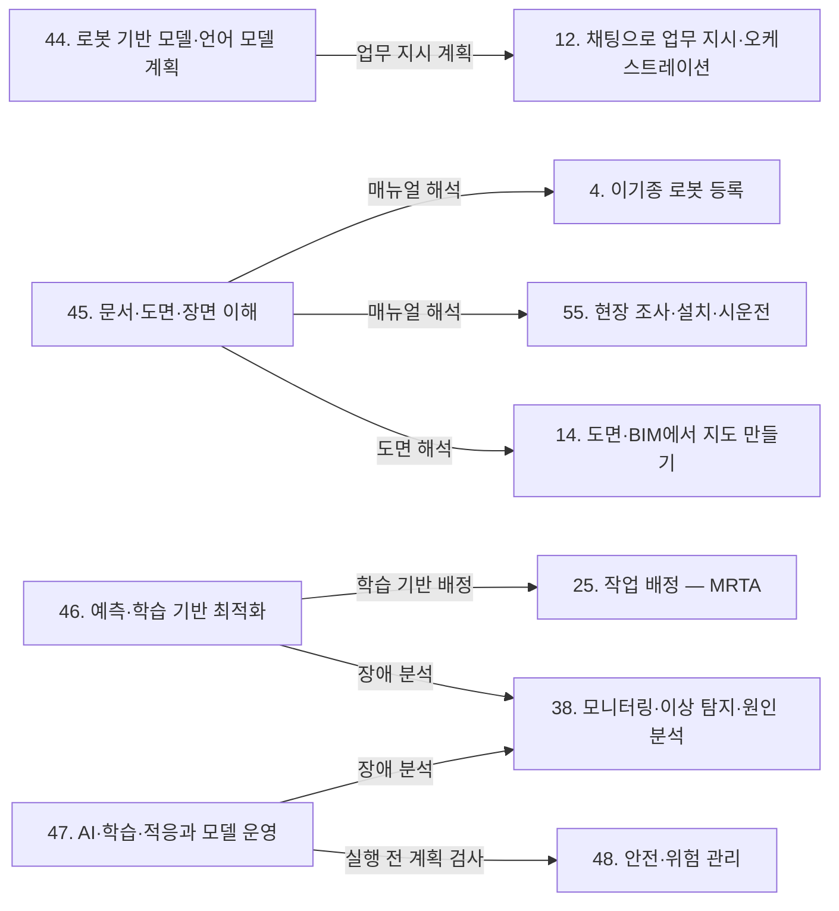

(너의 규칙은 시스템 프롬프트의 agents/shared-rules.md 와 agents/storyteller.md 이다. 아래는 이번 실행의 컨텍스트와 입력이다.)

## 실행 컨텍스트

- run_id: 2026-10-12-05
- date: 2026-10-12
- run_type: update (갱신)
- 대상: 44. 로봇 기반 모델·언어 모델 계획 (L. AI·학습 기술)
- 예산:
    - max_search_queries: 30
    - max_sources_per_run: 15
    - new_topic_pages: 1
    - page_updates: 2
    - max_retries: 2
- 환경 알림: web_fetch_available: true · fetch_mode: full
- 언어: ko

## 입력

### runs/2026-10-12-05/target.json

```json
{
  "run_id": "2026-10-12-05",
  "date": "2026-10-12",
  "weekday": "Mon",
  "run_number": 177,
  "run_type": "update",
  "forced": true,
  "target": {
    "area_no": 44,
    "area_name": "44. 로봇 기반 모델·언어 모델 계획",
    "category": "L. AI·학습 기술",
    "category_letter": "L"
  },
  "topic": null,
  "track": null,
  "corrections": [],
  "budget": {
    "max_search_queries": 30,
    "max_sources_per_run": 15,
    "new_topic_pages": 1,
    "page_updates": 2,
    "max_retries": 2
  },
  "priority_reason": null,
  "priority_questions": [],
  "excluded_areas": [],
  "lifted_areas": [],
  "deferred": {
    "monthly_recheck": false,
    "weekly_review": false
  },
  "selection_rationale": "CLI 지정 run_type=update, area=44"
}
```

### runs/2026-10-12-05/research.json

```json
{
  "run_id": "2026-10-12-05",
  "date": "2026-10-12",
  "run_type": "update",
  "target": {
    "area_no": 44,
    "area_name": "44. 로봇 기반 모델·언어 모델 계획",
    "category": "L. AI·학습 기술"
  },
  "gaps": [
    "섹션 5. 적용 사례 — 제조 공장 사례가 BMW 보도자료(ref-1051) 하나에 기대며, 93행 'Figure AI 자체 발표로는 교차 확인하지 못했다'가 Figure AI 발표(2025-11-19, 2026-06-30)의 존재와 맞지 않음. 10개월·11개월 문구의 출처 위치(CEO 인용·본문)와 Figure 쪽 기간 축, 99% 성공률이 목표치라는 구분이 없음. 연구 실물 사례(IMR-LLM 로봇 팔 3대)도 없음",
    "섹션 6. 대표 접근법과 기술(분리 2026-09-30-area44-s6) — SMART-LLM·IMR-LLM 은 초록 수준 서술뿐이라 평가 규모(36 지시, 23장면·50작업)·실패 양상(불가능 과제, 도달 불가 배정)·풀이 방식(FIFO)이 없고, LLM+P·KnowNo 류 보장의 입력 전제(사람이 준 도메인, i.i.d., 무오류 실행)가 적혀 있지 않음. 다중 로봇 등각 예측 계획(S-ATLAS) 없음. disjunctive graph 번역어가 위키 안에서 셋으로 갈림",
    "섹션 7. 관련 표준·프레임워크·오픈소스(분리 2026-09-30-area44-s7) — 'OpenVLA의 라이선스는 확인하지 못했다'(표 바로 아래)와 GR00T N1 '오픈소스(공개 모델)' 표기에 코드·가중치 라이선스 구분과 문서 간 충돌이 없음. VLA 배포물의 입출력 계약(정규화·행동 청크·개방 루프)과 GR00T N1.7 EA 상태, ROSA 의 물리 실행 조건이 없음",
    "섹션 8. 대표 연구와 자료(분리 2026-09-30-area44-s8) — 최근 로봇 기반 모델(π0.7)과 VLA 견고성 벤치마크(LIBERO-Plus)가 없고, 국내 동향이 2025-05 기사 하나뿐(산업부 M.AX 휴머노이드 과제 표 없음)",
    "섹션 9. 책임 경계 — 도구 호출(MCP)로 로봇을 움직일 때 힌트·권한·승인·세션 종료·물리 정지의 관계가 없음",
    "섹션 11. 열린 질문(분리 2026-09-30-area44-s11) — oq-216~oq-219 모두 열림. 부분 근거(배포물별 입출력, 연구 벤치마크 규모, Figure 기간 축)가 연결돼 있지 않음",
    "정정 요청 없음(target.json corrections 비어 있음). 메모·검증에서 나온 위키 내부 정정: s7 OpenVLA 라이선스 문장, 5절 93행 Figure 자체 발표 문장"
  ],
  "research_questions": [
    "범용 로봇 모델과 언어 모델은 오케스트레이션의 무엇을 바꾸는가? [분류원문]",
    "oq-217 언어 모델 기반 다중 로봇 계획기의 공개 평가는 어떤 규모·조건(시뮬레이션/실물, 로봇 수)이며 어떤 실패 양상(능력 밖 배정)을 보고하는가? (섹션 5·6 겨냥)",
    "기호 계획기 결합·등각 예측 기반 계획의 검증·보장은 어떤 입력 전제(도메인 제공자, 분포 가정, 스킬 실행 성공)에 기대는가? (섹션 6 겨냥)",
    "oq-216 VLA 를 등록하려면 배포물마다 어떤 입출력(행동 공간·정규화·행동 청크·제어 모드)과 공개 상태(EA/GA)를 확인해야 하는가? (섹션 7·8 겨냥)",
    "OpenVLA·GR00T N1.7·openpi 의 코드와 가중치 사용 조건은 각 문서에서 무엇이라 적혀 있고 서로 맞는가? (섹션 7 겨냥)",
    "언어 모델 도구 호출(MCP·ROSA)로 로봇을 움직일 때 권한·승인·세션 종료와 물리 정지는 어떻게 나뉘는가(oq-141 관련)? (섹션 7·9 겨냥)",
    "oq-218·oq-219 BMW–Figure 와 국내 물류 실증 발표에서 목표·기간·첫 시연과 실측 성과는 어떻게 구분되는가? (섹션 5·8·11 겨냥)"
  ],
  "findings": [
    {
      "id": "f1",
      "claim": "SMART-LLM 의 평가 데이터셋은 AI2-THOR 가정 시뮬레이션의 고수준 지시 36개로 구성되며, 과제마다 로봇 1~4대를 쓴다.",
      "tag": "사실",
      "source_ids": [
        "ref-090"
      ],
      "cross_checked": false,
      "confidence": "medium",
      "evidence_excerpt": "arXiv v2 §V-A: \"36 high-level instructions\", 과제별 로봇 1~4대, AI2-THOR. 기존 위키(docs/tracks/chat-based-configuration-and-operation/stage-2-data-and-standards.md 166행 '36개 상위 지시 … 원문 미열람', 같은 파일 370행)의 저자 보고 수치를 원문 확인으로 보강하는 것이며 새 사실 추가가 아니다. 실물 시험(대수·반복 수)은 이 수치와 별개",
      "as_of": "2026-10-12",
      "site_type": null,
      "flow_item": null
    },
    {
      "id": "f2",
      "claim": "SMART-LLM 의 불가능 과제 시험(어떤 로봇도 필요한 스킬을 갖지 않은 과제)에서 GPT-4·Claude-3 기반 구성은 배정 계획을 만들지 않았고, GPT-3.5·Llama2 기반 구성은 과제에 맞지 않는 로봇이 들어간 배정 계획을 만들었다. 이 시험은 표 I 집계에 들어 있지 않고 과제 수도 보고되지 않았다.",
      "tag": "사실",
      "source_ids": [
        "ref-090"
      ],
      "cross_checked": false,
      "confidence": "medium",
      "evidence_excerpt": "arXiv v2 §VI-A 'Infeasible Scenarios': \"GPT-4 and Claude-3 backbones exhibited the capacity to discern this situation and refrained from generating any task allocation plan. In contrast, … GPT-3.5 and Llama2 produced a task allocation plan involving robots ill-suited …\", \"This particular scenario is not included in Table I\". Claude-3 비교는 v2 에만 있다. 모든 모델·모든 실행으로 일반화하지 않음",
      "as_of": "2026-10-12",
      "site_type": null,
      "flow_item": null
    },
    {
      "id": "f3",
      "claim": "IMR-Bench 는 생산 라인 설계 전문가가 실제 산업 현장에서 수집·각색한 장면 23개(장면당 로봇 1~7대)를 바탕으로 제조 작업 50개를 구성한 벤치마크이며, KunWu 플랫폼 위에 만들어졌다.",
      "tag": "사실",
      "source_ids": [
        "ref-170"
      ],
      "cross_checked": false,
      "confidence": "medium",
      "evidence_excerpt": "arXiv v1 §V-A Dataset: \"our benchmark comprises 23 scenes collected and adapted from real industrial environments by production line design experts. Each scene involves between 1 to 7 robots\", 제조 작업 50개. ICRA 2026 pp.7609–7616. 기존 위키 C 트랙(stage-1-prior-work-and-products.md 240·310행) 'IMR-Bench 규모 미확인'에 답함. 실험 데이터셋이며 상용 플릿 실적이 아님",
      "as_of": "2026-10-12",
      "site_type": null,
      "flow_item": null
    },
    {
      "id": "f4",
      "claim": "IMR-LLM 구현은 언어 모델이 구성을 도운 이접 그래프(disjunctive graph)의 일정을 휴리스틱 FIFO(선입선출) 알고리즘으로 푼다.",
      "tag": "사실",
      "source_ids": [
        "ref-170"
      ],
      "cross_checked": false,
      "confidence": "medium",
      "evidence_excerpt": "arXiv v1 §IV-A: \"we use a heuristic First-In-First-Out (FIFO) [33] algorithm to solve the disjunctive graph\". 결정적 풀이를 전역 최적 보장으로 읽지 않음. 용어가 위키에 '선택 그래프'(2026-09-30-area44-s6.md 57행), '선언 그래프'(C 트랙 stage-1 112행), '이접 그래프'(같은 파일 240행)로 흩어져 있음",
      "as_of": "2026-10-12",
      "site_type": null,
      "flow_item": null
    },
    {
      "id": "f5",
      "claim": "IMR-LLM 의 실물 시험은 컨베이어에 공작물을 옮기는 로봇 팔 3대의 단일 장면이었고, 전문가가 약 15분 걸려 장면 설명을 손으로 작성해 입력했다. 반복 횟수는 보고되지 않았다.",
      "tag": "사실",
      "source_ids": [
        "ref-170"
      ],
      "cross_checked": false,
      "confidence": "medium",
      "evidence_excerpt": "arXiv v1 §V-C: \"This scene consists of three robotic arms\", \"we used a manually constructed scene description, which took an expert approximately 15 minutes\". 반복 횟수·오류율 미보고. 장기 공장 배치 증거가 아님(기존 위키 9절 138행·s6 57행 '초록에 실제 공장 배치 없음'과 일치)",
      "as_of": "2026-10-12",
      "site_type": null,
      "flow_item": null
    },
    {
      "id": "f6",
      "claim": "IMR-LLM 저자는 복잡한 다중 로봇 작업에서 성공률이 떨어진 주된 이유로 언어 모델의 잘못된 분해·배정(예: 팔이 닿지 않는 로봇에 작업 배정)을 들었으나, 그 빈도는 정량화하지 않았다.",
      "tag": "사실",
      "source_ids": [
        "ref-170"
      ],
      "cross_checked": false,
      "confidence": "medium",
      "evidence_excerpt": "arXiv v1 §V-B: \"we observed a decline in the SR for complex multi-robot tasks … incorrect decompositions and allocations (e.g., assigning an operation to an out-of-reach robot), which directly leads to a decrease in OC\". OC(작업 일관성) 하락 원인 예시이며 오류 건수는 없음",
      "as_of": "2026-10-12",
      "site_type": null,
      "flow_item": null
    },
    {
      "id": "f7",
      "claim": "LLM+P 는 행동의 전제·효과를 담은 PDDL 도메인 파일을 사람 전문가가 제공한다는 것을 입력 전제로 둔다. 언어 모델은 문제(problem) 파일만 만든다.",
      "tag": "사실",
      "source_ids": [
        "ref-092"
      ],
      "cross_checked": false,
      "confidence": "medium",
      "evidence_excerpt": "arXiv v3 §III-C: \"a human expert can provide\" 도메인 PDDL. 기존 위키의 [추정](C 트랙 stage-1-prior-work-and-products.md 80행, task-model-draft.md 133행 '사람이 미리 정의 … 이 위키의 정리')을 LLM+P 에 대해서는 직접 근거로 보강. 생성된 problem 이 현장 상태와 맞는지의 검증과는 별개",
      "as_of": "2026-10-12",
      "site_type": null,
      "flow_item": null
    },
    {
      "id": "f8",
      "claim": "S-ATLAS(등각 예측 기반 다중 로봇 언어 계획기)의 임무 성공률 보장은 보정(calibration) 시나리오와 시험 시나리오가 독립·동일분포(i.i.d.)라는 조건 아래에서만 성립한다.",
      "tag": "사실",
      "source_ids": [
        "ref-1607"
      ],
      "cross_checked": false,
      "confidence": "medium",
      "evidence_excerpt": "arXiv v4 Remark III.6: \"calibration and test scenarios are i.i.d.\". IEEE RA-L 10(1):160–167(2025-01). 확률은 명시한 시나리오 분포에서 정의되며 분포가 바뀐 현장까지 넓히지 않음",
      "as_of": "2026-10-12",
      "site_type": null,
      "flow_item": null
    },
    {
      "id": "f9",
      "claim": "S-ATLAS 의 임무 완료율 정리(Theorem IV.2(a))는 계획 실행에 오류가 없다는 전제를 두며, 증명은 예측 집합이 단일 원소가 아닐 때 사람이 정확한 도움을 준다는 것도 전제한다.",
      "tag": "사실",
      "source_ids": [
        "ref-1607"
      ],
      "cross_checked": false,
      "confidence": "medium",
      "evidence_excerpt": "arXiv v4 Theorem IV.2(a): \"Assuming error-free execution\"; 초록 \"assuming successful plan execution\", 기여 (i) \"assuming successful execution of robot skills\". 물리적 실패·안전 인증에 대한 보장이 아님",
      "as_of": "2026-10-12",
      "site_type": null,
      "flow_item": null
    },
    {
      "id": "f10",
      "claim": "S-ATLAS 는 AI2-THOR 시뮬레이션의 검증 시나리오 110개로 평가했고 로봇 수는 1·3·10·15대였다. 열람한 본문에서 실물 로봇 실험은 확인되지 않았다.",
      "tag": "사실",
      "source_ids": [
        "ref-1607"
      ],
      "cross_checked": false,
      "confidence": "medium",
      "evidence_excerpt": "arXiv v4 §V·§V-A: \"110 (validation) scenarios\", N∈{1,3,10,15}, AI2-THOR. hardware/real robot 실험 서술 없음(본문 검색 기준). 15대는 시뮬레이터 대수",
      "as_of": "2026-10-12",
      "site_type": null,
      "flow_item": null
    },
    {
      "id": "f11",
      "claim": "OpenVLA 모델 카드에 따르면 OpenVLA 는 언어 지시와 카메라 영상 한 장을 입력받아 정규화된 7자유도 엔드이펙터 변위(x, y, z, roll, pitch, yaw, gripper)를 출력하며, 실제 로봇에서 실행하려면 로봇·데이터셋별로 계산한 통계로 역정규화해야 한다.",
      "tag": "사실",
      "source_ids": [
        "ref-1609"
      ],
      "cross_checked": false,
      "confidence": "medium",
      "evidence_excerpt": "Hugging Face openvla/openvla-7b 카드 Uses: \"predict (normalized) robot actions consisting of 7-DoF end-effector deltas … actions need to be *un-normalized* subject to statistics computed on a per-robot, per-dataset basis\". 공통 능력 등록 스키마가 아니라 배포물의 입출력 설명",
      "as_of": "2026-10-12",
      "site_type": null,
      "flow_item": null
    },
    {
      "id": "f12",
      "claim": "OpenVLA 공식 저장소(고정 커밋 c8f03f4)의 코드 라이선스는 MIT 다.",
      "tag": "사실",
      "source_ids": [
        "ref-1608"
      ],
      "cross_checked": false,
      "confidence": "medium",
      "evidence_excerpt": "LICENSE 표제 \"MIT License\"; README 606행 \"`LICENSE` - All code is made available under the MIT License\". 가중치 조건과 분리해 기록. 기존 위키 2026-09-30-area44-s7.md 표 아래 'OpenVLA의 라이선스는 확인하지 못했다'를 정정할 근거",
      "as_of": "2026-10-12",
      "site_type": null,
      "flow_item": null
    },
    {
      "id": "f13",
      "claim": "같은 OpenVLA README 는 사전학습 모델이 기반 모델의 제약을 물려받을 수 있으며, 두 모델이 Llama 2 에서 파생됐으므로 Llama Community License 가 적용될 수 있다고 적는다.",
      "tag": "사실",
      "source_ids": [
        "ref-1608"
      ],
      "cross_checked": false,
      "confidence": "medium",
      "evidence_excerpt": "README 99–101행: \"our pretrained models may inherit restrictions from the underlying base models we use. Specifically, both the above models are derived from Llama-2, and as such are subject to the [Llama Community License]\". 검증에 따라 '적용된다'가 아니라 '적용될 수 있다'로 완화(앞 문장 'may inherit'). 법적 적용 판정이 아님",
      "as_of": "2026-10-12",
      "site_type": null,
      "flow_item": null
    },
    {
      "id": "f14",
      "claim": "OpenVLA 의 Hugging Face 모델 카드는 \"모든 OpenVLA 체크포인트와 학습 코드가 MIT 라이선스로 공개된다\"고 적어, 저장소 README 의 Llama Community License 적용 가능 문구와 충돌한다. 현재 main 판(커밋 47a0ec7, 2026-02-17)도 같은 문구이며, 두 문서는 같은 개발팀 자료라 어느 쪽이 맞는지는 문서만으로 정할 수 없다.",
      "tag": "사실",
      "source_ids": [
        "ref-1609",
        "ref-1608"
      ],
      "cross_checked": false,
      "confidence": "medium",
      "evidence_excerpt": "카드 20행: \"All OpenVLA checkpoints, as well as our training codebase are released under an MIT License.\", 메타데이터 license: mit. 메모가 고정한 리비전 258bd1d(2024-11-29)는 현재 main 이력에 없어 main(47a0ec7) 기준으로 대조. README·카드는 같은 프로젝트 자료라 독립 교차 확인이 아님. 충돌 해소(명시적 정정)는 확인 못 함",
      "as_of": "2026-10-12",
      "site_type": null,
      "flow_item": null
    },
    {
      "id": "f15",
      "claim": "openpi 원격 추론 예시는 정책 서버가 (action_horizon, action_dim) 형태의 행동 청크(action chunk)를 돌려준다고 설명한다.",
      "tag": "사실",
      "source_ids": [
        "ref-1610"
      ],
      "cross_checked": false,
      "confidence": "medium",
      "evidence_excerpt": "openpi 커밋 215abfb docs/remote_inference.md Querying 예시 주석: \"This returns an action chunk of shape (action_horizon, action_dim).\" 인터페이스 서술(벤더 성능 주장이 아님). 명령 수락·작업 완료 상태와 같지 않음",
      "as_of": "2026-10-12",
      "site_type": null,
      "flow_item": null
    },
    {
      "id": "f16",
      "claim": "같은 openpi 예시는 다음 추론 호출 전까지 예측된 행동 청크의 나머지 행동을 개방 루프(open-loop)로 실행하도록 안내한다.",
      "tag": "사실",
      "source_ids": [
        "ref-1610"
      ],
      "cross_checked": false,
      "confidence": "medium",
      "evidence_excerpt": "docs/remote_inference.md 63행 주석: \"… from the predicted action chunk open-loop in the remaining steps.\" 예시 동작 설명이며 네트워크 장애·청크 유효기간·안전 정지 기능의 근거가 아님",
      "as_of": "2026-10-12",
      "site_type": null,
      "flow_item": null
    },
    {
      "id": "f17",
      "claim": "openpi README(커밋 215abfb)가 제공하는 기반 체크포인트는 π0, π0-FAST, π0.5 뿐이며, π0.7 가중치는 목록에 없다.",
      "tag": "사실",
      "source_ids": [
        "ref-1610"
      ],
      "cross_checked": false,
      "confidence": "medium",
      "evidence_excerpt": "README 'Model Checkpoints' 표 66–68행: pi0_base, pi0_fast_base, pi05_base. π0.7 기술 보고서(ref-1613)와 공개 배포물의 대응이 없음을 뜻하며, π0.7 의 결과를 openpi 로 재현할 수 있다고 보지 않음",
      "as_of": "2026-10-12",
      "site_type": null,
      "flow_item": null
    },
    {
      "id": "f18",
      "claim": "NVIDIA Isaac GR00T 저장소의 n1.7-release README 는 GR00T N1.7 을 Early Access(EA) 릴리스로 명시하고, GA(정식) 릴리스 전까지 지원·안정성 보장이 제한되며 상용 지원을 포함한 운영 배치는 GA 대상이라고 적는다.",
      "tag": "사실",
      "source_ids": [
        "ref-1611"
      ],
      "cross_checked": false,
      "confidence": "medium",
      "evidence_excerpt": "README 49–59행: \"This is an Early Access (EA) release. … support and stability guarantees are limited until the GA release.\", GA 항목 \"Production deployment with commercial support\"; 507·511행 EA 기간 PR 미수용·best-effort 지원. 브랜치 이름 기준 열람이며 커밋 sha 로 고정하지 못함",
      "as_of": "2026-10-12",
      "site_type": null,
      "flow_item": null
    },
    {
      "id": "f19",
      "claim": "같은 GR00T README 의 License 절은 코드는 Apache 2.0, 모델 가중치는 NVIDIA Open Model License 로 구분한다.",
      "tag": "사실",
      "source_ids": [
        "ref-1611"
      ],
      "cross_checked": false,
      "confidence": "medium",
      "evidence_excerpt": "README 514–517행: \"Code: Apache 2.0 — see LICENSE\", \"Model weights: NVIDIA Open Model License\". 저장소 LICENSE 파일은 Apache 2.0",
      "as_of": "2026-10-12",
      "site_type": null,
      "flow_item": null
    },
    {
      "id": "f20",
      "claim": "GR00T README 소개 문단은 \"GR00T N1.7 은 Apache 2.0 으로 완전히 상용 라이선스가 가능하다\"고 적지만, 이는 같은 README 의 License 절(가중치는 별도 라이선스)·가중치 저장소 LICENSE(3.3절 비상업 한정)와 맞지 않는 벤더 소개 문구다.",
      "tag": "추정",
      "source_ids": [
        "ref-1611",
        "ref-1612"
      ],
      "cross_checked": false,
      "confidence": "low",
      "evidence_excerpt": "벤더 주장: README 71행 \"GR00T N1.7 is fully commercially licensable under Apache 2.0.\" 같은 문서 514–517행과 GR00T-N1.7-3B LICENSE §3.3(f21)이 이와 다르게 적는다. 소개 문구만으로 가중치 상용 허용을 확정하지 않음",
      "as_of": "2026-10-12",
      "site_type": null,
      "flow_item": null
    },
    {
      "id": "f21",
      "claim": "Hugging Face nvidia/GR00T-N1.7-3B 저장소의 LICENSE 파일(커밋 6949d5d, 현재 main 과 같음)은 'NVIDIA License' 표제 아래 3.3절에서 저작물과 파생물을 연구·평가 목적의 비상업 용도로만 쓸 수 있게 하고, NVIDIA 와 그 계열사는 상업적으로 쓸 수 있다는 예외를 둔다.",
      "tag": "사실",
      "source_ids": [
        "ref-1612"
      ],
      "cross_checked": false,
      "confidence": "medium",
      "evidence_excerpt": "LICENSE §3.3 Use Limitation: \"The Work and any derivative works thereof only may be used or intended for use non-commercially. Notwithstanding the foregoing, NVIDIA Corporation and its affiliates may use the Work and any derivative works commercially. As used herein, 'non-commercially' means for research or evaluation purposes only.\" 이 파일만 서술하며 모든 N1.7 배포물의 사용 금지로 넓히지 않음",
      "as_of": "2026-10-12",
      "site_type": null,
      "flow_item": null
    },
    {
      "id": "f22",
      "claim": "GR00T N1.7 가중치의 사용 조건은 세 문서가 서로 다르게 적는다: README 소개(Apache 2.0 으로 상용 가능), README License 절과 3B 모델 카드(NVIDIA Open Model License, 카드는 '상업·비상업 사용 준비'), 3B 저장소 LICENSE 파일(NVIDIA License 3.3절 비상업 한정). 어느 문서가 우선하는지는 문서에 적혀 있지 않다.",
      "tag": "사실",
      "source_ids": [
        "ref-1611",
        "ref-1612"
      ],
      "cross_checked": false,
      "confidence": "medium",
      "evidence_excerpt": "README 71·514–517행; GR00T-N1.7-3B 카드(main) \"This model is ready for commercial/non-commercial use.\", \"released under the NVIDIA Open Model License Agreement\"; 같은 저장소 LICENSE 표제 \"NVIDIA License\" §3.3. 모두 NVIDIA 자료라 독립 확인이 아니며 법적 우선순위는 판단하지 않음. 기존 위키 2026-09-30-area44-s7.md 표의 'GR00T N1 — 오픈소스(공개 모델)' 표기와도 관련",
      "as_of": "2026-10-12",
      "site_type": null,
      "flow_item": null
    },
    {
      "id": "f23",
      "claim": "Physical Intelligence 의 π0.7 기술 보고서는 관절(joint)·엔드이펙터(ee) 행동을 함께 학습하고 프롬프트의 텍스트 식별자 c∈{joint, ee} 로 실행 제어 모드를 지정해 실행 시 과제에 따라 고른다고 설명한다.",
      "tag": "추정",
      "source_ids": [
        "ref-1613"
      ],
      "cross_checked": false,
      "confidence": "low",
      "evidence_excerpt": "벤더 주장: arXiv v2 §V-D: \"use a text identifier c∈{joint, ee} to designate the control mode in the prompt. Then at runtime, we can pick the control mode depending on the task.\" 단일 회사 보고서이며 구현을 실행해 확인하지 않음",
      "as_of": "2026-10-12",
      "site_type": null,
      "flow_item": null
    },
    {
      "id": "f24",
      "claim": "π0.7 보고서는 추론 지연에 대비해 학습 중 0~12 타임스텝의 지연을 모사했고, 이는 50 Hz 로봇에서 최대 240 ms 에 해당한다고 적는다. 이는 학습 조건이며 측정된 추론 지연이 아니고, 보고서의 UR5e 로봇은 20 Hz 로 동작한다.",
      "tag": "추정",
      "source_ids": [
        "ref-1613"
      ],
      "cross_checked": false,
      "confidence": "low",
      "evidence_excerpt": "벤더 주장: arXiv v2 §VI-B: \"During training, we simulate delays of 0 to 12 timesteps, corresponding to a maximum inference latency of 240ms on a 50Hz robot.\"; 실험 로봇 플랫폼 설명(Fig. 4 다음 문단): \"The UR5e robots run at 20 Hz, while all other robots run at 50 Hz.\" 네트워크 포함 실측 최대 지연·다중 로봇 동시 추론 수치는 없음(oq-104 관련 근거로만)",
      "as_of": "2026-10-12",
      "site_type": null,
      "flow_item": null
    },
    {
      "id": "f25",
      "claim": "π0.7 저자들은 학습 데이터가 매우 커서 평가 과제가 학습 때 본(seen) 과제인지 처음 보는(unseen) 과제인지 확정하기 어렵다고 스스로 밝힌다.",
      "tag": "추정",
      "source_ids": [
        "ref-1613"
      ],
      "cross_checked": false,
      "confidence": "low",
      "evidence_excerpt": "arXiv v2 §X Discussion(seen/unseen 구분의 어려움). 회사 연구진의 한계 진술을 옮긴 것으로, 새 과제 무데이터 성공이나 이기종 플릿 일반화 보장의 근거로 쓰지 않음. 단일 출처",
      "as_of": "2026-10-12",
      "site_type": null,
      "flow_item": null
    },
    {
      "id": "f26",
      "claim": "LIBERO-Plus 는 LIBERO 시뮬레이션 조작 과제에서 물체 배치, 카메라 시점, 로봇 초기 상태, 언어 지시, 조명, 배경 질감, 센서 잡음의 7개 축으로 입력을 하나씩 교란해 VLA 모델의 견고성을 평가한다.",
      "tag": "사실",
      "source_ids": [
        "ref-1614",
        "ref-1615"
      ],
      "cross_checked": false,
      "confidence": "medium",
      "evidence_excerpt": "arXiv v3 §2.1: \"seven common single-dimension perturbations\"; CVPR 2026 게재본 Table 2 열(Camera, Robot, Language, Light, Background, Noise, Layout). 두 판은 같은 연구팀 자료라 독립 교차 확인이 아님. 단일 팔 조작 시뮬레이션이며 현장 플릿 평가가 아님",
      "as_of": "2026-10-12",
      "site_type": null,
      "flow_item": null
    },
    {
      "id": "f27",
      "claim": "LIBERO-Plus 에서 OpenVLA-OFT 의 성공률은 교란 없는 원본 97.1% 에서 로봇 초기 상태 교란 시 크게 떨어진다. 수치는 판마다 다르다: arXiv v3 표 1 은 로봇 초기 상태 37.2%·카메라 시점 59.7%, CVPR 2026 게재본(제목 'LIBERO-Plus: A Progressive Robustness Benchmark for Visual-Language-Action Models') 표 2 는 로봇 초기 상태 31.9%·카메라 시점 56.4% 다.",
      "tag": "사실",
      "source_ids": [
        "ref-1614",
        "ref-1615"
      ],
      "cross_checked": false,
      "confidence": "medium",
      "evidence_excerpt": "arXiv v3 Table 1 OpenVLA-OFT 행: 97.1 | 59.7 | 37.2 | 81.5 | 85.8 | 92.4 | 76.7 | 77.1. CVPR 2026 게재본(pp.38574–38583) Table 2 OpenVLA-OFT 행: Original 97.1, Camera 56.4, Robot 31.9, Language 79.5, Light 88.7, Background 93.3, Noise 75.8, Layout 74.2, Total 69.6. 검증 수정: 메모의 '97.1/37.2'는 v3 값이라 판을 명시하고 게재본 값을 병기. 직접 재실행하지 않음",
      "as_of": "2026-10-12",
      "site_type": null,
      "flow_item": null
    },
    {
      "id": "f28",
      "claim": "ROSA FAQ 는 핵심 ROSA 에이전트가 텍스트 상호작용에 한정되어 물리 세계와 상호작용할 수 없으며, 물리적 상호작용에는 사용자가 맞춤 도구와 프롬프트를 만들어야 한다고 설명한다.",
      "tag": "사실",
      "source_ids": [
        "ref-1616"
      ],
      "cross_checked": false,
      "confidence": "medium",
      "evidence_excerpt": "nasa-jpl/rosa Wiki FAQ 'What are ROSA's limitations?' 88행: \"The core ROSA agent is limited to text-based interactions and cannot interact with the physical world. To enable physical interactions, you will need to create custom tools and prompts.\" 릴리스에 고정되지 않은 위키 문서(접근일 기준)",
      "as_of": "2026-10-12",
      "site_type": null,
      "flow_item": null
    },
    {
      "id": "f29",
      "claim": "같은 ROSA FAQ 는 로봇 능력을 넘는 행동을 막으려면 맞춤 도구 안에 실행 전 로봇 상태·능력 확인 제약과 매개변수 검증·행동 제한 같은 안전 검사를 직접 넣으라고 권고한다.",
      "tag": "사실",
      "source_ids": [
        "ref-1616"
      ],
      "cross_checked": false,
      "confidence": "medium",
      "evidence_excerpt": "FAQ 'Safety and Guardrails' 128행 \"Add safety checks to your custom tools to validate parameters and limit actions.\", 'How can I ensure that ROSA does not perform actions that are outside the robot's capabilities?' 152–156행 \"Implement constraints in your custom tools to check the robot's state and capabilities before executing actions.\" 기존 위키 C 트랙 stage-1-prior-work-and-products.md 118행 [추정]('README·Custom Agents 위키 범위에서 확인·권한 장치 설명이 없다')은 FAQ 범위에서는 맞지 않아 후속 정리가 필요. 권고이며 자동 제공 기능이 아님",
      "as_of": "2026-10-12",
      "site_type": null,
      "flow_item": null
    },
    {
      "id": "f30",
      "claim": "MCP 공식 블로그(2026-03-16)는 도구 어노테이션(readOnlyHint·destructiveHint 등)이 위험을 알리는 힌트일 뿐 실행 강제 수단이 아니며, 확실한 보장이 필요하면 네트워크 통제나 샌드박스로 해야 한다고 설명한다.",
      "tag": "사실",
      "source_ids": [
        "ref-1617"
      ],
      "cross_checked": false,
      "confidence": "medium",
      "evidence_excerpt": "블로그 'What Annotations Can't Do' 75행: \"They aren't enforcement. If you need a guarantee that a tool can't exfiltrate data, that's a job for network controls or sandboxing, not a boolean hint.\" 규범 명세 개정이 아니라 프로젝트의 해설 글. 기존 위키의 MCP 명세(2025-06-18) 서술 — 2026-09-29-area13-s6.md 45행(ref-856: 신뢰하지 않는 서버의 주석 불신, 프로토콜은 강제 불가), C 트랙 stage-4-misinterpretation-safeguards.md 253행(ref-696) — 과 같은 방향이며 이를 보완함",
      "as_of": "2026-10-12",
      "site_type": null,
      "flow_item": null
    },
    {
      "id": "f31",
      "claim": "PickNik 의 MoveIt Pro MCP 서버 문서는 공유되는 배포(deployment) MCP 키는 읽기 전용이고, 로봇 동작은 호스트 사용자 세션에서 기존 Objective 를 시작·취소하는 것으로만 한정된다고 설명한다.",
      "tag": "추정",
      "source_ids": [
        "ref-1618"
      ],
      "cross_checked": false,
      "confidence": "low",
      "evidence_excerpt": "벤더 주장: MoveIt Pro 문서(Version 10) 74·78행: \"deployment MCP key is read-only because it is shared\", \"Robot motion over MCP is limited to starting and cancelling existing Objectives from a host-user session; the deployment MCP key never can.\" 제품을 실행해 확인하지 않음",
      "as_of": "2026-10-12",
      "site_type": null,
      "flow_item": null
    },
    {
      "id": "f32",
      "claim": "같은 문서는 MCP 서버가 별도의 실행 확인 프롬프트를 추가하지 않으며, 도구 승인은 MCP 클라이언트 설정에 달려 있고 클라이언트가 자동 승인할 수도 있다고 적는다.",
      "tag": "추정",
      "source_ids": [
        "ref-1618"
      ],
      "cross_checked": false,
      "confidence": "low",
      "evidence_excerpt": "벤더 주장: 78행: \"Your MCP client controls tool approval according to its configured permissions; clients may auto-approve calls. The server adds no confirmation prompt.\" oq-141(승인 관문 위치)의 부분 근거: 이 제품은 서버가 아니라 클라이언트에 승인을 맡김",
      "as_of": "2026-10-12",
      "site_type": null,
      "flow_item": null
    },
    {
      "id": "f33",
      "claim": "같은 문서는 run_objective 로 시작한 로봇이 세션이 끝나도 계속 움직일 수 있고, cancel_objective 는 최선 노력(best effort)일 뿐 비상 정지가 아니며 MCP 취소·소프트웨어 정지는 물리적 비상 정지를 대체하지 않는다고 적는다.",
      "tag": "추정",
      "source_ids": [
        "ref-1618"
      ],
      "cross_checked": false,
      "confidence": "low",
      "evidence_excerpt": "벤더 주장: 도구 표 119행 run_objective \"The robot may move, and keeps moving if the session ends.\"; 542행 \"cancel_objective is best effort, not an emergency stop. Neither MCP cancellation nor the Runtime's software stop controls replace physical emergency-stop controls.\" 세션 종료와 물리 정지를 같은 것으로 보지 않음",
      "as_of": "2026-10-12",
      "site_type": null,
      "flow_item": null
    },
    {
      "id": "f34",
      "claim": "Figure AI 의 2025-11-19 발표는 BMW 스파턴버그의 Figure 02 를 '11개월 배치'라고 부르면서, 개발 착수 뒤 6개월 안에 공장에 납품·시험을 시작하고 10개월 안에 생산 라인 전면 배치를 시작했으며 '6개월의 일일 가동'과 1,250시간 이상 가동을 적는다. 세 기간의 기점·종점이 달라 BMW 보도자료의 10개월·11개월 차이를 해소하지 못한다.",
      "tag": "추정",
      "source_ids": [
        "ref-1619",
        "ref-1051"
      ],
      "cross_checked": false,
      "confidence": "low",
      "evidence_excerpt": "벤더 주장: Figure 'F.02 Contributed to the Production of 30,000 Cars at BMW' 10행 \"an 11 month Figure 02 robot deployment … Within 6 months … began testing. Within 10 months, we launched full deployment\", 27행 \"Six months of daily runtime … 1,250+ operational hours\". BMW 보도자료(ref-1051)는 11개월이 Figure CEO 인용문, 10개월(\"over ten months\")이 본문. 10/11개월 충돌은 기존 위키(5절 89·91행, oq-219)에 있고 기간 축 차이만 새로 보탬. 같은 프로젝트 당사자 자료",
      "as_of": "2026-10-12",
      "site_type": null,
      "flow_item": null
    },
    {
      "id": "f35",
      "claim": "같은 Figure 발표에서 '교대당 99% 초과 성공률'과 '교대당 개입 0회'는 목표(target·goal)로 제시되며, 달성한 실측치로 보고되지 않았다.",
      "tag": "추정",
      "source_ids": [
        "ref-1619"
      ],
      "cross_checked": false,
      "confidence": "low",
      "evidence_excerpt": "벤더 주장: 22–23행 \"Our target was > 99% success per shift.\", \"The goal was zero per shift.\" 독립 생산 로그·분모 없음. 실측 달성률로 옮기지 않음",
      "as_of": "2026-10-12",
      "site_type": null,
      "flow_item": null
    },
    {
      "id": "f36",
      "claim": "Figure AI 는 2026-06-30 발표에서 BMW 스파턴버그 공장에서 Figure 03 이 물류 작업 흐름을 수행한 것을 '첫 시연'으로 설명하고, 자사 VLA 인 Helix 02 가 손·팔·몸통·발을 함께 제어해 무거운 대차를 끌었다고 적는다.",
      "tag": "추정",
      "source_ids": [
        "ref-1620"
      ],
      "cross_checked": false,
      "confidence": "low",
      "evidence_excerpt": "벤더 주장: Figure 'F.03 Arrives at BMW'(June 30, 2026) Highlights 14–15행: \"The first demonstration of Figure 03 performing a logistics workflow at BMW Group Plant Spartanburg.\", \"Helix 02, Figure's proprietary pixels-to-actions VLA …\". 첫 시연이며 지속 배치 성과(가동률·인계 로그)가 아님",
      "as_of": "2026-10-12",
      "site_type": null,
      "flow_item": null
    },
    {
      "id": "f37",
      "claim": "기존 위키 5절의 'Figure AI 자체 발표로는 교차 확인하지 못했다'(Figure 03 착수 문단)는 고쳐야 한다. Figure AI 자체 발표(2026-06-30, 2025-11-19)가 있으나, BMW 와 같은 프로젝트의 당사자 자료라 독립 교차 확인으로는 세지 않는다.",
      "tag": "추정",
      "source_ids": [
        "ref-1620",
        "ref-1619",
        "ref-1051"
      ],
      "cross_checked": false,
      "confidence": "low",
      "evidence_excerpt": "벤더 주장: 대상 문장은 docs/categories/ai-and-learning/robot-foundation-models-and-llm-planning.md 93행. Figure 발표 2건(ref-1619·ref-1620)이 BMW 보도자료(ref-1051)와 같은 배치·착수를 설명함. 세 출처 모두 벤더 문서라 '확인됨'이 아니라 '당사자 발표가 일치함'으로 적는 것이 맞음",
      "as_of": "2026-10-12",
      "site_type": null,
      "flow_item": null
    },
    {
      "id": "f38",
      "claim": "산업통상부 2025-11-24 보도자료에 따르면 산업부와 서울대가 M.AX 얼라이언스 협력 MOU 를 맺었고, 지원 과제 표의 휴머노이드 분과 과제는 '휴머노이드 AI 파운데이션 모델 개발'(2025~2028년, 484억 원, 핵심 연구진 장병탁·박재흥 서울대 교수)이다.",
      "tag": "사실",
      "source_ids": [
        "ref-1621"
      ],
      "cross_checked": false,
      "confidence": "medium",
      "evidence_excerpt": "motir.go.kr 보도자료(등록일 2025-11-24) 과제 표: \"휴머노이드 | '25~'28년, 484억원 | 장병탁, 박재흥 | 휴머노이드 AI 파운데이션 모델 개발\". 기업이 데이터·플랫폼을 주고 서울대가 모델을 개발해 기업에 다시 제공하는 구조. 기존 위키 5절 물류창고 사례의 로보티즈–BGF로지스 과제(ref-1052, 정부 출연금 약 60억 원)와 같은 사업인지는 확인되지 않음. 자동화율 80%·성공률 90% 실측 결과는 이 자료에도 없음(oq-218 미해결)",
      "as_of": "2026-10-12",
      "site_type": null,
      "flow_item": null
    },
    {
      "id": "f39",
      "claim": "스킬 목록이 없거나 로봇 능력 밖인 요청을 계획기가 거절하는지(또는 닿지 않는 로봇에 배정하지 않는지)를 일반 성공률과 별도의 수용 시험 항목으로 두어야 한다.",
      "tag": "의견",
      "source_ids": [
        "ref-090",
        "ref-170"
      ],
      "cross_checked": false,
      "confidence": "medium",
      "evidence_excerpt": "메모 A01·A03 ROP 시사점. 근거 f2(불가능 과제에서 일부 모델의 부적합 배정), f6(도달 불가 배정). 의견",
      "as_of": "2026-10-12",
      "site_type": null,
      "flow_item": null
    },
    {
      "id": "f40",
      "claim": "언어 모델 다중 로봇 계획의 검증 결과에는 일정 풀이 통과와 분해·배정의 정확성을 따로 적고, 계획 검증이 기대는 전제(사람이 준 도메인 판, i.i.d. 시나리오, 무오류 스킬 실행, 정확한 사람 도움)를 함께 기록해 전제가 깨질 때 보장 상태를 다시 평가해야 하며, 이 보장을 플릿의 물리적 안전 보장과 섞지 않아야 한다.",
      "tag": "의견",
      "source_ids": [
        "ref-170",
        "ref-092",
        "ref-1607"
      ],
      "cross_checked": false,
      "confidence": "medium",
      "evidence_excerpt": "메모 A02·A04·A05 ROP 시사점. 근거 f4, f7, f8, f9. 의견",
      "as_of": "2026-10-12",
      "site_type": null,
      "flow_item": null
    },
    {
      "id": "f41",
      "claim": "연구 논문의 실물 시험(예: 로봇 팔 3대 단일 장면)은 사례 표에 장면 작성자·시뮬레이션 확인·복구 책임을 함께 적고 장기 운영 실적으로 표시하지 않아야 한다.",
      "tag": "의견",
      "source_ids": [
        "ref-170"
      ],
      "cross_checked": false,
      "confidence": "medium",
      "evidence_excerpt": "메모 A03 ROP 시사점. 근거 f5. 의견",
      "as_of": "2026-10-12",
      "site_type": null,
      "flow_item": null
    },
    {
      "id": "f42",
      "claim": "VLA 탑재 로봇의 능력 등록에는 모델·가중치 revision(해시), 로봇 기종·카메라, 좌표계·행동 단위·제어 모드, 정규화 통계, 행동 청크의 형태·관측 시각·유효기간·중단 조건, 허용 과제와 완료 판정을 두고, 명령 완료는 로봇 외부 상태로 확인하는 것이 필요해 보인다. 이는 ROP 설계 제안이며 표준이 아니다.",
      "tag": "의견",
      "source_ids": [
        "ref-1609",
        "ref-1610",
        "ref-1613"
      ],
      "cross_checked": false,
      "confidence": "medium",
      "evidence_excerpt": "메모 A06·A08·A10 ROP 시사점. 근거 f11, f15, f16, f23. oq-216 의 부분 답(공통 등록 표준·적합성 시험은 확인 못 함). 의견",
      "as_of": "2026-10-12",
      "site_type": null,
      "flow_item": null
    },
    {
      "id": "f43",
      "claim": "공개 VLA 를 도입할 때 코드 라이선스와 가중치 사용 조건을 따로 확인하고, README 소개 문구만으로 상용 허용을 확정하지 않으며, 문서끼리 충돌하는 조건은 배포자에게 서면으로 확인할 항목으로 남겨야 한다.",
      "tag": "의견",
      "source_ids": [
        "ref-1608",
        "ref-1609",
        "ref-1611",
        "ref-1612"
      ],
      "cross_checked": false,
      "confidence": "medium",
      "evidence_excerpt": "메모 A07·A09 ROP 시사점. 근거 f12~f14, f18~f22. 법률 판단이 아님. 의견",
      "as_of": "2026-10-12",
      "site_type": null,
      "flow_item": null
    },
    {
      "id": "f44",
      "claim": "카메라 교체·로봇 초기 자세 변경 같은 교란을 로봇별 수용 시험에 넣고, 벤치마크 수치는 판(arXiv 판·게재본)을 밝혀 인용하며, 단일 팔 시뮬레이션 벤치마크 순위를 제조사 혼합 플릿 순위로 환산하지 않아야 한다.",
      "tag": "의견",
      "source_ids": [
        "ref-1614",
        "ref-1615"
      ],
      "cross_checked": false,
      "confidence": "medium",
      "evidence_excerpt": "메모 A11 ROP 시사점. 근거 f26, f27. 의견",
      "as_of": "2026-10-12",
      "site_type": null,
      "flow_item": null
    },
    {
      "id": "f45",
      "claim": "언어 모델이 도구 호출로 로봇을 움직이는 구성에서는 어노테이션 힌트나 클라이언트 자동 승인에 기대지 말고, ROP 쪽 런타임에서 읽기/실행 권한·실행 대상·승인된 계획 revision·goal id 와 물리적 완료 판정을 검사하며, 세션 종료를 별도의 정지 절차에 연결해야 한다.",
      "tag": "의견",
      "source_ids": [
        "ref-1617",
        "ref-1618",
        "ref-1616"
      ],
      "cross_checked": false,
      "confidence": "medium",
      "evidence_excerpt": "메모 A12·A13 ROP 시사점. 근거 f28~f33. 기존 위키 2026-09-29-area13-s6.md 45행의 '승인 관문은 ROP 쪽 호스트에' 추정과 같은 방향. 의견",
      "as_of": "2026-10-12",
      "site_type": null,
      "flow_item": null
    },
    {
      "id": "f46",
      "claim": "벤더·도입 기업 발표는 목표·기간·첫 시연과 실측 성과를 다른 열로 나누고, 운영 기간의 기점·종점, 성공률의 분모, 개입·실패 로그, 인계 신호가 공개될 때까지 도입 KPI 비교에 쓰지 않아야 한다. 국내 실증 목표(자동화율 80%·성공률 90%)도 같다.",
      "tag": "의견",
      "source_ids": [
        "ref-1619",
        "ref-1620",
        "ref-1051",
        "ref-1621"
      ],
      "cross_checked": false,
      "confidence": "medium",
      "evidence_excerpt": "메모 A14·A15 ROP 시사점. 근거 f34~f38. 의견",
      "as_of": "2026-10-12",
      "site_type": null,
      "flow_item": null
    }
  ],
  "sources": [
    {
      "id": "ref-090",
      "org": "Kannan, S. S., Venkatesh, V. L. N., & Min, B.-C.",
      "title": "SMART-LLM: Smart Multi-Agent Robot Task Planning using Large Language Models",
      "published": "2023-09",
      "url": "https://arxiv.org/abs/2309.10062",
      "type": "논문",
      "reliability": "medium",
      "accessed": "2026-10-12",
      "summary": "SMART-LLM 논문(기존 출처, IROS 2024 pp.12140–12147 게재). 이번에 arXiv v2 HTML 본문에서 36개 고수준 지시 데이터셋(§V-A)과 불가능 과제 시험(§VI-A)을 확인했다.",
      "fetched": true,
      "fetched_via": "webfetch",
      "fetch_url": "https://arxiv.org/html/2309.10062v2",
      "source_unopened": false
    },
    {
      "id": "ref-170",
      "org": "Su, X., Xu, J., van Kaick, O., Xu, K., & Hu, R.",
      "title": "IMR-LLM: Industrial Multi-Robot Task Planning and Program Generation using Large Language Models",
      "published": "2026-03",
      "url": "https://arxiv.org/abs/2603.02669",
      "type": "논문",
      "reliability": "medium",
      "accessed": "2026-10-12",
      "summary": "IMR-LLM 논문(기존 출처, ICRA 2026 pp.7609–7616). 이번에 arXiv v1 HTML 본문에서 IMR-Bench 23장면·50작업, FIFO 휴리스틱, 로봇 팔 3대 실물 시험, 도달 불가 배정 오류를 확인했다.",
      "fetched": true,
      "fetched_via": "webfetch",
      "fetch_url": "https://arxiv.org/html/2603.02669v1",
      "source_unopened": false
    },
    {
      "id": "ref-092",
      "org": "Liu, B., Jiang, Y., Zhang, X., Liu, Q., Zhang, S., Biswas, J., & Stone, P.",
      "title": "LLM+P: Empowering Large Language Models with Optimal Planning Proficiency",
      "published": "2023-04",
      "url": "https://arxiv.org/abs/2304.11477",
      "type": "논문",
      "reliability": "medium",
      "accessed": "2026-10-12",
      "summary": "LLM+P 프리프린트(기존 출처). 이번에 arXiv v3 HTML §III-C 에서 사람 전문가가 PDDL 도메인을 제공한다는 입력 전제를 확인했다.",
      "fetched": true,
      "fetched_via": "webfetch",
      "fetch_url": "https://arxiv.org/html/2304.11477v3",
      "source_unopened": false
    },
    {
      "id": "ref-1051",
      "org": "BMW Group",
      "title": "BMW Group advances the use of Physical AI in production with Figure 03 project in Spartanburg",
      "published": "2026-06-25",
      "url": "https://www.press.bmwgroup.com/global/article/detail/T0458778EN/bmw-group-advances-the-use-of-physical-ai-in-production-with-figure-03-project-in-spartanburg?language=en",
      "type": "벤더 문서",
      "reliability": "medium",
      "accessed": "2026-10-12",
      "summary": "BMW 그룹 보도자료(기존 출처). 이번 재열람에서 '11-month deployment'는 Figure CEO 인용문, 'over ten months'는 본문에 있음을 확인했다(캐나다판 T0458794EN 도 같은 문구).",
      "fetched": true,
      "fetched_via": "webfetch",
      "fetch_url": null,
      "source_unopened": false
    },
    {
      "id": "ref-1607",
      "org": "Wang, J., He, G., & Kantaros, Y. (IEEE Robotics and Automation Letters 10(1))",
      "title": "Probabilistically Correct Language-based Multi-Robot Planning using Conformal Prediction",
      "published": "2025-01",
      "url": "https://arxiv.org/abs/2402.15368",
      "type": "논문",
      "reliability": "medium",
      "accessed": "2026-10-12",
      "summary": "등각 예측으로 사용자 지정 임무 성공률을 노리는 분산 다중 로봇 언어 계획기 S-ATLAS 논문(RA-L 10(1):160–167, DOI 10.1109/LRA.2024.3504233). arXiv v4 HTML 로 i.i.d. 조건(Remark III.6), 무오류 실행 전제(Theorem IV.2), 110개 AI2-THOR 검증 시나리오를 확인했다.",
      "fetched": true,
      "fetched_via": "webfetch",
      "fetch_url": "https://arxiv.org/html/2402.15368v4",
      "source_unopened": false
    },
    {
      "id": "ref-1608",
      "org": "OpenVLA 개발팀 (openvla/openvla GitHub)",
      "title": "OpenVLA — README 및 LICENSE (커밋 c8f03f4)",
      "published": null,
      "url": "https://github.com/openvla/openvla/blob/c8f03f48af692657d3060c19588038c7220e9af9/README.md",
      "type": "오픈소스 문서",
      "reliability": "high",
      "accessed": "2026-10-12",
      "summary": "OpenVLA 공식 저장소 README·LICENSE. 코드 MIT, 사전학습 모델은 Llama 2 파생이라 Llama Community License 제약을 물려받을 수 있다는 문구(99–101행)를 확인했다. 커밋 날짜는 확인하지 못했다.",
      "fetched": true,
      "fetched_via": "github_raw",
      "fetch_url": "https://raw.githubusercontent.com/openvla/openvla/c8f03f48af692657d3060c19588038c7220e9af9/README.md",
      "source_unopened": false
    },
    {
      "id": "ref-1609",
      "org": "OpenVLA 개발팀 (Hugging Face openvla/openvla-7b)",
      "title": "openvla/openvla-7b — Model Card",
      "published": null,
      "url": "https://huggingface.co/openvla/openvla-7b",
      "type": "오픈소스 문서",
      "reliability": "high",
      "accessed": "2026-10-12",
      "summary": "OpenVLA 7B 가중치 모델 카드. 입출력(언어+영상 → 정규화 7자유도 엔드이펙터 변위, 로봇·데이터셋별 역정규화)과 '모든 체크포인트 MIT' 문구를 현재 main(커밋 47a0ec7, 2026-02-17)에서 확인했다. 메모가 고정한 리비전 258bd1d 는 현재 main 이력에 없다.",
      "fetched": true,
      "fetched_via": "webfetch",
      "fetch_url": "https://huggingface.co/openvla/openvla-7b/raw/main/README.md",
      "source_unopened": false
    },
    {
      "id": "ref-1610",
      "org": "Physical Intelligence (Physical-Intelligence/openpi GitHub)",
      "title": "openpi — README, docs/remote_inference.md, LICENSE (커밋 215abfb)",
      "published": null,
      "url": "https://github.com/Physical-Intelligence/openpi/blob/215abfb217dbac7d5f1273282331b9b1866c0479/docs/remote_inference.md",
      "type": "오픈소스 문서",
      "reliability": "high",
      "accessed": "2026-10-12",
      "summary": "π0 계열 공개 구현 openpi. 원격 추론의 행동 청크 형태(action_horizon, action_dim)와 개방 루프 실행 주석, 제공 체크포인트(π0·π0-FAST·π0.5), LICENSE(Apache 2.0)를 확인했다. 커밋 날짜는 확인하지 못했다.",
      "fetched": true,
      "fetched_via": "github_raw",
      "fetch_url": "https://raw.githubusercontent.com/Physical-Intelligence/openpi/215abfb217dbac7d5f1273282331b9b1866c0479/docs/remote_inference.md",
      "source_unopened": false
    },
    {
      "id": "ref-1611",
      "org": "NVIDIA (NVIDIA/Isaac-GR00T GitHub)",
      "title": "Isaac GR00T N1.7 — README 및 LICENSE (n1.7-release 브랜치)",
      "published": null,
      "url": "https://github.com/NVIDIA/Isaac-GR00T/blob/n1.7-release/README.md",
      "type": "오픈소스 문서",
      "reliability": "high",
      "accessed": "2026-10-12",
      "summary": "GR00T N1.7 공식 저장소 README. Early Access 릴리스 표기(49–59행), 소개 문단의 'Apache 2.0 으로 완전히 상용 라이선스 가능'(71행), License 절의 코드 Apache 2.0·가중치 NVIDIA Open Model License 구분(514–517행)을 확인했다. 브랜치 이름 기준이며 커밋 sha 로 고정하지 못했다.",
      "fetched": true,
      "fetched_via": "github_raw",
      "fetch_url": "https://raw.githubusercontent.com/NVIDIA/Isaac-GR00T/n1.7-release/README.md",
      "source_unopened": false
    },
    {
      "id": "ref-1612",
      "org": "NVIDIA (Hugging Face nvidia/GR00T-N1.7-3B)",
      "title": "GR00T-N1.7-3B — LICENSE 및 모델 카드",
      "published": null,
      "url": "https://huggingface.co/nvidia/GR00T-N1.7-3B/blob/6949d5dfab2e872283e8cca8106ac3af8adcf39b/LICENSE",
      "type": "오픈소스 문서",
      "reliability": "high",
      "accessed": "2026-10-12",
      "summary": "GR00T N1.7 3B 가중치 저장소. LICENSE(커밋 6949d5d, 2026-02-25; 현재 main 과 같음)의 'NVIDIA License' 3.3절 비상업 한정·NVIDIA 계열사 예외와, 모델 카드(main)의 'NVIDIA Open Model License'·'commercial/non-commercial use' 문구를 확인했다.",
      "fetched": true,
      "fetched_via": "webfetch",
      "fetch_url": "https://huggingface.co/nvidia/GR00T-N1.7-3B/raw/6949d5dfab2e872283e8cca8106ac3af8adcf39b/LICENSE",
      "source_unopened": false
    },
    {
      "id": "ref-1613",
      "org": "Physical Intelligence (Ai, B. 외, arXiv)",
      "title": "π0.7: a Steerable Generalist Robotic Foundation Model with Emergent Capabilities",
      "published": "2026-04-16",
      "url": "https://arxiv.org/abs/2604.15483",
      "type": "논문",
      "reliability": "medium",
      "accessed": "2026-10-12",
      "summary": "Physical Intelligence 의 π0.7 기술 보고서(v1 2026-04-16, v2 2026-04-24). v2 HTML 에서 제어 모드 프롬프트(joint/ee), 학습 중 0~12 타임스텝 지연 모사(50 Hz 에서 240 ms), UR5e 20 Hz, seen/unseen 구분의 어려움을 확인했다. 회사 자체 보고서다.",
      "fetched": true,
      "fetched_via": "webfetch",
      "fetch_url": "https://arxiv.org/html/2604.15483v2",
      "source_unopened": false
    },
    {
      "id": "ref-1614",
      "org": "Fei, S., Wang, S., Shi, J. 외 (arXiv)",
      "title": "LIBERO-Plus: In-depth Robustness Analysis of Vision-Language-Action Models",
      "published": "2025-10-15",
      "url": "https://arxiv.org/abs/2510.13626",
      "type": "논문",
      "reliability": "medium",
      "accessed": "2026-10-12",
      "summary": "VLA 모델의 7개 축 입력 교란 견고성 평가 프리프린트(v1 2025-10-15, v3 2025-12-26). v3 HTML 의 §2.1 과 표 1(OpenVLA-OFT 원본 97.1·카메라 59.7·로봇 초기 상태 37.2)을 확인했다. 학회 게재본(ref-1615)과 수치가 다르다.",
      "fetched": true,
      "fetched_via": "webfetch",
      "fetch_url": "https://arxiv.org/html/2510.13626v3",
      "source_unopened": false
    },
    {
      "id": "ref-1615",
      "org": "Fei, S., Wang, S., Shi, J. 외 (CVPR 2026, Computer Vision Foundation Open Access)",
      "title": "LIBERO-Plus: A Progressive Robustness Benchmark for Visual-Language-Action Models",
      "published": "2026",
      "url": "https://openaccess.thecvf.com/content/CVPR2026/html/Fei_LIBERO-Plus_A_Progressive_Robustness_Benchmark_for_Visual-Language-Action_Models_CVPR_2026_paper.html",
      "type": "논문",
      "reliability": "high",
      "accessed": "2026-10-12",
      "summary": "LIBERO-Plus 의 CVPR 2026 게재본(pp.38574–38583, arXiv 판과 제목이 다름). 표 2 의 OpenVLA-OFT 행(원본 97.1·카메라 56.4·로봇 31.9·전체 69.6)을 PDF 원문에서 확인했다.",
      "fetched": true,
      "fetched_via": "webfetch",
      "fetch_url": "https://openaccess.thecvf.com/content/CVPR2026/papers/Fei_LIBERO-Plus_A_Progressive_Robustness_Benchmark_for_Visual-Language-Action_Models_CVPR_2026_paper.pdf",
      "source_unopened": false
    },
    {
      "id": "ref-1616",
      "org": "NASA Jet Propulsion Laboratory (nasa-jpl)",
      "title": "FAQ · nasa-jpl/rosa Wiki",
      "published": null,
      "url": "https://github.com/nasa-jpl/rosa/wiki/FAQ",
      "type": "오픈소스 문서",
      "reliability": "high",
      "accessed": "2026-10-12",
      "summary": "ROSA 공식 위키 FAQ(릴리스에 고정되지 않은 문서). 핵심 에이전트는 물리 세계와 상호작용할 수 없고 맞춤 도구·프롬프트가 필요하다는 한계와, 맞춤 도구에 상태·능력 확인과 안전 검사를 넣으라는 권고를 확인했다. README(ref-171)·Custom Agents 위키(ref-172)와 다른 페이지다.",
      "fetched": true,
      "fetched_via": "github_raw",
      "fetch_url": "https://raw.githubusercontent.com/wiki/nasa-jpl/rosa/FAQ.md",
      "source_unopened": false
    },
    {
      "id": "ref-1617",
      "org": "Model Context Protocol (Hungerford, O., Morrow, S., & Chang, L.)",
      "title": "Tool Annotations as Risk Vocabulary: What Hints Can and Can't Do",
      "published": "2026-03-16",
      "url": "https://blog.modelcontextprotocol.io/posts/2026-03-16-tool-annotations/",
      "type": "오픈소스 문서",
      "reliability": "medium",
      "accessed": "2026-10-12",
      "summary": "MCP 프로젝트 공식 블로그 해설. 도구 어노테이션은 위험 힌트이며 실행 강제 수단이 아니라는 설명('They aren't enforcement.')을 확인했다. 규범 명세 자체는 아니다.",
      "fetched": true,
      "fetched_via": "webfetch",
      "fetch_url": null,
      "source_unopened": false
    },
    {
      "id": "ref-1618",
      "org": "PickNik Robotics",
      "title": "Connect an AI Assistant with the MCP Server (MoveIt Pro 문서 Version 10)",
      "published": null,
      "url": "https://docs.picknik.ai/how_to/programmatic_sdks/mcp_server/",
      "type": "벤더 문서",
      "reliability": "medium",
      "accessed": "2026-10-12",
      "summary": "MoveIt Pro 제품 문서의 MCP 서버 연결 안내. 배포 키 읽기 전용, 서버의 확인 프롬프트 없음, 세션 종료 뒤 로봇 계속 이동, cancel_objective 는 비상 정지가 아님 등 권한·실행 설명을 확인했다. 세부 제품 빌드와 발행일은 확인하지 못했다.",
      "fetched": true,
      "fetched_via": "webfetch",
      "fetch_url": null,
      "source_unopened": false
    },
    {
      "id": "ref-1619",
      "org": "Figure AI",
      "title": "F.02 Contributed to the Production of 30,000 Cars at BMW",
      "published": "2025-11-19",
      "url": "https://www.figure.ai/news/production-at-bmw",
      "type": "벤더 문서",
      "reliability": "medium",
      "accessed": "2026-10-12",
      "summary": "Figure 02 의 BMW 스파턴버그 배치를 회고한 Figure AI 발표. 11개월 배치, 6개월·10개월 이정표, 6개월 일일 가동·1,250시간 이상, 교대당 99% 초과 성공률·개입 0회 목표를 확인했다.",
      "fetched": true,
      "fetched_via": "webfetch",
      "fetch_url": null,
      "source_unopened": false
    },
    {
      "id": "ref-1620",
      "org": "Figure AI",
      "title": "F.03 Arrives at BMW",
      "published": "2026-06-30",
      "url": "https://www.figure.ai/news/f-03-at-bmw",
      "type": "벤더 문서",
      "reliability": "medium",
      "accessed": "2026-10-12",
      "summary": "Figure 03 이 BMW 스파턴버그에서 물류 작업 흐름을 수행한 '첫 시연'과 Helix 02 전신 제어를 설명한 Figure AI 발표. BMW 보도자료(ref-1051)와 같은 프로젝트의 당사자 자료다.",
      "fetched": true,
      "fetched_via": "webfetch",
      "fetch_url": null,
      "source_unopened": false
    },
    {
      "id": "ref-1621",
      "org": "산업통상부",
      "title": "서울대와 M.AX 얼라이언스가 손잡고 휴머노이드, 자율주행차, AI팩토리에 탑재될 AI 모델 공동 개발한다.",
      "published": "2025-11-24",
      "url": "https://www.motir.go.kr/kor/article/ATCL3f49a5a8c/171238/view",
      "type": "정부·연구기관",
      "reliability": "medium",
      "accessed": "2026-10-12",
      "summary": "산업부–서울대 M.AX 얼라이언스 협력 MOU 보도자료. 휴머노이드 분과 'AI 파운데이션 모델 개발'(2025~2028년, 484억 원, 장병탁·박재흥) 과제 표를 확인했다. 보도자료라 medium.",
      "fetched": true,
      "fetched_via": "webfetch",
      "fetch_url": null,
      "source_unopened": false
    }
  ],
  "page_proposals": [
    {
      "action": "update",
      "path": "docs/categories/ai-and-learning/robot-foundation-models-and-llm-planning.md",
      "sections": [
        "5",
        "6",
        "7",
        "8",
        "9",
        "11"
      ],
      "rationale": "갱신(차등): 섹션 5 — 제조 공장: 93행 'Figure AI 자체 발표로는 교차 확인하지 못했다'를 'Figure AI 자체 발표(2026-06-30 F.03 첫 시연, 2025-11-19 F.02 회고)가 같은 내용을 설명하나 같은 프로젝트 당사자 자료라 독립 확인은 아니다'로 정정(f37, 벤더 주장 [추정]). 89·91행 10/11개월 충돌은 기존 내용 확인(5절 89·91행, oq-219) — 새로 넣지 말고 11개월은 Figure CEO 인용·10개월은 본문이라는 위치와 Figure 쪽 세 기간 축(6·10·11개월, 6개월 일일 가동·1,250시간)만 보탬(f34). 예외·성과 칸에 99% 초과 성공률·개입 0회는 목표치(f35), Figure 03 은 첫 시연(f36). 연구 실물 사례로 IMR-LLM 로봇 팔 3대 단일 장면(전문가 15분 장면 작성, 반복 미보고, f5)을 '연구 평가'로 표시해 추가할 수 있음. 물류창고: 산업부 M.AX 휴머노이드 과제(f38)는 로보티즈–BGF로지스 과제와 동일성 미확인이라 별도 문장으로, 80/90 실측 없음 유지; 의견 f41·f46 / 섹션 6(분리 2026-09-30-area44-s6) — 다중 로봇 계획 소절: SMART-LLM 36개 지시·1~4대·AI2-THOR(f1, C 트랙 stage-2 166행의 '원문 미열람' 수치를 원문 확인으로 보강), 불가능 과제의 모델별 차이(f2). IMR-LLM 23장면·50작업(f3), FIFO 휴리스틱(f4), 복잡 과제 성공률 하락과 도달 불가 배정(f6). 57행 '선택 그래프(disjunctive graph)'는 위키 안에서 '선언 그래프'(C 트랙 stage-1 112행)·'이접 그래프'(같은 파일 240행)와 갈리므로 한 용어로 통일 제안(이번 갱신은 s6 만, 트랙 페이지는 후속 정리). 기호 계획기 소절: LLM+P 의 사람 제공 도메인 전제(f7). 불확실도 소절: S-ATLAS 의 i.i.d.·무오류 실행·정확한 도움 전제와 110개 시뮬레이션 시나리오(f8~f10)를 KnowNo 다음에 추가; 의견 f39·f40 / 섹션 7(분리 2026-09-30-area44-s7) — 표 아래 'OpenVLA의 라이선스는 확인하지 못했다'를 정정: 코드 MIT(f12), README 의 Llama Community License '적용될 수 있다'(f13), HF 카드 '모든 체크포인트 MIT'(f14)를 충돌 그대로 병기하고 해소하지 않음. 입출력 계약: OpenVLA 역정규화(f11), openpi 행동 청크·개방 루프(f15·f16), openpi 체크포인트에 π0.7 없음(f17). GR00T 행: N1.7 은 EA(f18), README License 절 코드/가중치 구분(f19), README 71행 '상용 가능' 문구는 벤더 주장(f20), 3B LICENSE 3.3절 비상업·NVIDIA 예외(f21), 세 문서 충돌(f22) — 표의 'GR00T N1 오픈소스(공개 모델)' 유형 칸에 '코드 Apache 2.0, 가중치 별도 라이선스' 주석. ROSA 행: FAQ 의 물리 상호작용 조건(f28)과 맞춤 도구 안전 검사 권고(f29). MCP 어노테이션 한계(f30)는 7절 또는 9절에 두되 기존 MCP 명세 서술(2026-09-29-area13-s6.md 45행 ref-856, C 트랙 stage-4 253행 ref-696)과 보완 관계로 적고 재서술하지 않음; 의견 f42·f43 / 섹션 8(분리 2026-09-30-area44-s8) — π0.7 항목 추가: 제어 모드 프롬프트(f23), 학습 중 지연 모사 240 ms(50 Hz)·UR5e 20 Hz(f24), seen/unseen 판정 어려움(f25) — 모두 회사 자체 보고서라 [추정]. LIBERO-Plus 항목 추가: 7개 교란 축(f26), OpenVLA-OFT 수치는 판을 밝혀 arXiv v3(로봇 37.2·카메라 59.7)와 CVPR 2026 게재본(로봇 31.9·카메라 56.4) 병기(f27). 국내 동향에 산업부 M.AX 휴머노이드 AI 파운데이션 모델 과제(f38); 의견 f44 / 섹션 9 — 로봇 자체 지능·제어 경계 아래에 도구 호출 실행 경계 문단: MCP 힌트는 강제 수단이 아님(f30), MoveIt Pro 의 읽기 전용 배포 키·서버 확인 프롬프트 없음·세션 종료 뒤 계속 이동·cancel 은 비상 정지 아님(f31~f33, 벤더 주장 [추정]), ROSA 맞춤 도구 조건(f28·f29); 의견 f45 / 섹션 11(분리 2026-09-30-area44-s11) — 부분 답(열린 채 둠): oq-216(배포물별 입출력 f11·f15·f16·f23, 의견 f42; 공통 등록 표준·적합성 시험 미확인), oq-217(연구 벤치마크 규모·조건 f1~f6·f8~f10·f26·f27; 설비·안전·시간창 통합 공통 기준 미확인), oq-219(Figure 기간 축 f34; 기점·종점 없어 미해소), oq-141(MoveIt Pro 는 승인을 클라이언트에 맡김 f32, 벤더). 관련 근거만: oq-104(f24 학습 조건 지연, 실측 아님), oq-218(f38, 실측 결과 없음). 답하지 못함: oq-314, oq-161. 메모 새 질문 1번(VLA 공통 최소 항목)은 문구 대조로 oq-216 과 같아 새로 만들지 않음; 2·3번과 라이선스 출처 충돌 2건을 새로 올림 / 후속 정리(이번 갱신 범위 밖, 다른 페이지): docs/standards/index.md 287·288행 OpenVLA·GR00T N1 '오픈소스' 유형에 코드·가중치 라이선스 구분(f12~f14, f19~f22); docs/tracks/chat-based-configuration-and-operation/stage-1-prior-work-and-products.md 118행 ROSA [추정] '확인·권한 장치 설명 없음'을 FAQ(f29)로 정리, 같은 파일 112·240행과 2026-09-30-area44-s6.md 57행의 disjunctive graph 번역어 통일, 같은 파일 310행 'IMR-Bench 규모 미확인'에 f3 연결; stage-2-data-and-standards.md 166·370행 SMART-LLM '원문 미열람'에 f1 연결; task-model-draft.md 133행 LLM+P 부분에 f7 연결. 다음 실행 후보: 59. 법·규제·보험·라이선스(f12~f22), 13. 대화형 기능의 신뢰·기반(f30~f33), 54. 시험·형식 검증·벤치마크(f26·f27)"
    }
  ],
  "glossary_candidates": [],
  "open_questions_new": [
    "언어 모델 다중 로봇 계획의 검증이 기대는 가정(사람이 준 도메인 판, i.i.d. 시나리오, 무오류 스킬 실행)을 런타임에서 누가 감시하고, 가정이 깨졌을 때 어떤 계획을 중단·재검증할 것인가? | 관련 영역: 44. 로봇 기반 모델·언어 모델 계획, 54. 시험·형식 검증·벤치마크 | 근거: f9 | 종류: 일반",
    "원격 VLA 정책의 행동 청크(개방 루프 실행) 유효기간과, 도구 세션이 끝난 뒤에도 로봇이 움직일 수 있는 MCP 실행의 안전한 정지 계약을 어떻게 결합할 것인가? | 관련 영역: 44. 로봇 기반 모델·언어 모델 계획, 29. 명령·작업 실행의 신뢰성 | 근거: f16 | 종류: 일반",
    "출처 충돌: OpenVLA 공개 가중치의 사용 조건은 저장소 README(Llama 2 파생이라 Llama Community License 가 적용될 수 있음)와 Hugging Face 모델 카드(모든 체크포인트 MIT) 가운데 어느 쪽인가? | 관련 영역: 44. 로봇 기반 모델·언어 모델 계획, 59. 법·규제·보험·라이선스 | 근거: f14 | 종류: 출처 충돌",
    "출처 충돌: GR00T N1.7 가중치의 상업적 사용 가능 여부는 README 소개(Apache 2.0 으로 상용 가능), README License 절·3B 모델 카드(NVIDIA Open Model License, 상업·비상업 사용 준비), 3B 가중치 저장소 LICENSE 3.3절(NVIDIA·계열사 외 비상업 한정) 가운데 어느 문서가 정하는가? | 관련 영역: 44. 로봇 기반 모델·언어 모델 계획, 59. 법·규제·보험·라이선스 | 근거: f22 | 종류: 출처 충돌"
  ],
  "open_questions_resolved": [],
  "self_check": {
    "source_count": 19,
    "cross_checked_count": 0,
    "unverified": [
      "리서치 단계 산출물 출처: 외부 AI 조사 메모(runs/2026-10-12-05/external_research.md)를 변환했다. 2026-10-12 Claude 서브에이전트가 메모의 [사실] 주장을 원문과 대조 검증했고, 검증에서 나온 수정(태그 강등·표현 정정·메타데이터 정정·중복 제거)을 반영했다.",
      "f14·f22: OpenVLA·GR00T N1.7 의 라이선스 문서 충돌은 문서끼리 대조한 것이며 배포자의 정정·법적 우선순위는 확인하지 못함. OpenVLA 카드는 메모의 고정 리비전 258bd1d 가 현재 main 이력에 없어 main(47a0ec7) 기준",
      "ref-1608·ref-1610: OpenVLA 커밋 c8f03f4, openpi 커밋 215abfb 의 커밋 날짜 미확인. ref-1611: GR00T n1.7-release 는 브랜치 이름으로만 열어 커밋 sha 고정 못 함. ref-1618: MoveIt Pro 문서 세부 빌드·발행일 미확인",
      "f17: openpi 에 π0.7 가중치가 없음을 README 목록으로 확인했을 뿐, π0.7 보고서와 공개 배포물의 대응(U10)·실제 네트워크 포함 최대 지연(U11)은 미확인",
      "f10: S-ATLAS 실물 실험이 없다는 것은 열람 본문 검색 기준이며 보충 자료는 보지 않음. SMART-LLM 실물 시험 대수·반복 수(U03), IMR-LLM 장기 운영(U04) 미확인",
      "f34: BMW–Figure 10/11개월의 기점·종점과 집계 관계, 교대별 실측 성공률·개입 분모(U13·U14), Figure 03 첫 시연 이후 가동률(U15) 미확인",
      "f38: 산업부 M.AX 휴머노이드 과제와 로보티즈–BGF로지스 물류 과제의 동일성(U17), 자동화율 80%·성공률 90% 실측 결과(U16, oq-218) 미확인",
      "메모 V01(GR00T-N1.7-ApplePnP-V1 모델 카드)와 V11(BGF로지스 매거진 회고)은 신규 출처 예산(15건) 때문에 출처째 넣지 않음. 둘 다 벤더 [추정]이며 ROP 판단에 쓰는 내용(라이선스 충돌·80/90 실측 부재)은 다른 finding 이 담음",
      "병원·상업시설·실외에서 로봇 기반 모델·언어 모델 계획을 쓴 이기종 플릿 현장 실증(U18), 벤더 혼합 장기 운영 플릿의 독립 재현 로그(U02), VLA 공통 능력 등록 표준·적합성 시험(U06) 미확인",
      "메모가 진단에 쓴 위키 고정 커밋(85960d2)과 현재 배포판의 동일성 미확인(U01)"
    ],
    "scope_violations": [
      "f12~f22: 코드·가중치 라이선스 문구는 59. 법·규제·보험·라이선스 쪽 내용이므로 문서 원문 대조까지만 하고 상용 사용 가능 여부의 법적 판단은 하지 않음",
      "f30~f33: 도구 호출 권한·승인·세션 종료는 13. 대화형 기능의 신뢰·기반, 29. 명령·작업 실행의 신뢰성과 겹치며, 이 영역에는 언어 모델 계획이 로봇 실행으로 넘어가는 경계 관점으로만 씀",
      "f26·f27: LIBERO-Plus 는 단일 팔 조작 시뮬레이션 벤치마크로 54. 시험·형식 검증·벤치마크와 겹치며, 이 영역에는 VLA 수용 시험 설계의 근거로만 씀"
    ],
    "budget_used": {
      "queries": 0,
      "sources": 15
    },
    "limits": "외부 조사 변환이라 검색·열람 횟수 집계 없음(budget_used.queries 0 은 집계 없음을 뜻함). 신규 출처 15건/15(ref-1607~ref-1621, 예약 구간 ref-1607~ref-1636 안), 재사용 4건(ref-090·ref-170·ref-092·ref-1051). 출처 매핑(검증 결과 기준): 메모 n1→ref-090, n2→ref-170, n3→ref-092, n4→ref-1607, n5→ref-1608, n6→ref-1609(main 47a0ec7 기준), n7→ref-1610, n8(ApplePnP 카드)→예산 초과로 제외, n9→ref-1611, n10→ref-1613, n11→ref-1612(같은 저장소 모델 카드 포함), n12→ref-1617, n13→ref-1616(ref-171·172 와 다른 페이지), n14→ref-1618, n15→ref-1051(글로벌 URL, 캐나다판 대신), n16→ref-1619, n17→ref-1620, n18→ref-1621, n19(BGF 매거진)→예산 초과로 제외, n20→ref-1614, 추가: CVPR 2026 게재본→ref-1615. 모든 출처 원문 열람(fetched true). 출처 type: OpenVLA·openpi·GR00T 저장소와 Hugging Face 모델 저장소 파일은 프로젝트가 관리하는 저장소라 '오픈소스 문서'로 두어 인터페이스·라이선스 원문 옮김(f11~f19, f21·f22)은 [사실]; MoveIt Pro·Figure·BMW 는 '벤더 문서'라 해당 finding 은 모두 [추정]·vendor_claim. 교차 확인 0건(SMART-LLM/IMR-LLM/S-ATLAS 는 조건이 달라 같은 주장 아님, OpenVLA 문서쌍·GR00T 문서셋·openpi/π0.7·LIBERO-Plus 두 판·BMW/Figure 는 같은 팀·기관·프로젝트). 검증 반영: F21 은 arXiv v3 값(37.2)에 판을 명시하고 CVPR 2026 게재본 값(로봇 31.9·카메라 56.4) 병기(f27); F13 '적용된다'→'적용될 수 있다'(f13); F14 현재 main 도 같은 문구라 충돌 지속(f14); F18/README 71행 '상용 가능'은 벤더 주장으로 분리(f20)하고 README·LICENSE·카드 3자 충돌 기록(f22); F06 은 성공률 하락의 예시이며 정량화 없음; F02 에 GPT-4·Claude-3 거절과 표 I 밖 명시; F05 에 15분 수동 장면 작성·반복 미보고; U10 을 f17 로; U13 Figure 세 기간을 f34 로; 위키 5절 93행 정정 제안(f37). 중복 제거: F01 은 C 트랙 stage-2 166행 기존 수치의 원문 확인 보강으로만(f1), F07 은 기존 [추정] 보강, F23 은 기존 MCP 명세 서술과 보완 관계로 서술, V08(BMW 10/11개월 충돌)은 기존 5절·oq-219 에 있어 새 finding 으로 넣지 않고 f34 근거 메모와 rationale 에 위치만 적음. 열린 질문: 부분 답 oq-216·oq-217·oq-219·oq-141, 관련 근거 oq-104·oq-218, 해결 제안 없음(open_questions_resolved 비움). 메모 새 질문 1번은 oq-216 과 같아 만들지 않고, 2·3번과 출처 충돌 2건을 새로 올림. 메모의 '.research-work' 로컬 경로·행 번호는 쓰지 않고 원문 절·표·행(저장 원문 기준)과 위키 실제 위치를 적었다. 정정 요청 없음. 용어 후보 없음."
  }
}
```

### runs/2026-10-12-05/verification.json

```json
{
  "run_id": "2026-10-12-05",
  "stage": "first",
  "verdict": "조건부 승인",
  "claim_checks": [
    {
      "finding_id": "f1",
      "source_exists": true,
      "supports_claim": true,
      "cross_checked": false,
      "tag_decision": "유지",
      "note": "확인: arXiv v2 HTML §V-A '36 high-level instructions', 과제별 로봇 1~4대, AI2-THOR(범주 6+8+14+8=36). 단일 출처."
    },
    {
      "finding_id": "f2",
      "source_exists": true,
      "supports_claim": true,
      "cross_checked": false,
      "tag_decision": "유지",
      "note": "확인: §VI-A GPT-4·Claude-3 은 배정 계획을 만들지 않았고 GPT-3.5·Llama2 는 부적합 로봇 배정, 'not included in Table I', 과제 수·실행 수 미보고. 'Claude-3 비교는 v2 에만 있다'는 검증에서 판 비교를 하지 않았으므로 본문에 쓰지 않는다."
    },
    {
      "finding_id": "f3",
      "source_exists": true,
      "supports_claim": true,
      "cross_checked": false,
      "tag_decision": "유지",
      "note": "확인: arXiv v1 §V-A 23장면(생산 라인 설계 전문가가 실제 산업 환경에서 수집·각색), 장면당 1~7대, 50작업, KunWu 플랫폼. ICRA 2026 채택은 ICRA 2026 수상 후보 목록에서 확인했으나 쪽수 pp.7609–7616 은 확인하지 못함."
    },
    {
      "finding_id": "f4",
      "source_exists": true,
      "supports_claim": true,
      "cross_checked": false,
      "tag_decision": "유지",
      "note": "확인: §IV-A 휴리스틱 FIFO 로 disjunctive graph 를 푼다(같은 상호배타 자원 작업은 작업 집합 순서로 처리). 전역 최적 보장으로 읽지 않는다는 단서 적절."
    },
    {
      "finding_id": "f5",
      "source_exists": true,
      "supports_claim": true,
      "cross_checked": false,
      "tag_decision": "유지",
      "note": "확인: §V-C 로봇 팔 3대, 전문가가 약 15분 걸려 수동 작성한 장면 설명, 시뮬레이션·실물 모두 반복 횟수·분산 미보고."
    },
    {
      "finding_id": "f6",
      "source_exists": true,
      "supports_claim": true,
      "cross_checked": false,
      "tag_decision": "유지",
      "note": "확인: §V-B 복잡 다중 로봇 작업의 SR 하락 원인을 잘못된 분해·배정(도달 불가 로봇 배정 예)으로 정성 서술. SR 하락 자체는 표 I 에 있으나(0.87→GPT-4o 0.68, Qwen3-32B 0.60) 원인별 빈도는 정량화하지 않음 — finding 문구와 일치."
    },
    {
      "finding_id": "f7",
      "source_exists": true,
      "supports_claim": true,
      "cross_checked": false,
      "tag_decision": "유지",
      "note": "확인: arXiv v3 §III-C 'a human expert can provide a domain description … available as a PDDL domain file', 언어 모델은 problem PDDL 을 추론."
    },
    {
      "finding_id": "f8",
      "source_exists": true,
      "supports_claim": true,
      "cross_checked": false,
      "tag_decision": "유지",
      "note": "확인: arXiv v4 Remark III.6 보장은 'calibration and test scenarios are i.i.d.'일 때만. RA-L 10(1):160–167(2025-01)은 NSF PAR 기록으로 확인. arXiv 초판 제목은 'Safe Task Planning for Language-Instructed Multi-Robot Systems using Conformal Prediction'으로 달랐다."
    },
    {
      "finding_id": "f9",
      "source_exists": true,
      "supports_claim": true,
      "cross_checked": false,
      "tag_decision": "유지",
      "note": "확인: Theorem IV.2(a) 'Assuming error-free execution of the designed plans', 증명 Case II 는 사용자가 'faithfully provide help'를 전제(그렇지 않으면 분포 이동)."
    },
    {
      "finding_id": "f10",
      "source_exists": true,
      "supports_claim": true,
      "cross_checked": false,
      "tag_decision": "유지",
      "note": "확인: §V-A '110 (validation) scenarios', N∈{1,3,10,15}, AI2-THOR. 검증 열람은 본문 앞 100,000자(전체 약 144,000자) 범위이며 그 범위에서 실물 실험 서술 없음 — '열람한 본문에서' 한정 표현 유지."
    },
    {
      "finding_id": "f11",
      "source_exists": true,
      "supports_claim": true,
      "cross_checked": false,
      "tag_decision": "유지",
      "note": "확인: HF openvla-7b 카드(main) Uses — 언어 지시+작업공간 카메라 영상 입력, 정규화된 7-DoF 엔드이펙터 변위 출력, 로봇·데이터셋별 통계로 un-normalize."
    },
    {
      "finding_id": "f12",
      "source_exists": true,
      "supports_claim": true,
      "cross_checked": false,
      "tag_decision": "유지",
      "note": "확인: 커밋 c8f03f4 README 'all code in this repository is released under an MIT License'. 커밋 날짜 미확인."
    },
    {
      "finding_id": "f13",
      "source_exists": true,
      "supports_claim": true,
      "cross_checked": false,
      "tag_decision": "유지",
      "note": "확인하되 표현 주의: README 는 'may inherit restrictions'(제약을 물려받을 수 있다)라고 한 뒤 'both … derived from Llama-2, and as such are subject to the Llama Community License'라고 단정한다. '적용될 수 있다'로 뭉뚱그리지 말고 두 문장을 원문대로 구분해 서술(수정 지시)."
    },
    {
      "finding_id": "f14",
      "source_exists": true,
      "supports_claim": true,
      "cross_checked": false,
      "tag_decision": "유지",
      "note": "확인: 카드(main) 'All OpenVLA checkpoints, as well as our training codebase are released under an MIT License', 메타데이터 license: mit. README 와 충돌. 카드 커밋 47a0ec7 의 날짜(2026-02-17)는 검증에서 확인하지 않음. 같은 팀 자료라 독립 확인 아님 — 충돌 병기·열린 질문 처리 적절."
    },
    {
      "finding_id": "f15",
      "source_exists": true,
      "supports_claim": true,
      "cross_checked": false,
      "tag_decision": "유지",
      "note": "확인: docs/remote_inference.md 'This returns an action chunk of shape (action_horizon, action_dim).'"
    },
    {
      "finding_id": "f16",
      "source_exists": true,
      "supports_claim": true,
      "cross_checked": false,
      "tag_decision": "유지",
      "note": "확인: 같은 파일 '… from the predicted action chunk open-loop in the remaining steps.' 예시 설명이며 안전 정지 근거 아님이라는 단서 적절."
    },
    {
      "finding_id": "f17",
      "source_exists": true,
      "supports_claim": true,
      "cross_checked": false,
      "tag_decision": "유지",
      "note": "확인: README Base Models 표 pi0_base·pi0_fast_base·pi05_base, π0.7 없음. '기반 체크포인트' 한정을 유지한다(미세조정 체크포인트 목록과 혼동하지 않음)."
    },
    {
      "finding_id": "f18",
      "source_exists": true,
      "supports_claim": true,
      "cross_checked": false,
      "tag_decision": "유지",
      "note": "확인: n1.7-release README 'Early Access (EA) release … support and stability guarantees are limited until the GA release', GA 항목 'Production deployment with commercial support'. 브랜치 기준 열람(커밋 미고정) — 기준일 2026-10-12 명시 필요."
    },
    {
      "finding_id": "f19",
      "source_exists": true,
      "supports_claim": true,
      "cross_checked": false,
      "tag_decision": "유지",
      "note": "확인: License 절 Code Apache 2.0, Model weights NVIDIA Open Model License."
    },
    {
      "finding_id": "f20",
      "source_exists": true,
      "supports_claim": true,
      "cross_checked": false,
      "tag_decision": "유지",
      "note": "확인: README 'fully commercially licensable under Apache 2.0' 문구 존재, 같은 문서 License 절과 불일치. [추정]·벤더 주장 유지."
    },
    {
      "finding_id": "f21",
      "source_exists": true,
      "supports_claim": true,
      "cross_checked": false,
      "tag_decision": "유지",
      "note": "확인: 커밋 6949d5d LICENSE 표제 'NVIDIA License', §3.3 비상업 한정·NVIDIA 및 계열사 상업 사용 예외·'non-commercially' = 연구·평가 목적."
    },
    {
      "finding_id": "f22",
      "source_exists": true,
      "supports_claim": true,
      "cross_checked": false,
      "tag_decision": "유지",
      "note": "확인: 3B 카드 'released under the NVIDIA Open Model License Agreement', 'ready for commercial/non-commercial use'; README·LICENSE 와 함께 세 갈래 서술. 모두 NVIDIA 자료라 독립 확인 아님. 이 finding 은 GR00T N1.7 에 관한 것이며 GR00T N1(ref-1049) 행에 옮겨 적지 않는다(수정 지시)."
    },
    {
      "finding_id": "f23",
      "source_exists": true,
      "supports_claim": true,
      "cross_checked": false,
      "tag_decision": "유지",
      "note": "확인: arXiv v2 §V-D c∈{joint, ee}, 'at runtime, we can pick the control mode depending on the task'. 회사 자체 보고서 [추정]·벤더 주장 유지."
    },
    {
      "finding_id": "f24",
      "source_exists": true,
      "supports_claim": true,
      "cross_checked": false,
      "tag_decision": "유지",
      "note": "확인: §VI-B 학습 중 0~12 타임스텝 지연 모사, 50Hz 에서 최대 240ms; 'The UR5e robots run at 20 Hz'. 학습 조건이며 실측 지연 아님이라는 단서 유지."
    },
    {
      "finding_id": "f25",
      "source_exists": true,
      "supports_claim": true,
      "cross_checked": false,
      "tag_decision": "유지",
      "note": "확인: Discussion 에서 seen/unseen 을 'practically difficult' 하게 구분한다고 한계로 적음. [추정] 유지."
    },
    {
      "finding_id": "f26",
      "source_exists": true,
      "supports_claim": true,
      "cross_checked": false,
      "tag_decision": "유지",
      "note": "확인: arXiv v3 §2.1 일곱 단일 축 교란(물체 배치·카메라 시점·로봇 초기 상태·언어 지시·조명·배경 질감·센서 잡음). CVPR 2026 게재(pp.38574–38583, 다른 제목)는 CVF 오픈액세스 HTML·포스터 페이지로 확인, 게재본 PDF 는 검증에서 403 으로 열지 못함."
    },
    {
      "finding_id": "f27",
      "source_exists": true,
      "supports_claim": false,
      "cross_checked": false,
      "tag_decision": "강등",
      "note": "사실 → 추정: '판마다 다르다'는 해석이 틀렸다. arXiv v3 안에 두 표가 모두 있다 — 표 1(원래 LIBERO 설정의 단일 축 교란 분석: OpenVLA-OFT 원본 97.1·카메라 59.7·로봇 초기 상태 37.2)과 표 2(LIBERO-Plus 벤치마크 견고성 평가: 카메라 56.4·로봇 31.9·전체 69.6). 수치 차이는 판 차이가 아니라 평가 설정 차이다. 게재본 표 2 의 'Original 97.1' 열은 게재본 PDF 를 열지 못해 검증에서 확인하지 못함. 수정 지시대로 고쳐 쓴다."
    },
    {
      "finding_id": "f28",
      "source_exists": true,
      "supports_claim": true,
      "cross_checked": false,
      "tag_decision": "유지",
      "note": "확인: ROSA Wiki FAQ(raw) 'limited to text-based interactions and cannot interact with the physical world', 맞춤 도구·프롬프트 필요. 릴리스 미고정 위키 문서 — 접근일 기준 명시."
    },
    {
      "finding_id": "f29",
      "source_exists": true,
      "supports_claim": true,
      "cross_checked": false,
      "tag_decision": "유지",
      "note": "확인: 같은 FAQ 의 맞춤 도구 매개변수 검증·행동 제한, 실행 전 로봇 상태·능력 확인 권고. 권고이며 자동 제공 기능 아님이라는 단서 유지."
    },
    {
      "finding_id": "f30",
      "source_exists": true,
      "supports_claim": true,
      "cross_checked": false,
      "tag_decision": "유지",
      "note": "확인: MCP 블로그(2026-03-16, Hungerford·Morrow·Chang) 'They aren't enforcement.' … 'a job for network controls or sandboxing'. 규범 명세가 아닌 해설 글임을 명시."
    },
    {
      "finding_id": "f31",
      "source_exists": true,
      "supports_claim": true,
      "cross_checked": false,
      "tag_decision": "유지",
      "note": "확인: MoveIt Pro 문서(Version 10) 배포 MCP 키 읽기 전용, 동작은 호스트 사용자 세션에서 기존 Objective 시작·취소로 한정. [추정]·벤더 주장 유지. 발행일 미확인."
    },
    {
      "finding_id": "f32",
      "source_exists": true,
      "supports_claim": true,
      "cross_checked": false,
      "tag_decision": "유지",
      "note": "확인: 'clients may auto-approve calls. The server adds no confirmation prompt.' [추정]·벤더 주장 유지."
    },
    {
      "finding_id": "f33",
      "source_exists": true,
      "supports_claim": true,
      "cross_checked": false,
      "tag_decision": "유지",
      "note": "확인: run_objective 'keeps moving if the session ends', cancel_objective 'best effort, not an emergency stop', 물리 비상정지 대체 불가. [추정]·벤더 주장 유지."
    },
    {
      "finding_id": "f34",
      "source_exists": true,
      "supports_claim": true,
      "cross_checked": false,
      "tag_decision": "유지",
      "note": "확인: Figure 발표(2025-11-19) '11 month … deployment', 6개월 안 납품·시험, 10개월 안 전면 배치, 6개월 일일 가동·1,250시간 이상. BMW 보도자료(2026-06-25) 재열람: 'over ten months'는 본문, '11-month'는 Figure CEO Brett Adcock 인용. 당사자 자료라 독립 확인 아님. [추정]·벤더 주장 유지."
    },
    {
      "finding_id": "f35",
      "source_exists": true,
      "supports_claim": true,
      "cross_checked": false,
      "tag_decision": "유지",
      "note": "확인: 'Our target was > 99% success per shift.', 'The goal was zero per shift.' 달성 여부 미기재. 목표치로만 적는다."
    },
    {
      "finding_id": "f36",
      "source_exists": true,
      "supports_claim": true,
      "cross_checked": false,
      "tag_decision": "유지",
      "note": "확인: 'F.03 Arrives at BMW'(2026-06-30) 'first demonstration of Figure 03 performing a logistics workflow at BMW Group Plant Spartanburg', Helix 02 'pixels-to-actions VLA'가 손·팔·몸통·발을 조율해 바퀴 달린 무거운 대차를 끎. [추정]·벤더 주장 유지."
    },
    {
      "finding_id": "f37",
      "source_exists": true,
      "supports_claim": true,
      "cross_checked": false,
      "tag_decision": "유지",
      "note": "확인: Figure 자체 발표 2건이 실재하므로 대상 페이지 5절의 'Figure AI 자체 발표로는 교차 확인하지 못했다'는 사실과 맞지 않음. 정정 문구는 '당사자 발표가 일치함(독립 확인 아님)'으로 한다."
    },
    {
      "finding_id": "f38",
      "source_exists": true,
      "supports_claim": true,
      "cross_checked": false,
      "tag_decision": "유지",
      "note": "motir.go.kr 원문은 검증에서 두 번 모두 ECONNRESET 으로 열지 못했고 검색에도 이 URL 이 나오지 않았다(원문 미열람(검증)). 내용(2025-11-24 산업부–서울대 MOU, 휴머노이드 AI 파운데이션 모델 2028년까지 484억 원, 장병탁·박재흥, 기업 데이터·플랫폼 제공 → 서울대 모델 개발 → 기업 탑재)은 같은 발표를 다룬 언론 보도 검색 결과와 일치. 보도는 보도자료에서 나온 것이라 독립 교차 확인으로 세지 않음. medium 상한."
    },
    {
      "finding_id": "f39",
      "source_exists": true,
      "supports_claim": true,
      "cross_checked": false,
      "tag_decision": "유지",
      "note": "[의견] 유지. 근거 f2·f6 은 확인됨. 누구의 의견인지(이 위키·구축자 의견) 밝힌다(수정 지시)."
    },
    {
      "finding_id": "f40",
      "source_exists": true,
      "supports_claim": true,
      "cross_checked": false,
      "tag_decision": "유지",
      "note": "[의견] 유지. 근거 f4·f7·f8·f9 확인. 구축자 의견 표시 필요."
    },
    {
      "finding_id": "f41",
      "source_exists": true,
      "supports_claim": true,
      "cross_checked": false,
      "tag_decision": "유지",
      "note": "[의견] 유지. 근거 f5 확인. 구축자 의견 표시 필요."
    },
    {
      "finding_id": "f42",
      "source_exists": true,
      "supports_claim": true,
      "cross_checked": false,
      "tag_decision": "유지",
      "note": "[의견] 유지. 근거 f11·f15·f16·f23 확인. 'ROP 설계 제안이며 표준이 아니다' 단서 유지, 구축자 의견 표시."
    },
    {
      "finding_id": "f43",
      "source_exists": true,
      "supports_claim": true,
      "cross_checked": false,
      "tag_decision": "유지",
      "note": "[의견] 유지. 근거 f12~f14·f18~f22 확인. 법률 판단 아님 단서 유지."
    },
    {
      "finding_id": "f44",
      "source_exists": true,
      "supports_claim": true,
      "cross_checked": false,
      "tag_decision": "유지",
      "note": "[의견] 유지하되 근거 f27 의 해석 오류를 따라 '판(arXiv 판·게재본)을 밝혀'를 '표·평가 설정(단일 축 교란 분석인지 벤치마크 평가인지)과 판을 밝혀'로 고친다(수정 지시)."
    },
    {
      "finding_id": "f45",
      "source_exists": true,
      "supports_claim": true,
      "cross_checked": false,
      "tag_decision": "유지",
      "note": "[의견] 유지. 근거 f28~f33 확인. 물리 비상정지는 연계 대상으로 쓴다(범위 수정 지시)."
    },
    {
      "finding_id": "f46",
      "source_exists": true,
      "supports_claim": true,
      "cross_checked": false,
      "tag_decision": "유지",
      "note": "[의견] 유지. 근거 f34~f38 확인. 구축자 의견 표시 필요."
    }
  ],
  "category_fit": {
    "ok": true,
    "reassign_to": null
  },
  "scope_boundary": {
    "ok": true,
    "issues": [
      "f31~f33·f45 (9절 도구 호출 실행 경계): MoveIt Pro 의 cancel_objective·물리 비상정지 서술을 ROP 가 비상정지를 제공하는 것처럼 쓰면 범위 위반이다. 물리 비상정지와 로봇 런타임 정지는 로봇 자체 지능·제어/설비 안전 제어의 연계 대상으로 짧게 적고, ROP 는 권한·승인·완료 판정·정지 절차 연결만 맡는 것으로 쓴다.",
      "f12~f22: 코드·가중치 라이선스의 적용 판단은 59. 법·규제·보험·라이선스 쪽 연계 대상이며 7절에서는 문서 문구 대조까지만 쓴다(브리프 self_check 와 같은 판단)."
    ]
  },
  "duplication": {
    "ok": true,
    "overlaps": [
      "f1 은 chat-based-configuration-and-operation 트랙 stage-2-data-and-standards.md 의 SMART-LLM 36개 지시 서술(원문 미열람)과 같은 수치 — 원문 확인 보강으로만 쓰고 기존 각주 ref-090 재사용",
      "f30 은 2026-09-29-area13-s6.md(ref-856)·트랙 stage-4(ref-696)의 MCP 명세 서술과 같은 방향 — 보완 관계로 짧게 쓰고 재서술하지 않음",
      "f34 는 대상 페이지 5절의 10/11개월 충돌과 oq-219 에 이미 있는 내용 — 위치(CEO 인용·본문)와 Figure 쪽 기간 축만 보탬",
      "f22 는 2026-09-30-area44-s7.md 표의 'GR00T N1 — 오픈소스(공개 모델)' 행과 대상 모델 판이 다름(N1.7 대 N1) — 충돌로 처리하지 말고 별도 판으로 구분"
    ]
  },
  "terminology": {
    "ok": true,
    "conflicts": [
      "disjunctive graph 번역어가 위키 안에서 '선택 그래프'(2026-09-30-area44-s6.md)·'선언 그래프'·'이접 그래프'(트랙 stage-1)로 갈림. 용어집에는 항목이 없음. 이번 갱신 페이지에서는 '이접 그래프(disjunctive graph)'로 통일하고 다른 페이지는 후속 정리로 남긴다."
    ]
  },
  "quotation_check": {
    "ok": true
  },
  "corrections_applied": [],
  "corrections_rejected": [],
  "required_fixes": [
    "f27: [사실] → [추정]으로 강등하고 문장을 고쳐 쓴다 — 'arXiv v3 안의 표 1(원래 LIBERO 설정의 단일 축 교란 분석: OpenVLA-OFT 원본 97.1, 카메라 시점 59.7, 로봇 초기 상태 37.2)과 표 2(LIBERO-Plus 벤치마크 견고성 평가: 카메라 56.4, 로봇 31.9, 전체 69.6)는 평가 설정이 다른 두 표'로 쓰고, '판마다 다르다'·'arXiv 판과 게재본의 수치 차이' 표현은 지운다 — 검증에서 두 표가 모두 arXiv v3 에 있음을 확인했고, 게재본 PDF 는 열지 못해 게재본 '원본 97.1' 열은 확인하지 못했다.",
    "f44: '벤치마크 수치는 판(arXiv 판·게재본)을 밝혀 인용하며'를 '벤치마크 수치는 표·평가 설정(단일 축 교란 분석인지 벤치마크 평가인지)과 판을 밝혀 인용하며'로 고친다 — 근거 f27 의 해석이 바뀌었다.",
    "8절(분리 2026-09-30-area44-s8) LIBERO-Plus 항목: 수치 병기를 위 f27 수정 문구로 하고, ref-1615(CVPR 2026 게재본, 제목 다름)는 게재 사실·일곱 교란 축의 근거로만 각주를 단다.",
    "f13: 'Llama Community License 가 적용될 수 있다'로 뭉뚱그리지 말고 README 원문대로 '사전학습 모델이 기반 모델의 제약을 물려받을 수 있다'와 '두 모델은 Llama 2 에서 파생돼 Llama Community License 를 따른다고 적는다'를 구분해 쓴다 — README 는 뒤 문장을 단정형('are subject to')으로 적는다. 법적 적용 판정이 아님은 유지한다.",
    "7절(분리 2026-09-30-area44-s7) GR00T 서술: f18~f22 는 GR00T N1.7(ref-1611·ref-1612)에 관한 것이므로 기존 'GR00T N1(ref-1049) — 오픈소스(공개 모델)' 행의 유형 칸을 N1.7 근거로 고치지 않는다. N1.7 을 별도 행이나 별도 문장으로 두고 'EA 릴리스, 코드 Apache 2.0, 가중치는 문서마다 조건이 다름(README 소개·License 절·3B 카드·3B LICENSE 3.3절)'으로 적는다 — N1 의 가중치 라이선스는 이번 브리프에 근거가 없다.",
    "7절: 표 바로 아래 'OpenVLA의 라이선스는 확인하지 못했다'를 지우고 코드 MIT(f12), README 의 Llama 2 파생 문구(f13), HF 카드 '모든 체크포인트 MIT'(f14)를 충돌 그대로 병기하며 어느 쪽도 고르지 않는다. 충돌은 open_questions_new 의 출처 충돌 질문으로 연결한다.",
    "5절 제조 공장 사례: 'Figure AI 자체 발표로는 교차 확인하지 못했다'를 지우고 'Figure AI 자체 발표(2025-11-19 F.02 회고, 2026-06-30 F.03 첫 시연)가 같은 배치·착수를 설명하나 같은 프로젝트 당사자 자료라 독립 확인은 아니다'로 고친다(f37). [추정] 벤더 주장 표기와 각주 ref-1619·ref-1620·ref-1051 을 단다.",
    "5절 제조 공장 예외·성과 칸: '교대당 99% 초과 성공률·개입 0회'는 '목표치(실측 아님)'로만 적고(f35), 10/11개월 문장에는 11개월이 Figure CEO 인용, 10개월이 BMW 본문이라는 위치와 Figure 쪽 6·10·11개월 이정표를 덧붙이되 하나로 정하지 않는다(f34). oq-219 는 열림 유지.",
    "5절에 IMR-LLM 실물 시험(f5)을 넣을 경우 '연구 평가(로봇 팔 3대 단일 장면, 전문가 약 15분 수동 장면 작성, 반복 횟수 미보고)'로 표시하고 장기 운영 실적으로 쓰지 않는다. 현장 유형은 '제조 공장'으로 명시하고 여섯 항목 가운데 근거 없는 칸은 '미확인'으로 둔다.",
    "5절 물류창고: 산업부 M.AX 휴머노이드 과제(f38)는 로보티즈–BGF로지스 과제(ref-1052)와 별도 문장으로 쓰고 같은 사업인지 미확인임을 밝힌다. ref-1621 각주는 검증에서 원문을 열지 못했으므로 기준일(2025-11-24 등록)을 반드시 남긴다.",
    "9절: 도구 호출 실행 경계 문단에서 물리 비상정지·런타임 소프트웨어 정지는 '연계 대상'(로봇 자체 제어·설비 안전 제어)으로 짧게 적고, ROP 가 직접 맡는 것은 읽기/실행 권한, 승인된 계획 대상 확인, 완료 판정, 세션 종료와 정지 절차의 연결로 한정한다. MoveIt Pro 서술(f31~f33)은 모두 [추정] 벤더 주장, MCP 블로그(f30)는 '규범 명세가 아닌 프로젝트 해설'임을 밝힌다.",
    "f39~f46: [의견] 문장마다 누구의 의견인지 밝힌다(예: '이 위키의 의견' 또는 '구축자 의견'). 외부 조사 메모의 시사점을 옮긴 것이므로 출처의 주장처럼 쓰지 않는다.",
    "6절(분리 2026-09-30-area44-s6): 57행 '선택 그래프(disjunctive graph)'를 '이접 그래프(disjunctive graph)'로 고친다. 트랙 페이지 등 다른 페이지의 번역어는 이번 갱신에서 고치지 않고 후속 정리로 남긴다.",
    "ref-170(IMR-LLM): ICRA 2026 채택은 적을 수 있으나 쪽수(pp.7609–7616)는 검증에서 확인하지 못했으므로 본문·각주에 쓰지 않는다. 같은 이유로 SMART-LLM 의 IROS 2024 쪽수(pp.12140–12147)도 쓰지 않는다.",
    "f18·f28: 브랜치·위키 문서처럼 판이 고정되지 않은 출처(ref-1611 n1.7-release 브랜치, ref-1616 ROSA Wiki FAQ)는 본문 또는 각주에 '접근일 2026-10-12 기준'임을 밝힌다.",
    "11절(분리 2026-09-30-area44-s11): oq-216·oq-217·oq-219 는 '부분 근거'로만 연결하고 상태는 열림 유지. oq-141 은 이 영역 질문 목록에 없으므로 13. 대화형 기능의 신뢰·기반 쪽 질문으로 연결만 하고 이 페이지에서 상태를 바꾸지 않는다. open_questions_new 4건은 브리프 문구대로 등록한다.",
    "각주 정의: 이번에 다시 연 기존 출처(ref-090·ref-170·ref-092·ref-1051)를 갱신하는 절은 접근일을 2026-10-12 로 쓰고, 새 출처 ref-1607~ref-1621 은 브리프의 기관·제목·발행일(없으면 '미확인')·URL 그대로 각주를 단다."
  ],
  "confidence": "medium",
  "verification_note": "판정: 조건부 승인. 확인 45건, 미확인 1건, 교차 확인 0건. 강등: f27 사실 → 추정(LIBERO-Plus 수치 차이는 arXiv 판과 게재본의 차이가 아니라 arXiv v3 안의 표 1(단일 축 교란 분석)과 표 2(벤치마크 평가)의 평가 설정 차이). 원문 미열람 출처: ref-1621(검증에서 두 차례 접속 실패. 내용은 2025-11-24 협약 보도와 일치), ref-1615 게재본 PDF(HTML·포스터 페이지로 실재만 확인). 주의: 모든 [사실] finding 은 단일 출처이거나 같은 팀·기관·프로젝트 자료여서 독립 교차 확인이 없다. OpenVLA(코드 MIT, README 의 Llama 2 파생 문구, HF 카드의 모든 체크포인트 MIT)와 GR00T N1.7(README 소개의 Apache 2.0 상용 가능, License 절·3B 카드의 NVIDIA Open Model License, 3B LICENSE 3.3절 비상업 한정)의 라이선스 문서는 서로 충돌하며 어느 쪽도 고르지 않았다. 법적 판단도 아니다. GR00T N1.7 근거를 GR00T N1 행에 옮겨 적지 않는다. Figure·BMW·MoveIt Pro·π0.7 서술은 벤더 주장이고, 99% 성공률·개입 0회는 목표치다. ICRA 2026·IROS 2024 쪽수는 확인하지 못했다. 브리프 출처 가운데 ref-1051·ref-1617~ref-1621 은 fetched: true 인데 fetch_url 이 비어 있다. 검증에서 ref-1051·ref-1617~ref-1620 은 열람을 확인했다. 정정 요청 없음. 갱신 범위가 대상 페이지와 분리 주제 페이지(s6·s7·s8·s11)에 걸친다.",
  "retry_reason": null
}
```

### docs/categories/ai-and-learning/robot-foundation-models-and-llm-planning.md

```markdown
---
title: "44. 로봇 기반 모델·언어 모델 계획"
type: area
category: "L. AI·학습 기술"
area_no: 44
related_areas: [1, 4, 5, 12, 13, 24, 25, 26, 29, 31, 47, 54, 61, 62, 65]
tags: [VLA, 로봇 기반 모델, 언어 모델 계획, 교차 형태 학습, 불확실도 정렬, 다중 로봇 계획]
status: published
confidence: medium
created: 2026-09-28
updated: 2026-09-30
sources: [ref-1045, ref-1046, ref-1047, ref-1048, ref-088, ref-092, ref-586, ref-090, ref-351, ref-1049, ref-170, ref-171, ref-1050, ref-1051, ref-1052]
last_run: 2026-09-30
version: 2
---

[홈](../../index.md) › [L. AI·학습 기술](index.md) › 44. 로봇 기반 모델·언어 모델 계획

# 44. 로봇 기반 모델·언어 모델 계획

!!! info "소속 대분류"
    [L. AI·학습 기술](index.md) — 핵심 질문:
    학습·언어 모델 같은 AI 기술을 어디에 쓰고, 그 결과를 어떤 기준으로 믿을 것인가? [분류원문]

<!-- auto:area-tracks:start -->
<!-- auto:area-tracks:end -->

<!-- auto:page-status:start -->
> 페이지 상태: published · 신뢰도: medium · 페이지 버전: 2 · 마지막 갱신: 2026-09-30 · 마지막 실행: 2026-09-30
<!-- auto:page-status:end -->

## 1. 한 줄 정의

시각–언어–행동 모델 같은 로봇 기반 모델의 흐름과 언어 모델 기반 작업 계획 [분류원문]

이 영역이 다루는 일(2026-09-28 리스트업 기준):

- **언어 모델 기반 작업 계획**: 언어 모델 에이전트로 작업을 계획·분해하는 방법과 한계를 다룬다
- **로봇 기반 모델·임바디드 AI 동향**: 시각–언어–행동 모델, 범용 로봇·휴머노이드 같은 흐름이 오케스트레이션에 주는 영향을 추적한다

이 영역의 일부는 이전 분류(2026-09-24)의 옛 27번 영역 ‘AI·학습·적응과 모델 운영’에서 왔다. 그 본문은 [47. AI·학습·적응과 모델 운영](ai-learning-adaptation-and-model-operations.md)로 옮겼으며, 이 영역은 그 내용을 출발점으로 삼는다.

## 2. 핵심 질문

범용 로봇 모델과 언어 모델은 오케스트레이션의 무엇을 바꾸는가? [분류원문]

## 3. 왜 중요한가

로봇 기반 모델과 대규모 언어 모델(Large Language Model, LLM) 기반 계획은 ROP가 로봇의 능력을 받아들이는 방식과 대화로 받은 지시를 실행으로 옮기는 방식을 함께 바꾸고 있어, 무엇을 받아들이고 무엇을 검증할지 정해야 하는 영역이다. [추정][^ref-1048][^ref-351]

자세한 내용은 주제 페이지 [44. 로봇 기반 모델·언어 모델 계획 — 왜 중요한가](../../topics/2026/2026-09-30-area44-s3.md)에 있다.

## 4. 핵심 개념과 용어

이 영역의 개념은 로봇 쪽의 학습된 범용 정책과 계획 쪽의 접지·검증 장치로 나뉜다. [추정][^ref-1045][^ref-586]

자세한 내용은 주제 페이지 [44. 로봇 기반 모델·언어 모델 계획 — 핵심 개념과 용어](../../topics/2026/2026-09-30-area44-s4.md)에 있다.

## 5. 적용 사례 (현장 유형 명시)

이번 조사에서 확인한 가정 사례는 처음 보는 가정집에서의 연구 평가다. [사실][^ref-1047] 제조 공장 사례는 도입 기업의 발표이고, 물류창고 사례는 국내 실증 계획이다. [추정] 벤더 주장[^ref-1051][^ref-1052] 병원·상업 시설·실외 현장의 로봇 기반 모델·언어 모델 계획 적용 사례는 이번 조사에서 찾지 못했다.

**현장 유형:** 가정

**사례:** 처음 보는 가정집에서 부엌·침실 정리(연구 평가)

| 항목 | 내용 |
|---|---|
| 시작 조건 | 미확인(초록에 작업을 일으키는 요청 방식이 없다) |
| 작업 대상 | 처음 보는 가정집의 부엌·침실 공간과 그 안의 물건 [사실][^ref-1047] |
| 수행 자원 | 미확인(초록에 로봇 기종과 사람의 역할이 없다) |
| 제약 | 학습 때 보지 못한 가정집에서 장기·정교한 조작 작업을 해야 한다 [사실][^ref-1047] |
| 완료·인계 | 미확인 |
| 예외·성과 | 미확인 |

Physical Intelligence의 π0.5는 여러 로봇의 데이터, 고수준 의미 예측, 웹 데이터 같은 이질적 과제를 함께 학습(co-training)해 “cleaning a kitchen or bedroom, in entirely new homes” 같은 장기 작업을 수행했다고 보고했다(2025-04). [사실][^ref-1047] 이것은 연구 평가(처음 보는 가정집에서의 실험)이며 상용 배치가 아니다. [사실][^ref-1047] 이 사례에서 로봇 기반 모델이 관여하는 부분은 작업 대상을 미리 정한 스킬 목록 없이 다루는 방식이다. [추정][^ref-1045][^ref-1047]

**현장 유형:** 제조 공장

**사례:** 자동차 공장에서 휴머노이드의 부품 투입과 순서 공급(BMW 그룹 스파턴버그 공장)

| 항목 | 내용 |
|---|---|
| 시작 조건 | 미확인(자료에 작업을 일으키는 요청 방식이 없다) |
| 작업 대상 | 용접 공정용 판금 부품(Figure 02), 대용량 용기에 섞여 들어온 부품(Figure 03, 착수 발표) [추정] 벤더 주장[^ref-1051] |
| 수행 자원 | Figure AI의 휴머노이드 Figure 02·Figure 03, 순서 대차를 조립 공정으로 옮기는 자동화 시스템 [추정] 벤더 주장[^ref-1051] |
| 제약 | 미확인 |
| 완료·인계 | 계획 내용(착수 발표): Figure 03이 부품을 순서 대차(sequencing trolley)에 정리하면 대차가 자동화 시스템으로 조립 공정에 운반된다. 수행 결과가 아니다 [추정] 벤더 주장[^ref-1051] |
| 예외·성과 | Figure 02가 BMW X3 3만 대 이상의 생산을 도왔다고 밝히나, 같은 자료 안에서 기간이 10개월과 11개월로 엇갈린다. 복구 주체는 미확인 [추정] 벤더 주장[^ref-1051] |

BMW 그룹은 2025년 스파턴버그 공장에 Figure AI의 휴머노이드 Figure 02를 배치해 용접 공정용 판금 부품 투입을 맡겼고, 이 로봇이 BMW X3 3만 대 이상의 생산을 도왔다고 밝힌다. [추정] 벤더 주장[^ref-1051] 같은 보도자료(2026-06-25) 안에는 10개월 동안 3만 대 이상 생산을 지원했다는 문장과 11개월 배치라는 문장이 함께 있어 기간을 하나로 정하지 않는다(11절 열린 질문). [추정] 벤더 주장[^ref-1051]

BMW 그룹은 또 후속 Figure 03이 스파턴버그에서 순서 공급(just in sequence) 물류 작업을 시작한다고 밝혔고(착수 발표), 이 로봇이 음성 대화 기능과 무선 충전을 갖췄다고 설명한다. [추정] 벤더 주장[^ref-1051] Figure AI 자체 발표로는 교차 확인하지 못했다.

**현장 유형:** 물류창고

**사례:** 물류센터에서 시각–언어–행동(Vision-Language-Action, VLA) 모델([비전 언어 행동 모델](../../glossary/vision-language-action-model.md))을 넣은 휴머노이드의 실증(개념 검증, Proof of Concept, PoC) 계획 — 입고·출고·피킹·반품 단계

| 항목 | 내용 |
|---|---|
| 시작 조건 | 미확인 |
| 작업 대상 | 입·출고·오발주 등 고난도 작업과 분류·피킹·반품 등 수작업 공정(비정형 작업) [추정] 벤더 주장[^ref-1052] |
| 수행 자원 | VLA 모델을 넣은 로보티즈의 상체형 휴머노이드 AI 워커, 협력사 BGF로지스 [추정] 벤더 주장[^ref-1052] |
| 제약 | 미확인 |
| 완료·인계 | 미확인 |
| 예외·성과 | 목표치(실측 아님): 핵심 공정 자동화율 80% 이상, 오발주 재분류·피킹 작업 성공률 90% 이상 [추정] 벤더 주장[^ref-1052] |

헬로티 보도(2025-11-26)에 따르면 로보티즈는 정부 과제 'AI 파운데이션 모델 기반 유통 공정 특화 휴머노이드 로봇 개발'(정부 출연금 약 60억 원)로, VLA 모델을 넣은 상체형 휴머노이드 AI 워커가 BGF로지스 물류센터 실증(PoC)을 수행할 계획이다. [추정] 벤더 주장[^ref-1052] 기사가 전한 성과 수치는 목표치(실측 아님)이며, 공개된 측정 결과는 확인하지 못했다(11절 열린 질문). [추정] 벤더 주장[^ref-1052]

## 6. 대표 접근법과 기술

대표 접근법은 여러 로봇 데이터로 범용 정책을 학습하는 로봇 기반 모델과, 언어 모델 계획을 로봇 능력·기호 계획기·사람 확인에 묶어 믿을 수 있게 하는 방법으로 나뉜다. [추정][^ref-1048][^ref-092][^ref-351]

자세한 내용은 주제 페이지 [44. 로봇 기반 모델·언어 모델 계획 — 대표 접근법과 기술](../../topics/2026/2026-09-30-area44-s6.md)에 있다.

## 7. 관련 표준·프레임워크·오픈소스

이번 조사에서 확인한 관련 자원은 공개 데이터셋(Open X-Embodiment), 공개 VLA 모델(OpenVLA, GR00T N1), ROS용 언어 모델 에이전트(ROSA), 계획 표현 언어인 계획 도메인 정의 언어(Planning Domain Definition Language, PDDL)다. [사실][^ref-1048][^ref-1046][^ref-1049][^ref-171][^ref-092]

자세한 내용은 주제 페이지 [44. 로봇 기반 모델·언어 모델 계획 — 관련 표준·프레임워크·오픈소스](../../topics/2026/2026-09-30-area44-s7.md)에 있다.

## 8. 대표 연구와 자료

대표 자료는 로봇 기반 모델 계열과 언어 모델 계획 계열의 논문, 그리고 국내 협력 동향 기사다. [사실][^ref-1045][^ref-088][^ref-1050]

자세한 내용은 주제 페이지 [44. 로봇 기반 모델·언어 모델 계획 — 대표 연구와 자료](../../topics/2026/2026-09-30-area44-s8.md)에 있다.

## 9. ROP가 직접 맡는 것과 외부와 연계하는 것 (책임 경계 기준)

ROP는 언어 모델 계획을 검증하고 사람 확인을 거쳐 이종 로봇에 내리는 계층을 맡고, VLA의 저수준 조작 정책은 로봇 제조사·모델 제공자에게 연계하는 것으로 보인다. [추정][^ref-092][^ref-351][^ref-1045]

| 경계 | ROP가 직접 맡는 것 | 외부와 연계하는 것 |
|---|---|---|
| 로봇 자체 지능·제어 | 로봇 기반 모델을 탑재한 로봇을 포함한 이종 로봇의 가능한 기능·실행 조건·완료·실패 확인을 받고, 검증된 계획을 내리는 인터페이스 [추정][^ref-088][^ref-090][^ref-171] | 연계 대상: VLA·로봇 기반 모델이 카메라 영상에서 관절·그리퍼 행동을 직접 생성하는 저수준 조작 정책(로봇 제조사·모델 제공자) [추정][^ref-1045][^ref-1046][^ref-1047][^ref-1049] |

ROP가 직접 맡을 범위는 언어 모델이 만든 작업 분해·배정 계획을 기호 계획기·제약 검사로 검증하는 계층, 불확실할 때 사람에게 확인을 요청하는 절차, 이종 로봇에 계획을 내리는 인터페이스이며, 이는 분류 원문 C. 채팅 기반 구성·운영 주석의 '사람이 확인·승인한 계획만 실행' 원칙과 같은 방향이다. [추정][^ref-092][^ref-586][^ref-351]

IMR-LLM처럼 공정 트리를 따라 실행 가능한 저수준 로봇 프로그램까지 생성하는 연구도 있으나, 그 부분은 로봇 자체 제어에 닿으므로 ROP에서는 연계 대상 문맥으로 본다. [추정][^ref-170] 이 경계는 제품 전략에 따라 이동할 수 있으며, 분류 원문은 '이종 제조사를 연결하는 ROP는 그 기능을 제조사에 맡기고 인터페이스와 실행 보장을 담당할 수 있다'고 적는다([범위 경계](../../about/scope-boundary.md)).

## 10. 다른 연구영역과의 연결 (번호와 이름을 함께 표기)

이 영역은 로봇 능력 표현, 대화형 지시, 계획·배정, 계획 검증, 현장 유형 영역과 이어진다. [추정][^ref-1046][^ref-090]

자세한 내용은 주제 페이지 [44. 로봇 기반 모델·언어 모델 계획 — 다른 연구영역과의 연결](../../topics/2026/2026-09-30-area44-s10.md)에 있다.

## 11. 열린 질문

(상태: 열림 · 제기 2026-09-30 · 실행 2026-09-30-07) 로봇 기반 모델(VLA)을 탑재해 명시적 스킬 목록 없이 학습된 범용 기능을 가진 로봇의 능력을 플랫폼의 능력 모델에 어떻게 등록·기술하고 검증할 것인가?

자세한 내용은 주제 페이지 [44. 로봇 기반 모델·언어 모델 계획 — 열린 질문](../../topics/2026/2026-09-30-area44-s11.md)에 있다.

## 12. 최근 업데이트 (자동)

<!-- auto:area-recent:start -->
- 2026-09-30 · 갱신 · [44. 로봇 기반 모델·언어 모델 계획](robot-foundation-models-and-llm-planning.md) — 영역 심화: seed → draft, 3~11절 신규 작성(자동 분리 후 요약·링크), 각주 15건, 1차 수정 지시 10건 이행. 2차: 5절 도입 문장을 가정 [사실]과 제조 공장·물류창고 [추정] 벤더 주장으로 분리, 5절에 VLA(용어집 링크)·PoC, 7절에 PDDL 풀어쓰기 (실행 2026-09-30-07)
- 2026-09-30 · 생성 · [44. 로봇 기반 모델·언어 모델 계획 — 대표 접근법과 기술](../../topics/2026/2026-09-30-area44-s6.md) — 자동 분리: 44. 로봇 기반 모델·언어 모델 계획 의 "6. 대표 접근법과 기술" 절(1,491자)을 옮겼다(2차 재실행에서 변경 없음) (실행 2026-09-30-07)
- 2026-09-30 · 생성 · [44. 로봇 기반 모델·언어 모델 계획 — 핵심 개념과 용어](../../topics/2026/2026-09-30-area44-s4.md) — 자동 분리: 44. 로봇 기반 모델·언어 모델 계획 의 "4. 핵심 개념과 용어" 절(1,296자)을 옮겼다(2차 재실행에서 변경 없음) (실행 2026-09-30-07)
- 2026-09-30 · 생성 · [44. 로봇 기반 모델·언어 모델 계획 — 대표 연구와 자료](../../topics/2026/2026-09-30-area44-s8.md) — 자동 분리: 44. 로봇 기반 모델·언어 모델 계획 의 "8. 대표 연구와 자료" 절을 옮겼다. 2차: RT-2 '출발점' 평가 삭제·f1·f3 범위로 재서술, LLM+P 문장을 분리해 [사실]`[^ref-092]` 부여(각주 정의·sources 추가), [의견]은 Kambhampati 외 주장에만 (실행 2026-09-30-07)
- 2026-09-30 · 생성 · [44. 로봇 기반 모델·언어 모델 계획 — 다른 연구영역과의 연결](../../topics/2026/2026-09-30-area44-s10.md) — 자동 분리: 44. 로봇 기반 모델·언어 모델 계획 의 "10. 다른 연구영역과의 연결 (번호와 이름을 함께 표기)" 절(953자)을 옮겼다(2차 재실행에서 변경 없음) (실행 2026-09-30-07)
<!-- auto:area-recent:end -->

## 13. 참고 자료 (각주)

[^ref-1045]: Brohan, A., Brown, N. 외 (Google DeepMind, arXiv), RT-2: Vision-Language-Action Models Transfer Web Knowledge to Robotic Control, 2023-07-28, https://arxiv.org/abs/2307.15818, 접근일 2026-09-30
[^ref-1046]: Kim, M. J., Pertsch, K., Karamcheti, S. 외 (arXiv), OpenVLA: An Open-Source Vision-Language-Action Model, 2024-06-13, https://arxiv.org/abs/2406.09246, 접근일 2026-09-30
[^ref-1047]: Physical Intelligence (Black, K., Finn, C., Levine, S. 외, arXiv), π0.5: a Vision-Language-Action Model with Open-World Generalization, 2025-04-22, https://arxiv.org/abs/2504.16054, 접근일 2026-09-30
[^ref-1048]: Open X-Embodiment Collaboration (arXiv), Open X-Embodiment: Robotic Learning Datasets and RT-X Models, 2023-10-13, https://arxiv.org/abs/2310.08864, 접근일 2026-09-30
[^ref-088]: Ahn, M., Brohan, A., Brown, N. 외 (arXiv), Do As I Can, Not As I Say: Grounding Language in Robotic Affordances, 2022-04-04, https://arxiv.org/abs/2204.01691, 접근일 2026-09-30
[^ref-092]: Liu, B., Jiang, Y., Zhang, X. 외 (arXiv), LLM+P: Empowering Large Language Models with Optimal Planning Proficiency, 2023-04-22, https://arxiv.org/abs/2304.11477, 접근일 2026-09-30
[^ref-586]: Kambhampati, S., Valmeekam, K., Guan, L. 외 (ICML 2024, arXiv), LLMs Can't Plan, But Can Help Planning in LLM-Modulo Frameworks, 2024-02-02, https://arxiv.org/abs/2402.01817, 접근일 2026-09-30
[^ref-090]: Kannan, S. S., Venkatesh, V. L. N., & Min, B.-C. (arXiv), SMART-LLM: Smart Multi-Agent Robot Task Planning using Large Language Models, 2023-09-18, https://arxiv.org/abs/2309.10062, 접근일 2026-09-30
[^ref-351]: Ren, A. Z., Dixit, A., Bodrova, A. 외 (CoRL 2023, arXiv), Robots That Ask For Help: Uncertainty Alignment for Large Language Model Planners, 2023-07-04, https://arxiv.org/abs/2307.01928, 접근일 2026-09-30
[^ref-1049]: NVIDIA (Bjorck, J., Castañeda, F. 외, arXiv), GR00T N1: An Open Foundation Model for Generalist Humanoid Robots, 2025-03-18, https://arxiv.org/abs/2503.14734, 접근일 2026-09-30
[^ref-170]: Su, X., Xu, J., van Kaick, O., Xu, K., & Hu, R. (arXiv), IMR-LLM: Industrial Multi-Robot Task Planning and Program Generation using Large Language Models, 2026-03-03, https://arxiv.org/abs/2603.02669, 접근일 2026-09-30
[^ref-171]: NASA Jet Propulsion Laboratory (nasa-jpl), ROSA — README, 미확인, https://github.com/nasa-jpl/rosa, 접근일 2026-09-30
[^ref-1050]: 지디넷코리아, K-휴머노이드 연합, 출범 3주 만에 협약 4건 성과, 2025-05-01, https://zdnet.co.kr/view/?no=20250501140356, 접근일 2026-09-30
[^ref-1051]: BMW Group, BMW Group advances the use of Physical AI in production with Figure 03 project in Spartanburg, 2026-06-25, https://www.press.bmwgroup.com/global/article/detail/T0458778EN/bmw-group-advances-the-use-of-physical-ai-in-production-with-figure-03-project-in-spartanburg?language=en, 접근일 2026-09-30
[^ref-1052]: 헬로티, VLA 이식한 로보티즈 'AI 워커', 물류 현장 난제 해결사로 전격 투입, 2025-11-26, https://www.hellot.net/news/article.html?no=107567, 접근일 2026-09-30
```

### docs/categories/ai-and-learning/index.md

````markdown
---
title: "L. AI·학습 기술"
type: category
status: published
created: 2026-09-28
updated: 2026-10-09
version: 2
sources: [ref-063, ref-067, ref-076, ref-090, ref-092, ref-170, ref-171, ref-199, ref-201, ref-238, ref-239, ref-241, ref-304, ref-308, ref-351, ref-354, ref-359, ref-417, ref-541, ref-617, ref-618, ref-619, ref-620, ref-621, ref-623, ref-624, ref-625, ref-626, ref-741, ref-815, ref-832, ref-854, ref-863, ref-1012, ref-1018, ref-1037, ref-1043, ref-1045, ref-1047, ref-1051, ref-1052, ref-1053, ref-1054, ref-1056, ref-1057, ref-1058, ref-1059, ref-1060, ref-1061, ref-1062, ref-1063, ref-1064, ref-1065, ref-1066, ref-1070, ref-1071, ref-1072, ref-1073, ref-1074, ref-1127, ref-1172, ref-416, ref-1245, ref-822, ref-857, ref-700, ref-453, ref-1262, ref-1253, ref-1263]
---

[홈](../../index.md) › L. AI·학습 기술

# L. AI·학습 기술

## 핵심 질문

학습·언어 모델 같은 AI 기술을 어디에 쓰고, 그 결과를 어떤 기준으로 믿을 것인가? [분류원문]

## 개요

로봇 기반 모델·언어 모델, 문서·도면·장면 이해, 예측·학습 기반 최적화, AI 결과의 신뢰와 모델 운영. [분류원문]

## 세부 연구영역

표의 세부 연구영역·무엇을 연구하는가·핵심 질문 열은 원문 그대로이고, 페이지·현재 상태 열은 위키에서 덧붙인 것이다. 현재 상태는 퍼블리셔가 자동으로 갱신한다.

<!-- auto:category-area-table:start -->
| 세부 연구영역 | 무엇을 연구하는가 | 핵심 질문 | 페이지 | 현재 상태 |
|---|---|---|---|---|
| **44. 로봇 기반 모델·언어 모델 계획** | 시각–언어–행동 모델 같은 로봇 기반 모델의 흐름과 언어 모델 기반 작업 계획 | 범용 로봇 모델과 언어 모델은 오케스트레이션의 무엇을 바꾸는가? | [44. 로봇 기반 모델·언어 모델 계획](robot-foundation-models-and-llm-planning.md) | published |
| **45. 문서·도면·장면 이해** | 매뉴얼·도면 해석과 플랫폼 수준의 장면 인식 | 매뉴얼·도면·현장 영상을 AI가 얼마나 정확히 읽어 낼 수 있는가? | [45. 문서·도면·장면 이해](document-drawing-and-scene-understanding.md) | published |
| **46. 예측·학습 기반 최적화** | 학습 기반 배정·경로, 수요·고장 예측 | 학습과 예측이 배정·경로·정비 결정을 실제로 개선하는가? | [46. 예측·학습 기반 최적화](prediction-and-learning-based-optimization.md) | published |
| **47. AI·학습·적응과 모델 운영** | AI 결과를 실행에 쓰는 기준과 불확실성, 모델 운영 | AI가 만든 작업 계획이나 기능 해석을 어떤 기준으로 실행에 사용할까? | [47. AI·학습·적응과 모델 운영](ai-learning-adaptation-and-model-operations.md) | published |

[분류원문]
<!-- auto:category-area-table:end -->

## 이 대분류의 핵심 포인트

AI는 특정 기능 하나에만 해당하지 않는다. **매뉴얼 해석은 4·55번, 도면 해석은 14번, 학습 기반 배정은 25번, 장애 분석은 38번**에 적용되는 연구 방법이다. [분류원문]

## 다른 대분류와의 연결

L. AI·학습 기술의 네 세부영역인 [44. 로봇 기반 모델·언어 모델 계획](robot-foundation-models-and-llm-planning.md), [45. 문서·도면·장면 이해](document-drawing-and-scene-understanding.md), [46. 예측·학습 기반 최적화](prediction-and-learning-based-optimization.md), [47. AI·학습·적응과 모델 운영](ai-learning-adaptation-and-model-operations.md)은 따로 떨어진 기능이라기보다 다른 대분류의 기능에 적용되는 연구 방법이다. 위 '이 대분류의 핵심 포인트'의 교차 규칙대로 매뉴얼 해석은 4. 이기종 로봇 등록과 55. 현장 조사·설치·시운전, 도면 해석은 14. 도면·BIM에서 지도 만들기, 학습 기반 배정은 25. 작업 배정 — MRTA, 장애 분석은 38. 모니터링·이상 탐지·원인 분석으로 이어진다. 아래는 이 네 갈래와 그 밖의 연결을 대분류별로 정리한 것이다.

연결 근거는 게시된 세부영역·대분류 페이지의 검증된 주장과 이번 조사에서 연 자료다. 대부분 단일 출처이거나 서로 다른 내용의 출처를 묶은 것이어서 두 출처로 교차 확인된 주장은 없다. '연계 대상'은 분류 원문 19장이 외부 연계 영역으로 둔 것으로, ROP가 직접 맡지 않는다. 본문의 oq-NNN은 [열린 질문](../../open-questions.md)의 항목이다.



### [A. 기획·사업](../planning-and-business/index.md)

- **44. 로봇 기반 모델·언어 모델 계획 ↔ [1. 기술·시장·업체 동향](../planning-and-business/technology-market-and-vendor-trends.md)**: BMW 그룹은 2026-06-25 보도자료에서 2025년 스파턴버그 공장에 Figure AI의 휴머노이드 Figure 02를 배치해 용접 공정용 판금 부품 투입을 맡겼고 BMW X3 3만 대 이상 생산을 도왔다고 밝혔으나, 같은 자료 안에서 배치 기간이 10개월과 11개월로 엇갈린다(벤더 주장, oq-219). [추정][^ref-1051] 헬로티 보도(2025-11-26)에 따르면 로보티즈는 시각–언어–행동(Vision-Language-Action, VLA) 모델을 넣은 상체형 휴머노이드 AI 워커로 BGF로지스 물류센터 실증(PoC)을 계획하며, 기사가 전한 핵심 공정 자동화율 80% 이상·작업 성공률 90% 이상은 실측이 아닌 목표치다(벤더 주장, oq-218). [추정][^ref-1052] 이런 로봇의 저수준 조작 정책은 로봇 자체 지능·제어 경계의 연계 대상이고, ROP 쪽 연결은 그 능력과 실행 조건을 받아 계획에 쓰는 부분이다.
- **46. 예측·학습 기반 최적화 ↔ [3. 경제성·조달·사업 모델](../planning-and-business/economics-procurement-and-business-models.md)**: Howard(Cal Poly 석사논문, 2026-06)는 처리량 최대화 기준의 자율 이동 로봇(Autonomous Mobile Robot, AMR) 대수 산정이 서비스형 로봇(Robot-as-a-Service, RaaS) 구독 과금에서는 플릿을 과대 산정한다고 보고, 대수 산정을 주문 라인당 비용 최소화 문제로 바꿔 시뮬레이션·대기행렬·기계학습 대리 모델을 함께 썼다. [사실][^ref-822]
- **47. AI·학습·적응과 모델 운영 ↔ [2. 사용 사례·요구·책임 범위](../planning-and-business/use-cases-requirements-and-scope.md)**: 법무법인 태평양(BKL) 해설은 에너지·보건의료·원자력·교통·교육 등 특정 영역에서 활용되는 AI를 한국 인공지능 기본법의 고영향 인공지능으로 설명하므로, 병원·교통 현장의 로봇 작업 계획·배정에 AI를 쓸지 정하는 사용 사례 정의 단계에서 고영향 해당 여부를 함께 판단해야 할 것으로 보인다(해설은 2025-09-30 공개된 시행령(안)·고시(안)·가이드라인(안) 기준이며 확정본과의 일치는 미확인, 로봇 언급은 없음, oq-105). [추정][^ref-1253][^ref-620]

### [B. 로봇 온톨로지](../robot-ontology/index.md)

- **45. 문서·도면·장면 이해 ↔ [4. 이기종 로봇 등록](../robot-ontology/heterogeneous-robot-registration.md)·[5. 로봇 능력·작업 표현](../robot-ontology/robot-capability-and-task-representation.md)**: 검색 증강 문맥 학습으로 자산관리셸(Asset Administration Shell, AAS)용 정보 추출을 개선하는 AAS-RAIL(2026-09)과 대규모 언어 모델(Large Language Model, LLM) 에이전트로 자산관리셸을 생성하는 Xia 외(2024)가 있다. [사실][^ref-1071][^ref-1072] 두 연구는 교차 규칙의 매뉴얼 해석이 등록 정보 작성으로 이어지는 예이며, 방법이 서로 달라 같은 내용을 교차 확인한 것은 아니다. 로봇 기술 파일(Unified Robot Description Format, URDF)에서 로봇 온톨로지를 LLM으로 채우는 연구(Dussard·Sarthou, 2026-06)와 LLM으로 능력 온톨로지를 생성하는 연구(Vieira da Silva 외, 2024-04)도 있다. [사실][^ref-239][^ref-238] 이 두 연구는 4. 이기종 로봇 등록과 5. 로봇 능력·작업 표현 양쪽에 닿으며, 같은 연결은 B. 로봇 온톨로지 페이지의 연결 절에도 있다.
- **45. 문서·도면·장면 이해 ↔ [7. 온톨로지 검증·변경 관리](../robot-ontology/ontology-verification-and-change-management.md)**: 추출 항목마다 원문 위치를 붙이는 출처 근거 연결 도구(LangExtract)를 쓰면 7. 온톨로지 검증·변경 관리의 원문 대조 검증과 사람의 확정·반려가 같은 근거를 공유할 것으로 보이나, 로봇 매뉴얼에 적용한 공개 구현은 확인하지 못했다(oq-147, oq-226). [추정][^ref-1074][^ref-1071]
- **44. 로봇 기반 모델·언어 모델 계획 ↔ [6. 온톨로지 기반 시스템·로봇 연동](../robot-ontology/ontology-based-system-and-robot-integration.md)**: Nabizada 외(2026-06, CASE 2026 채택)는 VDI 3682·IEC 61360-1·IDTA 02011·IDTA 02016으로 구성한 자산관리셸 능력 모델에서 계획 도메인 정의 언어(Planning Domain Definition Language, PDDL) 문제를 자동 생성한다. [사실][^ref-201] 자연어 문제를 PDDL로 옮겨 고전 계획기로 푸는 LLM+P와 함께 보면, PDDL 같은 계획 표현이 언어 모델 계획과 온톨로지 기반 연동을 잇는 인터페이스가 될 것으로 보이나 두 방식을 한 플랫폼에서 결합한 사례는 확인하지 못했다. [추정][^ref-092][^ref-201]
- **44. 로봇 기반 모델·언어 모델 계획 ↔ 5. 로봇 능력·작업 표현**: VLA 같은 로봇 기반 모델은 카메라 영상에서 행동을 직접 생성해 미리 정한 스킬 목록 없이 작업을 다루므로, 이런 로봇의 능력을 능력 모델에 어떻게 등록·기술·검증할지가 두 대분류 사이의 열린 쟁점으로 보인다(oq-216). [추정][^ref-1045][^ref-1047]

### [C. 채팅 기반 구성·운영](../chat-based-configuration-and-operation/index.md)

분류 원문은 C. 채팅 기반 구성·운영의 원칙을 다음과 같이 적는다.

대화 결과는 실행 명령이 아니라 계획이다. **사람이 확인·승인한 계획만 실행**되어야 언어 모델의 잘못된 해석이 로봇 동작으로 이어지지 않는다. [분류원문]

- **44. 로봇 기반 모델·언어 모델 계획 ↔ [12. 채팅으로 업무 지시·오케스트레이션](../chat-based-configuration-and-operation/chat-task-instruction-and-orchestration.md)**:
    - 언어 모델 계획: 언어 모델로 다중 로봇 작업을 계획하는 SMART-LLM(2023-09)과 언어 모델의 해석을 PDDL로 옮겨 최적 계획기에 맡기는 LLM+P(2023-04)가 있다. [사실][^ref-090][^ref-092] 분류 원문 C 주석은 업무 지시를 25. 작업 배정 — MRTA·26. 작업 순서·스케줄링의 기능을 대화로 쓰게 하는 것으로 두므로, 이 연구들은 대화 지시를 계획으로 바꾸는 엔진과 언어 모델 계획이 만나는 자리에 있다.
    - Nayantra: Open Robotics 상호운용 SIG의 2026-07-02 발표 안내문(2026-06-25 게시)은 Open-RMF REST API를 언어 모델이 호출하는 도구로 노출하는 모델 컨텍스트 프로토콜(Model Context Protocol, MCP) 서버와, 평이한 영어 지시를 여러 단계의 RMF 임무로 바꾸는 에이전트로 이루어진 Nayantra를 소개했다(시연은 창고 시뮬레이션이며 발표 내용 자체는 미열람). [사실][^ref-854] 같은 연결은 E. 사물·사람·실시간 상태와 K. 플랫폼 아키텍처·인프라 페이지의 연결 절에도 있다.
    - SayPlan: SayPlan(CoRL 2023)은 언어 모델이 3차원 장면 그래프로 세운 초기 계획을 실행 전에 장면 그래프 시뮬레이터로 확인하고 그 피드백으로 실행 불가능한 동작을 고치는 반복 재계획을 둔다(단일 이동 매니퓰레이터 평가). [사실][^ref-416] 장면 그래프를 계획의 바탕으로 쓴다는 점에서 이 연구는 [15. 지도·공간·위치 모델](../space-and-map-model/map-space-and-location-model.md)과도 닿는다.
- **47. AI·학습·적응과 모델 운영 ↔ 12. 채팅으로 업무 지시·오케스트레이션·[13. 대화형 기능의 신뢰·기반](../chat-based-configuration-and-operation/conversational-trust-and-foundations.md)**: 언어 모델 계획을 기호 계획기로 검증하고 불확실할 때 사람에게 묻는 장치가 위 원칙을 구현하는 수단이 될 것으로 보이며, 47. AI·학습·적응과 모델 운영은 그 채택 기준을 정하는 쪽을 맡는 것으로 보인다. [추정][^ref-351][^ref-092] KnowNo는 언어 모델 계획기가 필요할 때 사람에게 도움을 요청하게 하고(사람 도움을 줄이는 것이 목표라는 점은 저자 보고), ‘Learning to Ask’(2024-09)는 불분명한 지시를 받은 LLM 에이전트의 되묻기를, AmbiK는 주방 환경의 모호한 작업 데이터셋을 다룬다. [사실][^ref-351][^ref-359][^ref-354]
- **44. 로봇 기반 모델·언어 모델 계획 ↔ [11. 채팅으로 실제 상황 시뮬레이션 재현](../chat-based-configuration-and-operation/chat-real-situation-simulation-replay.md)**: Xia 외(2026-08)는 언어 모델 에이전트가 사용자 질의와 기준 구성을 받아 비교 시뮬레이션을 설계·실행하고 결과를 해석해 공정 매개변수 변경을 권고하는 다중 에이전트 틀을 제약 공정 설계에 적용했다(로봇 플릿 사례는 아님). [사실][^ref-832] 대화로 가정한 미래를 실험하는 34. 시뮬레이션·예측용 디지털 트윈을 부르는 형태라는 점에서 I. 설계·시뮬레이션과도 이어진다.
- **45. 문서·도면·장면 이해 ↔ [8. 채팅으로 맵 작성](../chat-based-configuration-and-operation/chat-map-authoring.md)**: DeFazio 외(2024-09)는 비전 언어 모델로 평면도 지도를 해석하는 연구를 냈다. [사실][^ref-076] 도면을 올려 대화로 지도를 만드는 기능은 45. 문서·도면·장면 이해의 도면 해석과 14. 도면·BIM에서 지도 만들기·15. 지도·공간·위치 모델의 엔진을 함께 부를 것으로 보이며, 건축·공학 도면 이해 벤치마크가 따로 있을 만큼 해석 오류가 남으므로 확인 질문이 필요할 것으로 보인다. [추정][^ref-076][^ref-1073]

### [D. 공간·지도 모델](../space-and-map-model/index.md)

- **45. 문서·도면·장면 이해 ↔ [14. 도면·BIM에서 지도 만들기](../space-and-map-model/maps-from-floor-plans-and-bim.md)**: 평면도 영상 분석 데이터셋 CubiCasa5K(2019-04), CAD 도면 파놉틱 심볼 스포팅 데이터셋 FloorPlanCAD(2021-05), 국내 AI Hub 건축 도면 데이터(2023-07-26)가 공개되어 있다. [사실][^ref-063][^ref-067][^ref-1012] 이 자료들은 교차 규칙의 도면 해석을 학습·평가하는 데 쓰이며, AI Hub 라벨에 로봇 운영에 필요한 클래스가 있는지는 oq-197로 남아 있다. Su 외(Sensors, 2022-03)는 쇼핑몰 평면도 25장의 점포 1,340개를 대상으로 공간 분할 정확도 92.54%, 점포 인식 정확도 90.56%, 전체 검출 정확도 83.81%를 보고했다(논문 평가값이며 로봇 현장 배치 결과는 아님). [사실][^ref-1066] AECV-Bench(2026-01)는 다중 모달 모델의 건축·공학 도면 이해를 평가하는 벤치마크다. [사실][^ref-1073]
- **45. 문서·도면·장면 이해 ↔ 15. 지도·공간·위치 모델·[16. 장소 의미·지도 관리](../space-and-map-model/place-semantics-and-map-management.md)**: Strader 외(2025-07)는 개방형 객체 지도를 담은 공유 3차원 장면 그래프로 여러 로봇의 장면 그래프를 융합하고, LLM이 장면 그래프와 로봇 능력에서 문맥을 뽑아 운영자의 자연어 의도를 PDDL 목표로 바꾸게 해 대규모 실외 환경에서 평가했다(로봇 대수·실험 수치는 초록에 없음). [사실][^ref-1070]
- **44. 로봇 기반 모델·언어 모델 계획 ↔ 16. 장소 의미·지도 관리**: osmAG-LLM(2025-07, RA-L 2026)은 계층적 위상·계량 의미 지도를 문맥으로 쓰고 LLM이 질의에 맞는 후보 장소를 추론하게 해, 물체가 옮겨졌거나 지도에 없는 경우도 찾게 하는 방법이다. [사실][^ref-1018] 같은 연결은 D. 공간·지도 모델 페이지의 연결 절에도 있다.

### [E. 사물·사람·실시간 상태](../objects-people-and-live-state/index.md)

- **45. 문서·도면·장면 이해 ↔ [18. 실시간 세계 상태·데이터 일관성](../objects-people-and-live-state/real-time-world-state-and-data-consistency.md)**: Brorsson 외(2025-12)가 보고한 대형 상용차 공장 사례에서는 약 8 m 높이 카메라 15대가 로봇의 ArUco 표식으로 위치를 계산하고 영상 분할로 장애물을 격자 단위로 구분했으며, 카메라 간 하드웨어 동기화가 없어 생기는 시간 차 오류가 제약으로 꼽혔다. [사실][^ref-308] 카메라 설치·동기화 자체는 시설·설비 경계의 연계 대상이다. 고정 카메라와 여러 로봇의 인식 결과를 시간·좌표를 맞춰 하나의 공간 상태로 합치는 일은 현재 상태를 표현하는 18. 실시간 세계 상태·데이터 일관성의 입력이 될 것으로 보이며, 가정한 미래를 실험하는 34. 시뮬레이션·예측용 디지털 트윈과는 구분되고, 허용 시간 차·정합 기준은 확인하지 못했다(oq-227). [추정][^ref-308][^ref-1070]
- **46. 예측·학습 기반 최적화 ↔ [19. 사람·보행자 모델](../objects-people-and-live-state/people-and-pedestrian-model.md)**: Rudenko 외 서베이가 정리한 사람 움직임 궤적 예측은 가까운 미래 사람 위치를 추정하는 방법이므로, 예측 결과를 경로·배정 비용에 넣는 일이 두 영역을 잇는 것으로 보인다. [추정][^ref-1172] 같은 연결은 E. 사물·사람·실시간 상태 페이지의 연결 절에도 있다.

### [F. 연동](../integration/index.md)

- **44. 로봇 기반 모델·언어 모델 계획 ↔ [20. 로봇·제조사 관제 연동](../integration/robot-and-vendor-fleet-manager-integration.md)**: NASA JPL의 ROSA는 ROS(Robot Operating System)용 언어 모델 에이전트로 공개되어 있다. [사실][^ref-171] C. 채팅 기반 구성·운영에서 본 Nayantra도 Open-RMF 플릿 API를 언어 모델의 도구로 노출한다는 점에서 이 영역과 이어진다.
- **44. 로봇 기반 모델·언어 모델 계획 ↔ [21. 상호운용 표준·적합성](../integration/interoperability-standards-and-conformance.md)**: B. 로봇 온톨로지에서 본 Nabizada 외의 PDDL 자동 생성은 표준 기반 능력 모델(VDI 3682·IEC 61360-1·IDTA 서브모델)을 계획 입력으로 쓰므로 표준 적합성과도 닿는다.
- **45. 문서·도면·장면 이해 ↔ [22. 설비·건물 시스템 연동](../integration/facility-and-building-system-integration.md)**: Robinson 외(2026-06)는 실제 창고에서 CCTV 카메라 30대만으로 작업용 주행 장비를 싣지 않은 로봇 4대를 영상 공간에서 계획·제어하고, 시야가 겹치는 카메라 구역을 배타적 자원으로 관리해 충돌·교착을 막는 시연을 보고했다(저자는 첫 현장 시연이라 밝힘). [사실][^ref-1065]
- **46. 예측·학습 기반 최적화 ↔ [23. 업무 시스템 연동](../integration/business-system-integration.md)**: 연계 대상: CJ대한통운은 이커머스 통합 플랫폼 iFlex가 AI·빅데이터로 주문 유형별 물량을 예측해 물류센터 인력 배치를 최적화한다고 밝혔으며(2021-07-28, 벤더 주장), 이는 상위 업무 시스템 쪽 수요예측이라 로봇 배정용 요청 예측과의 경계가 열린 질문으로 남아 있다(oq-223). [추정][^ref-1063]

### [G. 계획·최적화](../planning-and-optimization/index.md)

- **46. 예측·학습 기반 최적화 ↔ [25. 작업 배정 — MRTA](../planning-and-optimization/task-allocation-mrta.md)**: 교차 규칙의 학습 기반 배정이 이 연결이다. 어텐션 기반 강화학습으로 창고 다중 로봇 작업 배정을 하는 RTAW(2022-09, ICRA 2023)가 있다(시뮬레이션 창고 조건). [사실][^ref-623] Garces 외(2026-08, 프리프린트)는 병원 입원 병동의 실제 간호 업무 요청 데이터로 예측 인지형 모델 기반 강화학습을 평가했고, 요청 분포가 바뀌면 최근 예측 오차로 예측 요청을 다시 가중하고 아직 시작하지 않은 배정만 다시 최적화해 대기 시간을 줄였다고 보고했다(저자 보고). [사실][^ref-1062] 아마존 연구진의 DeepFleet은 전 세계 아마존 창고 수십만 대 로봇의 이동 데이터로 학습한 다중 로봇 기반 모델 모음이다(2025-08 공개). [사실][^ref-1053] 아마존은 DeepFleet을 혼잡 예측으로 작업 배정과 경로를 조정하는 데 쓰며 로봇 이동 효율을 10% 높였다고 주장한다(벤더 주장, 독립 측정 미확인). [추정][^ref-1054]
- **46. 예측·학습 기반 최적화 ↔ [27. 다중 로봇 경로·교통 관리 — MAPF](../planning-and-optimization/multi-robot-path-and-traffic-management-mapf.md)**: 같은 조건 비교에서는 탐색 기반 다중 에이전트 경로 찾기(Multi-Agent Path Finding, MAPF) 방법이 아직 앞서고, 학습은 탐색·최적화와 결합할 때 개선이 보고되는 것으로 보인다. [추정][^ref-1056][^ref-199][^ref-1064] 위 DeepFleet의 혼잡 예측도 경로 조정에 쓰인다는 점에서 이 영역에 닿는다.
- **46. 예측·학습 기반 최적화 ↔ [28. 공용 자원·충전·에너지 최적화](../planning-and-optimization/shared-resource-charging-and-energy-optimization.md)**: Poskart 외(Sensors, 2022-12)는 다중 로봇 시스템의 지능형 임무 계획을 위해 이동로봇 배터리 방전을 여러 매개변수로 예측하는 모델을 제시했다. [사실][^ref-1058]
- **44. 로봇 기반 모델·언어 모델 계획 ↔ [24. 작업·워크플로 모델링](../planning-and-optimization/task-and-workflow-modeling.md)·[26. 작업 순서·스케줄링](../planning-and-optimization/task-sequencing-and-scheduling.md)**: IMR-LLM(2026-03)은 대규모 언어 모델로 산업용 다중 로봇의 작업 계획과 프로그램 생성을 다루는 연구다. [사실][^ref-170] 이 가운데 저수준 로봇 프로그램 생성은 로봇 자체 제어에 닿아 연계 대상이고, ROP 쪽 연결은 작업 계획 단계다.
- **46. 예측·학습 기반 최적화 ↔ 26. 작업 순서·스케줄링·25. 작업 배정 — MRTA**: Elmachtoub·Grigas의 Smart ‘Predict, then Optimize’(2017-10)는 예측 모델을 예측 오차가 아니라 그 예측으로 내린 최적화 결정의 품질로 학습시키는 틀이다(로봇 배정·스케줄링 현장 적용은 미확인). [사실][^ref-1061]

### [H. 실행·협업·예외 복구](../execution-collaboration-and-recovery/index.md)

- **47. AI·학습·적응과 모델 운영 ↔ [29. 명령·작업 실행의 신뢰성](../execution-collaboration-and-recovery/command-and-task-execution-reliability.md)**: Obi 외(2026-04)는 언어 모델이 제어하는 로봇 시스템에 실행 전 안전 게이트와 작업 안전 계약을 두는 방법을 제안했다. [사실][^ref-417]
- **47. AI·학습·적응과 모델 운영 ↔ [31. 사람–로봇 협업](../execution-collaboration-and-recovery/human-robot-collaboration.md)**: 해석이 불확실할 때 사람에게 묻는 장치는 사람–로봇 협업의 개입 지점이 되지만, KnowNo의 등각 예측 보장은 보정 데이터와 운영 분포가 같다는 조건에 기대므로 지시 분포가 바뀌면 재보정 주기가 문제로 남을 것으로 보인다(oq-107). [추정][^ref-351]
- **44. 로봇 기반 모델·언어 모델 계획 ↔ [32. 예외 복구·재계획·업무 연속성](../execution-collaboration-and-recovery/exception-recovery-replanning-and-business-continuity.md)**: REFLECT(Liu·Bahety·Song, CoRL 2023)는 다중 감각 관측에서 로봇 경험의 계층적 요약을 만들어 LLM이 실패 원인을 설명하게 하고, 그 설명을 조건으로 언어 기반 계획기가 실패를 고쳐 작업을 마치는 계획을 만들게 하며, RoboFail 데이터셋으로 평가했다(단일 로봇 조작 작업이며 다중 로봇 플릿 적용은 아님). [사실][^ref-453]

### [I. 설계·시뮬레이션](../design-and-simulation/index.md)

- **46. 예측·학습 기반 최적화 ↔ [34. 시뮬레이션·예측용 디지털 트윈](../design-and-simulation/simulation-and-predictive-digital-twin.md)**: Smit 외(2024-04)는 작업자와 AMR이 피킹 위치에서 만나는 창고에서 작업자–AMR 배정을 다목적 심층 강화학습으로 정하고, 학습·평가용 이산 사건 시뮬레이션 모델을 만들어 학습 정책이 효율과 작업자 부하 공정성에서 비교 방법을 앞섰다고 보고했다. [사실][^ref-1245] DeepFleet 같은 운영 중 혼잡 예측은 배정·경로 결정에 바로 쓰이는 예측이고 34. 시뮬레이션·예측용 디지털 트윈은 가정한 미래를 실험하는 쪽이므로, 두 기능을 구분해 연결해야 할 것으로 보인다. [추정][^ref-1053][^ref-1054] 45. 문서·도면·장면 이해 쪽에서는 Sommer 외(2023)가 기존 건물 환경의 스캔과 객체 인식을 입력으로 생산 계획용 디지털 트윈을 자동 생성하는 방법을 다룬다. [사실][^ref-241]
- **46. 예측·학습 기반 최적화 ↔ [35. 처리능력·규모·배치 설계](../design-and-simulation/capacity-sizing-and-layout-design.md)**: Howard(2026)는 반개방형 대기행렬 모델로 설계안을 걸러 내고 XGBoost 대리 모델과 등각 예측 구간으로 추가 시뮬레이션 없이 연속 설계 공간의 비용을 예측했으며, 대기행렬 모델은 시뮬레이션 라인당 비용과 약 5%, 대리 모델은 교차 검증에서 3% 안에서 맞았다고 보고했다(저자 보고값). [사실][^ref-822]
- **44. 로봇 기반 모델·언어 모델 계획 ↔ [33. 시나리오 모델·편집](../design-and-simulation/scenario-model-and-editing.md)**: Holodeck(CVPR 2024)은 GPT-4가 장면 구성과 객체 간 공간 관계를 만들고 배치를 최적화해 글 지시로 3D 환경을 생성한다(생성 환경은 실제 현장 지도가 아님). [사실][^ref-815]
- **47. AI·학습·적응과 모델 운영 ↔ [36. 가상 시운전·실제 상황 재현](../design-and-simulation/virtual-commissioning-and-real-situation-replay.md)**: Kadian 외(RA-L 2020)는 시뮬레이션–현실 상관 계수(Sim-vs-Real Correlation Coefficient, SRCC)를 제안하고, LoCoBot PointGoal 주행에서 CVPR 2019 챌린지에서 쓰인 Habitat 설정의 성공률 SRCC가 0.18이었으나 시뮬레이션 매개변수 조정으로 0.844로 높였다고 보고했다. [사실][^ref-1127] 학습 정책이 시뮬레이터의 결함을 이용하는 현실 격차가 보고되므로, 학습 정책의 현실 격차 보정은 47. AI·학습·적응과 모델 운영(및 로봇 제조사·시뮬레이션 도구) 쪽이고 36. 가상 시운전·실제 상황 재현은 재현과 실제의 차이 지표를 관리하는 쪽을 맡는 것으로 보인다. [추정][^ref-741][^ref-1127] 이 대분류의 연결은 I. 설계·시뮬레이션 페이지의 연결 절에도 같은 각주로 있다.

### [J. 현장 운영·관제](../field-operations-and-monitoring/index.md)

- **46. 예측·학습 기반 최적화·47. AI·학습·적응과 모델 운영 ↔ [38. 모니터링·이상 탐지·원인 분석](../field-operations-and-monitoring/monitoring-anomaly-detection-and-root-cause-analysis.md)**: 교차 규칙의 장애 분석이 이 연결이다.
    - 언어 모델 진단: Herrmann 외(2024-10)는 산업용 로봇 시스템 진단 문제 2,500건 이상으로 비공개 벤치마크 SYSDIAGBENCH를 만들어 언어 모델의 근본 원인 분석을 평가했고, QLoRA 미세조정한 70억 매개변수 모델이 진단 정확도에서 GPT-4를 앞섰다고 보고했다(구체 정확도 수치는 초록에 없음). [사실][^ref-1262] H. 실행·협업·예외 복구에서 본 REFLECT도 실패 원인 설명을 만든다는 점에서 이 영역에 닿는다.
    - 예지 정비: Pookkuttath 외(Sensors, 2021-12)는 대학 캠퍼스에서 청소 로봇의 관성 측정 장치(Inertial Measurement Unit, IMU) 진동 신호를 1차원 합성곱 신경망으로 정상·지형·충돌·조립 풀림·구조 불균형 5종으로 분류해 동시적 위치추정·지도작성(SLAM) 지도에 겹친 예지 정비 지도를 만들고, 실시간 현장 시험 정확도 91%를 보고했다(저자 보고). [사실][^ref-1057] 파이낸셜뉴스가 전한 현대자동차 발표에 따르면 AI 고장예측 시스템이 산업용 로봇팔의 모터 부하·진동·전류 신호로 고장 약 5일 전에 90% 이상 정확도로 이상을 감지한다(2026-05-28, 벤더 주장, 정확도 산정 방법 미공개). [추정][^ref-1059] 부품 수준의 신호 감시는 제조사·설비 정비 쪽 연계 대상이고, ROP 몫은 예측 결과를 정비·배정에 반영하는 데 있다. ISO 13381-1:2025는 기계 시스템 상태 감시·진단의 예지(prognostics) 일반 지침과 요구사항을 다루는 표준이다. [사실][^ref-1060]
- **47. AI·학습·적응과 모델 운영 ↔ [37. 관제 화면·실행 기록](../field-operations-and-monitoring/control-screen-and-execution-records.md)**: EU AI Act 제12조(2026-07-27 EUR-Lex 통합본 기준)는 고위험 AI 시스템이 수명 기간 동안 사건 기록을 자동으로 남길 수 있어야 한다고 정하고(원문 표현 ‘automatic recording of events (logs)’), 위험 상황·실질적 변경 식별, 시판 후 감시, 배포자의 운영 감시에 필요한 사건을 기록하게 한다. [사실][^ref-863] ROP의 AI 구성요소가 EU AI Act 고위험 분류(부속서 I 제품의 안전 구성요소 등)에 들어간다면 37. 관제 화면·실행 기록과 43. 데이터·관측성·배포가 남기는 기록이 제12조 로그 요건을 받쳐야 할 것으로 보이나, 해당 여부 자체가 열린 질문이다(oq-106). [추정][^ref-863][^ref-621]

### [K. 플랫폼 아키텍처·인프라](../platform-architecture-and-infrastructure/index.md)

- **44. 로봇 기반 모델·언어 모델 계획 ↔ [42. 분산 시스템·통신·컴퓨팅 구조](../platform-architecture-and-infrastructure/distributed-systems-communication-and-computing.md)**: Bruno·Sim·Hagiwara(2026-09, 프리프린트)는 범용 서비스 로봇의 LLM 연쇄 기반 작업 계획에서 로컬 오픈소스와 프런티어 클라우드 배치 맥락의 모델을 함께 평가했다. [사실][^ref-1043] FogROS2(2022-05)는 ROS 2 로봇의 계산 부담이 큰 작업을 클라우드·포그로 옮겨 실행하는 플랫폼이다. [사실][^ref-304]
- **47. AI·학습·적응과 모델 운영 ↔ [43. 데이터·관측성·배포](../platform-architecture-and-infrastructure/data-observability-and-deployment.md)**: OpenTelemetry 생성형 AI 의미 규약 저장소는 언어 모델 클라이언트 호출의 토큰 사용량 지표를 정의하며, 이 규약은 아직 개발(Development) 단계다(oq-212). [사실][^ref-1037] MLflow 모델 레지스트리는 모델 버전과 별칭으로 운영 모델의 교체·되돌림 경로를 관리하게 하는 오픈소스 도구다(로봇 플랫폼 적용 사례는 미확인). [사실][^ref-626] FogROS2와 OpenTelemetry 연결은 K. 플랫폼 아키텍처·인프라 페이지의 연결 절에도 같은 각주로 있다.

### [M. 안전](../safety/index.md)

M. 안전은 여러 대분류에 걸쳐 적용되며, L. AI·학습 기술과는 언어 모델이 만든 계획을 실행 전에 어떻게 검사하느냐에서 만난다. 로봇 자체의 안전 기능과 안전 인증은 연계 대상이고, 아래 연결은 ROP가 계획을 채택하기 전 검사 범위로만 읽는다.

- **44. 로봇 기반 모델·언어 모델 계획 ↔ [48. 안전·위험 관리](../safety/safety-and-risk-management.md)**: Robey 외(2024-10)는 언어 모델이 제어하는 로봇에 해로운 물리 행동을 하게 만드는 탈옥 알고리즘 RoboPAIR를 제시하고, 자율주행 LLM, GPT-4o 계획기를 쓴 Clearpath Jackal, GPT-3.5를 연동한 Unitree Go2의 세 설정에서 RoboPAIR와 여러 정적 기준 방법의 공격 성공률이 자주 100%에 이르렀다고 보고했다(어느 설정에서 100%였는지는 미확인, 저자 보고값). [사실][^ref-857] Ravichandran 외(2025-03 v1, 2026-03 v2)의 RoboGuard는 악성 프롬프트에서 격리한 신뢰 기점 LLM이 미리 정한 안전 규칙을 환경에 맞춰 시간 논리 제약으로 바꾸고, 제어 합성으로 계획과의 충돌을 해소해 최악의 탈옥 공격에서 위험 계획 실행을 92% 이상에서 3% 미만으로 줄였다고 보고했다(v2 기준, 저자 보고값). [사실][^ref-700]
- **47. AI·학습·적응과 모델 운영 ↔ 48. 안전·위험 관리**: 실행 전 안전 게이트나 가드레일 같은 계획 검사는 ROP가 AI 계획을 채택하기 전 검증 단계의 후보가 될 것으로 보이며, 로봇 자체의 안전 기능과 인증은 연계 대상으로 남고, 이런 AI가 제품 안전 구성요소로 분류되는지는 열린 질문이다(oq-106). [추정][^ref-417][^ref-700][^ref-621] EU AI Act(Regulation (EU) 2024/1689)는 부속서 I의 EU 조화 법령(기계류 등) 대상 제품의 안전 구성요소이거나 제품 자체이고 제3자 적합성 평가 대상인 AI 시스템을 고위험 AI로 분류한다(적용 시점은 개정 논의로 확정되지 않음). [사실][^ref-621] 태평양(BKL) 해설에 따르면 과기정통부의 고영향 인공지능사업자 책무 고시·가이드라인 초안은 개발 단계에서 사람이 개입할 기준과 긴급 정지 같은 개입 방법을, 운영 단계에서 성능 저하·오류 정기 점검 계획과 관리자 교육·훈련을 요구한다(2025-09-30 공개된 시행령(안)·고시(안)·가이드라인(안) 기준이며 확정본과의 일치는 미확인). [사실][^ref-1253] AI 위험관리·관리 체계 표준으로는 ISO/IEC 42001:2023(AI 관리 시스템), ISO/IEC 23894:2023(AI 위험관리 지침, 2023-02), NIST AI 위험관리 프레임워크(2023-01 발표)가 있다. [사실][^ref-618][^ref-619][^ref-617]

### [N. 보안·개인정보](../security-and-privacy/index.md)

- **44. 로봇 기반 모델·언어 모델 계획 ↔ [51. 인증·권한·격리](../security-and-privacy/authentication-authorization-and-isolation.md)**: 언어 모델 에이전트가 플랫폼 API를 도구로 호출하는 구조에서는 탈옥된 모델이 해로운 동작을 낼 수 있으므로, 모델에 넘기는 도구·로봇·구역 권한을 최소로 제한하는 접근통제가 두 대분류의 경계가 될 것으로 보인다(로봇 플릿 플랫폼의 권한 설계 사례는 미확인). [추정][^ref-854][^ref-857]
- **44. 로봇 기반 모델·언어 모델 계획 ↔ [52. 통신 보호·위협 관리·감사](../security-and-privacy/communication-protection-threat-management-and-audit.md)**: M. 안전에서 본 RoboPAIR(언어 모델 제어 로봇 탈옥 알고리즘) 결과가 이 영역에도 닿는다.
- **45. 문서·도면·장면 이해 ↔ [53. 개인정보·영상 데이터](../security-and-privacy/privacy-and-video-data.md)**: 2026-05-06 ICT 규제샌드박스 심의위원회는 뉴빌리티의 ‘영상정보 원본 활용 자율주행 배달 로봇 시스템 고도화’ 과제에 실증특례를 승인해 배달로봇 카메라 원본 영상을 AI 학습에 쓰게 했고, 연구 목적 내 활용·개인 식별 금지·제3자 제공 금지·전담 조직·보호대책을 조건으로 붙였다(기사 1건 기준이며 정부 보도자료는 확인하지 못했다). [사실][^ref-1263] Brorsson 외(2025-12)는 천장 카메라 기반 운반 로봇 사례의 제약으로 작업자·독점 제품·기밀 공정이 영상에 찍히는 개인정보·기밀 문제를 들었다(oq-228). [사실][^ref-308]

### [O. 검증·도입·수명주기](../verification-deployment-and-lifecycle/index.md)

- **44. 로봇 기반 모델·언어 모델 계획·46. 예측·학습 기반 최적화·47. AI·학습·적응과 모델 운영 ↔ [54. 시험·형식 검증·벤치마크](../verification-deployment-and-lifecycle/testing-formal-verification-and-benchmarking.md)**: Breck 외(Google Research, 2017)의 ML Test Score는 머신러닝 시스템의 운영 준비 상태와 기술 부채 감소를 점검하는 평가 기준표다. [사실][^ref-625] LoTa-Bench(ICLR 2024)는 언어 지향 작업 계획기를 체화 에이전트 환경에서 평가하는 벤치마크로 공식 저장소가 공개되어 있다. [사실][^ref-541] 다만 현장 제약이 있는 다중 로봇 계획기의 공통 벤치마크는 이번 조사에서 확인하지 못했다(oq-217). POGEMA(ICLR 2025)는 협력 다중 에이전트 경로 찾기의 학습 기반·탐색 기반 방법을 같은 조건에서 비교하는 벤치마크 플랫폼이다(격자 조건의 성과가 현장 처리량으로 이어지는지는 미확인, oq-220). [사실][^ref-1056] I. 설계·시뮬레이션에서 본 SRCC도 시뮬레이션 평가가 현실 성능을 얼마나 예측하는지 재는 지표라는 점에서 이 영역에 닿는다.
- **45. 문서·도면·장면 이해 ↔ [55. 현장 조사·설치·시운전](../verification-deployment-and-lifecycle/site-survey-installation-and-commissioning.md)**: 교차 규칙의 매뉴얼 해석 대상인 55. 현장 조사·설치·시운전에서는 URDF·자산관리셸에서 능력 정의 초안을 LLM으로 만드는 방법이 새 로봇 온보딩의 반복 작업을 줄이는 데 쓰일 것으로 보이나, 온보딩 현장에 적용해 소요를 측정한 사례는 확인하지 못했다. [추정][^ref-239][^ref-1072]
- **47. AI·학습·적응과 모델 운영 ↔ [56. 운영 이관·확대·교육](../verification-deployment-and-lifecycle/operations-handover-scale-out-and-training.md)**: M. 안전에서 본 고영향 인공지능사업자 책무 초안의 관리자 교육·훈련 요구가 이 영역의 운영 이관·교육과 이어진다.
- **47. AI·학습·적응과 모델 운영 ↔ [57. 자산·소프트웨어 수명주기 관리](../verification-deployment-and-lifecycle/asset-and-software-lifecycle-management.md)**: Sculley 외(2015)는 실제 머신러닝 시스템이 일반 코드의 유지보수 문제에 더해 경계 침식, 얽힘, 숨은 피드백 루프, 선언되지 않은 소비자, 데이터 의존성 같은 고유 위험으로 큰 유지 비용을 낳는다고 지적했다. [사실][^ref-624] K. 플랫폼 아키텍처·인프라에서 본 MLflow 모델 레지스트리의 교체·되돌림 경로도 이 영역의 모델 수명주기 관리와 이어진다.

### [P. 거버넌스·법규·사회](../governance-law-and-society/index.md)

- **47. AI·학습·적응과 모델 운영 ↔ [59. 법·규제·보험·라이선스](../governance-law-and-society/law-regulation-insurance-and-licensing.md)**: 한국 「인공지능 발전과 신뢰 기반 조성 등에 관한 기본법」과 시행령은 2026-01-22 시행되었고, 사람의 생명·안전·기본권에 중대한 영향을 미칠 수 있는 영역의 AI를 고영향 인공지능으로 두어 별도 책무를 부과한다(개정 법률 시행일과 고영향 영역 목록은 미확인). [사실][^ref-620] 태평양(BKL) 해설에 따르면 고영향 인공지능사업자 책무 초안은 위험관리방안(수명주기 전반 준수·주기적 점검), 결과 도출 기준과 학습용 데이터 개요의 설명 방안, 이용자 보호방안을 요구하고 홈페이지 게시와 관련 문서 5년 보관을 정한다(2025-09-30 공개된 시행령(안)·고시(안)·가이드라인(안) 기준이며 확정본과의 일치는 미확인). [사실][^ref-1253] M. 안전에서 본 EU AI Act의 고위험 분류도 이 영역에 속한다.
- **47. AI·학습·적응과 모델 운영 ↔ [58. 다사업자 책임·계약·데이터](../governance-law-and-society/multi-party-responsibility-contracts-and-data.md)**: 고영향 인공지능 책무가 ‘사업자’에게 부과되므로 로봇 작업 계획·배정 AI를 ROP 사업자·현장 운영사·로봇 제조사 가운데 누가 개발·이용 사업자로서 책임질지가 다사업자 계약 항목이 될 것으로 보이며, 조직 차원의 AI 관리 체계(ISO/IEC 42001)가 그 운영 틀이 될 수 있어 보인다(oq-105). [추정][^ref-620][^ref-618][^ref-1253] 법령 해석과 적용 판단은 법무·운영 사업자 쪽 연계 대상이며, ROP가 맡을 몫은 그 판단에 필요한 기록·설명 기능이다.

### [Q. 현장 유형별 적용](../site-type-applications/index.md)

Q. 현장 유형별 적용은 현장마다 다른 요구를 모으고, 모든 현장에 공통인 기능은 A~P에 둔다. 위 연결의 근거 가운데 현장 유형이 드러난 것은 다음과 같다.

- [61. 물류창고](../site-type-applications/warehouse.md): 로보티즈 AI 워커 실증 계획(목표치, 벤더 주장), CCTV 카메라망만으로 여러 로봇을 계획·제어한 시연, DeepFleet과 그 혼잡 예측(효율 수치는 벤더 주장), 작업자–AMR 배정 강화학습, RaaS 과금 조건의 AMR 대수 산정.
- [62. 제조 공장](../site-type-applications/manufacturing-plant.md): BMW 스파턴버그 공장의 Figure 02 배치(벤더 주장, 기간 충돌), 상용차 공장의 천장 카메라 기반 운반 로봇과 영상의 개인정보·기밀 제약, 현대자동차 로봇팔 고장예측(벤더 주장).
- [63. 병원·의료](../site-type-applications/hospital-and-healthcare.md): 입원 병동 간호 업무 요청 데이터로 평가한 예측 인지형 배정 강화학습.
- [64. 상업 시설](../site-type-applications/commercial-facilities.md): 쇼핑몰 평면도 분할·점포 인식(논문 평가값).
- [65. 가정·공동주택](../site-type-applications/home-and-apartment.md): Physical Intelligence의 π0.5(2025-04)는 여러 로봇 데이터·고수준 의미 예측·웹 데이터를 함께 학습해 처음 보는 가정집에서 부엌·침실 정리 같은 장기 작업을 수행했다고 보고했으며, 이는 상용 배치가 아닌 연구 평가다. [사실][^ref-1047] 저수준 조작 정책은 연계 대상이다.
- [66. 실외](../site-type-applications/outdoor.md): 대규모 실외 환경의 다중 로봇 3차원 장면 그래프와 언어 접지 계획, 배달로봇 원본 영상 AI 학습 실증특례.
- [67. 기타 현장](../site-type-applications/other-sites.md): 대학 캠퍼스 청소 로봇의 진동 기반 예지 정비 지도.

### 아직 근거를 찾지 못한 연결

게시 페이지와 이번 조사에서 L. AI·학습 기술과 잇는 근거를 찾지 못한 세부영역은 17. 작업 대상·자산 식별과 인계 추적, 30. 로봇 간 협업·물리적 인계, 39. 운영 성과 측정·개선, 40. 운영 절차·요청 창구, 49. 사람 근접 안전, 50. 안전 표준·인증·사고 조사, 60. 노동·수용성·접근성이다. 다음 조사에서 근거를 찾으면 이 절에 더한다.

## 이 대분류의 자료

<!-- auto:category-sources:start -->
이 대분류의 페이지가 인용했거나 이 대분류 영역과 연결된 출처는 모두 84건이다(논문 59건 · 기사·보고서 6건 · 업체 발표 3건 · 표준·오픈소스·기관 자료 16건). 유형은 참고문헌의 출처 유형을 따르며, 업체 발표는 '벤더 문서' 유형이다. 묶음마다 발행일이 최근인 것부터 10건까지 보이고, 전체 목록은 [참고문헌](../../references/index.md)에 있다.

**논문**

- [ref-1071](../../references/ref-1071.md) — Groß, J., & Heidrich, J. (arXiv), AAS-RAIL: Improving Information Extraction for Asset Administration Shells through Retrieval-Augmented In-Context Learning (발행 2026-09-07)
- [ref-1043](../../references/ref-1043.md) — Bruno, L. D. M., Sim, J., & Hagiwara, Y. (arXiv), Design and Evaluation of LLM Chaining-Based Task Planning for General Purpose Service Robots (발행 2026-09)
- [ref-832](../../references/ref-832.md) — Xia, Y., Weyrich, M., Jazdi, N., Stümpfle, J., Sigel, J., Narla, A., Reynolds, G. K., Jawor-Baczynska, A., & Llopart, P., LLM Agents Perform Controlled Experiments Using Simulation Models (발행 2026-08-22)
- [ref-1062](../../references/ref-1062.md) — Garces, D., Castro, S., Haimovich, A., Crowe, B., & Gil, S. (arXiv), Model-Based Reinforcement Learning for Heterogeneous Multi-Robot Task Assignment Under Distribution Shifts (발행 2026-08)
- [ref-1065](../../references/ref-1065.md) — Robinson, L., Ramtoula, B., Izaaryene, A., Newman, P., & De Martini, D. (arXiv), Multi-Robot Planning and Control from CCTV Camera Networks in a Real Warehouse (발행 2026-06-04)
- [ref-822](../../references/ref-822.md) — Howard, T. L. (California Polytechnic State University, 석사논문), A Simulation, Analytical, and Machine-Learning Approach for Collaborative Autonomous Mobile Robot Fleet Sizing in Picker-to-Parts Facilities (발행 2026-06)
- [ref-239](../../references/ref-239.md) — Dussard, B., & Sarthou, G. (LAAS-CNRS), Extracting Semantics: LLM-Guided Automatic Population of Robot Ontology from URDF (발행 2026-06)
- [ref-201](../../references/ref-201.md) — Nabizada, H., Wirt, T., Vieira da Silva, L. M., Gehlhoff, F., & Fay, A., From Capability Models to Automated Planning: An AAS-Native Approach for Automatic PDDL Generation (발행 2026-06)
- [ref-1069](../../references/ref-1069.md) — Modi, G., Buoso, D., Averta, G., & De Martini, D. (arXiv), RGB-only Active 3D Scene Graph Generation for Indoor Mobile Robots (발행 2026-05-18)
- [ref-417](../../references/ref-417.md) — Obi, I., Venkatesh, V. L. N., Wang, W., Wang, R., Suh, D., Amosa, T. I., Jo, W., & Min, B.-C.(Purdue University SMART Lab), Pre-Execution Safety Gate & Task Safety Contracts for LLM-Controlled Robot Systems (발행 2026-04)
- 그 밖에 49건

**기사·보고서**

- [ref-627](../../references/ref-627.md) — 머니투데이, 포장은 로봇이, 간선운송은 무인차가…물류현장 스며든 '피지컬 AI' (발행 2026-09-19)
- [ref-1059](../../references/ref-1059.md) — 파이낸셜뉴스, 현대차, '로봇 고장' AI로 잡는다…5일전 90%이상 감지 (발행 2026-05-28)
- [ref-1263](../../references/ref-1263.md) — 메트로신문, AI·커머스·플랫폼 분야 규제 특례 확대…사업화 지원 (발행 2026-05-06)
- [ref-1052](../../references/ref-1052.md) — 헬로티, VLA 이식한 로보티즈 'AI 워커', 물류 현장 난제 해결사로 전격 투입 (발행 2025-11-26)
- [ref-1253](../../references/ref-1253.md) — 법무법인 태평양(BKL) AI팀, AI기본법 가이드라인 해설 시리즈 (4) 고영향 인공지능사업자의 책무 관련 고시 및 가이드라인 (발행 2025-09-30)
- [ref-1050](../../references/ref-1050.md) — 지디넷코리아, K-휴머노이드 연합, 출범 3주 만에 협약 4건 성과 (발행 2025-05-01)

**업체 발표**

- [ref-1051](../../references/ref-1051.md) — BMW Group, BMW Group advances the use of Physical AI in production with Figure 03 project in Spartanburg (발행 2026-06-25)
- [ref-1054](../../references/ref-1054.md) — Amazon Science, Amazon builds first foundation model for multirobot coordination (발행 2025-08-11)
- [ref-1063](../../references/ref-1063.md) — CJ대한통운, 'AI 혁신 기술'이 이끄는 CJ대한통운의 스마트 물류 혁명 (발행 2021-07-28)

**표준·오픈소스·기관 자료**

- [ref-854](../../references/ref-854.md) — Open Source Robotics Alliance (OSRA) Interop SIG, Open Robotics Discourse, Interop SIG, 02 July 2026: Natural-Language Control of Open-RMF Fleets via the Model Context Protocol (MCP) (발행 2026-06-25)
- [ref-1060](../../references/ref-1060.md) — ISO (ISO/TC 108), ISO 13381-1:2025 Condition monitoring and diagnostics of machine systems — Prognostics — Part 1: General guidelines and requirements (발행 2025)
- [ref-863](../../references/ref-863.md) — European Commission — AI Act Service Desk, Article 12: Record-keeping (Regulation (EU) 2024/1689, Artificial Intelligence Act) (발행 2024-06-13)
- [ref-1012](../../references/ref-1012.md) — AI Hub (한국지능정보사회진흥원) — 구축 주관 에이치씨아이플러스(주), 건축 도면 데이터 (발행 2023-07-26)
- [ref-619](../../references/ref-619.md) — ISO/IEC, ISO/IEC 23894:2023 - AI — Guidance on risk management (발행 2023-02)
- [ref-617](../../references/ref-617.md) — NIST, NIST Risk Management Framework Aims to Improve Trustworthiness of Artificial Intelligence (발행 2023-01-26)
- [ref-618](../../references/ref-618.md) — ISO/IEC, ISO/IEC 42001:2023 - AI management systems (발행 2023)
- [ref-626](../../references/ref-626.md) — MLflow (Linux Foundation 오픈소스 프로젝트), ML Model Registry \| MLflow AI Platform (발행 미확인)
- [ref-621](../../references/ref-621.md) — European Commission, AI Act \| Shaping Europe's digital future (발행 미확인)
- [ref-620](../../references/ref-620.md) — 국가법령정보센터(과학기술정보통신부), 인공지능 발전과 신뢰 기반 조성 등에 관한 기본법 (발행 미확인)
- 그 밖에 6건
<!-- auto:category-sources:end -->

## 최근 업데이트

<!-- auto:category-recent:start -->
- 2026-10-09 · 갱신 · [L. AI·학습 기술](index.md) — '다른 대분류와의 연결' 절 신규 작성(A~K·M~Q 16개 대분류, 교차 규칙 네 갈래와 C 원칙 반영, 미연결 7개 영역 명시), 페이지 끝에 '참고 자료' 절 추가(각주 정의 70건). 2차: 번호만 쓴 항목 제목 2곳 수정, 52번 항목의 근거 없는 해석 문장을 태그 없는 연결 설명으로 교체, 38·12번 항목을 하위 항목으로 나눔, ROS 첫 등장 풀어쓰기 (실행 2026-10-09-08)
- 2026-10-09 · 요약 · [L. AI·학습 기술](index.md) — L. AI·학습 기술: 다른 대분류와의 연결 절 신규 작성(A~K·M~Q 16개 대분류, 교차 규칙 네 갈래·C 원칙 반영, 미연결 7개 영역 명시)과 참고 자료 절 추가 (실행 2026-10-09-08)
- 2026-09-30 · 갱신 · [46. 예측·학습 기반 최적화](prediction-and-learning-based-optimization.md) — 영역 심화: 섹션 3~11 신규 작성(학습 기반 배정·경로, 결정 중심 학습, 배터리·고장 예측, 현장 사례 4종), 각주 14건, 프런트매터 related_areas·tags·sources·confidence 추가(2차 재실행: 이 페이지 본문 변경 없음) (실행 2026-09-30-09)
- 2026-09-30 · 생성 · [46. 예측·학습 기반 최적화 — 대표 접근법과 기술](../../topics/2026/2026-09-30-area46-s6.md) — 자동 분리: 46. 예측·학습 기반 최적화 의 "6. 대표 접근법과 기술" 절(1,868자)을 옮겼다. 2차: DeepFleet·34. 시뮬레이션·예측용 디지털 트윈 구분 문장의 태그를 [의견]에서 [추정]으로 되돌렸다 (실행 2026-09-30-09)
- 2026-09-30 · 생성 · [46. 예측·학습 기반 최적화 — 대표 연구와 자료](../../topics/2026/2026-09-30-area46-s8.md) — 자동 분리: 46. 예측·학습 기반 최적화 의 "8. 대표 연구와 자료" 절(1,712자)을 옮겼다 (실행 2026-09-30-09)
<!-- auto:category-recent:end -->

## 참고 자료

[^ref-1051]: BMW Group, BMW Group advances the use of Physical AI in production with Figure 03 project in Spartanburg, 2026-06-25, https://www.press.bmwgroup.com/global/article/detail/T0458778EN/bmw-group-advances-the-use-of-physical-ai-in-production-with-figure-03-project-in-spartanburg?language=en, 접근일 2026-10-09 (원문 미열람)
[^ref-1052]: 헬로티, VLA 이식한 로보티즈 'AI 워커', 물류 현장 난제 해결사로 전격 투입, 2025-11-26, https://www.hellot.net/news/article.html?no=107567, 접근일 2026-10-09 (원문 미열람)
[^ref-822]: Howard, T. L. (California Polytechnic State University, San Luis Obispo, 석사논문), A Simulation, Analytical, and Machine-Learning Approach for Collaborative Autonomous Mobile Robot Fleet Sizing in Picker-to-Parts Facilities, 2026-06, https://digitalcommons.calpoly.edu/theses/3387, 접근일 2026-10-09 (원문 미열람)
[^ref-1253]: 법무법인 태평양(BKL) AI팀, AI기본법 가이드라인 해설 시리즈 (4) 고영향 인공지능사업자의 책무 관련 고시 및 가이드라인, 2025-09-30, https://www.bkl.co.kr/law/insight/newsletter/6248, 접근일 2026-10-09
[^ref-620]: 국가법령정보센터(과학기술정보통신부), 인공지능 발전과 신뢰 기반 조성 등에 관한 기본법, 미확인, https://www.law.go.kr/lsInfoP.do?lsiSeq=268543, 접근일 2026-10-09 (원문 미열람)
[^ref-1071]: Groß, J., & Heidrich, J. (arXiv), AAS-RAIL: Improving Information Extraction for Asset Administration Shells through Retrieval-Augmented In-Context Learning, 2026-09-07, https://arxiv.org/abs/2609.07334, 접근일 2026-10-09 (원문 미열람)
[^ref-1072]: Xia, Y., Xiao, Z., Jazdi, N., & Weyrich, M. (IEEE Access, arXiv), Generation of Asset Administration Shell with Large Language Model Agents: Toward Semantic Interoperability in Digital Twins in the Context of Industry 4.0, 2024-06-24, https://arxiv.org/abs/2403.17209, 접근일 2026-10-09 (원문 미열람)
[^ref-239]: Dussard, B., & Sarthou, G. (LAAS-CNRS), Extracting Semantics: LLM-Guided Automatic Population of Robot Ontology from URDF, 2026-06, https://arxiv.org/abs/2606.17073, 접근일 2026-10-09 (원문 미열람)
[^ref-238]: Vieira da Silva, L. M., Köcher, A., Gehlhoff, F., & Fay, A., On the Use of Large Language Models to Generate Capability Ontologies, 2024-04, https://arxiv.org/abs/2404.17524, 접근일 2026-10-09 (원문 미열람)
[^ref-1074]: Google (google/langextract), LangExtract — README, 미확인, https://github.com/google/langextract, 접근일 2026-10-09 (원문 미열람)
[^ref-201]: Nabizada, H., Wirt, T., Vieira da Silva, L. M., Gehlhoff, F., & Fay, A., From Capability Models to Automated Planning: An AAS-Native Approach for Automatic PDDL Generation, 2026-06, https://arxiv.org/abs/2606.02167, 접근일 2026-10-09 (원문 미열람)
[^ref-092]: Liu, B., Jiang, Y., Zhang, X., Liu, Q., Zhang, S., Biswas, J., & Stone, P., LLM+P: Empowering Large Language Models with Optimal Planning Proficiency, 2023-04, https://arxiv.org/abs/2304.11477, 접근일 2026-10-09 (원문 미열람)
[^ref-1045]: Brohan, A., Brown, N. 외 (Google DeepMind, arXiv), RT-2: Vision-Language-Action Models Transfer Web Knowledge to Robotic Control, 2023-07-28, https://arxiv.org/abs/2307.15818, 접근일 2026-10-09 (원문 미열람)
[^ref-1047]: Physical Intelligence (Black, K., Finn, C., Levine, S. 외, arXiv), π0.5: a Vision-Language-Action Model with Open-World Generalization, 2025-04-22, https://arxiv.org/abs/2504.16054, 접근일 2026-10-09 (원문 미열람)
[^ref-090]: Kannan, S. S., Venkatesh, V. L. N., & Min, B.-C., SMART-LLM: Smart Multi-Agent Robot Task Planning using Large Language Models, 2023-09, https://arxiv.org/abs/2309.10062, 접근일 2026-10-09 (원문 미열람)
[^ref-854]: Open Source Robotics Alliance (OSRA) Interop SIG, Open Robotics Discourse, Interop SIG, 02 July 2026: Natural-Language Control of Open-RMF Fleets via the Model Context Protocol (MCP), 2026-06-25, https://discourse.openrobotics.org/t/interop-sig-02-july-2026-natural-language-control-of-open-rmf-fleets-via-the-model-context-protocol-mcp/55687, 접근일 2026-10-09 (원문 미열람)
[^ref-416]: Rana, K., Haviland, J., Garg, S., Abou-Chakra, J., Reid, I., & Suenderhauf, N. (CoRL 2023, arXiv), SayPlan: Grounding Large Language Models using 3D Scene Graphs for Scalable Robot Task Planning, 2023-07-12, https://arxiv.org/abs/2307.06135, 접근일 2026-10-09 (원문 미열람)
[^ref-351]: Ren, A. Z. 외, Robots That Ask For Help: Uncertainty Alignment for Large Language Model Planners, 2023-07, https://arxiv.org/abs/2307.01928, 접근일 2026-10-09 (원문 미열람)
[^ref-359]: Wang, W. 외, Learning to Ask: When LLM Agents Meet Unclear Instruction, 2024-09, https://arxiv.org/abs/2409.00557, 접근일 2026-10-09 (원문 미열람)
[^ref-354]: cog-model (AmbiK 저자), AmbiK-dataset — README (AmbiK: Dataset of Ambiguous Tasks in Kitchen Environment), 미확인, https://github.com/cog-model/AmbiK-dataset, 접근일 2026-10-09 (원문 미열람)
[^ref-832]: Xia, Y., Weyrich, M., Jazdi, N., Stümpfle, J., Sigel, J., Narla, A., Reynolds, G. K., Jawor-Baczynska, A., & Llopart, P., LLM Agents Perform Controlled Experiments Using Simulation Models, 2026-08-22, https://arxiv.org/abs/2608.23622, 접근일 2026-10-09 (원문 미열람)
[^ref-076]: DeFazio, D., Mehta, H., Wang, M., Yang, P., Blackburn, J., & Zhang, S., Vision Language Models Can Parse Floor Plan Maps, 2024-09, https://arxiv.org/abs/2409.12842, 접근일 2026-10-09 (원문 미열람)
[^ref-1073]: Kondratenko, A., Birhane, M., Hsain, H. E., & Maciocci, G. (arXiv), AECV-Bench: Benchmarking Multimodal Models on Architectural and Engineering Drawings Understanding, 2026-01-08, https://arxiv.org/abs/2601.04819, 접근일 2026-10-09 (원문 미열람)
[^ref-063]: Kalervo, A., Ylioinas, J., Häikiö, M., Karhu, A., & Kannala, J., CubiCasa5K: A Dataset and an Improved Multi-Task Model for Floorplan Image Analysis, 2019-04, https://arxiv.org/abs/1904.01920, 접근일 2026-10-09 (원문 미열람)
[^ref-067]: Fan, Z., Zhu, L., Li, H., Chen, X., Zhu, S., & Tan, P., FloorPlanCAD: A Large-Scale CAD Drawing Dataset for Panoptic Symbol Spotting, 2021-05, https://arxiv.org/abs/2105.07147, 접근일 2026-10-09 (원문 미열람)
[^ref-1012]: AI Hub (한국지능정보사회진흥원) — 구축 주관 에이치씨아이플러스(주), 건축 도면 데이터, 2023-07-26, https://www.aihub.or.kr/aihubdata/data/view.do?currMenu=115&topMenu=100&dataSetSn=71465, 접근일 2026-10-09 (원문 미열람)
[^ref-1066]: Su, M., Shi, W., Zhao, D., Cheng, D., & Zhang, J. (Sensors 22(7)), A High-Precision Method for Segmentation and Recognition of Shopping Mall Plans, 2022-03-25, https://pmc.ncbi.nlm.nih.gov/articles/PMC9003070/, 접근일 2026-10-09 (원문 미열람)
[^ref-1070]: Strader, J., Ray, A., Arkin, J. 외 (arXiv), Language-Grounded Hierarchical Planning and Execution with Multi-Robot 3D Scene Graphs, 2025-07-10, https://arxiv.org/abs/2506.07454, 접근일 2026-10-09 (원문 미열람)
[^ref-1018]: Xie, F., Schwertfeger, S., & Blum, H. (RA-L 2026 채택, arXiv), osmAG-LLM: Zero-Shot Open-Vocabulary Object Navigation via Semantic Maps and Large Language Models Reasoning, 2025-07, https://arxiv.org/abs/2507.12753, 접근일 2026-10-09 (원문 미열람)
[^ref-308]: Brorsson, E. 외, Infrastructure-based Autonomous Mobile Robots for Internal Logistics -- Challenges and Future Perspectives, 2025-12, https://arxiv.org/abs/2512.15215, 접근일 2026-10-09 (원문 미열람)
[^ref-1172]: Rudenko, A., Palmieri, L., Herman, M., Kitani, K. M., Gavrila, D. M., & Arras, K. O. (arXiv; IJRR 39(8), 2020), Human Motion Trajectory Prediction: A Survey, 2019-12-17, https://arxiv.org/abs/1905.06113, 접근일 2026-10-09 (원문 미열람)
[^ref-171]: NASA Jet Propulsion Laboratory (nasa-jpl), ROSA — ROS Agent (GitHub README), 미확인, https://github.com/nasa-jpl/rosa, 접근일 2026-10-09 (원문 미열람)
[^ref-1065]: Robinson, L., Ramtoula, B., Izaaryene, A., Newman, P., & De Martini, D. (arXiv), Multi-Robot Planning and Control from CCTV Camera Networks in a Real Warehouse, 2026-06-04, https://arxiv.org/abs/2606.06762, 접근일 2026-10-09 (원문 미열람)
[^ref-1063]: CJ대한통운, 'AI 혁신 기술'이 이끄는 CJ대한통운의 스마트 물류 혁명, 2021-07-28, https://www.cjlogistics.com/ko/newsroom/latest/LT_00000238, 접근일 2026-10-09 (원문 미열람)
[^ref-623]: Agrawal, A. 외, RTAW: An Attention Inspired Reinforcement Learning Method for Multi-Robot Task Allocation in Warehouse Environments, 2022-09, https://arxiv.org/abs/2209.05738, 접근일 2026-10-09 (원문 미열람)
[^ref-1062]: Garces, D., Castro, S., Haimovich, A., Crowe, B., & Gil, S. (arXiv), Model-Based Reinforcement Learning for Heterogeneous Multi-Robot Task Assignment Under Distribution Shifts, 2026-08, https://arxiv.org/abs/2608.21554, 접근일 2026-10-09 (원문 미열람)
[^ref-1053]: Agaskar, A., Siva, S., Pickering, W. 외 (Amazon, arXiv), DeepFleet: Multi-Agent Foundation Models for Mobile Robots, 2025-08, https://arxiv.org/abs/2508.08574, 접근일 2026-10-09 (원문 미열람)
[^ref-1054]: Amazon Science, Amazon builds first foundation model for multirobot coordination, 2025-08-11, https://www.amazon.science/blog/amazon-builds-first-foundation-model-for-multirobot-coordination, 접근일 2026-10-09 (원문 미열람)
[^ref-1056]: Skrynnik, A., Andreychuk, A., Borzilov, A., Chernyavskiy, A., Yakovlev, K., & Panov, A. (ICLR 2025, arXiv), POGEMA: A Benchmark Platform for Cooperative Multi-Agent Pathfinding, 2025-04, https://arxiv.org/abs/2407.14931, 접근일 2026-10-09 (원문 미열람)
[^ref-199]: arXiv 2410.21415 저자(미확인), Deploying Ten Thousand Robots: Scalable Imitation Learning for Lifelong Multi-Agent Path Finding, 2024-10, https://arxiv.org/abs/2410.21415, 접근일 2026-10-09 (원문 미열람)
[^ref-1064]: Zhang, Y., Jiang, H., Bhatt, V., Nikolaidis, S., & Li, J. (arXiv, IJCAI 2024), Guidance Graph Optimization for Lifelong Multi-Agent Path Finding, 2024-02, https://arxiv.org/abs/2402.01446, 접근일 2026-10-09 (원문 미열람)
[^ref-1058]: Poskart, B., Iskierka, G., Krot, K., Burduk, R., Gwizdal, P., & Gola, A. (Sensors), Multi-Parameter Predictive Model of Mobile Robot's Battery Discharge for Intelligent Mission Planning in Multi-Robot Systems, 2022-12-15, https://pmc.ncbi.nlm.nih.gov/articles/PMC9786877/, 접근일 2026-10-09 (원문 미열람)
[^ref-170]: Su, X., Xu, J., van Kaick, O., Xu, K., & Hu, R., IMR-LLM: Industrial Multi-Robot Task Planning and Program Generation using Large Language Models, 2026-03, https://arxiv.org/abs/2603.02669, 접근일 2026-10-09 (원문 미열람)
[^ref-1061]: Elmachtoub, A. N., & Grigas, P. (arXiv), Smart "Predict, then Optimize", 2017-10, https://arxiv.org/abs/1710.08005, 접근일 2026-10-09 (원문 미열람)
[^ref-417]: Obi, I., Venkatesh, V. L. N., Wang, W., Wang, R., Suh, D., Amosa, T. I., Jo, W., & Min, B.-C.(Purdue University SMART Lab), Pre-Execution Safety Gate & Task Safety Contracts for LLM-Controlled Robot Systems, 2026-04, https://arxiv.org/abs/2604.05427, 접근일 2026-10-09 (원문 미열람)
[^ref-453]: Liu, Z., Bahety, A., & Song, S. (CoRL 2023, arXiv), REFLECT: Summarizing Robot Experiences for Failure Explanation and Correction, 2023-06-27, https://arxiv.org/abs/2306.15724, 접근일 2026-10-09
[^ref-1245]: Smit, I. G., Bukhsh, Z., Pechenizkiy, M., Alogariastos, K., Hendriks, K., & Zhang, Y. (arXiv), Learning Efficient and Fair Policies for Uncertainty-Aware Collaborative Human-Robot Order Picking, 2024-04-09, https://arxiv.org/abs/2404.08006, 접근일 2026-10-09 (원문 미열람)
[^ref-241]: Sommer, M., Stjepandić, J., Stobrawa, S., & von Soden, M., Automated generation of digital twin for a built environment using scan and object detection as input for production planning, 2023, https://www.sciencedirect.com/science/article/abs/pii/S2452414X23000353, 접근일 2026-10-09 (원문 미열람)
[^ref-815]: Yang, Y., Sun, F.-Y., Weihs, L. 외 (Allen Institute for AI 등), Holodeck: Language Guided Generation of 3D Embodied AI Environments, 2023-12-14, https://arxiv.org/abs/2312.09067, 접근일 2026-10-09 (원문 미열람)
[^ref-1127]: Kadian, A., Truong, J., Gokaslan, A., Clegg, A., Wijmans, E., Lee, S., Savva, M., Chernova, S., & Batra, D. (arXiv / IEEE RA-L), Sim2Real Predictivity: Does Evaluation in Simulation Predict Real-World Performance?, 2020-08, https://arxiv.org/abs/1912.06321, 접근일 2026-10-09 (원문 미열람)
[^ref-741]: Aljalbout, E. 외(University of Zurich·NVIDIA·University of Washington), The Reality Gap in Robotics: Challenges, Solutions, and Best Practices, 2025-10, https://arxiv.org/abs/2510.20808, 접근일 2026-10-09 (원문 미열람)
[^ref-1262]: Herrmann, J. E., Gopinath, A. M., Norrlöf, M., & Müller, M. N. (arXiv), Diagnosing Robotics Systems Issues with Large Language Models, 2024-10-06, https://arxiv.org/abs/2410.09084, 접근일 2026-10-09
[^ref-1057]: Pookkuttath, S., Elara, M. R., Sivanantham, V., & Ramalingam, B. (Sensors), AI-Enabled Predictive Maintenance Framework for Autonomous Mobile Cleaning Robots, 2021-12-21, https://pmc.ncbi.nlm.nih.gov/articles/PMC8747287/, 접근일 2026-10-09 (원문 미열람)
[^ref-1059]: 파이낸셜뉴스, 현대차, '로봇 고장' AI로 잡는다…5일전 90%이상 감지, 2026-05-28, https://www.fnnews.com/news/202605280925297568, 접근일 2026-10-09 (원문 미열람)
[^ref-1060]: ISO (ISO/TC 108), ISO 13381-1:2025 Condition monitoring and diagnostics of machine systems — Prognostics — Part 1: General guidelines and requirements, 2025, https://www.iso.org/standard/88029.html, 접근일 2026-10-09 (원문 미열람)
[^ref-863]: European Commission — AI Act Service Desk, Article 12: Record-keeping (Regulation (EU) 2024/1689, Artificial Intelligence Act), 2024-06-13, https://ai-act-service-desk.ec.europa.eu/en/ai-act/article-12, 접근일 2026-10-09
[^ref-621]: European Commission, AI Act | Shaping Europe's digital future, 미확인, https://digital-strategy.ec.europa.eu/en/policies/regulatory-framework-ai, 접근일 2026-10-09 (원문 미열람)
[^ref-1043]: Bruno, L. D. M., Sim, J., & Hagiwara, Y. (arXiv), Design and Evaluation of LLM Chaining-Based Task Planning for General Purpose Service Robots, 2026-09, https://arxiv.org/abs/2609.29043, 접근일 2026-10-09 (원문 미열람)
[^ref-304]: Ichnowski, J., Chen, K. 외(UC Berkeley AUTOLAB), FogROS2: An Adaptive Platform for Cloud and Fog Robotics Using ROS 2, 2022-05, https://arxiv.org/abs/2205.09778, 접근일 2026-10-09 (원문 미열람)
[^ref-1037]: OpenTelemetry (open-telemetry/semantic-conventions-genai), semantic-conventions-genai/docs/gen-ai/gen-ai-token-metrics.md, 미확인, https://github.com/open-telemetry/semantic-conventions-genai/blob/main/docs/gen-ai/gen-ai-token-metrics.md, 접근일 2026-10-09 (원문 미열람)
[^ref-626]: MLflow (Linux Foundation 오픈소스 프로젝트), ML Model Registry | MLflow AI Platform, 미확인, https://mlflow.org/docs/latest/ml/model-registry/, 접근일 2026-10-09 (원문 미열람)
[^ref-857]: Robey, A., Ravichandran, Z., Kumar, V., Hassani, H., & Pappas, G. J. (University of Pennsylvania, arXiv), Jailbreaking LLM-Controlled Robots, 2024-10-17, https://arxiv.org/abs/2410.13691, 접근일 2026-10-09
[^ref-700]: Ravichandran, Z., Robey, A., Kumar, V., Pappas, G. J., & Hassani, H. (arXiv), Safety Guardrails for LLM-Enabled Robots, 2025-03-10, https://arxiv.org/abs/2503.07885, 접근일 2026-10-09
[^ref-618]: ISO/IEC, ISO/IEC 42001:2023 - AI management systems, 2023, https://www.iso.org/standard/42001, 접근일 2026-10-09 (원문 미열람)
[^ref-619]: ISO/IEC, ISO/IEC 23894:2023 - AI — Guidance on risk management, 2023-02, https://www.iso.org/standard/77304.html, 접근일 2026-10-09 (원문 미열람)
[^ref-617]: NIST, NIST Risk Management Framework Aims to Improve Trustworthiness of Artificial Intelligence, 2023-01-26, https://nist.gov/news-events/news/2023/01/nist-risk-management-framework-aims-improve-trustworthiness-artificial, 접근일 2026-10-09 (원문 미열람)
[^ref-1263]: 메트로신문, AI·커머스·플랫폼 분야 규제 특례 확대…사업화 지원, 2026-05-06, https://www.metroseoul.co.kr/article/20260506500296, 접근일 2026-10-09
[^ref-625]: Breck, E. 외 (Google Research), The ML Test Score: A Rubric for ML Production Readiness and Technical Debt Reduction, 2017, https://research.google/pubs/the-ml-test-score-a-rubric-for-ml-production-readiness-and-technical-debt-reduction/, 접근일 2026-10-09 (원문 미열람)
[^ref-541]: lbaa2022 (LoTa-Bench 공식 저장소), LLMTaskPlanning — LoTa-Bench: Benchmarking Language-oriented Task Planners for Embodied Agents (ICLR 2024) (GitHub README), 미확인, https://github.com/lbaa2022/LLMTaskPlanning, 접근일 2026-10-09 (원문 미열람)
[^ref-624]: Sculley, D. 외, Hidden Technical Debt in Machine Learning Systems, 2015, https://papers.nips.cc/paper/5656-hidden-technical-debt-in-machine-learning-systems, 접근일 2026-10-09 (원문 미열람)
````

### templates/area.md

```markdown
---
title: "{{area_no}}. {{area_name}}"        # 원문 명칭 그대로. 예: "17. 작업 대상·자산 식별과 인계 추적"
type: area
category: "{{category}}"                    # 소속 대분류 원문 명칭. 예: "E. 사물·사람·실시간 상태"
area_no: {{area_no}}                        # 1~67 정수
related_areas: [{{related_areas}}]          # 10절에서 연결한 세부영역 번호. 예: [18, 29, 30]. 없으면 []
tags: [{{tags}}]                            # 핵심 용어 3~6개. 예: [EPCIS, 인계 확인, 자산 추적]. 시드면 []
status: {{status}}                          # seed | draft | verified | published | needs_update | deprecated
confidence: {{confidence}}                  # high | medium | low. 내용 검증 에이전트가 부여. 시드면 이 줄을 뺀다
created: {{created}}                        # YYYY-MM-DD. 페이지를 처음 만든 날
updated: {{updated}}                        # YYYY-MM-DD. 마지막으로 내용을 바꾼 날
sources: [{{sources}}]                      # 이 페이지 각주에 쓴 참고문헌 id. 예: [ref-003, ref-021]. 없으면 []
last_run: {{last_run}}                      # 이 페이지를 마지막으로 다룬 실행 날짜 YYYY-MM-DD. 시드면 이 줄을 뺀다
version: {{version}}                        # 정수. 시드 1, 갱신마다 +1
---
<!--
[템플릿] 세부 연구영역 페이지 (type: area)
경로: docs/categories/<대분류 slug>/<영역 slug>.md  (아래 경로 규약 표. 2026-09-28 개정부터 폴더·파일 이름에 대분류 문자·영역 번호를 붙이지 않는다)
쓰임: 구축 시 시드 생성 → 영역 심화 실행(1주기)에서 3~11절 작성 → 갱신·월간 재검증 실행에서 부분 갱신.
시드 규칙(4.4): 1절·2절의 원문 정의·질문, 소속 대분류, 원문 주석(2절의 "> 원문 주석:" 인용 블록. 예: 17. 작업 대상·자산 식별과 인계 추적의 EPCIS 언급, 14. 도면·BIM에서 지도 만들기·15. 지도·공간·위치 모델·16. 장소 의미·지도 관리의 지도 관리 주석, 18. 실시간 세계 상태·데이터 일관성과 34. 시뮬레이션·예측용 디지털 트윈의 구분, L. AI·학습 기술의 교차 적용 주석, C. 채팅 기반 구성·운영의 엔진 짝 주석), 1절 아래 "이 영역이 다루는 일(2026-09-28 리스트업 기준)" 목록(data/area_items.json)과 옛 영역에서 이어받은 경우의 계보 안내(data/area_lineage.json)만 넣고, 3~11절은 제목만 두고 "아직 작성되지 않음"으로 표시한다. status 는 seed.
분량: 3~11절의 본문 글자 수(공백 포함, 표 구분 기호·각주 정의·프런트매터 제외)를 4,000자 이내로 한다. 넘치면 주제 페이지(docs/topics/)로 분리하고 이 페이지에서는 링크한다.
갱신 규칙: 갱신 실행에서는 기존 본문 중 유지할 부분과 바꿀 부분을 정하고, 브리프에 없는 새 사실을 더하지 않는다. 조건부 승인의 수정 목록은 모두 반영한다. 변경 요약은 pages.json 의 diff_summary 와 changelog_entry 로 내고(12절 최근 업데이트는 퍼블리셔가 채운다) version 을 올린다.
절 제목: 아래 13개 H2 문자열은 사양서 5.4 문구 그대로(괄호 설명 포함)이며 pipeline/checks/protect_source.py 의 AREA_SECTIONS 와 글자 단위로 같다. 괄호까지 포함해 그대로 쓴다. 다르면 "섹션 제목·순서 불일치"로 반려된다.

[공통 규칙] 모든 템플릿에 같은 규칙이 적용된다.
1. 자리 표시: {{...}} 는 모두 실제 값으로 바꾼다. 자리 표시({{ }})가 남은 페이지는 퍼블리셔가 반려한다. 값이 없는 선택 필드는 줄 자체를 지운다.
2. 섹션 제목과 순서는 고정이다. 제목 문구를 바꾸거나, 섹션을 빼거나, 순서를 바꾸지 않는다. 채울 근거가 없는 섹션은 제목 아래에 "아직 작성되지 않음" 한 줄만 둔다. 섹션 안의 소제목(###)은 자유롭게 둘 수 있다.
3. 자동 갱신 영역: auto:<key>:start 와 auto:<key>:end 마커 사이는 퍼블리셔 스크립트가 다시 쓴다. 마커를 지우거나 옮기지 않으며, 마커 사이의 내용은 손대지 않는다(새 페이지에서는 템플릿의 안내 문구를 그대로 둔다). 마커 밖의 본문은 스크립트가 건드리지 않는다.
4. 안내 주석 처리: 이 블록을 포함한 HTML 주석과 프런트매터의 # 주석은 완성 페이지에서 지운다. auto 마커 주석만 남긴다.
5. 문체: 한국어 평서체("~이다/~한다"), 짧은 단락, 전문용어는 첫 등장 시 영문 병기, 약어는 첫 등장 시 풀어 쓴다. 마케팅 표현 금지, 근거 없는 단정 금지. 독자는 로봇·플랫폼·기획 실무자이며 전문가가 아니어도 이해할 수 있어야 한다.
6. 항목 호칭: 대분류·세부영역은 항상 번호와 이름을 함께 쓴다. 예: "17. 작업 대상·자산 식별과 인계 추적", "B. 로봇 온톨로지". "B-7", "2-1", "7번"처럼 코드·번호만으로 부르지 않는다. 표·도식·링크 텍스트 안에서도 같다.
7. 사실 표기: 주장 문장의 끝에 [사실] / [추정] / [의견] 중 하나와 각주를 함께 붙인다. 예: "GS1 EPCIS는 제품·자산의 상태·위치·이동·인계 이벤트를 공유하는 표준이다. [사실][^ref-003]". 트랙 가설은 [가설], 사용자가 experiments/ 에 넣은 실험 결과는 [사용자 실험]으로 표기하고, 둘 다 [사실]로 올리려면 내용 검증 에이전트의 판정이 필요하다. 벤더의 기능·성능 주장은 독립 출처로 확인되기 전까지 [추정]에 "벤더 주장"을 병기한다. 출처 없는 수치·사례는 쓰지 않는다. 핵심 수치는 2개 이상 출처로 교차 확인한다. 확인하지 못한 것은 지어내지 않고 "미확인"으로 남기거나 열린 질문으로 보낸다. 모든 사실에는 기준일(발행일 또는 확인일)을 남긴다. 서로 다른 출처가 충돌하면 한쪽을 고르지 않고 둘 다 제시하고 열린 질문에 올린다. "빠짐없이", "완전", "모든 기능" 같은 표현은 측정 결과(커버리지 지표)가 있을 때만 쓴다.
8. 분류 원문: _source/ROP_연구분야_분류.md 에서 가져온 문장은 한 글자도 바꾸지 않고(굵게·기울임 같은 마크다운 표기와 원문의 [1]~[10] 번호 표기 포함) 문장(또는 표) 끝에 [분류원문] 을 붙인다. 2026-09-28 개정 전 원문(보관본 _source/archive/ROP_SCM_연구분야_분류_2026-09-24.md)의 문장은 옛 영역의 정의·질문·주석을 이력으로 남길 때만 같은 방식으로 옮기고 [옛 분류원문] 을 붙인다. 두 태그 줄 모두 퍼블리셔가 해당 원문과 글자 단위로 대조한다. 원문의 대분류·세부영역 명칭·번호·정의·질문은 변경·축약·병합하지 않는다(B. 로봇 온톨로지, C. 채팅 기반 구성·운영과 그 세부영역 이름도 줄이지 않는다). 세부영역을 새로 만들거나 분류를 확장하지 않는다. 필요해 보이면 열린 질문에 "분류 확장 제안"으로만 기록한다.
9. 각주: 본문에서는 [^ref-003] 형식으로 쓴다. 각주 정의는 페이지 마지막 "참고 자료" 또는 "출처" 섹션에 "[^ref-003]: 기관, 제목, 발행일, URL, 접근일 YYYY-MM-DD" 형식으로 둔다(시드 docs/references/ref-003.md·docs/about/what-is-rop.md 와 같은 형식. 예: "[^ref-003]: GS1, EPCIS and CBV Linked Data Model, 미확인, https://ref.gs1.org/epcis/, 접근일 2026-09-24"). 발행일을 모르면 발행일 자리에 "미확인"을 쓰고, 접근일은 날짜 앞에 "접근일 "을 붙인다. 원문을 열지 못한 출처는 접근일 뒤에 " (원문 미열람)"을 붙인다. 참고문헌 id 는 ref-001 ~ ref-010 이 분류 원문 22장(참고 자료)의 1~10번에 대응한다(ref-001 ASCM SCOR Digital Standard(이전 판 분류가 업무 프로세스 범위를 잡을 때 참고한 자료), ref-002 ISA-95, ref-003 GS1 EPCIS, ref-004 Open-RMF, ref-005 Li et al. Lifelong MAPF, ref-006 Ma et al. MAPD, ref-007 NIST 협업 로봇 성능, ref-008 NIST ARIAC, ref-009 ROS 2 DDS-Security, ref-010 ROS 2 위협 모델). 새 출처는 ref-011 부터 리서치 브리프가 준 id 를 그대로 쓴다. 같은 주장에는 기존 각주를 재사용한다. 출처 원문 직접 인용은 출처당 1회, 짧은 구절만 허용하고 나머지는 요약·재서술한다. 표·그림은 복제하지 않고 필요하면 Mermaid로 직접 그린다.
10. 링크: 이 페이지의 위치 기준 상대 경로 마크다운 링크를 쓰고 .md 확장자를 포함한다. 링크 텍스트는 원문 명칭 그대로 쓴다.
11. 도식: mermaid 코드 펜스를 쓴다. 노드 id 는 영문으로, 표시 이름은 한국어 이름으로 쓴다. 도식 안에서도 번호만 쓰지 말고 이름을 쓴다.
12. 범위 경계: 분류 원문 19장을 기준으로 한다. 외부 연계 영역(수요예측·구매·재무·전사 자원 계획 / 센서 인식·SLAM·로컬 회피·파지·모터·관절 제어 / 승강기·컨베이어·PLC·설비 안전 제어 / 배차·운송계획·운임·국제물류 / 의료·식품·위험물·실외 차량·드론 등의 전문 요구사항)은 "연계 대상"으로 짧게 다루고 ROP 직접 범위처럼 서술하지 않는다.
13. 교차 규칙: L. AI·학습 기술의 AI는 매뉴얼 해석은 4. 이기종 로봇 등록과 55. 현장 조사·설치·시운전, 도면 해석은 14. 도면·BIM에서 지도 만들기, 학습 기반 배정은 25. 작업 배정 — MRTA, 장애 분석은 38. 모니터링·이상 탐지·원인 분석에 적용되는 연구 방법이다. AI 관련 내용은 L. AI·학습 기술의 해당 영역 페이지(예: 45. 문서·도면·장면 이해, 47. AI·학습·적응과 모델 운영)와 적용 대상 영역 페이지 양쪽에 연결한다. 18. 실시간 세계 상태·데이터 일관성(현재 상태를 표현)과 34. 시뮬레이션·예측용 디지털 트윈(가정한 미래를 실험)의 구분을 지킨다. C. 채팅 기반 구성·운영의 채팅 기능은 대화가 부르는 엔진과 짝을 이룬다(맵 작성은 14·15번, 시나리오 구성과 실제 상황 재현은 33·36번, 로봇 구성은 5번, 업무 지시는 25·26번 영역). 채팅 영역을 다루면 짝이 되는 엔진 영역을 함께 연결한다.
14. 날짜는 YYYY-MM-DD(Asia/Seoul). 실행 id 는 YYYY-MM-DD-NN(예 2026-09-25-01). 열린 질문 id 는 oq-001 부터, 트랙 백로그 질문 id 는 q<단계>-<두 자리>(예 q1-01), 참고문헌 id 는 ref-NNN.
15. 현장 유형: 이 위키는 ROP를 구현하고 운영하는 데 관여하는 일 전체의 기술 지형도이며, 물류창고는 현장 유형(물류창고·제조 공장·병원·상업 시설·가정·실외·기타) 가운데 하나다. 적용 사례·예시는 현장 유형 하나를 명시하고 여섯 항목(시작 조건, 작업 대상, 수행 자원, 제약, 완료·인계, 예외·성과, 원문 21장)을 채운다. 물류 흐름(입고~반품)을 모든 영역의 기본 틀로 쓰지 않는다.

[경로 규약] 대분류 폴더와 세부영역 파일. 같은 대분류 안의 세부영역은 파일명만으로, 다른 대분류의 세부영역은 ../<대분류 slug>/<파일>로 링크한다. 홈은 ../../index.md, 열린 질문은 ../../open-questions.md, 현장 유형 매트릭스는 ../../site-matrix.md, 용어집은 ../../glossary/<slug>.md, 참고문헌은 ../../references/ref-NNN.md, 표준 목록은 ../../standards/index.md, 주제 페이지는 ../../topics/YYYY/YYYY-MM-DD-slug.md, 트랙 개요는 ../../tracks/<트랙 slug>/index.md(예: manual-capability-ontology, chat-based-configuration-and-operation, floorplan-recognition) 이다.
| 대분류 | 핵심 질문 | 폴더 (docs/categories/ 아래, index.md 가 대분류 페이지) |
|-|-|-|
| A. 기획·사업 | 어떤 일을 로봇에게 맡기고, 무엇을 들여, 어떤 효과를 볼 것인가? | planning-and-business/ |
| B. 로봇 온톨로지 | 서로 다른 제조사의 로봇을 어떻게 등록하고, 할 수 있는 일을 같은 말로 표현해, 시스템과 쉽게 연결할 것인가? | robot-ontology/ |
| C. 채팅 기반 구성·운영 | 맵 작성, 시나리오 구성, 로봇 구성, 실제 상황 재현, 업무 지시를 비전문 사용자가 대화만으로 할 수 있게 하려면? | chat-based-configuration-and-operation/ |
| D. 공간·지도 모델 | 로봇마다 다른 지도와 건물 도면을 어떻게 하나의 공간으로 만들고 유지할 것인가? | space-and-map-model/ |
| E. 사물·사람·실시간 상태 | 작업 대상·사람·설비·로봇이 지금 어디에 어떤 상태로 있는지 어떻게 믿을 수 있게 알 것인가? | objects-people-and-live-state/ |
| F. 연동 | 제조사 관제·로봇·문·승강기·업무 시스템과 어떻게 확실하게 연결할 것인가? | integration/ |
| G. 계획·최적화 | 누가, 언제, 어디로, 어떤 자원을 써서 일할 것인가? | planning-and-optimization/ |
| H. 실행·협업·예외 복구 | 계획한 일을 여러 로봇과 사람이 함께 끝까지 해내고, 어긋나면 어떻게 이어 갈 것인가? | execution-collaboration-and-recovery/ |
| I. 설계·시뮬레이션 | 현장을 바꾸거나 로봇을 늘리기 전에 가상으로 설계하고 결과를 미리 볼 수 있는가? | design-and-simulation/ |
| J. 현장 운영·관제 | 운영자가 지금 무슨 일이 일어나는지 보고, 이상을 알아차리고, 성과를 확인할 수 있는가? | field-operations-and-monitoring/ |
| K. 플랫폼 아키텍처·인프라 | 플랫폼을 어디에 어떻게 두어야 끊김·확장·다현장 조건에서도 계속 동작하는가? | platform-architecture-and-infrastructure/ |
| L. AI·학습 기술 | 학습·언어 모델 같은 AI 기술을 어디에 쓰고, 그 결과를 어떤 기준으로 믿을 것인가? | ai-and-learning/ |
| M. 안전 | 여러 로봇·사람·설비가 함께 움직일 때 생기는 위험을 어떻게 찾고 막을 것인가? | safety/ |
| N. 보안·개인정보 | 누가 어떤 로봇에 무엇을 시킬 수 있는지 통제하고, 데이터와 사람의 정보를 어떻게 지킬 것인가? | security-and-privacy/ |
| O. 검증·도입·수명주기 | 만든 것을 어떻게 검증하고, 현장에 설치해 넘기고, 오래 바꿔 가며 운영할 것인가? | verification-deployment-and-lifecycle/ |
| P. 거버넌스·법규·사회 | 여러 사업자와 법, 사회적 요구 속에서 책임과 규칙을 어떻게 정할 것인가? | governance-law-and-society/ |
| Q. 현장 유형별 적용 | 현장마다 다른 요구를 플랫폼이 어떻게 받아들이고, 실제로 어디에 어떻게 쓰이고 있는가? | site-type-applications/ |

| 번호 | 세부영역(원문 명칭) | 대분류 | 파일 (docs/categories/ 아래) |
|-|-|-|-|
| 1 | 1. 기술·시장·업체 동향 | A. 기획·사업 | planning-and-business/technology-market-and-vendor-trends.md |
| 2 | 2. 사용 사례·요구·책임 범위 | A. 기획·사업 | planning-and-business/use-cases-requirements-and-scope.md |
| 3 | 3. 경제성·조달·사업 모델 | A. 기획·사업 | planning-and-business/economics-procurement-and-business-models.md |
| 4 | 4. 이기종 로봇 등록 | B. 로봇 온톨로지 | robot-ontology/heterogeneous-robot-registration.md |
| 5 | 5. 로봇 능력·작업 표현 | B. 로봇 온톨로지 | robot-ontology/robot-capability-and-task-representation.md |
| 6 | 6. 온톨로지 기반 시스템·로봇 연동 | B. 로봇 온톨로지 | robot-ontology/ontology-based-system-and-robot-integration.md |
| 7 | 7. 온톨로지 검증·변경 관리 | B. 로봇 온톨로지 | robot-ontology/ontology-verification-and-change-management.md |
| 8 | 8. 채팅으로 맵 작성 | C. 채팅 기반 구성·운영 | chat-based-configuration-and-operation/chat-map-authoring.md |
| 9 | 9. 채팅으로 시나리오 구성 | C. 채팅 기반 구성·운영 | chat-based-configuration-and-operation/chat-scenario-composition.md |
| 10 | 10. 채팅으로 로봇 구성 | C. 채팅 기반 구성·운영 | chat-based-configuration-and-operation/chat-robot-configuration.md |
| 11 | 11. 채팅으로 실제 상황 시뮬레이션 재현 | C. 채팅 기반 구성·운영 | chat-based-configuration-and-operation/chat-real-situation-simulation-replay.md |
| 12 | 12. 채팅으로 업무 지시·오케스트레이션 | C. 채팅 기반 구성·운영 | chat-based-configuration-and-operation/chat-task-instruction-and-orchestration.md |
| 13 | 13. 대화형 기능의 신뢰·기반 | C. 채팅 기반 구성·운영 | chat-based-configuration-and-operation/conversational-trust-and-foundations.md |
| 14 | 14. 도면·BIM에서 지도 만들기 | D. 공간·지도 모델 | space-and-map-model/maps-from-floor-plans-and-bim.md |
| 15 | 15. 지도·공간·위치 모델 | D. 공간·지도 모델 | space-and-map-model/map-space-and-location-model.md |
| 16 | 16. 장소 의미·지도 관리 | D. 공간·지도 모델 | space-and-map-model/place-semantics-and-map-management.md |
| 17 | 17. 작업 대상·자산 식별과 인계 추적 | E. 사물·사람·실시간 상태 | objects-people-and-live-state/work-object-and-asset-identification-and-handover-tracking.md |
| 18 | 18. 실시간 세계 상태·데이터 일관성 | E. 사물·사람·실시간 상태 | objects-people-and-live-state/real-time-world-state-and-data-consistency.md |
| 19 | 19. 사람·보행자 모델 | E. 사물·사람·실시간 상태 | objects-people-and-live-state/people-and-pedestrian-model.md |
| 20 | 20. 로봇·제조사 관제 연동 | F. 연동 | integration/robot-and-vendor-fleet-manager-integration.md |
| 21 | 21. 상호운용 표준·적합성 | F. 연동 | integration/interoperability-standards-and-conformance.md |
| 22 | 22. 설비·건물 시스템 연동 | F. 연동 | integration/facility-and-building-system-integration.md |
| 23 | 23. 업무 시스템 연동 | F. 연동 | integration/business-system-integration.md |
| 24 | 24. 작업·워크플로 모델링 | G. 계획·최적화 | planning-and-optimization/task-and-workflow-modeling.md |
| 25 | 25. 작업 배정 — MRTA | G. 계획·최적화 | planning-and-optimization/task-allocation-mrta.md |
| 26 | 26. 작업 순서·스케줄링 | G. 계획·최적화 | planning-and-optimization/task-sequencing-and-scheduling.md |
| 27 | 27. 다중 로봇 경로·교통 관리 — MAPF | G. 계획·최적화 | planning-and-optimization/multi-robot-path-and-traffic-management-mapf.md |
| 28 | 28. 공용 자원·충전·에너지 최적화 | G. 계획·최적화 | planning-and-optimization/shared-resource-charging-and-energy-optimization.md |
| 29 | 29. 명령·작업 실행의 신뢰성 | H. 실행·협업·예외 복구 | execution-collaboration-and-recovery/command-and-task-execution-reliability.md |
| 30 | 30. 로봇 간 협업·물리적 인계 | H. 실행·협업·예외 복구 | execution-collaboration-and-recovery/robot-to-robot-collaboration-and-physical-handover.md |
| 31 | 31. 사람–로봇 협업 | H. 실행·협업·예외 복구 | execution-collaboration-and-recovery/human-robot-collaboration.md |
| 32 | 32. 예외 복구·재계획·업무 연속성 | H. 실행·협업·예외 복구 | execution-collaboration-and-recovery/exception-recovery-replanning-and-business-continuity.md |
| 33 | 33. 시나리오 모델·편집 | I. 설계·시뮬레이션 | design-and-simulation/scenario-model-and-editing.md |
| 34 | 34. 시뮬레이션·예측용 디지털 트윈 | I. 설계·시뮬레이션 | design-and-simulation/simulation-and-predictive-digital-twin.md |
| 35 | 35. 처리능력·규모·배치 설계 | I. 설계·시뮬레이션 | design-and-simulation/capacity-sizing-and-layout-design.md |
| 36 | 36. 가상 시운전·실제 상황 재현 | I. 설계·시뮬레이션 | design-and-simulation/virtual-commissioning-and-real-situation-replay.md |
| 37 | 37. 관제 화면·실행 기록 | J. 현장 운영·관제 | field-operations-and-monitoring/control-screen-and-execution-records.md |
| 38 | 38. 모니터링·이상 탐지·원인 분석 | J. 현장 운영·관제 | field-operations-and-monitoring/monitoring-anomaly-detection-and-root-cause-analysis.md |
| 39 | 39. 운영 성과 측정·개선 | J. 현장 운영·관제 | field-operations-and-monitoring/operational-performance-measurement-and-improvement.md |
| 40 | 40. 운영 절차·요청 창구 | J. 현장 운영·관제 | field-operations-and-monitoring/operating-procedures-and-request-channels.md |
| 41 | 41. 플랫폼 아키텍처·외부 API | K. 플랫폼 아키텍처·인프라 | platform-architecture-and-infrastructure/platform-architecture-and-external-api.md |
| 42 | 42. 분산 시스템·통신·컴퓨팅 구조 | K. 플랫폼 아키텍처·인프라 | platform-architecture-and-infrastructure/distributed-systems-communication-and-computing.md |
| 43 | 43. 데이터·관측성·배포 | K. 플랫폼 아키텍처·인프라 | platform-architecture-and-infrastructure/data-observability-and-deployment.md |
| 44 | 44. 로봇 기반 모델·언어 모델 계획 | L. AI·학습 기술 | ai-and-learning/robot-foundation-models-and-llm-planning.md |
| 45 | 45. 문서·도면·장면 이해 | L. AI·학습 기술 | ai-and-learning/document-drawing-and-scene-understanding.md |
| 46 | 46. 예측·학습 기반 최적화 | L. AI·학습 기술 | ai-and-learning/prediction-and-learning-based-optimization.md |
| 47 | 47. AI·학습·적응과 모델 운영 | L. AI·학습 기술 | ai-and-learning/ai-learning-adaptation-and-model-operations.md |
| 48 | 48. 안전·위험 관리 | M. 안전 | safety/safety-and-risk-management.md |
| 49 | 49. 사람 근접 안전 | M. 안전 | safety/human-proximity-safety.md |
| 50 | 50. 안전 표준·인증·사고 조사 | M. 안전 | safety/safety-standards-certification-and-incident-investigation.md |
| 51 | 51. 인증·권한·격리 | N. 보안·개인정보 | security-and-privacy/authentication-authorization-and-isolation.md |
| 52 | 52. 통신 보호·위협 관리·감사 | N. 보안·개인정보 | security-and-privacy/communication-protection-threat-management-and-audit.md |
| 53 | 53. 개인정보·영상 데이터 | N. 보안·개인정보 | security-and-privacy/privacy-and-video-data.md |
| 54 | 54. 시험·형식 검증·벤치마크 | O. 검증·도입·수명주기 | verification-deployment-and-lifecycle/testing-formal-verification-and-benchmarking.md |
| 55 | 55. 현장 조사·설치·시운전 | O. 검증·도입·수명주기 | verification-deployment-and-lifecycle/site-survey-installation-and-commissioning.md |
| 56 | 56. 운영 이관·확대·교육 | O. 검증·도입·수명주기 | verification-deployment-and-lifecycle/operations-handover-scale-out-and-training.md |
| 57 | 57. 자산·소프트웨어 수명주기 관리 | O. 검증·도입·수명주기 | verification-deployment-and-lifecycle/asset-and-software-lifecycle-management.md |
| 58 | 58. 다사업자 책임·계약·데이터 | P. 거버넌스·법규·사회 | governance-law-and-society/multi-party-responsibility-contracts-and-data.md |
| 59 | 59. 법·규제·보험·라이선스 | P. 거버넌스·법규·사회 | governance-law-and-society/law-regulation-insurance-and-licensing.md |
| 60 | 60. 노동·수용성·접근성 | P. 거버넌스·법규·사회 | governance-law-and-society/labor-acceptance-and-accessibility.md |
| 61 | 61. 물류창고 | Q. 현장 유형별 적용 | site-type-applications/warehouse.md |
| 62 | 62. 제조 공장 | Q. 현장 유형별 적용 | site-type-applications/manufacturing-plant.md |
| 63 | 63. 병원·의료 | Q. 현장 유형별 적용 | site-type-applications/hospital-and-healthcare.md |
| 64 | 64. 상업 시설 | Q. 현장 유형별 적용 | site-type-applications/commercial-facilities.md |
| 65 | 65. 가정·공동주택 | Q. 현장 유형별 적용 | site-type-applications/home-and-apartment.md |
| 66 | 66. 실외 | Q. 현장 유형별 적용 | site-type-applications/outdoor.md |
| 67 | 67. 기타 현장 | Q. 현장 유형별 적용 | site-type-applications/other-sites.md |
-->
[홈](../../index.md) › [{{category}}](index.md) › {{area_no}}. {{area_name}}

# {{area_no}}. {{area_name}}

!!! info "소속 대분류"
    [{{category}}](index.md) — 핵심 질문:
    {{category_core_question}} [분류원문]
<!-- 4.8: 세부영역 페이지 상단에 소속 대분류와 핵심 질문을 노출한다. 시드 67페이지(예: docs/categories/robot-ontology/robot-capability-and-task-representation.md)·agents/storyteller.md 4.2·agents/verifier.md 11절 항목 3·부록 C 와 같은 세 줄 admonition 블록이다.
1줄: !!! info "소속 대분류"
2줄: 공백 4칸 + 대분류 링크 + " — 핵심 질문:" (콜론에서 줄이 끝난다. 콜론 뒤에 공백을 두지 않는다)
3줄: 공백 4칸 + 분류 원문 1장 표의 핵심 질문 문장 그대로(위 경로 규약의 대분류 표 참고) + " [분류원문]"
예(B. 로봇 온톨로지):
!!! info "소속 대분류"
    [B. 로봇 온톨로지](index.md) — 핵심 질문:
    서로 다른 제조사의 로봇을 어떻게 등록하고, 할 수 있는 일을 같은 말로 표현해, 시스템과 쉽게 연결할 것인가? [분류원문]
3줄은 태그를 뗀 문자열이 분류 원문 표 셀 하나와 글자 단위로 같아야 퍼블리셔 원문 보호 검사(protect_source.py 의 check_area·check_tagged_lines)를 통과한다. 링크와 핵심 질문을 한 줄에 합치면 태그 줄이 원문 셀과 달라져 반려된다. 갱신 실행에서는 입력으로 받은 시드의 이 세 줄을 들여쓰기·줄바꿈 위치까지 한 글자도 바꾸지 않고 그대로 둔다. 2차 검증(verifier.md 항목 3·부록 C)은 이 블록을 입력 시드와 줄바꿈까지 글자 단위로 대조하며, 한 줄로 합치거나 "**소속 대분류:** …" 단락으로 바꾸면 [분류원문] 훼손으로 불통과된다. -->

<!-- auto:area-tracks:start -->
<!-- auto:area-tracks:end -->
<!-- "관련 연구 트랙" 안내. 퍼블리셔가 config/tracks/*.yaml 의 primary_area·related_areas·idea_areas 에서 만든다(연결된 트랙이 없으면 빈 영역). 시드 67페이지 모두 admonition 블록 바로 아래에 이 마커가 있다. 마커를 지우거나 옮기지 않는다. -->

<!-- auto:page-status:start -->
<!-- auto:page-status:end -->
<!-- 페이지 상태 줄은 손으로 쓰지 않는다. 상태의 단일 원천은 프런트매터(status·confidence·version·updated·last_run)이며, 퍼블리셔가 이 마커 안에 "> 페이지 상태: … · 신뢰도: … · 페이지 버전: … · 마지막 갱신: … · 마지막 실행: …" 한 줄을 만든다. 마커 밖에 "페이지 상태:" 나 "> 상태: draft …" 같은 줄을 쓰면 check_frontmatter 가 반려한다. 시드 세부영역에는 이 마커가 없으며, 영역 심화 실행에서 area-tracks 마커 아래(1절 제목 위)에 빈 마커 두 줄을 넣는다. 새 시드를 이 템플릿으로 만들 때는 이 마커를 지운다. -->

## 1. 한 줄 정의

{{definition}} [분류원문]

{{area_items_block}}
<!--
첫 내용 줄: 분류 원문 표의 "무엇을 연구하는가" 칸 문장을 한 글자도 바꾸지 않고 옮기고 끝에 " [분류원문]" 을 붙인다. 예: "물품·자산·도구 같은 작업 대상의 식별·위치·인계 책임을 추적하고, 사람에게 넘길 때 수령인을 확인한다 [분류원문]".
이 절의 첫 내용 줄은 정의 문장 + " [분류원문]" 과 글자 단위로 같아야 한다. 태그 뒤에 각주나 다른 글자를 붙이지 않는다. 원문 주석(현재 원문)은 이 절이 아니라 2절의 인용 블록에 둔다.
{{area_items_block}}: 시드가 넣은 위키 문구를 그대로 둔다(pipeline/scaffold.py area_items_block). (1) "이 영역이 다루는 일(2026-09-28 리스트업 기준):" 과 그 아래 "- **일 이름**: 정의" 목록(data/area_items.json), (2) 옛 영역에서 일부를 이어받은 영역이면 계보 안내 문장(data/area_lineage.json), (3) 옛 영역 본문을 이어받은 영역이면 옛 영역 안내 문장과 옛 정의·질문·주석 인용 블록("> 옛 정의: … [옛 분류원문]", "> 옛 질문: … [옛 분류원문]", "> 옛 원문 주석: … [옛 분류원문]"). 옛 인용 블록은 보관한 옛 원문(_source/archive/ROP_SCM_연구분야_분류_2026-09-24.md)과 글자 단위로 같아야 하며(protect_source.py check_tagged_lines), 이력 기록이므로 에이전트가 고치거나 새 문장을 [옛 분류원문] 으로 태그하지 않는다. 해당 내용이 없는 영역은 이 자리 표시 줄을 지운다.
이 절의 원문 문장과 옛 원문 인용은 에이전트가 수정하지 않는다. 퍼블리셔(pipeline/checks/protect_source.py check_area)가 _source/ 원문과 글자 단위로 대조한다.
-->

## 2. 핵심 질문

{{core_question}} [분류원문]

> 원문 주석: {{source_note_paragraph}} [분류원문]

{{source_note_footnote_sentence}}
<!--
첫 내용 줄은 분류 원문 세부영역 표의 "핵심 질문" 칸 문장 + " [분류원문]" 과 글자 단위로 같아야 한다. 예: "로봇이 도착했을 때 실제로 무엇이 누구에게 넘겨졌는지 어떻게 확인할 것인가? [분류원문]". 수정 금지. (대분류 페이지의 핵심 질문과 다른 문장이다. 소속 대분류의 핵심 질문은 H1 아래 admonition 에 둔다.)
원문 주석: 분류 원문에서 이 세부영역을 "N번"으로 명시해 언급하는 표 아래 문단이 있는 영역은 문단마다 이 절 안에 "> 원문 주석: <문단 그대로> [분류원문]" 인용 블록 하나를 둔다. 해당 영역(2026-09-28 원문 기준): 4. 이기종 로봇 등록, 5. 로봇 능력·작업 표현, 14. 도면·BIM에서 지도 만들기, 15. 지도·공간·위치 모델, 16. 장소 의미·지도 관리, 17. 작업 대상·자산 식별과 인계 추적, 18. 실시간 세계 상태·데이터 일관성, 25. 작업 배정 — MRTA, 26. 작업 순서·스케줄링, 30. 로봇 간 협업·물리적 인계, 33. 시나리오 모델·편집, 34. 시뮬레이션·예측용 디지털 트윈, 36. 가상 시운전·실제 상황 재현, 38. 모니터링·이상 탐지·원인 분석, 55. 현장 조사·설치·시운전. 예: 17. 작업 대상·자산 식별과 인계 추적의 EPCIS 언급, 14~16번의 지도 관리 주석, 18. 실시간 세계 상태·데이터 일관성과 34. 시뮬레이션·예측용 디지털 트윈의 구분, L. AI·학습 기술의 교차 적용 주석("매뉴얼 해석은 4·55번, 도면 해석은 14번, 학습 기반 배정은 25번, 장애 분석은 38번"), C. 채팅 기반 구성·운영의 엔진 짝 주석("맵 작성은 14·15번, 시나리오 구성과 실제 상황 재현은 33·36번, 로봇 구성은 5번, 업무 지시는 25·26번").
굵게 표기와 원문의 [n] 번호를 그대로 두고, 인용 블록은 " [분류원문]" 으로 끝나야 하며 그 뒤에 각주를 붙이지 않는다. 한 문단이 여러 영역을 언급하면 각 영역 페이지에 같은 인용 블록을 둔다. 문단이 여럿인 영역(예: 14. 도면·BIM에서 지도 만들기는 셋, 15. 지도·공간·위치 모델과 25. 작업 배정 — MRTA는 둘)은 인용 블록도 원문 순서대로 그 수만큼 둔다. 원문 주석이 없는 영역은 인용 블록 줄과 각주 문장 줄을 지운다. 정확한 목록은 pipeline/lib/source.py 의 area_notes(번호)가 정한다.
각주: 원문의 [n] 에 대응하는 참고문헌 각주는 인용 블록 밖의 별도 문장에 둔다. 예: "원문의 [3]은 참고문헌 [ref-003](../../references/ref-003.md)에 해당한다.[^ref-003]". 각주 정의는 13절에 둔다. [n] 이 없는 주석이면 각주 문장 줄을 지운다.
퍼블리셔(pipeline/checks/protect_source.py check_area)가 이 절의 첫 줄과 "> 원문 주석:" 인용 블록 목록을 _source/ 원문과 글자 단위로 대조한다. 인용 블록이 1절에 있거나, "원문 주석: "으로 시작하지 않거나, 태그 뒤에 각주가 붙으면 "원문 주석 인용 불일치"로 반려된다.
-->

## 3. 왜 중요한가

{{why_it_matters}}
<!--
2~4개의 짧은 단락. 이 영역이 없으면 ROP를 구현·운영할 때 무엇이 막히는지, 로봇 개별 성능과 업무 전체 성과가 어떻게 갈리는지를 쓴다. 2절의 핵심 질문에서 출발한다. 특정 현장 유형(예: 물류창고)에만 해당하는 이야기로 좁히지 말고, 현장 유형에 따라 달라지는 점이 있으면 어느 현장 유형인지 밝힌다.
주장마다 태그와 각주를 붙인다. 근거가 브리프에 없으면 [의견]으로 쓰거나 쓰지 않는다. 사례·수치는 출처가 있을 때만 쓴다.
-->

## 4. 핵심 개념과 용어

{{key_concepts}}
<!--
형식: "- **용어(영문)** — 한 줄 설명. [태그][^ref]" 목록. 3~8개.
약어는 첫 등장 시 풀어 쓴다. 예: "VDA 5050(독일자동차산업협회 무인운반차 인터페이스)", "WMS(Warehouse Management System, 창고 관리 시스템)". 용어집에 있는 용어는 ../../glossary/<slug>.md 로 링크한다. 새 용어는 pages.json 의 glossary_updates 로도 낸다.
-->

## 5. 적용 사례 (현장 유형 명시)

**현장 유형:** {{site_types}}
<!-- 이 사례가 놓이는 현장 유형을 분류 원문 21장의 일곱 가지(물류창고 / 제조 공장 / 병원 / 상업 시설 / 가정 / 실외 / 기타) 가운데 하나로 명시한다. 예: "병원". 물류창고는 일곱 현장 유형 가운데 하나일 뿐이므로 기본값으로 쓰지 않고, 브리프 근거가 있는 현장 유형을 고른다. 물류창고 사례라면 입고 → 적치 → 보충 → 피킹 → 포장 → 출하 → 반품 중 어느 단계인지를 사례 제목이나 서술에 덧붙일 수 있다. -->

**사례:** {{case_title}}
<!-- 한 현장의 구체적 작업 하나를 제목으로 쓴다. 예: "병원에서 검체를 검사실로 운반", "제조 공장에서 공정 사이 부품 운반". -->

| 항목 | 내용 |
|---|---|
| 시작 조건 | {{trigger}} |
| 작업 대상 | {{object}} |
| 수행 자원 | {{resources}} |
| 제약 | {{constraints}} |
| 완료·인계 | {{completion_handover}} |
| 예외·성과 | {{exception_performance}} |

{{case_narrative}}
<!--
여섯 항목은 분류 원문 21장의 정의를 따른다. 시작 조건: 어떤 요청·이벤트가 작업을 발생시키는가? / 작업 대상: 어떤 물건·공간·정보·사람을 다루는가? / 수행 자원: 로봇·사람·설비 중 누가 어떤 부분을 맡는가? / 제약: 시간·공간·적재량·설비·권한·안전 제약은 무엇인가? / 완료·인계: 무엇이 확인돼야 일이 끝났다고 인정하는가? / 예외·성과: 실패하면 누가 복구하며, 처리량·시간·비용에 어떤 영향을 주는가?
표 아래에 1~3단락으로 사례를 서술한다. 이 영역이 여섯 항목 중 어디에 관여하는지가 드러나야 한다. 실제 도입 사례는 출처 각주와 함께 쓰고, 설명용 가상 사례이면 첫 문장에 밝힌다(예: "다음은 설명을 위한 가상의 사례이다."). 지어낸 현장 수치는 쓰지 않는다.
사례가 여럿이면 "**현장 유형:** … / **사례:** … / 여섯 항목 표 / 서술" 묶음을 사례마다 반복한다(서로 다른 현장 유형의 사례를 우선한다). 2026-09-28 개정 전에 쓴 물류창고 시나리오는 "현장 유형: 물류창고" 사례로 유지한다.
다룬 칸(현장 유형 × 항목)은 pages.json 의 site_matrix_updates 로 함께 낸다(항목마다 site_type·item·link·title. 대분류는 퍼블리셔가 link 에서 정한다). 현장 유형 매트릭스 페이지: ../../site-matrix.md
-->

## 6. 대표 접근법과 기술

{{approaches}}
<!--
소제목(###)별로 접근법을 2~5개 정리한다. 각 접근법: 무엇을 해결하는가, 어떻게 동작하는가, 한계는 무엇인가. 주장마다 태그·각주.
벤더 제품의 기능·성능은 [추정]에 "벤더 주장"을 병기한다. 표·그림은 복제하지 않고 필요하면 mermaid 로 직접 그린다.
-->

## 7. 관련 표준·프레임워크·오픈소스

{{standards}}
<!--
표 형식: | 이름 | 유형(표준 / 오픈소스 / 평가 프로그램 / 프레임워크) | 이 영역과의 관계 | 출처 |. 각 행의 출처 칸에 각주.
표준·규격은 발행 기관의 공식 자료를 근거로 하고, 원문을 못 열었으면 "원문 미열람"을 표기한다. 대체·개정된 표준은 현재 버전을 확인해 기준일을 쓴다. 표준 목록 페이지(../../standards/index.md)와 용어집 링크를 함께 둔다.
-->

## 8. 대표 연구와 자료

{{key_research}}
<!--
목록 형식: "- 저자 또는 기관, 제목(연도) — 한두 문장 요약과 이 영역에서의 의미. [태그][^ref]". 3~8건. 학술 논문·표준·정부·연구기관 보고서를 우선하고 기사·벤더 문서는 보조로 둔다.
-->

## 9. ROP가 직접 맡는 것과 외부와 연계하는 것 (책임 경계 기준)

| 경계 | ROP가 직접 맡는 것 | 외부와 연계하는 것 |
|---|---|---|
| {{boundary_row}} | {{owned}} | {{external}} |

{{boundary_note}}
<!--
분류 원문 19장(ROP가 직접 소유할 범위와 외부 연계 경계)의 다섯 경계(상위 업무 시스템 / 로봇 자체 지능·제어 / 시설·설비 제어 / 현장 간 운송 / 업종별 조건) 중 이 영역에 해당하는 행만 골라 채운다(최소 1행). 이 표는 위키의 열 이름과 영역에 맞게 고쳐 쓴 셀을 섞은 합성 표이므로 행 끝에 [분류원문] 을 붙이지 않는다(원문의 줄도 셀도 아닌 문장에 태그가 붙으면 태그 줄 원문 대조에 실패한다). 원문 19장 표를 열 이름·셀까지 그대로 옮길 때만 표 아래 빈 줄 다음에 [분류원문] 한 줄을 두고, 영역에 맞게 고쳐 쓴 행·문장에는 태그를 붙이지 않고 주장에 [사실]/[추정]/[의견]과 각주를 붙인다. 원문 셀 문구를 인용할 때는 문장 안에 따옴표로 인용하고 범위 경계 페이지(../../about/scope-boundary.md)로 링크한다.
표 아래 1~2단락: 경계가 제품 전략에 따라 이동할 수 있다는 점과, 이 영역에서 이종 제조사를 연결하는 ROP가 어디까지를 인터페이스와 실행 보장으로 맡는지를 쓴다. 외부 연계 영역을 ROP 직접 범위처럼 서술하지 않는다. 범위 경계 페이지: ../../about/scope-boundary.md
-->

## 10. 다른 연구영역과의 연결 (번호와 이름을 함께 표기)

{{connections}}
<!--
목록 형식: "- [18. 실시간 세계 상태·데이터 일관성](real-time-world-state-and-data-consistency.md) — 연결 이유 한 문장"(같은 대분류 E. 사물·사람·실시간 상태 안의 예). 다른 대분류의 영역은 ../<대분류 slug>/<파일>.md 로 링크한다(경로 규약 표 참고).
반드시 번호와 이름을 함께 쓴다. 여기에 적은 번호를 프런트매터 related_areas 에 넣는다.
교차 규칙: AI를 다루면 L. AI·학습 기술의 해당 영역(예: 45. 문서·도면·장면 이해, 47. AI·학습·적응과 모델 운영)을 연결한다. 18. 실시간 세계 상태·데이터 일관성(현재 상태를 표현)과 34. 시뮬레이션·예측용 디지털 트윈(가정한 미래를 실험)의 구분을 지킨다. C. 채팅 기반 구성·운영의 영역이면 짝이 되는 엔진 영역(맵 작성은 14·15번, 시나리오 구성과 실제 상황 재현은 33·36번, 로봇 구성은 5번, 업무 지시는 25·26번)을 연결한다. 현장 유형별 요구·도입 사례는 Q. 현장 유형별 적용의 해당 영역(61. 물류창고 ~ 67. 기타 현장)을 연결한다. 트랙과 관련된 영역이면 트랙 개요(../../tracks/<트랙 slug>/index.md. 예: manual-capability-ontology, chat-based-configuration-and-operation, floorplan-recognition)도 연결한다.
-->

## 11. 열린 질문

{{open_questions}}
<!--
목록 형식: "- **oq-012** (상태: 열림 | 조사 중 | 해결 | 보류 · 제기 2026-09-25 · 실행 2026-09-25-01) 질문 문장". 해결된 질문은 답이 실린 페이지 링크를 덧붙인다.
새 질문·해결된 질문은 pages.json 의 open_question_updates 로도 낸다. 전체 목록: ../../open-questions.md
트랙 전용 질문(q1-01 형식)은 여기에 두지 않고 트랙 백로그(../../tracks/<트랙 slug>/question-backlog.md)로 링크만 둔다.
출처가 충돌한 주장, 확인하지 못한 수치, "분류 확장 제안"은 여기에 질문으로 올린다.
-->

## 12. 최근 업데이트 (자동)

<!-- auto:area-recent:start -->
퍼블리셔가 자동으로 채운다.
<!-- auto:area-recent:end -->
<!-- 퍼블리셔가 이 영역을 다룬 실행과 주제 페이지를 최신순으로 넣는다(날짜 | 실행 id | 변경 요약 | 페이지 링크). 스토리텔러는 마커 사이를 건드리지 않는다. -->

## 13. 참고 자료 (각주)

{{footnotes}}
<!--
각주 정의만 둔다. 형식: "[^ref-003]: GS1, EPCIS and CBV Linked Data Model, 미확인, https://ref.gs1.org/epcis/, 접근일 2026-09-24"(공통 규칙 9). 본문에서 쓴 각주는 모두 여기에 정의하고, 정의만 있고 본문에 없는 각주는 지운다. 프런트매터 sources 와 일치시킨다.
시드 페이지는 2절 원문 주석의 [n] 에 대응하는 각주 정의만 둔다(없으면 "아직 작성되지 않음"). 각주 정의는 이 절에만 두고 [분류원문] 이 붙은 줄에는 붙이지 않는다.
-->
```

### templates/topic.md

```markdown
---
title: "{{title}}"                          # 주제 제목. 질문형 또는 명사구. 예: "로봇 도착과 작업 대상 인계 확인은 어떻게 다른가"
type: topic
category: "{{category}}"                    # 주 연구영역이 속한 대분류 원문 명칭. 예: "E. 사물·사람·실시간 상태"
primary_area_no: {{primary_area_no}}        # 주 연구영역 번호(1~67). 반드시 하나
track: {{track_slug}}                       # 트랙 실행에서 나온 주제 페이지만. 예: manual-capability-ontology, chat-based-configuration-and-operation, floorplan-recognition. 아니면 이 줄을 뺀다
related_areas: [{{related_areas}}]          # 관련 영역 번호 0개 이상. 예: [18, 29]. 없으면 []
tags: [{{tags}}]                            # 핵심 용어 3~6개
status: {{status}}                          # draft | verified | published | needs_update | deprecated
confidence: {{confidence}}                  # high | medium | low. 내용 검증 에이전트가 부여
created: {{created}}                        # YYYY-MM-DD
updated: {{updated}}                        # YYYY-MM-DD
sources: [{{sources}}]                      # 이 페이지 각주에 쓴 참고문헌 id
last_run: {{last_run}}                      # 이 페이지를 마지막으로 다룬 실행 날짜
version: {{version}}                        # 정수. 신규 1, 갱신마다 +1
---
<!--
[템플릿] 주제 페이지 (type: topic)
경로: docs/topics/YYYY/YYYY-MM-DD-slug.md  (YYYY-MM-DD 는 생성한 실행 날짜, slug 는 영문 소문자·하이픈)
쓰임: 파이프라인 2주기부터의 주제 조사 실행, 세부영역 페이지가 4,000자를 넘어 분리한 글, 트랙 실행에서 하나의 질문을 깊게 다룬 글. 하루 신규 주제 페이지 상한은 daily_budget.new_topic_pages 를 따른다.
필수: 주 연구영역 하나(primary_area_no)와 0개 이상의 관련 영역. 트랙 실행에서 나온 페이지는 프런트매터에 track 을 넣고, 해당 트랙 단계 페이지의 3절(조사 결과)에서 이 페이지를 링크한다.
분량: 1~7절 텍스트 합계(공백 포함, 표 구분 기호·각주 정의·프런트매터 제외) 1,500~2,500자.
서사 골격: 왜 중요한가 → 현장에서 무슨 일이 벌어지는가(현장 유형을 밝힌 적용 사례) → 무엇이 알려져 있는가(검증된 사실) → ROP는 무엇을 맡고 무엇을 연계하는가 → 다른 영역과 어떻게 이어지는가 → 아직 모르는 것.
브리프의 발견 사항(finding)만 쓴다. 새 사실을 더하지 않는다. 필요한 사실이 브리프에 없으면 본문에 넣지 않고 pages.json 의 additional_research_requests 에 기록한다.

[공통 규칙] 모든 템플릿에 같은 규칙이 적용된다.
1. 자리 표시: {{...}} 는 모두 실제 값으로 바꾼다. 자리 표시({{ }})가 남은 페이지는 퍼블리셔가 반려한다. 값이 없는 선택 필드는 줄 자체를 지운다.
2. 섹션 제목과 순서는 고정이다. 제목 문구를 바꾸거나, 섹션을 빼거나, 순서를 바꾸지 않는다. 채울 근거가 없는 섹션은 제목 아래에 "아직 작성되지 않음" 한 줄만 둔다. 섹션 안의 소제목(###)은 자유롭게 둘 수 있다.
3. 자동 갱신 영역: auto:<key>:start 와 auto:<key>:end 마커 사이는 퍼블리셔 스크립트가 다시 쓴다. 마커를 지우거나 옮기지 않으며, 마커 사이의 내용은 손대지 않는다(새 페이지에서는 템플릿의 안내 문구를 그대로 둔다). 마커 밖의 본문은 스크립트가 건드리지 않는다.
4. 안내 주석 처리: 이 블록을 포함한 HTML 주석과 프런트매터의 # 주석은 완성 페이지에서 지운다. auto 마커 주석만 남긴다.
5. 문체: 한국어 평서체("~이다/~한다"), 짧은 단락, 전문용어는 첫 등장 시 영문 병기, 약어는 첫 등장 시 풀어 쓴다. 마케팅 표현 금지, 근거 없는 단정 금지. 독자는 로봇·플랫폼·기획 실무자이며 전문가가 아니어도 이해할 수 있어야 한다.
6. 항목 호칭: 대분류·세부영역은 항상 번호와 이름을 함께 쓴다. 예: "17. 작업 대상·자산 식별과 인계 추적", "B. 로봇 온톨로지". "B-7", "2-1", "7번"처럼 코드·번호만으로 부르지 않는다. 표·도식·링크 텍스트 안에서도 같다.
7. 사실 표기: 주장 문장의 끝에 [사실] / [추정] / [의견] 중 하나와 각주를 함께 붙인다. 예: "GS1 EPCIS는 제품·자산의 상태·위치·이동·인계 이벤트를 공유하는 표준이다. [사실][^ref-003]". 트랙 가설은 [가설], 사용자가 experiments/ 에 넣은 실험 결과는 [사용자 실험]으로 표기하고, 둘 다 [사실]로 올리려면 내용 검증 에이전트의 판정이 필요하다. 벤더의 기능·성능 주장은 독립 출처로 확인되기 전까지 [추정]에 "벤더 주장"을 병기한다. 출처 없는 수치·사례는 쓰지 않는다. 핵심 수치는 2개 이상 출처로 교차 확인한다. 확인하지 못한 것은 지어내지 않고 "미확인"으로 남기거나 열린 질문으로 보낸다. 모든 사실에는 기준일(발행일 또는 확인일)을 남긴다. 서로 다른 출처가 충돌하면 한쪽을 고르지 않고 둘 다 제시하고 열린 질문에 올린다. "빠짐없이", "완전", "모든 기능" 같은 표현은 측정 결과(커버리지 지표)가 있을 때만 쓴다.
8. 분류 원문: _source/ROP_연구분야_분류.md 에서 가져온 문장은 한 글자도 바꾸지 않고(굵게·기울임 같은 마크다운 표기와 원문의 [1]~[10] 번호 표기 포함) 문장(또는 표) 끝에 [분류원문] 을 붙인다. 2026-09-28 개정 전 원문(보관본 _source/archive/ROP_SCM_연구분야_분류_2026-09-24.md)의 문장은 옛 영역의 정의·질문·주석을 이력으로 남길 때만 같은 방식으로 옮기고 [옛 분류원문] 을 붙인다. 두 태그 줄 모두 퍼블리셔가 해당 원문과 글자 단위로 대조한다. 원문의 대분류·세부영역 명칭·번호·정의·질문은 변경·축약·병합하지 않는다(B. 로봇 온톨로지, C. 채팅 기반 구성·운영과 그 세부영역 이름도 줄이지 않는다). 세부영역을 새로 만들거나 분류를 확장하지 않는다. 필요해 보이면 열린 질문에 "분류 확장 제안"으로만 기록한다.
9. 각주: 본문에서는 [^ref-003] 형식으로 쓴다. 각주 정의는 페이지 마지막 "참고 자료" 또는 "출처" 섹션에 "[^ref-003]: 기관, 제목, 발행일, URL, 접근일 YYYY-MM-DD" 형식으로 둔다(시드 docs/references/ref-003.md·docs/about/what-is-rop.md 와 같은 형식. 예: "[^ref-003]: GS1, EPCIS and CBV Linked Data Model, 미확인, https://ref.gs1.org/epcis/, 접근일 2026-09-24"). 발행일을 모르면 발행일 자리에 "미확인"을 쓰고, 접근일은 날짜 앞에 "접근일 "을 붙인다. 원문을 열지 못한 출처는 접근일 뒤에 " (원문 미열람)"을 붙인다. 참고문헌 id 는 ref-001 ~ ref-010 이 분류 원문 22장(참고 자료)의 1~10번에 대응한다(ref-001 ASCM SCOR Digital Standard(이전 판 분류가 업무 프로세스 범위를 잡을 때 참고한 자료), ref-002 ISA-95, ref-003 GS1 EPCIS, ref-004 Open-RMF, ref-005 Li et al. Lifelong MAPF, ref-006 Ma et al. MAPD, ref-007 NIST 협업 로봇 성능, ref-008 NIST ARIAC, ref-009 ROS 2 DDS-Security, ref-010 ROS 2 위협 모델). 새 출처는 ref-011 부터 리서치 브리프가 준 id 를 그대로 쓴다. 같은 주장에는 기존 각주를 재사용한다. 출처 원문 직접 인용은 출처당 1회, 짧은 구절만 허용하고 나머지는 요약·재서술한다. 표·그림은 복제하지 않고 필요하면 Mermaid로 직접 그린다.
10. 링크: 이 페이지의 위치 기준 상대 경로 마크다운 링크를 쓰고 .md 확장자를 포함한다. 링크 텍스트는 원문 명칭 그대로 쓴다.
11. 도식: mermaid 코드 펜스를 쓴다. 노드 id 는 영문으로, 표시 이름은 한국어 이름으로 쓴다. 도식 안에서도 번호만 쓰지 말고 이름을 쓴다.
12. 범위 경계: 분류 원문 19장을 기준으로 한다. 외부 연계 영역(수요예측·구매·재무·전사 자원 계획 / 센서 인식·SLAM·로컬 회피·파지·모터·관절 제어 / 승강기·컨베이어·PLC·설비 안전 제어 / 배차·운송계획·운임·국제물류 / 의료·식품·위험물·실외 차량·드론 등의 전문 요구사항)은 "연계 대상"으로 짧게 다루고 ROP 직접 범위처럼 서술하지 않는다.
13. 교차 규칙: L. AI·학습 기술의 AI는 매뉴얼 해석은 4. 이기종 로봇 등록과 55. 현장 조사·설치·시운전, 도면 해석은 14. 도면·BIM에서 지도 만들기, 학습 기반 배정은 25. 작업 배정 — MRTA, 장애 분석은 38. 모니터링·이상 탐지·원인 분석에 적용되는 연구 방법이다. AI 관련 내용은 L. AI·학습 기술의 해당 영역 페이지(예: 45. 문서·도면·장면 이해, 47. AI·학습·적응과 모델 운영)와 적용 대상 영역 페이지 양쪽에 연결한다. 18. 실시간 세계 상태·데이터 일관성(현재 상태를 표현)과 34. 시뮬레이션·예측용 디지털 트윈(가정한 미래를 실험)의 구분을 지킨다. C. 채팅 기반 구성·운영의 채팅 기능은 대화가 부르는 엔진과 짝을 이룬다(맵 작성은 14·15번, 시나리오 구성과 실제 상황 재현은 33·36번, 로봇 구성은 5번, 업무 지시는 25·26번 영역). 채팅 영역을 다루면 짝이 되는 엔진 영역을 함께 연결한다.
14. 날짜는 YYYY-MM-DD(Asia/Seoul). 실행 id 는 YYYY-MM-DD-NN(예 2026-09-25-01). 열린 질문 id 는 oq-001 부터, 트랙 백로그 질문 id 는 q<단계>-<두 자리>(예 q1-01), 참고문헌 id 는 ref-NNN.
15. 현장 유형: 이 위키는 ROP를 구현하고 운영하는 데 관여하는 일 전체의 기술 지형도이며, 물류창고는 현장 유형(물류창고·제조 공장·병원·상업 시설·가정·실외·기타) 가운데 하나다. 적용 사례·예시는 현장 유형 하나를 명시하고 여섯 항목(시작 조건, 작업 대상, 수행 자원, 제약, 완료·인계, 예외·성과, 원문 21장)을 채운다. 물류 흐름(입고~반품)을 모든 영역의 기본 틀로 쓰지 않는다.

[경로 규약] 이 페이지에서 홈은 ../../index.md, 주제 목록은 ../index.md, 세부영역 페이지는 ../../categories/<대분류 slug>/<파일>, 대분류 페이지는 ../../categories/<대분류 slug>/index.md, 용어집은 ../../glossary/<slug>.md, 참고문헌은 ../../references/ref-NNN.md, 열린 질문은 ../../open-questions.md, 현장 유형 매트릭스는 ../../site-matrix.md, 트랙은 ../../tracks/<트랙 slug>/<파일>.md 이다.
| 대분류 | 핵심 질문 | 폴더 (docs/categories/ 아래, index.md 가 대분류 페이지) |
|-|-|-|
| A. 기획·사업 | 어떤 일을 로봇에게 맡기고, 무엇을 들여, 어떤 효과를 볼 것인가? | planning-and-business/ |
| B. 로봇 온톨로지 | 서로 다른 제조사의 로봇을 어떻게 등록하고, 할 수 있는 일을 같은 말로 표현해, 시스템과 쉽게 연결할 것인가? | robot-ontology/ |
| C. 채팅 기반 구성·운영 | 맵 작성, 시나리오 구성, 로봇 구성, 실제 상황 재현, 업무 지시를 비전문 사용자가 대화만으로 할 수 있게 하려면? | chat-based-configuration-and-operation/ |
| D. 공간·지도 모델 | 로봇마다 다른 지도와 건물 도면을 어떻게 하나의 공간으로 만들고 유지할 것인가? | space-and-map-model/ |
| E. 사물·사람·실시간 상태 | 작업 대상·사람·설비·로봇이 지금 어디에 어떤 상태로 있는지 어떻게 믿을 수 있게 알 것인가? | objects-people-and-live-state/ |
| F. 연동 | 제조사 관제·로봇·문·승강기·업무 시스템과 어떻게 확실하게 연결할 것인가? | integration/ |
| G. 계획·최적화 | 누가, 언제, 어디로, 어떤 자원을 써서 일할 것인가? | planning-and-optimization/ |
| H. 실행·협업·예외 복구 | 계획한 일을 여러 로봇과 사람이 함께 끝까지 해내고, 어긋나면 어떻게 이어 갈 것인가? | execution-collaboration-and-recovery/ |
| I. 설계·시뮬레이션 | 현장을 바꾸거나 로봇을 늘리기 전에 가상으로 설계하고 결과를 미리 볼 수 있는가? | design-and-simulation/ |
| J. 현장 운영·관제 | 운영자가 지금 무슨 일이 일어나는지 보고, 이상을 알아차리고, 성과를 확인할 수 있는가? | field-operations-and-monitoring/ |
| K. 플랫폼 아키텍처·인프라 | 플랫폼을 어디에 어떻게 두어야 끊김·확장·다현장 조건에서도 계속 동작하는가? | platform-architecture-and-infrastructure/ |
| L. AI·학습 기술 | 학습·언어 모델 같은 AI 기술을 어디에 쓰고, 그 결과를 어떤 기준으로 믿을 것인가? | ai-and-learning/ |
| M. 안전 | 여러 로봇·사람·설비가 함께 움직일 때 생기는 위험을 어떻게 찾고 막을 것인가? | safety/ |
| N. 보안·개인정보 | 누가 어떤 로봇에 무엇을 시킬 수 있는지 통제하고, 데이터와 사람의 정보를 어떻게 지킬 것인가? | security-and-privacy/ |
| O. 검증·도입·수명주기 | 만든 것을 어떻게 검증하고, 현장에 설치해 넘기고, 오래 바꿔 가며 운영할 것인가? | verification-deployment-and-lifecycle/ |
| P. 거버넌스·법규·사회 | 여러 사업자와 법, 사회적 요구 속에서 책임과 규칙을 어떻게 정할 것인가? | governance-law-and-society/ |
| Q. 현장 유형별 적용 | 현장마다 다른 요구를 플랫폼이 어떻게 받아들이고, 실제로 어디에 어떻게 쓰이고 있는가? | site-type-applications/ |

| 번호 | 세부영역(원문 명칭) | 대분류 | 파일 (docs/categories/ 아래) |
|-|-|-|-|
| 1 | 1. 기술·시장·업체 동향 | A. 기획·사업 | planning-and-business/technology-market-and-vendor-trends.md |
| 2 | 2. 사용 사례·요구·책임 범위 | A. 기획·사업 | planning-and-business/use-cases-requirements-and-scope.md |
| 3 | 3. 경제성·조달·사업 모델 | A. 기획·사업 | planning-and-business/economics-procurement-and-business-models.md |
| 4 | 4. 이기종 로봇 등록 | B. 로봇 온톨로지 | robot-ontology/heterogeneous-robot-registration.md |
| 5 | 5. 로봇 능력·작업 표현 | B. 로봇 온톨로지 | robot-ontology/robot-capability-and-task-representation.md |
| 6 | 6. 온톨로지 기반 시스템·로봇 연동 | B. 로봇 온톨로지 | robot-ontology/ontology-based-system-and-robot-integration.md |
| 7 | 7. 온톨로지 검증·변경 관리 | B. 로봇 온톨로지 | robot-ontology/ontology-verification-and-change-management.md |
| 8 | 8. 채팅으로 맵 작성 | C. 채팅 기반 구성·운영 | chat-based-configuration-and-operation/chat-map-authoring.md |
| 9 | 9. 채팅으로 시나리오 구성 | C. 채팅 기반 구성·운영 | chat-based-configuration-and-operation/chat-scenario-composition.md |
| 10 | 10. 채팅으로 로봇 구성 | C. 채팅 기반 구성·운영 | chat-based-configuration-and-operation/chat-robot-configuration.md |
| 11 | 11. 채팅으로 실제 상황 시뮬레이션 재현 | C. 채팅 기반 구성·운영 | chat-based-configuration-and-operation/chat-real-situation-simulation-replay.md |
| 12 | 12. 채팅으로 업무 지시·오케스트레이션 | C. 채팅 기반 구성·운영 | chat-based-configuration-and-operation/chat-task-instruction-and-orchestration.md |
| 13 | 13. 대화형 기능의 신뢰·기반 | C. 채팅 기반 구성·운영 | chat-based-configuration-and-operation/conversational-trust-and-foundations.md |
| 14 | 14. 도면·BIM에서 지도 만들기 | D. 공간·지도 모델 | space-and-map-model/maps-from-floor-plans-and-bim.md |
| 15 | 15. 지도·공간·위치 모델 | D. 공간·지도 모델 | space-and-map-model/map-space-and-location-model.md |
| 16 | 16. 장소 의미·지도 관리 | D. 공간·지도 모델 | space-and-map-model/place-semantics-and-map-management.md |
| 17 | 17. 작업 대상·자산 식별과 인계 추적 | E. 사물·사람·실시간 상태 | objects-people-and-live-state/work-object-and-asset-identification-and-handover-tracking.md |
| 18 | 18. 실시간 세계 상태·데이터 일관성 | E. 사물·사람·실시간 상태 | objects-people-and-live-state/real-time-world-state-and-data-consistency.md |
| 19 | 19. 사람·보행자 모델 | E. 사물·사람·실시간 상태 | objects-people-and-live-state/people-and-pedestrian-model.md |
| 20 | 20. 로봇·제조사 관제 연동 | F. 연동 | integration/robot-and-vendor-fleet-manager-integration.md |
| 21 | 21. 상호운용 표준·적합성 | F. 연동 | integration/interoperability-standards-and-conformance.md |
| 22 | 22. 설비·건물 시스템 연동 | F. 연동 | integration/facility-and-building-system-integration.md |
| 23 | 23. 업무 시스템 연동 | F. 연동 | integration/business-system-integration.md |
| 24 | 24. 작업·워크플로 모델링 | G. 계획·최적화 | planning-and-optimization/task-and-workflow-modeling.md |
| 25 | 25. 작업 배정 — MRTA | G. 계획·최적화 | planning-and-optimization/task-allocation-mrta.md |
| 26 | 26. 작업 순서·스케줄링 | G. 계획·최적화 | planning-and-optimization/task-sequencing-and-scheduling.md |
| 27 | 27. 다중 로봇 경로·교통 관리 — MAPF | G. 계획·최적화 | planning-and-optimization/multi-robot-path-and-traffic-management-mapf.md |
| 28 | 28. 공용 자원·충전·에너지 최적화 | G. 계획·최적화 | planning-and-optimization/shared-resource-charging-and-energy-optimization.md |
| 29 | 29. 명령·작업 실행의 신뢰성 | H. 실행·협업·예외 복구 | execution-collaboration-and-recovery/command-and-task-execution-reliability.md |
| 30 | 30. 로봇 간 협업·물리적 인계 | H. 실행·협업·예외 복구 | execution-collaboration-and-recovery/robot-to-robot-collaboration-and-physical-handover.md |
| 31 | 31. 사람–로봇 협업 | H. 실행·협업·예외 복구 | execution-collaboration-and-recovery/human-robot-collaboration.md |
| 32 | 32. 예외 복구·재계획·업무 연속성 | H. 실행·협업·예외 복구 | execution-collaboration-and-recovery/exception-recovery-replanning-and-business-continuity.md |
| 33 | 33. 시나리오 모델·편집 | I. 설계·시뮬레이션 | design-and-simulation/scenario-model-and-editing.md |
| 34 | 34. 시뮬레이션·예측용 디지털 트윈 | I. 설계·시뮬레이션 | design-and-simulation/simulation-and-predictive-digital-twin.md |
| 35 | 35. 처리능력·규모·배치 설계 | I. 설계·시뮬레이션 | design-and-simulation/capacity-sizing-and-layout-design.md |
| 36 | 36. 가상 시운전·실제 상황 재현 | I. 설계·시뮬레이션 | design-and-simulation/virtual-commissioning-and-real-situation-replay.md |
| 37 | 37. 관제 화면·실행 기록 | J. 현장 운영·관제 | field-operations-and-monitoring/control-screen-and-execution-records.md |
| 38 | 38. 모니터링·이상 탐지·원인 분석 | J. 현장 운영·관제 | field-operations-and-monitoring/monitoring-anomaly-detection-and-root-cause-analysis.md |
| 39 | 39. 운영 성과 측정·개선 | J. 현장 운영·관제 | field-operations-and-monitoring/operational-performance-measurement-and-improvement.md |
| 40 | 40. 운영 절차·요청 창구 | J. 현장 운영·관제 | field-operations-and-monitoring/operating-procedures-and-request-channels.md |
| 41 | 41. 플랫폼 아키텍처·외부 API | K. 플랫폼 아키텍처·인프라 | platform-architecture-and-infrastructure/platform-architecture-and-external-api.md |
| 42 | 42. 분산 시스템·통신·컴퓨팅 구조 | K. 플랫폼 아키텍처·인프라 | platform-architecture-and-infrastructure/distributed-systems-communication-and-computing.md |
| 43 | 43. 데이터·관측성·배포 | K. 플랫폼 아키텍처·인프라 | platform-architecture-and-infrastructure/data-observability-and-deployment.md |
| 44 | 44. 로봇 기반 모델·언어 모델 계획 | L. AI·학습 기술 | ai-and-learning/robot-foundation-models-and-llm-planning.md |
| 45 | 45. 문서·도면·장면 이해 | L. AI·학습 기술 | ai-and-learning/document-drawing-and-scene-understanding.md |
| 46 | 46. 예측·학습 기반 최적화 | L. AI·학습 기술 | ai-and-learning/prediction-and-learning-based-optimization.md |
| 47 | 47. AI·학습·적응과 모델 운영 | L. AI·학습 기술 | ai-and-learning/ai-learning-adaptation-and-model-operations.md |
| 48 | 48. 안전·위험 관리 | M. 안전 | safety/safety-and-risk-management.md |
| 49 | 49. 사람 근접 안전 | M. 안전 | safety/human-proximity-safety.md |
| 50 | 50. 안전 표준·인증·사고 조사 | M. 안전 | safety/safety-standards-certification-and-incident-investigation.md |
| 51 | 51. 인증·권한·격리 | N. 보안·개인정보 | security-and-privacy/authentication-authorization-and-isolation.md |
| 52 | 52. 통신 보호·위협 관리·감사 | N. 보안·개인정보 | security-and-privacy/communication-protection-threat-management-and-audit.md |
| 53 | 53. 개인정보·영상 데이터 | N. 보안·개인정보 | security-and-privacy/privacy-and-video-data.md |
| 54 | 54. 시험·형식 검증·벤치마크 | O. 검증·도입·수명주기 | verification-deployment-and-lifecycle/testing-formal-verification-and-benchmarking.md |
| 55 | 55. 현장 조사·설치·시운전 | O. 검증·도입·수명주기 | verification-deployment-and-lifecycle/site-survey-installation-and-commissioning.md |
| 56 | 56. 운영 이관·확대·교육 | O. 검증·도입·수명주기 | verification-deployment-and-lifecycle/operations-handover-scale-out-and-training.md |
| 57 | 57. 자산·소프트웨어 수명주기 관리 | O. 검증·도입·수명주기 | verification-deployment-and-lifecycle/asset-and-software-lifecycle-management.md |
| 58 | 58. 다사업자 책임·계약·데이터 | P. 거버넌스·법규·사회 | governance-law-and-society/multi-party-responsibility-contracts-and-data.md |
| 59 | 59. 법·규제·보험·라이선스 | P. 거버넌스·법규·사회 | governance-law-and-society/law-regulation-insurance-and-licensing.md |
| 60 | 60. 노동·수용성·접근성 | P. 거버넌스·법규·사회 | governance-law-and-society/labor-acceptance-and-accessibility.md |
| 61 | 61. 물류창고 | Q. 현장 유형별 적용 | site-type-applications/warehouse.md |
| 62 | 62. 제조 공장 | Q. 현장 유형별 적용 | site-type-applications/manufacturing-plant.md |
| 63 | 63. 병원·의료 | Q. 현장 유형별 적용 | site-type-applications/hospital-and-healthcare.md |
| 64 | 64. 상업 시설 | Q. 현장 유형별 적용 | site-type-applications/commercial-facilities.md |
| 65 | 65. 가정·공동주택 | Q. 현장 유형별 적용 | site-type-applications/home-and-apartment.md |
| 66 | 66. 실외 | Q. 현장 유형별 적용 | site-type-applications/outdoor.md |
| 67 | 67. 기타 현장 | Q. 현장 유형별 적용 | site-type-applications/other-sites.md |
-->
[홈](../../index.md) › [주제](../index.md) › {{title}}

# {{title}}

**주 연구영역:** [{{primary_area_no}}. {{primary_area_name}}](../../categories/{{category_slug}}/{{area_file}}.md) · **관련 영역:** {{related_area_links_or_없음}} · **실행:** {{run_id}}
<!-- 관련 영역 링크는 "[18. 실시간 세계 상태·데이터 일관성](../../categories/objects-people-and-live-state/real-time-world-state-and-data-consistency.md)" 형식으로 쉼표 구분. 트랙 페이지면 "· **트랙:** [트랙 이름](../../tracks/<트랙 slug>/index.md) 단계 n" 을 덧붙인다(예: [매뉴얼 기반 로봇 기능 온톨로지](../../tracks/manual-capability-ontology/index.md), [채팅 기반 구성·운영](../../tracks/chat-based-configuration-and-operation/index.md)). -->

<!-- auto:page-status:start -->
<!-- auto:page-status:end -->
<!-- 페이지 상태 줄은 손으로 쓰지 않는다. 상태의 단일 원천은 프런트매터이며, 퍼블리셔가 이 마커 안에 "> 페이지 상태: … · 신뢰도: … · 페이지 버전: … · 마지막 갱신: … · 마지막 실행: …" 한 줄을 만든다. 마커 밖에 "페이지 상태:" 나 "> 상태: draft …" 같은 줄을 쓰면 check_frontmatter 가 반려한다. 새 페이지에는 빈 마커 두 줄만 둔다. -->

## 1. 세 줄 요약

- {{summary_line_1}}
- {{summary_line_2}}
- {{summary_line_3}}
<!-- 정확히 세 줄. 각 줄은 한 문장. 첫 줄은 무엇을 밝혔는가, 둘째 줄은 ROP 운영에 무엇을 뜻하는가, 셋째 줄은 무엇이 아직 확인되지 않았는가. 요약에도 핵심 주장에는 태그를 붙인다. -->

## 2. 배경

{{background}}
<!--
어느 연구영역의 어떤 질문에서 출발했는지 쓴다. 주 연구영역의 원문 "핵심 질문"을 인용하면 그대로 옮기고 [분류원문] 을 붙인다. 출발점이 열린 질문(oq-NNN)이나 트랙 백로그 질문(q1-01), 정정 요청, priority.yaml 의 우선 주제이면 그 id 와 링크를 적는다. 1~2단락.
-->

## 3. 본문

### {{subheading_1}}

{{body_1}}

### {{subheading_2}}

{{body_2}}
<!--
소제목은 자유(2~5개). 주장마다 태그·각주. 검증된 발견 사항만 쓰고 순서는 서사 골격을 따른다. 출처가 충돌하면 둘 다 제시하고 7절 열린 질문에 올린다.
표·그림 복제 금지. 도식이 필요하면 mermaid 로 그리고 도식 안에서도 이름을 쓴다. 벤더 주장은 [추정]에 "벤더 주장" 병기. 조건부 승인의 수정 목록을 모두 반영하고 pages.json 의 fixes_applied 에 표시한다.
-->

## 4. 현장 시나리오

**현장 유형:** {{site_types}}

**사례:** {{case_title}}

| 항목 | 내용 |
|---|---|
| 시작 조건 | {{trigger}} |
| 작업 대상 | {{object}} |
| 수행 자원 | {{resources}} |
| 제약 | {{constraints}} |
| 완료·인계 | {{completion_handover}} |
| 예외·성과 | {{exception_performance}} |

{{case_narrative}}
<!--
절 제목 "4. 현장 시나리오"는 파이프라인(pipeline/lib/validate.py)이 쓰는 고정 문자열이므로 바꾸지 않는다. 내용은 분류 원문 21장의 방법대로 쓴다: 현장 유형(물류창고 / 제조 공장 / 병원 / 상업 시설 / 가정 / 실외 / 기타) 하나를 명시하고, 여섯 항목(시작 조건: 어떤 요청·이벤트가 작업을 발생시키는가 / 작업 대상: 어떤 물건·공간·정보·사람을 다루는가 / 수행 자원 / 제약 / 완료·인계 / 예외·성과)을 채운다. 물류창고는 일곱 현장 유형 가운데 하나이므로 기본값으로 쓰지 않는다. 이 주제와 직접 관련 없는 항목은 "해당 없음"으로 둔다. 실제 사례는 출처 각주와 함께, 설명용 가상 사례이면 첫 문장에 밝히고 지어낸 수치는 쓰지 않는다. 다룬 칸(현장 유형 × 항목)은 pages.json 의 site_matrix_updates 로 낸다.
-->

## 5. ROP 관점의 시사점

**직접 범위:**
{{direct_scope_implications}}

**연계 범위:**
{{external_scope_implications}}
<!-- 분류 원문 19장(ROP가 직접 소유할 범위와 외부 연계 경계)의 경계를 기준으로 ROP가 직접 맡는 것과 외부와 연계하는 것을 나누어 쓴다. 각 항목은 목록으로, 주장마다 태그·각주. 외부 연계 영역을 ROP 직접 범위처럼 쓰지 않는다. -->

## 6. 연결되는 연구영역

{{connected_areas}}
<!-- 목록 형식: "- [25. 작업 배정 — MRTA](../../categories/planning-and-optimization/task-allocation-mrta.md) — 연결 이유 한 문장". 주 연구영역을 첫 줄에, 관련 영역을 그 아래에. 번호와 이름을 함께 쓴다. 여기 적은 번호는 프런트매터 primary_area_no·related_areas 와 일치시킨다. AI를 다루면 27. AI·학습·적응과 모델 운영을 함께 연결한다. -->

## 7. 열린 질문

{{open_questions}}
<!-- 목록 형식: "- **oq-012** (상태: 열림 · 제기 2026-09-25 · 실행 2026-09-25-01) 질문 문장". 이 글에서 새로 생긴 질문과 답한(해결한) 질문을 나누어 적고, 해결한 질문에는 답이 있는 절을 표시한다. 트랙 질문(q1-01)은 트랙 백로그 링크만 둔다. pages.json 의 open_question_updates 로도 낸다. 없으면 "없음"과 이유. -->

## 8. 출처

{{footnotes}}
<!-- 각주 정의만 둔다. 형식: "[^ref-003]: 기관, 제목, 발행일, URL, 접근일 YYYY-MM-DD". 본문의 각주와 프런트매터 sources 를 일치시킨다. 새 출처는 pages.json 의 reference_updates 로도 낸다. -->

## 9. 검증 노트

- 판정: 1차 {{first_verdict}} / 2차 {{second_verdict}}
- 확인·미확인: 확인 {{confirmed_count}}건 · 미확인 {{unconfirmed_count}}건 · 교차 확인 {{cross_checked_count}}건
- 강등된 주장: {{downgraded_claims_or_없음}}
- 검증자 주의: {{verification_note}}
- 신뢰도: {{confidence}}
<!-- 내용 검증 에이전트의 verification.json 에서 옮긴다. 판정 값: 1차 = 승인 | 조건부 승인 | 반려, 2차 = 통과 | 수정 후 재검증 | 불통과. 강등된 주장은 finding id 와 "사실 → 추정" 같은 변경을 적는다. "검증자 주의"는 verification_note 문구를 그대로 쓴다. 스토리텔러는 여기에 자기 의견을 넣지 않는다. -->

## 10. 이력

| 날짜 | 실행 id | 변경 | 버전 |
|---|---|---|---|
| {{date}} | {{run_id}} | {{change_summary}} | {{version}} |
<!-- 신규 작성은 "신규 작성". 갱신마다 한 행을 위에 추가하고 프런트매터 version 을 올린다. 정정 요청을 반영했으면 corr-NNN id 를 적는다. -->
```

### docs/references/index.md (요약: 이번 대상 페이지가 인용한 15건 / 전체 1511건. 목록에 없는 출처는 새 id 로 적는다 — 같은 URL 이 이미 있으면 퍼블리셔가 기존 id 로 합친다)

```markdown
| id | 기관 | 제목 | 발행일 | URL | 접근일 | 원문 열람 |
|---|---|---|---|---|---|---|
| ref-088 | Ahn, M. 외(Google) | Do As I Can, Not As I Say: Grounding Language in Robotic Affordances | 2022-04 | https://arxiv.org/abs/2204.01691 | 2026-09-25 | 아니오 |
| ref-090 | Kannan, S. S., Venkatesh, V. L. N., & Min, B.-C. | SMART-LLM: Smart Multi-Agent Robot Task Planning using Large Language Models | 2023-09 | https://arxiv.org/abs/2309.10062 | 2026-09-25 | 아니오 |
| ref-092 | Liu, B., Jiang, Y., Zhang, X., Liu, Q., Zhang, S., Biswas, J., & Stone, P. | LLM+P: Empowering Large Language Models with Optimal Planning Proficiency | 2023-04 | https://arxiv.org/abs/2304.11477 | 2026-09-25 | 아니오 |
| ref-170 | Su, X., Xu, J., van Kaick, O., Xu, K., & Hu, R. | IMR-LLM: Industrial Multi-Robot Task Planning and Program Generation using Large Language Models | 2026-03 | https://arxiv.org/abs/2603.02669 | 2026-09-25 | 아니오 |
| ref-171 | NASA Jet Propulsion Laboratory (nasa-jpl) | ROSA — ROS Agent (GitHub README) | 미확인 | https://github.com/nasa-jpl/rosa | 2026-09-25 | 예 |
| ref-351 | Ren, A. Z. 외 | Robots That Ask For Help: Uncertainty Alignment for Large Language Model Planners | 2023-07 | https://arxiv.org/abs/2307.01928 | 2026-09-25 | 아니오 |
| ref-586 | Kambhampati, S., Valmeekam, K., Guan, L., Verma, M., Stechly, K., Bhambri, S., Saldyt, L., & Murthy, A. | LLMs Can't Plan, But Can Help Planning in LLM-Modulo Frameworks | 2024-02 | https://arxiv.org/abs/2402.01817 | 2026-09-25 | 아니오 |
| ref-1045 | Brohan, A., Brown, N. 외 (Google DeepMind, arXiv) | RT-2: Vision-Language-Action Models Transfer Web Knowledge to Robotic Control | 2023-07-28 | https://arxiv.org/abs/2307.15818 | 2026-09-30 | 예 |
| ref-1046 | Kim, M. J., Pertsch, K., Karamcheti, S. 외 (arXiv) | OpenVLA: An Open-Source Vision-Language-Action Model | 2024-06-13 | https://arxiv.org/abs/2406.09246 | 2026-09-30 | 예 |
| ref-1047 | Physical Intelligence (Black, K., Finn, C., Levine, S. 외, arXiv) | π0.5: a Vision-Language-Action Model with Open-World Generalization | 2025-04-22 | https://arxiv.org/abs/2504.16054 | 2026-09-30 | 예 |
| ref-1048 | Open X-Embodiment Collaboration (arXiv) | Open X-Embodiment: Robotic Learning Datasets and RT-X Models | 2023-10-13 | https://arxiv.org/abs/2310.08864 | 2026-09-30 | 예 |
| ref-1049 | NVIDIA (Bjorck, J., Castañeda, F. 외, arXiv) | GR00T N1: An Open Foundation Model for Generalist Humanoid Robots | 2025-03-18 | https://arxiv.org/abs/2503.14734 | 2026-09-30 | 예 |
| ref-1050 | 지디넷코리아 | K-휴머노이드 연합, 출범 3주 만에 협약 4건 성과 | 2025-05-01 | https://zdnet.co.kr/view/?no=20250501140356 | 2026-09-30 | 예 |
| ref-1051 | BMW Group | BMW Group advances the use of Physical AI in production with Figure 03 project in Spartanburg | 2026-06-25 | https://www.press.bmwgroup.com/global/article/detail/T0458778EN/bmw-group-advances-the-use-of-physical-ai-in-production-with-figure-03-project-in-spartanburg?language=en | 2026-09-30 | 예 |
| ref-1052 | 헬로티 | VLA 이식한 로보티즈 'AI 워커', 물류 현장 난제 해결사로 전격 투입 | 2025-11-26 | https://www.hellot.net/news/article.html?no=107567 | 2026-09-30 | 예 |
```

### docs/glossary/index.md (요약: 용어 399개, slug: 한국어 (영어). 정의는 docs/glossary/<slug>.md)

```markdown
- 3d-scene-graph: 3차원 장면 그래프 (3D Scene Graph)
- 4d-scene-graph: 4차원 장면 그래프 (4D Scene Graph)
- a-b-update: A/B 업데이트 (A/B Update (Dual Partition Update with Rollback))
- aas-registry-and-discovery: 자산관리셸 레지스트리·디스커버리 (AAS Registry / Discovery)
- ablation-study: 절제 실험 (Ablation Study)
- abstract-and-concrete-scenario: 추상 시나리오·구체 시나리오 (Abstract Scenario / Concrete Scenario)
- action-dependency-graph: 행동 의존 그래프 (Action Dependency Graph (ADG))
- action-status: 동작 상태 (Action Status (VDA 5050 actionStatus))
- actively-exploited-vulnerability: 적극 악용 취약점 (Actively Exploited Vulnerability (EU Cyber Resilience Act))
- affordance: 어포던스 (Affordance)
- age-of-information: 정보 나이 (Age of Information (AoI))
- agentic-ai: 에이전틱 AI (Agentic AI)
- aggregation-event: 집계 이벤트 (AggregationEvent)
- agv-technical-data-submodel: AGV 기술 데이터 서브모델 (Technical Data for AGV in Intralogistics (IDTA 02047))
- alarm-management: 경보 관리 (Alarm Management (ANSI/ISA 18.2))
- alert-tier: 경보 등급 (Alert Tier (Open-RMF Alert))
- almere-model: 알메러 모델 (Almere Model)
- alternative-name: 대체 이름 (Alternative Name (IMDF alt_name))
- amr-assisted-order-picking: AMR 협업 피킹 (AMR-assisted Order Picking)
- api-deprecation-policy: API 폐기 정책 (API Deprecation Policy)
- approval-fatigue: 승인 피로 (Approval Fatigue (Consent Fatigue))
- ariac: 산업 자동화용 민첩 로봇 경진대회 (Agile Robotics for Industrial Automation Competition (ARIAC))
- artificial-intelligence-management-system: AI 관리 시스템 (Artificial Intelligence Management System (AIMS))
- as-planned-vs-as-built-deviation: 설계–준공 편차 (As-planned vs As-built Deviation)
- asam-openscenario: 오픈시나리오 (ASAM OpenSCENARIO)
- assembly-line-feeding-problem: 조립라인 공급 문제 (Assembly Line Feeding Problem (ALFP))
- asset-administration-shell: 자산관리셸 (Asset Administration Shell (AAS))
- association-event: 연결 이벤트 (AssociationEvent)
- asyncapi-specification: AsyncAPI 명세 (AsyncAPI Specification)
- attribute-based-access-control: 속성 기반 접근 통제 (Attribute-Based Access Control (ABAC))
- audit-trail: 감사 추적 (Audit Trail)
- automatic-recording-of-events: 자동 사건 기록 (Automatic Recording of Events (Logs, EU AI Act Article 12))
- automatic-simulation-model-generation: 자동 시뮬레이션 모델 생성 (Automatic Simulation Model Generation (ASMG))
- automation-bias: 자동화 편향 (Automation Bias)
- average-displacement-error: 평균 변위 오차 (Average Displacement Error (ADE))
- b2mml: B2MML (Business To Manufacturing Markup Language (B2MML))
- bag-file: 백 파일 (Bag File (rosbag2))
- battery-swapping: 배터리 교환 (Battery Swapping)
- behavior-domain-definition-language: 행동 영역 정의 언어 (Behavior Domain Definition Language (BDDL))
- behavior-tree: 행동 트리 (Behavior Tree)
- block-reference: 블록 참조 (Block Reference (INSERT))
- bpmn: 비즈니스 프로세스 모델 및 표기법 (Business Process Model and Notation (BPMN))
- brainless-robot: 브레인리스 로봇 (Brainless Robot)
- building-element-proxy: 건물 요소 프록시 (Building Element Proxy (IfcBuildingElementProxy))
- building-information-modeling: 건물 정보 모델링 (Building Information Modeling (BIM))
- building-topology-ontology: 건물 위상 온톨로지 (Building Topology Ontology (BOT))
- buildingsmart-data-dictionary: buildingSMART 데이터 사전 (buildingSMART Data Dictionary (bSDD))
- business-continuity-management-system: 업무 연속성 관리 시스템 (Business Continuity Management System (BCMS))
- business-location: 업무 위치 (Business Location (EPCIS bizLocation))
- cap-theorem: CAP 정리 (CAP Theorem)
- capabilities-skills-services: 능력·스킬·서비스 모델 (Capabilities, Skills and Services (CSS) Model)
- capability-based-task-allocation: 능력 기반 작업 배정 (Capability-based Task Allocation)
- capability-description-submodel: 능력 기술 서브모델 (Capability Description Submodel (IDTA 02020))
- capability-matchmaking: 능력 매칭 (Capability Matchmaking)
- cbv: 핵심 업무 어휘 (Core Business Vocabulary (CBV))
- cell-based-production: 셀 생산 방식 (Cell-based Production)
- clarification-question: 명확화 질문 (Clarification Question (Follow-up Clarification))
- cloud-robotics: 클라우드 로보틱스 (Cloud Robotics)
- coalition-formation: 연합 형성 (Coalition Formation)
- collaborative-application: 협동 적용 (Collaborative Application)
- collaborative-perception: 협동 인지 (Collaborative Perception)
- common-coordinate-system: 공통 좌표계 (Common Coordinate System (CCS, ISO 21423))
- common-data-environment: 공통 데이터 환경 (Common Data Environment (CDE))
- compensating-transaction: 보상 트랜잭션 (Compensating Transaction)
- competency-question: 역량 질문 (Competency Question (CQ))
- condition-based-maintenance: 상태 기반 정비 (Condition-Based Maintenance (CBM))
- configuration-copilot: 구성 코파일럿 (Configuration Copilot)
- conflict-based-search: 충돌 기반 탐색 (Conflict-Based Search (CBS))
- conformal-prediction: 등각 예측 (Conformal Prediction)
- conformance-test: 적합성 시험 (Conformance Test)
- confused-deputy: 혼란된 대리인 (Confused Deputy)
- connection-state: 연결 상태 (Connection State (VDA 5050 connectionState))
- consensus-based-bundle-algorithm: 합의 기반 번들 알고리즘 (Consensus-Based Bundle Algorithm (CBBA))
- constrained-decoding: 제약 디코딩 (Constrained Decoding)
- contrastive-explanation: 대조적 설명 (Contrastive Explanation)
- control-barrier-function: 제어 장벽 함수 (Control Barrier Function (CBF))
- cooperative-object-transport: 협동 운반 (Cooperative Object Transport)
- cora: 로봇·자동화 핵심 온톨로지 (Core Ontology for Robotics and Automation (CORA))
- core-manufacturing-simulation-data: 핵심 제조 시뮬레이션 데이터 (Core Manufacturing Simulation Data (CMSD))
- costmap: 비용 지도 (Costmap)
- crdt: 무충돌 복제 데이터 타입 (Conflict-free Replicated Data Type (CRDT))
- cross-embodiment-learning: 교차 형태 학습 (Cross-embodiment Learning)
- cross-schedule-dependency: 스케줄 간 의존 (Cross-schedule Dependency (XD))
- curb-cut: 연석 경사로 (Curb Cut (Curb Ramp))
- cyber-resilience-act: 사이버복원력법 (Cyber Resilience Act (CRA))
- data-holder: 데이터 보유자 (Data Holder (EU Data Act))
- data-provenance: 데이터 출처 추적 (Data Provenance (W3C PROV))
- dds-security: DDS 보안 규격 (DDS Security (DDS-Security))
- deadlock: 교착 (Deadlock)
- decision-focused-learning: 결정 중심 학습 (Decision-Focused Learning)
- digital-nameplate: 디지털 명판 (Digital Nameplate (IDTA 02006))
- digital-shadow: 디지털 섀도 (Digital Shadow)
- digital-thread: 디지털 스레드 (Digital Thread)
- digital-twin-composition: 디지털 트윈 결합 (Digital Twin Composition)
- digital-twin: 디지털 트윈 (Digital Twin)
- discrete-event-simulation: 이산 사건 시뮬레이션 (Discrete Event Simulation (DES))
- dispenser-ingestor: 디스펜서·인제스터 (Dispenser / Ingestor)
- distributed-tracing: 분산 추적 (Distributed Tracing)
- document-layout-analysis: 문서 레이아웃 분석 (Document Layout Analysis)
- domain-shift: 도메인 이동 (Domain Shift)
- door-to-door-robot-delivery: 도어 투 도어 로봇 배송 (Door-to-Door Robot Delivery)
- drawing-exchange-format: 도면 교환 형식 (Drawing Exchange Format (DXF))
- dual-system-architecture: 이중 시스템 구조 (Dual-system Architecture (System 1 / System 2))
- eclass: ECLASS (ECLASS)
- edit-cost: 편집 비용 (Edit Cost)
- elevator-operating-rate: 승강기 가동률 (Elevator Operating Rate (EOR))
- empanelment-programme: 등재 프로그램 (Empanelment Programme)
- enclave: 인클레이브 (Enclave (SROS 2))
- epcis-error-declaration: 오류 선언 (Error Declaration (EPCIS errorDeclaration))
- epcis: 전자 제품 코드 정보 서비스 (Electronic Product Code Information Services (EPCIS))
- ethical-black-box: 윤리적 블랙박스 (Ethical Black Box (EBB))
- event-driven-rescheduling: 사건 기반 재스케줄링 (Event-driven Rescheduling)
- event-trace: 사건 트레이스 (Event Trace)
- excessive-agency: 과도한 에이전시 (Excessive Agency)
- expected-value-of-perfect-information: 완전 정보의 기대 가치 (Expected Value of Perfect Information (EVPI))
- explainable-mapf: 설명 가능한 다중 에이전트 경로 찾기 (Explainable Multi-Agent Path Finding (Explainable MAPF))
- explicit-implicit-confirmation: 명시적 확인·암시적 확인 (Explicit / Implicit Confirmation)
- face-obfuscation: 얼굴 가림 (Face Obfuscation)
- failure-explanation: 실패 설명 (Failure Explanation)
- falsification: 반증 기반 시험 (Falsification)
- fan-out: 팬아웃 (Fan-out (human-robot team))
- fault-detection-and-diagnosis-fdd: 고장 탐지·진단 (Fault Detection and Diagnosis (FDD))
- fault-injection: 장애 주입 (Fault Injection)
- filter-mask: 필터 마스크 (Filter Mask (Nav2 costmap filter))
- finops: 핀옵스 (FinOps)
- fleet-adapter: 플릿 어댑터 (Fleet Adapter)
- fleet-control-level: 플릿 제어 수준 (Fleet Control Level (Open-RMF: Full Control / Traffic Light / Read Only))
- fleet-management-system: 플릿 관리 시스템 (Fleet Management System (FMS))
- fleet-sizing: 차량 소요대수 산정 (Fleet Sizing)
- floor-plan-recognition: 평면도 인식 (Floor Plan Recognition)
- fog-computing: 포그 컴퓨팅 (Fog Computing)
- frozen-horizon: 동결 구간 (Frozen Horizon (Frozen Zone))
- generalized-voronoi-graph: 일반화 보로노이 그래프 (Generalized Voronoi Graph (GVG))
- giai: 글로벌 개별 자산 식별자 (Global Individual Asset Identifier (GIAI))
- gln-extension-component: GLN 확장 성분 (GLN Extension Component)
- goal-condition: 목표 조건 (Goal Condition)
- goods-to-person: 상품-대-사람 (Goods-to-Person (GTP))
- grade-certainty-of-evidence: 근거 확실성 등급 (GRADE (Grading of Recommendations, Assessment, Development and Evaluation))
- grai: 글로벌 반환형 자산 식별자 (Global Returnable Asset Identifier (GRAI))
- graph-edit-distance: 그래프 편집 거리 (Graph Edit Distance (GED))
- guidance-graph: 안내 그래프 (Guidance Graph)
- hallucination: 환각 (Hallucination)
- hardware-in-the-loop: 하드웨어 인 더 루프 (Hardware-in-the-Loop (HiL))
- hddl: 계층 도메인 정의 언어 (Hierarchical Domain Definition Language (HDDL))
- hierarchical-task-network: 계층적 작업 네트워크 (Hierarchical Task Network (HTN))
- high-impact-ai: 고영향 인공지능 (High-impact AI (Korea AI Basic Act))
- hmi-philosophy: HMI 철학 (HMI Philosophy (ISA-TR101.01))
- human-in-the-loop: 사람 참여 루프 (Human-in-the-Loop (HITL))
- human-motion-trajectory-prediction: 사람 움직임 궤적 예측 (Human Motion Trajectory Prediction)
- hungarian-method: 헝가리안 방법 (Hungarian Method)
- i-pass-handoff-program: I-PASS 인계 프로그램 (I-PASS Handoff Program)
- idempotency-key: 멱등성 키 (Idempotency Key)
- identity-report: 신원 보고 (Identity Report (MassRobotics identityReport))
- iec-common-data-dictionary: IEC 공통 데이터 사전 (IEC Common Data Dictionary (IEC CDD))
- ifc: 산업 기초 클래스 (Industry Foundation Classes (IFC))
- imitation-learning: 모방 학습 (Imitation Learning)
- indirect-prompt-injection: 간접 프롬프트 주입 (Indirect Prompt Injection)
- indoor-mapping-data-format: 실내 지도 데이터 형식 (Indoor Mapping Data Format (IMDF))
- indoor-space-subspacing: 공간 세분화 (Subspacing (Indoor Space Subdivision))
- indoorgml: IndoorGML (IndoorGML)
- industrial-data: 산업데이터 (Industrial Data)
- information-delivery-specification: 정보 전달 명세 (Information Delivery Specification (IDS))
- information-for-use: 사용 정보 (Information for Use (Instructions for Use))
- infrastructure-mounted-sensing: 인프라 장착 센서 (Infrastructure-mounted Sensing)
- integrity-risk: 무결성 위험 (Integrity Risk)
- intent-recognition: 의도 인식 (Intent Recognition (Intent Detection))
- irdi: 국제 등록 데이터 식별자 (International Registration Data Identifier (IRDI))
- irreducible-infeasible-subset: 기약 불능 제약 집합 (Irreducible Infeasible Subset (IIS))
- isa-95: 기업–제어 시스템 통합 표준 (ISA-95 Enterprise-Control System Integration)
- it-ot-convergence: IT/OT 융합 (IT/OT Convergence)
- jailbreak: 탈옥 (Jailbreak)
- job-shop-scheduling-problem: 작업장 스케줄링 문제 (Job Shop Scheduling Problem (JSSP))
- joint-goal-accuracy: 결합 목표 정확도 (Joint Goal Accuracy (JGA))
- json-schema: JSON 스키마 (JSON Schema)
- keystroke-level-model: 키 입력 수준 모델 (Keystroke-Level Model (KLM))
- kiosk-accessibility: 무인정보단말기 접근성 (Kiosk Accessibility (Unmanned Information Terminal Accessibility))
- lane-closure: 차선 폐쇄 (Lane Closure)
- language-guided-floor-plan-generation: 언어 유도 평면도 생성 (Language-guided Floor Plan Generation)
- latent-failure: 잠재 실패 (Latent Failure)
- layout-interchange-format: 레이아웃 교환 형식 (Layout Interchange Format (LIF))
- lease-expiry: 허가 만료 시각 (Lease Expiry (VDA 5050 leaseExpiry))
- level-alignment-fiducial: 층 정렬 기준점 (Fiducial (Level Alignment Fiducial))
- life-cycle-costing: 수명주기 비용 분석 (Life Cycle Costing (LCC, IEC 60300-3-3))
- lifelong-mapf: 지속형 다중 에이전트 경로 찾기 (Lifelong Multi-Agent Path Finding (Lifelong MAPF))
- lift-adapter: 승강기 어댑터 (Lift Adapter)
- linear-temporal-logic-on-finite-traces: 유한 트레이스 선형 시간 논리 (Linear Temporal Logic on Finite Traces (LTLf))
- linear-temporal-logic: 선형 시간 논리 (Linear Temporal Logic (LTL))
- littles-law: 리틀의 법칙 (Little's Law)
- llm-agent: LLM 에이전트 (LLM Agent)
- llm-modulo-framework: LLM-모듈로 프레임워크 (LLM-Modulo Framework)
- localization-score: 위치추정 품질 점수 (Localization Score (VDA 5050 localizationScore))
- location-check-digit: 위치 체크 디지트 (Location Check Digit)
- lockout-tagout: 잠금·표지 (Lockout/Tagout (LOTO))
- log-playback: 로그 재생 (Log Playback)
- makespan: 메이크스팬 (Makespan)
- managed-node: 관리형 노드 (Managed Node (ROS 2 Lifecycle Node))
- management-of-change: 변경 관리 (Management of Change (MOC))
- map-alignment: 지도 정합 (Map Alignment)
- map-distribution: 지도 배포 (Map Distribution (VDA 5050 downloadMap / enableMap / deleteMap))
- map-version: 지도 버전 (Map Version (VDA 5050 mapId / mapVersion))
- mapf: 다중 에이전트 경로 찾기 (Multi-Agent Path Finding (MAPF))
- maps-of-dynamics: 움직임 지도 (Maps of Dynamics (MoD))
- market-based-task-allocation: 시장 기반 작업 배정 (Market-based Task Allocation)
- matter: 매터 (Matter (Connectivity Standards Alliance smart home standard))
- mcap: MCAP (MCAP)
- milp: 혼합 정수 계획 (Mixed Integer Linear Programming (MILP))
- minimum-cost-flow: 최소 비용 흐름 (Minimum-Cost Flow)
- mission-specification-pattern: 미션 명세 패턴 (Mission Specification Pattern)
- mobile-manipulator: 모바일 매니퓰레이터 (Mobile Manipulator)
- mobile-video-information-processing-device: 이동형 영상정보처리기기 (Mobile Video Information Processing Device)
- model-checking: 모델 검사 (Model Checking)
- model-context-protocol: 모델 컨텍스트 프로토콜 (Model Context Protocol (MCP))
- model-contractual-terms: 모델 계약 조항 (Model Contractual Terms (MCTs))
- model-registry: 모델 레지스트리 (Model Registry)
- model-substitution-and-routing-dilution: 모델 대체·라우팅 희석 (Model Substitution / Routing Dilution)
- models-and-simulations-credibility-assessment: 모델·시뮬레이션 신뢰도 평가 (Models and Simulations Credibility Assessment (NASA-STD-7009))
- mqtt-last-will: MQTT 유언 메시지 (MQTT Last Will (Will Message))
- mqtt-quality-of-service-level: MQTT 서비스 품질 수준 (MQTT Quality of Service (QoS) Level)
- mqtt: 메시지 큐잉 원격 측정 전송 (Message Queuing Telemetry Transport (MQTT))
- mrta: 다중 로봇 작업 배정 (Multi-Robot Task Allocation (MRTA))
- multi-agent-pickup-and-delivery: 다중 에이전트 픽업·배송 (Multi-Agent Pickup and Delivery (MAPD))
- multi-fleet-orchestration: 다중 플릿 오케스트레이션 (Multi-Fleet Orchestration)
- multi-trip-vehicle-routing-problem: 다중 운행 차량 경로 문제 (Multi-Trip Vehicle Routing Problem (MTVRP))
- nearest-vehicle-first-rule: 최근접 차량 우선 규칙 (Nearest Vehicle First (NVF) Rule)
- neuro-symbolic-ai: 신경-기호 AI (Neuro-symbolic AI)
- number-of-clicks: 클릭 수 지표 (Number of Clicks (NoC))
- oauth2-client-credentials-grant: 클라이언트 자격 증명 흐름 (OAuth 2.0 Client Credentials Grant (Machine-to-Machine))
- observability: 관측성 (Observability)
- occupancy-grid-map: 점유 격자 지도 (Occupancy Grid Map (OGM))
- ocel: 객체 중심 이벤트 로그 (Object-Centric Event Log (OCEL))
- online-simulation: 온라인 시뮬레이션 (Online Simulation)
- ontology-evolution: 온톨로지 진화 (Ontology Evolution)
- ontology-pitfall: 온톨로지 피트폴 (Ontology Pitfall)
- ontology-population: 온톨로지 채우기 (Ontology Population)
- open-rmf: 오픈 RMF (Open-RMF (Open Robotics Middleware Framework))
- openapi-specification: OpenAPI 명세 (OpenAPI Specification (OAS))
- opentelemetry-genai-semantic-conventions: 생성형 AI 의미 규약 (OpenTelemetry GenAI Semantic Conventions)
- opentelemetry: 오픈텔레메트리 (OpenTelemetry (OTel))
- operating-mode: 운용 모드 (Operating Mode (VDA 5050 operatingMode))
- operating-zone: 운용 구역 (Operating Zone (ISO 3691-4))
- operational-state: 운용 상태 (Operational State (MassRobotics statusReport operationalState))
- optimality-gap: 최적성 간격 (Optimality Gap)
- order-batching: 주문 배치 (Order Batching)
- original-instructions: 원본 설명서 (Original Instructions)
- outdoor-mobile-robot-operational-safety-certification: 실외이동로봇 운행안전인증 (Outdoor Mobile Robot Operational Safety Certification)
- over-the-air-update: 무선 업데이트 (Over-the-Air Update (OTA))
- overall-equipment-effectiveness: 종합설비효율 (Overall Equipment Effectiveness (OEE))
- panoptic-quality: 파놉틱 품질 (Panoptic Quality (PQ))
- panoptic-symbol-spotting: 파놉틱 심볼 스포팅 (Panoptic Symbol Spotting)
- pass-k: pass^k 지표 (pass^k)
- pay-per-pick: 피킹량 기반 과금 (Pay-per-pick)
- payback-period: 투자 회수 기간 (Payback Period)
- pddl: 계획 도메인 정의 언어 (Planning Domain Definition Language (PDDL))
- perfect-order-fulfillment: 완전 주문 이행률 (Perfect Order Fulfillment)
- performable-action: 수행 가능 동작 (Performable Action (Open-RMF perform_action))
- persistence-filter: 지속성 필터 (Persistence Filter)
- personal-delivery-device: 개인 배송 장치 (Personal Delivery Device (PDD))
- phased-rollout: 단계적 배포 (Phased Rollout (Staged Rollout))
- plug-and-produce: 플러그 앤 프로듀스 (Plug and Produce)
- post-encroachment-time: 침범 후 시간 (Post-Encroachment Time (PET))
- post-occupancy-evaluation: 사용 후 평가 (Post-Occupancy Evaluation (POE))
- power-and-force-limiting: 동력·힘 제한 (Power and Force Limiting (PFL))
- pre-execution-plan-verification: 사전 실행 계획 검증 (Pre-execution Plan Verification)
- pre-hold-post-condition: 전제·유지·사후 조건 (Pre-, Hold-, Post-condition)
- precedence-constraint: 선후 제약 (Precedence Constraint)
- precision-time-protocol: 정밀 시간 프로토콜 (Precision Time Protocol (PTP))
- predictive-maintenance: 예지 정비 (Predictive Maintenance)
- presumption-of-conformity: 적합성 추정 (Presumption of Conformity)
- priority-inheritance-with-backtracking: 우선순위 상속·되돌림 (Priority Inheritance with Backtracking (PIBT))
- private-5g-network: 5G 특화망(이음5G) (Private 5G Network (e-Um 5G))
- process-mining: 프로세스 마이닝 (Process Mining)
- product-liability: 제조물책임 (Product Liability)
- prompt-injection: 프롬프트 주입 (Prompt Injection)
- protective-separation-distance: 보호 분리 거리 (Protective Separation Distance)
- pseudonymisation: 가명처리 (Pseudonymisation)
- public-area-mobile-robot: 공공 영역 이동로봇 (Public-area Mobile Robot (PMR))
- put-wall: 풋월 (Put Wall)
- raster-to-vector-conversion: 래스터–벡터 변환 (Raster-to-Vector Conversion)
- raw-video-regulatory-sandbox-exemption: 영상정보 원본 활용 규제샌드박스 실증특례 (Regulatory Sandbox Special Demonstration Exemption for Raw Video Use)
- read-point: 판독 지점 (Read Point (EPCIS readPoint))
- reality-gap: 현실 격차 (Reality Gap (Sim-to-Real Gap))
- regression-testing: 회귀 시험 (Regression Testing)
- release-zone: 해제 구역 (Release Zone)
- remote-attestation: 원격 증명 (Remote Attestation)
- remote-controlled-small-vehicle: 원격 조작형 소형차 (Remote-controlled Small Vehicle (遠隔操作型小型車))
- required-and-provided-capability: 요구 능력·제공 능력 (Required Capability / Provided (Offered) Capability)
- resource-constrained-project-scheduling-problem: 자원 제약 프로젝트 스케줄링 문제 (Resource-Constrained Project Scheduling Problem (RCPSP))
- risk-assessment: 위험성평가 (Risk Assessment (ISO 12100))
- roadmap: 경로망 (Roadmap)
- robot-as-a-service: 서비스형 로봇 (Robot-as-a-Service (RaaS))
- robot-density: 로봇 밀도 (Robot Density)
- robot-foundation-model: 로봇 기반 모델 (Robot Foundation Model)
- robot-friendly-building-certification: 로봇 친화형 건축물 인증 (Robot-Friendly Building Certification)
- robot-standard-process-model: 로봇활용 표준공정모델 (Robot Standard Process Model (Korea))
- robot-task-fitness-matrix: 로봇–작업 적합도 행렬 (Robot–Task Fitness Matrix)
- robotic-middleware-for-healthcare: 의료 로봇 미들웨어 RoMi-H (Robotic Middleware for Healthcare (RoMi-H))
- robotic-mobile-fulfillment-system: 로봇 이동형 풀필먼트 시스템 (Robotic Mobile Fulfillment System (RMFS))
- role-ambiguity: 역할 모호성 (Role Ambiguity)
- role-based-access-control: 역할 기반 접근 통제 (Role-Based Access Control (RBAC))
- root-cause-analysis-rca: 근본 원인 분석 (Root Cause Analysis (RCA))
- runtime-tracing: 런타임 추적 (Runtime Tracing (ros2_tracing))
- runtime-verification: 런타임 검증 (Runtime Verification)
- safe-interval-path-planning: 안전 구간 경로 계획 (Safe Interval Path Planning (SIPP))
- safety-guardrail: 안전 가드레일 (Safety Guardrail (LLM-enabled robots))
- safety-state-report: 안전 상태 보고 (Safety State (VDA 5050 safetyState))
- saga: 사가 (Saga)
- satisfiability-modulo-theories: 이론 모듈로 만족 가능성 (Satisfiability Modulo Theories (SMT))
- scan-vs-bim: 스캔 대 BIM 비교 (Scan-vs-BIM)
- scenario-reconstruction: 시나리오 재구성 (Scenario Reconstruction)
- schedule-stability: 일정 안정성 (Schedule Stability)
- scor: 공급망 운영 참조 모델 (Supply Chain Operations Reference (SCOR))
- security-level-iec-62443: 보안 수준 (Security Level (SL, IEC 62443))
- self-driving-laboratory: 자율 실험실 (Self-driving Laboratory (Autonomous Laboratory))
- semantic-id: 의미 식별자 (Semantic ID (semanticId))
- semantic-map: 의미 지도 (Semantic Map)
- semantic-versioning: 의미적 버전 관리 (Semantic Versioning (SemVer))
- semi-open-queueing-network: 반개방형 대기행렬 네트워크 (Semi-Open Queueing Network (SOQN))
- semi-static-object: 반정적 객체 (Semi-static Object)
- service-level-agreement: 서비스 수준 협약 (Service Level Agreement (SLA))
- service-triad: 서비스 삼자 관계 (Service Triad (service robot, customer, frontline employee))
- shacl: 형상 제약 언어 (Shapes Constraint Language (SHACL))
- shift-handover: 교대 인수인계 (Shift Handover)
- shifting-bottleneck-detection-active-period-method: 이동 병목 탐지 (Shifting Bottleneck Detection (Active Period Method))
- shuttle-based-storage-and-retrieval-system: 셔틀 기반 저장·회수 시스템 (Shuttle-Based Storage and Retrieval System (SBS/RS))
- signal-temporal-logic: 신호 시간 논리 (Signal Temporal Logic (STL))
- sila-2: SiLA 2 (Standardization in Lab Automation 2 (SiLA 2))
- sim-vs-real-correlation-coefficient: 시뮬레이션–현실 상관 계수 (Sim-vs-Real Correlation Coefficient (SRCC))
- similarity-transformation: 유사 변환 (Similarity Transformation)
- simulation-description-format: 시뮬레이션 기술 형식 (Simulation Description Format (SDFormat))
- situation-awareness-based-agent-transparency: 상황 인식 기반 에이전트 투명성 (Situation Awareness-based Agent Transparency (SAT))
- situation-awareness: 상황 인식 (Situation Awareness (SA))
- situation-state-tracking: 상황 상태 추적 (Situation State Tracking)
- skill-interface: 스킬 인터페이스 (Skill Interface)
- skill: 스킬 (Skill)
- skos: 단순 지식 조직 체계 (Simple Knowledge Organization System (SKOS))
- slot-filling: 슬롯 채우기 (Slot Filling)
- slotcar: 슬롯카 모델 (Slotcar (Open-RMF simulated robot plugin))
- smart-hospital-leading-model: 스마트병원 선도모델 (Smart Hospital Leading Model)
- smart-logistics-center-certification: 스마트물류센터 인증 (Smart Logistics Center Certification)
- social-force-model: 사회적 힘 모델 (Social Force Model)
- social-robot-navigation: 사회적 내비게이션 (Social Robot Navigation (Human-aware Navigation))
- soft-landings: 소프트 랜딩 (Soft Landings (BSRIA BG 54))
- software-bill-of-materials: 소프트웨어 자재명세서 (Software Bill of Materials (SBOM))
- software-in-the-loop: 소프트웨어 인 더 루프 (Software-in-the-Loop (SiL))
- software-nameplate: 소프트웨어 명판 (Software Nameplate (IDTA 02007))
- source-grounding: 출처 근거 연결 (Source Grounding)
- space-boundary: 공간 경계 (Space Boundary (IfcRelSpaceBoundary))
- space-graph: 공간 그래프 (Space Graph)
- speed-and-separation-monitoring: 속도·분리 감시 (Speed and Separation Monitoring (SSM))
- sscc: 물류 단위 일련 코드 (Serial Shipping Container Code (SSCC))
- stakeholder-requirements-specification: 이해관계자 요구사항 명세 (Stakeholder Requirements Specification (StRS))
- state-of-charge: 충전 상태 (State of Charge (SOC))
- state-of-health: 배터리 건강 상태 (State of Health (SOH))
- state-script: 상태 스크립트 (State Script (Mender))
- stpa: 시스템 이론적 프로세스 분석 (System-Theoretic Process Analysis (STPA))
- strict-schema: 엄격 스키마 (Strict Schema (deprecated elements removed))
- stride-threat-classification: STRIDE 위협 분류 (STRIDE (Spoofing, Tampering, Repudiation, Information Disclosure, Denial of Service, Elevation of Privilege))
- structured-output: 구조화 출력 (Structured Output)
- substantial-modification: 실질적 변경 (Substantial Modification)
- success-weighted-by-path-length: 경로 길이 가중 성공률 (Success weighted by Path Length (SPL))
- supervisory-control: 감독 제어 (Supervisory Control)
- surrogate-model: 대리 모델 (Surrogate Model)
- synchronization-loss: 동기화 손실 (Synchronization Loss)
- table-structure-recognition: 표 구조 인식 (Table Structure Recognition)
- tamper-evident-log: 변조 탐지 로그 (Tamper-evident Log)
- task-decomposition: 작업 분해 (Task Decomposition)
- task-dependency-graph: 작업 의존 그래프 (Task Dependency Graph (Dependency DAG))
- technology-readiness-level: 기술 성숙도 (Technology Readiness Level (TRL))
- teleoperation: 원격 조작 (Teleoperation)
- time-window: 시간창 (Time Window)
- topological-map: 위상 지도 (Topological Map)
- total-cost-of-ownership: 총소유비용 (Total Cost of Ownership (TCO))
- trace-context: 추적 문맥 (Trace Context (W3C traceparent / tracestate))
- transparency-level-ieee-7001: 자율 시스템 투명성 수준 (Transparency Level (IEEE 7001-2021))
- traversability: 통과 가능성 (Traversability)
- uncertainty-alignment: 불확실도 정렬 (Uncertainty Alignment)
- underspecification: 과소명세 (Underspecification)
- urdf: 통합 로봇 기술 형식 (Unified Robot Description Format (URDF))
- use-case-template: 사용 사례 템플릿 (Use Case Template (IEC 62559-2))
- user-defined-property-set: 사용자 정의 속성 세트 (User-defined Property Set)
- user-simulator: 사용자 시뮬레이터 (User Simulator)
- utaut: 통합 기술 수용 이론 (Unified Theory of Acceptance and Use of Technology (UTAUT))
- vda-5050-cancel-order: 주문 취소 즉시 동작 (cancelOrder (VDA 5050 instant action))
- vda-5050-factsheet: VDA 5050 팩트시트 (VDA 5050 factsheet)
- vda-5050-hibernation: 절전 모드 (Hibernation (VDA 5050 startHibernation / HIBERNATING))
- vda-5050: VDA 5050 (VDA 5050)
- verification-and-validation-of-simulation-models: 시뮬레이션 모델 검증·타당성 확인 (Verification and Validation (V&V) of Simulation Models)
- version-iri: 버전 IRI (Version IRI (owl:versionIRI))
- virtual-commissioning: 가상 시운전 (Virtual Commissioning)
- vision-language-action-model: 비전 언어 행동 모델 (Vision-Language-Action Model (VLA))
- voice-picking: 음성 피킹 (Voice-Directed Picking (Voice Picking))
- waveless-order-release: 웨이브리스 출고 지시 (Waveless Order Release)
- webhook: 웹훅 (Webhook)
- wes-wcs-wms-mes-tms: 창고 실행·창고 제어·창고 관리·제조 실행·운송 관리 시스템 (Warehouse Execution System / Warehouse Control System / Warehouse Management System / Manufacturing Execution System / Transportation Management System)
- wireless-safety-rated-emergency-stop: 무선 안전 비상정지 (Wireless Safety-rated Emergency Stop)
- workflow-diagram: 워크플로 다이어그램 (Workflow Diagram (Open-RMF 상호운용 관심 그룹 제안))
- workflow-net: 워크플로 넷 (Workflow Net (WF-net))
- zone-set: 구역 집합 (Zone Set (VDA 5050 zoneSet))
- zones-and-conduits: 보안 구역과 도관 (Zones and Conduits (IEC 62443))
```

### docs/open-questions.md (요약: 대상 영역 [44] 에 걸린 7건 / 전체 405건)

```markdown
- oq-216 [열림] 로봇 기반 모델(VLA)을 탑재해 명시적 스킬 목록 없이 학습된 범용 기능을 가진 로봇의 능력을 플랫폼의 능력 모델에 어떻게 등록·기술하고 검증할 것인가? (영역 44, 5)
- oq-217 [열림] 언어 모델 기반 다중 로봇 계획기를 현장 제약(설비·안전·시간창)이 있는 조건에서 비교할 공통 벤치마크나 평가 기준이 있는가? (영역 44, 54)
- oq-218 [열림] 국내 로봇 AI 파운데이션 모델 과제의 물류센터 실증 목표(자동화율 80%, 성공률 90%)에 대한 공개된 측정 결과가 있는가? (영역 44, 61)
- oq-219 [열림] 출처 충돌: BMW 그룹 보도자료(2026-06-25) 안에서 Figure 02의 스파턴버그 배치 기간이 10개월과 11개월로 엇갈리는데, 실제 배치 기간은 얼마인가? (영역 44, 62)
- oq-305 [열림] 대화로 만든 다중 로봇 작업 계획을 사람이 승인하기 전에 시뮬레이션으로 실행 가능성을 미리 확인하는 절차를 플릿 오케스트레이션에 적용한 공개 사례가 있는가? (영역 12, 36, 44)
- oq-314 [열림] RoboGuard 같은 언어 모델 로봇용 안전 가드레일을 다중 로봇 플릿의 배정·경로·구역 계획에 적용해 위험 계획 차단율을 측정한 연구나 제품이 있는가? (영역 44, 48, 13)
- oq-315 [열림] 언어 모델 기반 고장 진단(REFLECT, SYSDIAGBENCH)을 제조사가 다른 이동로봇 플릿의 실행 기록·오류 코드에 적용해 원인 분석 정확도를 측정한 사례가 있는가? (영역 47, 38, 44)
```

### docs/standards/index.md (요약: 366개 — 이름 · 종류 · 발행 기관)

```markdown
- SCOR (SCOR Digital Standard) · 표준 · ASCM(Association for Supply Chain Management)
- ISA-95 (ANSI/ISA-95) · 표준 · ISA(International Society of Automation)
- GS1 EPCIS · 표준 · GS1
- Open-RMF · 오픈소스 · Open Robotics
- ROS 2 DDS-Security (ROS 2 DDS-Security Integration) · 프레임워크 · ROS 2 Design
- ROS 2 위협 모델 (ROS 2 Robotic Systems Threat Model) · 프레임워크 · ROS 2 Design
- NIST 협업 로봇 성능 (Performance of Collaborative Robot Systems) · 평가 프로그램 · NIST(National Institute of Standards and Technology)
- ARIAC · 평가 프로그램 · NIST
- GS1 EPCIS 2.0 (ISO/IEC 19987:2024) · ISO/IEC · GS1 · 표준
- GS1 CBV (Core Business Vocabulary) · GS1 · 표준
- SSCC (Serial Shipping Container Code) · GS1 · 표준
- GS1 Logistic Label Guideline · GS1 · 표준
- GRAI (Global Returnable Asset Identifier) · GS1 · 표준
- GIAI (Global Individual Asset Identifier) · GS1 · 표준
- EPC Tag Data Standard (1.11판) · GS1 · 표준
- VDA 5050 (2.0.0) · VDA(Verband der Automobilindustrie) · 표준
- OpenEPCIS · OpenEPCIS · 오픈소스
- IEEE 1872-2015 Standard Ontologies for Robotics and Automation (CORA) · IEEE · 표준
- IEEE 1872.2-2021 Standard for Autonomous Robotics (AuR) Ontology · IEEE · 표준
- W3C/OGC Semantic Sensor Network Ontology (SSN/SOSA) · W3C / OGC · 표준
- VDA 5050 (3.0.0) · VDA(Verband der Automobilindustrie) · 표준
- MassRobotics AMR Interoperability Standard (1.0) · MassRobotics · 표준
- OPC UA for Robotics Part 1: Vertical Integration (OPC 40010-1) · OPC Foundation / VDMA · 표준
- Information Model for Capabilities, Skills & Services (CSS) · Plattform Industrie 4.0 · 프레임워크
- Oliot EPCIS (GS1 EPCIS/CBV 2.0 오픈소스 구현) · Auto-ID Labs Korea(세종대학교) · 오픈소스
- RAWSim-O · Merschformann, M. (RAWSim-O GitHub) · 오픈소스
- 스마트물류센터 인증제 · 한국교통연구원(인증스마트물류센터) · 평가 프로그램
- BPMN 2.0 (ISO/IEC 19510:2013) · OMG(Object Management Group) · ISO/IEC · 표준
- IEC 62264-3:2016 (ISA-95 Part 3) 제조 운영 관리 활동 모델 · IEC / ISO · 표준
- B2MML (Business To Manufacturing Markup Language, 판 0701) · MESA International · 표준
- OCEL 2.0 (Object-Centric Event Log) · arXiv:2403.01975 저자(미확인) · 표준
- ISO 22400-2:2014 제조 운영 관리 KPI 정의 · ISO · 표준
- WERC DC Measures · WERC(Warehousing Education and Research Council) · 평가 프로그램
- PM4Py · Process Intelligence Solutions · 오픈소스
- OPC UA for ISA-95 Part 4: Job Control (OPC 10031-4, 노드셋 2.0.0) · OPC Foundation / ISA · 표준
- osmAG-from-cad (CAD-to-osmAG 파이프라인) · Zhang, J. (jiajiezhang7 GitHub) · 오픈소스
- Ogm2Pgbm · Vega-Torres, M. A. (MigVega GitHub) · 오픈소스
- ifc2indoorgml · Diakité, A. A. 외 · 오픈소스
- IDTA 02020 Capability Description 1.0 · IDTA(Industrial Digital Twin Association) · 표준
- IDTA 02047 Technical Data for Automated Guided Vehicles 1.0 · IDTA(Industrial Digital Twin Association) · 표준
- CaSkMan · CaSkade-Automation (GitHub) · 오픈소스
- SOMA (Socio-physical Model of Activities) · EASE CRC · 오픈소스
- IEEE 1872.2 AuR 온톨로지 OWL 구현(IndustrialStandard-ODP-IEEE1872-2) · Helmut Schmidt University, Institute of Automation Technology · 오픈소스
- ISO 22166-201:2024 서비스 로봇 모듈 공통 정보 모델 · ISO · 표준
- KS B 7321-2 서비스 로봇 모듈용 정보 모델 — 제2부: 소프트웨어 모듈용 정보 모델 · 국가표준인증통합정보시스템(KSSN) · 표준
- VDMA LIF (Layout Interchange Format) · VDMA · 표준
- IFC 4.3 (Industry Foundation Classes, 개발 저장소 ifc4.3-main) · buildingSMART · 표준
- Nav2 Docking Framework (nav2_docking) · ROS Navigation (Open Navigation) · 오픈소스
- IDTA 02020 Capability Description (AAS 서브모델 1.0) · IDTA(Industrial Digital Twin Association) · 표준
- IDTA 02047 Technical Data for Automated Guided Vehicles (1.0) · IDTA(Industrial Digital Twin Association) · 표준
- AAS Part 3a: Data Specification – IEC 61360 (IDTA-01003-a 3.0.2) · IDTA(Industrial Digital Twin Association) · 표준
- ISO 22166-202:2025 서비스 로봇 소프트웨어 모듈 정보 모델 · ISO · 표준
- KS B 7321-2 로봇 — 서비스 로봇 모듈용 정보 모델 — 제2부: 소프트웨어 모듈용 정보 모델 · 국가표준인증통합정보시스템(KSSN) · 표준
- SkiROS2 · RVMI lab, Aalborg University · 오픈소스
- LIF (Layout Interchange Format) 1.0.0 · VDMA · 표준
- ISO 21423 Industrial mobile robots — Communications and interoperability · ISO · 표준
- IFC 4.3 (IfcSpace) · buildingSMART International · 표준
- OGC IndoorGML 2.0 · OGC · 표준
- ISO 19164:2024 Indoor feature model · ISO · 표준
- GS1 GLN (Global Location Number) · GS1 · 표준
- REP 105 Coordinate Frames for Mobile Platforms · ROS (ros-infrastructure/rep) · 프레임워크
- ROSA (ROS Agent) · NASA Jet Propulsion Laboratory · 오픈소스
- RAI · Robotec.ai · 오픈소스
- free_fleet (Open-RMF 플릿 어댑터) · Open Robotics (open-rmf) · 오픈소스
- ros_amr_interop (VDA5050 커넥터·MassRobotics 송신 노드) · InOrbit · 오픈소스
- Open-RMF fleet_adapter_template · Open Robotics (open-rmf) · 오픈소스
- SLAM Toolbox · Macenski, S. (SteveMacenski GitHub) · 오픈소스
- ROS 2 QoS 정책 (Deadline·Lifespan·Liveliness, Jazzy 문서) · Open Robotics (ROS 2 Documentation) · 오픈소스
- Eclipse Sparkplug (Chapter 5 Operational Behavior) · Eclipse Foundation · 표준
- OPC UA Part 4: Services (7.11 DataValue) · OPC Foundation · 표준
- ISO 23247 제조 디지털 트윈 프레임워크 · ISO (NIST 해설 경유) · 표준
- ROS 2 설계 문서 — ROS on DDS · QoS 정책 · ROS 2 Design · 프레임워크
- rmw_zenoh (Zenoh 기반 ROS 2 미들웨어) · ROS 2 (ros2/rmw_zenoh) · 오픈소스
- KubeEdge · KubeEdge (CNCF) · 오픈소스
- Open-RMF rmf-web (대시보드·API 서버) · Open Robotics (open-rmf) · 오픈소스
- MQTT Version 5.0 · OASIS · 표준
- NIST SP 500-325 Fog Computing Conceptual Model · NIST · 프레임워크
- KS B 7317 이동 로봇의 엘리베이터 탑승을 위한 안전 요구사항 및 평가 방법 · 산업통상자원부 국가기술표준원 · 표준
- Open-RMF 승강기·문 메시지(rmf_internal_msgs의 rmf_lift_msgs·rmf_door_msgs) · Open Robotics (open-rmf) · 오픈소스
- KnowRob (하이브리드 지식 베이스) · KnowRob (knowrob GitHub) · 오픈소스
- IEEE1872-owl (CORA 공개 OWL 번역, 제3자) · srfiorini (IEEE1872-owl GitHub) · 오픈소스
- CityGML 3.0 Part 1: Conceptual Model (OGC 20-010) · OGC · 표준
- IMDF (Indoor Mapping Data Format) 1.0.0 · OGC / Apple · 표준
- BOT (Building Topology Ontology) 0.3.2 · W3C Linked Building Data Community Group · 프레임워크
- ifcOWL · buildingSMART · 표준
- Brick Schema · Brick Consortium · 오픈소스
- ISO 16739-1:2024 (IFC 4.3) · ISO · 표준
- Rasa 폼(Forms, Rasa 3.x) · Rasa Technologies · 오픈소스
- ROS 2 액션 설계(Actions) · ROS 2 Design · 프레임워크
- ROS 2 관리형 노드 수명주기(Managed nodes) · ROS 2 Design · 프레임워크
- Open-RMF rmf_task · Open Robotics (open-rmf) · 오픈소스
- IETF Idempotency-Key HTTP 헤더 초안(draft-ietf-httpapi-idempotency-key-header) · IETF HTTPAPI Working Group · 표준
- OPC UA Part 10: Programs (v1.04) · OPC Foundation · 표준
- ISA-TR88.00.02 Machine and Unit States (PackML) · ISA · 표준
- BehaviorTree.CPP · BehaviorTree (GitHub) · 오픈소스
- OR-Tools CP-SAT (스케줄링 레시피) · Google · 오픈소스
- Open-RMF rmf_task (TaskPlanner·BinaryPriorityScheme) · Open Robotics (open-rmf) · 오픈소스
- rmf_task (Open-RMF 작업 계획기 TaskPlanner) · Open Robotics (open-rmf) · 오픈소스
- ISO 13567-1:2017 CAD 레이어 구성·명명 — Part 1: 개요와 원칙 · ISO · 표준
- 미국 국가 CAD 표준(NCS) AIA CAD 레이어 이름 형식(V5, V6 판 있음) · National Institute of Building Sciences · 표준
- KS F 1542 CAD 도면 작성을 위한 레이어 원칙과 기준 · 국가표준인증통합정보시스템(KSSN) · 표준
- 건설CALS/EC 전자도면 작성표준(V1.1, KCCS-0001-2006) · 한국건설기술연구원(건설CALS 체계) · 표준
- ezdxf (DXF 읽기·쓰기 라이브러리) · Moitzi, M. (mozman/ezdxf GitHub) · 오픈소스
- ECLASS (제품·서비스 분류·속성 사전, Release 15.0·16.0) · ECLASS e.V. · 표준
- IEC 공통 데이터 사전(IEC CDD) · IEC · 표준
- rmf_traffic (Open-RMF 교통 스케줄링·협상 패키지) · Open Robotics (open-rmf) · 오픈소스
- Open-RMF Traffic Editor · Open Robotics · 오픈소스
- MAPF-LRR2023 (League of Robot Runners 2023 팀 해법 WPPL) · DiligentPanda (Team Pikachu, GitHub) · 오픈소스
- SEMI E84 Enhanced Carrier Handoff Parallel I/O Interface · SEMI · 표준
- ASTM F3499-21 A-UGV 도킹 성능 시험 방법 · ASTM International · 표준
- ANSI/A3 R15.08-2-2023 Industrial Mobile Robots — Safety Requirements — Part 2 · ANSI / A3 · 표준
- KS B ISO 10218-2 산업용 로봇의 안전 — 제2부: 로봇 시스템 및 통합 · 국가표준인증통합정보시스템(KSSN) · 표준
- Open-RMF 디스펜서·인제스터 메시지(rmf_internal_msgs의 rmf_dispenser_msgs) · Open Robotics (open-rmf) · 오픈소스
- Open-RMF rmf_traffic (교통 그래프·뮤텍스 그룹) · Open Robotics (open-rmf) · 오픈소스
- Open-RMF rmf_reservation (실험적 예약 라이브러리) · Open Robotics (open-rmf) · 오픈소스
- ISO 3691-4:2023 무인 산업용 트럭과 그 시스템의 안전 요구·검증 · ISO · 표준
- ISO 10218-1·10218-2:2025 산업용 로봇 안전(협동 적용 통합) · ISO (A3 해설 경유) · 표준
- ANSI/A3 R15.08-2 산업용 이동로봇 시스템·적용 안전 표준 · A3(Association for Advancing Automation) · 표준
- 고정식·이동식 산업용 로봇의 협동작업 안전 가이드 · 고용노동부·한국산업안전보건공단 · 프레임워크
- 이동식 협동로봇 안전기준 KS(표준 번호 미확인) · 중소벤처기업부 발표(대구 이동식 협동로봇 규제자유특구) · 표준
- Open-RMF rmf_demos · Open Robotics (open-rmf) · 오픈소스
- IEC 61360-7:2024 교차 도메인 개념 데이터 사전(General items) · IEC · 표준
- IDTA 02003 Generic Frame for Technical Data for Industrial Equipment in Manufacturing (1.2) · IDTA(Industrial Digital Twin Association) · 표준
- Nav2 map_server (ROS 2 지도 서버, 점유 격자 지도 YAML 형식) · ROS Navigation (ros-navigation/navigation2) · 오픈소스
- ROS 2 diagnostics · ROS (ros/diagnostics GitHub) · 오픈소스
- ros2_tracing · ROS 2 (ros2/ros2_tracing GitHub) · 오픈소스
- OpenTelemetry Specification · OpenTelemetry (CNCF) · 오픈소스
- Open-RMF 작업 상태 스키마(rmf_api_msgs task_state) · Open Robotics (open-rmf) · 오픈소스
- Open-RMF 경보 메시지(rmf_task_msgs Alert) · Open Robotics (open-rmf) · 오픈소스
- IFCtoLBD (IFC → 링크드 빌딩 데이터 변환기, 판 2.54.0) · Oraskari, J. (jyrkioraskari GitHub) · 오픈소스
- SHACL (Shapes Constraint Language) · W3C · 표준
- IDS (Information Delivery Specification) · buildingSMART · 표준
- RMF Site Editor (rmf_site) · Open Robotics (open-rmf) · 오픈소스
- ISO 22301:2019 업무 연속성 관리 시스템 요구사항(개정 1:2024 별도) · ISO · 표준
- 기업재난관리표준·재해경감 우수기업 인증제 · 행정안전부 · 평가 프로그램
- 중소규모 사업장 기능연속성계획(BCP) 수립 가이드(2022) · 고용노동부 · 프레임워크
- 보상 트랜잭션 패턴(Compensating Transaction pattern) · Microsoft (Azure Architecture Center) · 프레임워크
- Open-RMF rmf_ros2 플릿 어댑터(RobotUpdateHandle) · Open Robotics (open-rmf) · 오픈소스
- IEEE 1872.1-2024 Standard for Robot Task Representation · IEEE Standards Association · 표준
- Serverless Workflow (Open Workflow Specification) DSL · CNCF Serverless Workflow · 오픈소스
- HDDL (Hierarchical Domain Definition Language) · Höller 외(IPC 2020 계층 계획 부문) · 프레임워크
- FaMe (BPMN 기반 다중 로봇 시스템 개발 틀) · Pettinari, S. (UNICAM PROS) · 오픈소스
- ISO 20607:2019 기계 안전 — 설명서 일반 작성 원칙 · ISO · 표준
- IEC/IEEE 82079-1:2019 제품 사용 정보 작성 — Part 1: 원칙과 일반 요구사항 · IEC / IEEE / ISO · 표준
- OmniDocBench (PDF 문서 파싱 벤치마크) · OpenDataLab · 오픈소스
- ISO 23247-6:2026 제조 디지털 트윈 프레임워크 — 제6부: 디지털 트윈 결합 · ISO · 표준
- KS X ISO 23247 제조를 위한 디지털 트윈 프레임워크(제1부 개요 및 일반 원리 등) · 국가표준인증종합정보센터(KSSN) · 표준
- Open-RMF rmf_simulation (시뮬레이션 플러그인) · Open Robotics (open-rmf) · 오픈소스
- OFacT (Open Factory Twin) · OpenFactoryTwin (Fraunhofer ISST, HSBI, FH Dortmund) · 오픈소스
- League of Robot Runners · League of Robot Runners (Amazon Robotics 후원) · 평가 프로그램
- ASTM F45 위원회(무인 자동 유도 산업 차량) · ASTM International (NIST 참여) · 표준
- KS B ISO 18646-1 서비스 로봇 성능 기준 및 시험방법 — 제1부: 바퀴형 로봇의 이동능력 · 국가표준인증종합정보센터(KSSN) · 표준
- 한국로봇산업진흥원 로봇 시험평가 · 한국로봇산업진흥원(KIRIA) · 평가 프로그램
- ros2_fault_injection · reeceholland (GitHub) · 오픈소스
- ROSMonitoring · University of Liverpool Autonomy and Verification · 오픈소스
- LSMART (Lifelong Scalable Multi-Agent Realistic Testbed) · Yan, J. 외(arXiv 2602.15721) · 오픈소스
- IDTA 02007 Nameplate for Software in Manufacturing (Software Nameplate 1.0) · IDTA(Industrial Digital Twin Association) · 표준
- ISO 17359:2018 기계 상태 감시·진단 일반 지침 · ISO · 표준
- ISO 55000:2024 자산 관리 — 용어·개요·원칙 · ISO (ISO/TC 251) · 표준
- IEC TR 62443-2-3:2015 IACS 환경의 패치 관리 · IEC · 표준
- REP 2000 ROS 2 Releases and Target Platforms · Open Robotics (ROS REP) · 프레임워크
- rmf_simulation (Open-RMF 시뮬레이션 플러그인) · Open Robotics (open-rmf) · 오픈소스
- 협동로봇 설치 작업장 안전인증 · 한국로봇사용자협회 · 평가 프로그램
- ISO 12100:2010 기계 안전 — 설계 일반 원칙 — 위험성평가와 위험 감소 · ISO (CEN EN ISO 12100:2010) · 표준
- KS B ISO/TS 15066 로봇 및 로봇 장치 — 협동로봇 · 국가기술표준원(KSSN) · 표준
- Nav2 Route Server (nav2_route) · ROS Navigation (ros-navigation/navigation2) · 오픈소스
- NIST SP 800-82 Rev. 3 Guide to Operational Technology (OT) Security · NIST · 프레임워크
- Eclipse Mosquitto (MQTT 브로커, mosquitto.conf ACL·인증서 인증) · Eclipse Foundation · 오픈소스
- SROS 2 접근 제어 정책(ROS 2 Access Control Policies) · ROS 2 Design · 프레임워크
- ROS 2 보안 인클레이브(ROS 2 Security Enclaves) · ROS 2 Design · 프레임워크
- KISA 로봇 보안취약점 점검 체크리스트 해설서 · 한국인터넷진흥원(KISA) · 프레임워크
- NIST AI RMF 1.0 (NIST AI 100-1) · NIST · 프레임워크
- ISO/IEC 42001:2023 AI 관리 시스템 · ISO/IEC · 표준
- ISO/IEC 23894:2023 AI 위험관리 지침 · ISO/IEC · 표준
- MLflow 모델 레지스트리 · MLflow (Linux Foundation 오픈소스 프로젝트) · 오픈소스
- LoTa-Bench · lbaa2022 (LoTa-Bench 공식 저장소) · 오픈소스
- AmbiK 데이터셋 · cog-model (AmbiK 저자) · 오픈소스
- SISO CMSD (Core Manufacturing Simulation Data, SISO-STD-008-2010·SISO-STD-008-01-2012) · SISO(Simulation Interoperability Standards Organization) · 표준
- SLAPStack (블록 적재 창고 저장 위치 배정 시뮬레이션) · Rinciog, A. 외 (malerinc/slapstack GitHub) · 오픈소스
- Semantic Versioning 2.0.0 · Semantic Versioning (semver.org) · 프레임워크
- IETF RFC 9745 The Deprecation HTTP Response Header Field · IETF · 표준
- IEC 62443-3-3:2013 시스템 보안 요구사항과 보안 수준 · IEC · 표준
- ISO/IEC 20000-1:2018 서비스 관리 시스템 요구사항 · ISO/IEC · 표준
- KOROS 1148-8:2025 서비스 로봇을 위한 모듈 — 제2-8부: 소프트웨어 모듈용 정보모델 상호운용성 시험 절차 · 한국지능형로봇표준포럼(KOROS) · 표준
- OPC Foundation 인증 프로그램(적합성 시험 도구 CTT·독립 시험소 인증) · OPC Foundation · 평가 프로그램
- Nav2 costmap_2d (비용 지도·비용 지도 필터: 금지 구역·속도 제한) · ROS Navigation (ros-navigation/navigation2) · 오픈소스
- SLAM2REF (라이다 데이터의 기준 지도 다중 세션 정렬 도구) · Vega-Torres, M. A. (MigVega GitHub) · 오픈소스
- Open-RMF rmf_task_ros2 디스패처·입찰 경매자(평가기) · Open Robotics (open-rmf) · 오픈소스
- Rasa 폴백·사람 인계(Fallback and Human Handoff, Rasa 3.x) · Rasa Technologies · 오픈소스
- nudged (2D 유사 변환 추정 라이브러리) · Palonen, A. (axelpale/nudged GitHub) · 오픈소스
- Rasa CALM 대화 복구 패턴(rasa-calm-demo patterns.yml) · Rasa Technologies · 오픈소스
- IfcDiff (IfcOpenShell IFC 모델 비교 도구, v0.8.0 문서) · IfcOpenShell · 오픈소스
- BS EN ISO 19650 Guidance Part C: 공통 데이터 환경(Edition 1) · UK BIM Framework · 프레임워크
- OWASP Top 10 for LLM Applications 2025 (LLM06 Excessive Agency) · OWASP · 프레임워크
- Model Context Protocol 명세 2025-06-18 (Server Features: Tools) · Model Context Protocol (modelcontextprotocol GitHub) · 표준
- LangChain Human-in-the-loop 미들웨어 · LangChain · 오픈소스
- ISO 18646-2:2024 서비스 로봇 성능 기준과 시험 방법 — Part 2: 주행 · ISO · 표준
- ASTM F3244 Standard Test Method for Navigation: Defined Area · ASTM International · 표준
- SSIG (평면도 구조 유사도 지표) · van Engelenburg, C. 외 (caspervanengelenburg GitHub) · 오픈소스
- SLABIM (SLAM–BIM 결합 데이터셋) · HKUST Aerial Robotics Group · 오픈소스
- vda5050-sim (VDA 5050 가상 로봇 플릿 시뮬레이터) · gpue (vda5050-sim GitHub, 개인 저장소) · 오픈소스
- vda-5050-lib.js (가상 AGV 어댑터 포함 VDA 5050 라이브러리) · coatyio · 오픈소스
- τ-bench (도구–에이전트–사용자 상호작용 벤치마크) · sierra-research · 평가 프로그램
- SafeAgentBench (LLM 체화 에이전트 안전 계획 벤치마크) · SafeAgentBench 저자(shengyin1224 공식 저장소) · 평가 프로그램
- JSON Schema Validation (json-schema-spec, main 브랜치 차기판 초안) · JSON Schema (json-schema-org) · 표준
- VAL (PDDL 계획 검증 도구) · KCL-Planning · 오픈소스
- JSONSchemaBench · guidance-ai · 오픈소스
- Model Context Protocol 명세 2025-06-18 (Basic: Authorization) · Model Context Protocol (modelcontextprotocol GitHub) · 표준
- NIST SP 800-162 속성 기반 접근 통제(ABAC) 정의와 고려 사항 · NIST · 프레임워크
- RobotFleet (LLM·MILP 작업 배정기를 둔 중앙 다중 로봇 계획 틀) · therohangupta (RobotFleet 공식 저장소) · 오픈소스
- rosbag2 · ROS 2 (ros2/rosbag2 GitHub) · 오픈소스
- Simod (로그 기반 업무 프로세스 시뮬레이션 모델 자동 발견 도구) · Camargo, M., Dumas, M., & González-Rojas, O. · 오픈소스
- Open-RMF 작업 요청 스키마(rmf_api_msgs task_request) · Open Robotics (open-rmf) · 오픈소스
- Open-RMF 작업 구성(compose 범주)과 단계 API(ros2multirobotbook task_new) · Open Robotics · 오픈소스
- VerifyLLM (LLM 기반 사전 실행 작업 계획 검증 모듈, 코드 공개) · Grigorev, D. S., Kovalev, A. K., & Panov, A. I. (IROS 2025) · 오픈소스
- EU AI Act 제12조 기록 보관 (Regulation (EU) 2024/1689, Article 12 Record-keeping) · European Union (유럽위원회 AI Act Service Desk 게재) · 프레임워크
- 생성형 인공지능(AI) 개발·활용을 위한 개인정보 처리 안내서(2025.8.) · 개인정보보호위원회 · 프레임워크
- 2024 신뢰할 수 있는 인공지능 개발 안내서 — 일반분야 · 과학기술정보통신부·한국정보통신기술협회(TTA) · 프레임워크
- Embodied Agent Interface (체화 의사결정 언어 모델 벤치마크) · Li, M. 외 (NeurIPS 2024 Datasets and Benchmarks) · 평가 프로그램
- langbar (다중 모달 GUI–MCP 아키텍처 참조 구현) · van Dam, H. G. W. · 오픈소스
- IDTA 02006 Digital Nameplate for Industrial Equipment (3.0) · IDTA(Industrial Digital Twin Association) · 표준
- IDTA-01002 Asset Administration Shell Specification — API (3.2.0) · IDTA(Industrial Digital Twin Association) · 표준
- RoMi-H Empanelment Programme (싱가포르 공공 의료기관 시스템 통합사 등재) · Changi General Hospital CHART(Centre for Healthcare Assistive & Robotics Technology) · 평가 프로그램
- CSS 온톨로지 (CaSkade-Automation/CSS, Plattform Industrie 4.0 능력·스킬·서비스 모델의 OWL 구현) · CaSkade-Automation (Helmut Schmidt University, Institute of Automation Technology) · 오픈소스
- OWL 2 Web Ontology Language Structural Specification (Second Edition) · W3C · 표준
- IDTA 서브모델 템플릿 공식 저장소(admin-shell-io/submodel-templates) 판·폐기 규칙 · IDTA(Industrial Digital Twin Association) · 표준
- KGCL (Knowledge Graph Change Language) · Hegde, H. 외 (Database, Oxford) · 프레임워크
- ISO 13482 (서비스 로봇 안전 요구사항) · ISO · 표준
- RoMi-H (Robotic Middleware for Healthcare) · Changi General Hospital CHART(Centre for Healthcare Assistive & Robotics Technology) · 오픈소스
- 서비스로봇 실증사업 · 한국로봇산업진흥원 · 평가 프로그램
- 스마트병원 선도모델(9개 모듈) · 한국보건산업진흥원 스마트병원 확산지원센터 · 프레임워크
- 로봇 친화형 건축물 인증 · 스마트도시협회 · 평가 프로그램
- Matter 1.2 (로봇청소기 장치 유형 포함) · Connectivity Standards Alliance (CSA) · 표준
- 실외이동로봇 운행안전인증 (지능형로봇법 제40조의2) · 한국로봇산업진흥원 · 평가 프로그램
- ISO/TR 4448-1:2024 Public-area mobile robots (PMR) — Part 1: Overview of paradigm · ISO (ISO/TC 204) · 표준
- ISO 4448 시리즈 (Public-area mobile robots, Part 6·9·16 개발 중) · ISO/TC 204 · 표준
- Nav2 GPS 항법 구성 (navsat_transform·두 EKF 융합·rolling 전역 비용 지도) · Open Navigation (Nav2) · 오픈소스
- SiLA 2 (Standardization in Lab Automation 2) · SiLA Consortium · 표준
- ISO 18497-3:2024 부분 자동·반자율·자율 농업기계 안전 — 제3부: 자율 운용 구역 · ISO · 표준
- SS 713 Data Exchange Between Robots, Lifts and Automated Doorways · 싱가포르(발행 기관명 미확인, The Robot Report 보도 기준) · 표준
- TR 130 Interoperability Between Robots and Central Command Systems · 싱가포르(발행 기관명 미확인, The Robot Report 보도 기준) · 표준
- IEEE 1873-2015 Robot Map Data Representation for Navigation · IEEE Standards Association (IEEE RAS) · 표준
- osmAG (OSM 형식 계층형 위상·거리 의미 지도) · Feng, D. 외 (arXiv) · 프레임워크
- Open-RMF 차선 요청 메시지(rmf_fleet_msgs LaneRequest) · Open Robotics (open-rmf) · 오픈소스
- OpenAPI Specification 3.1.0 · OpenAPI Initiative · 표준
- AsyncAPI Specification 3.1.0 · AsyncAPI Initiative · 표준
- FogROS2 (클라우드·포그 로보틱스 플랫폼) · Ichnowski, J., Chen, K., Dharmarajan, K. 외 · 오픈소스
- MCAP (rosbag2 기본 기록 형식, ROS 2 Iron 부터) · Foxglove (ROS 2 채택: Open Robotics) · 오픈소스
- OpenTelemetry 생성형 AI 의미 규약 — 토큰 지표 · OpenTelemetry (CNCF) · 오픈소스
- ros-opentelemetry · szobov (GitHub, 개인 저장소) · 오픈소스
- Mender (OTA 업데이트 관리자) · Northern.tech (mendersoftware) · 오픈소스
- FinOps 프레임워크 (FinOps Phases) · FinOps Foundation · 프레임워크
- FOCUS 1.2 (FinOps 청구 데이터 명세) · FinOps Foundation · 표준
- Open X-Embodiment 데이터셋·RT-X 모델 · Open X-Embodiment Collaboration · 오픈소스
- OpenVLA · Kim, M. J., Pertsch, K., Karamcheti, S. 외 · 오픈소스
- GR00T N1 · NVIDIA · 오픈소스
- POGEMA (협동 다중 에이전트 경로 찾기 벤치마크 플랫폼) · Skrynnik, A. 외 (ICLR 2025) · 평가 프로그램
- ISO 13381-1:2025 기계 상태 감시·진단 — 예지 — Part 1: 일반 지침과 요구사항 · ISO (ISO/TC 108) · 표준
- Docling (AI 기반 문서 변환 오픈소스 도구) · IBM Research · 오픈소스
- LangExtract (원문 위치 근거를 붙이는 LLM 정보 추출 라이브러리) · Google (google/langextract) · 오픈소스
- AECV-Bench (건축·엔지니어링 도면 이해 벤치마크) · Kondratenko, A. 외 (arXiv 2601.04819) · 평가 프로그램
- FloorPlanCAD (파놉틱 심볼 스포팅용 CAD 평면도 데이터셋) · Fan, Z. 외 (arXiv 2105.07147) · 평가 프로그램
- Nav2 Collision Monitor (nav2_collision_monitor) · Open Navigation (ros-navigation/navigation2) · 오픈소스
- ASAM OpenSCENARIO XML (1.4.0) · ASAM e.V. · 표준
- SDFormat (Simulation Description Format) · Open Source Robotics Foundation · 오픈소스
- BEHAVIOR-1K (BDDL 활동 명세·OmniGibson) · Stanford 등 (Li, C. 외) · 평가 프로그램
- Moving AI MAPF 벤치마크 · Moving AI Lab (Sturtevant 외) · 평가 프로그램
- Arena-Bench · Kästner, L. 외 (RA-L 2022) · 평가 프로그램
- ISA-101 시리즈 (ISA-101.01-2015, ISA-TR101.01-2022 HMI 철학, ISA-TR101.02-2019 HMI 사용성과 성능) · ISA(International Society of Automation) · 표준
- Open-RMF rmf_visualization · Open Robotics (open-rmf) · 오픈소스
- Open-RMF 작업 로그 스키마(rmf_api_msgs task_log·log_entry) · Open Robotics (open-rmf) · 오픈소스
- IEC 62559 사용 사례 방법론 (Part 1~4) · IEC · 표준
- ISO/IEC/IEEE 29148:2018 요구공학 · ISO / IEC / IEEE · 표준
- 로봇활용 표준공정모델 · 산업통상자원부 · 프레임워크
- OWASP Top 10 for LLM Applications 2025 (LLM01 Prompt Injection) · OWASP GenAI Security Project · 프레임워크
- EU 기계류 규정 (EU) 2023/1230 (변조 보호·개입 증거 기록, 업계 해설 기준) · European Union (IES 해설 경유) · 프레임워크
- KISA 로봇 분야 보안모델 고도화판·사이버보안 요구사항 해설서 · 과학기술정보통신부·한국인터넷진흥원(KISA) · 프레임워크
- 윤리적 블랙박스(EBB) 공개 표준 초안 (An Ethical Black Box for Social Robots: a draft Open Standard) · Winfield, A. F. T., van Maris, A., Salvini, P., & Jirotka, M. (arXiv) · 프레임워크
- VDI/VDE 3693 Blatt 1 가상 시운전 — 모델 유형·용어·정의 (2025-05 개정판) · VDI/VDE (VDI/VDE-Gesellschaft Mess- und Automatisierungstechnik) · 표준
- NASA-STD-7009B Standard for Models and Simulations · NASA · 표준
- 개인정보 보호법 제25조의2(이동형 영상정보처리기기의 운영 제한) · 개인정보보호위원회 · 프레임워크
- 이동형 영상정보처리기기를 위한 개인영상정보 보호·활용 안내서(2024.9.) · 개인정보보호위원회 · 프레임워크
- 가명정보 처리 가이드라인(2024-02 개정, 비정형 데이터 포함) · 개인정보보호위원회 · 프레임워크
- 영상정보 원본 활용 규제샌드박스 실증특례 · 개인정보보호위원회 · 프레임워크
- EDPB Guidelines 3/2019 on processing of personal data through video devices · European Data Protection Board (EDPB) · 프레임워크
- EgoBlur · Meta Reality Labs · 오픈소스
- ANSI/A3 R15.08-3-2026 산업용 이동로봇 안전 요구사항 제3부: IMR 응용의 사용 · ANSI / A3(Association for Advancing Automation) · 표준
- HSE Human Factors Briefing Note No. 8 — Safety-Critical Communications · UK Health and Safety Executive (HSE) · 프레임워크
- IEC 60300-3-3:2017 신뢰성 관리 — 적용 지침 — 수명주기 비용 · IEC(International Electrotechnical Commission) · 표준
- REP 155 Conventions, Topics, Interfaces for Perception in Human-Robot Interaction (ROS4HRI) · ROS (ros-infrastructure/rep) · 프레임워크
- HuNavSim (ROS 2 사람 보행 시뮬레이터) · Pérez-Higueras, N., Otero, R., Caballero, F., & Merino, L. · 오픈소스
- Open-RMF CrowdSim (Menge 기반 군중 시뮬레이션) · Open Robotics · 오픈소스
- 사회적 내비게이션 평가 원칙·지침 (Principles and Guidelines for Evaluating Social Robot Navigation Algorithms) · Francis, A. 외 · 프레임워크
- BSRIA BG 54/2018 Soft Landings Framework (소프트 랜딩 프레임워크) · BSRIA · 프레임워크
- 산업안전보건법 시행규칙 별표 5 로봇작업 특별교육 · 법제처(법령해석 법제처-23-0872 경유) · 프레임워크
- EU 데이터법 (Regulation (EU) 2023/2854, Data Act) · European Union (European Commission 해설) · 프레임워크
- EU 데이터법 모델 계약 조항·클라우드 표준 계약 조항 권고 초안 · European Commission · 프레임워크
- 산업데이터 계약 가이드라인 · 산업통상부 · 프레임워크
- Kubernetes Deprecation Policy (API 폐기 정책) · The Kubernetes Authors · 오픈소스
- ISO/IEC 19086-1:2016 클라우드 SLA 프레임워크 — Part 1: 개요와 개념 · ISO/IEC (JTC 1) · 표준
- IEC 62443-2-4:2023 IACS 서비스 제공자 보안 프로그램 요구사항 · IEC · 표준
- EU AI법 제25조(AI 가치사슬 책임)·제26조(고위험 AI 배포자 의무) · European Union (Future of Life Institute 비공식 게재본 경유) · 프레임워크
- 21 CFR Part 11 §11.10 폐쇄형 시스템 통제(감사 추적) · U.S. Food and Drug Administration · 프레임워크
- ISO/IEC Guide 71:2014 표준의 접근성 반영 지침(2판) · ISO/IEC · 표준
- 장애인차별금지법에 따른 무인정보단말기 접근성 의무(2026-01-28 전면 시행) · 보건복지부 · 프레임워크
- 근로자참여 및 협력증진에 관한 법률 제20조(협의 사항) · 대한민국 국회 · 프레임워크
- 독일 사업장조직법(BetrVG) 제87조 공동결정권 · Bundesministerium der Justiz · 프레임워크
- 지능형로봇법·도로교통법 개정(실외이동로봇 보도 통행·운용자 의무·보험 의무, 2023-11-17 시행) · 산업통상자원부·경찰청 · 프레임워크
- 버지니아주법 §46.2-908.1:1 개인 배송 장치(Personal Delivery Devices) · Commonwealth of Virginia · 프레임워크
- EU 개정 제조물책임지침 (Directive (EU) 2024/2853) · European Union (Gibson Dunn 해설 경유) · 프레임워크
- 한국 제조물책임법 · 대한민국 (김·장 법률사무소 해설 경유) · 프레임워크
- 인공지능 기본법 (2026-01-22 시행) · 과학기술정보통신부 · 프레임워크
- EU 사이버복원력법(CRA) 보고 의무 · European Commission · 프레임워크
- 산업안전보건법 안전검사 (산업용 로봇·컨베이어) · 고용노동부 · 프레임워크
- ROS 2 개발자 가이드 (패키지 라이선스·저작권 규칙) · Open Robotics (ROS 2 Documentation) · 오픈소스
- REP 2004 Package Quality Categories · ROS (ros-infrastructure/rep) · 프레임워크
- SPDX (ISO/IEC 5962:2021) · SPDX Project (Linux Foundation) · 표준
- Gazebo(클래식) 모델 구조·요구사항 (모델 데이터베이스 라이선스 표기) · Open Robotics (Gazebo Classic) · 오픈소스
- ANSI/ISA 18.2-2016 공정 산업 경보 시스템 관리 (Management of Alarm Systems for the Process Industries) · ISA(International Society of Automation) · 표준
- IDTA 02005 Provision of Simulation Models (1.0) · IDTA(Industrial Digital Twin Association) · 표준
- autoware_rosbag2_anonymizer · Autoware Foundation · 오픈소스
- Gazebo Fuel Tools (gz-fuel-tools) · Open Robotics · 오픈소스
- ISO/AWI 26159-2 로봇 응용을 위한 기반시설 — 승강기·자동문 연동 요구사항 (초안) · ISO (ISO/TC 299 Robotics) · 표준
- ISO/CD TS 8100-11 승강기와 다른 시스템의 상호운용 (위원회 초안) · ISO (ISO/TC 178 Lifts, escalators and moving walks) · 표준
- 싱가포르 Technical Reference 93 (TR 93) 로봇–건물 설비 데이터 교환 · 싱가포르 (CGH 보도자료 기준, 발행 기관명 미확인) · 표준
- Open-RMF 장애물 메시지(rmf_internal_msgs의 rmf_obstacle_msgs) · Open Robotics (open-rmf) · 오픈소스
- Open-RMF rmf_obstacle (사람 검출·lane_blocker) · Open Robotics (open-rmf) · 오픈소스
- Scenario Execution for Robotics (OpenSCENARIO 2 기반 로봇 시나리오 실행 라이브러리) · Pasch, F. 외 (Intel Labs 외) · 오픈소스
- RoboVAST (출처 기록 기반 시뮬레이션 시험 틀) · Ortega, A., Wiest, S., Pasch, F., & Hochgeschwender, N. · 프레임워크
- ISO 11064 관제 센터 인간공학 설계(Ergonomic design of control centres) 계열 · ISO · 표준
- IEEE 7001-2021 자율 시스템 투명성 표준 · IEEE Standards Association · 표준
- W3C Trace Context (traceparent·tracestate, 권고안 2021-11-23) · W3C · 표준
- EU AI Act 제19조 자동 생성 로그 (Article 19) · European Union (유럽위원회 AI Act Service Desk 게재) · 프레임워크
- EU 기계류 지침 2006/42/EC 부속서 I 1.7.4.1 (설명서 언어·원본·번역 표기) · European Parliament and Council (legislation.gov.uk 게재본) · 프레임워크
- MMLongBench-Doc (긴 문서 이해 벤치마크) · Ma, Y. 외 (NeurIPS 2024 Datasets and Benchmarks) · 평가 프로그램
- NVIDIA Isaac Mission Dispatch · NVIDIA (nvidia-isaac) · 오픈소스
- NVIDIA Isaac Mission Control · NVIDIA (nvidia-isaac) · 오픈소스
- PlanSys2 (ROS 2 Planning System) · PlanSys2 프로젝트 · 오픈소스
- crossflow · Open Robotics (open-rmf) · 오픈소스
- Open BIM Object standard (OBOS) V1.0 · Construction Information Limited (Masterspec, 뉴질랜드) · 표준
- W3C SKOS (Simple Knowledge Organization System) Reference · W3C · 표준
- BPMN 2.0.2 (OMG formal/13-12-09) · OMG(Object Management Group) · 표준
- Open-RMF 입찰 제안 메시지(rmf_internal_msgs의 rmf_task_msgs BidProposal) · Open Robotics (open-rmf) · 오픈소스
- KS B ISO 22166-202 로봇 — 서비스 로봇의 모듈화 — 제202부: 소프트웨어 모듈용 정보 모델 · 국가표준인증통합정보시스템(KSSN) · 표준
- 엘리베이터와 로봇의 상호 연동을 위한 가이드라인 (대한승강기협회 단체표준) · 대한승강기협회(KOLA) · 표준
- KONE RMF Lift Adapter (kone-ros-api) · CHART (KABAM-Robotics 보존 저장소) · 오픈소스
- door_adapter_dormakaba (Open-RMF Dormakaba 문 어댑터) · Open Robotics (open-rmf) · 오픈소스
- Open-RMF 작업 배정·취소 응답 스키마(rmf_api_msgs dispatch_task_response·cancel_task_response·simple_response) · Open Robotics (open-rmf) · 오픈소스
- KS B 7327 산업용 이동 머니퓰레이터의 응용을 위한 안전 요구사항 · 국가기술표준원(한국표준협회 KSSN) · 표준
- KS B ISO 3691-4 산업용 트럭 — 안전 요구사항과 검증 — 제4부: 무인 산업용 트럭과 시스템 · 국가기술표준원(한국표준협회 KSSN) · 표준
- 사업장 위험성평가에 관한 지침(고용노동부고시 제2024-76호) · 고용노동부 · 프레임워크
- STPA Handbook · MIT Partnership for Systems Approaches to Safety and Security · 프레임워크
- KS B 8252 실내 이동로봇의 보호정지 시험방법 · 국가기술표준원 (e-나라표준인증) · 표준
- 실외이동로봇 운행안전인증 절차 및 기준 등에 관한 고시(산업통상부고시 제2025-21호) 별표 3 · 산업통상부 · 평가 프로그램
- human_detection_fusion (YOLO·UWB 사람 위치 융합 ROS 2 패키지) · ATHENA RC (EU ARISE 'KIRO' 실험) · 오픈소스
- UL 3100 Automated Mobile Platforms (AMPs) · UL Standards & Engagement · 표준
- UL 3300 (SCIEE 로봇 표준, Simbe Tally 인증 발표) · UL Solutions · 표준
- ISO/DIS 3691-4 (제3판) 무인 산업용 트럭과 그 시스템 안전 요구·검증 개정안 · ISO · 표준
- KS B ISO 10218-1 산업용 로봇의 안전에 관한 요구사항 — 제1부: 로봇 · 국가기술표준원 · 표준
- 산업용 로봇 자율안전확인 · 안전보건공단 산업안전보건인증원 · 평가 프로그램
- 위원회 시행결정 (EU) 2026/2015 (기계류 지침 조화 표준 목록 개정·폐지) · European Commission · 프레임워크
- WCAG 2.2 (Web Content Accessibility Guidelines 2.2, W3C 권고 2024-12-12) · W3C Accessibility Guidelines Working Group · 표준
- WCAG2ICT (Guidance on Applying WCAG 2 to Non-Web ICT, W3C Group Note 2025-12-11) · W3C Accessibility Guidelines Working Group (WCAG2ICT Task Force) · 프레임워크
- EN 301 549 V4.1.1 (2026-09) ICT 제품·서비스 접근성 요구사항 · ETSI / CEN / CENELEC · 표준
- 유럽 접근성법 (Directive (EU) 2019/882) · European Parliament and Council of the European Union · 프레임워크
- axe-core (v4.14.0, 웹 접근성 자동 검사 엔진) · Deque Systems · 오픈소스
```

### runs/2026-10-12-05/docs_tree.txt

```text
about/agents.md
about/how-to-contribute.md
about/idea-mapping.md
about/reading-guide.md
about/research-method.md
about/scope-boundary.md
about/simulator.md
about/what-is-rop.md
categories/ai-and-learning/ai-learning-adaptation-and-model-operations.md
categories/ai-and-learning/document-drawing-and-scene-understanding.md
categories/ai-and-learning/index.md
categories/ai-and-learning/prediction-and-learning-based-optimization.md
categories/ai-and-learning/robot-foundation-models-and-llm-planning.md
categories/chat-based-configuration-and-operation/chat-map-authoring.md
categories/chat-based-configuration-and-operation/chat-real-situation-simulation-replay.md
categories/chat-based-configuration-and-operation/chat-robot-configuration.md
categories/chat-based-configuration-and-operation/chat-scenario-composition.md
categories/chat-based-configuration-and-operation/chat-task-instruction-and-orchestration.md
categories/chat-based-configuration-and-operation/conversational-trust-and-foundations.md
categories/chat-based-configuration-and-operation/index.md
categories/design-and-simulation/capacity-sizing-and-layout-design.md
categories/design-and-simulation/index.md
categories/design-and-simulation/scenario-model-and-editing.md
categories/design-and-simulation/simulation-and-predictive-digital-twin.md
categories/design-and-simulation/virtual-commissioning-and-real-situation-replay.md
categories/execution-collaboration-and-recovery/command-and-task-execution-reliability.md
categories/execution-collaboration-and-recovery/exception-recovery-replanning-and-business-continuity.md
categories/execution-collaboration-and-recovery/human-robot-collaboration.md
categories/execution-collaboration-and-recovery/index.md
categories/execution-collaboration-and-recovery/robot-to-robot-collaboration-and-physical-handover.md
categories/field-operations-and-monitoring/control-screen-and-execution-records.md
categories/field-operations-and-monitoring/index.md
categories/field-operations-and-monitoring/monitoring-anomaly-detection-and-root-cause-analysis.md
categories/field-operations-and-monitoring/operating-procedures-and-request-channels.md
categories/field-operations-and-monitoring/operational-performance-measurement-and-improvement.md
categories/governance-law-and-society/index.md
categories/governance-law-and-society/labor-acceptance-and-accessibility.md
categories/governance-law-and-society/law-regulation-insurance-and-licensing.md
categories/governance-law-and-society/multi-party-responsibility-contracts-and-data.md
categories/integration/business-system-integration.md
categories/integration/facility-and-building-system-integration.md
categories/integration/index.md
categories/integration/interoperability-standards-and-conformance.md
categories/integration/robot-and-vendor-fleet-manager-integration.md
categories/objects-people-and-live-state/index.md
categories/objects-people-and-live-state/people-and-pedestrian-model.md
categories/objects-people-and-live-state/real-time-world-state-and-data-consistency.md
categories/objects-people-and-live-state/work-object-and-asset-identification-and-handover-tracking.md
categories/planning-and-business/economics-procurement-and-business-models.md
categories/planning-and-business/index.md
categories/planning-and-business/technology-market-and-vendor-trends.md
categories/planning-and-business/use-cases-requirements-and-scope.md
categories/planning-and-optimization/index.md
categories/planning-and-optimization/multi-robot-path-and-traffic-management-mapf.md
categories/planning-and-optimization/shared-resource-charging-and-energy-optimization.md
categories/planning-and-optimization/task-allocation-mrta.md
categories/planning-and-optimization/task-and-workflow-modeling.md
categories/planning-and-optimization/task-sequencing-and-scheduling.md
categories/platform-architecture-and-infrastructure/data-observability-and-deployment.md
categories/platform-architecture-and-infrastructure/distributed-systems-communication-and-computing.md
categories/platform-architecture-and-infrastructure/index.md
categories/platform-architecture-and-infrastructure/platform-architecture-and-external-api.md
categories/robot-ontology/heterogeneous-robot-registration.md
categories/robot-ontology/index.md
categories/robot-ontology/ontology-based-system-and-robot-integration.md
categories/robot-ontology/ontology-verification-and-change-management.md
categories/robot-ontology/robot-capability-and-task-representation.md
categories/safety/human-proximity-safety.md
categories/safety/index.md
categories/safety/safety-and-risk-management.md
categories/safety/safety-standards-certification-and-incident-investigation.md
categories/security-and-privacy/authentication-authorization-and-isolation.md
categories/security-and-privacy/communication-protection-threat-management-and-audit.md
categories/security-and-privacy/index.md
categories/security-and-privacy/privacy-and-video-data.md
categories/site-type-applications/commercial-facilities.md
categories/site-type-applications/home-and-apartment.md
categories/site-type-applications/hospital-and-healthcare.md
categories/site-type-applications/index.md
categories/site-type-applications/manufacturing-plant.md
categories/site-type-applications/other-sites.md
categories/site-type-applications/outdoor.md
categories/site-type-applications/warehouse.md
categories/space-and-map-model/index.md
categories/space-and-map-model/map-space-and-location-model.md
categories/space-and-map-model/maps-from-floor-plans-and-bim.md
categories/space-and-map-model/place-semantics-and-map-management.md
categories/verification-deployment-and-lifecycle/asset-and-software-lifecycle-management.md
categories/verification-deployment-and-lifecycle/index.md
categories/verification-deployment-and-lifecycle/operations-handover-scale-out-and-training.md
categories/verification-deployment-and-lifecycle/site-survey-installation-and-commissioning.md
categories/verification-deployment-and-lifecycle/testing-formal-verification-and-benchmarking.md
changelog.md
corrections.md
glossary/3d-scene-graph.md
glossary/4d-scene-graph.md
glossary/a-b-update.md
glossary/aas-registry-and-discovery.md
glossary/ablation-study.md
glossary/abstract-and-concrete-scenario.md
glossary/action-dependency-graph.md
glossary/action-status.md
glossary/actively-exploited-vulnerability.md
glossary/affordance.md
glossary/age-of-information.md
glossary/agentic-ai.md
glossary/aggregation-event.md
glossary/agv-technical-data-submodel.md
glossary/alarm-management.md
glossary/alert-tier.md
glossary/almere-model.md
glossary/alternative-name.md
glossary/amr-assisted-order-picking.md
glossary/api-deprecation-policy.md
glossary/approval-fatigue.md
glossary/ariac.md
glossary/artificial-intelligence-management-system.md
glossary/as-planned-vs-as-built-deviation.md
glossary/asam-openscenario.md
glossary/assembly-line-feeding-problem.md
glossary/asset-administration-shell.md
glossary/association-event.md
glossary/asyncapi-specification.md
glossary/attribute-based-access-control.md
glossary/audit-trail.md
glossary/automatic-recording-of-events.md
glossary/automatic-simulation-model-generation.md
glossary/automation-bias.md
glossary/average-displacement-error.md
glossary/b2mml.md
glossary/bag-file.md
glossary/battery-swapping.md
glossary/behavior-domain-definition-language.md
glossary/behavior-tree.md
glossary/block-reference.md
glossary/bpmn.md
glossary/brainless-robot.md
glossary/building-element-proxy.md
glossary/building-information-modeling.md
glossary/building-topology-ontology.md
glossary/buildingsmart-data-dictionary.md
glossary/business-continuity-management-system.md
glossary/business-location.md
glossary/cap-theorem.md
glossary/capabilities-skills-services.md
glossary/capability-based-task-allocation.md
glossary/capability-description-submodel.md
glossary/capability-matchmaking.md
glossary/cbv.md
glossary/cell-based-production.md
glossary/clarification-question.md
glossary/cloud-robotics.md
glossary/coalition-formation.md
glossary/collaborative-application.md
glossary/collaborative-perception.md
glossary/common-coordinate-system.md
glossary/common-data-environment.md
glossary/compensating-transaction.md
glossary/competency-question.md
glossary/condition-based-maintenance.md
glossary/configuration-copilot.md
glossary/conflict-based-search.md
glossary/conformal-prediction.md
glossary/conformance-test.md
glossary/confused-deputy.md
glossary/connection-state.md
glossary/consensus-based-bundle-algorithm.md
glossary/constrained-decoding.md
glossary/contrastive-explanation.md
glossary/control-barrier-function.md
glossary/cooperative-object-transport.md
glossary/cora.md
glossary/core-manufacturing-simulation-data.md
glossary/costmap.md
glossary/crdt.md
glossary/cross-embodiment-learning.md
glossary/cross-schedule-dependency.md
glossary/curb-cut.md
glossary/cyber-resilience-act.md
glossary/data-holder.md
glossary/data-provenance.md
glossary/dds-security.md
glossary/deadlock.md
glossary/decision-focused-learning.md
glossary/digital-nameplate.md
glossary/digital-shadow.md
glossary/digital-thread.md
glossary/digital-twin-composition.md
glossary/digital-twin.md
glossary/discrete-event-simulation.md
glossary/dispenser-ingestor.md
glossary/distributed-tracing.md
glossary/document-layout-analysis.md
glossary/domain-shift.md
glossary/door-to-door-robot-delivery.md
glossary/drawing-exchange-format.md
glossary/dual-system-architecture.md
glossary/eclass.md
glossary/edit-cost.md
glossary/elevator-operating-rate.md
glossary/empanelment-programme.md
glossary/enclave.md
glossary/epcis-error-declaration.md
glossary/epcis.md
glossary/ethical-black-box.md
glossary/event-driven-rescheduling.md
glossary/event-trace.md
glossary/excessive-agency.md
glossary/expected-value-of-perfect-information.md
glossary/explainable-mapf.md
glossary/explicit-implicit-confirmation.md
glossary/face-obfuscation.md
glossary/failure-explanation.md
glossary/falsification.md
glossary/fan-out.md
glossary/fault-detection-and-diagnosis-fdd.md
glossary/fault-injection.md
glossary/filter-mask.md
glossary/finops.md
glossary/fleet-adapter.md
glossary/fleet-control-level.md
glossary/fleet-management-system.md
glossary/fleet-sizing.md
glossary/floor-plan-recognition.md
glossary/fog-computing.md
glossary/frozen-horizon.md
glossary/generalized-voronoi-graph.md
glossary/giai.md
glossary/gln-extension-component.md
glossary/goal-condition.md
glossary/goods-to-person.md
glossary/grade-certainty-of-evidence.md
glossary/grai.md
glossary/graph-edit-distance.md
glossary/guidance-graph.md
glossary/hallucination.md
glossary/hardware-in-the-loop.md
glossary/hddl.md
glossary/hierarchical-task-network.md
glossary/high-impact-ai.md
glossary/hmi-philosophy.md
glossary/human-in-the-loop.md
glossary/human-motion-trajectory-prediction.md
glossary/hungarian-method.md
glossary/i-pass-handoff-program.md
glossary/idempotency-key.md
glossary/identity-report.md
glossary/iec-common-data-dictionary.md
glossary/ifc.md
glossary/imitation-learning.md
glossary/index.md
glossary/indirect-prompt-injection.md
glossary/indoor-mapping-data-format.md
glossary/indoor-space-subspacing.md
glossary/indoorgml.md
glossary/industrial-data.md
glossary/information-delivery-specification.md
glossary/information-for-use.md
glossary/infrastructure-mounted-sensing.md
glossary/integrity-risk.md
glossary/intent-recognition.md
glossary/irdi.md
glossary/irreducible-infeasible-subset.md
glossary/isa-95.md
glossary/it-ot-convergence.md
glossary/jailbreak.md
glossary/job-shop-scheduling-problem.md
glossary/joint-goal-accuracy.md
glossary/json-schema.md
glossary/keystroke-level-model.md
glossary/kiosk-accessibility.md
glossary/lane-closure.md
glossary/language-guided-floor-plan-generation.md
glossary/latent-failure.md
glossary/layout-interchange-format.md
glossary/lease-expiry.md
glossary/level-alignment-fiducial.md
glossary/life-cycle-costing.md
glossary/lifelong-mapf.md
glossary/lift-adapter.md
glossary/linear-temporal-logic-on-finite-traces.md
glossary/linear-temporal-logic.md
glossary/littles-law.md
glossary/llm-agent.md
glossary/llm-modulo-framework.md
glossary/localization-score.md
glossary/location-check-digit.md
glossary/lockout-tagout.md
glossary/log-playback.md
glossary/makespan.md
glossary/managed-node.md
glossary/management-of-change.md
glossary/map-alignment.md
glossary/map-distribution.md
glossary/map-version.md
glossary/mapf.md
glossary/maps-of-dynamics.md
glossary/market-based-task-allocation.md
glossary/matter.md
glossary/mcap.md
glossary/milp.md
glossary/minimum-cost-flow.md
glossary/mission-specification-pattern.md
glossary/mobile-manipulator.md
glossary/mobile-video-information-processing-device.md
glossary/model-checking.md
glossary/model-context-protocol.md
glossary/model-contractual-terms.md
glossary/model-registry.md
glossary/model-substitution-and-routing-dilution.md
glossary/models-and-simulations-credibility-assessment.md
glossary/mqtt-last-will.md
glossary/mqtt-quality-of-service-level.md
glossary/mqtt.md
glossary/mrta.md
glossary/multi-agent-pickup-and-delivery.md
glossary/multi-fleet-orchestration.md
glossary/multi-trip-vehicle-routing-problem.md
glossary/nearest-vehicle-first-rule.md
glossary/neuro-symbolic-ai.md
glossary/number-of-clicks.md
glossary/oauth2-client-credentials-grant.md
glossary/observability.md
glossary/occupancy-grid-map.md
glossary/ocel.md
glossary/online-simulation.md
glossary/ontology-evolution.md
glossary/ontology-pitfall.md
glossary/ontology-population.md
glossary/open-rmf.md
glossary/openapi-specification.md
glossary/opentelemetry-genai-semantic-conventions.md
glossary/opentelemetry.md
glossary/operating-mode.md
glossary/operating-zone.md
glossary/operational-state.md
glossary/optimality-gap.md
glossary/order-batching.md
glossary/original-instructions.md
glossary/outdoor-mobile-robot-operational-safety-certification.md
glossary/over-the-air-update.md
glossary/overall-equipment-effectiveness.md
glossary/panoptic-quality.md
glossary/panoptic-symbol-spotting.md
glossary/pass-k.md
glossary/pay-per-pick.md
glossary/payback-period.md
glossary/pddl.md
glossary/perfect-order-fulfillment.md
glossary/performable-action.md
glossary/persistence-filter.md
glossary/personal-delivery-device.md
glossary/phased-rollout.md
glossary/plug-and-produce.md
glossary/post-encroachment-time.md
glossary/post-occupancy-evaluation.md
glossary/power-and-force-limiting.md
glossary/pre-execution-plan-verification.md
glossary/pre-hold-post-condition.md
glossary/precedence-constraint.md
glossary/precision-time-protocol.md
glossary/predictive-maintenance.md
glossary/presumption-of-conformity.md
glossary/priority-inheritance-with-backtracking.md
glossary/private-5g-network.md
glossary/process-mining.md
glossary/product-liability.md
glossary/prompt-injection.md
glossary/protective-separation-distance.md
glossary/pseudonymisation.md
glossary/public-area-mobile-robot.md
glossary/put-wall.md
glossary/raster-to-vector-conversion.md
glossary/raw-video-regulatory-sandbox-exemption.md
glossary/read-point.md
glossary/reality-gap.md
glossary/regression-testing.md
glossary/release-zone.md
glossary/remote-attestation.md
glossary/remote-controlled-small-vehicle.md
glossary/required-and-provided-capability.md
glossary/resource-constrained-project-scheduling-problem.md
glossary/risk-assessment.md
glossary/roadmap.md
glossary/robot-as-a-service.md
glossary/robot-density.md
glossary/robot-foundation-model.md
glossary/robot-friendly-building-certification.md
glossary/robot-standard-process-model.md
glossary/robot-task-fitness-matrix.md
glossary/robotic-middleware-for-healthcare.md
glossary/robotic-mobile-fulfillment-system.md
glossary/role-ambiguity.md
glossary/role-based-access-control.md
glossary/root-cause-analysis-rca.md
glossary/runtime-tracing.md
glossary/runtime-verification.md
glossary/safe-interval-path-planning.md
glossary/safety-guardrail.md
glossary/safety-state-report.md
glossary/saga.md
glossary/satisfiability-modulo-theories.md
glossary/scan-vs-bim.md
glossary/scenario-reconstruction.md
glossary/schedule-stability.md
glossary/scor.md
glossary/security-level-iec-62443.md
glossary/self-driving-laboratory.md
glossary/semantic-id.md
glossary/semantic-map.md
glossary/semantic-versioning.md
glossary/semi-open-queueing-network.md
glossary/semi-static-object.md
glossary/service-level-agreement.md
glossary/service-triad.md
glossary/shacl.md
glossary/shift-handover.md
glossary/shifting-bottleneck-detection-active-period-method.md
glossary/shuttle-based-storage-and-retrieval-system.md
glossary/signal-temporal-logic.md
glossary/sila-2.md
glossary/sim-vs-real-correlation-coefficient.md
glossary/similarity-transformation.md
glossary/simulation-description-format.md
glossary/situation-awareness-based-agent-transparency.md
glossary/situation-awareness.md
glossary/situation-state-tracking.md
glossary/skill-interface.md
glossary/skill.md
glossary/skos.md
glossary/slot-filling.md
glossary/slotcar.md
glossary/smart-hospital-leading-model.md
glossary/smart-logistics-center-certification.md
glossary/social-force-model.md
glossary/social-robot-navigation.md
glossary/soft-landings.md
glossary/software-bill-of-materials.md
glossary/software-in-the-loop.md
glossary/software-nameplate.md
glossary/source-grounding.md
glossary/space-boundary.md
glossary/space-graph.md
glossary/speed-and-separation-monitoring.md
glossary/sscc.md
glossary/stakeholder-requirements-specification.md
glossary/state-of-charge.md
glossary/state-of-health.md
glossary/state-script.md
glossary/stpa.md
glossary/strict-schema.md
glossary/stride-threat-classification.md
glossary/structured-output.md
glossary/substantial-modification.md
glossary/success-weighted-by-path-length.md
glossary/supervisory-control.md
glossary/surrogate-model.md
glossary/synchronization-loss.md
glossary/table-structure-recognition.md
glossary/tamper-evident-log.md
glossary/task-decomposition.md
glossary/task-dependency-graph.md
glossary/technology-readiness-level.md
glossary/teleoperation.md
glossary/time-window.md
glossary/topological-map.md
glossary/total-cost-of-ownership.md
glossary/trace-context.md
glossary/transparency-level-ieee-7001.md
glossary/traversability.md
glossary/uncertainty-alignment.md
glossary/underspecification.md
glossary/urdf.md
glossary/use-case-template.md
glossary/user-defined-property-set.md
glossary/user-simulator.md
glossary/utaut.md
glossary/vda-5050-cancel-order.md
glossary/vda-5050-factsheet.md
glossary/vda-5050-hibernation.md
glossary/vda-5050.md
glossary/verification-and-validation-of-simulation-models.md
glossary/version-iri.md
glossary/virtual-commissioning.md
glossary/vision-language-action-model.md
glossary/voice-picking.md
glossary/waveless-order-release.md
glossary/webhook.md
glossary/wes-wcs-wms-mes-tms.md
glossary/wireless-safety-rated-emergency-stop.md
glossary/workflow-diagram.md
glossary/workflow-net.md
glossary/zone-set.md
glossary/zones-and-conduits.md
ideas/chat-based-configuration-and-operation.md
ideas/floorplan-recognition.md
ideas/index.md
ideas/robot-capability-ontology.md
index.md
logs/daily/2026-09-25.md
logs/daily/2026-09-26.md
logs/daily/2026-09-29.md
logs/daily/2026-09-30.md
logs/daily/2026-10-09.md
logs/daily/2026-10-10.md
logs/daily/2026-10-11.md
logs/daily/2026-10-12.md
logs/index.md
logs/weekly/2026-W39.md
metrics.md
open-questions.md
references/index.md
references/ref-001.md
references/ref-002.md
references/ref-003.md
references/ref-004.md
references/ref-005.md
references/ref-006.md
references/ref-007.md
references/ref-008.md
references/ref-009.md
references/ref-010.md
references/ref-011.md
references/ref-012.md
references/ref-013.md
references/ref-014.md
references/ref-015.md
references/ref-016.md
references/ref-017.md
references/ref-018.md
references/ref-019.md
references/ref-020.md
references/ref-021.md
references/ref-022.md
references/ref-023.md
references/ref-024.md
references/ref-025.md
references/ref-026.md
references/ref-027.md
references/ref-028.md
references/ref-029.md
references/ref-030.md
references/ref-031.md
references/ref-032.md
references/ref-033.md
references/ref-034.md
references/ref-035.md
references/ref-036.md
references/ref-037.md
references/ref-038.md
references/ref-039.md
references/ref-040.md
references/ref-041.md
references/ref-042.md
references/ref-043.md
references/ref-044.md
references/ref-045.md
references/ref-046.md
references/ref-047.md
references/ref-048.md
references/ref-049.md
references/ref-050.md
references/ref-051.md
references/ref-052.md
references/ref-053.md
references/ref-054.md
references/ref-055.md
references/ref-056.md
references/ref-057.md
references/ref-058.md
references/ref-059.md
references/ref-060.md
references/ref-061.md
references/ref-062.md
references/ref-063.md
references/ref-064.md
references/ref-065.md
references/ref-066.md
references/ref-067.md
references/ref-068.md
references/ref-069.md
references/ref-070.md
references/ref-071.md
references/ref-072.md
references/ref-073.md
references/ref-074.md
references/ref-075.md
references/ref-076.md
references/ref-077.md
references/ref-078.md
references/ref-079.md
references/ref-080.md
references/ref-081.md
references/ref-082.md
references/ref-083.md
references/ref-084.md
references/ref-085.md
references/ref-086.md
references/ref-087.md
references/ref-088.md
references/ref-089.md
references/ref-090.md
references/ref-091.md
references/ref-092.md
references/ref-093.md
references/ref-094.md
references/ref-095.md
references/ref-096.md
references/ref-097.md
references/ref-098.md
references/ref-099.md
references/ref-100.md
references/ref-1000.md
references/ref-1001.md
references/ref-1002.md
references/ref-1003.md
references/ref-1004.md
references/ref-1005.md
references/ref-1006.md
references/ref-1007.md
references/ref-1008.md
references/ref-1009.md
references/ref-101.md
references/ref-1010.md
references/ref-1011.md
references/ref-1012.md
references/ref-1013.md
references/ref-1014.md
references/ref-1015.md
references/ref-1016.md
references/ref-1017.md
references/ref-1018.md
references/ref-1019.md
references/ref-102.md
references/ref-1020.md
references/ref-1021.md
references/ref-1022.md
references/ref-1023.md
references/ref-1024.md
references/ref-1025.md
references/ref-1026.md
references/ref-1027.md
references/ref-1028.md
references/ref-1029.md
references/ref-103.md
references/ref-1030.md
references/ref-1031.md
references/ref-1032.md
references/ref-1033.md
references/ref-1034.md
references/ref-1035.md
references/ref-1036.md
references/ref-1037.md
references/ref-1038.md
references/ref-1039.md
references/ref-104.md
references/ref-1040.md
references/ref-1041.md
references/ref-1042.md
references/ref-1043.md
references/ref-1044.md
references/ref-1045.md
references/ref-1046.md
references/ref-1047.md
references/ref-1048.md
references/ref-1049.md
references/ref-105.md
references/ref-1050.md
references/ref-1051.md
references/ref-1052.md
references/ref-1053.md
references/ref-1054.md
references/ref-1055.md
references/ref-1056.md
references/ref-1057.md
references/ref-1058.md
references/ref-1059.md
references/ref-106.md
references/ref-1060.md
references/ref-1061.md
references/ref-1062.md
references/ref-1063.md
references/ref-1064.md
references/ref-1065.md
references/ref-1066.md
references/ref-1067.md
references/ref-1068.md
references/ref-1069.md
references/ref-107.md
references/ref-1070.md
references/ref-1071.md
references/ref-1072.md
references/ref-1073.md
references/ref-1074.md
references/ref-1075.md
references/ref-1076.md
references/ref-1077.md
references/ref-1078.md
references/ref-1079.md
references/ref-108.md
references/ref-1080.md
references/ref-1081.md
references/ref-1082.md
references/ref-1083.md
references/ref-1084.md
references/ref-1085.md
references/ref-1086.md
references/ref-1087.md
references/ref-1088.md
references/ref-1089.md
references/ref-109.md
references/ref-1090.md
references/ref-1091.md
references/ref-1092.md
references/ref-1093.md
references/ref-1094.md
references/ref-1095.md
references/ref-1096.md
references/ref-1097.md
references/ref-1098.md
references/ref-1099.md
references/ref-110.md
references/ref-1100.md
references/ref-1101.md
references/ref-1102.md
references/ref-1103.md
references/ref-1104.md
references/ref-1105.md
references/ref-1106.md
references/ref-1107.md
references/ref-1108.md
references/ref-1109.md
references/ref-111.md
references/ref-1110.md
references/ref-1111.md
references/ref-1112.md
references/ref-1113.md
references/ref-1114.md
references/ref-1115.md
references/ref-1116.md
references/ref-1117.md
references/ref-1118.md
references/ref-1119.md
references/ref-112.md
references/ref-1120.md
references/ref-1121.md
references/ref-1122.md
references/ref-1123.md
references/ref-1124.md
references/ref-1125.md
references/ref-1126.md
references/ref-1127.md
references/ref-1128.md
references/ref-1129.md
references/ref-113.md
references/ref-1130.md
references/ref-1131.md
references/ref-1132.md
references/ref-1133.md
references/ref-1134.md
references/ref-1135.md
references/ref-1136.md
references/ref-1137.md
references/ref-1138.md
references/ref-1139.md
references/ref-114.md
references/ref-1140.md
references/ref-1141.md
references/ref-1142.md
references/ref-1143.md
references/ref-1144.md
references/ref-1145.md
references/ref-1146.md
references/ref-1147.md
references/ref-1148.md
references/ref-1149.md
references/ref-115.md
references/ref-1150.md
references/ref-1151.md
references/ref-1152.md
references/ref-1153.md
references/ref-1154.md
references/ref-1155.md
references/ref-1156.md
references/ref-1157.md
references/ref-1158.md
references/ref-1159.md
references/ref-116.md
references/ref-1160.md
references/ref-1161.md
references/ref-1162.md
references/ref-1163.md
references/ref-1164.md
references/ref-1165.md
references/ref-1166.md
references/ref-1167.md
references/ref-1168.md
references/ref-1169.md
references/ref-117.md
references/ref-1170.md
references/ref-1171.md
references/ref-1172.md
references/ref-1173.md
references/ref-1174.md
references/ref-1175.md
references/ref-1176.md
references/ref-1177.md
references/ref-1178.md
references/ref-1179.md
references/ref-118.md
references/ref-1180.md
references/ref-1181.md
references/ref-1182.md
references/ref-1183.md
references/ref-1184.md
references/ref-1185.md
references/ref-1186.md
references/ref-1187.md
references/ref-1188.md
references/ref-1189.md
references/ref-119.md
references/ref-1190.md
references/ref-1191.md
references/ref-1192.md
references/ref-1193.md
references/ref-1194.md
references/ref-1195.md
references/ref-1196.md
references/ref-1197.md
references/ref-1198.md
references/ref-1199.md
references/ref-120.md
references/ref-1200.md
references/ref-1201.md
references/ref-1202.md
references/ref-1203.md
references/ref-1204.md
references/ref-1205.md
references/ref-1206.md
references/ref-1207.md
references/ref-1208.md
references/ref-1209.md
references/ref-121.md
references/ref-1210.md
references/ref-1211.md
references/ref-1212.md
references/ref-1213.md
references/ref-1214.md
references/ref-1215.md
references/ref-1216.md
references/ref-1217.md
references/ref-1218.md
references/ref-1219.md
references/ref-122.md
references/ref-1220.md
references/ref-1221.md
references/ref-1222.md
references/ref-1223.md
references/ref-1224.md
references/ref-1225.md
references/ref-1226.md
references/ref-1227.md
references/ref-1228.md
references/ref-1229.md
references/ref-123.md
references/ref-1230.md
references/ref-1231.md
references/ref-1232.md
references/ref-1233.md
references/ref-1234.md
references/ref-1235.md
references/ref-1236.md
references/ref-1237.md
references/ref-1238.md
references/ref-1239.md
references/ref-124.md
references/ref-1240.md
references/ref-1241.md
references/ref-1242.md
references/ref-1243.md
references/ref-1244.md
references/ref-1245.md
references/ref-1246.md
references/ref-1247.md
references/ref-1248.md
references/ref-1249.md
references/ref-125.md
references/ref-1250.md
references/ref-1251.md
references/ref-1252.md
references/ref-1253.md
references/ref-1254.md
references/ref-1255.md
references/ref-1256.md
references/ref-1257.md
references/ref-1258.md
references/ref-1259.md
references/ref-126.md
references/ref-1260.md
references/ref-1261.md
references/ref-1262.md
references/ref-1263.md
references/ref-1264.md
references/ref-1265.md
references/ref-1266.md
references/ref-1267.md
references/ref-1268.md
references/ref-1269.md
references/ref-127.md
references/ref-1270.md
references/ref-1271.md
references/ref-1272.md
references/ref-1273.md
references/ref-1274.md
references/ref-1275.md
references/ref-1276.md
references/ref-1277.md
references/ref-1278.md
references/ref-1279.md
references/ref-128.md
references/ref-1280.md
references/ref-1281.md
references/ref-1282.md
references/ref-1283.md
references/ref-1284.md
references/ref-1285.md
references/ref-1286.md
references/ref-1287.md
references/ref-1288.md
references/ref-1289.md
references/ref-129.md
references/ref-1290.md
references/ref-1291.md
references/ref-1292.md
references/ref-1293.md
references/ref-1294.md
references/ref-1295.md
references/ref-1296.md
references/ref-1297.md
references/ref-1298.md
references/ref-1299.md
references/ref-130.md
references/ref-1300.md
references/ref-1301.md
references/ref-1302.md
references/ref-1303.md
references/ref-1304.md
references/ref-1305.md
references/ref-1306.md
references/ref-1307.md
references/ref-1308.md
references/ref-1309.md
references/ref-131.md
references/ref-1310.md
references/ref-1311.md
references/ref-1312.md
references/ref-1313.md
references/ref-1314.md
references/ref-1315.md
references/ref-1316.md
references/ref-1317.md
references/ref-1318.md
references/ref-1319.md
references/ref-132.md
references/ref-1320.md
references/ref-1321.md
references/ref-1322.md
references/ref-1323.md
references/ref-1324.md
references/ref-1325.md
references/ref-1326.md
references/ref-1327.md
references/ref-1328.md
references/ref-1329.md
references/ref-133.md
references/ref-1330.md
references/ref-1331.md
references/ref-1332.md
references/ref-1333.md
references/ref-1334.md
references/ref-1335.md
references/ref-1336.md
references/ref-1337.md
references/ref-1338.md
references/ref-1339.md
references/ref-134.md
references/ref-1340.md
references/ref-1341.md
references/ref-1342.md
references/ref-1343.md
references/ref-1344.md
references/ref-1345.md
references/ref-1346.md
references/ref-1347.md
references/ref-1348.md
references/ref-1349.md
references/ref-135.md
references/ref-1350.md
references/ref-1351.md
references/ref-1352.md
references/ref-1353.md
references/ref-1354.md
references/ref-1355.md
references/ref-1356.md
references/ref-1357.md
references/ref-1358.md
references/ref-1359.md
references/ref-136.md
references/ref-1360.md
references/ref-1361.md
references/ref-1362.md
references/ref-1363.md
references/ref-1364.md
references/ref-1365.md
references/ref-1366.md
references/ref-1367.md
references/ref-1368.md
references/ref-1369.md
references/ref-137.md
references/ref-1370.md
references/ref-1371.md
references/ref-1372.md
references/ref-1373.md
references/ref-1374.md
references/ref-1375.md
references/ref-1376.md
references/ref-1377.md
references/ref-1378.md
references/ref-1379.md
references/ref-138.md
references/ref-1380.md
references/ref-1381.md
references/ref-1382.md
references/ref-1383.md
references/ref-1384.md
references/ref-1385.md
references/ref-1386.md
references/ref-1387.md
references/ref-1388.md
references/ref-1389.md
references/ref-139.md
references/ref-1390.md
references/ref-1391.md
references/ref-1392.md
references/ref-1393.md
references/ref-1394.md
references/ref-1395.md
references/ref-1396.md
references/ref-1397.md
references/ref-1398.md
references/ref-1399.md
references/ref-140.md
references/ref-1400.md
references/ref-1401.md
references/ref-1402.md
references/ref-1403.md
references/ref-1404.md
references/ref-1405.md
references/ref-1406.md
references/ref-1407.md
references/ref-1408.md
references/ref-1409.md
references/ref-141.md
references/ref-1410.md
references/ref-1411.md
references/ref-1412.md
references/ref-1413.md
references/ref-1414.md
references/ref-1415.md
references/ref-1416.md
references/ref-1417.md
references/ref-1418.md
references/ref-1419.md
references/ref-142.md
references/ref-1420.md
references/ref-1421.md
references/ref-1422.md
references/ref-1423.md
references/ref-1424.md
references/ref-1425.md
references/ref-1426.md
references/ref-1427.md
references/ref-1428.md
references/ref-1429.md
references/ref-143.md
references/ref-1430.md
references/ref-1431.md
references/ref-1432.md
references/ref-1433.md
references/ref-1434.md
references/ref-1435.md
references/ref-1436.md
references/ref-1437.md
references/ref-1438.md
references/ref-1439.md
references/ref-144.md
references/ref-1440.md
references/ref-1441.md
references/ref-1442.md
references/ref-1443.md
references/ref-1444.md
references/ref-1445.md
references/ref-1446.md
references/ref-1447.md
references/ref-1448.md
references/ref-1449.md
references/ref-145.md
references/ref-1450.md
references/ref-1451.md
references/ref-1452.md
references/ref-1453.md
references/ref-1454.md
references/ref-1455.md
references/ref-1456.md
references/ref-1457.md
references/ref-1458.md
references/ref-1459.md
references/ref-146.md
references/ref-1460.md
references/ref-1461.md
references/ref-1462.md
references/ref-1463.md
references/ref-1464.md
references/ref-1465.md
references/ref-1466.md
references/ref-1467.md
references/ref-1468.md
references/ref-1469.md
references/ref-147.md
references/ref-1470.md
references/ref-1471.md
references/ref-1472.md
references/ref-1473.md
references/ref-1474.md
references/ref-1475.md
references/ref-1476.md
references/ref-1477.md
references/ref-1478.md
references/ref-1479.md
references/ref-148.md
references/ref-1480.md
references/ref-1481.md
references/ref-1482.md
references/ref-1483.md
references/ref-1484.md
references/ref-1485.md
references/ref-1486.md
references/ref-1487.md
references/ref-1488.md
references/ref-1489.md
references/ref-149.md
references/ref-1490.md
references/ref-1491.md
references/ref-1492.md
references/ref-1493.md
references/ref-1494.md
references/ref-1495.md
references/ref-1496.md
references/ref-150.md
references/ref-151.md
references/ref-152.md
references/ref-153.md
references/ref-154.md
references/ref-155.md
references/ref-156.md
references/ref-157.md
references/ref-158.md
references/ref-159.md
references/ref-160.md
references/ref-161.md
references/ref-162.md
references/ref-163.md
references/ref-164.md
references/ref-165.md
references/ref-166.md
references/ref-167.md
references/ref-168.md
references/ref-169.md
references/ref-170.md
references/ref-171.md
references/ref-172.md
references/ref-173.md
references/ref-174.md
references/ref-175.md
references/ref-176.md
references/ref-177.md
references/ref-178.md
references/ref-179.md
references/ref-180.md
references/ref-181.md
references/ref-182.md
references/ref-183.md
references/ref-184.md
references/ref-185.md
references/ref-186.md
references/ref-187.md
references/ref-188.md
references/ref-189.md
references/ref-190.md
references/ref-191.md
references/ref-192.md
references/ref-193.md
references/ref-194.md
references/ref-195.md
references/ref-196.md
references/ref-197.md
references/ref-198.md
references/ref-199.md
references/ref-200.md
references/ref-201.md
references/ref-202.md
references/ref-203.md
references/ref-204.md
references/ref-205.md
references/ref-206.md
references/ref-207.md
references/ref-208.md
references/ref-209.md
references/ref-210.md
references/ref-211.md
references/ref-212.md
references/ref-213.md
references/ref-214.md
references/ref-215.md
references/ref-216.md
references/ref-217.md
references/ref-218.md
references/ref-219.md
references/ref-220.md
references/ref-221.md
references/ref-222.md
references/ref-223.md
references/ref-224.md
references/ref-225.md
references/ref-226.md
references/ref-227.md
references/ref-228.md
references/ref-229.md
references/ref-230.md
references/ref-231.md
references/ref-232.md
references/ref-233.md
references/ref-234.md
references/ref-235.md
references/ref-236.md
references/ref-237.md
references/ref-238.md
references/ref-239.md
references/ref-240.md
references/ref-241.md
references/ref-242.md
references/ref-243.md
references/ref-244.md
references/ref-245.md
references/ref-246.md
references/ref-247.md
references/ref-248.md
references/ref-249.md
references/ref-250.md
references/ref-251.md
references/ref-252.md
references/ref-253.md
references/ref-254.md
references/ref-255.md
references/ref-256.md
references/ref-257.md
references/ref-258.md
references/ref-259.md
references/ref-260.md
references/ref-261.md
references/ref-262.md
references/ref-263.md
references/ref-264.md
references/ref-265.md
references/ref-266.md
references/ref-267.md
references/ref-268.md
references/ref-269.md
references/ref-270.md
references/ref-271.md
references/ref-272.md
references/ref-273.md
references/ref-274.md
references/ref-275.md
references/ref-276.md
references/ref-277.md
references/ref-278.md
references/ref-279.md
references/ref-280.md
references/ref-281.md
references/ref-282.md
references/ref-283.md
references/ref-284.md
references/ref-285.md
references/ref-286.md
references/ref-287.md
references/ref-288.md
references/ref-289.md
references/ref-290.md
references/ref-291.md
references/ref-292.md
references/ref-293.md
references/ref-294.md
references/ref-295.md
references/ref-296.md
references/ref-297.md
references/ref-298.md
references/ref-299.md
references/ref-300.md
references/ref-301.md
references/ref-302.md
references/ref-303.md
references/ref-304.md
references/ref-305.md
references/ref-306.md
references/ref-307.md
references/ref-308.md
references/ref-309.md
references/ref-310.md
references/ref-311.md
references/ref-312.md
references/ref-313.md
references/ref-314.md
references/ref-315.md
references/ref-316.md
references/ref-317.md
references/ref-318.md
references/ref-319.md
references/ref-320.md
references/ref-321.md
references/ref-322.md
references/ref-323.md
references/ref-324.md
references/ref-325.md
references/ref-326.md
references/ref-327.md
references/ref-328.md
references/ref-329.md
references/ref-330.md
references/ref-331.md
references/ref-332.md
references/ref-333.md
references/ref-334.md
references/ref-335.md
references/ref-336.md
references/ref-337.md
references/ref-338.md
references/ref-339.md
references/ref-340.md
references/ref-341.md
references/ref-342.md
references/ref-343.md
references/ref-344.md
references/ref-345.md
references/ref-346.md
references/ref-347.md
references/ref-348.md
references/ref-349.md
references/ref-350.md
references/ref-351.md
references/ref-352.md
references/ref-353.md
references/ref-354.md
references/ref-355.md
references/ref-356.md
references/ref-357.md
references/ref-358.md
references/ref-359.md
references/ref-360.md
references/ref-361.md
references/ref-362.md
references/ref-363.md
references/ref-364.md
references/ref-365.md
references/ref-366.md
references/ref-367.md
references/ref-368.md
references/ref-369.md
references/ref-370.md
references/ref-371.md
references/ref-372.md
references/ref-373.md
references/ref-374.md
references/ref-375.md
references/ref-376.md
references/ref-377.md
references/ref-378.md
references/ref-379.md
references/ref-380.md
references/ref-381.md
references/ref-382.md
references/ref-383.md
references/ref-384.md
references/ref-385.md
references/ref-386.md
references/ref-387.md
references/ref-388.md
references/ref-389.md
references/ref-390.md
references/ref-391.md
references/ref-392.md
references/ref-393.md
references/ref-394.md
references/ref-395.md
references/ref-396.md
references/ref-397.md
references/ref-398.md
references/ref-399.md
references/ref-400.md
references/ref-401.md
references/ref-402.md
references/ref-403.md
references/ref-404.md
references/ref-405.md
references/ref-406.md
references/ref-407.md
references/ref-408.md
references/ref-409.md
references/ref-410.md
references/ref-411.md
references/ref-412.md
references/ref-413.md
references/ref-414.md
references/ref-415.md
references/ref-416.md
references/ref-417.md
references/ref-418.md
references/ref-419.md
references/ref-420.md
references/ref-421.md
references/ref-422.md
references/ref-423.md
references/ref-424.md
references/ref-425.md
references/ref-426.md
references/ref-427.md
references/ref-428.md
references/ref-429.md
references/ref-430.md
references/ref-431.md
references/ref-432.md
references/ref-433.md
references/ref-434.md
references/ref-435.md
references/ref-436.md
references/ref-437.md
references/ref-438.md
references/ref-439.md
references/ref-440.md
references/ref-441.md
references/ref-442.md
references/ref-443.md
references/ref-444.md
references/ref-445.md
references/ref-446.md
references/ref-447.md
references/ref-448.md
references/ref-449.md
references/ref-450.md
references/ref-451.md
references/ref-452.md
references/ref-453.md
references/ref-454.md
references/ref-455.md
references/ref-456.md
references/ref-457.md
references/ref-458.md
references/ref-459.md
references/ref-460.md
references/ref-461.md
references/ref-462.md
references/ref-463.md
references/ref-464.md
references/ref-465.md
references/ref-466.md
references/ref-467.md
references/ref-468.md
references/ref-469.md
references/ref-470.md
references/ref-471.md
references/ref-472.md
references/ref-473.md
references/ref-474.md
references/ref-475.md
references/ref-476.md
references/ref-477.md
references/ref-478.md
references/ref-479.md
references/ref-480.md
references/ref-481.md
references/ref-482.md
references/ref-483.md
references/ref-484.md
references/ref-485.md
references/ref-486.md
references/ref-487.md
references/ref-488.md
references/ref-489.md
references/ref-490.md
references/ref-491.md
references/ref-492.md
references/ref-493.md
references/ref-494.md
references/ref-495.md
references/ref-496.md
references/ref-497.md
references/ref-498.md
references/ref-499.md
references/ref-500.md
references/ref-501.md
references/ref-502.md
references/ref-503.md
references/ref-504.md
references/ref-505.md
references/ref-506.md
references/ref-507.md
references/ref-508.md
references/ref-509.md
references/ref-510.md
references/ref-511.md
references/ref-512.md
references/ref-513.md
references/ref-514.md
references/ref-515.md
references/ref-516.md
references/ref-517.md
references/ref-518.md
references/ref-519.md
references/ref-520.md
references/ref-521.md
references/ref-522.md
references/ref-523.md
references/ref-524.md
references/ref-525.md
references/ref-526.md
references/ref-527.md
references/ref-528.md
references/ref-529.md
references/ref-530.md
references/ref-531.md
references/ref-532.md
references/ref-533.md
references/ref-534.md
references/ref-535.md
references/ref-536.md
references/ref-537.md
references/ref-538.md
references/ref-539.md
references/ref-540.md
references/ref-541.md
references/ref-542.md
references/ref-543.md
references/ref-544.md
references/ref-545.md
references/ref-546.md
references/ref-547.md
references/ref-548.md
references/ref-549.md
references/ref-550.md
references/ref-551.md
references/ref-552.md
references/ref-553.md
references/ref-554.md
references/ref-555.md
references/ref-556.md
references/ref-557.md
references/ref-558.md
references/ref-559.md
references/ref-560.md
references/ref-561.md
references/ref-562.md
references/ref-563.md
references/ref-564.md
references/ref-565.md
references/ref-566.md
references/ref-567.md
references/ref-568.md
references/ref-569.md
references/ref-570.md
references/ref-571.md
references/ref-572.md
references/ref-573.md
references/ref-574.md
references/ref-575.md
references/ref-576.md
references/ref-577.md
references/ref-578.md
references/ref-579.md
references/ref-580.md
references/ref-581.md
references/ref-582.md
references/ref-583.md
references/ref-584.md
references/ref-585.md
references/ref-586.md
references/ref-587.md
references/ref-588.md
references/ref-589.md
references/ref-590.md
references/ref-591.md
references/ref-592.md
references/ref-593.md
references/ref-594.md
references/ref-595.md
references/ref-596.md
references/ref-597.md
references/ref-598.md
references/ref-599.md
references/ref-600.md
references/ref-601.md
references/ref-602.md
references/ref-603.md
references/ref-604.md
references/ref-605.md
references/ref-606.md
references/ref-607.md
references/ref-608.md
references/ref-609.md
references/ref-610.md
references/ref-611.md
references/ref-612.md
references/ref-613.md
references/ref-614.md
references/ref-615.md
references/ref-616.md
references/ref-617.md
references/ref-618.md
references/ref-619.md
references/ref-620.md
references/ref-621.md
references/ref-622.md
references/ref-623.md
references/ref-624.md
references/ref-625.md
references/ref-626.md
references/ref-627.md
references/ref-628.md
references/ref-629.md
references/ref-630.md
references/ref-631.md
references/ref-632.md
references/ref-633.md
references/ref-634.md
references/ref-635.md
references/ref-636.md
references/ref-637.md
references/ref-638.md
references/ref-639.md
references/ref-640.md
references/ref-641.md
references/ref-642.md
references/ref-643.md
references/ref-644.md
references/ref-645.md
references/ref-646.md
references/ref-647.md
references/ref-648.md
references/ref-649.md
references/ref-650.md
references/ref-651.md
references/ref-652.md
references/ref-653.md
references/ref-654.md
references/ref-655.md
references/ref-656.md
references/ref-657.md
references/ref-658.md
references/ref-659.md
references/ref-660.md
references/ref-661.md
references/ref-662.md
references/ref-663.md
references/ref-664.md
references/ref-665.md
references/ref-666.md
references/ref-667.md
references/ref-668.md
references/ref-669.md
references/ref-670.md
references/ref-671.md
references/ref-672.md
references/ref-673.md
references/ref-674.md
references/ref-675.md
references/ref-676.md
references/ref-677.md
references/ref-678.md
references/ref-679.md
references/ref-680.md
references/ref-681.md
references/ref-682.md
references/ref-683.md
references/ref-684.md
references/ref-685.md
references/ref-686.md
references/ref-687.md
references/ref-688.md
references/ref-689.md
references/ref-690.md
references/ref-691.md
references/ref-692.md
references/ref-693.md
references/ref-694.md
references/ref-695.md
references/ref-696.md
references/ref-697.md
references/ref-698.md
references/ref-699.md
references/ref-700.md
references/ref-701.md
references/ref-702.md
references/ref-703.md
references/ref-704.md
references/ref-705.md
references/ref-706.md
references/ref-707.md
references/ref-708.md
references/ref-709.md
references/ref-710.md
references/ref-711.md
references/ref-712.md
references/ref-713.md
references/ref-714.md
references/ref-715.md
references/ref-716.md
references/ref-717.md
references/ref-718.md
references/ref-719.md
references/ref-720.md
references/ref-721.md
references/ref-722.md
references/ref-723.md
references/ref-724.md
references/ref-725.md
references/ref-726.md
references/ref-727.md
references/ref-728.md
references/ref-729.md
references/ref-730.md
references/ref-731.md
references/ref-732.md
references/ref-733.md
references/ref-734.md
references/ref-735.md
references/ref-736.md
references/ref-737.md
references/ref-738.md
references/ref-739.md
references/ref-740.md
references/ref-741.md
references/ref-742.md
references/ref-743.md
references/ref-744.md
references/ref-745.md
references/ref-746.md
references/ref-747.md
references/ref-748.md
references/ref-749.md
references/ref-750.md
references/ref-751.md
references/ref-752.md
references/ref-753.md
references/ref-754.md
references/ref-755.md
references/ref-756.md
references/ref-757.md
references/ref-758.md
references/ref-759.md
references/ref-760.md
references/ref-761.md
references/ref-762.md
references/ref-763.md
references/ref-764.md
references/ref-765.md
references/ref-766.md
references/ref-767.md
references/ref-768.md
references/ref-769.md
references/ref-770.md
references/ref-771.md
references/ref-772.md
references/ref-773.md
references/ref-774.md
references/ref-775.md
references/ref-776.md
references/ref-777.md
references/ref-778.md
references/ref-779.md
references/ref-780.md
references/ref-781.md
references/ref-782.md
references/ref-783.md
references/ref-784.md
references/ref-785.md
references/ref-786.md
references/ref-787.md
references/ref-788.md
references/ref-789.md
references/ref-790.md
references/ref-791.md
references/ref-792.md
references/ref-793.md
references/ref-794.md
references/ref-795.md
references/ref-796.md
references/ref-797.md
references/ref-798.md
references/ref-799.md
references/ref-800.md
references/ref-801.md
references/ref-802.md
references/ref-803.md
references/ref-804.md
references/ref-805.md
references/ref-806.md
references/ref-807.md
references/ref-808.md
references/ref-809.md
references/ref-810.md
references/ref-811.md
references/ref-812.md
references/ref-813.md
references/ref-814.md
references/ref-815.md
references/ref-816.md
references/ref-817.md
references/ref-818.md
references/ref-819.md
references/ref-820.md
references/ref-821.md
references/ref-822.md
references/ref-823.md
references/ref-824.md
references/ref-825.md
references/ref-826.md
references/ref-827.md
references/ref-828.md
references/ref-829.md
references/ref-830.md
references/ref-831.md
references/ref-832.md
references/ref-833.md
references/ref-834.md
references/ref-835.md
references/ref-836.md
references/ref-837.md
references/ref-838.md
references/ref-839.md
references/ref-840.md
references/ref-841.md
references/ref-842.md
references/ref-843.md
references/ref-844.md
references/ref-845.md
references/ref-846.md
references/ref-847.md
references/ref-848.md
references/ref-849.md
references/ref-850.md
references/ref-851.md
references/ref-852.md
references/ref-853.md
references/ref-854.md
references/ref-855.md
references/ref-856.md
references/ref-857.md
references/ref-858.md
references/ref-859.md
references/ref-860.md
references/ref-861.md
references/ref-862.md
references/ref-863.md
references/ref-864.md
references/ref-865.md
references/ref-866.md
references/ref-867.md
references/ref-868.md
references/ref-869.md
references/ref-870.md
references/ref-871.md
references/ref-872.md
references/ref-873.md
references/ref-874.md
references/ref-875.md
references/ref-876.md
references/ref-877.md
references/ref-878.md
references/ref-879.md
references/ref-880.md
references/ref-881.md
references/ref-882.md
references/ref-883.md
references/ref-884.md
references/ref-885.md
references/ref-886.md
references/ref-887.md
references/ref-888.md
references/ref-889.md
references/ref-890.md
references/ref-891.md
references/ref-892.md
references/ref-893.md
references/ref-894.md
references/ref-895.md
references/ref-896.md
references/ref-897.md
references/ref-898.md
references/ref-899.md
references/ref-900.md
references/ref-901.md
references/ref-902.md
references/ref-903.md
references/ref-904.md
references/ref-905.md
references/ref-906.md
references/ref-907.md
references/ref-908.md
references/ref-909.md
references/ref-910.md
references/ref-911.md
references/ref-912.md
references/ref-913.md
references/ref-914.md
references/ref-915.md
references/ref-916.md
references/ref-917.md
references/ref-918.md
references/ref-919.md
references/ref-920.md
references/ref-921.md
references/ref-922.md
references/ref-923.md
references/ref-924.md
references/ref-925.md
references/ref-926.md
references/ref-927.md
references/ref-928.md
references/ref-929.md
references/ref-930.md
references/ref-931.md
references/ref-932.md
references/ref-933.md
references/ref-934.md
references/ref-935.md
references/ref-936.md
references/ref-937.md
references/ref-938.md
references/ref-939.md
references/ref-940.md
references/ref-941.md
references/ref-942.md
references/ref-943.md
references/ref-944.md
references/ref-945.md
references/ref-946.md
references/ref-947.md
references/ref-948.md
references/ref-949.md
references/ref-950.md
references/ref-951.md
references/ref-952.md
references/ref-953.md
references/ref-954.md
references/ref-955.md
references/ref-956.md
references/ref-957.md
references/ref-958.md
references/ref-959.md
references/ref-960.md
references/ref-961.md
references/ref-962.md
references/ref-963.md
references/ref-964.md
references/ref-965.md
references/ref-966.md
references/ref-967.md
references/ref-968.md
references/ref-969.md
references/ref-970.md
references/ref-971.md
references/ref-972.md
references/ref-973.md
references/ref-974.md
references/ref-975.md
references/ref-976.md
references/ref-977.md
references/ref-978.md
references/ref-979.md
references/ref-980.md
references/ref-981.md
references/ref-982.md
references/ref-983.md
references/ref-984.md
references/ref-985.md
references/ref-986.md
references/ref-987.md
references/ref-988.md
references/ref-989.md
references/ref-990.md
references/ref-991.md
references/ref-992.md
references/ref-993.md
references/ref-994.md
references/ref-995.md
references/ref-996.md
references/ref-997.md
references/ref-998.md
references/ref-999.md
site-matrix.md
standards/index.md
topics/2026/2026-09-25-area01-s11.md
topics/2026/2026-09-25-area01-s3.md
topics/2026/2026-09-25-area01-s4.md
topics/2026/2026-09-25-area01-s6.md
topics/2026/2026-09-25-area01-s7.md
topics/2026/2026-09-25-area01-s8.md
topics/2026/2026-09-25-area02-s10.md
topics/2026/2026-09-25-area02-s11.md
topics/2026/2026-09-25-area02-s4.md
topics/2026/2026-09-25-area02-s6.md
topics/2026/2026-09-25-area02-s7.md
topics/2026/2026-09-25-area02-s8.md
topics/2026/2026-09-25-area03-s11.md
topics/2026/2026-09-25-area03-s6.md
topics/2026/2026-09-25-area03-s7.md
topics/2026/2026-09-25-area03-s8.md
topics/2026/2026-09-25-area04-s11.md
topics/2026/2026-09-25-area04-s4.md
topics/2026/2026-09-25-area04-s6.md
topics/2026/2026-09-25-area04-s7.md
topics/2026/2026-09-25-area04-s8.md
topics/2026/2026-09-25-area05-s4.md
topics/2026/2026-09-25-area05-s6.md
topics/2026/2026-09-25-area05-s7.md
topics/2026/2026-09-25-area05-s8.md
topics/2026/2026-09-25-area06-s10.md
topics/2026/2026-09-25-area06-s3.md
topics/2026/2026-09-25-area06-s4.md
topics/2026/2026-09-25-area06-s6.md
topics/2026/2026-09-25-area06-s7.md
topics/2026/2026-09-25-area06-s8.md
topics/2026/2026-09-25-area07-s6.md
topics/2026/2026-09-25-area07-s7.md
topics/2026/2026-09-25-area08-s10.md
topics/2026/2026-09-25-area08-s11.md
topics/2026/2026-09-25-area08-s3.md
topics/2026/2026-09-25-area08-s4.md
topics/2026/2026-09-25-area08-s6.md
topics/2026/2026-09-25-area08-s7.md
topics/2026/2026-09-25-area08-s8.md
topics/2026/2026-09-25-area09-s10.md
topics/2026/2026-09-25-area09-s11.md
topics/2026/2026-09-25-area09-s4.md
topics/2026/2026-09-25-area09-s6.md
topics/2026/2026-09-25-area09-s7.md
topics/2026/2026-09-25-area09-s8.md
topics/2026/2026-09-25-area10-s10.md
topics/2026/2026-09-25-area10-s11.md
topics/2026/2026-09-25-area10-s4.md
topics/2026/2026-09-25-area10-s7.md
topics/2026/2026-09-25-area10-s8.md
topics/2026/2026-09-25-area11-s10.md
topics/2026/2026-09-25-area11-s4.md
topics/2026/2026-09-25-area11-s6.md
topics/2026/2026-09-25-area11-s7.md
topics/2026/2026-09-25-area11-s8.md
topics/2026/2026-09-25-area12-s11.md
topics/2026/2026-09-25-area12-s4.md
topics/2026/2026-09-25-area12-s6.md
topics/2026/2026-09-25-area12-s7.md
topics/2026/2026-09-25-area12-s8.md
topics/2026/2026-09-25-area13-s11.md
topics/2026/2026-09-25-area13-s4.md
topics/2026/2026-09-25-area13-s6.md
topics/2026/2026-09-25-area13-s7.md
topics/2026/2026-09-25-area13-s8.md
topics/2026/2026-09-25-area14-s11.md
topics/2026/2026-09-25-area14-s4.md
topics/2026/2026-09-25-area14-s6.md
topics/2026/2026-09-25-area14-s8.md
topics/2026/2026-09-25-area15-s3.md
topics/2026/2026-09-25-area15-s4.md
topics/2026/2026-09-25-area15-s6.md
topics/2026/2026-09-25-area15-s7.md
topics/2026/2026-09-25-area15-s8.md
topics/2026/2026-09-25-area16-s11.md
topics/2026/2026-09-25-area16-s4.md
topics/2026/2026-09-25-area16-s6.md
topics/2026/2026-09-25-area16-s7.md
topics/2026/2026-09-25-area16-s8.md
topics/2026/2026-09-25-area17-s10.md
topics/2026/2026-09-25-area17-s11.md
topics/2026/2026-09-25-area17-s4.md
topics/2026/2026-09-25-area17-s6.md
topics/2026/2026-09-25-area17-s7.md
topics/2026/2026-09-25-area17-s8.md
topics/2026/2026-09-25-area18-s4.md
topics/2026/2026-09-25-area18-s6.md
topics/2026/2026-09-25-area18-s7.md
topics/2026/2026-09-25-area18-s8.md
topics/2026/2026-09-25-area19-s11.md
topics/2026/2026-09-25-area19-s4.md
topics/2026/2026-09-25-area19-s6.md
topics/2026/2026-09-25-area19-s7.md
topics/2026/2026-09-25-area19-s8.md
topics/2026/2026-09-25-area20-s10.md
topics/2026/2026-09-25-area20-s11.md
topics/2026/2026-09-25-area20-s4.md
topics/2026/2026-09-25-area20-s6.md
topics/2026/2026-09-25-area20-s7.md
topics/2026/2026-09-25-area21-s4.md
topics/2026/2026-09-25-area21-s6.md
topics/2026/2026-09-25-area21-s7.md
topics/2026/2026-09-25-area21-s8.md
topics/2026/2026-09-25-area22-s10.md
topics/2026/2026-09-25-area22-s4.md
topics/2026/2026-09-25-area22-s6.md
topics/2026/2026-09-25-area22-s7.md
topics/2026/2026-09-25-area22-s8.md
topics/2026/2026-09-25-area23-s10.md
topics/2026/2026-09-25-area23-s11.md
topics/2026/2026-09-25-area23-s4.md
topics/2026/2026-09-25-area23-s6.md
topics/2026/2026-09-25-area23-s7.md
topics/2026/2026-09-25-area24-s10.md
topics/2026/2026-09-25-area24-s3.md
topics/2026/2026-09-25-area24-s4.md
topics/2026/2026-09-25-area24-s6.md
topics/2026/2026-09-25-area24-s7.md
topics/2026/2026-09-25-area25-s11.md
topics/2026/2026-09-25-area25-s3.md
topics/2026/2026-09-25-area25-s6.md
topics/2026/2026-09-25-area25-s7.md
topics/2026/2026-09-25-area25-s8.md
topics/2026/2026-09-25-area26-s10.md
topics/2026/2026-09-25-area26-s11.md
topics/2026/2026-09-25-area26-s3.md
topics/2026/2026-09-25-area26-s4.md
topics/2026/2026-09-25-area26-s6.md
topics/2026/2026-09-25-area26-s7.md
topics/2026/2026-09-25-area26-s8.md
topics/2026/2026-09-25-area27-s10.md
topics/2026/2026-09-25-area27-s4.md
topics/2026/2026-09-25-area27-s6.md
topics/2026/2026-09-25-area27-s7.md
topics/2026/2026-09-25-area27-s8.md
topics/2026/2026-09-25-area28-s11.md
topics/2026/2026-09-25-area28-s3.md
topics/2026/2026-09-25-area28-s4.md
topics/2026/2026-09-25-area28-s6.md
topics/2026/2026-09-25-area28-s7.md
topics/2026/2026-09-25-epcis-event-design-for-robot-handover.md
topics/2026/2026-09-25-robot-load-reporting-handover-confirmation.md
topics/2026/2026-09-26-area04-s10.md
topics/2026/2026-09-26-area25-s7.md
topics/2026/2026-09-29-area01-s10.md
topics/2026/2026-09-29-area01-s11.md
topics/2026/2026-09-29-area01-s3.md
topics/2026/2026-09-29-area01-s4.md
topics/2026/2026-09-29-area01-s6.md
topics/2026/2026-09-29-area01-s7.md
topics/2026/2026-09-29-area01-s8.md
topics/2026/2026-09-29-area04-s10.md
topics/2026/2026-09-29-area04-s11.md
topics/2026/2026-09-29-area04-s3.md
topics/2026/2026-09-29-area04-s4.md
topics/2026/2026-09-29-area04-s6.md
topics/2026/2026-09-29-area04-s7.md
topics/2026/2026-09-29-area04-s8.md
topics/2026/2026-09-29-area06-s10.md
topics/2026/2026-09-29-area06-s11.md
topics/2026/2026-09-29-area06-s3.md
topics/2026/2026-09-29-area06-s4.md
topics/2026/2026-09-29-area06-s6.md
topics/2026/2026-09-29-area06-s7.md
topics/2026/2026-09-29-area06-s8.md
topics/2026/2026-09-29-area07-s10.md
topics/2026/2026-09-29-area07-s11.md
topics/2026/2026-09-29-area07-s3.md
topics/2026/2026-09-29-area07-s4.md
topics/2026/2026-09-29-area07-s6.md
topics/2026/2026-09-29-area07-s7.md
topics/2026/2026-09-29-area07-s8.md
topics/2026/2026-09-29-area08-s10.md
topics/2026/2026-09-29-area08-s11.md
topics/2026/2026-09-29-area08-s3.md
topics/2026/2026-09-29-area08-s4.md
topics/2026/2026-09-29-area08-s6.md
topics/2026/2026-09-29-area08-s7.md
topics/2026/2026-09-29-area08-s8.md
topics/2026/2026-09-29-area09-s10.md
topics/2026/2026-09-29-area09-s11.md
topics/2026/2026-09-29-area09-s3.md
topics/2026/2026-09-29-area09-s4.md
topics/2026/2026-09-29-area09-s6.md
topics/2026/2026-09-29-area09-s7.md
topics/2026/2026-09-29-area09-s8.md
topics/2026/2026-09-29-area10-s10.md
topics/2026/2026-09-29-area10-s11.md
topics/2026/2026-09-29-area10-s3.md
topics/2026/2026-09-29-area10-s4.md
topics/2026/2026-09-29-area10-s6.md
topics/2026/2026-09-29-area10-s7.md
topics/2026/2026-09-29-area10-s8.md
topics/2026/2026-09-29-area11-s10.md
topics/2026/2026-09-29-area11-s11.md
topics/2026/2026-09-29-area11-s3.md
topics/2026/2026-09-29-area11-s4.md
topics/2026/2026-09-29-area11-s6.md
topics/2026/2026-09-29-area11-s7.md
topics/2026/2026-09-29-area11-s8.md
topics/2026/2026-09-29-area12-s10.md
topics/2026/2026-09-29-area12-s11.md
topics/2026/2026-09-29-area12-s3.md
topics/2026/2026-09-29-area12-s4.md
topics/2026/2026-09-29-area12-s6.md
topics/2026/2026-09-29-area12-s7.md
topics/2026/2026-09-29-area12-s8.md
topics/2026/2026-09-29-area13-s10.md
topics/2026/2026-09-29-area13-s11.md
topics/2026/2026-09-29-area13-s3.md
topics/2026/2026-09-29-area13-s4.md
topics/2026/2026-09-29-area13-s6.md
topics/2026/2026-09-29-area13-s7.md
topics/2026/2026-09-29-area13-s8.md
topics/2026/2026-09-29-area61-s10.md
topics/2026/2026-09-29-area61-s11.md
topics/2026/2026-09-29-area61-s3.md
topics/2026/2026-09-29-area61-s4.md
topics/2026/2026-09-29-area61-s6.md
topics/2026/2026-09-29-area61-s7.md
topics/2026/2026-09-29-area61-s8.md
topics/2026/2026-09-29-area62-s10.md
topics/2026/2026-09-29-area62-s11.md
topics/2026/2026-09-29-area62-s3.md
topics/2026/2026-09-29-area62-s4.md
topics/2026/2026-09-29-area62-s6.md
topics/2026/2026-09-29-area62-s7.md
topics/2026/2026-09-29-area62-s8.md
topics/2026/2026-09-29-area63-s10.md
topics/2026/2026-09-29-area63-s11.md
topics/2026/2026-09-29-area63-s3.md
topics/2026/2026-09-29-area63-s4.md
topics/2026/2026-09-29-area63-s6.md
topics/2026/2026-09-29-area63-s7.md
topics/2026/2026-09-29-area63-s8.md
topics/2026/2026-09-29-area64-s10.md
topics/2026/2026-09-29-area64-s11.md
topics/2026/2026-09-29-area64-s3.md
topics/2026/2026-09-29-area64-s4.md
topics/2026/2026-09-29-area64-s6.md
topics/2026/2026-09-29-area64-s7.md
topics/2026/2026-09-29-area64-s8.md
topics/2026/2026-09-29-area65-s10.md
topics/2026/2026-09-29-area65-s11.md
topics/2026/2026-09-29-area65-s3.md
topics/2026/2026-09-29-area65-s4.md
topics/2026/2026-09-29-area65-s6.md
topics/2026/2026-09-29-area65-s7.md
topics/2026/2026-09-29-area65-s8.md
topics/2026/2026-09-30-area02-s10.md
topics/2026/2026-09-30-area02-s11.md
topics/2026/2026-09-30-area02-s3.md
topics/2026/2026-09-30-area02-s4.md
topics/2026/2026-09-30-area02-s6.md
topics/2026/2026-09-30-area02-s7.md
topics/2026/2026-09-30-area02-s8.md
topics/2026/2026-09-30-area03-s10.md
topics/2026/2026-09-30-area03-s11.md
topics/2026/2026-09-30-area03-s3.md
topics/2026/2026-09-30-area03-s4.md
topics/2026/2026-09-30-area03-s6.md
topics/2026/2026-09-30-area03-s7.md
topics/2026/2026-09-30-area03-s8.md
topics/2026/2026-09-30-area14-s10.md
topics/2026/2026-09-30-area14-s11.md
topics/2026/2026-09-30-area14-s3.md
topics/2026/2026-09-30-area14-s4.md
topics/2026/2026-09-30-area14-s6.md
topics/2026/2026-09-30-area14-s8.md
topics/2026/2026-09-30-area16-s10.md
topics/2026/2026-09-30-area16-s11.md
topics/2026/2026-09-30-area16-s4.md
topics/2026/2026-09-30-area16-s6.md
topics/2026/2026-09-30-area16-s7.md
topics/2026/2026-09-30-area16-s8.md
topics/2026/2026-09-30-area19-s10.md
topics/2026/2026-09-30-area19-s11.md
topics/2026/2026-09-30-area19-s3.md
topics/2026/2026-09-30-area19-s4.md
topics/2026/2026-09-30-area19-s6.md
topics/2026/2026-09-30-area19-s7.md
topics/2026/2026-09-30-area19-s8.md
topics/2026/2026-09-30-area33-s10.md
topics/2026/2026-09-30-area33-s11.md
topics/2026/2026-09-30-area33-s3.md
topics/2026/2026-09-30-area33-s4.md
topics/2026/2026-09-30-area33-s6.md
topics/2026/2026-09-30-area33-s7.md
topics/2026/2026-09-30-area33-s8.md
topics/2026/2026-09-30-area36-s10.md
topics/2026/2026-09-30-area36-s11.md
topics/2026/2026-09-30-area36-s3.md
topics/2026/2026-09-30-area36-s4.md
topics/2026/2026-09-30-area36-s6.md
topics/2026/2026-09-30-area36-s7.md
topics/2026/2026-09-30-area36-s8.md
topics/2026/2026-09-30-area37-s10.md
topics/2026/2026-09-30-area37-s4.md
topics/2026/2026-09-30-area37-s6.md
topics/2026/2026-09-30-area37-s8.md
topics/2026/2026-09-30-area40-s10.md
topics/2026/2026-09-30-area40-s11.md
topics/2026/2026-09-30-area40-s3.md
topics/2026/2026-09-30-area40-s4.md
topics/2026/2026-09-30-area40-s6.md
topics/2026/2026-09-30-area40-s7.md
topics/2026/2026-09-30-area40-s8.md
topics/2026/2026-09-30-area41-s10.md
topics/2026/2026-09-30-area41-s11.md
topics/2026/2026-09-30-area41-s3.md
topics/2026/2026-09-30-area41-s4.md
topics/2026/2026-09-30-area41-s6.md
topics/2026/2026-09-30-area41-s7.md
topics/2026/2026-09-30-area41-s8.md
topics/2026/2026-09-30-area43-s10.md
topics/2026/2026-09-30-area43-s11.md
topics/2026/2026-09-30-area43-s3.md
topics/2026/2026-09-30-area43-s4.md
topics/2026/2026-09-30-area43-s6.md
topics/2026/2026-09-30-area43-s7.md
topics/2026/2026-09-30-area44-s10.md
topics/2026/2026-09-30-area44-s11.md
topics/2026/2026-09-30-area44-s3.md
topics/2026/2026-09-30-area44-s4.md
topics/2026/2026-09-30-area44-s6.md
topics/2026/2026-09-30-area44-s7.md
topics/2026/2026-09-30-area44-s8.md
topics/2026/2026-09-30-area45-s10.md
topics/2026/2026-09-30-area45-s11.md
topics/2026/2026-09-30-area45-s3.md
topics/2026/2026-09-30-area45-s4.md
topics/2026/2026-09-30-area45-s6.md
topics/2026/2026-09-30-area45-s7.md
topics/2026/2026-09-30-area45-s8.md
topics/2026/2026-09-30-area46-s10.md
topics/2026/2026-09-30-area46-s11.md
topics/2026/2026-09-30-area46-s3.md
topics/2026/2026-09-30-area46-s4.md
topics/2026/2026-09-30-area46-s6.md
topics/2026/2026-09-30-area46-s7.md
topics/2026/2026-09-30-area46-s8.md
topics/2026/2026-09-30-area49-s10.md
topics/2026/2026-09-30-area49-s11.md
topics/2026/2026-09-30-area49-s3.md
topics/2026/2026-09-30-area49-s4.md
topics/2026/2026-09-30-area49-s6.md
topics/2026/2026-09-30-area49-s7.md
topics/2026/2026-09-30-area49-s8.md
topics/2026/2026-09-30-area50-s10.md
topics/2026/2026-09-30-area50-s11.md
topics/2026/2026-09-30-area50-s3.md
topics/2026/2026-09-30-area50-s4.md
topics/2026/2026-09-30-area50-s6.md
topics/2026/2026-09-30-area50-s7.md
topics/2026/2026-09-30-area50-s8.md
topics/2026/2026-09-30-area52-s10.md
topics/2026/2026-09-30-area52-s11.md
topics/2026/2026-09-30-area52-s3.md
topics/2026/2026-09-30-area52-s4.md
topics/2026/2026-09-30-area52-s6.md
topics/2026/2026-09-30-area52-s8.md
topics/2026/2026-09-30-area53-s10.md
topics/2026/2026-09-30-area53-s11.md
topics/2026/2026-09-30-area53-s3.md
topics/2026/2026-09-30-area53-s4.md
topics/2026/2026-09-30-area53-s6.md
topics/2026/2026-09-30-area53-s7.md
topics/2026/2026-09-30-area53-s8.md
topics/2026/2026-09-30-area56-s10.md
topics/2026/2026-09-30-area56-s11.md
topics/2026/2026-09-30-area56-s3.md
topics/2026/2026-09-30-area56-s4.md
topics/2026/2026-09-30-area56-s6.md
topics/2026/2026-09-30-area56-s7.md
topics/2026/2026-09-30-area56-s8.md
topics/2026/2026-09-30-area58-s10.md
topics/2026/2026-09-30-area58-s11.md
topics/2026/2026-09-30-area58-s3.md
topics/2026/2026-09-30-area58-s4.md
topics/2026/2026-09-30-area58-s6.md
topics/2026/2026-09-30-area58-s7.md
topics/2026/2026-09-30-area59-s10.md
topics/2026/2026-09-30-area59-s11.md
topics/2026/2026-09-30-area59-s3.md
topics/2026/2026-09-30-area59-s4.md
topics/2026/2026-09-30-area59-s6.md
topics/2026/2026-09-30-area59-s7.md
topics/2026/2026-09-30-area59-s8.md
topics/2026/2026-09-30-area60-s10.md
topics/2026/2026-09-30-area60-s11.md
topics/2026/2026-09-30-area60-s3.md
topics/2026/2026-09-30-area60-s4.md
topics/2026/2026-09-30-area60-s6.md
topics/2026/2026-09-30-area60-s7.md
topics/2026/2026-09-30-area60-s8.md
topics/2026/2026-09-30-area66-s10.md
topics/2026/2026-09-30-area66-s11.md
topics/2026/2026-09-30-area66-s3.md
topics/2026/2026-09-30-area66-s4.md
topics/2026/2026-09-30-area66-s6.md
topics/2026/2026-09-30-area66-s7.md
topics/2026/2026-09-30-area66-s8.md
topics/2026/2026-09-30-area67-s10.md
topics/2026/2026-09-30-area67-s11.md
topics/2026/2026-09-30-area67-s3.md
topics/2026/2026-09-30-area67-s4.md
topics/2026/2026-09-30-area67-s6.md
topics/2026/2026-09-30-area67-s7.md
topics/2026/2026-09-30-area67-s8.md
topics/2026/2026-10-09-area18-s10.md
topics/2026/2026-10-09-area18-s11.md
topics/2026/2026-10-09-area18-s6.md
topics/2026/2026-10-09-area18-s7.md
topics/2026/2026-10-09-area18-s8.md
topics/2026/2026-10-09-area19-s10.md
topics/2026/2026-10-09-area19-s11.md
topics/2026/2026-10-09-area19-s6.md
topics/2026/2026-10-09-area19-s7.md
topics/2026/2026-10-09-area19-s8.md
topics/2026/2026-10-09-area33-s10.md
topics/2026/2026-10-09-area33-s11.md
topics/2026/2026-10-09-area33-s3.md
topics/2026/2026-10-09-area33-s6.md
topics/2026/2026-10-09-area33-s7.md
topics/2026/2026-10-09-area33-s8.md
topics/2026/2026-10-09-area37-s11.md
topics/2026/2026-10-09-area37-s3.md
topics/2026/2026-10-09-area37-s7.md
topics/2026/2026-10-09-area38-s10.md
topics/2026/2026-10-09-area38-s11.md
topics/2026/2026-10-09-area38-s3.md
topics/2026/2026-10-09-area38-s7.md
topics/2026/2026-10-09-area41-s11.md
topics/2026/2026-10-09-area41-s6.md
topics/2026/2026-10-09-area41-s7.md
topics/2026/2026-10-09-area42-s10.md
topics/2026/2026-10-09-area42-s11.md
topics/2026/2026-10-09-area42-s3.md
topics/2026/2026-10-09-area42-s7.md
topics/2026/2026-10-09-area43-s10.md
topics/2026/2026-10-09-area43-s11.md
topics/2026/2026-10-09-area43-s6.md
topics/2026/2026-10-09-area43-s7.md
topics/2026/2026-10-09-area43-s8.md
topics/2026/2026-10-10-area20-s10.md
topics/2026/2026-10-10-area20-s11.md
topics/2026/2026-10-10-area20-s3.md
topics/2026/2026-10-10-area20-s6.md
topics/2026/2026-10-10-area20-s7.md
topics/2026/2026-10-10-area20-s8.md
topics/2026/2026-10-10-area24-s11.md
topics/2026/2026-10-10-area24-s3.md
topics/2026/2026-10-10-area24-s6.md
topics/2026/2026-10-10-area24-s7.md
topics/2026/2026-10-10-area24-s8.md
topics/2026/2026-10-10-area25-s10.md
topics/2026/2026-10-10-area25-s11.md
topics/2026/2026-10-10-area25-s3.md
topics/2026/2026-10-10-area25-s6.md
topics/2026/2026-10-10-area25-s7.md
topics/2026/2026-10-10-area25-s8.md
topics/2026/2026-10-10-area26-s10.md
topics/2026/2026-10-10-area26-s11.md
topics/2026/2026-10-10-area26-s3.md
topics/2026/2026-10-10-area26-s7.md
topics/2026/2026-10-10-area26-s8.md
topics/2026/2026-10-10-area27-s10.md
topics/2026/2026-10-10-area27-s11.md
topics/2026/2026-10-10-area27-s6.md
topics/2026/2026-10-10-area27-s7.md
topics/2026/2026-10-10-area27-s8.md
topics/2026/2026-10-10-area28-s10.md
topics/2026/2026-10-10-area28-s11.md
topics/2026/2026-10-10-area28-s3.md
topics/2026/2026-10-10-area28-s6.md
topics/2026/2026-10-10-area28-s7.md
topics/2026/2026-10-10-area28-s8.md
topics/2026/2026-10-10-binary-priority-cost-deadline-and-replanning.md
topics/2026/2026-10-10-charging-threshold-charger-lift-evidence.md
topics/2026/2026-10-11-area21-s10.md
topics/2026/2026-10-11-area21-s11.md
topics/2026/2026-10-11-area21-s6.md
topics/2026/2026-10-11-area21-s7.md
topics/2026/2026-10-11-area21-s8.md
topics/2026/2026-10-11-area22-s10.md
topics/2026/2026-10-11-area22-s11.md
topics/2026/2026-10-11-area22-s3.md
topics/2026/2026-10-11-area22-s6.md
topics/2026/2026-10-11-area22-s7.md
topics/2026/2026-10-11-area22-s8.md
topics/2026/2026-10-11-area23-s10.md
topics/2026/2026-10-11-area23-s11.md
topics/2026/2026-10-11-area23-s3.md
topics/2026/2026-10-11-area23-s4.md
topics/2026/2026-10-11-area23-s6.md
topics/2026/2026-10-11-area23-s7.md
topics/2026/2026-10-11-area23-s8.md
topics/2026/2026-10-11-area48-s10.md
topics/2026/2026-10-11-area48-s11.md
topics/2026/2026-10-11-area48-s3.md
topics/2026/2026-10-11-area48-s4.md
topics/2026/2026-10-11-area48-s6.md
topics/2026/2026-10-11-area48-s7.md
topics/2026/2026-10-11-area48-s8.md
topics/2026/2026-10-11-area49-s11.md
topics/2026/2026-10-11-area49-s4.md
topics/2026/2026-10-11-area49-s6.md
topics/2026/2026-10-11-area49-s7.md
topics/2026/2026-10-11-area49-s8.md
topics/2026/2026-10-11-area50-s10.md
topics/2026/2026-10-11-area50-s11.md
topics/2026/2026-10-11-area50-s4.md
topics/2026/2026-10-11-area50-s6.md
topics/2026/2026-10-11-area50-s7.md
topics/2026/2026-10-11-area50-s8.md
topics/2026/2026-10-12-area58-s11.md
topics/2026/2026-10-12-area58-s4.md
topics/2026/2026-10-12-area58-s6.md
topics/2026/2026-10-12-area58-s7.md
topics/2026/2026-10-12-area58-s8.md
topics/2026/2026-10-12-area60-s11.md
topics/2026/2026-10-12-area60-s4.md
topics/2026/2026-10-12-area60-s6.md
topics/2026/2026-10-12-area60-s7.md
topics/2026/2026-10-12-area60-s8.md
topics/index.md
tracks/chat-based-configuration-and-operation/experiments.md
tracks/chat-based-configuration-and-operation/index.md
tracks/chat-based-configuration-and-operation/log.md
tracks/chat-based-configuration-and-operation/question-backlog.md
tracks/chat-based-configuration-and-operation/stage-1-prior-work-and-products.md
tracks/chat-based-configuration-and-operation/stage-10-integrated-verification.md
tracks/chat-based-configuration-and-operation/stage-2-data-and-standards.md
tracks/chat-based-configuration-and-operation/stage-3-implementation-hypothesis.md
tracks/chat-based-configuration-and-operation/stage-4-misinterpretation-safeguards.md
tracks/chat-based-configuration-and-operation/stage-5-verification-and-hypotheses.md
tracks/chat-based-configuration-and-operation/stage-6-chat-map-authoring.md
tracks/chat-based-configuration-and-operation/stage-7-chat-scenario-composition.md
tracks/chat-based-configuration-and-operation/stage-8-chat-robot-configuration.md
tracks/chat-based-configuration-and-operation/stage-9-chat-real-situation-replay.md
tracks/chat-based-configuration-and-operation/task-model-draft.md
tracks/floorplan-recognition/experiments.md
tracks/floorplan-recognition/index.md
tracks/floorplan-recognition/log.md
tracks/floorplan-recognition/question-backlog.md
tracks/floorplan-recognition/space-graph-schema-draft.md
tracks/floorplan-recognition/stage-1-prior-work-and-products.md
tracks/floorplan-recognition/stage-2-data-and-standards.md
tracks/floorplan-recognition/stage-3-implementation-hypothesis.md
tracks/floorplan-recognition/stage-4-map-conversion-and-site-alignment.md
tracks/floorplan-recognition/stage-5-verification-and-hypotheses.md
tracks/manual-capability-ontology/document-type-matrix.md
tracks/manual-capability-ontology/evaluation-and-verification.md
tracks/manual-capability-ontology/experiments.md
tracks/manual-capability-ontology/index.md
tracks/manual-capability-ontology/log.md
tracks/manual-capability-ontology/model-standard-comparison.md
tracks/manual-capability-ontology/ontology-draft.md
tracks/manual-capability-ontology/question-backlog.md
tracks/manual-capability-ontology/stage-1-existing-models-and-standards.md
tracks/manual-capability-ontology/stage-2-document-types.md
tracks/manual-capability-ontology/stage-3-extraction-methods.md
tracks/manual-capability-ontology/stage-4-execution-grounding.md
tracks/manual-capability-ontology/stage-5-completeness-verification.md
tracks/manual-capability-ontology/stage-6-lifecycle-governance.md
tracks/manual-capability-ontology/stage-7-rop-scenarios-and-hypotheses.md
```

### inbox/corrections.md

````markdown
# 정정 요청함 (inbox/corrections.md)

이 파일은 위키 내용에 대한 정정 요청을 모으는 곳이다. 형식, 처리 흐름, 거부되는 경우는 docs/corrections.md(정정 요청 안내)에 있다.

- 한 요청은 `## corr-NNN` 제목으로 시작하는 블록 하나다. id 는 corr-001 부터 순서대로 늘리며, 아래 "요청 목록"에 새 블록을 덧붙인다.
- 필드는 서식의 여섯 줄(페이지, 문제 문장, 근거, 요청일, 요청자, 상태)을 그대로 쓰고 값만 채운다. 각 필드는 한 줄로 쓴다. 페이지·문제 문장·근거·요청일은 빌드 사양서 7.4 의 필드이고, 요청자·상태는 구축자가 더한 것이다. [가정]
- 상태는 요청자가 `open` 으로 쓴다. `applied`(반영됨)·`rejected`(반영하지 않음)는 퍼블리셔가 바꾸고, 그때 "처리 실행"과 "처리 메모" 줄을 덧붙인다.
- 리서치 에이전트는 다음 실행에서 이 파일 전체를 읽는다. 대상 페이지에 걸린 `open` 요청은 반드시 조사 질문에 들어가고, 내용 검증 에이전트가 1차 검증 항목 11(정정 요청 반영 여부)로 확인하며, 처리 결과는 docs/changelog.md(변경 이력)에 남는다.
- 분류 원문의 명칭·번호·정의·질문은 정정 대상이 아니다. 새 주제나 우선 영역은 config/priority.yaml 에 적는다.

## 서식

아래 블록을 복사해 "요청 목록" 끝에 붙이고, 제목의 `corr-NNN` 을 실제 id 로 바꾼 뒤 값을 채운다. 코드 펜스 안의 서식은 요청으로 읽히지 않는다(정정 요청을 읽는 스크립트는 코드 펜스 안의 `## corr-` 줄을 제외해야 한다). [가정]

```markdown
## corr-NNN

- 페이지: docs/<경로>/<파일>.md
- 문제 문장: "페이지에 있는 문장을 태그까지 그대로 옮긴다"
- 근거: 출처 URL 또는 설명
- 요청일: YYYY-MM-DD
- 요청자: 이름 또는 역할
- 상태: open
```

## 요청 목록

(아직 요청이 없다.)
````
